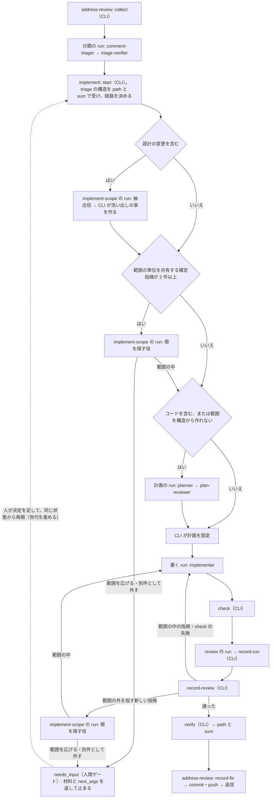

# 3 スキルの再設計案：repo-implement・repo-review・address-review

`repo-implement`・`repo-review`・`address-review` を、設計方針文書（`docs/design/skill-design-patterns.md`）に沿って全体から組み直す案。不適合と根拠は `docs/design/develop-skills-audit.md`（以下「監査」。行は「監査 #N」と引く）に置き、ここには書き写さない。原則は設計方針文書の節名で引く。この文書は案で、適用（スキル・AGENTS.md・設計方針文書の変更）は人が決める。

発端は PR #182 の指摘への対応で、文書 8 行の修正に計画の Workflow 5 回・レビュー 2 回、cache 読み約 8,850 万 token を使った。局所の手直しではなく、どの条件がどの段を強いるかから出し直す。

## 目次
- [結論](#結論)
- [develop-plugin.md との関係](#develop-pluginmd-との関係)
- [形の判定](#形の判定)
- [対象の種類による経路](#対象の種類による経路)
- [計画が持つもの・持たないもの](#計画が持つもの持たないもの)
- [役ごとのモデル・effort](#役ごとのモデルeffort)
- [体数と起動数](#体数と起動数)
- [文脈の配り方](#文脈の配り方)
- [共有状態と作業ファイル](#共有状態と作業ファイル)
- [運搬の形](#運搬の形)
- [指摘を束ねて根を探す段](#指摘を束ねて根を探す段)
- [止まってよい場所](#止まってよい場所)
- [検証役に渡す範囲](#検証役に渡す範囲)
- [AGENTS.md の規則の変更案](#agentsmd-の規則の変更案)
- [形式手法と「機械で確かめる」](#形式手法と機械で確かめる)
- [設計方針文書への提案](#設計方針文書への提案)
- [費用の見積もりの考え方](#費用の見積もりの考え方)
- [移行の順序](#移行の順序)
- [未決事項](#未決事項)

## 結論

- **経路を変更の種類で分ける。** CLI が変更する path から、コード・規範文書・一般の文書を決定的に分ける。計画の run とケース計画を強いるのはコードと、範囲を入力の構造から作れない run だけ。規範文書の変更（以下「設計の変更」）には、変える概念に触れる箇所を洗い出す段を必ず通す（#182 は要求文書の修正だった）。
- **確かめた事実を境界で文に潰さない。** triage が確かめた指摘・根拠・直す path・指摘が守ろうとする性質を構造のまま implement に渡す。implement は前の指摘の位置と ID、触れる要求 ID を事実として review に渡す。判定（受理・却下の理由）は渡さない。
- **状態を run の外に持ち、止まったら同じ状態から続ける。** 新しい `stateDir` から始め直すのをやめる。状態に run の世代を持たせ、前の run の遅れた書き込みを CLI が拒否する。
- **範囲を守る規則と根を直す規則がぶつかったら、どちらも勝たせずに人に聞く。** 範囲の拡大と、確定した指摘を別件として外すことは、人間ゲートとして扱う。元の範囲の外を指す指摘が出たら、CLI が修正の前に根を探す段を強いる。
- **run の中では状態を書かない。運搬役が運ぶ本文は小さくし、run の外では path と sum だけを渡す。** 構成案の、状態の書き手を run の外に置く判断（Codex runner でも効く形）に従う。
- **役ごとにモデルと effort を分ける。** 値は「役ごとのモデル・effort」の表だけに置く。

## develop-plugin.md との関係

この案は `docs/design/develop-plugin.md`（以下「構成案」）の次の箇所を置き換えるか、従う。置き換える箇所には、構成案の側に、この文書への参照だけを行の末尾に足した（行番号は変えていない）。値と列挙は、この文書か構成案のどちらか一方にだけ置く。

| 構成案の箇所 | 今の内容 | この案での扱い | 構成案の参照 |
|---|---|---|---|
| 「結論と範囲」24-26 行 | 今の役の分担・段・照合は残し、変えるのは一般化の 2 種類だけ | 置き換える。役（根を探す役・抽出役を足す）、段（経路で計画の run を飛ばす、洗い出しの段を足す）、照合（`insidePlan` の停止を根を探す段に変える、返り値を path と sum にする）を変える | 24 行 |
| 「結論と範囲」の表の 32 行 | 役ごとの model・effort の置き場は Workflow source の `ROLE_MODELS` | 置き場はそのまま。初期値と理由の正本は「役ごとのモデル・effort」 | 32 行 |
| 「ファイルの置き場」64 行 | Workflow source の名前は 4 本 | 洗い出しと根を探す段の run を 1 本足す（`implement-scope`。案）。他の 4 本は変えない | 64 行 |
| 「依存と Codex runner」77 行 | `implement-run` だけ workspace-write、他は read-only | 従う。足す `implement-scope` も read-only | なし（変えない） |
| 「権限」88 行 | read-only の run の中では `stateDir` を含めてどこにも書かない | 従う。作業ファイルも run が返った後にセッション側の CLI が書く（「運搬の形」） | 88 行 |
| 「起動数の上限」101-102・112 行、116-120 行 | `record-run` が run の返り値を状態に書く。書き手を run の外に置く | 従い、広げる。`record-run` は 1 段目の判定と止まった時点の票も書き、結果のファイルを書いて path と sum を返す（「運搬の形」） | 112 行 |
| 「形の判定」の表 132・134・137 行 | `implement-plan` を一律に置く。implement の外側は固定集合の反復型。address-review の外側は 1 run 1 周 | 置き換える（「形の判定」「対象の種類による経路」） | 128 行 |
| 「宣言する設定」165 行、「既定の観点」205 行、「機能の行き先」301 行 | `kinds` は `specification`・`prd`。宣言が無ければ document | 分類は 1 本のまま、`kinds` に `design` を足し、経路をその分類から導く（「対象の種類による経路」） | 165 行 |
| 「呼び出し側との契約」217・220 行 | address-review が implement に渡すのは PR の番号と方針の版。返り値の正本は review の Workflow source の schema | 置き換える。address-review は triage の構造を path と sum で渡す。返り値の正本は `record-run` が書く結果のファイルの schema | 217・220 行 |
| 「機能の行き先」310 行 | `stopAfter: "plan"` は計画の受け入れの後で止まる | 従う。CLI が計画を作る経路でも、計画を固定した後で止まる | なし（変えない） |
| 「3 リポジトリから取り込む仕組み」323・324 行 | 条件ごとのケース計画を implement に。`needs_replan` で止まる | ケース計画はコードの経路だけ。`needs_replan` の停止は「指摘を束ねて根を探す段」に置き換える | 323・324 行 |
| 「bp 計測から導いた差分」350-406 行 | bp review の棄却群から一般化の項目を導く。374 行は model・effort の根拠の参照先を移すだけ | 費用・形・境界の受け渡しは bp review の観点に無かった。この文書と監査が受け持つ。374 行の値は「役ごとのモデル・effort」 | 374 行 |
| 「移行計画」410-416 行 | 段 0〜3 | 「移行の順序」。段 1b との前後は未決 | 414 行 |

構成案で変えないもの：呼び出しの名前、方針の版の導き方、resolve と required checks の待ち、`external` モード、focus を書く役、review の資産台帳、起動数の上限の扱い（PR-BPDESIGNEDSKILL-016・017・019〜023）。

## 形の判定

設計方針文書「形の判定」の図を、軽い形から当て直す。重い段を置く所は、それを強いた条件を書く（PR-BPDESIGNEDSKILL-002）。

| 問い | 答え | 強いるもの |
|---|---|---|
| 人間の入力を run の境界にできるか | できる。分類の食い違い・範囲の拡大・別件として外す判断・計画の判断は、どれも段の間に 1 回挟まるだけ | needs_input で止まって同じ状態から再開する境界（監査 #7） |
| 書き込む役と書き込ませない役が同じ区間に要るか | implement では要る（implementer と、計画・洗い出し・根を探す・レビューの役） | 書く run を分ける。それ以外の段はこの問いからは強いられない |
| 段の間に結果による戻りがあるか | 分類・洗い出しと根を探す・書く・review の各 run には無い。計画の run は planner と plan-reviewer の作り直しの回を持つ。implement の run の並びには、check・review の結果で修正に戻る戻りがある | 計画の run は固定パイプライン型＋項目ごとの until-pass（項目は計画 1 つ。作り直しの上限に達したら、通らなかったことと残った作り直しの指摘を返して止まる。構成案「形の判定」の `revisions_exhausted`）。他の run は固定パイプライン型。run の並びは次の問いへ |
| 試すものの集合が事前に決まり、結果で増減しないか | run の並びでは決まっている。観点の集合と、範囲（元の指摘・承認した計画・人の決定）は run の中で変わらない。範囲が広がるのは人の決定を挟んだ run の境界だけ | run の並びは固定集合の反復型 |
| 資産台帳の適用条件 | review だけが当たる（構成案「形の判定」の review の資産台帳） | review の台帳 |

図の問いからは導かれず、部品を選ぶときの条件で決まる段：

| 段 | 強いる条件 | 条件が無いとき |
|---|---|---|
| 計画役（planner と plan-reviewer の run） | 書く範囲（`affected_paths`）を、入力の構造（triage の `repair_paths`・指摘の path）から決定的に作れない。依頼文だけで始まった run と、コードの変更（呼び出し元・利用側を辿らないと範囲が決まらない）がこれに当たる | CLI が入力の構造から計画を作る。計画役は起動しない |
| ケース計画 | テストで確かめる挙動を変える（コードの変更） | 持たない。文書の変更に、自動テストのケースを要求しない |
| 洗い出しの段 | 設計の変更（規範文書を変える）。変える概念が、文書の他の箇所の規則と組み合わさって意味を持つ | 置かない |
| 根を探す段 | 入力の確定指摘のうち 2 件以上が同じ範囲の単位（要求 ID・見出し・洗い出しの束の箇所）を共有する。または、修正の回で元の範囲の外を指す新しい指摘が出た（「指摘を束ねて根を探す段」の引き金） | 置かない。互いに範囲を共有しない指摘には払わない |

**根を探す段の形。** 監査役は、範囲を広げる段を足すと試すものの集合が結果で変わり、形を問い直す必要があると見た。この案では変わらない。根を探す役が run の中で読むのは閉じた集合（確定した指摘の全件、束、今の範囲、決定）で、返すのは閉集合からの選択だけ。範囲を広げることと指摘を外すことは、needs_input で止まった後に人が決定を足し、新しい run が状態から読む時だけ起きる。run の中で集合は変わらないので、固定パイプライン型のまま組める。人の決定なしに範囲を広げる作りにすると、この判定は崩れて探索に近づく。だから範囲の変更を agent の判断に任せない。

## 対象の種類による経路

経路は CLI が path から決める。agent にも司令塔にも選ばせない（選ばせると、軽い経路を選んで洗い出しを飛ばす経路ができる）。分類は構成案「宣言する設定」の対象の種類（skill・code・document と、`kinds` で宣言する種類）の 1 本だけにし、経路はそこから導く。review の観点と implement の経路で、同じ path が別の種類にならない。

| 対象の種類（構成案の分類） | 経路 |
|---|---|
| code、skill のうち script・CLI・テスト・Workflow source | コード |
| `kinds` の `specification`・`prd`・`design`（`design` は案で足す。設計方針の文書のように、規則を持つが要求 ID を持たない文書を宣言する）、skill のうち `SKILL.md`・`agents/*.md`・`references/` | 規範文書 |
| document のうち、要求 ID・仕様 ID の形の見出しを持つもの（ID の形は `kinds` と同じ設定で宣言する） | 規範文書 |
| 上のどれにも当たらない document | 一般の文書 |

- 宣言の無い spec・prd は document になる（構成案 165 行のまま）。そのうち ID の見出しを持つものは、中身から規範文書に入る。ID も宣言も無い規則の文書は一般の文書になり、洗い出しを通らない。これを避けるには `design` を宣言する。既定を規範文書にしないのは、全ての文書に洗い出しを払うと、README の誤字にまで抽出役と束の費用が掛かるから。
- 1 つの変更が複数の経路に当たるときは、当たった経路の段を全て通す（和を取る）。軽い方に寄せると、混ざったコードがケース計画を通らない。

| 経路 | 計画 | 洗い出しの段 | check | review |
|---|---|---|---|---|
| 一般の文書 | CLI が入力の構造から作る。構造が無ければ計画役（文書の schema。ケース計画なし） | なし | 変更した path に当たる宣言の check と必須の check | 必須の観点と、選んだ観点。差分に絞って渡す |
| 規範文書 | 同上 | あり | 同上 | 必須の観点と、選んだ観点。洗い出しの束を渡す（「検証役に渡す範囲」） |
| コード | 計画役（ケース計画あり） | なし（呼び出し元の辿りは計画役が持つ） | 同上 | 必須の観点と、選んだ観点。差分に絞って渡す |

**洗い出しの段。** `implement-scope` の run（read-only）の最初の段で行う。
1. CLI（start）が、差分が触れる予定の範囲（元の指摘の行を含む要求 ID・仕様 ID・見出し）を取り、その ID をリポジトリで grep した結果を閉集合にする。
2. 抽出役が、元の指摘の行と範囲の本文に出る語のうち、変える概念に当たるものを、その行の閉集合から選ぶ。抽出役は語を作らず、選ぶだけ。
3. run が返った後、CLI が選ばれた語を grep し、ID の閉集合と合わせて、各箇所を行番号つきで抜き出した束（洗い出しの束）を作る。箇所ごとに ID を付ける。大きさに上限を置き、載せなかった箇所は束の中に一覧で宣言する（上限は「文脈の配り方」）。
4. この束は grep と ID の参照で当たる範囲だけを持つ。同じ概念を別の語で書いた箇所は当たらないことを、束の中に宣言する。

## 計画が持つもの・持たないもの

計画は、範囲と守る性質と確かめ方を固定するもので、実装の写しではない（監査 #20）。

| 持つ | 出所（計画役を通す経路） | 出所（CLI が作る経路） |
|---|---|---|
| 固定した目標（範囲・禁止事項・指示語を解いた依頼の要約、数値条件） | planner が書き、plan-reviewer が照らす | triage の結果（指摘 ID と `repair_paths`）。指示語は triage の段で解けている |
| 書く範囲（`affected_paths`。閉集合） | planner | `repair_paths` と、根を探す段の `within_scope` が挙げた箇所 |
| 守る性質（invariants） | planner | comment-triager が指摘ごとに書き、triage-verifier が確かめた「指摘が守ろうとしている性質」（triage の schema に欄を足す。案）を CLI が逐語で写す。CLI は意味を作らない |
| 流す check の ID | planner（宣言の閉集合から） | CLI が変更する path と宣言の `pathGlob` から選ぶ |
| コードの経路だけ：条件と、条件ごとのケース計画（期待値の出所を依頼・仕様に取る） | planner | — |
| 人の決定（範囲の拡大・別件として外した指摘。目標の文とは別の記録） | CLI | CLI |

| 持たない | 理由 |
|---|---|
| 実装の手順（`implementation_steps`）、置き換える文の全文、書く予定のコード | 計画が実装の写しになり、plan-reviewer の指摘面と作り直しの全文が膨らむ（監査 #20） |
| 実装から写した期待値 | 期待値が実装に合わせて動き、テストが何も確かめない |
| 範囲の外の改善案 | 頼まれていない成果物に費用を払う（設計方針文書「目標の固定」） |
| 文書の経路でのケース計画 | 文書の変更に自動テストのケースは無い |

plan-reviewer の照らし方：
- 指摘に重さを付ける。直さないと計画が使えないもの（範囲の抜け、守る性質の抜け、期待値の出所が依頼・仕様に無い）だけが作り直しを起こす。それ以外は計画に注記として残し、作り直さない。重さが無いと、全ての指摘が全文の作り直しを起こし、指摘面が増えるほど収束しない。
- 2 回目以降の plan-reviewer には、前の回の作り直しを起こした指摘（本文と位置）と、前の計画からの差分を渡す。前の指摘が解けたかと、変わった部分だけを見る。新しい面からの指摘は、変わった部分に限る。前の指摘の本文は「確かめる対象の主張」で、今の計画への判定ではないので、独立は崩れない（「共有状態と作業ファイル」の、結論を渡さない規則の範囲）。
- schema の形の不備（フィールドの欠け）は作り直しの回数に数えない。script が不備のフィールドの一覧だけを planner に返す（回数には上限を置く）。

## 役ごとのモデル・effort

この表が、3 スキル（develop:* を含む）の役の初期値と理由の正本。実装では Workflow source の `ROLE_MODELS` に置く（構成案の 32 行）。値は eval で決め直す。どの役も `xhigh`・`max` を使わない。質の向上を測れた役が無いから（設計方針文書「モデル・effort・prompt」）。

**設計方針文書の初期値から離れる点。** 設計方針文書は計画役を「最上位のモデル・その既定の effort」とし、Fable 5.1（`high`）と Opus 5.5（`medium`）を並べる。この案は判断役の最上位を `opus` に留め、Fable を使わない。理由は 2 つ。AGENTS.md の実測で、モデルを省いて Fable を継承した監査の Workflow が 5 時間のレート制限の窓を約 3 分で使い切った。Codex runner では `ROLE_MODELS` の全てのモデル名に `modelMap` が要り（構成案「依存と Codex runner」）、写す先の無いモデルは使えない。Fable で質が上がると測れた役だけを、後で上げる。

| 役 | model | effort | 理由 |
|---|---|---|---|
| comment-triager | `opus` | `medium` | 指摘と規則を読んで分類し、守ろうとしている性質を書く判断。`high` にした測定が無い（監査 #19） |
| triage-verifier | `opus` | `medium` | 事実の検証役は実行役と同等以上（triager と同じ） |
| 根を探す役 | `opus` | `medium` | 指摘の全件と束を読んで根を判断する、計画役に当たる役 |
| planner（計画役） | `opus` | `medium` | 上の「離れる点」のとおり |
| plan-reviewer | `opus` | `medium` | 検証役は実行役（planner）と同等以上 |
| implementer | `opus` | `medium` | 範囲と守る性質を守って書く役。費用の割合は小さい（計測表で cache 読み 0.74M） |
| 抽出役（洗い出しの語を選ぶ） | `sonnet` | `low` | 行の閉集合から選ぶだけで、本文を作らない。AGENTS.md の、閉集合からの選択は小さいモデルに任せる規則 |
| focus を書く役（構成案） | `sonnet` | `medium` | 方針の束の節 ID と path:line を引いて書く。引いた ID と path は CLI が照らす |
| reviewer | `sonnet` | `medium` | 指摘の候補を挙げる実行役。確定は 2 段の検証が持つ。暫定（下記） |
| 検証役（1 段目） | `sonnet` | `medium` | reviewer の主張を確かめる。実行役（reviewer）と同等 |
| 検証役（2 段目） | `opus` | `medium` | 1 段目で決着しなかった主張だけに当てる。実行役より上 |
| 運搬役 | `haiku` | `low` | 判断せず小さい本文を写す（今と同じ） |

- reviewer と 1 段目の検証役を `sonnet` にするのは暫定。implementer より下位のモデルが、implementer の書いたものを読む形になる。確かめ方は「移行の順序」の R2（正解つきの fixture で、`opus` の reviewer と取りこぼしを比べる）。
- 表に `sonnet` が入るので、Codex runner の `modelMap` にもその写像が要る。
- 実際に起動したモデルと effort を run の結果に残す（監査 #17）。残らない環境では、モデル指定が効いていない前提で、起動数で費用を抑える（設計方針文書「体数と同時実行」）。

## 体数と起動数

- 同時実行は、設計方針文書「体数と同時実行」の初期値に戻す（監査 #15）。上げるのは、R2 の fixture で上げた値でもレート制限に当たらず、確定指摘が減らないと測れたときだけ。
- 足す役（抽出役・根を探す役）は `implement-scope` の run に 1 体ずつで、fan-out しない。PR-BPDESIGNEDSKILL-016・017・019〜023 は fan-out を含む Workflow にだけ掛かるので、この run には当たらない（構成案「起動数の上限」は、fan-out を持つのは `review-run` だけとする）。
- `review-run` の起動数は変えない。運ぶ本文を小さくしても運搬役の段の数は今と同じなので、構成案「起動数の上限」の、運搬役を枠に数える式はそのまま使える。
- review の観点の数を差分の大きさで絞る案は採らない。上限を渡されない run に固定の上限を置くことになり、PR-BPDESIGNEDSKILL-021 に反する。review の費用はモデルの単価と束で下げる。

## 文脈の配り方

設計方針文書「文脈の配達」と、AGENTS.md の、抽出役 1 体が行番号つきの束を 1 回作って配る規則に従う。束は設計方針文書の語（方針の束・資産の束）に合わせ、ここでも「束」と呼ぶ。

| 束 | 作る者と時点 | 持つもの |
|---|---|---|
| 方針の束 | review の CLI（今と同じ）。3 スキルで共有する（`develop-core.mjs`） | 方針の版の規則文書の、行番号つきの本文 |
| 対象の束 | 各スキルの CLI が run の前に 1 回 | 差分の hunk と前後の行、担当ファイルの該当範囲。コードでは呼び出し元・利用側の grep の結果 |
| 指摘の束 | address-review の CLI（collect） | 指摘の本文と、指す path:line の行 |
| 洗い出しの束 | implement の CLI（設計の変更） | 「対象の種類による経路」の手順で作る |

- 束は `stateDir` にファイルで置き、ID と sum を状態に書く。agent の prompt には path と sum と、その役が見る範囲の ID だけを載せる。各範囲に ID を付けるので、review の資産台帳の資産 ID にそのまま使える。
- 束を配る prompt は、全ての役で共有する部分（束の path・規則の要約）を先頭に置き、prompt cache の prefix をそろえる。
- 各役は、引いた行だけを元のファイルで読み直す。検証役が根拠の行を自分で読み直すのは、検証方式の再取得に当たる（設計方針文書「探索グラフ」の検証方式。独立はここで保つ）。
- 束に入れるのは元の文書の本文だけで、他の役の判定（受理・却下・分類の理由）は入れない。判定を入れると、検証役が前の役の結論をなぞる。
- 束 1 つの大きさの上限は、初期値（暫定）2,000 行とし、R3 で測り直す。値は実装で core の定数に移し、この行は消す。載せなかったものは束の中に宣言する。宣言した範囲の閉じ方は「検証役に渡す範囲」。
- 上位モデルの役（2 段目の検証役・根を探す役）に洗い出しの束の全体を渡すのは、根を探す役だけにする。2 段目の検証役には、確かめる主張が引いた範囲 ID の行だけを渡す（AGENTS.md の、上位モデルへ渡すものを絞る規則）。全体を見渡すのは reviewer と 1 段目の検証役（表で下位のモデル）が持つ。

## 共有状態と作業ファイル

run の中では、状態も作業ファイルも書かない（構成案 88 行・116-120 行に従う。Codex runner の read-only の run では書けず、workspace-write にすると同じ run の書き込ませない役も書けるから）。どちらも、run が返った後にセッション側の CLI が書く。

| 置き場 | 書く者と時点 | 持つもの | 読む者 |
|---|---|---|---|
| 共有状態（`stateDir`） | CLI だけ。run が返った後 | 世代、固定した目標と出発点（作業ツリーの snapshot・HEAD・方針の版の SHA）、人の決定、確かめた事実（triage で検証役が受理した根拠と守る性質、plan-reviewer が確かめた path:line、確定した指摘とその ID）、指摘の状態、束の ID と sum、回数（計画の作り直し・修正の回・根を探した回）、停止の理由と未着手、宣言された見ていない範囲 | 全ての役（読み出しの op か束の path で） |
| 作業ファイル（`stateDir` の下の run ごとのディレクトリ） | CLI が、run の返り値の中の各 agent の出力（schema の `notes` 欄など）を、agent ごとに CLI が決めた path に書く。検証を通ったものとして扱わない | 思考と分析：planner の影響の調査メモ、根を探す役の分析、reviewer・検証役の出力の全文 | 同じ役の次の回 |

- path は CLI が agent ごとに決めるので、他の役が上書きできる場所に作業ファイルは無い（native Workflow では全ての役が同じ権限で書けるため、agent に書かせると上書きを検出できない）。
- 作業ファイルの書き込みを CLI に寄せたので、agent は書き込みの道具を使わない。書き込ませない役が書いたら、今のとおり run の境界の snapshot・pin で事後に検出する。

**世代（前の run の遅れた書き込みを防ぐ）。** 同じ `stateDir` から再開するので、前の run の返り値が後から記録されると、新しい run が読んだ状態を変える（設計方針文書「停止・再開と人間の入力」の、遅れた書き込みの行）。
- 状態は世代の番号を持つ。再開の op（`resume`）だけが世代を 1 つ進め、`next_args` に新しい世代を入れる。
- Workflow の args は世代を持ち、run の返り値はそれをそのまま返す。
- `record-run`・`record-review` など状態を書く op は、返り値の世代が今の世代と違えば拒否する。状態の書き込みは冪等にし（返り値の sum を鍵にする）、同じ返り値を 2 回記録しても状態は変わらない。

**再開の前の照合。** 再開の op は、状態にある作業ツリーの snapshot・HEAD・方針の版の SHA を今の値と照らす（設計方針文書「停止・再開と人間の入力」の、再開した run を対象の今の内容に基づかせる行）。
- 作業ツリーか HEAD が変わっていたら、check の結果と review の判定を履歴に移し、check から取り直す。人の決定と triage で確かめた事実は、それが指す行がまだあれば残す。
- 方針の版が変わっていたら、方針の束を作り直し、review から取り直す。

**再開する位置。** 設計方針文書は、再開した run を必ず計画役から始め、止まっていた間に増えたヒントを読ませる。3 スキルはヒント（待たれない入力）を持たない。人の入力は全て needs_input の後の決定として、run の境界で入る。読ませるヒントが無いので、再開は止まった段から続ける。決定が範囲を変えたときは、範囲を使う段（計画を固定する段）からやり直す。

差し戻しで引き継ぐもの：

| 受け取る役 | 渡すもの | 渡さないもの |
|---|---|---|
| 作り直す生成役（planner・implementer） | 前の成果物の path、作り直しを起こした指摘の ID と本文、共有状態の事実、自分の前の作業ファイル | なし（同じ役の続きなので、前の分析を全て使ってよい） |
| plan-reviewer | 新しい計画、前の計画からの差分、束、前の回の作り直しを起こした指摘（本文と位置） | planner の作業ファイル、前の plan-reviewer の作業ファイル |
| review の reviewer・検証役 | 新しい成果物、束、依頼の文、前の確定指摘の ID と位置、触れる要求 ID、洗い出しの結果 | 生成役の作業ファイル、前の確定指摘の本文と、受理・却下の理由 |

- 生成役の作業ファイルを検証役に渡さないのは、生成役の推論をなぞると、生成と別の context で確かめる意味が消えるから（設計方針文書「構成要素」の検証役の行）。事実（前の指摘がどこにあったか）は渡しても独立は崩れない。結論を渡すと崩れる。
- review に前の確定指摘の本文を渡さないのは、それが前の review の結論だから。前の指摘の位置で同じ問題が残ったかは、reviewer が今の本文を読んで新しく判断し、CLI が位置と ID で前の指摘と照らして resolved・regressed を決める（設計方針文書「資産台帳」の、run の中で対象を書き換える構成の行。run をまたぐ追跡との関係は「未決事項」）。

## 運搬の形

決定済み：repo-review の返り値を path と sum にし、repo-implement の `record-review` と address-review も合わせる。

構成案の、状態の書き手を run の外に置く判断（116-120 行）に従う。run の中の運搬役は、今と同じく読んで照合し結果を返すだけの op（pin・merge・judge）を流す。変えるのは運ぶ本文の大きさで、両方の host で同じに効く。

| 受け渡し | 今 | 案 |
|---|---|---|
| 検証役 → judge（run の中） | 運搬役が、全ての claim の evidence と 2 段分の rounds を含む 6〜8KB の本文を heredoc で再出力する（監査 #22） | 運搬役が運ぶのは票だけ（merge が付けた claim ID と判定の組）。`assignments` は CLI が候補から導く。evidence は運ばず、run の返り値に入れ、`record-run` が形を検査する。2 段目の judge が 1 段目の票を要るときも票だけを送り直す。運ぶ本文が逐語の写しの上限（「設計方針文書への提案」）を超えたら、script は運ばずに止まる |
| run → 状態 | 運搬の失敗で `findings: []` を返し、検証済みの票を捨てる（監査 #11） | 止まった run も、それまでの reviewer の出力・票・1 段目の判定を返り値に入れる。セッション側の `record-run` がそれを状態に書く。再開した run は最終の判定から続ける |
| review → implement | 本体（6〜8KB）を司令塔が写す。計画のファイルの path と sum は別に写す | `record-run` が結果のファイルを書き、path と sum を返す。結果のファイルが review の計画のファイルとその sum を指すので、司令塔が `record-review` へ写すのは 1 組だけ |
| implement → address-review | `{passed, actual}` を写す。sum が無い（監査 #25） | implement の `verify` が記録を書いて path と sum を返す。address-review の `record-fix` はそのファイルを読み、`passed` と `actual` を自分で取り出す |
| address-review → implement | 自然文の依頼（監査 #3） | 指摘の束と triage の結果（指摘 ID・根拠・`repair_paths`・守る性質）を path と sum で渡す |
| 計画 → 各 op | 計画の JSON の全文を司令塔が毎回写す（監査 #24） | 計画は状態に置き、各 op は状態の path と sum だけを受ける |

- 残る写し：run の返り値を `record-run` に渡すのは司令塔で、構成案 112 行のとおり返り値の sum で写し間違いを止める。司令塔が返り値を写さずにファイルで渡せるか（host が Workflow の返り値をファイルに残すか）は未確認（「未決事項」）。運搬役が写して落ちていた大きな本文は、この案では運搬役に渡らない。
- 運搬役の固定費（共通の指示とツールの定義を読むので、1 体あたり cache 読み約 100k〜250k）は残る。
- 返り値の schema の正本は、Workflow source から `record-run` が書く結果のファイルの schema に移る（構成案 220 行の置き換え）。

## 指摘を束ねて根を探す段

**いつ走るか。** `implement-scope` の run（read-only。抽出役と同じ run）で走る。
- start で、入力の確定指摘のうち 2 件以上が、同じ範囲の単位（要求 ID・仕様 ID・見出し、または洗い出しの束の同じ箇所）を共有するとき。CLI が決定的に判定する。共有しない指摘（別の文書の誤字とコードの不具合など）には走らない。
- 修正の回の引き金（下記）が立ったとき。

**範囲の集合。** CLI が状態に持ち、範囲の単位ごとに、どの時点の構造で引いたかを記録する。
- 元の指摘が指す path と、その行を含む要求 ID・仕様 ID（ID の無い文書では見出し）。start の時点の HEAD の文書の構造で引く。
- 承認した計画の `affected_paths` と、その中で計画が名指した ID・見出し。計画役を通したコードの経路では、plan-reviewer が承認した呼び出し元・利用側の path も範囲に入る（承認を通った範囲なので、そこへの指摘で根を探す段を走らせない）。
- 人が決定で足した path と ID。
- 指摘を持たずに依頼文だけで始まった run では、範囲は計画の `affected_paths` とその中の ID・見出し、人の決定だけになる。範囲が空のまま引き金を判定すると、最初の review の指摘が全て引き金を立てるから。

**引き金（CLI が決定的に判定する）。** `insidePlan` は path しか見ないので、同じファイルの中での根の広がり（#182 の要求文書）を見落とす。`record-review` は、新しい確定指摘の行を含む ID・見出しを、review が pin した作業ツリーの snapshot の構造で引く（修正の回の指摘は、まだ commit していない作業ツリーの行を指すので、HEAD で引くと行がずれる）。implementer が範囲の中に足した見出しは、足した範囲の ID・見出しの下にあるので範囲の中と数える。path か ID（見出し）が範囲の集合の外にある指摘が 1 件でもあれば、修正の券を出さず `next: find_root` を返す。根を探す段の結果が状態に書かれるまで、修正の券を拒否する。注意書きではなく CLI の拒否で強いるのは、why を書いただけの規則では足りなかったから（論点 B4）。

**根を探す役。**
- 入力：確定した指摘の全件（ID つき）、洗い出しの束（設計の変更）か対象の束、今の範囲の集合、人の決定。
- 出力：指摘のグループごとに、含む指摘の ID（閉集合から）、根の説明、根が触れる箇所（束の範囲 ID の閉集合から）、判定（`within_scope`・`needs_scope_expansion`・`separate` のどれか）。

**判定の扱い。** 確定した指摘（2 段の検証を通ったもの）を修正から外すか、範囲を変える判定は、根を探す役 1 体では決めない。生成と検証を分ける規則（AGENTS.md）と、範囲と根の衝突を agent の判断で決めない方針（論点 B4）による。

| 判定 | CLI の扱い | 誤ったとき |
|---|---|---|
| `within_scope` | グループを 1 枚の修正の券にまとめ、根の説明を implementer に渡す。指摘を 1 件ずつ最小差分で塞がない | 範囲を変えず、指摘も外さないので、誤りは次の review で範囲の外の指摘として返り、引き金が再び立つ。そのため別の検証役を置かない |
| `needs_scope_expansion` | needs_input で止まる（人間ゲート）。返すもの：グループ、根の説明、根が触れる箇所の一覧、広げた後の範囲の案、ここまでに確かめたこと（check・review の結果）、残った未着手、`next_args` | 人が判断する |
| `separate` | 外す候補として needs_input の材料に載せ、人が外すと決めた指摘だけを修正の券から外す（人間ゲート）。同じ run に `needs_scope_expansion` が無ければ、`separate` だけで止まる | 人が判断する。外さないと決めた指摘は、`within_scope` と同じく修正の券に戻る |

- 根を探した回数に上限を置き（値は core の定数）、達したら needs_input で止まる。
- 人の答えは決定として状態に足し、目標の文は変えない（構成案「目標の固定」の implement の段落と同じ）。範囲の集合に決定の path と ID を足し、同じ `stateDir` から再開する（世代を進める）。文書の経路では、CLI が計画の `affected_paths` を広げる。コードの経路では、決定を入力にして計画の run をやり直す（計画役は前の作業ファイルを読める）。

**縛りの書き直し。** 監査 #13 の 4 箇所の「範囲を広げない」は、範囲を計画と決定が決めることと、範囲の外を直す必要に気づいたら直さずに報告することに書き直す。理由も添える：範囲の外の変更は検証を通らないまま成果物に入る。範囲の外にある根を黙って残すと、同じ根の指摘が繰り返し返る。どちらの理由も、判断を agent に任せず人に聞く理由になる。

## 止まってよい場所

AGENTS.md の作業ルールは「途中で止めず完了まで実行する。人間ゲート（マージ・公開）以外では止めない」とする。この案の needs_input はこの規則とぶつかる。この案では、止まってよい場所を人間ゲートとして閉じた一覧で定め、それ以外では止まらない。

| 人間ゲート | なぜ agent が決めてはいけないか |
|---|---|
| マージ・公開（今のまま） | 取り消せない |
| 範囲の拡大（`needs_scope_expansion`） | 依頼に無い変更を成果物に入れる判断で、依頼の範囲を決めるのは依頼者（設計方針文書「目標の固定」の、依頼文に無い目標を作らない行） |
| 確定した指摘を別件として外す（`separate`） | 検証を通った指摘を直さずに終える判断で、生成役の判断だけで決めると検証を飛ばす |
| 見ないまま進める（設計の変更で、宣言された見ていない範囲を閉じずに完了する。「検証役に渡す範囲」） | 見ていない範囲が「問題なし」と読まれる |
| 分類の食い違い・判断の要る指摘（address-review の `needs_decision`。今のまま） | 互換性・公開の契約などの選択は依頼者のもの |

- どちらを勝たせるか：範囲の規則と根本原因の除去がぶつかった場合に限り、止まる側（人間ゲート）を勝たせる。「止めない」規則は、このゲートの一覧の外の全ての場所で勝つ。ゲートの一覧の正本は AGENTS.md の作業ルールの当該の項にし、スキルと設計方針文書は参照する（変更案は「AGENTS.md の規則の変更案」）。
- ゲートで止まるときは、判断の材料と `next_args` を返し、同じ状態から続けられるようにする。止まることが「完了を先送りする」にならないのは、材料と再開の経路を持つから。

## 検証役に渡す範囲

| 変更 | 渡す範囲 | 理由 |
|---|---|---|
| 差分の検証（一般の文書・コード） | 差分と対象の束。AGENTS.md の、上位モデルへ渡すものを絞る規則のとおり | 変更が持ち込んだ問題を探すには差分の周りで足り、全量を渡すと入力が対象の大きさに比例して膨らむ |
| 設計の変更（規範文書の経路） | 先に洗い出しの束を reviewer と 1 段目の検証役に渡し、全体を見渡したうえで差分を見る。2 段目の検証役には、主張が引いた範囲の行だけを渡す（「文脈の配り方」）。依頼の文、前の指摘の位置と ID、触れる要求 ID も事実として渡す | 差分の周りだけでは、変えた規則と散った他の規則のぶつかりが見えない（#182 で検証役が差分の周りしか見なかった） |

**宣言された範囲を閉じる（論点 B3）。** 「見ていない」の宣言（束の上限で外した箇所、grep に当たらない言い換えの宣言、coverage の skip 一覧、読めなかった範囲）を、CLI が未決の項目として状態に書く。設計の変更では、`verify` は未決の項目が残る限り通さない。閉じ方は 2 つだけ。
- skip 一覧に残った範囲だけを渡して reviewer を追加で起動し、「見た」を作る（設計方針文書「資産台帳」の skip 一覧の行）。
- 人間ゲート（見ないまま進める）で人に返し、決定として記録する。

宣言だけで終わると、見ていない範囲が誰にも受け取られずに残る（論点 B3 の観察）。

## AGENTS.md の規則の変更案

適用は人が決める。この文書では AGENTS.md を変えない。B1〜B3 の「設計の変更」は、この文書の規範文書の経路と同じ範囲を指す（要求・仕様・設計の文書と、スキルの指示）。

| 論点 | 今の規則（AGENTS.md「作業ルール」） | 変更案 | 守らないと壊れること |
|---|---|---|---|
| ゲート | 途中で止めず完了まで実行する。人間ゲート（マージ・公開）以外では止めない | ゲートの一覧を広げる：「人間ゲート（マージ・公開・範囲の拡大・確定した指摘を別件として外す・見ていない範囲を閉じずに完了する）以外では止めない。ゲートで止まるときは判断の材料と、同じ状態から続ける経路を返す」。この項をゲートの一覧の正本にする | 範囲の判断を agent が勝手に下すか、ゲートの外で止まって完了が先送りされる |
| B1 | 該当する規則が無い | 新しい項：「設計の変更の前に、変える概念に触れる箇所を grep と ID の参照の閉集合で洗い出す。変更後の全体を、その一覧に照らしてぶつかりが無いか確かめてから完了とする。grep に当たらない言い換えは洗い出しの外にあると宣言する」 | 最小差分の修正が隣の規則とぶつかり、次の指摘を生む（#182 で 5 回連鎖した） |
| B2 | 上位モデルへ渡すプロンプトは、フィルタ済みの diff・該当抜粋・対象ファイルに絞る | 適用の範囲を足す：「この絞り込みは差分の検証に当てる。設計の変更では、B1 の洗い出しの一覧を下位のモデルの役に先に渡して見渡させ、上位モデルの役には引いた行に絞って渡す」 | 設計の変更で検証役が差分の周りしか見ず、散った規則のぶつかりを誰も見ない |
| B3 | 絞った結果の「見ていないもの」は必ず宣言する | 足す：「設計の変更では、宣言した範囲を閉じる役（skip 一覧からの追加起動か、人間ゲート）を必ず置く。宣言だけで完了にしない」 | 宣言が行き止まりになり、見ていない範囲が完了の後も残る |
| B4 | 解決は常に根本原因の除去を目指す。範囲を守る規則（依頼の範囲を広げない）は各スキルの prompt にある | 両方の側に足す：「範囲を守る規則と根本原因の除去がぶつかったら、どちらも勝たせずに人間ゲート（範囲の拡大）で止まる。範囲の外の変更は検証を通らないまま成果物に入り、根を残すと同じ指摘が繰り返し返るので、どちらも agent の判断で決めない」。why だけでは守られなかったので、repo-implement には CLI の引き金を置く（「指摘を束ねて根を探す段」） | 範囲の規則が勝つと症状を 1 件ずつ塞ぎ続け、根の規則が勝つと頼まれていない変更が検証なしに入る |

B4 の趣旨の正本はこの AGENTS.md の案にし、設計方針文書への提案（下記）はこれを参照する。

## 形式手法と「機械で確かめる」

論点 B5 の案（要求どうしの関係の多重度を Alloy 相当で、止まる→人が足す→続ける、の順を TLA+ 相当で確かめる）は、設計方針文書「機械で確かめる」の次の行の手段に当たる。

| 「機械で確かめる」の行 | B5 での当たり方 |
|---|---|
| 閉じた有限の対象は全数列挙で確かめる | 状態と入力の組ごとに規則がちょうど 1 つ当たること（多重度）。組が小さければ Node のテストで全数列挙できる（構成案の resolve の条件の全数列挙と同じ作り）。Alloy 相当が要るのは組が大きいか、関係に量化が要るとき |
| 状態遷移や決定表を形式に書き下す試みを、抜けの検出に使う | 止まり方 × 人が足すもの → 続ける位置、の遷移を書き下す。TLA+ 相当の検査器が反例（到達できない位置、2 つの規則が同時に当たる位置）を出す |
| 性質ごとに検査器・前提と範囲・確かめられない残りを宣言する | モデルは書いた概念しか見ない。B1 の洗い出しの段は別に要り、モデルの外は「検証済み」に含めない |

**この案自身が足す決定表と遷移。** B5 の道具を待たずに、Node のテストで全数列挙する。標本の fixture では確かめない。

| 性質 | 閉じた対象 | 検査器 | 範囲の外に残るもの |
|---|---|---|---|
| 経路の和が、当たった経路の段を全て含み、それ以外を含まない | 3 つの経路の部分集合（8 通り） | core のテスト | path から種類への分類そのものが正しいか（分類の規則のテストが別に持つ） |
| 引き金が、範囲の集合の外の指摘でだけ立つ | 指摘の path・ID が範囲の中か外か × 範囲の出所（元の指摘・計画・決定・空）の組 | core のテスト | ID・見出しの引き方（文書の構造の解析）の正しさ |
| 根を探す役の判定ごとに、次の段がちょうど 1 つ決まり、範囲を変える判定は必ず人間ゲートを通る | 3 つの判定の組み合わせ（グループごと）× 根を探した回数が上限か | core のテスト | 根を探す役の判定の意味の正しさ |
| 止まり方ごとに再開する位置がちょうど 1 つで、世代の違う書き込みは全て拒否される | 停止の種類 × 再開の前の照合の結果（変化なし・作業ツリー・HEAD・方針の版）× 書き込みの世代（今・前） | core のテスト | host が run を止めた後に agent が走り続けるか |

今の「機械で確かめる」は、スキルの性質（コード・状態遷移）を対象にしている。B5 は対象を、規範文書の規則の集合にも広げる。広げるときの条件：
- モデルは要求の写しになる。機械が読める 1 つの正本（決定表の JSON など）から文書の表とモデルの両方を導くか、文書とモデルの一致をテストで照らす。どちらも無いと、文書とモデルが別々に直されてずれる（AGENTS.md の、同じ値を 2 箇所に書かない規則）。
- 最初の対象の候補は、#182 の連鎖の根になった再開の規則（要求文書の 6 箇所に散っていた）。

導入するか、どの道具を使うかは未決。TLA+ の `tla2tools.jar` は入っておらず、ダウンロードには利用者の許可が要る（Java は Temurin 27 がある）。道具を入れる前に、Node の全数列挙で足りる範囲を先に試す。

## 設計方針文書への提案

監査の「設計方針の側の欠け」に当たるもの。設計方針文書は、この作業では変えない。

- 「形の判定」の例の着地の表の、計画・実装・check・レビュー・修正を回す行を、変更の種類で分ける。計画の run は、書く範囲を入力の構造から決定的に作れないときだけに置く、という条件を書く。
- 「状態の書き込み」の、運搬役は逐語で写すかパスだけを渡す、という行に、逐語で写す本文の大きさの上限を足す。上限を超える本文は運ばずに止まるか、パスで渡す。
- 「停止・再開と人間の入力」に、範囲を守る規則と根を直す規則がぶつかったら needs_input で止める行を足す。趣旨の正本は「AGENTS.md の規則の変更案」の B4 とゲートの行で、設計方針文書の行はそれを参照する。
- 「機械で確かめる」の対象に、規範文書の規則の集合を足すか（論点 B5）。

## 費用の見積もりの考え方

計測表（監査「材料と表記」）の 18 本・82 体を基準にする。#182 の 8 行の修正に当たる Workflow は決められないので（監査「未確定事項」）、見積もりは 18 本についてのもので、「8 行の修正がいくらになるか」ではない。下の「案で消えるか」「増える分」は全て【推測】。確かめ方は「移行の順序」。

| 原因 | 計測表での量 | 動く指標 | 案で消えるか |
|---|---|---|---|
| 文書の修正にも計画の run を置く（監査 #1） | 計画の 2 役で cache 読み 81.9M（全体の約 77%）、出力 97 万 token。このうち文書の修正の分は分けられない | 計画の Workflow の本数、cache 読み、出力 | 構造から範囲を作れる文書の修正では、計画の run が 0 本になる。コードの経路の計画は残る |
| run の作り直し（監査 #7） | 計画の Workflow 9 本に対し、実装 3 本・修正の回 0 回 | 計画の Workflow の本数 | 同じ状態からの再開で、止まるたびの計画のやり直しが消える |
| 差し戻しの全文の作り直しと冷読み（監査 #10・#20） | wf_9e929ee2 の planner-1・-2 が各 130k・99k 文字を読み直す。planner の出力 7k〜99k token | tool_result の文字数、cache 読み、出力 | 重さで作り直しを絞り、作業ファイルを引き継ぎ、plan-reviewer が変わった部分を見るので減る。どれだけ減るかは測るまで分からない |
| 対象の束が無い（監査 #2） | reviewer 15 体で tool_result 685,604 文字。同じ agent の中で同じファイルを 2〜5 回読む | tool_result の文字数、cache 読み | 束と引いた行の読み直しで減る。検証役が根拠の行を読み直す分は、独立のために残る |
| 同じ主張の 3 回の確かめ（監査 #18） | 分類・計画のレビュー・review の検証 | 読み直しの量 | 確かめた事実を渡すので、読み直しは減る。検証の回数そのものは独立のために残る |
| 全ての判断役が `high`（監査 #19） | 69 体 | 出力 token と turn の数 | 表の初期値の effort で主に出力と turn が減る。cache 読みは、turn が減る分しか減らない。cache 読みを動かすのは束と計画の run の本数 |
| reviewer・1 段目の検証役のモデル | reviewer と 1 段目の検証役で cache 読み 15.4M | token あたりの単価 | 表の初期値のモデルで単価が下がる。token の量は変わらない |
| 運搬の失敗（監査 #11・#22） | 落ちた 2 run で cache 読み約 13.2M | 失敗した run の本数 | 運ぶ本文が票だけになり、止まっても判定から続けるので、全損が消える。両方の host で効く。運搬役の固定費（1 体約 100k〜250k）は残る |
| 同時実行 8 体（監査 #15） | — | レート制限 | token の量は変わらない。窓あたりの消費の速さが下がる |

この案で増える分：

| 増える分 | 動く指標 | 抑え方 |
|---|---|---|
| 設計の変更での洗い出しの束（束の大きさ × 受け取る体数 × turn） | cache 読み | 束に上限を置き、全体を渡すのは reviewer・1 段目の検証役と根を探す役だけにする。2 段目の検証役には引いた行だけ |
| 抽出役 1 体 | 起動数、cache 読み（運搬役と同じく、共通の指示を読む固定費） | 設計の変更のときだけ起動する |
| 根を探す役 1 体 | 起動数、cache 読み | 範囲の単位を共有する指摘が 2 件以上か、引き金が立ったときだけ。回数に上限 |
| 引き金の後の修正の回で、review の run がもう 1 本走る | review の費用 | 今も修正の回ごとに review は走る。根を探してグループで直すので、回の数は今の連鎖（#182 で 5 回）より減ると見込む |

## 移行の順序

**比べ方。** 設計方針文書「記録と改善」の、直した後に同じ課題で前と後を比べる行に従う。
- fixture は小さく、正解を持たせる。文書の fixture は #182 と同じ形（規則が要求文書の数箇所に散っていて、1 箇所の修正が隣とぶつかる）の 8 行程度の修正に、埋めた欠陥の一覧を付ける。コードの fixture も、埋めた欠陥の一覧を付ける。
- fixture ごとに 3 回流し、件数と費用は幅で比べる。1 回では、取りこぼしの増減と揺れを区別できない。
- 試走の記録に、script・agents の指示・判定基準の sum（指紋）を残す（設計方針文書「記録と改善」の、記録と指紋を残す行）。
- 費用：fixture を流すのは R0・R2・R4・R5 だけにする。R1・R3・R6 は決定的なテスト（全数列挙と、失敗を注入したテスト）で完了を見る。段ごとの予算は、R0 で測った 1 回あたりの cache 読み × 3 回 × 2 本を上限とし、超えたら止めて人に返す。

| 段 | 作業 | 完了条件 | 解く監査の行 |
|---|---|---|---|
| R0 基準 | 正解つきの fixture を 2 本作り、今のスキルで 3 回ずつ流す | 起動したモデル・effort、cache 読み、出力、Workflow の本数、指摘の連鎖の回数、埋めた欠陥の検出数が、指紋とともに記録に残る | — |
| R1 運搬と状態 | 運ぶ本文を票だけにする、`record-run` が止まった run の票と判定を書く、結果のファイルの path と sum、`record-review` と `record-fix` の path と sum、計画を状態に置く、世代と再開の前の照合 | 運搬の失敗を注入したテストで、判定から再開する。世代の違う書き込みの拒否と、再開の位置の全数列挙のテストが通る | #11・#22・#23・#24・#25 |
| R2 モデルと同時実行 | `ROLE_MODELS` を「役ごとのモデル・effort」の初期値にし、起動したモデルを結果に残す。同時実行を初期値に戻す | 結果の記録で、指定どおりのモデルが起動したと分かる。fixture の埋めた欠陥の検出数が R0 の幅を下回らない（下回れば reviewer のモデルを 2 段目の検証役と同じに上げる） | #15・#17・#19 |
| R3 束 | 3 スキルの CLI が束を作って配る | 束の上限と宣言のテストが通る。R4 の fixture で、同じ agent の中の同じファイルの再読が R0 より減る | #2・#3・#18 |
| R4 経路と計画 | 分類から経路を導く、`implement-scope` の洗い出し、計画を細くする（schema・重さ・差分のレビュー）、守る性質を triage から写す | 経路の和の全数列挙のテストが通る。文書の fixture で計画の run が 0 本。設計の変更の fixture で洗い出しの束が review に渡る | #1・#6・#20 |
| R5 根と人間ゲート | 根を探す段、引き金、人間ゲートと needs_input の材料、縛りの書き直し | 引き金と判定の全数列挙のテストが通る。文書の fixture で、範囲の外の指摘が出たら修正の前に根を探す段が走り、連鎖の回数が R0 の幅を下回る | #4・#7・#8・#9・#10・#12・#13 |
| R6 閉じる | 宣言された範囲を閉じる経路、review の資産台帳 | 未決の項目が残る設計の変更を `verify` が通さないテストが通る | #5・#27 |

- R4 と R5 の順：R5 の引き金は、R4 が作る範囲の集合（計画の `affected_paths` と洗い出しの束の箇所）を読む。R4 を先にしないと引き金が判定できない。逆に R4 単独では、コードの経路で範囲を広げる needs_input が無く、今の `needs_replan` の停止が残る。R4 と R5 の間は、今の停止のまま運用する。
- AGENTS.md の変更案（ゲートと B1〜B4）と設計方針文書への提案は、どの段とも独立に人が決める。R5 は、ゲートの一覧の変更が決まってから入れる。決まる前に入れると、AGENTS.md の「止めない」とぶつかる。
- 形式手法（B5）は導入の可否が決まってから段を置く。
- 監査 #14・#16・#21・#26・#28 は、構成案の段 1b（一般化）の作業に入れる。この順序には置かない。
- 構成案の移行計画との前後は未決。案は、R1〜R6 を今の `repo-*` で先に行い、その後に段 1b で一般化すること。段 1b の完了条件（bp review と試走）を、今の重い形のまま払わずに済む。

## 未決事項

- **run の返り値を司令塔が写さずに `record-run` へ渡せるか。** host が Workflow の返り値をファイルに残すなら、その path を渡す。残さないなら、今のとおり司令塔が写し、sum で写し間違いを止める。
- **`triage-result` も path と sum にそろえるか。** 決定の「address-review も合わせる」の範囲の読み方による。依頼者に確かめる。
- **triage の schema に「指摘が守ろうとしている性質」の欄を足すこと。** 構成案の分類の基準との関係を決める。
- **一般の文書と規範文書でも必須の check を流すか。** `make test` の約 349 秒のうち約 96% が prd-spec の unittest（設計方針文書「水準と未決事項」の実測）。
- **`kinds` に足す `design` と、ID の見出しの形の宣言。** 構成案「宣言する設定」の表に足す形を決める。
- **洗い出しの語の選び方。** 抽出役が行から選ぶ案で足りるか。同じ概念を別の語で書いた箇所は grep に当たらない。
- **reviewer と 1 段目の検証役のモデルの初期値。** R2 で決める。
- **束の上限の値。** R3 で決める。
- **根を探した回数の上限の値と、needs_input の材料の形。** 実装で決め、core の定数に置く。
- **run をまたぐ指摘の追跡。** この案では implement の状態が前の指摘の ID と位置を持ち、review に事実として渡す。設計方針文書「水準と未決事項」の、指摘の状態を run をまたいで追うかの論点と、どこまで重なるかを決める。
- **AGENTS.md のゲートの一覧の変更。** 人が決める。決まるまで R5 を入れない。
- **形式手法の導入と道具のダウンロード。** 利用者の許可が要る。
- **R1〜R6 と構成案の段 1b の前後。**
- **#182 の Workflow を特定できないこと。** 前後の比較は R0 の fixture で取る。8,850 万 token の内訳は決められないまま残る。
