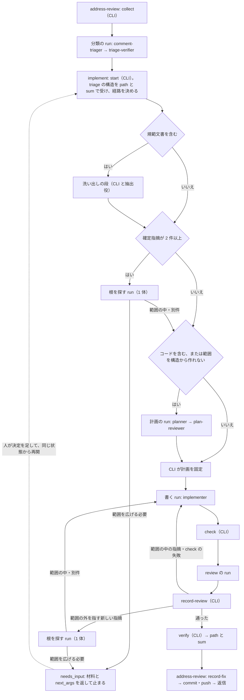

# 3 スキルの再設計案：repo-implement・repo-review・address-review

`repo-implement`・`repo-review`・`address-review` を、設計方針文書（`docs/design/skill-design-patterns.md`）に沿って全体から組み直す案。不適合と根拠は `docs/design/develop-skills-audit.md`（以下「監査」。行は「監査 #N」と引く）に置き、ここには書き写さない。原則は設計方針文書の節名で引く。この文書は案で、適用（スキル・AGENTS.md・設計方針文書の変更）は人が決める。

発端は PR #182 の指摘への対応で、文書 8 行の修正に計画の Workflow 5 回・レビュー 2 回、cache 読み約 8,850 万 token を使った。局所の手直しではなく、どの条件がどの段を強いるかから出し直す。

## 目次
- [結論](#結論)
- [develop-plugin.md との関係](#develop-pluginmd-との関係)
- [形の判定](#形の判定)
- [対象の種類による経路](#対象の種類による経路)
- [計画が持つもの・持たないもの](#計画が持つもの持たないもの)
- [役ごとのモデル・effort](#役ごとのモデルeffort)
- [文脈の配り方](#文脈の配り方)
- [共有状態と作業ファイル](#共有状態と作業ファイル)
- [運搬の形](#運搬の形)
- [指摘を束ねて根を探す段](#指摘を束ねて根を探す段)
- [検証役に渡す範囲](#検証役に渡す範囲)
- [AGENTS.md の規則の変更案](#agentsmd-の規則の変更案)
- [形式手法と「機械で確かめる」](#形式手法と機械で確かめる)
- [設計方針文書への提案](#設計方針文書への提案)
- [費用の見積もりの考え方](#費用の見積もりの考え方)
- [移行の順序](#移行の順序)
- [未決事項](#未決事項)

## 結論

- **経路を変更の種類で分ける。** CLI が変更する path から、コード・規範文書（要求・仕様・設計・スキルの指示）・一般の文書を決定的に分ける。計画の run とケース計画を強いるのはコードだけ。規範文書には、変える概念に触れる箇所を全て洗い出す段を必ず通す（#182 は要求文書の修正だった）。
- **確かめた事実を境界で文に潰さない。** triage が確かめた指摘・根拠・直す path を構造のまま implement に渡し、implement は前の指摘の位置と触れる要求 ID を事実として review に渡す。判定（受理・却下の理由）は渡さない。
- **状態を run の外に持ち、止まったら状態から続ける。** 新しい `stateDir` から始め直すのをやめる。運搬の失敗も、範囲の確認待ちも、同じ状態から再開する。
- **範囲を守る規則と根を直す規則がぶつかったら、どちらも勝たせずに人に聞く。** 指摘を束ねて根を探す段を置き、元の指摘に無い要求・ファイルを指す指摘が出たら、CLI が修正の前にその段を強いる。
- **運ぶのは path と sum だけにする。** 本文は書いた役がファイルに置き、CLI が読む。
- **役ごとにモデルと effort を分ける。** 全員を最上位・`high` にしない。Opus 5.5 は既定の `medium` から始め、`xhigh`・`max` は使わない。

## develop-plugin.md との関係

この案は `docs/design/develop-plugin.md`（以下「構成案」）の次の箇所を置き換える。構成案の側には、この文書への参照だけを足した。値と列挙は、この文書か構成案のどちらか一方にだけ置く。

| 構成案の箇所 | 今の内容 | 置き換え先（この文書の節） |
|---|---|---|
| 「結論と範囲」24-26 行 | 今の役の分担・段・照合は残し、変えるのは一般化の 2 種類だけ | 全体。役（根を探す役・抽出役を足す）、段（経路で計画の run を飛ばす、洗い出しの段を足す）、照合（`insidePlan` の停止を根を探す段に変える、返り値を path と sum にする）を変える |
| 「結論と範囲」の表の 32 行（役ごとの model・effort） | 置き場は Workflow source の `ROLE_MODELS` | 置き場はそのまま。初期値と理由の正本は「役ごとのモデル・effort」 |
| 「権限」88 行 | read-only の run の中では `stateDir` を含めてどこにも書かない | 「運搬の形」。native Workflow では、書き込ませない役も run のディレクトリに自分の作業ファイルを書く（設計方針文書「権限」の、作業ファイルへの記録は許す行）。Codex runner での扱いは未決 |
| 「起動数の上限」101-102・112 行 | `record-run` は run の返り値を受けて状態に書く | 「運搬の形」。`record-run` は返り値の本文ではなく path と sum を受ける |
| 「形の判定」の表 132・134・137 行 | `implement-plan` を一律に置く。implement の外側は固定集合の反復型。address-review の外側は 1 run 1 周 | 「形の判定」と「対象の種類による経路」 |
| 「呼び出し側との契約」217・220 行 | address-review が implement に渡すのは PR の番号と方針の版。返り値の正本は review の Workflow source の schema | 「運搬の形」。address-review は triage の構造を path と sum で渡す。返り値の正本は CLI が書く結果のファイルの schema に移る |
| 「3 リポジトリから取り込む仕組み」323・324 行 | 条件ごとのケース計画を implement に。`needs_replan` で止まる | ケース計画はコードの経路だけ（「計画が持つもの・持たないもの」）。`needs_replan` の停止は「指摘を束ねて根を探す段」に置き換える |
| 「bp 計測から導いた差分」350-406 行 | bp review の棄却群から一般化の項目を導く。374 行の model・effort の行は根拠の参照先を移すだけ | 費用・形・境界の受け渡しは bp review の観点に無かった。この文書と監査が受け持つ。374 行の値は「役ごとのモデル・effort」 |
| 「移行計画」410-416 行 | 段 0〜3 | 「移行の順序」。段 1b との前後は未決 |

構成案で変えないもの：呼び出しの名前、`develop.config.json` の項目（`kinds` の拡張は「対象の種類による経路」で案として出す）、方針の版の導き方、resolve と required checks の待ち、`external` モード、focus を書く役、review の資産台帳。

## 形の判定

設計方針文書「形の判定」の図を、軽い形から当て直す。重い段を置く所は、それを強いた条件を書く（PR-BPDESIGNEDSKILL-002）。

| 問い | 答え | 強いるもの |
|---|---|---|
| 人間の入力を run の境界にできるか | できる。分類の食い違い・範囲を広げるかの確認・計画の判断は、どれも段の間に 1 回挟まるだけ | needs_input で止まって状態から再開する境界。止まるたびに作り直すのではない（監査 #7） |
| 書き込む役と書き込ませない役が同じ区間に要るか | implement では要る（implementer と、計画・レビューの役） | 書く run を分ける。それ以外の段はこの問いからは強いられない |
| 段の間に結果による戻りがあるか | 分類の run・書く run・review の run・根を探す run は無い。implement の run の並びには、check・review の結果で修正に戻る戻りがある | 各 run は固定パイプライン型。run の並びは次の問いへ |
| 試すものの集合が事前に決まり、結果で増減しないか | run の並びでは決まっている。観点の集合と、範囲（元の指摘の集合と人が足した決定）は run の中で変わらない。範囲が広がるのは人の決定を挟んだ run の境界だけ | run の並びは固定集合の反復型 |
| 資産台帳の適用条件 | review だけが当たる（構成案「形の判定」の review の資産台帳） | review の台帳 |

図の問いからは導かれず、部品を選ぶときの条件で決まる段：

| 段 | 強いる条件 | 条件が無いとき |
|---|---|---|
| 計画役（planner と plan-reviewer の run） | 書く範囲（`affected_paths`）を、入力の構造（triage の `repair_paths`・指摘の path）から決定的に作れない。依頼文だけで始まった run と、コードの変更（呼び出し元・利用側を辿らないと範囲が決まらない）がこれに当たる | CLI が入力の構造から計画を作る。計画役は起動しない |
| ケース計画 | テストで確かめる挙動を変える（コードの変更） | 持たない。文書の変更に、自動テストのケースを要求しない |
| 洗い出しの段 | 規範文書を変える。変える概念が、文書の他の箇所の規則と組み合わさって意味を持つ | 置かない |
| 根を探す段 | 入力の指摘が 2 件以上ある。または、修正の回で元の範囲の外を指す新しい指摘が出た（「指摘を束ねて根を探す段」の引き金） | 置かない |

**根を探す段の形。** 監査役は、範囲を広げる段を足すと試すものの集合が結果で変わり、形を問い直す必要があると見た。この案では変わらない。根を探す役が run の中で読むのは閉じた集合（確定した指摘の全件、洗い出しの束、今の範囲、決定）で、返すのは「範囲の中で直せる」「範囲を広げる必要がある」「別件」の閉集合からの選択だけ。範囲を広げるのは、needs_input で止まった後に人が決定を足し、新しい run が状態から読む時だけ。run の中で集合は変わらないので、固定パイプライン型（1 体、戻りなし）のまま組める。人の決定なしに範囲を広げる作りにすると、この判定は崩れて探索に近づく。だから範囲の拡大を agent の判断に任せない。

## 対象の種類による経路

変更の種類は CLI が path から決める。agent にも司令塔にも選ばせない（選ばせると、軽い経路を選んで洗い出しを飛ばす経路ができる）。

| 経路 | 当たる path | 計画 | 洗い出しの段 | check | review |
|---|---|---|---|---|---|
| 一般の文書 | 規範文書でない文書（README・ガイドの本文など） | CLI が入力の構造から作る。構造が無ければ計画役（文書の schema。ケース計画なし） | なし | 変更した path に当たる宣言の check と必須の check | 必須の観点と、選んだ観点。差分に絞って渡す |
| 規範文書 | 例：要求・仕様・設計の文書、AGENTS.md・REVIEW.md・ガイドライン、スキルの `SKILL.md`・`agents/*.md`・`references/`（一覧の正本は下の `kinds` の宣言） | 同上 | あり | 同上 | 必須の観点と、選んだ観点。洗い出しの束を全ての reviewer と検証役に渡す（「検証役に渡す範囲」） |
| コード | script・CLI・テスト・Workflow source | 計画役（ケース計画あり） | なし（呼び出し元の辿りは計画役が持つ） | 同上 | 必須の観点と、選んだ観点。差分に絞って渡す |

- 1 つの変更が複数の経路に当たるときは、当たった経路の段を全て通す（和を取る）。軽い方に寄せると、混ざったコードがケース計画を通らない。
- 規範文書の glob は、構成案「宣言する設定」の `kinds` に種類を足して利用側が宣言する（案。今の `kinds` は `specification`・`prd` だけ）。宣言が無い文書は規範文書として扱う。一般の文書として扱うと、洗い出しを黙って飛ばすから。
- 一般の文書と規範文書でも必須の check を流すかは未決（claude-plugins の必須の check は `make test` で、1 回約 349 秒）。

**洗い出しの段（規範文書）。**
1. CLI が、差分が触れた要求 ID・仕様 ID・見出しを取り、その ID をリポジトリ全体で grep した結果を閉集合にする（ID の参照の閉集合）。
2. 抽出役が、差分の行に出る語のうち、変える概念に当たるものを差分の行の閉集合から選ぶ。CLI がその語を grep し、当たった箇所を閉集合に足す。抽出役は語を作らず、選ぶだけ。
3. CLI が、閉集合の各箇所を行番号つきで抜き出し、箇所ごとに ID を付けた束（洗い出しの束）を作る。大きさに上限を置き、載せなかった箇所は束の中に一覧で宣言する。
4. 書く役と、review の全ての役がこの束を受け取る。

## 計画が持つもの・持たないもの

計画は、範囲と守る性質と確かめ方を固定するもので、実装の写しではない（監査 #20）。

| 持つ | 持たない |
|---|---|
| 固定した目標（範囲・禁止事項・指示語を解いた依頼の要約、数値条件） | 実装の手順（`implementation_steps`） |
| 書く範囲（`affected_paths`。閉集合） | 置き換える文の全文、書く予定のコード |
| 守る性質（invariants） | 実装から写した期待値 |
| 流す check の ID | 範囲の外の改善案 |
| コードの経路だけ：条件と、条件ごとのケース計画（期待値の出所を依頼・仕様に取る） | 文書の経路でのケース計画 |
| 人の決定（範囲の拡大を含む。目標の文とは別の記録） | |

plan-reviewer の照らし方：
- 指摘に重さを付ける。直さないと計画が使えないもの（範囲の抜け、守る性質の抜け、期待値の出所が依頼・仕様に無い）だけが作り直しを起こす。それ以外は計画に注記として残し、作り直さない。重さが無いと、全ての指摘が全文の作り直しを起こし、指摘面が増えるほど収束しない。
- 2 回目以降の plan-reviewer には、前の回の作り直しを起こした指摘（本文と位置）と、前の計画からの差分を渡す。前の指摘が解けたかと、変わった部分だけを見る。新しい面からの指摘は、変わった部分に限る。
- schema の形の不備（フィールドの欠け）は作り直しの回数に数えない。script が不備のフィールドの一覧だけを planner に返す（回数には上限を置く）。

## 役ごとのモデル・effort

この表が、3 スキル（develop:* を含む）の役の初期値と理由の正本。実装では Workflow source の `ROLE_MODELS` に置く（構成案の 32 行）。値は設計方針文書「モデル・effort・prompt」の初期値に従い、eval で決め直す。どの役も `xhigh`・`max` を使わない。質の向上を測れた役が無いから。

| 役 | model | effort | 理由 |
|---|---|---|---|
| comment-triager | `opus` | `medium` | 指摘と規則を読んで分類する判断。Opus 5.5 の既定。`high` にした測定が無い（監査 #19） |
| triage-verifier | `opus` | `medium` | 事実の検証役は実行役と同等以上（triager と同じ） |
| 根を探す役 | `opus` | `medium` | 指摘の全件と洗い出しの束を読んで根を判断する、計画役に当たる役 |
| planner（計画役） | `opus` | `medium` | 計画役は最上位のモデルとその既定の effort |
| plan-reviewer | `opus` | `medium` | 検証役は実行役（planner）と同等以上 |
| implementer | `opus` | `medium` | 範囲と守る性質を守って書く役。費用の割合は小さい（計測表で cache 読み 0.74M） |
| 抽出役（洗い出しの語を選ぶ） | `sonnet` | `low` | 差分の行の閉集合から選ぶだけで、本文を作らない。AGENTS.md の、閉集合からの選択は小さいモデルに任せる規則 |
| focus を書く役（構成案） | `sonnet` | `medium` | 方針の束の節 ID と path:line を引いて書く。引いた ID と path は CLI が照らす |
| reviewer | `sonnet` | `medium` | 指摘の候補を挙げる実行役。確定は 2 段の検証が持つ。暫定（下記） |
| 検証役（1 段目） | `sonnet` | `medium` | reviewer の主張を確かめる。実行役（reviewer）と同等 |
| 検証役（2 段目） | `opus` | `medium` | 1 段目で決着しなかった主張だけに当てる。実行役より上 |
| 運搬役 | `haiku` | `low` | 判断せず path と sum を写す（今と同じ） |

- reviewer と 1 段目の検証役を `sonnet` にするのは暫定。implementer（`opus`）が書いたものを `sonnet` が読む形になる。確かめ方：同じ fixture（「移行の順序」の R0）で `opus`・`medium` の reviewer と確定指摘の件数と取りこぼしを比べ、取りこぼしが増えたら `opus` に戻す。
- Codex runner では、`ROLE_MODELS` の全てのモデル名に `modelMap` を明示する（構成案「依存と Codex runner」）。`sonnet` を足すので、その写像も要る。
- 実際に起動したモデルと effort を run の結果に残す（監査 #17）。残らない環境では、モデル指定が効いていない前提で、起動数で費用を抑える（設計方針文書「体数と同時実行」）。

## 文脈の配り方

設計方針文書「文脈の配達」と、AGENTS.md の、抽出役 1 体が行番号つきの束を 1 回作って配る規則に従う。束は設計方針文書の語（方針の束・資産の束）に合わせ、ここでも「束」と呼ぶ。

| 束 | 作る者と時点 | 持つもの |
|---|---|---|
| 方針の束 | review の CLI（今と同じ）。3 スキルで共有する（`develop-core.mjs`） | 方針の版の規則文書の、行番号つきの本文 |
| 対象の束 | 各スキルの CLI が run の始めに 1 回 | 差分の hunk と前後の行、担当ファイルの該当範囲。コードでは呼び出し元・利用側の grep の結果 |
| 指摘の束 | address-review の CLI（collect） | 指摘の本文と、指す path:line の行 |
| 洗い出しの束 | implement の CLI（規範文書の経路） | 「対象の種類による経路」の手順で作る |

- 束は `stateDir` にファイルで置き、ID と sum を状態に書く。agent の prompt には path と sum と、その役が見る範囲の ID だけを載せる。各範囲に ID を付けるので、review の資産台帳の資産 ID にそのまま使える。
- 束を配る prompt は、全ての役で共有する部分（束の path・規則の要約）を先頭に置き、prompt cache の prefix をそろえる。
- 各役は、引いた行だけを元のファイルで読み直す。検証役が根拠の行を自分で読み直すのは、検証方式の再取得に当たる（設計方針文書「探索グラフ」の検証方式。独立はここで保つ）。
- 束に入れるのは元の文書の本文だけで、他の役の判定（受理・却下・分類の理由）は入れない。判定を入れると、検証役が前の役の結論をなぞる。
- 束の大きさに上限を置き、載せなかったものは束の中に宣言する。宣言した範囲の閉じ方は「検証役に渡す範囲」。

## 共有状態と作業ファイル

| 置き場 | 書く者 | 持つもの | 読む者 |
|---|---|---|---|
| 共有状態（`stateDir`） | CLI だけ | 固定した目標と出発点、人の決定（範囲の拡大を含む）、確かめた事実（triage で検証役が受理した根拠、plan-reviewer が確かめた path:line、確定した指摘とその ID）、指摘の状態、束の ID と sum、回数（計画の作り直し・修正の回・根を探した回）、停止の理由と未着手、宣言された見ていない範囲 | 全ての役（読み出しの op か束の path で） |
| 作業ファイル（run のディレクトリ） | 各 agent が自分の分だけ | 思考と分析：planner の影響の調査メモ、根を探す役の分析、reviewer・検証役の出力 | CLI（記録するとき、path を読んで sum を付ける）、同じ役の次の回 |

差し戻しで引き継ぐもの：

| 受け取る役 | 渡すもの | 渡さないもの |
|---|---|---|
| 作り直す生成役（planner・implementer） | 前の成果物の path、作り直しを起こした指摘の ID と本文、共有状態の事実、自分の前の作業ファイル | なし（同じ役の続きなので、前の分析を全て使ってよい） |
| 検証役（plan-reviewer・reviewer・検証役） | 新しい成果物、束、依頼の文、前の指摘の本文と位置、触れる要求 ID、洗い出しの結果 | 生成役の作業ファイル（思考・分析）、前の検証役の受理・却下の理由 |

- 生成役の作業ファイルを検証役に渡さないのは、生成役の推論をなぞると、生成と別の context で確かめる意味が消えるから（設計方針文書「構成要素」の検証役の行）。事実（前の指摘がどこにあったか）は渡しても独立は崩れない。結論を渡すと崩れる。
- 再開した run は、共有状態をそのまま読み、受理した事実と回数を使い続ける（設計方針文書「停止・再開と人間の入力」）。これで、計画外の停止・修正の上限・運搬の失敗のどれでも、計画と開始時の check と review の結果を捨てない（監査 #7・#11）。

## 運搬の形

決定済み：repo-review の返り値を path と sum にし、repo-implement の `record-review` と address-review も合わせる。

| 受け渡し | 今 | 案 |
|---|---|---|
| reviewer・検証役 → CLI（run の中） | 運搬役が検証役の出力の本文を heredoc で再出力する（監査 #22） | reviewer と検証役が、自分の出力を作業ファイルに書き、path を返す。運搬役は path だけを CLI に渡す。CLI がファイルを読んで schema を検査し、sum を付ける |
| 1 段目の判定 → 最終の判定 | 1 段目の本文を再送する | CLI が 1 段目の判定を状態に書き、最終の判定はそこから読む。`assignments` は CLI が候補から導く |
| review → implement | 本体（6〜8KB）を司令塔が写す。計画のファイルの path と sum は別に写す | CLI が結果のファイルを書き、script は `{status, result_path, result_sum}` を返す。結果のファイルが計画のファイルとその sum を指すので、司令塔が写すのは 1 組だけ |
| implement → address-review | `{passed, actual}` を写す。sum が無い（監査 #25） | implement の `verify` が記録を書いて path と sum を返す。address-review の `record-fix` はそのファイルを読み、`passed` と `actual` を自分で取り出す |
| address-review → implement | 自然文の依頼（監査 #3） | 指摘の束と triage の結果（指摘 ID・根拠・`repair_paths`）を path と sum で渡す |
| 計画 → 各 op | 計画の JSON の全文を司令塔が毎回写す（監査 #24） | 計画は状態に置き、各 op は状態の path と sum だけを受ける |

- 運搬役の失敗で止まるときは、それまでに CLI が書いた判定が状態に残っている。次の run は、失敗した段から続ける（監査 #11）。
- 運搬役の固定費（共通の指示とツールの定義を読むので、1 体あたり cache 読み約 100k〜250k）は残る。運ぶ本文が数十字になるので、写し間違いによる再送と全損は消える。
- 返り値の schema の正本は、Workflow source から CLI が書く結果のファイルの schema に移る（構成案 220 行の置き換え）。
- native Workflow では、書き込ませない役も run のディレクトリに作業ファイルを書く。対象の作業ツリーには書かない（設計方針文書「権限」の、作業ファイルへの記録は許す行）。run の境界の snapshot と pin は今のまま残し、対象への書き込みを事後に検出する。
- Codex runner の read-only の run は、作業ファイルも書けない。この場合の作り方は未決（「未決事項」）。

## 指摘を束ねて根を探す段

**いつ走るか。**
- implement の start で、入力の確定指摘が 2 件以上あるとき。
- 修正の回の引き金（下記）が立ったとき。

**引き金（CLI が決定的に判定する）。** `insidePlan` は path しか見ないので、同じファイルの中での根の広がり（#182 の要求文書）を見落とす。CLI は次の範囲の集合を状態に持つ。
- 元の指摘（start で受けた指摘）が指す path。
- その行を含む要求 ID・仕様 ID。ID の無い文書では、その行を含む見出し。どちらも、その時点の HEAD の文書の構造から CLI が決める。
- 人が決定で足した path と ID。
- 承認した計画の `affected_paths` と、その中で計画が名指した ID・見出し。計画役を通したコードの経路では、plan-reviewer が承認した呼び出し元・利用側の path も範囲に入る（承認を通った範囲なので、そこへの指摘で根を探す段を走らせない）。
- 指摘を持たずに依頼文だけで始まった run では、元の指摘が無いので、範囲は計画の `affected_paths` とその中の ID・見出し、人の決定だけになる。範囲が空のまま引き金を判定すると、最初の review の指摘が全て引き金を立てるから。

`record-review` は、新しい確定指摘のうち、path か ID（見出し）がこの集合の外にあるものが 1 件でもあれば、修正の券を出さず `next: find_root` を返す。根を探す段の結果が状態に書かれるまで、修正の券を拒否する。注意書きではなく CLI の拒否で強いるのは、why を書いただけの規則では足りなかったから（論点 B4）。

**根を探す役。**
- 入力：確定した指摘の全件（ID つき）、洗い出しの束（規範文書の経路）か対象の束、今の範囲の集合、人の決定。
- 出力：指摘のグループごとに、含む指摘の ID（閉集合から）、根の説明、根が触れる箇所（束の範囲 ID の閉集合から）、判定（`within_scope`・`needs_scope_expansion`・`separate` のどれか）。
- CLI の扱い：
  - `within_scope`：グループを 1 枚の修正の券にまとめ、根の説明を implementer に渡す。指摘を 1 件ずつ最小差分で塞がない。
  - `needs_scope_expansion`：needs_input で止まる。返すもの：グループ、根の説明、根が触れる箇所の一覧、広げた後の範囲の案、ここまでに確かめたこと（check・review の結果）、残った未着手、`next_args`。
  - `separate`：その指摘を修正の券から外し、別件として報告する（address-review の `out_of_scope` と同じ扱い）。
- 根を探す役の判定は別の検証役に通さない。`within_scope` の誤りは、次の review で範囲の外の指摘として返り、引き金が再び立つ。`needs_scope_expansion` は人が判断する。根を探した回数に上限を置き（値は core の定数）、達したら needs_input で止まる。

**人の答えの後。** 答えは決定として状態に足し、目標の文は変えない（構成案「目標の固定」の implement の段落と同じ）。範囲の集合に決定の path と ID を足し、同じ `stateDir` から再開する。文書の経路では、CLI が計画の `affected_paths` を広げる。コードの経路では、決定を入力にして計画の run をやり直す（計画役は前の作業ファイルを読める）。

**縛りの書き直し。** 監査 #13 の 4 箇所の「範囲を広げない」は、範囲を計画と決定が決めることと、範囲の外を直す必要に気づいたら直さずに報告することに書き直す。理由も添える：範囲の外の変更は検証を通らないまま成果物に入る。範囲の外にある根を黙って残すと、同じ根の指摘が繰り返し返る。どちらの理由も、判断を agent に任せず人に聞く理由になる。

## 検証役に渡す範囲

| 変更 | 渡す範囲 | 理由 |
|---|---|---|
| 差分の検証（一般の文書・コード） | 差分と対象の束。AGENTS.md の、上位モデルへ渡すものを絞る規則のとおり | 変更が持ち込んだ問題を探すには差分の周りで足り、全量を渡すと入力が対象の大きさに比例して膨らむ |
| 設計の変更（規範文書、または根を探す段がグループを返した変更） | 先に洗い出しの束を全ての reviewer と検証役に渡し、全体を見渡したうえで差分を見る。依頼の文、前の指摘の位置、触れる要求 ID も事実として渡す | 差分の周りだけでは、変えた規則と散った他の規則のぶつかりが見えない（#182 で検証役が差分の周りしか見なかった） |

**宣言された範囲を閉じる（論点 B3）。** 「見ていない」の宣言（束の上限で外した箇所、coverage の skip 一覧、読めなかった範囲）を、CLI が未決の項目として状態に書く。設計の変更では、`verify` は未決の項目が残る限り通さない。閉じ方は 2 つだけ。
- skip 一覧に残った範囲だけを渡して reviewer を追加で起動し、「見た」を作る（設計方針文書「資産台帳」の skip 一覧の行）。
- needs_input で人に返し、見ないまま進めてよいかを決定として記録する。

宣言だけで終わると、見ていない範囲が誰にも受け取られずに残る（論点 B3 の観察）。

## AGENTS.md の規則の変更案

適用は人が決める。この文書では AGENTS.md を変えない。

| 論点 | 今の規則（AGENTS.md「作業ルール」） | 変更案 | 守らないと壊れること |
|---|---|---|---|
| B1 | 該当する規則が無い | 新しい項：「設計・要求・仕様を変える前に、変える概念に触れる箇所を全て決定的に洗い出す（ID の参照の閉集合と grep）。変更後の全体を、その一覧に照らしてぶつかりが無いか確かめてから完了とする」 | 最小差分の修正が隣の規則とぶつかり、次の指摘を生む（#182 で 5 回連鎖した） |
| B2 | 上位モデルへ渡すプロンプトは、フィルタ済みの diff・該当抜粋・対象ファイルに絞る | 適用の範囲を足す：「この絞り込みは差分の検証に当てる。設計・要求・仕様の変更では、B1 の洗い出しの一覧を先に渡し、見渡したうえで絞る」 | 設計の変更で検証役が差分の周りしか見ず、散った規則のぶつかりを誰も見ない |
| B3 | 絞った結果の「見ていないもの」は必ず宣言する | 足す：「設計の変更では、宣言した範囲を閉じる役（skip 一覧からの追加起動か、人の判断）を必ず置く。宣言だけで完了にしない」 | 宣言が行き止まりになり、見ていない範囲が完了の後も残る |
| B4 | 解決は常に根本原因の除去を目指す。範囲を守る規則（依頼の範囲を広げない）は各スキルの prompt にある | 両方の側に足す：「範囲を守る規則と根本原因の除去がぶつかったら、どちらも勝たせずに止まり、範囲を広げるかを人に聞く（needs_input）。範囲の外の変更は検証を通らないまま成果物に入り、根を残すと同じ指摘が繰り返し返るので、どちらも agent の判断で決めない」。why だけでは守られなかったので、repo-implement には CLI の引き金を置く（「指摘を束ねて根を探す段」） | 範囲の規則が勝つと症状を 1 件ずつ塞ぎ続け、根の規則が勝つと頼まれていない変更が検証なしに入る |

## 形式手法と「機械で確かめる」

論点 B5 の案（要求どうしの関係の多重度を Alloy 相当で、止まる→人が足す→続ける、の順を TLA+ 相当で確かめる）は、設計方針文書「機械で確かめる」の次の行の手段に当たる。

| 「機械で確かめる」の行 | B5 での当たり方 |
|---|---|
| 閉じた有限の対象は全数列挙で確かめる | 状態と入力の組ごとに規則がちょうど 1 つ当たること（多重度）。組が小さければ Node のテストで全数列挙できる（構成案の resolve の条件の全数列挙と同じ作り）。Alloy 相当が要るのは組が大きいか、関係に量化が要るとき |
| 状態遷移や決定表を形式に書き下す試みを、抜けの検出に使う | 止まり方 × 人が足すもの → 続ける位置、の遷移を書き下す。TLA+ 相当の検査器が反例（到達できない位置、2 つの規則が同時に当たる位置）を出す |
| 性質ごとに検査器・前提と範囲・確かめられない残りを宣言する | モデルは書いた概念しか見ない。B1 の洗い出しの段は別に要り、モデルの外は「検証済み」に含めない |

今の「機械で確かめる」は、スキルの性質（コード・状態遷移）を対象にしている。B5 は対象を、規範文書の規則の集合にも広げる。広げるときの条件：
- モデルは要求の写しになる。機械が読める 1 つの正本（決定表の JSON など）から文書の表とモデルの両方を導くか、文書とモデルの一致をテストで照らす。どちらも無いと、文書とモデルが別々に直されてずれる（AGENTS.md の、同じ値を 2 箇所に書かない規則）。
- 最初の対象の候補は、#182 の連鎖の根になった再開の規則（要求文書の 6 箇所に散っていた）。

導入するか、どの道具を使うかは未決。TLA+ の `tla2tools.jar` は入っておらず、ダウンロードには利用者の許可が要る（Java は Temurin 27 がある）。道具を入れる前に、Node の全数列挙で足りる範囲を先に試す。

## 設計方針文書への提案

監査の「設計方針の側の欠け」に当たるもの。設計方針文書は、この作業では変えない。

- 「形の判定」の例の着地の表の、計画・実装・check・レビュー・修正を回す行を、変更の種類で分ける。計画の run は、書く範囲を入力の構造から決定的に作れないときだけに置く、という条件を書く。
- 「状態の書き込み」の、運搬役は逐語で写すかパスだけを渡す、という行に、逐語で写す本文の大きさの上限を足す。上限を超える本文はパスで渡す。
- 「停止・再開と人間の入力」に、範囲を守る規則と根を直す規則がぶつかったら needs_input で止める行を足す（論点 B4 の AGENTS.md の案と同じ趣旨。どちらかを正本にし、他方は参照にする）。
- 「機械で確かめる」の対象に、規範文書の規則の集合を足すか（論点 B5）。

## 費用の見積もりの考え方

計測表（監査「材料と表記」）の 18 本・82 体を基準にする。#182 の 8 行の修正に当たる Workflow は決められないので（監査「未確定事項」）、見積もりは 18 本についてのもので、「8 行の修正がいくらになるか」ではない。下の「案で消えるか」は全て【推測】。確かめ方は「移行の順序」の R0 の fixture の前後比較。

| 原因 | 計測表での量 | 動く指標 | 案で消えるか |
|---|---|---|---|
| 文書の修正にも計画の run を置く（監査 #1） | 計画の 2 役で cache 読み 81.9M（全体の約 77%）、出力 97 万 token。このうち文書の修正の分は分けられない | 計画の Workflow の本数、cache 読み、出力 | 構造から範囲を作れる文書の修正では、計画の run が 0 本になる |
| run の作り直し（監査 #7） | 計画の Workflow 9 本に対し、実装 3 本・修正の回 0 回 | 計画の Workflow の本数 | 状態からの再開で、止まるたびの計画のやり直しが消える |
| 差し戻しの全文の作り直しと冷読み（監査 #10・#20） | wf_9e929ee2 の planner-1・-2 が各 130k・99k 文字を読み直す。planner の出力 17k〜99k token | tool_result の文字数、cache 読み、出力 | 重さで作り直しを絞り、作業ファイルを引き継ぎ、plan-reviewer が変わった部分を見るので減る。どれだけ減るかは測るまで分からない |
| 対象の束が無い（監査 #2） | reviewer 15 体で tool_result 685,604 文字。同じ agent の中で同じファイルを 2〜5 回読む | tool_result の文字数、cache 読み | 束と引いた行の読み直しで減る。検証役が根拠の行を読み直す分は、独立のために残る |
| 同じ主張の 3 回の確かめ（監査 #18） | 分類・計画のレビュー・review の検証 | 読み直しの量 | 確かめた事実を渡すので、読み直しは減る。検証の回数そのものは独立のために残る |
| 全ての判断役が `high`（監査 #19） | 69 体 | 出力 token と turn の数 | `medium` で主に出力と turn が減る。cache 読みは、turn が減る分しか減らない。cache 読みを動かすのは束と計画の run の本数 |
| reviewer・1 段目の検証役のモデル | reviewer と 1 段目の検証役で cache 読み 15.4M | token あたりの単価 | `sonnet` で単価が下がる。token の量は変わらない |
| 運搬の失敗（監査 #11・#22） | 落ちた 2 run で cache 読み約 13.2M | 失敗した run の本数 | path と sum で写し間違いが消え、失敗しても判定から続ける。運搬役の固定費（1 体約 100k〜250k）は残る |
| 同時実行 8 体（監査 #15） | — | レート制限 | token の量は変わらない。窓あたりの消費の速さが下がる |

## 移行の順序

各段の後に R0 の fixture を流し直して前と比べる（設計方針文書「記録と改善」の、直した後に同じ課題で比べる行）。

| 段 | 作業 | 完了条件 | 解く監査の行 |
|---|---|---|---|
| R0 基準 | 文書の修正（#182 と同じ形：規則が要求文書の数箇所に散った修正）とコードの修正の fixture を 1 本ずつ作り、今のスキルで流す | 起動したモデル・effort、cache 読み、出力、Workflow の本数、指摘の連鎖の回数が記録に残る | — |
| R1 運搬 | repo-review の作業ファイルと path・sum、判定を状態に書いて判定から再開、`record-review` と `record-fix` の path・sum | fixture で E_TRANSPORT が 0 件。運搬の失敗を注入したテストで、判定から再開する | #11・#22・#23・#24・#25 |
| R2 モデル | `ROLE_MODELS` を「役ごとのモデル・effort」の初期値にし、起動したモデルを結果に残す | 結果の記録で、指定どおりのモデルが起動したと分かる。fixture の確定指摘が R0 から減らない | #17・#19 |
| R3 束 | 3 スキルの CLI が束を作って配る | 計測で同じ agent の中の同じファイルの再読が減る | #2・#3・#18 |
| R4 経路 | 経路の分岐、洗い出しの段、計画を細くする（schema・重さ・差分のレビュー） | 文書の fixture で計画の run が 0 本。規範文書の fixture で洗い出しの束が review に渡る | #1・#6・#20 |
| R5 根と再開 | 根を探す段、引き金、needs_input の材料、状態からの再開、縛りの書き直し | 文書の fixture で、範囲の外の指摘が出たら修正の前に根を探す段が走る。連鎖の回数が R0 より少ない | #4・#7・#8・#9・#10・#12・#13 |
| R6 閉じる | 宣言された範囲を閉じる経路、review の資産台帳 | 未決の項目が残る設計の変更を `verify` が通さない | #5・#27 |

- AGENTS.md の変更案（B1〜B4）と設計方針文書への提案は、どの段とも独立に人が決める。
- 形式手法（B5）は導入の可否が決まってから段を置く。
- 監査 #14・#16・#21・#26・#28 は、構成案の段 1b（一般化）の作業に入れる。この順序には置かない。
- 構成案の移行計画との前後は未決。案は、R1〜R6 を今の `repo-*` で先に行い、その後に段 1b で一般化すること。段 1b の完了条件（bp review と試走）を、今の重い形のまま払わずに済む。

## 未決事項

- **Codex runner の read-only の run で作業ファイルを書けないこと。** 案：(a) runner が書ける場所を `stateDir` の下だけに限れるなら、review の run に許す。(b) 限れないなら、Codex では運ぶ本文を小さくする（票だけを運び、`assignments` は CLI が導き、1 段目は再送しない）。どちらも未確認。
- **`triage-result` も path と sum にそろえるか。** 決定の「address-review も合わせる」の範囲の読み方による。依頼者に確かめる。
- **一般の文書と規範文書でも必須の check を流すか。** `make test` の約 349 秒のうち約 96% が prd-spec の unittest（設計方針文書「水準と未決事項」の実測）。
- **規範文書の glob の宣言の形。** `kinds` に種類を足すか、別の項目にするか。
- **洗い出しの語の選び方。** 抽出役が差分の行から選ぶ案で足りるか。同じ概念を別の語で書いた箇所は grep に当たらない。
- **reviewer と 1 段目の検証役を `sonnet` にする初期値。** R2 の fixture で決める。
- **根を探した回数の上限の値と、`needs_scope_expansion` の材料の形。** 実装で決め、core の定数に置く。
- **run をまたぐ指摘の追跡。** この案では implement の状態が前の指摘を持ち、review に事実として渡す。設計方針文書「水準と未決事項」の、指摘の状態を run をまたいで追うかの論点と、どこまで重なるかを決める。
- **形式手法の導入と道具のダウンロード。** 利用者の許可が要る。
- **R1〜R6 と構成案の段 1b の前後。**
- **#182 の Workflow を特定できないこと。** 前後の比較は R0 の fixture で取る。8,850 万 token の内訳は決められないまま残る。
