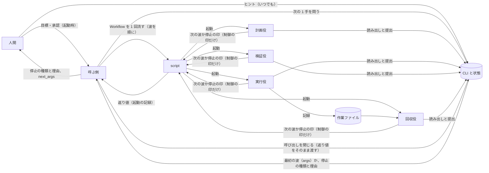
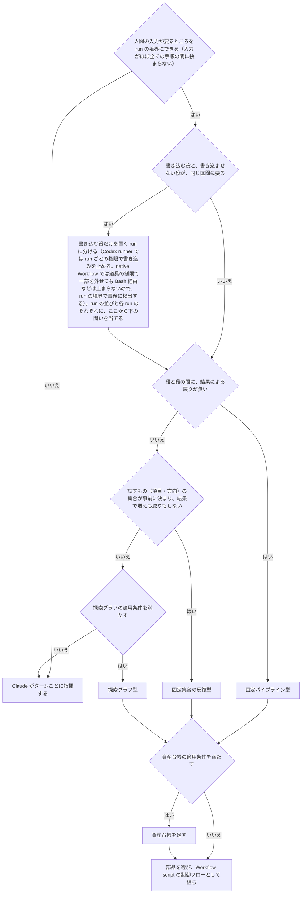
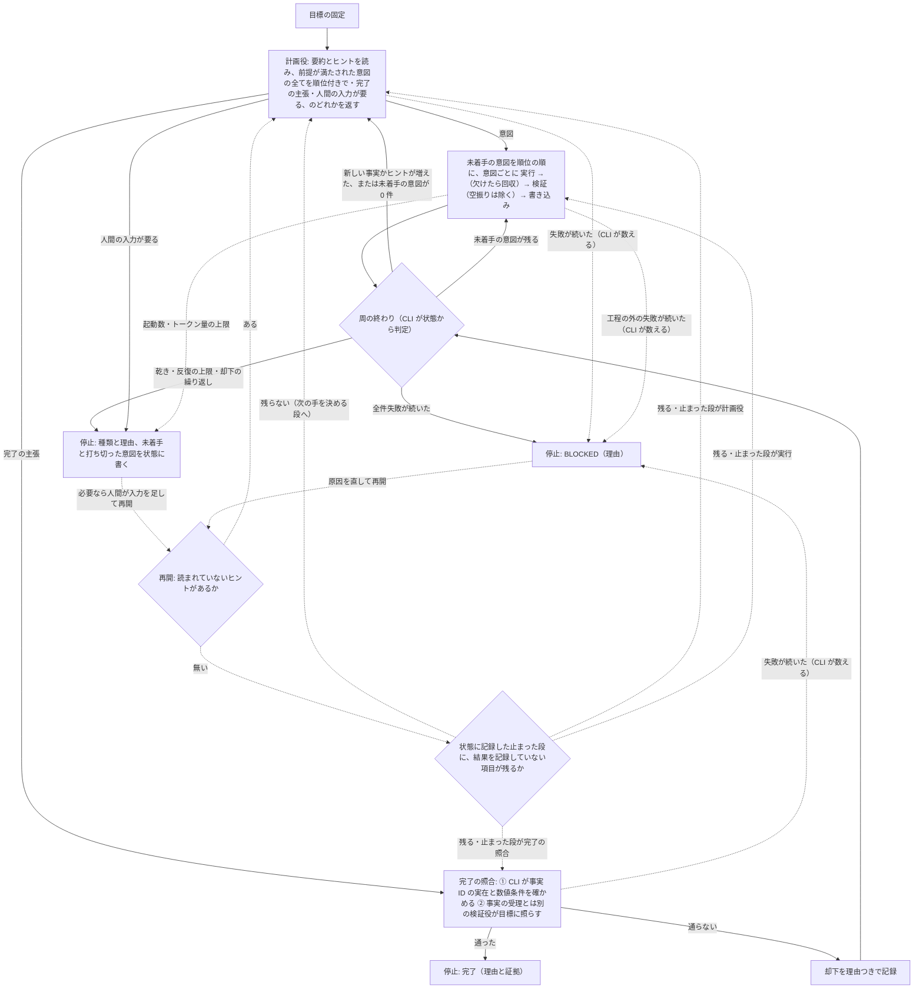

# スキル設計の再設計方針：形の判定・探索グラフ・資産台帳

スキルを multi-agent の Workflow として設計するときの方針。この文書は要求を固めるための調査と簡単な設計で、このリポジトリの要求文書と仕様書はこれをもとに起こし、原則はこの文書の節を参照する。表の「出所」列の略記は末尾の「出所」で引く。

## 目次
- [用語](#用語)
- [構成要素](#構成要素)
- [文脈の配達](#文脈の配達)
- [配置の原則](#配置の原則)
- [形の判定](#形の判定)
- [目標の固定](#目標の固定)
- [停止・再開と人間の入力](#停止再開と人間の入力)
- [体数と同時実行](#体数と同時実行)
- [モデル・effort・prompt](#モデルeffortprompt)
- [権限](#権限)
- [探索グラフ](#探索グラフ)
- [状態の書き込み](#状態の書き込み)
- [機械で確かめる](#機械で確かめる)
- [資産台帳](#資産台帳)
- [証拠記録の保存と照会](#証拠記録の保存と照会)
- [記録と改善](#記録と改善)
- [水準と未決事項](#水準と未決事項)
- [出所](#出所)

## 用語

複数の節で使う用語だけをここで定義する。1 つの節でだけ使う用語は、その節の初出で定義する。
- **項目**：1 つの段で処理する単位（ファイル・観点・意図など）。
- **段**：全ての項目を待ってから次へ進む区切りと、区切りの間の処理のまとまり。次の手順が全ての項目の結果を必要とするなら、そこが段の境界になる。
- **工程**：1 つの項目（`pipeline()` の 1 item）の中の手順。工程の間では他の項目を待たない。authoring が pipeline について言う "stage" は本書の工程に、"barrier" は全件の到着を待つ区切り（本書の段の境界）に当たる（本書の読み）。
- **反復**：段の並びを、結果に応じてもう一度回すこと。探索グラフの反復は**周**と呼ぶ。
- **形**：段と段の間の制御フロー。次の 3 つだけ（選び方は「形の判定」）。
  - 固定パイプライン型：段と段の間に、結果による戻りが無い（有限の分岐は列挙できるのでここに含める）
  - 固定集合の反復型：試すもの（項目・方向）の集合が事前に決まって結果で増えも減りもせず、段と段の間に結果による戻りがある
  - 探索グラフ型：試すもの（項目・方向）の集合が、前の結果で変わる
- **部品**：1 つ以上の段からなり、段と段の間に戻りの無い定型の並び。形の中に組み込む（例は「形の判定」）。
- **CLI**：状態（グラフ・台帳・ヒント）を検証つきで読み書きする唯一のコマンド。規則は「状態の書き込み」。
- **呼ぶ側**：Workflow の外で、CLI に次の 1 手を問い、CLI が返した最初の波の args で Workflow を流し、その返り値を CLI へ渡す主体（スキルを読んで動く session など。持つものと持たないものは「構成要素」）。スキルを呼び出す別のスキルを指す語ではない。
- **作業ファイル**：agent が run のディレクトリか状態の置き場の下に置くファイル（実行の記録・大きな出力・各 agent の出力・提出の前に置く結果のファイル）。状態ではなく、CLI を通さずに書く。結果のファイルは、役の提出を受けた CLI が照合してから中身を状態に取り込み、照合に落ちたものは取り込まない（「状態の書き込み」）。
- **needs_input**：人間の入力を待って止まったことを示す停止の種類。
- **BLOCKED**：失敗して続けられずに止まったか、検査で対象の欠けが見つかり、対象を直さないと先へ進めずに止まったことを示す停止の種類。
- **対象の欠け**：検査で見つかった、検査した対象の誤り・矛盾・漏れ。工程の欠け（agent が結果を返さないこと）とは別の語。
- **ヒント**：人間が状態に足す、待たれない入力（「停止・再開と人間の入力」）。
- **空振り**：何も見つからなかったという結果。
- **試行**：1 件の意図を、実行の工程から書き込みの工程まで 1 回流すこと（回収を含む）。
- **工程の欠け**：工程の agent が結果を返さずに終わること。試行については、実行の工程が欠け、回収でも受理が 1 件も出なかったことを指す（「実行役・回収役・検証役」）。
- **乾き**（暫定）：新しいものが 1 件も受理されず、全件失敗でもない反復。空振り・既知の事実・検証不能・却下（事実・完了の主張）は「新しいもの」に数えない。
- **全件失敗**：処理した項目が 1 件以上あり、その全てで工程が欠けた反復。探索グラフでは、実行した全ての意図で、試行が工程の欠けになった周。
- **未着手**：まだ結論の出ていない意図。試行の上限で外した意図（**打ち切り**）は含まない。

## 構成要素

Workflow script で組むスキルは、次の要素に分かれる。各要素は「持つもの」だけを持ち、「持たないもの」は他の要素に任せる。役の名前は探索グラフでのもので、他の形では使う役だけを置く。事実と意図は「探索グラフ」で定義する。役は結果を返り値で運ばず、CLI の提出で状態に書く。本書で役が結果を「返す」と書くのは、この提出を指す。1 回の Workflow は、CLI が状態から決める次の波がある間、波を順に流す。各波の役は claim で担当を取り、CLI が状態の次の段とその波の段が一致するときだけ担当を渡す。役が返り値で返すのは、CLI が状態に記録した次の波の印（id・行）か停止の印だけで、CLI が claim で照らす。script はその印のとおりに次の波を起動するか止まるだけで、次の段も停止も判定しない。区切り（時間・起動数・check・停止）は CLI が決め、呼ぶ側は次の呼び出しで続ける。制御の印は内容でなく、書き換えても CLI が claim で記録と照らすので、空の起動か早い停止にしかならない。このため印を返す役は運ぶ役にならない。本書の「run が止まる」は、CLI が停止の種類を返し、呼ぶ側が次の呼び出しを流さないことを指す。呼ぶ側は、Workflow の返り値（起動の記録）を手を加えずに CLI の呼び出しを閉じるコマンドへ渡し、CLI が起動の記録だけを読んで状態に取り込む。呼ぶ側は内容を判断せず、役の出力を運ばないので、運ぶ役にはならない（本書。coverage-audit・coverage-build の実装の置き方）。

| 要素 | 持つもの | 持たないもの |
|---|---|---|
| script | 波の中の制御フロー、CLI が決めた起動の一覧（最初の波は args、次の波は役が返した印）どおりの agent の起動、起動の記録を返り値にすること | ファイルと shell（docs：script はどちらにも触れない）、受理の決定、次の段と停止の判定、起動する役と担当の決定 |
| 計画役 | 次に試す意図、完了の主張、人間の入力が要るという判断 | 実行、状態の直接の書き込み（結果は CLI の提出で書く） |
| 実行役 | 1 件の意図の実行と、事実の候補（検証に要るものを添える） | 受理の判定、他の意図 |
| 回収役 | 工程が欠けた実行の記録から、確認済みの事実の候補を拾う | 新しい実行 |
| 検証役 | 生成と別の context で、事実の候補を受理・却下・検証不能に、完了の主張を受理か却下に分ける | 生成 |
| CLI | 状態、ID、要約、決定的な照合、役の提出の受け付けと拒否、次の段と停止の判定、次の波の記録と呼び出しの区切り、起動する役の一覧と担当の割り当て | 意味の判定 |
| 人間 | 目標、ヒント、承認 | run の中で待たれる応答（docs：実行中の入力は受け取れない） |

## 文脈の配達

各役が仕事に必要な前提（組織の規則・対象の要約・判定基準・実行環境の決まり）を、誰がどうやって届けるか。前提が届くかどうかは、形によらず当てはまる。

| 原則 | 出所 | 守らないと壊れること |
|---|---|---|
| 役に必要な前提は、環境から自然に届くものとして扱わず、script か CLI が決定的に配る対象として設計する | メタワーク（前提は AI が読める形で残し、頼むたびに説明し直さない）・本書 | 配布先や実行環境が変わると、同じスキルでも届く文脈が変わり、前提を知らない agent がそれらしく間違える |
| 前提は、AI が引ける形（読める文書・CLI の読み出し）で残し、守れたかを確かめる環境（テスト・検査）と対で用意する | メタワーク（AI が読む知識と、確かめる環境の両方を揃える） | 前提が引ける形で残っていないと、守るべき規則が実行のたびに解釈され、同じ検査でも結果が run ごとに変わる。確かめる環境だけがあると、検査は前提の古い写しを相手にし、文書側で前提を更新しても検査に届かない |
| 配れなかった前提・読めなかった文脈は、黙って欠けたまま進めず、結果に「見ていない」として宣言する | 本書・メタワーク | 見ていない前提が、前提どおりに進めたものとして結果に読まれる |
| AI の判断に渡す知識（原則）は、要るときに引ける独立した単位に分けて置く。適用した原則は、その run で実際に読んだ単位だけを、どの判断を変えたかとともに名指しする | pstack（原則を leaf skill として分け、入口のスキルが合成する。読んだ原則だけを引く） | 大きな指示の塊では、必要な原則だけを読む形にならない。読んでいない原則を適用したことにでき、原則が判断を変えたのか後付けの理由なのか区別できない |
| 配布先の runtime が正本のファイルをそのまま読めない場合は、正本から決定的な手続きでコピーを生成して配り、再生成との差分（drift）を機械検査で落とす。手で写したコピーは置かない | pstack（正本から別 runtime 向けの木を生成し、docs と木の drift を検査で落とす） | 手で写したコピーは正本の更新に追随せず、古い前提のまま配られ続ける。drift を検査しないと、正本とコピーのどちらが正か分からなくなる |
| 役へ仕事の対象や前提を渡すときは、受け手が正本を読める場合は、中身の写しではなく参照（パス・行範囲・ID）を渡し、正本を読ませる。読む時点の内容を固定する必要があるときは、内容の hash で固定した写し（「状態の書き込み」の、状態の置き場の行が許す唯一の写し）の参照（パス・行範囲・hash）を渡し、中身は渡さない。CLI は、提出が依った写しの hash が、状態が持つその対象の今の内容の hash と違えば受け付けない | 本書（依頼者の裁定）・本書（coverage-audit の実装：対象の写しを内容の hash の名で置き、役にはその path と行範囲を渡し、hash の違う提出を拒む） | 写しは渡した時点の内容で固定され、正本が更新されてもずれに気づけない。複製のたびにトークン量も増える。固定した写しを hash で照らさないと、古い内容に基づく結果が今の結果として受け付けられる |

## 配置の原則

スキルが持つルール・知識・処理を、どの層に置くか。層は硬い順に、構造とスキーマ（違反が表現できない）、決定的なスクリプトと機械検査（違反が必ず落ちる）、閉集合からの選択（自由記述で決めない）、AI の判断に渡す知識、人間の判定、とする。形によらず当てはまる。

この節は新しい仕組みを足すものではなく、本書の各節が既に置いているものの総論である。「状態の書き込み」（探索グラフと資産台帳に共通する）は状態の読み書きと決定的な照合を CLI に寄せ、既知かどうかの判定も CLI の決定的な照合か検証役の閉集合からの選択に寄せている。「機械で確かめる」は確かめられる性質を検査器に寄せている。いずれも、柔らかい層にあった判定を硬い層へ移した適用例である。

| 原則 | 出所 | 守らないと壊れること |
|---|---|---|
| ルール・知識・処理は、それを表せる最も硬い層に置く | ハーネス（決定的に表せるものは決定的な層に置く）・本書（層の順と、スキルへの当てはめ） | 柔らかい層に置いたルールは実行のたびに解釈され直し、同じルールでも run ごとに違う実行になる。外れても、落ちる検査が無いので気づく手段が無い |
| 柔らかい層に置く場合は、なぜ硬い層へ置けないかを記録に残す | 本書 | 理由が残らないと、後から硬い層へ移せるようになったときに移す対象が分からず、柔らかい層への配置が既定として残り続ける |
| 置いたルールごとに、それを強制する層と機構（構造とスキーマ、決定的なスクリプトと機械検査、閉集合からの選択、AI の判断に渡す知識、人間の判定のどれか）を対応づけて残す。この対応づけは、柔らかい層に置く理由の記録の続きとして、硬い層へ移すためと、移した後の整理のために持つ。対応から落とすのは、構造とスキーマの層で違反が表現できなくなったルールに限る。決定的なスクリプトと機械検査で落とすだけのルールは、誤りを起こせるので残す | pstack（/correct が、ルールとそれを強制するものの対応表を agent の指示ファイルに残す） | 対応の無いルールは、守られているかを確かめる手段が無いまま残る。違反が表現できなくなったルールを残すと、効いていない規則と区別がつかず、規則の集合自体が信用を失う。逆に、検査で落とすだけのルールを落とすと、まだ起こせる誤りの守りが見えなくなる |
| 決定的な処理を置く script・CLI の実装言語は、Rust を第一候補にする。他の言語を選ぶとき（配布先で Rust の実行物を動かせない、既存の CLI を拡張する、Workflow source（JavaScript）と同じ照合の文を写しを持たずに 1 か所に置いて CLI から読み込む など）は、理由を設計の説明に残す | 本書（依頼者の裁定）・本書（coverage-build・coverage-audit の実装：静的な照合の文を Workflow source の 1 区間だけに置き、Node の CLI がその区間を読み込んで提出を照らす。runner の source は import できないため） | 言語の選択が作るたびに揺れ、型で落とせる誤りが実行時まで残る。理由が残らないと、後から Rust へ寄せられる処理を見分けられない |

## 形の判定

軽い形から順に問う。前の問いは、後の重い形を選ぶ理由になる条件を含まないように書く。

資産台帳の追加起動（「資産台帳」）は、形を決める戻りに数えない。追加起動は、決まった資産の集合の残りに同じ段を当てるだけで、試すものを変えないから。数えると、台帳を足しただけで形が変わる。

部品の例：
- 並列化：互いに独立な項目を同時に処理する段（項目ごとの処理は違ってよい）
- 観点ごとの検証、反証
- Judge panel：独立に N 案を作る段 → 並列に採点する段 → 最良を軸に他の案の良いところを取り込む段（authoring）
- 項目ごとの map：全ての項目に同じ処理を当てる段

項目の工程の中で、検証に落ちた項目を直して検証し直す部品は置かない。直す前には全体を対象にした直す前の設計の段（下の表の、生成の前に設計の段を置く行）を通すので、直しは全ての項目の検証を待つ段の境界の後に来る（本書。依頼者の裁定）。

| 原則 | 出所 | 守らないと壊れること |
|---|---|---|
| 待たれる人間の入力（承認・回答）が要るところは run の境界にし、Workflow script には入力を待たない区間だけを入れる（「停止・再開と人間の入力」）。入力がほぼ全ての手順の間に挟まるなら、run に切っても利点が無いので Claude がターンごとに指揮する | docs（Behavior and limits の表：実行中の入力は受け取れず、段階の間の承認は段階ごとに別の workflow として回す） | run の中では、入力を待ってから続けることができない |
| 図の順（軽い形から）に問い、重い形を選ぶときは、どの条件がそれを強いるかをスキルの設計の説明に書く | 本書 | 重い形が既定になり、決まった手順のスキルに探索の費用を払う |
| 書き込む役と、書き込ませない役（計画役・検証役など）が同じ区間に要るときは、書き込む役だけを置く run に分ける。分けて得られるものは host で違う。Codex runner では、run ごとの書き込みの権限（read-only か workspace-write か）で、書き込ませない役の run の書き込みを止められる。Claude Code の native Workflow では、permission rules が全ての subagent に同じく効くので、run を分けること自体では書き込みは止められない。登録した agent type の道具の制限（`tools`・`disallowedTools`）で Edit・Write を外すことはできる（plugin から読む agent でも、無視されるのは `hooks`・`mcpServers`・`permissionMode` で、`tools` は入らない）。ただし Workflow の `agent()` から agent type を指定できることは、公式の頁では未確認。道具の制限は Bash 経由などの書き込みを止めないので、run の境界で CLI が対象の状態（作業ツリーの snapshot など）を照らし、書き込ませない役の run で起きた書き込みを事後に検出することが残る。どちらの host でも、run の並びの制御は script の外に置き（次の波と停止は CLI が状態から決め、script は CLI が記録した波を流すだけにする：「構成要素」）、run の並びと各 run のそれぞれに形の問いを当てる。native で残る危険（止められず、検出だけであること）は run の結果に書く（「権限」の、役ごとの制限が配布先で効くかを確かめる行） | docs（workflow が起こす subagent は利用者の permission rules を使う：「権限」。prompt cache の一致の条件に agent ごとの agent type と tools を挙げる）・subagents（allow rules はセッション全体に効く。`tools`・`disallowedTools` で道具を絞れ、plugin の agent で無視されるのは `hooks`・`mcpServers`・`permissionMode`）・authoring（`agent()` の option に `agentType` がある：`plugins/skill-creator/skills/skill-creator-best-practices/references/skill-writing-guide.md` の `agentType` の項）・本書（Codex runner は run ごとの書き込みの権限を持ち、agent ごとの道具の許可を持たない：`plugins/workflow/skills/dynamic-workflow-runner/scripts/runtime/README.md` の未実装の一覧） | Codex runner で分けないと、書き込ませない役も対象を書けてしまい、検証の前の変更や、検証役による対象の書き換えを止められない。native で分けないと、書き込みを見つけてもどの役の段で起きたかを切り分けられない。native で分けたことや道具の制限を「書き込みを止めた」と読むと、Bash 経由の書き込みが残るのに、事後の検出だけの保証が防止として扱われる |
| 「Claude がターンごとに指揮する」形でも、手順をその場で作らず、閉集合の playbook（手順を data として固定したもの）から入口が依頼に合うものを選び、手順を実行計画へ逐語で写してから実行する形がある。当てはまる playbook が無い仕事は、その旨を宣言して指揮する | pstack（入口のスキル poteto-mode が依頼を playbook に当てはめ、手順を todolist へ逐語で写す） | 手順をその場で作ると、同じ依頼でも run ごとに手順が変わり、検証も再利用もできない。逐語で写さないと、data として固定した手順が実行時の解釈で崩れる |
| 生成の前に設計の段を置く。置かないのは、作り方と合格の基準が入力で決まっていて、設計で決めることが残らない生成（例：決まった変換を各項目に当てる移行の map）だけにし、置かない理由をスキルの設計の説明に書く。検証の指摘を直す前には、必ず直す前の設計の段を置く。直す前の設計は、確定した指摘を、全体を対象にした網羅的な検査（例：coverage-audit）で根本原因ごとに束ね、束ごとに原因の層（目標・設計・実装）を決めて、その層へ戻す段とする。原因の層の決め方は「記録と改善」の、悪かった出来事を振り返る行に従う。戻し方は CLI が層から決める。目標の層は needs_input で人間に返し、回答を決定の記録に足してから設計をやり直す。設計の層は、原因の単位とそれに依存する単位の全てを設計からやり直す（単位が決まらなければ、単位への分割から）。実装の層は、原因の単位を、その単位の設計に合わせて作り直す（テストの欠陥ならテストから）。どの層でも、やり直す役に渡すのは単位の設計と確かめた欠陥と原因で、指摘の引用の箇所ではない。指摘の箇所だけを直す経路は置かない。作り直す役は、戻した単位（設計の層では依存する単位を含む）の受け持ちの全体を、単位の設計に合わせて作り直す。戻していない単位は書き換えない（全面の書き直しをしない）。やり直した後は、中身が同じでも検証をやり直す | 本書（依頼者の裁定）・本書（coverage-build の実装：目標の層は人間へ、設計の層は単位と依存する単位を詳細設計から、実装の層は単位のテストか実装を作り直す。実装の役は、前の回の欠陥と原因を受けて受け持ち全体を設計に合わせて作り直す） | 指摘の箇所だけを直すと原因が残り、同じ種類の指摘が別の箇所に出続ける。直しどうしが前提を崩し合い、ループが収束しない。戻していない単位まで書き直すと、前に直した箇所へ新しい欠陥が入る。設計を経ない生成は、目的からずれた成果物を検証で見つけるまで費用を払う |

例の着地（本書）：

| 例 | 着地 | 理由 |
|---|---|---|
| review（観点 fan-out → 反証 → 集約） | 固定パイプライン型＋観点ごとの検証・反証の部品 | 段と段の間に戻りが無い |
| 移行の map | 固定パイプライン型＋項目ごとの map の部品。検証に落ちたファイルを直すなら固定集合の反復型 | 変換は他のファイルの結果を必要としない。直すときは、直す前の設計が全てのファイルの検証結果を束ねるので、検証と直しの間が段の境界になり、そこに戻りがある |
| Judge panel で N 案から選ぶ | 固定パイプライン型＋Judge panel の部品 | 案を作る → 採点 → 取り込む、で戻りが無い |
| 1 つの文書の監査と改稿を繰り返す | 固定集合の反復型 | 改稿が全ての観点の監査結果を必要とするので、監査と改稿の間が段の境界になり、そこに戻りがある |
| ゲートつきの要求文書の作成（人間の承認で止まって再開する） | 固定集合の反復型。各ゲートを run の境界にする | 上と同じ。ゲートの間の区間は、run の中で人間の入力を待たない |
| 情報源を辿る調査、原因調査 | 探索グラフ型 | 試すもの（調べる方向）の集合が前の結果で変わる |
| 計画・実装・check・レビュー・修正を繰り返す実装 | run に分ける。run の並びは固定集合の反復型、計画の run と実装の run は固定パイプライン型（計画の作り直しも、run の並びの戻りで行う） | 書き込む実装役と、書き込ませない計画役・レビュー役を同じ run に置くと、Codex runner では書き込みを止められず、native Workflow では（道具の制限で外せない Bash 経由の書き込みについて）どの役の段の書き込みかを run の境界で切り分けられない。修正は全ての観点のレビュー結果を必要とするので、run の並びに戻りがある |

## 目標の固定

どの形でも、入口で目標を固定する。探索グラフでは、完了の照合がこの目標に対して行われる。

| 原則 | 出所 | 守らないと壊れること |
|---|---|---|
| 目標は「最終的に検証できる成果物」とし、調査・手段・検証の手順を入れない。成果物が互いに独立なときだけ分ける | 本書 | 手順を終えたことが完了と読まれる |
| 依頼文から範囲と禁止事項を先に抜き出し、指示語を固有名に置き換えて自己完結させる | 本書 | fresh な agent に渡った時点で指示語の意味が消え、範囲の外へ探索が漏れる |
| 目標に数値で判定できる条件（件数・閾値など。以下「数値条件」）があれば、目標と一緒に固定する | 本書 | 完了の照合で、決定的に確かめられる条件が無くなる |
| 固定した目標と出発点は、前提として状態に書き、最初の周の意図が根拠として指せるようにする。検証役による受理の規則の外に置く | 本書（生成した主張ではなく入力だから）・Cairn（origin と goal を特別な事実として作る） | 最初の周の意図が根拠の事実を指せず、CLI に拒否される |
| 依頼文に無い目標・制約は作らない。目標・受け入れ基準・制約の各項目に、依頼文か決定の記録（人間が会話で決めたことを、人間の言葉のまま 1 件ずつ残したもの）からの逐語の引用を付け、引用が引用元に逐語であるかを CLI が照らす。依頼文と決定の記録が求める成果を挙げてどの項目が受け止めるかを対応づけ、どの項目にも受け止められない成果があれば needs_input で返す | 本書・Opus 5（依頼の範囲を広げたり狭めたりしない）・本書（coverage-audit・coverage-build の実装：引用の無い項目と逐語でない引用を拒み、照合役には成果と項目の対応だけを返させる。足したか・狭めたかを LLM に判定させると、回ごとに揺れた） | 頼まれていない成果物に費用を払い、その完了を報告する。依頼から落とした成果が、目標の外として気づかれないまま残る |

## 停止・再開と人間の入力

形によらず、Workflow script に当てはまる。

- **next_args**：止まった run が返す、同じ状態から新しい run を起動するのに要るもの。
- **再開**：`next_args` で新しい run を起動すること。docs の relaunch（同じ run を保存した結果から再生すること）とは別で、本書は relaunch を使わない。
- **停止の種類**：完了・乾き・needs_input・反復の上限・BLOCKED（全件失敗の連続と、続けられない失敗と、検査で対象の欠けが見つかり、対象を直さないと先へ進めないこと）。形によっては使わないものがある。

人間の入力は 2 種類ある。
- **待たれる入力**（承認・質問への回答）：run の境界でだけ入れる。run は needs_input で止まり、人間が入力を足してから再開する。
- **待たれない入力**（ヒント）：run は止まらず、計画役を持つ形では次に計画役を呼ぶときに、計画役を持たない形では次に始まる段で起動する役を呼ぶときに取り込まれる。runtime 自体は実行中の入力を受け取らないが（docs）、状態は run の外にあり agent が CLI で読むので、この経路は runtime の制約に当たらない（本書）。

| 原則 | 出所 | 守らないと壊れること |
|---|---|---|
| どの停止でも、理由と、止まった段（どの段で止まったか）とその段で結果を記録していない項目と、未着手の意図と打ち切った意図の一覧を状態に書き（打ち切った意図は、打ち切りという結果を記録した項目として扱う）、次の run では、未着手は始めた段が項目として読み、打ち切りと停止の理由は次の手を決める段（探索グラフでは計画役）が読む。どの段から始めるかは、再開した run の始め方の行。完了は照合の証拠も返す | 本書・authoring（No silent caps：絞ったものを記録しないと「全部見た」と読まれる） | なぜ止まったか、どこから再開すればよいかが残らない。試していない方向が「試した」と読まれる |
| 待たれる入力が要るときは、needs_input と理由を返して止め、人間が入力を足し、再開する。中身を決める回答（質問への答え、欠陥の直し方や受け入れ方）は、人間の言葉のまま決定の記録に足し、以後の目標・制約はその行を引用して使う。上限を引き上げるだけの回答と、直さない判断は、回答として記録し、決定の記録には足さない | docs（Behavior and limits の表：実行中の入力は受け取れない）・本書（next_args）・本書（coverage-audit・coverage-build の実装：回答を決定の記録に足し、その行を引用する制約にしてやり直す） | run の中で入力を待つ設計は組めない。回答を言い換えて取り込むと、人間が決めていないことが決定として残る |
| needs_input で止めるときは、理由だけでなく、人間が判断に要る材料（何を決めればよいか、ここまでの検証結果、影響の範囲、残った未着手）を一緒に返す | メタワーク（人には、変更を理解して判断できる形で材料を届ける） | 理由だけでは人間がその場で判断できず、材料集めの往復で止まり続ける |
| 生成・検証（・修正）のループは、（設計 →）生成または修正 → 検証までを 1 巡と数える。設計の検証のループ、実装の検証のループ、機械の検査（check）の失敗による戻りは、どの層へ戻しても、全て同じ 1 つの巡の数に数え、ループごとや層ごとに別に数えない。2 巡目の検証で合格しなければ 3 巡目に入らず、needs_input で止める。止めるときは、当てるはずだったやり直し（戻す層・単位と原因）を当てずに保留し、残った指摘とここまでの検証結果と一緒に判断材料として返す。判断材料には、2 巡で終わらなかったことを、スキルの目標・設計・prompt の欠けを疑ってスキルのレビューと改修を考える理由として含める。人間の回答は、上限を 1 巡引き上げて保留をそのまま当てるか、保留を捨てて直さない判断を記録するかのどちらかにする。上限の値だけを変えても、保留は当てない。同じ単位のやり直しの回数にも上限を置き、超えたら同じく needs_input で返す。この停止は停止の理由として記録し、記録を集めて繰り返すつまずきを直すことは「記録と改善」の行に従う。探索グラフの周と、同じ意図の試行の回数（「停止」の試行の上限の行）には当てない | 本書（依頼者の裁定）・本書（coverage-build の実装：周の上限を超えるやり直しを保留して人間に返し、回答で上限を 1 上げて保留を当てるか、却下で保留を捨てて記録する。単位ごとのやり直しの上限も持つ）・Opus 5.5（自動の続行は同じ課題で 2〜3 回までにして、詰まった run を止めて見直せるようにする。本書はこの目安を巡に当てはめる） | 収束しないループが、ほかの上限に当たるまで費用を払い続け、人間の判断が要る食い違いが run の中で回り続ける。スキル側の欠陥が回数で押し切られて見えなくなる。上限の値を変えただけで保留が当たると、人間が判断材料を見ないまま同じやり直しを繰り返す |
| ヒントは人間が CLI で状態に追記する。run の実行中も、完了以外で止まっている間も足せる | Cairn（ヒントはグラフの外の入力で、停止中のプロジェクトにも足せる） | 実行中に気づいたことを伝えるために run を止めることになる |
| スキルは run を起動したときに、ヒントの足し方を人間に示す | 本書 | 人間がヒントの足し方を知らず、待たれない入力の経路が使われない |
| ヒントを読んだ役（計画役を持つ形では計画役、計画役を持たない形では次に始まる段で起動する役）が読んだヒントと、停止の判定が「読まれていないヒント」とするヒントを一致させる | 本書 | 読まれていないヒントが残ったまま乾きや却下で止まるか、読んだヒントを未読と数えて止まらない |
| ヒントの既読は、ヒントを読んだ役（計画役を持つ形では計画役、計画役を持たない形では次に始まる段で起動する役）が出力を返し、CLI がその書き込みを受け付けた時点で、その周（計画役を持たない形ではその段）に配達したヒントへ CLI が付ける。配達しただけでは付けない。受け付けは検証役の受理・却下の判定とは別の時点で、完了の主張が却下された場合に却下の理由を記録することも受け付けに含む | 本書 | 配達した時点で付けると、ヒントを読んだ役が失敗して BLOCKED で止まった場合に、実際には読まれていないヒントが既読のまま残り、その役が読んだヒントと停止の判定が未読とするヒントが食い違う |
| 完了した状態へのヒントの追記は、CLI が拒否する | 本書（完了からは再開しないので、足しても読まれない。完了した項目を reopen できる Cairn とは事情が違う） | 人間が足したヒントが、誰にも読まれずに残る |
| 止めた run や途中で終わった run は relaunch せず、状態から新しい run として再開する。再開した run は状態をそのまま読み、途中の周で受理された事実・試行の回数・打ち切りも、そのまま使う | 本書（状態にあるのは検証を通ったものだけなので、捨てる理由が無い）・docs（relaunch では、prompt が変わった agent か失敗した agent から後ろが、完了済みでも再実行される） | 再実行の記録が前の記録と混ざる |
| 前の run の遅れた書き込みが、新しい run の状態を変えないようにする | 本書（新しい run の起動には relaunch の拒否のような保護が無い）・docs（止めた run の agent がまだ終わっていなければ relaunch は拒否される） | 前の run の遅れた書き込みが、新しい run が読んだ後の状態を変える |
| 完了以外の停止からは再開できる。乾き・反復の上限・needs_input は必要なら人間が入力を足してから（反復の上限からの再開を受け付ける条件は、すぐに止まらないようにする行に従う）、BLOCKED は原因を直してから再開する。ただし、対象を run の外の主体が直し、直すと run の入力（中身を含む）が変わる形では、状態が単位ごとの指紋を持たなければ、前の状態から再開せず、新しい状態から始める。状態が単位ごとの指紋を持てば、同じ状態を持ち越し、読み直す単位は「状態の書き込み」の、状態の置き場の行で決める。どちらの形も、再開してよいかを決める入力そのものが直すことで変わる場合で、同じ状態のまま結び付きとカバレッジを対象の今の内容に合わせる場合（台帳の結び付きとカバレッジの行）とは別である | 本書 | 止まった run の途中までの結果を捨てて、最初からやり直すことになる。入力が変わった後に前の状態から再開すると、直す前の対象に基づく結果が残る |
| 再開した run は、計画役を持つ形で読まれていないヒントがあれば計画役から始め、そのヒントを読ませる。それ以外では、始める段を状態に記録した位置だけで決め、停止の種類では決めない（計画役を持たない形では、読まれていないヒントは始めた段で起動する役が読む）。止まった段に結果を状態に記録していない項目が残っていれば、その段のその項目から続け、結果を記録した項目は作り直さない。残っていなければ、次の手を決める段（探索グラフでは計画役）から始める。人間が足した待たれる入力は、始めた段が読む。止まっていた間に対象が変わったときに、記録した結果を使い続けるかは、単位ごとの指紋を持つ状態では「状態の書き込み」の状態の置き場の行に従い、完了以外の停止から再開する行の但し書きの形（新しい状態から始める）を除くそれ以外は、「水準と未決事項」の (i) で未決 | Cairn（ヒントの増加で計画役を呼ぶ）・本書（原則の目的はヒントを読ませることで、読むべきヒントが無い再開まで計画役から始める理由は無い。位置を停止の種類で決めると、同じ種類の停止が段の途中でも段の終わりでも起き、位置が 1 つに決まらない） | 計画役を持つ形で読まれていないヒントがあるのに計画役から始めないと、ヒントが読まれない。ヒントが無いのに計画役から始めると、記録した結果と計画を作り直し、計画で止めて承認を待つ使い方や、人の判断待ちからの続きが成り立たない。全ての項目に結果がある段から続けると、同じ判定で再び止まる（次の行） |
| 再開した run は、人間の入力が効く前に、前の run と同じ理由ですぐに止まらないようにする。反復の上限で止めるときは、どの上限で止まったかを停止の理由として状態に書き、再開を受け付けるかは CLI がこの理由で決める。上限は、比べる回数が前の run から引き継がれるかで分け、回数を状態に記録するかどうかでは分けない。比べる回数を再開をまたいで引き継ぐ上限（反復の数・計画の作り直しなど。生成・検証のループの巡の上限は needs_input で止まり、生成・検証のループの行に従う）で止まった停止からは、人間が上限を変える入力（引き上げた上限か、打ち切ってよい範囲）を足したときだけ再開を受け付け、引き継いだ回数を足した上限と比べる。それ以外の、比べる回数を再開した run が 0 から数える上限（起動数・トークン量など）で止まった停止からは、入力が無くても再開を受け付ける | 本書（起動数とトークン量の上限はどちらも 1 run の入力で（トークン量の上限の行・「水準と未決事項」の Codex runner との互換）、新しい run では 0 から始まる） | 乾きで止まって再開した run が、最初の周で再確認を待たずに止まる。人間の入力が効く前に却下でまた止まる。回数を引き継ぐ上限は回数をそのまま使う（再開をまたいで残す値の行）ので、上限を変えずに再開した run は、最初の判定で同じ上限にまた止まる。0 から数える上限で止まった停止にも入力を求めると、上限を変えなくても続けられる run が、要らない入力待ちで止まる |
| 再開した run では、台帳の結び付きとカバレッジを、対象の今の内容に基づかせる | 本書（前の run の後に対象が変わっていることがある） | 古い内容に基づく結び付きとカバレッジが残る |
| 再開をまたいで残す値（固定した目標・未着手の意図・試行の回数など）は run の外の状態に持ち、再開した run はそこから読む | 本書（再開は新しい run の起動なので、script の変数は残らない） | 人間の入力を挟むたびに、それまでの値が失われ、試行の回数が初期値に戻る |
| pipeline の外の agent が失敗しても、理由を残さずに run を終わらせない。役の失敗で提出の無かった呼び出しを CLI が数え、続いたら BLOCKED と理由を返して止める。状態を読み書きする agent も含む | docs（直接 await した agent は、失敗すると run を終わらせるか `null` を返す）・authoring（`agent()` は予算の超過などで throw する）・本書（coverage-audit・coverage-build の実装：提出の無い呼び出しが続けて決めた回数に達したら、blocked（failure）で止める） | 停止の理由が残らないまま run が終わる |
| BLOCKED の返り値は、理由の区分（失敗か対象の欠けか）でどちらの場合かを必ず区別する。入力の誤りは、対象の文書ではなく渡し方か環境を直すので、失敗に含める | 本書 | 直す先（環境と入力か、対象の文書か）が違うので、区別できないと利用者が何を直せばよいか分からない |

## 体数と同時実行

形によらず当てはまる。

| 原則 | 出所 | 守らないと壊れること |
|---|---|---|
| 探索グラフでは、実行役は全て、CLI が状態から決めた起動の一覧どおりに script が起動し、周ごとの起動数を CLI が状態に取り込んで結果に残す | 本書 | 何体走ったかの記録が残らず、費用を追えない |
| fan-out の項目の件数は事前に決めない（探索グラフでは「計画役」の意図の件数の行） | 本書 | 件数を先に決めると、残りが次の反復に回って反復が増える |
| 同時に走る agent は 3 体まで（初期値。eval で測って決め直す）とし、残りは枠が空くまで待たせる。守らせ方（runtime の設定か script か）は実装で決める | 本書・docs（runtime の同時実行は既定で 16 体まで。`CLAUDE_CODE_WORKFLOW_MAX_CONCURRENT_AGENTS` で変える） | 同時に走る agent が増え、レート制限に当たる |
| 同時実行数などの任せる範囲は、検証できた証拠の分だけ広げる。初期値を広げるときは、eval や試走の実測で決めた基準を満たすことを条件にする | メタワーク（GitLab の段階の考え方：下の段で決めた精度や成功率を満たしたら一段上がる）・本書 | 証拠が無いまま任せる範囲が広がり、失敗したときの規模だけが大きくなる |
| 項目の件数が runtime の 1 回の呼び出しの件数の上限を超えるときは、呼び出しを分ける。切り捨てない | docs（上限を超える一覧はエラーで拒否される） | 呼び出しがエラーで拒否されるか、切り捨てた項目が「見た」と読まれる |
| トークン量の上限は、消費量を run の中に読める経路（native Workflow の budget）でのみ、run の入力として受け取る。その経路では、入力が無いときに備えた既定の上限は置かず、上限に達したら反復の上限として止める。消費量を run の中に読めない経路（Codex runner）ではトークン量では止められないので、起動数の上限で費用を抑える | 本書 | トークンの上限が無いと、起動数が収まっても 1 体あたりの消費が大きい run の費用を止められない。既定の上限を置くと、上限を渡さなかった run まで途中で止まる |
| LLM に渡す前に、機械的に減らせる費用は減らす。同じ資産・行範囲・カテゴリの指摘は決定的な照合で統合し、証拠記録を保存する構成では、再利用の照合（「証拠記録の保存と照会」）に一致したものの再取得・再検証を省き、資産台帳の skip 一覧による追加起動で見終えた資産の再検査を省く。読む単位を重要度で絞って費用を減らさない | 本書・REA（保存結果の再利用条件）・authoring（No silent caps）・本書（coverage-audit・coverage-build の実装：重要度で単位を絞らない） | 重複した指摘や変わっていない資産にまで LLM の費用を払い続け、費用の上限に早く当たる。重要度で絞ると、重要度の判定の誤りがそのまま見ない単位になる |
| 実際に起動した agent のモデルを run の結果に記録し、役ごとのモデル指定が効いたかを記録で確かめる。効いていない環境では、起動数や反証の段数など、数で絞れる側で費用を抑える。起動したモデルの ID が記録に残らない環境（Codex runner で host-default としか残らない場合）では、効いたかを記録で確かめられないので、モデル指定が効いていない前提で、数で絞れる側で費用を抑える | 本書 | モデル指定が効いていないことに気づかないと、全ての agent が最上位のモデルで走り、役ごとの前提で見積もった費用が崩れる |
| agent を分ける前に、まとめられないかを問う。分割は、独立した context・生成と別の検証・権限の分離のように、独立性が本当に要るときだけにし、agent の数は費用の変数として数える。1 体に渡す単位は、単位の本文のバイト数の和が 1 つの上限に収まる所まで、列挙の順に前から CLI が詰め、詰めきれない分だけ体を増やす。1 体が CLI から担当を続けて取るときも、同じ上限で束にして取る | 本書（依頼者の裁定）・本書（coverage-audit・coverage-build の実装：本文のバイト数の上限 1 つで詰め合わせを決め、前に戻って詰めない。1 体の中で取る意図の束も同じ上限で測る） | 分けるたびに文脈の複製と受け渡しでトークン量が増える。分けっぱなしで増え続ける agent の構成は、それ自体が設計の負債になる。詰め方を LLM や人が決めると、run ごとに組が変わり、費用も読み方も揃わない |

## モデル・effort・prompt

役ごとに求める性質が違うので、`agent()` の `model` と `effort` を役ごとに決める（本書。authoring は `model` を省略するのを既定とするので、本書はここで離れる）。model を指定しなければ、subagent と同じ順で決まり、他に割り当てが無ければセッションのモデルになる（docs）。値はモデルの世代で変わるので、本書は初期値だけを置き、eval で決め直す。

| 役 | 求める性質 | 初期値（暫定） |
|---|---|---|
| 計画役 | グラフ全体を読んで方向を選ぶ判断 | 最上位のモデル。effort はそのモデルの既定（Fable 5.1 は `high`、Opus 5.5 は `medium`） |
| 実行役 | 1 件の意図をやり切る持続力 | 課題に合わせる（Fable 5.1 を `low` で使うときは下の表の行） |
| 事実の検証役 | 表面的でない確認 | 実行役と別の、同等以上のモデル。生成と別の context |
| 完了の照合の検証役 | 受理済みの事実を目標に照らす | 事実の検証役と同じモデル設定で、完了を主張する計画役と別のモデル（原則の表の、判断を出す役と確かめる役の行）。小さいモデルは使わない。誤って通すと run が完了して止まるため（Opus 5.5 は完了の照合に別の小さいモデルを使う選択肢も挙げるが、本書はこの理由で小さいモデルは採らない） |
| 回収役 | 記録から確認済みのものだけを拾う | 小さいモデル・`low` |

| 原則 | 出所 | 守らないと壊れること |
|---|---|---|
| effort はモデルをまたいで同じ思考量を指さない。モデルを変えたら測り直す | Opus 5.5・Fable 5.1 | 前のモデルの設定を持ち込み、費用だけが増えるか、質が落ちる |
| `xhigh` と `max` は、質の向上を測れた役にだけ使う | Opus 5.5 | 1 周が長くなり、出力のトークンが増える |
| Fable 5.1 を `low` で使う役では、検索や読み出しの道具を使う場面を prompt に書く | Fable 5.1（`low` では検索と読み出しの道具を呼ぶ回数が減る） | 実行役が調べずに答え、検証役に却下され続ける |
| 実行役の prompt に「自分で検証せよ」「subagent で確かめよ」を書かない。検証は script の構造（検証役の工程）で持つ | Opus 5（検証の指示は過剰な検証を招く。subagent で自分の作業を確かめさせない）・本書（検証役は script が起動するので、Fable 5 が長い run に勧める subagent による検証の指示は要らない） | 実行役と検証役が同じ確認を二重に行い、費用だけが増える |
| 各役の prompt には、指示と一緒にその理由（何のための成果か）を書く。強い言葉や細かい手順の列挙で縛らない | Fable 5（理由を渡すとよく働く。前のモデル向けの細かすぎる指示は質を落とす）・本書（強い言葉で縛らない）・GPT-6（Astra は指示とスキルに敏感なので、矛盾を点検する） | 指示の字面だけに従い、目的に合わない結果を返す |
| 実行役は、返す事実ごとに、それを示したツールの結果（パス・URL・コマンド）を添える | Fable 5（進捗の主張をツールの結果に照らすと、作り話の報告がほぼ無くなる） | 検証役が何を再取得すればよいか分からない |
| Codex で GPT-6 Astra を使うときは、実行役に「依頼から意図を推定して完了まで進める」と書き、ユーザーの指示がスキルより優先されると書く | GPT-6（Astra は、追加の入力で結果が大きく変わるときに確認を求めて止まりやすく、指示とスキルに影響されやすい） | 実行役が確認待ちで止まり、工程が欠ける |
| 判断を出す役と、それを確かめる役（検証役・確認の役）は、別の context に加えて別のモデルにする。同じモデルの別の context で受理を決める段を置くときは、その段が足したものと落としたものを、別のモデルの役が確かめる。同じ提供元のモデルどうしでは盲点の重なりが残るので、run の結果にそれを開示する。役の初期値の表が求める強さ（同等以上など）と両立しないときは、別のモデルにすることを優先し、満たせなかった強さも run の結果に開示する | 本書（coverage-audit・coverage-build の実装：計画役と観点の検証役、判定役と確認役、テストの担当と実装の担当、振り返りの実行役と検証役を別のモデルにし、盲点の相関を結果に開示する。観点の検証役と確認役は、判断を出す役より下位のモデルでも別のモデルにしている）・MAST（検証が無い・誤る失敗が観測されている） | 同じモデルで確かめると、同じ盲点で誤りを通す。開示しないと、独立した確認を経たと読まれ、残る相関が見えない |

## 権限

permission rules（allow・deny の規則）は workflow の全ての subagent に同じく効き、agent ごとには変えられない（docs：workflow が起こす subagent はあなたの permission rules を使う）。agent ごとに絞れるのは、登録した subagent の定義の道具の一覧（`tools`・`disallowedTools`）で（subagents）、Workflow の `agent()` からその型を指定できることは公式の頁では未確認。道具の一覧は Bash 経由の書き込みを止めない。下の役ごとの制限は、この前提のうえで組む。

| 原則 | 出所 | 守らないと壊れること |
|---|---|---|
| auto mode では、script が `agent()` に渡す prompt はユーザーの依頼として扱われない。スキルの側からは変えられない前提で組む | docs（Claude Code が script の計算した文として印を付ける） | 権限確認で agent が止まり、run が人間の応答を待つ |
| agent が使う道具の許可は、run の前にそろえる。スキルは、必要な許可を利用者向けに書く | docs（長い run で確認を避けるには、agent が要る道具を allow rules に入れる） | 長い run の途中で確認が出て、その間 run が進まない |
| 許可は、CLI、作業ファイル（提出の前に置く結果のファイルを含む）の書き込み、実行役が課題に要る道具に絞る | 本書（状態を書くのは CLI だけなので、状態のファイルへの直接の書き込みを許す必要が無い。結果のファイルは状態ではなく、CLI が照合してから取り込む：用語の「作業ファイル」） | 許可が広すぎ、意図しない書き込みが確認なしで通る |
| 役ごとに制限し、状態への書き込みは、どの役も CLI の提出だけにする。CLI は、提出をその役が受け持つ担当の ID で照らし、受け持ちの外の提出を拒む | 本書・本書（coverage-audit・coverage-build の実装：役は担当を取ってから、その担当の結果だけを提出でき、閉じた呼び出しや受け持ちの外の提出は拒まれる） | 役が状態のファイルを直接書くか、受け持ちの外の担当の結果を出して、照合と検証を飛ばす |
| 対象に書き込まない役は、対象を書き換えられないようにする（作業ファイルへの記録は許す） | 本書 | 記録を書く実行役が対象まで書き換える |
| 役ごとの制限が配布先で実際に効くかを確かめる。確かめられない分は、残る危険として run の結果に書く | subagents（plugin から読み込む agent では、frontmatter の設定の一部が無視される） | 役ごとの制限が、配布先で黙って効かない |

## 探索グラフ

**定義**：グラフの要素は事実と意図の 2 つ（Cairn）。
- 事実：分かったこと。グラフの点。
- 意図：次に試す方向。根拠にした 1 つ以上の事実から出る矢印で、試した結果が事実になると、その事実につながる。

ヒントはグラフの外から足す（「停止・再開と人間の入力」。Cairn もヒントを事実グラフの外に置き、誰でも足せる）。

グラフは状態の文書で、agent を持たない。script が計画役・実行役・検証役などを起動し、各役は CLI でグラフを読み、自分の結果を CLI の提出で書く（「状態の書き込み」）。

1 周の流れは下の図のとおり。検証役と回収役の工程は、Cairn と違う本書の作り方（Cairn は reason の自己判定で完了し、欠けた実行の回収は同じ session の続きで行う）。

**適用条件**（本書。4 つ全てを満たすときだけ。1 つでも欠けると、グラフは重いだけになる）：
- 出発点が分かっている
- 完了を判定できる（「目標の固定」ができている）
- 試すもの（項目・方向）の集合が、前の結果で変わる
- 分岐を並列に試す価値がある

満たさないときは、試すものの集合が結果で変わるので固定の形にも収まらず、Claude がターンごとに指揮する（「形の判定」の図）。

次に試すこと（意図）が、受理した事実の種類から決定的に決まる構成では、意図を CLI が事実から作り、計画役を置かない。この構成では乾きで止めず、開いた意図が 0 になったときに段を終える。「計画役」の表と、「停止」の表の乾きの行は、計画役が意図を出す構成に当たる（本書。coverage-audit の実装は、ファイルをまたぐ判定の意図を CLI が事実の種類から作り、開いた意図が 0 で終える）。

1 体の agent が 1 回で解ける課題は対象にしない。Cairn は最初に 1 体で全体を解かせる段（bootstrap）を持つが、本書は持たない。1 回で解けるなら、スキルの形にする理由が無いから。

図の分岐（R・RS・RS2）と停止は CLI が状態から決め、計画役（P）・実行（X）・完了の照合（C）は、それぞれ CLI が記録した波として流し、1 回の Workflow は次の波がある間、波を順に流す（「構成要素」）。新しい事実が出続ける限り、周の終わりで止まるのは反復の上限だけ。完了は周の終わりではなく、完了の照合（C）を通ってだけ起きる。再開（RS・RS2）は「停止・再開と人間の入力」の、再開した run の始め方の行に従い、停止の種類ではなく状態に記録した止まった段で始める段を決める。止まった段は 1 つなので、RS2 の辺は重ならない。周の終わり（R）で止まったときは、R の判定が記録されているので結果の無い項目は残らず、計画役から始める。

### 計画役

| 原則 | 出所 | 守らないと壊れること |
|---|---|---|
| 最初の呼び出しと、計画役から続ける再開を除き、計画役を呼ぶのは、新しい事実かヒントが増えたか、未着手の意図が無くなったときだけ。意図が増えただけでは呼ばない | Cairn（事実かヒントの数が増えたか、結論の出ていない意図が無くなったときだけ reason を呼び直す） | 自分の出力に反応して空回りする |
| 空振りは新しい事実に数えない。ここで Cairn から離れる | Cairn（explore は空振りでも 1 件の事実を書き、事実の数の増加で reason が呼び直される）・本書（離れる理由） | 空振りに反応して計画役が空回りする |
| 同時に走る計画役は 1 体（Cairn の lease は、計画役を走らせる排他の権利と本書は読む） | Cairn（reason の lease はプロジェクトごとに 1 つ）・本書（理由） | 同じ方向の意図が重複する |
| 試行の回数は、意図単位だけでなく方向でも数える。方向のキー（根拠にした事実 ID の組と、方向を正規化したキー）で、CLI が意図をまたいで試行の回数を合算し、上限の判定に使う。方向で数える試行は意図単位と同じもので、工程が欠けて試行の回数を記録した試行だけを数え、成功や空振りで終わった意図は数えない。方向の合算が上限に達したら、その方向は打ち切りと同じ扱いにし、打ち切りの印と理由を記録して次の計画役の要約に載せ、以後その方向に新しい意図は出さない。未着手の意図が残っていれば、それも打ち切りとして扱う | 本書 | 意図単位でしか数えないと、同じ方向に別の意図を出し続けて上限をすり抜け、反復の上限だけが歯止めになる |
| 1 回に出す意図は、グラフの今の状態から、前提が満たされ、互いに独立で重ならないものの全て。件数は事前に決めず、グラフの必要に応じて増減する | Cairn（reason は重ならない方向を出す）・本書（一度に全て出すと周が減り、費用を抑えて精度を保てる見込み。無駄は前提の行と重ならない規則で防ぐ） | 出し惜しむと周が増える。重なると同じ作業に二重に費用を払う |
| 未着手の意図が無く、完了でもないなら、意図か「人間の入力が要る」を返す | Cairn（結論の出ていない意図が無ければ意図を返す。本書は周の終わりで全ての実行を待つので、そこでの「結論の出ていない意図」は未着手と同じ）・本書（人間の入力） | 誰も次の手を出さないまま止まる |
| 計画役の prompt に、課題の複雑さと出す意図の件数の目安を書く（上限ではない） | research system（初期は単純な問いに 50 体を起動する誤りがあった。単純な事実の確認は 1 体、複雑な調査は 10 体を超えることもある、という目安を prompt に入れた） | 単純な問いに意図を出しすぎる |
| 前の出力に依存する直列の手順は、前提が満たされた 1 手順だけを意図にする | 本書・ARTEX（依存のある手順の一覧を周をまたいで持ち、前提の事実がそろった次の手順だけを出す） | 前提の無い手順まで並列に出て、空振りが費用になる |
| 「見つからなかった」は結論にしない。証拠が薄ければ、同じ方向に、回数を限って再確認の意図を出す | 本書 | 1 回の空振りで方向ごと捨てられる |
| 意図には順位を付ける。計画役は呼ばれるたびに、残っている未着手の意図も含めて順位を付け直す | 本書 | 同時実行の上限（「体数と同時実行」）で待つ意図を、どの順で始めるかが決まらない。別の呼び出しで付けた順位どうしを比べられない |
| 完了をもう一度主張するときは、前の却下の理由と、それに答える事実の ID を挙げ、なぜ今度は足りるかを書く | 本書・Opus 5.5（完了の条件を別のモデルが照らし、満たさないときは理由を返して続けさせる） | 同じ根拠で主張と却下を往復する |
| 計画役に渡すのは、状態の要約（「状態の書き込み」）と、その周で読むヒントだけ。計画役がヒントを読む範囲は、渡された分に限る | 本書（Cairn は reason にも explore にもグラフのスナップショットを渡すので、ここで離れる） | 全量を渡すと、周ごとに context が膨らむ |

### 実行役・回収役・検証役

| 原則 | 出所 | 守らないと壊れること |
|---|---|---|
| 実行役は意図を 1 件だけ受け取る。返すのはグラフに無い差分だけで、大きな出力はファイルに置いて参照を返す | Cairn | 既知の内容の繰り返しでグラフが膨らむ |
| 空振りも返し、空振りの印を付けて残す。その意図は未着手に戻さない（方向の扱いは「見つからなかった」の行） | Cairn（返す）・本書（印） | 残さないと、同じ方向が繰り返し出される。印が無いと、乾きの判定で新しい事実に数えられる |
| 空振りは検証役に通さず、受理の規則の外に置く | 本書（調べた範囲の外まで含めた「無かった」は、どの検証方式でも確かめられない） | 受理の規則に入れると、乾きの判定で新しい事実に数えられる |
| 対象に書き込む実行役は、試行ごとに作り直す隔離した写しで動かす。試行の中の再起動で写しに残った変更が、事実の検証を誤らせないようにする | docs（移行の例：各ファイルを隔離した写しで変換し、編集の衝突を避ける。stall して再起動した試行の変更は残る）・本書（その変更が写しに残るという読み） | 並列の実行役どうしの書き込みが衝突し、やり直しの試行が前の試行の変更の上に重なる。再起動の前の変更が、検証される事実に混ざる |
| 写しは統合しない。実行役が返すのは事実だけで、成果物への反映は探索グラフの外で、探索の結果を入力にした別の run として 1 本の流れで行う | Cognition 続報（書き込みは 1 本の流れに保ち、並列の agent は読み取りで知見を足す形が実際に機能している） | 並列の実行役どうしの書き込みが衝突する |
| 実行役は、確認できた事実を見つけるたびに、意図ごとの記録ファイル（作業ファイル）へ、検証方式と検証に要るものを添えて追記する | context（context の外にメモを書き、後で読み戻す）・本書（回収の材料にするため） | 実行が途中で欠けたとき、それまでに確認したことが全て失われる |
| 実行の工程が欠けたら、回収役が記録ファイルだけを読み、確認済みの事実の候補だけを返す。候補は通常どおり検証役に通す | Cairn（timeout と出力の解析失敗のあと、同じ session で確認済みのことだけを要約させる）・docs（stall からの再起動は前の試行の transcript を持たない）・本書（`agent()` は同じ session を続けられないので記録ファイルで代える） | 長く走った実行役の成果が、最後の失敗 1 回で全て捨てられる |
| 実行役の時間に上限を置く | docs（`agent()` に経過時間の上限を指定する記載は無い） | 実行役が終わらず、周の終わりがその 1 件に引きずられる |
| 意図ごとに `pipeline()` の 1 item として流し、工程の間で item を待たせない。待つのは周の終わりだけ。同時実行の上限（「体数と同時実行」）で待つ item は、枠が空くたびに始める | authoring（pipeline は stage の間に barrier が無い。上限を超えた呼び出しは枠が空くまで待つ） | 工程ごとに全件を待たせると、最も遅い 1 件に全体が引きずられる |
| 周の途中で意図は足さない | 本書（計画役は周の終わりの状態を読んで意図を出す。途中で足すと、何を走らせるかが実行の速さで変わる） | 同じ状態から始めた run が、走らせる意図の違う run になる |
| 事実は、生成側と別 context の検証役が、下の検証方式で確かめたものだけを受理する | 本書（生成した本人には自分の誤りが見えない）・MAST（検証が無い・誤る失敗が観測されている）・Fable 5（fresh な context の検証役は自己批判より良い）。Opus 5 は別立ての検証の段を足す旧来の足場を外すよう勧めるが、本書はここで離れ、上の理由と MAST の観測から段を残す（Opus 5 にも、書き手と検証役の組をうまく回せるという能力の記述はある） | 自己申告がそのまま状態になり、後の手順がそれを前提に動く |
| 完了の照合は図の C の 2 つの手順で行う | 本書・MAST（表面的な検証に留まる失敗と、目標に照らす検証の効果）・Cairn（reason の自己判定だけで完了する。本書はここで離れる） | LLM だけの判定で、表面的な確認のまま完了が通る |

**検証方式**（本書）：実行役は事実ごとに方式を 1 つ選び、検証に要るもの（パス・URL・コマンド）を添える。検証役は方式に応じて確かめる。

| 方式 | 使うとき | 検証役がすること |
|---|---|---|
| 再取得 | 対象を読み直せる（ファイル・ページ） | 同じ出所を読み直し、事実と照らす |
| 再実行 | 実行の結果（コマンドの出力・計測値） | 同じ条件で実行し直して照らす。費用が高すぎるときは検証不能にする |
| 出典照合 | 他者の主張を引く | 出典を開き、主張がそこに書かれているかを確かめる |
| 検証不能 | 時間で変わる、再現の費用が高すぎる | 受理しない。検証不能の印を付けて記録し、計画役の要約に載せる |

検証不能の事実は根拠の事実として意図から指せない。確かめていない事実を根拠にすると、その上に積んだ意図と事実が全て未検証のものに依存するから。計画役は、それを確かめる別の方式の意図を出すか、人間の入力が要ると返す。

### 停止

停止の種類は「停止・再開と人間の入力」。ここには探索グラフでの止め方を置く。

| 原則 | 出所 | 守らないと壊れること |
|---|---|---|
| 反復の数に上限を置き、達したら止める | 本書 | 新しい事実が出続ける限り止まらない |
| 全件失敗が、計画役が方向を選び直した後も続いたら、BLOCKED で止める | 本書 | 失敗は乾きに数えないので、止めないと反復の上限まで回り続ける |
| 完了の主張の却下が、新しい事実の受理を挟まずに繰り返され、読まれていないヒントが無ければ、needs_input で止め、却下の理由を返す | 本書 | 主張と却下の往復が、反復の上限まで続く |
| 乾き停止は K 周連続の乾きで、読まれていないヒントが無いときに判定し、K ≥ 2 とする | authoring（Loop-until-dry：K 周続けて新しいものが無くなるまで回す）・docs（例：2 周続けて新しいものが無ければ止める）・本書（K ≥ 2） | K = 1 だと、再確認の意図が出る前に止まる |
| 却下した完了の主張は、照合で足りなかった点を理由として記録し、新しい事実に数えない。理由は次の計画役の要約に載せる | 本書・Opus 5.5（満たさない理由を返して続けさせる） | 計画役が何を足せばよいか分からず、同じ主張を繰り返す |
| 工程が欠けた意図は、事実を書かず、試行の回数を記録して未着手に戻す。1 件の工程の欠けだけでは、乾きにも BLOCKED にもしない | Cairn（失敗した explore は何も書かず意図を解放する）・本書（試行の回数を状態に持たないと、再開で 0 に戻り、試行の上限が効かない）・docs（pipeline の中の失敗は null になり run は続く） | 1 件の欠測で run 全体が止まるか、欠けた意図が失われる |
| 同じ意図の試行の回数に上限を置き、上限まで欠けたら打ち切りの印を付け、理由とともに記録し、未着手から外す。打ち切りは次の計画役の要約に載せる | Opus 5.5（自動の続行は同じ課題で 2〜3 回までにして、詰まった run を止めて見直せるようにする。本書はこの目安を試行の回数に当てはめる）・docs（agent 単位では、stall した agent を runtime が最大 5 回まで再起動する） | 壊れ続ける 1 件の意図が、反復の上限まで再試行される |
| 検証不能の件数と割合を CLI が数え、閾値（暫定。eval で決め直す）を超えたら、乾きではなく needs_input で止め、費用をかけて確かめるかを判断材料つきで返す | 本書 | 検証不能が積み上がると、根拠に使える事実が増えないまま乾きで止まり、確かめられなかったことが人間の判断に返らない |

## 状態の書き込み

探索グラフと資産台帳に共通する。

| 原則 | 出所 | 守らないと壊れること |
|---|---|---|
| 状態を書くのは CLI だけ。run の中の各役は、自分の結果を CLI の提出で直接書き、CLI が提出を照合して（ID の実在・逐語の引用・形）、受け付けるか理由を付けて拒む。拒まれた提出は同じ役が直して出し直す。役の出力を返り値・args・prompt に載せて別の役や script へ運ばず、運ぶ役も置かない。役が返り値で返してよいのは、CLI が状態に記録した制御の印（次の波の id・行、停止の印）だけで、CLI が次の claim で記録と照らす（「構成要素」）。人間によるヒントの追記は例外（「停止・再開と人間の入力」） | 本書（CLI だけ）・docs（script はファイルにも shell にも触れない）・本書（coverage-audit・coverage-build の実装：役が担当を取り、入力を引き、結果を提出する。運ぶ役の写し違いが再現したので、運ぶ工程を無くした。役は最後の claim が返す次の波か停止の印だけを返り値で返し、CLI は claim の wave・model・effort・stage を波の記録と照らして違えば拒む） | agent がファイルを直接書くと、検査を通らない内容が状態に入る。役の出力を運ぶと、運ぶ agent の写し違いや言い換えが、照合を通らずに次の役へ渡る。返り値に内容を載せると、制御の印の照合を通らずに内容が次の波へ渡る |
| 生成した役に受理を決めさせない。生成した役の提出は候補として受け、受理は、静的に決まる部分を CLI の照合が、意味の部分を生成と別の検証役の提出が決める | 本書（受理の判定を生成側に持たせないため。coverage-audit・coverage-build の実装：作る役の提出は照合を通っても候補で、受理は別の役の判定の提出と CLI の照合で決まる） | 受理を生成した agent が決めると、検証を飛ばした書き込みを止められない |
| CLI は、状態にある ID と、その書き込み自身が作る ID だけを受け付ける | 本書 | 存在しないものを根拠にした結果が状態に入る |
| ID は、再実行しても同じものを指し、別のものを指さないように決める | 本書 | 再実行で ID が変わるか、別のものが同じ ID になる |
| 既知の事実かどうかと、同じ指摘かどうかは、CLI の決定的な照合（既知のキー・ID との一致）か、検証役の閉集合からの選択で決める。生成した agent の申告や自由記述では決めない | 本書（言い換えを新しいものと数えないため） | 言い換えただけの既知が新しいものに数えられ、乾きも重複除去も壊れる |
| 状態の全ての書き込みは冪等にする。runtime が agent を再起動して同じ書き込みを繰り返しても、状態が変わらないようにする | docs（stall した agent は同じ prompt で再起動される）・本書 | 再実行された書き込みが、事実を二重に足し、連続数を二重に進める |
| 既にあるものと食い違う書き込みは、黙って受け付けず BLOCKED にする | 本書 | 状態と、実際に試したものが黙って食い違う |
| 受理した事実と出来事は足すだけで、書き換えも消しもしない。事実の状態の変化（指摘の状態の遷移、今の根拠から外すことを含む）は、新しい記録を足すか、足した記録と今の指紋から CLI が導く。回数・位置・印のような進みの値は CLI が上書きしてよいが、1 回の書き込みは状態の全体を一時ファイルから置き換え、途中の状態を残さない | Cairn（結論の出た意図は書き換えず、状態の変化は新しい事実として足す）・本書（指摘の遷移、進みの値の上書き。coverage-audit・coverage-build の実装：事実と出来事は追記し、台帳は一時ファイルからの rename で置き換える） | どの事実を根拠に何を決めたかを、後から辿れない。途中で落ちた書き込みが、壊れた状態を残す |
| 状態（探索グラフ・資産台帳・ヒント）のファイルは、作業ツリーの外の状態の置き場に置き、git などの版管理に載せない。どの事実を根拠に何を決めたかは、版ではなく、足すだけの記録（「受理した事実と出来事は足すだけ」の行）で辿る。状態の置き場に置いてよい写しは、読む対象の内容をその時点に固定する、内容の hash を名に持つ読み取り専用の写しだけにする。状態そのものの写し、版を重ねる写し、状態から導いた内容の書き出しは置かない。導いた内容（要約・確定した指摘の一覧など）は、CLI が読み出しのたびに状態から作って返す。状態は run をまたいで持ち越す。持ち越すときは、CLI が単位ごとに指紋（単位の内容の hash と、その単位に渡す観点の組の版）を今のものと照らし、どちらかが変わった単位の結果を今の根拠から外して読み直す（記録は消さない）。目標・受け入れ基準・制約・決定の記録が変わったときは、指紋によらず全ての単位を読み直す。状態の形が今の CLI と違うか、壊れているときは持ち越さず、新しい状態から始める | 本書（依頼者の裁定：版管理に載せない。置いてよい写しは hash で固定した写しだけ）・本書（coverage-audit・coverage-build の実装：状態の置き場は作業ツリーの外に置き、run をまたいで同じ台帳を使い、単位の hash と観点の組の版が前と同じ単位の読みだけを持ち越す。目標・基準・制約・決定の記録が変われば全ての単位を読み直す。形の違う台帳は init 以外のコマンドが拒否する） | commit した版と CLI が書いた今の状態の両方が正本を名乗り、checkout や merge が CLI を通らずに状態を書き換えて、CLI の検査を通っていない古い内容が状態に戻る。状態の写しや書き出しを置くと、CLI を通らずにその写しが読まれ、今の状態とずれた内容が根拠になる。指紋を照らさずに持ち越すと、変わった対象や変わった手続きに基づく古い結果が、今の結果として使われる |
| agent に渡すのは状態の要約だけにし、細部は ID で必要なときに引かせる | context（パスやリンクのような軽い識別子だけを持ち、必要なときに読み込む。context は有限の資源） | 全量を渡すと context が膨らみ、想起が落ちる |
| 要約は CLI が決定的に作る | 本書 | agent が要約すると、原典から drift した写しが混ざる |
| 要約の大きさに上限を置き、載せなかったものは要約の中で宣言する | 本書・authoring（No silent caps） | 載らなかったものが「無い」と読まれる |
| 作業の対象や成果のファイルは、版を重ねる写しを作らず、そのファイル自体を更新する。役割ごとに別のファイルを持つことは妨げない | 本書（依頼者の裁定） | 写しが増えると、どれが正か分からなくなる。正本だけを直したつもりが、古い写しの内容で上書きされ、二重管理の drift が起きる |

## 機械で確かめる

スキルのどの性質を、LLM の判定ではなく機械の検査で保証するか。書き込みの進め方は「状態の書き込み」が持ち、この節は検査の対象と範囲を持つ。検査器は、この節でだけ使う語で、性質を決定的に確かめる CLI やテストを指す。

| 原則 | 出所 | 守らないと壊れること |
|---|---|---|
| 形にかかわらず、各対象スキルの要求・状態・遷移・入出力・制約から検証すべき性質を洗い出し、形式検証を適用できる性質を必要な手法で検証する。形式化できない性質は、理由と別の確認の結果または未確認を残す。検証できない run（区分は失敗）と、性質が成り立たない run（区分は対象の欠け）は、対象と理由を報告して止める | 本書（依頼者の裁定。具体的な要求は `docs/requirements/bp-designed-skill.md` の PR-BPDESIGNEDSKILL-024・025・026・027） | 形式化の対象を選んだ理由や確認できない性質が残らず、失敗したまま完了として扱われる |
| 閉じた有限の対象（形の判定のような決定表、停止の種類と状態遷移、ヒントの配達から既読・停止判定までの遷移、enum の写像、合否の precedence）は、全数列挙で確かめる。標本のテストで済ませない | FV（入力の空間が閉じていれば、その全数について性質を確かめる）・本書 | 標本から外れた組み合わせに、到達できない遷移や条件の重なりが残る |
| 件数・ID・カバレッジのような決定的に計算できるものは、性質として宣言し、検査器が数える。agent の申告や検証役の判定を、数値の根拠にしない | FV（証明が通ったかはチェッカーが確かめ、証明を書いた側の申告では決まらない）・本書 | 数えた側の誤りや言い換えがそのまま数値になり、合格の根拠に化ける |
| 機械で確かめる性質ごとに、性質・検査器・前提と範囲（信頼するものは仕様の文・検査器・対象の意味モデル）・機械では確かめられない残りを宣言する。宣言した範囲の外へ「検証済み」を広げない（載せなかったものを宣言する No silent caps と同じ考え方） | FV（信頼すべきものは仕様の文・意味モデル・チェッカーだけに縮む。「検証済み」は前提と範囲の中だけの話で、範囲の外と仕様と現実のズレが残る） | 範囲の外の性質まで「検証済み」と読まれ、残りの問題の居場所が見えなくなる |
| 既存のテストや eval のケースは、「常時成り立つべき性質」に変換できるものは変換し、仕様として固定する | FV（既存のテスト群を「常時通るべき仕様」に変換して証明の対象にする）・本書 | ケースの追加や削除で、保証している性質の範囲が黙って変わる |
| 状態遷移や決定表を形式に書き下す試み自体を、到達できない遷移や条件の重なりといった抜けの検出に使う。書き下せない部分は、機械検証の対象外として残す | FV（証明を試みる過程自体がバグを見つける）・本書 | 書き下さない抜けは散文の読み違いとして残り、誰も見つけられない |
| 仕様とコードの網羅は、「資産台帳」とは別の仕組みで扱う。借りるのは形だけで、要求 ID・仕様 ID に決定的な ID を付け、テストや検証結果との結び付きとカバレッジを数え、結び付かなかったものの一覧を決定的に返す | 本書・FV（正しさは仕様に対して定義される） | 結び付きの無い仕様項目が黙って残り、仕様とコードの対応の抜けが見えない |
| 完了の照合の決定的な部分は CLI が持つ。数値条件と事実 ID の実在に加え、証拠記録の依存一致の照合も CLI で確かめる（何の一致を確かめるかは、「証拠記録の保存と照会」の再利用の照合が正本）。LLM の意味の照合は機械では確かめられない残りに限る | 本書・REA（保存結果の再利用条件） | 決定的に確かめられる依存の変化を LLM の判定に残すと、判定が run ごとに揺れるうえ、依存が変わった古い結果のまま照合が通る |
| 新しい検査（テスト・lint・検査器）は、実際の過去の誤りか、対象を意図的に壊した変異で落ちることを、入れる前に示す。示せないまま入れる場合は、その性質の宣言（前提と範囲）で、検出力を確かめていないものとして扱い、検証済みの根拠に数えない | pstack（/correct が、新しい検査ごとに、実際の過去の誤りで落ちることの証明を求める） | 落ちることを確かめていない検査は、通ること自体が保証の顔をして、壊れた対象を通し続ける |
| 完了や合格の根拠は、対象そのものの観測（実行したコマンドの出力、前と後の数値）にする。コンパイルの通過、実行した側の自己申告、代理の指標は根拠にしない | pstack（Prove It Works の原則と、依頼で見たい証拠を指定する形） | 代理の指標が通ることは、対象が正しいこととは別である。根拠にすると、壊れた対象が完了として扱われる |
| プログラムの単位のテストは、実装より先に、実装と別の担当（別の体。モデルの関係は「モデル・effort・prompt」の、判断を出す役と確かめる役の行）が単位の設計から書く。実装の担当はテストを読むだけで変えず、変えたかを CLI が照らす | 本書（coverage-build の実装：テストの担当と実装の担当を別の体にし、テストを先に書かせ、実装の担当によるテストの変更を提出の照合で拒む） | 実装を見て期待値を合わせたテストは、実装の誤りを写して通る。実装の担当がテストを直せると、落ちたテストを直すことで合格が作れる |
| 検証に使うコマンドは、run の始めに人間が固定した引数の列（argv）だけを、CLI が shell を通さずに実行し、終了コードと出力を記録する。役にコマンドを組み立てさせない | 本書（coverage-build の実装：check は init で固定した argv だけを shell なしで実行する） | 役が組み立てたコマンドは run ごとに変わり、合否の根拠が揃わない。shell を通すと、引数の中身が別のコマンドとして実行される |

### 形式化の対象と手法

以下は本書が扱う契約を対象にした候補であり、個々のスキルで検証済みという意味ではない。適用時の宣言は上の表の「機械で確かめる性質ごとに」の行に従い、費用と得られる保証を比べる。閉じた有限対象は同表の全数列挙の規範に従う。状態遷移のモデル検査は、その列挙に加えて、停止・再開や並行実行における遷移の順序や回数が結果に与える影響を調べる候補である。実装の入出力や更新にはプログラム契約の検証を、一般の性質を公理や定義から導く必要がある場合には定理証明を候補にする。手法は併用でき、道具と手法は一対一ではない。

| 本書の対象 | 形式化できる性質と候補 | 適用しない理由・未検証 |
|---|---|---|
| 構成要素・文脈の配達 | 役と入出力の対応、必須文脈の欠落を有限列挙や契約で検査する | 文脈が判断に十分かは意味のレビューが必要 |
| 形の判定・目標の固定 | 条件の重なり、漏れ、目標の同一性を決定表や契約で検査する | 目標が利用者の意図に合うかは別に確かめる |
| 停止・再開と人間の入力 | 停止理由、ヒントの配達・既読、再開時の状態の遷移をモデル検査する | 有限の状態や回数に絞る場合、その範囲外の経路は未検証 |
| 体数・同時実行・権限 | 起動数の計算、権限の割当て、並行時の競合や禁止操作への到達を列挙やモデル検査で調べる | 外部サービスの実際の権限や障害をモデルに含めなければ、その挙動は未検証 |
| モデル・effort・prompt | 選択肢と設定の対応、渡す入力の構造を列挙や契約で検査する | 出力の意味や品質は形式だけでは判定できない |
| 探索グラフ・状態の書き込み | 事実と意図の参照、受理・却下、停止、更新の不変条件や中断後の回復をモデル検査や契約で調べる | 無限に増える探索を有限化した場合、範囲外は未検証。終了性には環境や進捗の前提が要る |
| 機械検査・資産台帳 | 決定表、ID の一意性、結び付き、skip と件数の整合を全数列挙や契約で検査する | 資産を読んだ記録は、読みの正しさを保証しない |
| 証拠記録の保存と照会 | 参照先の実在、依存条件の一致、履歴と現在の結果の分離を契約や状態遷移で検査する | 取得した観測が現実を十分に表すか、推論が妥当かは別の検証が必要 |
| 記録と改善 | 比較条件や記録の構造、集計を契約や有限列挙で検査する | 評価指標や正解の妥当性は機械的な整合だけでは決まらない |

プログラム契約は事前条件の下で事後条件などを確かめ、定理証明は明記した定義・公理から対象の命題を導く。モデルを検査した場合、実装がモデルに対応することは別に確かめる。

検証する性質に応じた道具の例を示す（各一次資料は 2026-10-29 に確認）。道具の用途は重なり、表は選択を限定しない。

| 道具 | 使う場面の例 | 前提と範囲の例 |
|---|---|---|
| [TLA+・TLC](https://lamport.azurewebsites.net/tla/tools.html) | 停止・再開や並行処理を状態遷移として表し、完了条件や進行性をモデル検査する | TLC は指定したモデルの状態を探索する。有限化した範囲と、進行に必要な環境・公平性の前提を示す |
| [Alloy](https://alloytools.org/documentation.html) | 資産・証拠・判定の関係や ID の一意性を表し、制約を破る例を探す。Alloy 6 では時間を含むモデル検査もできる | [探索する要素の範囲](https://alloytools.org/spec.html)を定める。指定した範囲で反例が無いことを、範囲外の保証に広げない |
| [Dafny](https://dafny.org/dafny/OnlineTutorial/guide) | プログラムの事前条件・事後条件やループの不変条件を記述し、実装が契約を満たすか検証する | 契約と、その検証対象のコードが前提となる。別の実装が同じ性質を持つかは別に確かめる |
| [Lean](https://lean-lang.org/theorem_proving_in_lean4/Introduction/) | 数学的な性質やアルゴリズムの性質を命題として定め、証明を機械で検査する | 明記した定義・公理と証明対象についての結果である。対象の定義や実装との対応は別に確かめる |

## 資産台帳

**定義**（本書）：台帳は、資産と各 agent の結果との結び付きの一覧である。資産は、検証や探索の対象のうち、CLI が決定的に安定した ID を付けられる単位を指す（ファイル＋行範囲・要求 ID・情報源 URL など）。
- 主張のように、同じかどうかが意味の判定になる対象は資産にしない（CLI が ID を決められない）。
- 資産 ID は、台帳を作り直しても、変わっていない資産を同じものと識別できるように決める。
- 対象がファイルの行範囲なら、台帳は各行範囲に ID を付ける。agent には行範囲の中身を配らず、内容の hash で固定した写し（「状態の書き込み」の、状態の置き場の行）のパスと行範囲を渡す。
- 台帳は agent が共有する資産の層（run をまたいで持ち越す：次の箇条）で、探索グラフはタスクごとの探索の層。2 つを分けて持つ（ARTEX も、探索のグラフと資産のグラフを分け、意図と事実を資産に結ぶ）。
- 台帳は run をまたいで持ち越す（持ち越しの条件と読み直す単位は「状態の書き込み」の、状態の置き場の行）。

**適用条件**（本書）：fan-out した結果について、どこまで見たかを宣言する必要があるとき（宣言しないと壊れることは、下の skip 一覧の行）。

| 例 | 資産 | 結び付ける結果 |
|---|---|---|
| review / audit | ファイル・節・行範囲 | 「見た」の結び付き。指摘と「確認済みで問題なし」は検証役の結果 |
| 要求文書・仕様書の作成 | 要求 ID・仕様 ID | 検証結果、追跡リンク |
| 情報源を辿る調査 | 情報源 URL | その情報源で受理・却下・検証不能になった主張 |

「状態の書き込み」の原則は、台帳にも全て当てはまる。そのうえで、「見た」という結び付きは自己申告のまま入れず、観点ごとの答え（閉じた集合）と、その単位の本文からの逐語の引用を CLI が照らしてから入れる。指摘と「確認済みで問題なし」は検証役の結果として結び付ける。機械の照合は安いので全ての単位にかけ、モデルによる確かめは指摘に絞る。「見た」は正しさを示さない。

| 原則 | 出所 | 守らないと壊れること |
|---|---|---|
| 資産の ID と、同じ資産かどうかの判定は、CLI だけが決定的に決める。agent は生の情報を返すだけにする | 本書・ARTEX（資産の親子関係と重複除去のキーはプログラムが計算し、agent は生の情報だけを出す） | agent が判定すると、同じ資産が別 ID になり、カバレッジも重複除去も壊れる |
| カバレッジ（結果が 1 件以上結び付いた資産の割合）は CLI が数え、結果が結び付かなかった資産の一覧（skip 一覧）を結果に載せる | authoring（No silent caps） | 見ていない箇所が「問題なし」と読まれる |
| カバレッジは「見た」ことしか示さない。正しさは検証役が別に持つ | redesignhealth | 網羅率の高さが正しさの証拠として読まれる |
| skip 一覧に残った資産だけを渡して、その資産を読んで「見た」を作る役（review では観点ごとに資産を読む役。best-practices の review では観点ごとの検証役、指摘の候補を挙げる reviewer と主張を確かめる検証役を分ける構成では reviewer。調査では実行役）を追加で起動する。主張だけを確かめる役には未読の資産を渡さない | redesignhealth（カバレッジに穴があれば reviewer を 1〜2 体足す）・本書（skip 一覧を渡す形、読む役と確かめる役の区別） | 全体を回し直すと、見終えた資産にも費用を払い直す。主張を確かめる役に未読の資産を渡すと、新しい発見と検証の票が混ざり、どの候補が検証を通ったか数えられない |
| 追加の起動は、CLI が状態（skip 一覧）から次の波の起動の一覧に載せて決め、script はその一覧どおりに起動する。起動の記録は CLI が状態に取り込む | 本書（起動数を記録するため。coverage-audit の実装：CLI が読み残した単位の詰め合わせを次の波か次の呼び出しの起動の一覧に載せ、呼び出しを閉じるときに起動の記録を取り込む） | 何体走ったかの記録が残らない。起動を役や呼ぶ側の判断に任せると、同じ状態から起動する役が run ごとに変わる |
| 追加起動は、新しく見た資産が無くなった回で止め、残った skip 一覧を返す | 本書 | 毎回残る資産について、回り続ける |
| 読む単位はファイルにし、1 体の文脈に収まらないファイルだけを構造の境目で分ける。担当は、単位を列挙の順に詰めた組にし（詰め方は「体数と同時実行」の、まとめられないかを問う行）、関係の近さで集めない。ファイルをまたぐ検査は、読む役の結果（指摘・保証と前提）から CLI が決定的に作る意図を、別の段の役が受け持つ | 本書（coverage-audit の実装：単位はファイル、大きいファイルだけを構造の境目で分け、担当は前から詰めた組。またぐ食い違いは、読む役が書いた保証と前提の主語から作る意図で照らす）・redesignhealth（ファイルを順に読むだけでは、ファイルをまたぐ検査が誰の担当にも入らない。本書はこれを、担当の組み方でなく、またぐ検査の段で受け持つ） | 関係で集める判断を LLM に任せると、担当が run ごとに変わり、ファイルをまたぐ検査が担当の組み方しだいで漏れる。またぐ検査の段が無いと、ファイルをまたぐ検査が誰の担当にも入らない |
| 担当に入れる資産の範囲は、CLI の決定的な規則で作るか、抽出役（範囲を選ぶ agent）が閉集合（ファイル一覧など）から選ぶ。抽出役が選ぶのは範囲に入れる資産だけで、資産を読む単位に分けて担当に詰め、役に割り当てるのは CLI が行う（読む単位はファイルにする行と、担当を CLI が割り当てる行） | 本書 | LLM が自由に範囲を作ると、範囲が run ごとに変わる。抽出役が担当の組み方まで決めると、組が run ごとに変わる |
| 担当は CLI が状態から決定的に割り当て、役は CLI から自分の担当を取る。役が担当を選ぶ形や、得意な agent が自分から名乗り出る形にはしない | 本書（起動の一覧と同じく割り当ても CLI が持つ。coverage-audit・coverage-build の実装：役が担当を取る op は、その役の行に結んだ担当だけを並びの順に返し、出し終えていない担当を返し直す） | 得意な資産に名乗り出が集まって費用が重なり、苦手な資産は毎回 skip 一覧に残る |
| 指摘の ID は、回をまたいで同じ指摘を同じものと数えられるように決める | 本書 | 回ごとに ID が変わると、同じ指摘が別物として数えられる |
| 指摘を確定にするのは、義務（目標か受け入れ基準の項目）と原因の層の両方に結んだものだけにする。結べない気づきは参考として別に返し、指摘の件数にも網羅にも数えない | 本書（coverage-audit の実装：義務と原因の層を持つ事実だけを指摘として導き、結べないものは参考にする） | 目標に結ばない指摘が件数に混ざり、直す価値の無い指摘に費用を払う。層の無い指摘は戻す先が決まらず、指摘の箇所だけを直す形に戻る |
| 対象を書き換えてから、もう一度見るとき（run の中の固定集合の反復型と、run をまたぐ再検査のどちらも）は、指紋の変わった単位の古い結果を今の根拠から外し（記録は消さない）、指摘を resolved / regressed まで追う | redesignhealth（前回の指摘を新しい差分と照らし、resolved / regressed / still open に分ける）・本書（run の中と run をまたぐ場合に同じ指紋の判定を当てる） | 追わないと、直った指摘と再発した指摘を区別できない。run をまたぐときだけ別の判定にすると、同じ変更が run の切れ目で違う結果になる |
| 前の読みから内容が変わっていない単位の指摘は、open / dismissed だけを持つ | 本書 | resolved / regressed が決まらない状態として残る |
| agent どうしが互いの作業過程を検索する専用の仕組みは作らない。各 agent の出力を run のディレクトリにファイルで残す | 本書（ARTEX は worker が他の worker の作業過程を検索する仕組みを持つが、足りるかどうか確かめる前に作らない） | 足りるかどうか確かめる前に、仕組みの保守費用を払う |

## 証拠記録の保存と照会

この節で定義する「証拠記録」は、他の節からもこの節を参照して使う語である。他の節の「証拠」（完了の照合の証拠・証拠が薄い・正しさの証拠など）は一般の語で、証拠記録を指さない。

**証拠記録**（本書）：対象のどの版・位置から、いつ、どの条件で、何を取得したかを、取得できた範囲と限界とともに残す記録。取得条件には操作・引数・ツールとその版・設定を含む。内容は保存した出力またはその不変な参照で保持し、出所のパス・URL だけでは代えない。証拠記録があることは、そこから述べた事実の候補が受理されたことを意味しない。

**証拠記録を保存する構成**（本書）：スキルのフローか CLI の仕様に、次の 2 つが両方あるもの。どちらも、フローと CLI の仕様を読めば有無を答えられる。
- ツールで取得した内容を、取得条件と取得した対象の版とともに記録し、その記録に ID を付けて状態から指す。
- その記録を、取得した役と別の役か、再開した run が、根拠として読む。

次の 2 つは 1 つ目に当たらない。
- 資産台帳：資産ごとに内容の指紋を資産 ID とともに持つ（`docs/specifications/bp-findings.md` の SP-BPFINDINGS-004）が、取得した内容と取得条件を持たない。
- `docs/specifications/bp-inspection.md` の資産の束：同書の用語「資産の束」と SP-BPINSPECTION-017 が持たせるものは資産の内容と資産 ID・行番号だけで、取得条件を持たない。review・audit は資産の束を共有し再開後にも使うが、それだけではこの構成にならない。

REA は、保存した Evidence から必要な部分を取り出し、観測・推論・未解決を区別する。保存結果の再利用は、対象の内容と操作・引数・provider・設定の一致に限る。本書はこの分離を、既存の各役と CLI の責務へ取り込む。以下の主張・判定の依存関係と再利用条件は、本書の設計判断であり、REA の仕様をそのまま移したものではない。

この節の規則は、証拠記録を保存する構成にだけ当たる。証拠記録は探索グラフの外の保存記録とし、グラフの事実や台帳から ID で指す。グラフの要素は事実と意図の 2 つのまま変えない。証拠記録を登録しても新しい受理事実には数えず、乾きの判定も進捗の判断も代えない。証拠記録の ID の実在だけでは、未検証の事実を意図の根拠にできない。証拠記録を取るだけの agent は増やさず、既存の実行役が課題に必要なツールを使う。証拠記録の保存と照会も、状態の書き込みと同じく CLI だけが行う。

| 原則 | 出所 | 守らないと壊れること |
|---|---|---|
| 証拠記録の中で、ツールが直接返した観測と、それを解釈した推論を識別し、不明・取得失敗も残す。推論は根拠の証拠記録を指す | REA（観測・推論・未解決を分けて保存する）・本書（課題全般へ適用） | 推論や取得失敗が、対象から直接確認した事実に置き換わる |
| 実行役は、証拠記録の登録候補（不明・取得失敗の記録を含む）を作業ファイルへ置き、その参照を提出し、意図ごとの記録ファイルにも書く。実行の工程が欠けたときは、回収役が記録ファイルにある登録候補の参照を全て提出し、事実の候補に結び付くものはその候補に添える。どちらも、置いた役の提出を CLI が登録の候補として受ける。CLI が記録の構造・参照先・内容の同一性を検査して保存する。観測の登録には意味の受理を求めず、事実の候補の受理は独立した検証の後にだけ決める | 本書（状態の書き込みと役の分担を維持する。回収役は記録ファイルだけを読む） | 実行役が登録を通じて事実を直接受理したり、未検証の材料を残せなくなったりする。工程が欠けた実行で取った証拠記録や、事実に結び付かない取得失敗が登録されない |
| 証拠記録の保存と照会を分け、CLI は保存した記録から要約・範囲・個別の記録を決定的に返す。照会では元の記録を書き換えず、その証拠記録の ID と取得条件・範囲・限界へ辿れるようにする | REA（保存した Evidence から summary・page・個別の結果を返す）・本書（CLI の責務） | 同じ証拠記録の照会で取得がやり直され、違う時点の結果が混ざる。要約が原記録より強い断定になる |
| 取得できなかった範囲、取得対象から選択で外した範囲、保存済みだが今回の表示で省いた範囲を区別して返す。空の結果やページの終端は、調べた範囲の外での不存在を示さない | REA（source coverage とページの終端を分ける）・本書（3 つの範囲を区別する） | 取得の失敗や表示の省略が「存在しない」「調査済み」に化ける |
| 受理された事実・指摘・合否などの判定は、その判断に使った証拠記録の集合と判定基準を指す。指摘のある資産だけでなく、依存先の設定・規則などの証拠記録も含める | 本書 | 指摘先が不変でも依存先の変更で判断が変わるのに、古い却下や合格が使い回される |
| 保存した証拠記録・受理された事実・判定を現在の対象へ再利用するときは、再開した run でも、対象を run の中で書き換えない構成でも、CLI が依存する証拠記録の集合の対象版・取得条件と判定基準の一致を照合する。時点に依存する取得では有効とする時点の条件も明示する。一致を確認できないものと、依存する対象版・取得条件・判定基準のどれかが変わったものは、履歴に残したまま現在の根拠・合否としての再利用を止め、必要な証拠記録を取り直し、別 context の検証を通してから現在の結果に結び直す。内容の指紋の一致は同一性だけを示し、意味の正しさの判定を代えない。副作用のある操作を、照会や再利用のためだけに自動で再実行しない | REA（保存結果の再利用条件）・本書（依存集合・判定基準・時点・再開への適用と、履歴と現在の有効性の分離。依存先の変更は対象を書き換えない run でも起きる） | 条件の違う観測や未検証の主張、依存先だけが変わった古い結果が、現在の事実や合格として使い回される。履歴を消して変更の根拠を失う。再確認が対象への追加の変更を生む |

## 記録と改善

run の記録から、スキルの設計自体をどう直すか。

| 原則 | 出所 | 守らないと壊れること |
|---|---|---|
| 各 run の担当ごとの作業記録と証拠を、記録台帳の参照から後で辿れるよう実行環境に残し、保存できたものは利用者の削除指示まで保持する。保存できない run は、保存できたものを保持し、未保存の範囲と理由を報告して止める | 本書（依頼者の裁定。記録台帳は資産台帳とは別。具体的な要求は `docs/requirements/bp-designed-skill.md` の PR-BPDESIGNEDSKILL-028・029・032・040・034・035・036） | run や担当の結果、記録を残せなかった範囲が後から分からず、改善や監査の根拠が消える |
| 各 run の作業記録は、後から来た指摘や評価（PR レビュー、レビュー内容の評価へのレビュー、処理の経過の観察など。入口は限らない）をその原因の箇所（スキル・prompt・段の構成・判定の規則）に結び付けて修正の根拠にできるよう、どの段で、何を入力に、どう判断したかまで残す | ハーネス（レビュー指摘を集めて Skill の更新案を作り、人が見送った理由を残して次の提案で読ませる）・本書（作業過程を記録し、その粒度を指摘から原因の箇所へ遡れるかで決める） | 指摘がどの段のどの入力・判断から生じたかを特定できず、直す箇所を推測で選ぶ。原因を外れた直しでは同じ指摘が繰り返され、直しが効いたかも原因の箇所と照らして確かめられない |
| 停止理由・却下・言い直し・工程の欠けといった run の記録を集め、繰り返すつまずきは、その場しのぎの対処で終わらせず、設計や prompt の直しに変える | メタワーク（実行の記録からつまずきを見つけ、手順・スキル・指示文を直す） | 同じつまずきが run ごとに繰り返され、そのつど人間の手で対処することになる |
| 検証やコマンドの検査の後に、run の中の悪かった出来事（照合に落ちた出力、返らなかった役、受け持ちの外への書き込み、検証の指摘、check の失敗、見られなかった単位）を探索グラフの事実として振り返り、「原因はこれか」を意図として確かめる。原因は、実行役の引用が記録に逐語であり、検証役（実行役とのモデルの関係は「モデル・effort・prompt」の、判断を出す役と確かめる役の行）が受理したものだけにする。出来事ごとの原因の層（目標・設計・実装、またはスキルの進め方）は、CLI が、受理した原因の層と検証の層のうち最も上流を採って決め、振り返りで検証の層より下げない。進め方の層は成果物を戻さず、報告して、繰り返すつまずきの行で直す | 本書（coverage-build の実装：悪かった出来事を事実に、原因の仮説を意図にした探索グラフを、計画役・実行役・別のモデルの検証役で回し、受理した原因の層で戻す先を決める。振り返りは層を上げられるが下げられない） | 原因を辿らずに戻すと、指摘の出た層へ戻すだけになり、上流の原因が残る。スキルの進め方の欠けを成果物の欠陥として扱うと、作り直しても同じ出来事が繰り返す |
| 直した後は、同じ課題・入力と合格基準で前と後の試走を比べ、良くなったかを数で確かめる。比べない改善は完了にしない | メタワーク（同じ課題で前後の点数を比べる）・自己改善（事例で課題と正しさを評価する）・本書（入力と基準を揃える） | 条件の違いを改善と読み、別の箇所の悪化を見逃す |
| 効率を比較するときは、成果までの所要時間、人が確認・修正に使った時間、計算費用を分けて測る | 期待の差（確認・修正を含む所要時間の自己申告）・自己改善（限定された事例で人の役割と計算費用を報告）・本書（各値を分けて測る） | 所要時間が短くても、人の作業や計算費用が増えたことを見落とす |
| レビューを既知の正解や事例で評価するときは、見逃しと誤指摘の両方を測る | 自己改善（過去のインシデントを使った事後評価）・本書（両方を評価する） | 検出数だけでは、見逃しと誤指摘を区別できない |
| 試走の記録と指紋（判定基準や script が変わったことの検出）は、証拠記録として残す（「証拠記録の保存と照会」） | メタワーク・本書 | 前と後で条件が変わっていたことに気づかず、条件の違いを改善と読む |
| スキルの開発で文書を直すループの検証は、毎回全体を対象にする。全文を毎回読み直すのではなく、中間成果物（規範文を組にした表など）を差分で更新して全体に当て、機械の検査を全体に回す。全文を観点別に読むのは、ループを完了と判定する直前の 1 回だけにする | 本書 | 差分だけを検証すると、直しが別の箇所の前提を崩したことが見えず、局所最適になる。全文を毎回読むと、費用が回数に比例して膨らむ |
| スキルの開発で文書を直すループでは、意味の欠けを先に直し、書き方の指摘は最後にまとめて直し、機械で確かめる | 本書 | 書き方の直しを意味の直しと混ぜると、後の意味の直しが書き方を崩し、同じ書き方の指摘を何度も直すことになる |

## 水準と未決事項

本書が決めるのは原則と初期値まで。「（暫定）」の印を付けた規則と値、CLI の形とキー・ID の作り方は、最初の実装でテストとともに決め、本書へ書き戻す。

未決事項：
- Codex runner との互換：裁定済み。fan-out を含むスキルは 1 run の起動数の上限を入力として受け取れるようにし、Codex runner で起動するときだけ、上限を 1 run の agent の総数の上限として渡す。Claude Code の native Workflow では渡さない（`docs/requirements/bp-designed-skill.md` の PR-BPDESIGNEDSKILL-016・019・021・022）
- 「証拠記録の保存と照会」の節で未決なのは次の範囲。再利用の照合の条件そのものは同節の再利用の照合の行で決まっているので、未決にしない。(i) 優先関係：その照合と、「停止・再開と人間の入力」の受理された事実をそのまま使う再開の行や、「資産台帳」の、指紋の変わった単位の古い結果を今の根拠から外す行との、どちらを優先するか。ただし、「停止・再開と人間の入力」の完了以外の停止から再開する行の但し書きの形（新しい状態から始める）は、同行で決まっているので、(i) に含めない。(ii) 再利用を止めた指摘に、open とは別の中間状態（stale）を置くかどうか。(iii) 同節の構成にすべきときの条件（「資産台帳」の適用条件に当たるもの）と、保存形式・照合の具体的な方法。各 run の記録と証拠の保持期間は「記録と改善」の原則に従う。
- 形式検証の対象範囲：裁定済み。各対象スキルについて「機械で確かめる」の節の洗い出しと検証の原則を適用する。
- 仕様とコードの網羅の仕組み（「機械で確かめる」の仕様とコードの網羅の行）を、要求・仕様を持つこのリポジトリの外のスキルにどこまで求めるか
- BLOCKED の返り値の理由の区分を求める行（「停止・再開と人間の入力」）と、best-practices 自身の返り値仕様（`docs/specifications/bp-run.md` の SP-BPRUN-032）との関係。仕様の返り値には理由の区分の欄が無い。仕様書の返り値に欄を足すか、best-practices 自身は当面不適合として扱うかを決める
- 同じ行（BLOCKED の返り値の理由の区分）に適合しない、Workflow script を持つ既存の対象スキルの扱い。対象は best-practices に限らない（best-practices 自身の扱いは SP-BPRUN-032 の項目）。各対象スキルの返り値に区分を足すか、不適合として扱うかを決める
- needs_input で判断材料を返す行（「停止・再開と人間の入力」）と、best-practices 自身の needs_input の返り値仕様（`docs/specifications/bp-run.md` の SP-BPRUN-032、`docs/specifications/bp-authoring.md` の SP-BPAUTHORING-034）との関係。仕様の返り値には理由しか無く、ここまでの検証結果・影響の範囲・残った未着手の欄が無い。仕様書の返り値に欄を足すか、行を条件つきにするか、best-practices 自身は当面不適合として扱うかを決める。状態を作る前に止まる needs_input（依頼文が空、update の根拠が 0 件）では判断材料自体が存在しない点も含む
- 「状態の書き込み」の、運搬役を置かず各役が CLI の提出で書き、受理を CLI の照合と検証役の提出で決める行と、best-practices 自身の仕様（`docs/specifications/bp-run.md` の用語と状態の書き込みの規則・SP-BPRUN-006・027、`docs/specifications/bp-findings.md` の台帳の読み書き、`docs/specifications/bp-authoring.md` の合否と停止の表、`docs/specifications/bp-entry.md` の workspace の mode、`docs/specifications/bp-conformance.md` の SP-BPCONFORMANCE-023 と SP-BPCONFORMANCE-035 の確定値の表）と実装との関係。どれも運搬役と、script が受理を決めることを前提にしている。`bp-run.md` は運搬役を本書の用語として引くが、本書は運搬役を定義していない。仕様書と実装を書き直すか、best-practices 自身は当面不適合として扱うかを決める。best-practices の試走の題材（運搬役を持つ準拠対象として作った）も同じ判断に従う。新しい行の下で、題材は運搬役の行に限らず不適合になりうる（script が受理・追加の起動・担当を決める、1 回の失敗で BLOCKED に止まる、など）。どの単位が当たるかの洗い出しも、追随の作業に含める
- 「状態の書き込み」の、状態の置き場の行（状態の置き場には内容の hash で固定した読み取り専用の写しだけを置き、状態から導いた内容の書き出しは置かない）に対し、coverage-audit と coverage-build の実装には、状態から導いた書き出し（指摘と群の導いた写し、止まったときの status の書き出し、設計と検査の status の写し）が残り、coverage-build の持ち越しの指紋は設計の写しの hash を含む。実装をこの行に合わせるまでは、これらをこの行に合わない既知の差として扱う
- 「モデル・effort・prompt」の、判断を出す役と確かめる役を別のモデルにする行と、`docs/requirements/bp-designed-skill.md` の PR-BPDESIGNEDSKILL-009・`docs/specifications/bp-conformance.md` の SP-BPCONFORMANCE-035（適合の判定では、モデル・effort の値自体と初期値の表に照らさず、`model` と `effort` の option の有無で判定する）との関係。この行が求めるのは役どうしのモデルの関係で、値そのものではないが、関係を確かめるには値に照らすことになる。どこまでが照らさない範囲かを決める。決まるまで、best-practices の試走の題材の正解表でこの行に置いた仕込み（完了の照合の検証役を計画役と同じモデルで起動してよいとする文）は、当たるかが定まらないので、試走の根拠に数えない
- 「形の判定」の、項目の工程の中で直して検証し直す部品を置かない段落と、best-practices 自身の仕様（`docs/specifications/bp-conformance.md` の SP-BPCONFORMANCE-028 の until-pass の繰り返しの上限、`docs/specifications/bp-run.md` の起動数の定義が数える until-pass の繰り返し）との関係。仕様はこの部品があることを前提にしている。仕様書を書き直すか、best-practices 自身は当面不適合として扱うかを決めるまでは、この部品の記述を本書に合わない既知の差として扱う
- リポジトリ運用の非機能要求（テストの所要時間など）の置き場。docs/・AGENTS.md・REVIEW.md・README.md を、所要時間・実行時間・速度・並列・CI・timeout・性能・非機能で検索した範囲では、リポジトリ運用（テスト・CI）の所要時間の目標値を持つ文書は無い（docs/specifications にある所要時間の値は対象スキルの run のもので、リポジトリ運用の目標値ではない。AGENTS.md の「検証」と docs/guidelines/testing.md は `make test` の運用手順は持つ）。置き場の候補に AGENTS.md を含めるかも含めて決める必要がある。実測では、スイートごとに個別に測った合計で `make test` 約349秒のうち prd-spec の unittest 917件・334秒が約96%を占めている（この VM では root 実行のため prd-spec の失敗で `make test` が中断し、完走させた値ではない）。層分け・並列化・バッチ化といった高速化の置き場も含めて決める

## 出所

表の「出所」列の略記（期待の差と自己改善は 2026-10-28、REA は 2026-10-23、FV とメタワークは 2026-10-24、ハーネスは 2026-10-31、pstack は 2026-11-22、他は 2026-10-20 に取得）：

| 略記 | 指すもの |
|---|---|
| docs | [Orchestrate subagents at scale with dynamic workflows](https://code.claude.com/docs/en/workflows)（Claude Code 公式） |
| subagents | [Create custom subagents](https://code.claude.com/docs/en/sub-agents)（Claude Code 公式） |
| authoring | Claude Code に同梱の `/workflow-authoring` skill の reference（公開 URL は無い。v2.1.291 で照合） |
| Cairn | [oritera/Cairn](https://github.com/oritera/Cairn) の protocol と dispatcher の spec、reason と explore の prompt、`dispatch.example.yaml`、README |
| REA | [morluto/rea の CLI and Evidence](https://github.com/morluto/rea/blob/main/docs/cli.md) と [Cross-layer JavaScript application workflows](https://github.com/morluto/rea/blob/main/docs/javascript-application-workflows.md) |
| FV | [LLMs are making formal software verification feasible at a much larger scale](https://www.anthropic.com/research/formal-verification)（Anthropic） |
| メタワーク | [エージェントを使い続けるためのメタワーク](https://speakerdeck.com/rkaga/meta-work-for-keeping-using-the-agent)（SpeakerDeck。五反田AI vol.4 の登壇資料、2026-10-21） |
| ハーネス | [AIに任せられるFlutterコードベースを作る 〜仕様をコードで表し、ハーネスで守る〜](https://speakerdeck.com/myohei/ai-ni-makaserareru-flutter-kodo-besu-o-tsukuru-shiyou-o-kodo-de-arawashi-hanesu-de-mamoru)（SpeakerDeck。Yohei Maeda、FlutterKaigi 2026 の登壇資料） |
| 期待の差 | [The AI expectations gap](https://www.anthropic.com/research/ai-expectations-gap)（Anthropic。米国成人と同社職員の調査で、所要時間は回答者の自己申告） |
| 自己改善 | [When AI builds itself](https://www.anthropic.com/institute/recursive-self-improvement)（Anthropic。同社の限定された事例と過去のインシデントの事後評価） |
| ARTEX | [Hinln/ARTEX](https://github.com/Hinln/ARTEX) の README の構成の節 |
| redesignhealth | [Agentic code review harness](https://www.redesignhealth.com/content/agentic-code-review-harness) |
| MAST | [Why Do Multi-Agent LLM Systems Fail?](https://arxiv.org/html/2503.13657v3) |
| research system | [How we built our multi-agent research system](https://www.anthropic.com/engineering/multi-agent-research-system)（Anthropic） |
| context | [Effective context engineering for AI agents](https://www.anthropic.com/engineering/effective-context-engineering-for-ai-agents)（Anthropic） |
| Cognition 続報 | [Multi-Agents: What's Actually Working](https://cognition.com/blog/multi-agents-working)（2026-04-22） |
| Opus 5.5 | [Prompting Claude Opus 5.5](https://platform.claude.com/docs/en/build-with-claude/prompt-engineering/prompting-claude-opus-5-5) |
| Opus 5 | [Prompting Claude Opus 5](https://platform.claude.com/docs/en/build-with-claude/prompt-engineering/prompting-claude-opus-5) |
| Fable 5.1 | [Prompting Claude Fable 5.1](https://platform.claude.com/docs/en/build-with-claude/prompt-engineering/prompting-claude-fable-5-1) |
| Fable 5 | [Prompting Claude Fable 5](https://platform.claude.com/docs/en/build-with-claude/prompt-engineering/prompting-claude-fable-5) |
| GPT-6 | [Prompt guidance](https://developers.openai.com/api/docs/guides/prompt-guidance)（OpenAI。GPT-6 Astra・GPT-6.1 Sol・GPT-6 Luna が対象） |
| pstack | [cursor/plugins の pstack](https://github.com/cursor/plugins/tree/main/pstack)（Cursor 公式プラグイン集、Lauren Tan） |
| 本書 | このリポジトリの設計判断。理由は、その行の「守らないと壊れること」の列か、出所の括弧書きに書く |
