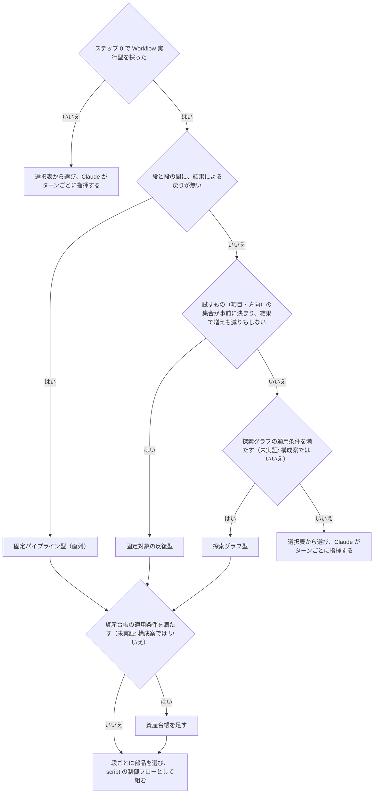
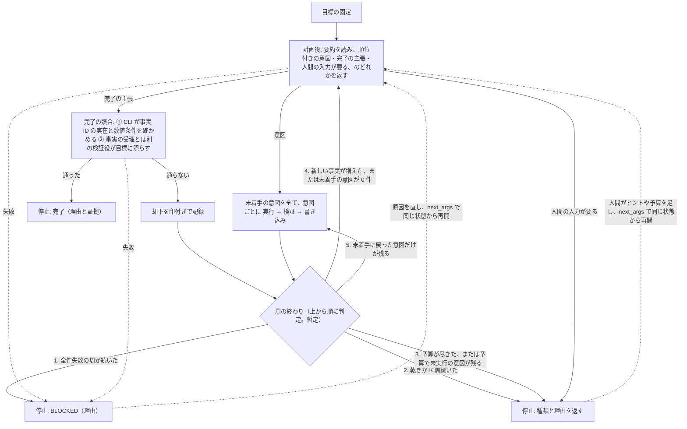

# スキル設計の再設計方針：形の判定・探索グラフ・資産台帳

スキル設計の再設計方針。best-practices を作り直すときに正本の文書へ統合する。それまで、配布物のスキルからは参照しない。

## 目次
- [参照と出所](#参照と出所)
- [用語](#用語)
- [位置づけ](#位置づけ)
- [形の判定](#形の判定)
- [目標の固定](#目標の固定)
- [停止・再開と人間の入力](#停止再開と人間の入力)
- [探索グラフ](#探索グラフ)
- [資産台帳](#資産台帳)
- [統合時に解消すること](#統合時に解消すること)

## 参照と出所

正本の文書:
- `best-practices.md` = `plugins/skill-creator/skills/skill-creator-best-practices/references/best-practices.md`（§ はこの文書の節）
- `coordination-patterns.md` = `plugins/skill-creator/skills/skill-creator-best-practices/references/coordination-patterns.md`（パターン番号はこの文書のパターン）

表の「出所」列の略記（外部の出所は 2026-10-20 に取得）:

| 略記 | 指すもの |
|---|---|
| docs | [Orchestrate subagents at scale with dynamic workflows](https://code.claude.com/docs/en/workflows)（Claude Code 公式） |
| authoring | Claude Code に同梱の `/workflow-authoring` skill の reference（公開 URL は無い。v2.1.291 で照合） |
| Cairn | [oritera/Cairn](https://github.com/oritera/Cairn) の protocol と dispatcher の spec、reason と explore の prompt、README |
| redesignhealth | [Agentic code review harness](https://www.redesignhealth.com/content/agentic-code-review-harness) |
| MAST | [Why Do Multi-Agent LLM Systems Fail?](https://arxiv.org/html/2503.13657v3) |
| research system | [How we built our multi-agent research system](https://www.anthropic.com/engineering/multi-agent-research-system)（Anthropic） |
| context | [Effective context engineering for AI agents](https://www.anthropic.com/engineering/effective-context-engineering-for-ai-agents)（Anthropic） |
| Cognition | [Don't Build Multi-Agents](https://cognition.com/blog/dont-build-multi-agents) |
| bp | `best-practices.md` の該当節。best-practices は作り直し中なので、bp だけが出所の原則はまだ確定していない |
| cp | `coordination-patterns.md` の該当箇所 |
| 本書 | このリポジトリの設計判断 |

## 用語

用語の定義は本書による。「（暫定）」を付けたものは、最初の実装でテストとともに確かめて書き戻す。
- **段**：全ての項目を待ってから次へ進む区切り。1 つの項目（`pipeline()` の 1 item）の中の手順は**工程**と呼ぶ。
- **形**：段と段の間の制御フロー。次の 3 つ。
  - 直列：段と段の間に、結果による戻りが無い（有限の分岐は列挙できるので直列に含める）
  - 固定集合のループ：試すもの（項目・方向）の集合が事前に決まって結果で増えも減りもせず、段と段の間に結果による戻りがある
  - 探索のループ：試すもの（項目・方向）の集合が、前の結果で変わる
- **部品**：1 つの段の中に入れるもの（各項目の工程を含む）。並列・観点ごとの検証・反証・N 案の比較（Judge panel）・項目ごとの map・項目ごとの until-pass（1 項目の工程を通るまで繰り返す）など。段と段の間のループは部品ではなく形（Orchestrator-Subagent は直列、Generator-Verifier の段をまたぐループは固定集合のループに当たる）。
- **構成案**：skill-creator-best-practices の create で structure-designer が出す設計案。
- **CLI**：状態（グラフ・台帳）を検証つきで読み書きする唯一のコマンド。規則は「状態の書き込み」。
- **next_args**：止まった run が返す、同じ状態から再開するための引数。
- **周**（暫定）：探索グラフの 1 回の反復。計画役を 1 回呼ぶ周と、計画役を呼ばずに未着手に戻った意図だけを実行する周（図の判定 5）の両方を 1 周に数える。
- **空振り**：何も見つからなかったという結果。
- **乾き**（定義全体が暫定）：新しい事実が 1 件も受理されず、検証を通った結果（空振り・既知の事実・事実の却下・完了の主張の却下）が 1 件以上ある周。完了の主張が却下されただけの周も乾きに数える。結果が 1 件も検証を通らなかった周は乾きではない。
- **全件失敗**：意図を 1 件以上実行し、その全てで実行・検証・書き込みのどれかの工程が欠けた周。
- **evidence pack**：根拠を行番号つきで 1 回だけ抜き出し、各 agent に配る束（§13「体数は測れる値から段階的に決める」）。
- **探索グラフ**の「グラフ」は事実と意図の構造を指す。§13「反復の停止と戻り先」の工程グラフ（工程を点、戻り先を辺とするもの）とは別物。

## 位置づけ

- 探索グラフと資産台帳は、パターン 7（Workflow 実行型）の内側でだけ使う。agent の起動とその記録・停止を script が行うことが前提で、Claude がターンごとに次を決める形（docs の比較表）ではこれを守れない。
- このリポジトリで未実証なのは、事実と意図のグラフ・CLI・資産台帳の 3 つ。実装で確かめるまで構成案の候補にしない。
- 本書が決めるのは原則まで。CLI の形、意図をもう一度試す仕組みの詳細、回数の閾値（K など）、用語の「（暫定）」は、最初の実装でテストとともに決め、本書へ書き戻す。

## 形の判定

cp の「パターン選択ガイド」ステップ 0（Workflow 実行型を採るか）の後に置く。軽い形から順に問う。前の問いは、後の重い形を選ぶ理由になる条件を含まないように書く。

形は 3 つで、どれにも当たらなければ選択表に戻る。探索グラフが実証されるまで、試すものの集合が結果で変わるスキルは TT（選択表から選び、Claude がターンごとに指揮する）で組む。

| 形 | 中身 | 以前の呼び名 |
|---|---|---|
| 固定パイプライン型 | 決まった段を順に処理する（Orchestrator-Subagent）。観点ごとの並列検証（Parallelization）、Judge panel、項目ごとの map や until-pass は段の中の部品 | パイプライン型、観点 fan-out＋検証型 |
| 固定対象の反復型 | 試すものの集合が決まったまま、段と段の間を戻って通るまで回す（例：監査の段と改稿の段を往復する。Generator-Verifier の until-pass。cp の基本方針） | — |
| 探索グラフ型 | 試すもの（項目・方向）の集合が前の結果で変わる。下の「探索グラフ」 | 探索グラフ型 |

| 原則 | 出所 | 守らないと壊れること |
|---|---|---|
| 図の順（軽い形から）に問い、重い形を選ぶときは、どの条件がそれを強いるかを構成案に書く | 本書 | 重い形が既定になり、決まった手順のスキルに探索の費用を払う |

例の着地（本書）：

| 例 | 着地 | 理由 |
|---|---|---|
| review（観点 fan-out → 反証 → 集約） | 固定パイプライン型＋並列の部品 | 段と段の間に戻りが無い |
| 移行の map（各ファイルを通るまで直す場合も） | 固定パイプライン型＋項目ごとの map・until-pass の部品 | until-pass は各ファイルの工程の中にあり、段と段の間には戻りが無い |
| Judge panel で N 案から選ぶ | 固定パイプライン型＋Judge panel の部品 | 生成 → 採点 → 接ぐ、で戻りが無い |
| 1 つの文書の監査と改稿を通るまで回す | 固定対象の反復型 | 試すもの（監査の観点・節）は事前に決まり、監査の段と改稿の段の間に戻りがある |
| ゲートつきの要求文書の作成（人間の承認で止まって再開する） | 固定対象の反復型＋「停止・再開と人間の入力」 | 上と同じ。ゲートで run が分かれるので、台帳と指摘の状態は run をまたがない（「統合時に解消すること」） |
| `research:search`、原因調査 | 探索グラフ型（実証までは TT） | 試すもの（調べる方向）の集合が前の結果で変わる |

## 目標の固定

どの形でも、入口で目標を固定する。探索グラフでは、完了の照合がこの目標に対して行われる。

| 原則 | 出所 | 守らないと壊れること |
|---|---|---|
| 目標は「最終的に検証できる成果物」とし、調査・手段・検証の手順を入れない。成果物が互いに独立なときだけ分ける | 本書 | 手順を終えたことが完了と読まれる |
| 依頼文から範囲と禁止事項を先に抜き出し、指示語を固有名に置き換えて自己完結させる | 本書 | fresh な agent に渡った時点で指示語の意味が消え、範囲の外へ探索が漏れる |
| 目標に数値で判定できる条件（件数・閾値など。以下「数値条件」）があれば、目標と一緒に固定する | 本書 | 完了の照合で、決定的に確かめられる条件が無くなる |
| 依頼文に無い目標・制約は作らない | 本書 | 頼まれていない成果物に費用を払い、その完了を報告する |

## 停止・再開と人間の入力

形によらず、Workflow 実行型に当てはまる。

| 原則 | 出所 | 守らないと壊れること |
|---|---|---|
| 停止の種類は「完了・乾き・予算・人間の入力待ち（needs_input）・BLOCKED」の 5 つ（形によっては使わないものがある）で、どれも理由を返す。完了は照合の証拠も返す | 本書（種類）・bp（§13 の終端と needs_input） | なぜ止まったか、どこから再開すればよいかが残らない |
| どの停止からも `next_args` で同じ状態から再開できる。乾きと予算は人間が入力や予算を足してから、BLOCKED は原因を直してから再開する | 本書 | 止まった run の途中までの結果を捨てて、最初からやり直すことになる |
| 人間の入力は run の境界でだけ入れる。入力が要るときは needs_input と理由を返して止め、人間が入力を足し、`next_args` で同じ状態から再開する | docs（実行中の入力は受け取れない）・bp（§13 の needs_input）・本書（next_args） | run の中で入力を待つ設計は組めない |
| 再開をまたいで残す値（固定した目標・予算の残り・反復の番号・連続数など）は run の外の状態に持ち、再開した run はそこから読む | 本書（`next_args` での再開は新しい run として起動するので、script の変数は残らない） | 人間の入力を挟むたびに予算と数が初期値に戻る |
| 単独で await する agent は、throw も `null` も受け止めて、BLOCKED と理由を返す。状態を読み書きする agent も含む | docs（直接 await した agent は、失敗すると run を終わらせるか `null` を返す） | 停止の理由が残らないまま run が終わる |

## 探索グラフ

**定義**：グラフの要素は事実と意図の 2 つ（Cairn）。
- 事実：分かったこと。グラフの点。
- 意図：次に試す方向。根拠にした 1 つ以上の事実から出る矢印で、試した結果が事実になると、その事実につながる。

ヒントは、人間がグラフの外から足す情報で、計画役が次に読むときに取り込む（Cairn はヒントを事実グラフの外に置き、誰でも足せる）。

1 周の流れは下の図のとおり。検証役の段は、Cairn に無い本書の追加。

**適用条件**（本書。4 つ全てを満たすときだけ。1 つでも欠けると、グラフは重いだけになる）：
- 出発点が分かっている
- 完了を判定できる（上の「目標の固定」ができている）
- 試す方向の集合が、前の結果で変わる
- 分岐を並列に試す価値がある

周の終わりの判定では、新しい事実が出続ける限り、完了か予算（判定 3）でしか止まらない。

### 計画役

| 原則 | 出所 | 守らないと壊れること |
|---|---|---|
| 最初の呼び出しと再開を除き、計画役を呼ぶのは図の判定 4 のときだけ。意図が増えただけでは呼ばない。空振りの事実は新しい事実に数えない（Cairn は空振りの結論も 1 件の事実として数えて呼び直す。本書はここで離れる） | Cairn・本書（空振りの扱い） | 自分の出力や空振りに反応して空回りする（本書） |
| 同時に走る計画役は 1 体 | Cairn | 同じ方向の意図が重複する（本書） |
| 出す意図は互いに重ならないものだけにする | Cairn | 同じ作業に二重に費用を払う（research system） |
| 未着手の意図が無く、完了でもないなら、意図か「人間の入力が要る」を返す | Cairn（意図を返す規則）・本書（人間の入力） | 誰も次の手を出さないまま止まる |
| 前の出力に依存する直列の手順は、前提が満たされた 1 段だけを意図にする | 本書 | 前提の無い段まで並列に出て、空振りが費用になる |
| 「見つからなかった」は結論にしない。証拠が薄ければ、同じ方向につき 1 回だけ（暫定）再確認の意図を出す | 本書 | 1 回の空振りで方向ごと捨てられる |
| 意図には順位を付ける | 本書 | 予算が足りないときに、どれを走らせるかが決まらない |
| 新しい事実の無いまま、完了をもう一度主張しない | 本書 | 主張と却下の往復が続く |
| 計画役に渡すのは状態の要約だけ（「状態の書き込み」の要約の行）。Cairn は計画役にグラフ全体を渡すので、本書はここで Cairn から離れる | 本書 | 全量を渡すと、周ごとに context が膨らむ |

### 実行役と検証役

| 原則 | 出所 | 守らないと壊れること |
|---|---|---|
| 実行役は意図を 1 件だけ受け取る。返すのはグラフに無い差分だけで、大きな出力はファイルに置いて参照を返す | Cairn | 既知の内容の繰り返しでグラフが膨らむ |
| 空振りも返し、空振りの印を付けた事実として残す | Cairn（返す）・本書（印） | 残さないと、同じ方向が繰り返し出される。印が無いと、乾きの判定で新しい事実に数えられる |
| 実行役は読み取り専用にするか、意図ごとに分けた作業場所で動かす | Cognition・docs（止まった試行の変更は残る） | 並列の実行役どうしの書き込みが衝突し、やり直しの試行が前の試行の変更の上に重なる |
| 意図ごとに `pipeline()` の 1 item として流し、工程の間で item を待たせない。待つのは周の終わりだけ。空いた枠は runtime の同時実行の上限が埋める | authoring | 工程ごとに全件を待たせると、最も遅い 1 件に全体が引きずられる |
| 周の途中で意図は足せない（item は呼んだ時点の配列で決まる） | 本書（API の形からの推論） | 足せる前提で組むと、足した意図が実行されない |
| 事実は、生成側と別 context の検証役が再取得した証拠を持つものだけを受理する | bp（§13 Verified commit）・本書（生成と検証の分離） | 自己申告がそのまま状態になり、後段がそれを前提に動く |
| 完了の照合は図の C の 2 段で行う | 本書・MAST | LLM だけの判定で、表面的な確認のまま完了が通る |

### 状態の書き込み

探索グラフと資産台帳に共通する。

| 原則 | 出所 | 守らないと壊れること |
|---|---|---|
| 状態を書くのは CLI だけ。script はファイルに触れないので、CLI を呼ぶのは agent | 本書（CLI だけ）・docs（script はファイルにも shell にも触れない） | agent がファイルを直接書くと、検査を通らない内容が状態に入る |
| 受理を決めるのは script。書き込む agent は、その決定を CLI に渡すだけにする | bp（§13 Verified commit）・docs | 受理を agent が決めると、検証を飛ばした書き込みを止められない |
| CLI は、有効な ID の一覧に無い ID を指す出力を拒否する。有効な ID は、台帳の資産 ID・事実の ID・事実が指す資産 ID の和集合 | 本書 | 存在しない事実や資産を根拠にした結果が状態に入る |
| 既知の事実かどうかと、同じ指摘かどうかは、CLI の決定的な照合（既知のキー・ID との一致）か、検証役の閉集合からの選択で決める。生成した agent の申告や自由記述では決めない | 本書・bp（§13「乾き停止」の novelty を script が算出） | 言い換えただけの既知が新しいものに数えられ、乾きも重複除去も壊れる |
| 状態の全ての更新（事実・カウンタ・予算の残りを含む）は、内容から決まるキー（暫定：周の番号と意図 ID）で冪等にする。時刻や乱数でキーを作らない | docs（resume と停止時の再実行） | 再実行された書き込み役が、事実を二重に足し、予算を二重に引き、連続数を二重に進める |
| CLI の読み出しは周の番号を引数に取り、その周の時点の状態を返す（暫定） | 本書・docs（relaunch では途中の agent から再実行される） | 再実行された読み出しが、前の run が先まで書いた状態を読み、計画と判定が未来の事実を前提にする |
| 事実は足すだけで書き換えない。状態の変化（指摘の状態の遷移を含む）は、新しい記録として足す | Cairn（事実）・本書（指摘の遷移） | どの事実を根拠に何を決めたかを、後から辿れない |
| agent に渡すのは状態の要約だけにし、細部は ID で必要なときに引かせる。要約は CLI が決定的に作り、大きさに上限を置き、載せなかったものは要約の中で宣言する | 本書・context（ID で必要なときに読み込む、context は有限の資源）・bp（§13「抽出は agent より決定的な script が望ましい」） | 全量を渡すと context が膨らみ想起が落ちる。agent が要約すると原典から drift する。載らなかったものが「無い」と読まれる |
| CLI の出力（要約・件数・ID）を script へ運ぶ agent は、schema のフィールドに逐語で写すか、パスだけを渡す | 本書 | 運ぶ agent の言い換えが、原典から drift した写しになる |

### 体数と予算

| 原則 | 出所 | 守らないと壊れること |
|---|---|---|
| 実行役は全て script が起動し、周ごとの起動数を結果に残す | bp（§13「体数は測れる値から段階的に決める」）・本書 | 起動が帳簿に載らず、費用を追えない |
| 実行役の数は意図の件数で決め、どの経路でも固定の上限は置かない。§13 の体数の規則との関係は「統合時に解消すること」 | 本書 | 固定すると、難しい課題では必要な方向を試せず、易しい課題では余計に起動する |
| 予算は、計画役・完了の照合・CLI を呼ぶ agent と、意図ごとの実行・検証・書き込み（1 意図あたり 3 体以上）を全て数える。残りの予算で賄えないときは、順位の順に起動し、残りは「未実行」として結果に残す（図の判定 3 で予算停止） | 本書 | 一部を数え漏らすと予算が守られない。黙って切ると、試していない方向が「試した」と読まれる |
| runtime の上限（1 回の `parallel()` / `pipeline()` で 4096 件、1 run で 1000 体）も予算に含め、当たる前に止める | docs | 4096 件を超えた呼び出しはエラーで拒否される |

### 停止

| 原則 | 出所 | 守らないと壊れること |
|---|---|---|
| 周の終わりの判定は図の 1〜5 の順で、最初に当たったものだけを採る（暫定） | 本書 | 同じ周が複数の停止に当たり、返す理由を誤る |
| 全件失敗と乾きの連続数は、それぞれ条件に当たらない周で 0 に戻る（暫定） | 本書 | 間に別の周を挟んだ失敗や乾きが積み上がり、早すぎる停止になる |
| 全件失敗の周が続いたら BLOCKED で止める（連続数は実装で決める） | 本書 | 失敗は乾きに数えないので、止めないと予算まで回り続ける |
| 乾き停止は K 周連続の乾きで判定し、K ≥ 2 とする（具体値は実装で決める） | 本書・bp（§13 品質パターン Loop-until-dry）・authoring | K = 1 だと、1 回だけの再確認が出る前に止まる |
| 却下した完了の主張は、印を付けて記録し、新しい事実に数えない | 本書 | 主張と却下の往復が、乾きを止めたまま続く |
| 欠けた工程のある意図は何も書かず未着手に戻す。1 件の欠けだけでは、乾きにも BLOCKED にもしない | Cairn（失敗した explore は何も書かず意図を解放する）・本書・docs（pipeline の中の失敗は null になり run は続く） | 1 件の欠測で run 全体が止まるか、欠けた意図が失われる |
| ヒントは run の中では増えない。ヒントが増えたことが、再開した run で計画役を呼ぶ理由になる | Cairn（ヒントの増加で計画役を呼ぶ）・本書 | 再開しても計画役が新しいヒントを読まない |

## 資産台帳

**定義**（本書）：台帳は、資産と各 agent の結果との結び付きの一覧である。資産は、検証や探索の対象のうち、CLI が決定的に安定した ID を付けられる単位を指す（ファイル＋行範囲・要求 ID・情報源 URL など）。
- 主張のように、同じかどうかが意味の判定になる対象は資産にしない（CLI が ID を決められない）。
- 資産 ID は内容から決まるので、台帳を作り直しても同じ ID になる。
- 対象がファイルの行範囲なら、台帳は evidence pack の各行範囲に ID を付けた形になる。
- 台帳は run の中で agent が共有する資産の層で、探索グラフはタスクごとの探索の層。2 つを分けて持つ。
- 台帳の寿命は 1 run。両方を使うスキルで needs_input から再開した run は、台帳を作り直す。

**適用条件**（本書）：fan-out した結果について、どこまで見たかを宣言する必要があるとき。

| スキルの例 | 資産 | 結び付ける結果 |
|---|---|---|
| review / audit | ファイル・節・行範囲 | 「見た」の結び付き。指摘と「確認済みで問題なし」は検証役の結果 |
| `prd-spec` | 要求 ID・仕様 ID | 検証結果、追跡リンク |
| `research:search` | 情報源 URL | その情報源で確認済み・反証・確認不能になった主張 |

「状態の書き込み」の原則は、台帳にも全て当てはまる。そのうえで、「見た」という結び付きは検証を通さずに入れ、指摘と「確認済みで問題なし」は検証役の結果として結び付ける。

| 原則 | 出所 | 守らないと壊れること |
|---|---|---|
| 資産の ID と、同じ資産かどうかの判定は、CLI だけが決定的に決める。agent は生の情報を返すだけにする | 本書 | agent が判定すると、同じ資産が別 ID になり、カバレッジも重複除去も壊れる |
| カバレッジ（結果が 1 件以上結び付いた資産の割合）は CLI が数え、結果が結び付かなかった資産の一覧（skip 一覧）を結果に載せる | bp（§13 evidence pack の「入れなかったファイルは一覧で宣言」）・authoring（No silent caps） | 見ていない箇所が「問題なし」と読まれる |
| カバレッジは「見た」ことしか示さない。正しさは検証役（パターン 2）が別に持つ | redesignhealth | 網羅率の高さが正しさの証拠として読まれる |
| agent への prompt は資産 ID の順に並べて安定させる | docs（prompt が変わった最初の agent 以降が再実行される） | resume のたびに順序が揺れ、再実行の範囲が広がる |
| skip 一覧に残った資産だけを渡して、reviewer を追加で起動する（起動は script） | redesignhealth（狙った追加）・本書（script） | 全体を回し直すと、見終えた資産にも費用を払い直す |
| 追加起動は、新しく見た資産が 0 件になった回で止め（暫定）、残った skip 一覧を返す | 本書 | 毎回残る資産について、予算まで回り続ける |
| agent に渡す担当の単位は、ファイルではなく、一緒に読まないと判断できない範囲にする。範囲は CLI の決定的な規則で作るか、抽出役が閉集合（ファイル一覧など）から選ぶ | redesignhealth（単位）・本書（決め方） | ファイル単位で切ると、ファイルをまたぐ検査が誰の担当にも入らない。LLM が自由に範囲を作ると、範囲が run ごとに変わる |
| 担当は script が割り当てる。得意な agent が自分から名乗り出る形にはしない | 本書・bp（§13「分担の原則」と「体数を agent の自己申告や判断で変えない」から導出） | 得意な資産に名乗り出が集まって費用が重なり、苦手な資産は毎回 skip 一覧に残る |
| 指摘の ID は、資産 ID と規則（観点）の ID から決定的に作る | 本書 | 回ごとに ID が変わると、同じ指摘が別物として数えられる |
| run の中で対象が書き換わるとき（until-pass の部品・固定対象の反復型・書き込む実行役）だけ、反復ごとに資産の内容のハッシュで古い結果を無効にし（暫定）、resolved / regressed まで追う。書き換わらないときは open / dismissed だけを持つ | redesignhealth（状態の追跡）・本書（書き換えの有無で分ける） | 書き換わらない run で resolved / regressed を持つと、決まらない状態が残る。書き換わる run で追わないと、直った指摘と再発した指摘を区別できない |
| agent どうしが互いの作業過程を検索する専用の仕組みは作らない。各 agent の出力を run のディレクトリにファイルで残す | 本書 | 足りるかどうか確かめる前に、仕組みの保守費用を払う |

## 統合時に解消すること

- 本書を正本へ統合した後の扱い（削除するか、正本への参照だけにするか）
- 探索グラフ・資産台帳の、cp パターン 1–8 に対する位置づけ（冒頭の段落・目次・パターン番号）
- 「形の判定」の図と、cp の選択表・基本方針との役割分担。cp のステップ 1 の見出し「内側の形を選ぶ」の「形」は、本書の「形」と意味が違う
- 構成案の候補への追加：実装で実証された後に限り、`plugins/skill-creator/skills/skill-creator-best-practices/agents/structure-designer.md` の採用パターンの列挙と、`plugins/skill-creator/skills/skill-creator-best-practices/references/orchestrator-requirements.md` の選択手順に加える
- cp のステップ 0 は「各ステップに人間の判断・承認が挟まるなら Workflow 実行型にしない」としている。本書の「停止・再開と人間の入力」（run の境界で止めて next_args で再開する）との関係
- エンジン（グラフの記録・起動条件・完了の照合）の置き場。別 plugin の部品はスキル呼び出しでしか使えないという規則と、`workflow()` の入れ子が 1 段までという制約（authoring）の両方に合う置き方
- §13「体数を agent の自己申告や判断で変えない」に、script が起動して数を記録する起動は対象外と明記する（方向は決定済み。§13 が問題にするのは帳簿に載らない起動で、本書の起動は全て script が行い数を記録する。§13 が挙げる「票の独立」は探索グラフには票が無いので当たらないことも書く）
- Codex runner との互換：runner は、hard max の無い動的な fan-out と、上限が分からない loop を起動前に拒否する（`plugins/workflow/skills/dynamic-workflow-runner/references/claude-workflow-compatibility.md`）。探索グラフは native では動くが、runner 側が変わらない限り runner には拒否される（本書は実行役の数に上限を置かない）
- 指摘の状態を run をまたいで resolved / regressed まで追うこと。前提は、資産の内容のハッシュで古い結果を無効にする仕組み
- 乾き停止の定義の食い違いは bp の中にある：§13「反復の停止と戻り先」は 1 周で判定し、§13 品質パターン Loop-until-dry と authoring は K 周連続で判定する。本書は K ≥ 2 を採る
- 停止の種類（完了と BLOCKED）と、§13 の終端・「前提が崩れた」・スコープの梯子（失敗の種類ごとの戻り先）との関係
- pipeline の原則と §13「pipeline と parallel の使い分け」の重複（統合時は §13 への参照にする）
- §13 品質パターン（Verified commit・No silent caps・Loop-until-dry・Judge panel）との関係と、§10 チェックリストに確認項目を足すか
- 出所が bp だけの原則（表で「bp」とだけ書いた行）の見直し
- 最初の実装で確かめて書き戻すもの：「位置づけ」に挙げた細部、K と全件失敗の連続数、「（暫定）」を付けたもの（周と乾きの定義、連続数を 0 に戻す規則、周の終わりの判定の順、冪等のキーの構成、読み出しに周の番号を渡すこと、再確認の回数、ハッシュによる無効化、追加起動の止め方）
