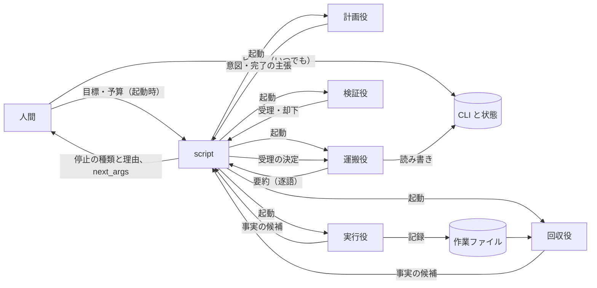
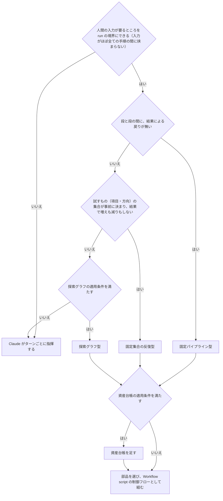
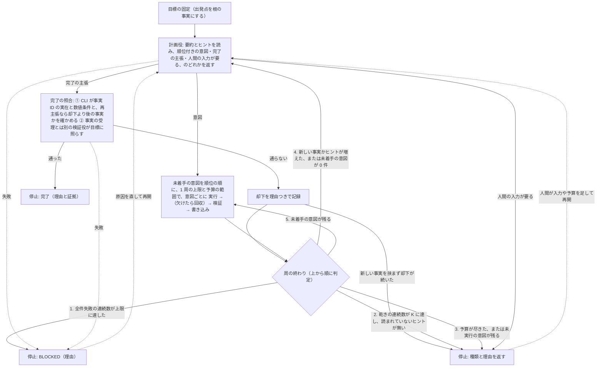

# スキル設計の再設計方針：形の判定・探索グラフ・資産台帳

スキルを multi-agent の Workflow として設計するときの方針。

## 目次
- [出所](#出所)
- [用語](#用語)
- [方針の水準](#方針の水準)
- [構成要素](#構成要素)
- [形の判定](#形の判定)
- [目標の固定](#目標の固定)
- [停止・再開と人間の入力](#停止再開と人間の入力)
- [モデル・effort・prompt](#モデルeffortprompt)
- [権限](#権限)
- [探索グラフ](#探索グラフ)
- [資産台帳](#資産台帳)
- [未決事項](#未決事項)

## 出所

表の「出所」列の略記（2026-10-20 に取得）:

| 略記 | 指すもの |
|---|---|
| docs | [Orchestrate subagents at scale with dynamic workflows](https://code.claude.com/docs/en/workflows)（Claude Code 公式） |
| authoring | Claude Code に同梱の `/workflow-authoring` skill の reference（公開 URL は無い。v2.1.291 で照合） |
| Cairn | [oritera/Cairn](https://github.com/oritera/Cairn) の protocol と dispatcher の spec、reason と explore の prompt、`dispatch.example.yaml`、README |
| ARTEX | [Hinln/ARTEX](https://github.com/Hinln/ARTEX) の README の構成の節（本家の Autumn-27/ARTEX は取得時に 404。README は Cairn を参考に挙げる） |
| redesignhealth | [Agentic code review harness](https://www.redesignhealth.com/content/agentic-code-review-harness) |
| MAST | [Why Do Multi-Agent LLM Systems Fail?](https://arxiv.org/html/2503.13657v3) |
| research system | [How we built our multi-agent research system](https://www.anthropic.com/engineering/multi-agent-research-system)（Anthropic） |
| context | [Effective context engineering for AI agents](https://www.anthropic.com/engineering/effective-context-engineering-for-ai-agents)（Anthropic） |
| Cognition | [Don't Build Multi-Agents](https://cognition.com/blog/dont-build-multi-agents) |
| Cognition 続報 | [Multi-Agents: What's Actually Working](https://cognition.com/blog/multi-agents-working)（2026-04-22） |
| Opus 5.5 | [Prompting Claude Opus 5.5](https://platform.claude.com/docs/en/build-with-claude/prompt-engineering/prompting-claude-opus-5-5) |
| Opus 5 | [Prompting Claude Opus 5](https://platform.claude.com/docs/en/build-with-claude/prompt-engineering/prompting-claude-opus-5) |
| Fable 5.1 | [Prompting Claude Fable 5.1](https://platform.claude.com/docs/en/build-with-claude/prompt-engineering/prompting-claude-fable-5-1) |
| Fable 5 | [Prompting Claude Fable 5](https://platform.claude.com/docs/en/build-with-claude/prompt-engineering/prompting-claude-fable-5) |
| GPT-6 | [Prompt guidance](https://developers.openai.com/api/docs/guides/prompt-guidance)（OpenAI。GPT-6 Astra・GPT-6.1 Sol・GPT-6 Luna が対象。ページに日付の記載は無い） |
| 本書 | このリポジトリの設計判断。理由は、その行の「守らないと壊れること」の列か、出所の括弧書きに書く |

## 用語

用語の定義は本書による。
- **項目**：1 つの段で処理する単位（ファイル・観点・意図など）。
- **段**：全ての項目を待ってから次へ進む区切りと、区切りの間の処理のまとまり。次の手順が全ての項目の結果を必要とするなら、そこが段の境界になる。
- **工程**：1 つの項目（`pipeline()` の 1 item）の中の手順。工程の間では他の項目を待たない。authoring が pipeline について言う "stage" は、本書の工程に当たる。
- **反復**：段の並びを、結果に応じてもう一度回すこと。探索グラフの反復は**周**と呼ぶ。判定 5 で未着手の意図だけを実行する回と、完了の主張が却下されただけの回も 1 周に数える（暫定）。
- **形**：段と段の間の制御フロー。次の 3 つだけ。
  - 固定パイプライン型：段と段の間に、結果による戻りが無い（有限の分岐は列挙できるのでここに含める）
  - 固定集合の反復型：試すもの（項目・方向）の集合が事前に決まって結果で増えも減りもせず、段と段の間に結果による戻りがある
  - 探索グラフ型：試すもの（項目・方向）の集合が、前の結果で変わる
- **部品**：1 つ以上の段からなり、段と段の間に戻りの無い定型の並び。形の中に組み込む。例：
  - 並列化：互いに独立な項目を同時に処理する段（項目ごとの処理は違ってよい）
  - 観点ごとの検証、反証
  - Judge panel：独立に N 案を作る段 → 並列に採点する段 → 最良を軸に他の案の良いところを取り込む段（authoring）
  - 項目ごとの map：全ての項目に同じ処理を当てる段
  - 項目ごとの until-pass：1 項目の工程を、通るまでその項目の中で繰り返す
- **CLI**：状態（グラフ・台帳・ヒント）を検証つきで読み書きする唯一のコマンド。規則は「状態の書き込み」。
- **作業ファイル**：run のディレクトリに agent が置くファイル（実行の記録・大きな出力・各 agent の出力）。状態ではなく、CLI を通さずに書く。
- **next_args**：止まった run が返す、同じ状態から新しい run を起動するための引数。
- **再開**：`next_args` で新しい run を起動すること。docs の resume（一時停止からの再開）や relaunch（同じ run を保存した結果から再生すること）とは別。本書は relaunch を使わない（「停止・再開と人間の入力」）。
- **needs_input**：人間の入力を待って止まったことを示す停止の種類。
- **BLOCKED**：失敗して続けられずに止まったことを示す停止の種類。
- **ヒント**：人間が状態に足す、待たれない入力。run の実行中でも足せる（「停止・再開と人間の入力」）。
- **空振り**：何も見つからなかったという結果。
- **乾き**（暫定）：新しいものが 1 件も受理されず、全件失敗でもない反復。探索グラフでは周を単位とし、空振り・既知の事実・検証不能・却下（事実・完了の主張）は「新しいもの」に数えない。
- **全件失敗**：処理した項目が 1 件以上あり、その全てで工程が欠けた反復。探索グラフでは、実行した全ての意図で、試行が工程の欠けになった周（回収で受理が出た試行は欠けではない）。
- **未着手**：まだ結論の出ていない意図。予算で起動しなかった意図（**未実行**）、1 周の上限で回せなかった意図、工程が欠けて戻った意図を含む。試行の上限で外した意図（**打ち切り**）は含まない。

## 方針の水準

本書が決めるのは原則と初期値まで。「（暫定）」の印を付けた規則と値、CLI の形とキー・ID の作り方は、最初の実装でテストとともに決め、本書へ書き戻す。

## 構成要素

Workflow script で組むスキルは、次の要素に分かれる。各要素は「持つもの」だけを持ち、「持たないもの」は他の要素に任せる。役の名前は探索グラフでのもので、他の形では使う役だけを置く。

| 要素 | 持つもの | 持たないもの |
|---|---|---|
| script | 制御フロー、agent の起動と起動数の記録、受理の決定、停止の判定 | ファイルと shell（docs：script はどちらにも触れない） |
| 計画役 | 次に試す意図、完了の主張、人間の入力が要るという判断 | 実行、状態の書き込み |
| 実行役 | 1 件の意図の実行と、事実の候補（検証に要るものを添える） | 受理の判定、他の意図 |
| 回収役 | 工程が欠けた実行の記録から、確認済みの事実の候補を拾う | 新しい実行 |
| 検証役 | 事実の候補・完了の主張を、生成と別の context で受理か却下に分ける | 生成 |
| 運搬役 | CLI の呼び出しと、その出力の逐語の写し | 判断 |
| CLI | 状態、ID、要約、決定的な照合 | 意味の判定 |
| 人間 | 目標、ヒント、予算、承認 | run の中で待たれる応答（docs：実行中の入力は受け取れない） |

## 形の判定

軽い形から順に問う。前の問いは、後の重い形を選ぶ理由になる条件を含まないように書く。

| 原則 | 出所 | 守らないと壊れること |
|---|---|---|
| 待たれる人間の入力（承認・回答）が要るところは run の境界にし、Workflow script には入力を待たない区間だけを入れる（「停止・再開と人間の入力」）。入力がほぼ全ての手順の間に挟まるなら、run に切っても利点が無いので Claude がターンごとに指揮する | docs（Behavior and limits の表：実行中の入力は受け取れず、段階の間の承認は段階ごとに別の workflow として回す） | run の中では、入力を待ってから続けることができない |
| 図の順（軽い形から）に問い、重い形を選ぶときは、どの条件がそれを強いるかをスキルの設計の説明に書く | 本書 | 重い形が既定になり、決まった手順のスキルに探索の費用を払う |

例の着地（本書）：

| 例 | 着地 | 理由 |
|---|---|---|
| review（観点 fan-out → 反証 → 集約） | 固定パイプライン型＋観点ごとの検証・反証の部品 | 段と段の間に戻りが無い |
| 移行の map（各ファイルを通るまで直す場合も） | 固定パイプライン型＋項目ごとの map・until-pass の部品 | 改稿が他のファイルの結果を必要としないので、until-pass は各ファイルの工程の中にある |
| Judge panel で N 案から選ぶ | 固定パイプライン型＋Judge panel の部品 | 案を作る → 採点 → 取り込む、で戻りが無い |
| 1 つの文書の監査と改稿を通るまで回す | 固定集合の反復型 | 改稿が全ての観点の監査結果を必要とするので、監査と改稿の間が段の境界になり、そこに戻りがある |
| ゲートつきの要求文書の作成（人間の承認で止まって再開する） | 固定集合の反復型。各ゲートを run の境界にする | 上と同じ。ゲートの間の区間は、run の中で人間の入力を待たない |
| 情報源を辿る調査、原因調査 | 探索グラフ型 | 試すもの（調べる方向）の集合が前の結果で変わる |

## 目標の固定

どの形でも、入口で目標を固定する。探索グラフでは、完了の照合がこの目標に対して行われる。

| 原則 | 出所 | 守らないと壊れること |
|---|---|---|
| 目標は「最終的に検証できる成果物」とし、調査・手段・検証の手順を入れない。成果物が互いに独立なときだけ分ける | 本書 | 手順を終えたことが完了と読まれる |
| 依頼文から範囲と禁止事項を先に抜き出し、指示語を固有名に置き換えて自己完結させる | 本書 | fresh な agent に渡った時点で指示語の意味が消え、範囲の外へ探索が漏れる |
| 目標に数値で判定できる条件（件数・閾値など。以下「数値条件」）があれば、目標と一緒に固定する | 本書 | 完了の照合で、決定的に確かめられる条件が無くなる |
| 固定した目標と出発点は、前提として状態に書く（探索グラフでは出発点を根の事実にする）。検証役による受理の規則の外に置く | 本書（生成した主張ではなく入力だから）・Cairn（origin と goal を特別な事実として作る） | 最初の周の意図が根拠の事実を指せず、CLI に拒否される |
| 依頼文に無い目標・制約は作らない | 本書・Opus 5（依頼の範囲を広げたり狭めたりしない） | 頼まれていない成果物に費用を払い、その完了を報告する |

## 停止・再開と人間の入力

形によらず、Workflow script に当てはまる。人間の入力は 2 種類ある。

- **待たれる入力**（承認・質問への回答）：run の境界でだけ入れる。run は needs_input で止まり、人間が入力を足してから再開する。
- **待たれない入力**（ヒント）：run の実行中でも CLI で状態に足せる。run は止まらず、次に計画役を呼ぶときに取り込まれる。runtime 自体は実行中の入力を受け取らないが（docs）、状態は run の外にあり agent が CLI で読むので、この経路は runtime の制約に当たらない（本書）。

| 原則 | 出所 | 守らないと壊れること |
|---|---|---|
| 停止の種類は「完了・乾き・予算・needs_input・BLOCKED」の 5 つ（形によっては使わないものがある）で、どれも理由と、結論の出ていない意図の一覧を返す。一覧は未実行・1 周の上限で回せなかった・工程が欠けた・打ち切り、の別を付け、2 つに当たる意図は工程の欠けを優先する。完了は照合の証拠も返す | 本書・authoring（No silent caps） | なぜ止まったか、どこから再開すればよいかが残らない。試していない方向が「試した」と読まれる |
| 待たれる入力が要るときは、needs_input と理由を返して止め、人間が入力を足し、再開する | docs（Behavior and limits の表：実行中の入力は受け取れない）・本書（next_args） | run の中で入力を待つ設計は組めない |
| ヒントは人間が CLI で状態に追記する。ヒントには追記の順の番号を付け、run の実行中も、完了以外で止まっている間も足せる | Cairn（ヒントはグラフの外の入力で、停止中のプロジェクトにも足せる）・本書（番号） | 実行中に気づいたことを伝えるために run を止めることになる |
| スキルは run を起動したときに、ヒントを足す CLI のコマンドと状態の置き場を人間に示す | 本書 | 人間がヒントの足し方を知らず、待たれない入力の経路が使われない |
| 計画役に渡す読み出しは、その周で読むヒントの範囲（番号の上限）を、周の番号をキーに記録して固定する。計画役を呼ばない周（判定 5）は直前の周の上限を引き継ぐ。周の終わりの判定 2 と 4 は、この上限より後のヒントがあるかで「読まれていないヒント」を判断する | 本書 | 計画役が読んだヒントと、判定が数えるヒントが食い違う |
| 完了した状態へのヒントの追記は、CLI が拒否する | 本書（完了からは再開しないので、足しても読まれない。Cairn は完了した項目を reopen できるので事情が違う） | 人間が足したヒントが、誰にも読まれずに残る |
| 止めた run や途中で終わった run は relaunch せず、状態から新しい run として再開する。再開した run は状態をそのまま読み、周の番号は使った番号の次から振る。途中の周で受理された事実・試行の回数・打ち切り・予算の消費も、そのまま使う。新しい run は、起動する側（Claude か人間）が前の run の agent が全て終わったことを `/workflows` で確かめてから起動する。run ID は起動する側が args で渡し（script では時刻も乱数も使えない）、CLI は書き込みに run ID を求めて、新しい run が始まった後の古い run ID の書き込みを拒否する | 本書（状態にあるのは検証を通ったものと実際に起きた消費だけなので、捨てる理由が無い）・docs（relaunch では prompt が変わった agent か失敗した agent から後ろが完了済みでも再実行される。止めた run の agent がまだ終わっていなければ relaunch は拒否されるが、新しい run の起動にはこの保護が無い） | 再実行の記録が前の記録と混ざる。前の run の遅れた書き込みが、新しい run が読んだ後の状態を変える |
| 完了以外の停止からは再開できる。乾き・予算・needs_input は人間が入力や予算を足してから、BLOCKED は原因を直してから再開する | 本書 | 止まった run の途中までの結果を捨てて、最初からやり直すことになる |
| 再開した run は必ず計画役から始め、止まっていた間に増えたヒントを読ませる | Cairn（ヒントの増加で計画役を呼ぶ）・本書 | 再開しても計画役が新しいヒントを読まない |
| 再開した run では、全件失敗・乾き・完了の主張の却下の連続数を 0 から数え直す（暫定）。resume（一時停止からの再開）ではこの規則を使わない | 本書 | 乾きで止まって再開した run が、最初の周で再確認を待たずに止まる |
| 再開した run では、台帳を作り直す（暫定） | 本書（前の run の後に対象が変わっていても、作り直せば今の内容から ID とカバレッジが決まる。資産 ID は内容から決まるので、変わっていない資産は同じ ID になる） | 古い内容に基づく結び付きとカバレッジが残る |
| 再開をまたいで残す値（固定した目標・予算の残り・反復の番号・試行の回数など）は run の外の状態に持ち、再開した run はそこから読む | 本書（再開は新しい run の起動なので、script の変数は残らない） | 人間の入力を挟むたびに予算と数が初期値に戻る |
| 単独で await する agent は、throw も `null` も受け止めて、BLOCKED と理由を返す。状態を読み書きする agent も含む | docs（直接 await した agent は、失敗すると run を終わらせるか `null` を返す）・authoring（`agent()` は予算の超過などで throw する。script は通常の JavaScript なので try/catch で受け止める） | 停止の理由が残らないまま run が終わる |

## モデル・effort・prompt

役ごとに求める性質が違うので、`agent()` の `model` と `effort` を役ごとに決める（authoring）。model を指定しなければ、subagent と同じ順で決まり、他に割り当てが無ければセッションのモデルになる（docs）。値はモデルの世代で変わるので、本書は初期値だけを置き、eval で決め直す。

| 役 | 求める性質 | 初期値（暫定） |
|---|---|---|
| 計画役 | グラフ全体を読んで方向を選ぶ判断 | 最上位のモデル。effort はそのモデルの既定（Fable 5.1 は `high`、Opus 5.5 は `medium`） |
| 実行役 | 1 件の意図をやり切る持続力 | 課題に合わせる（Fable 5.1 を `low` で使うときは下の表の行） |
| 事実の検証役 | 表面的でない確認 | 実行役と同等以上のモデル。生成と別の context |
| 完了の照合の検証役 | 受理済みの事実を目標に照らす | 事実の検証役と同じ。誤って通すと run が完了して止まるため |
| 回収役 | 記録から確認済みのものだけを拾う | 小さいモデル・`low` |
| 運搬役 | 判断せず逐語で写す | 最小のモデル・`low` |

| 原則 | 出所 | 守らないと壊れること |
|---|---|---|
| effort はモデルをまたいで同じ思考量を指さない。モデルを変えたら測り直す | Opus 5.5・Fable 5.1 | 前のモデルの設定を持ち込み、費用だけが増えるか、質が落ちる |
| `xhigh` と `max` は、質の向上を測れた役にだけ使う | Opus 5.5 | 1 周が長くなり、出力のトークンが増える |
| Fable 5.1 を `low` で使う役では、検索や読み出しの道具を使う場面を prompt に書く | Fable 5.1（`low` では検索と読み出しの道具を呼ぶ回数が減る） | 実行役が調べずに答え、検証役に却下され続ける |
| 実行役の prompt に「自分で検証せよ」「subagent で確かめよ」を書かない。検証は script の構造（検証役の工程）で持つ | Opus 5（検証の指示は過剰な検証を招く。subagent で自分の作業を確かめさせない）・本書（Fable 5 は長い run で subagent による検証を prompt に書くよう勧めるが、本書は検証役の工程として script が起動するので、実行役に書く必要が無い） | 実行役と検証役が同じ確認を二重に行い、費用だけが増える |
| 各役の prompt には、指示と一緒にその理由（何のための成果か）を書く。強い言葉や細かい手順の列挙で縛らない | Fable 5（理由を渡すとよく働く。前のモデル向けのスキルは指示が細かすぎて質を落とす）・GPT-6（Astra は指示とスキルに敏感なので、矛盾を点検する） | 指示の字面だけに従い、目的に合わない結果を返す |
| 実行役は、返す事実ごとに、それを示したツールの結果（パス・URL・コマンド）を添える | Fable 5（進捗の主張をツールの結果に照らすと、作り話の報告がほぼ無くなる） | 検証役が何を再取得すればよいか分からない |
| Codex で GPT-6 Astra を使うときは、実行役に「依頼から意図を推定して完了まで進める」と書き、ユーザーの指示がスキルより優先されると書く | GPT-6（Astra は確認を求めて止まりやすく、指示とスキルに影響されやすい） | 実行役が確認待ちで止まり、工程が欠ける |

## 権限

| 原則 | 出所 | 守らないと壊れること |
|---|---|---|
| auto mode では、script が `agent()` に渡す prompt はユーザーの依頼として扱われない。スキルの側からは変えられない前提で組む | docs（Claude Code が script の計算した文として印を付ける） | 権限確認で agent が止まり、run が人間の応答を待つ |
| agent が使う道具は、run の前に allow rules に入れる。スキルは、必要な allow rules を利用者向けに書く | docs（長い run で確認を避けるには、agent が要る道具を allow rules に入れる） | 長い run の途中で確認が出て、その間 run が進まない |
| allow rules は、CLI のコマンド、run のディレクトリへの作業ファイルの書き込み、実行役が課題に要る道具に絞る | 本書（状態を書くのは CLI だけなので、状態の置き場への直接の書き込みを許す必要が無い） | 許可が広すぎ、意図しない書き込みが確認なしで通る |
| allow rules は、workflow の全ての subagent に session の permission rules として効く（docs）。agent ごとに分ける仕組みは docs に無いので（本書の推論）、役ごとの制限は agent type の道具で行い、CLI を呼べる道具を持つのは運搬役の agent type だけにする。shell か書き込みの道具を持つ役（課題で shell を要る実行役、再実行で確かめる検証役、記録を書く実行役）は CLI や状態に届きうる。書き込みの道具は書ける先をパスで絞れないので、記録を書く実行役は対象にも書けてしまう。これらの残る危険を run の結果に書く（暫定） | docs（workflow が起こす subagent はあなたの permission rules を使う。agent type と tools は agent ごとに違いうる）・authoring（`agentType` で subagent の定義を選べる）・本書 | 実行役が CLI で事実を直接書き、検証を飛ばす |

## 探索グラフ

**定義**：グラフの要素は事実と意図の 2 つ（Cairn）。
- 事実：分かったこと。グラフの点。
- 意図：次に試す方向。根拠にした 1 つ以上の事実から出る矢印で、試した結果が事実になると、その事実につながる。

ヒントは、人間がグラフの外から足す情報で、計画役が次に読むときに取り込む（Cairn はヒントを事実グラフの外に置き、誰でも足せる）。

1 周の流れは下の図のとおり。検証役と回収役の工程は、Cairn と違う本書の作り方（Cairn は reason の自己判定で完了し、欠けた実行の回収は同じ session の続きで行う）。

**適用条件**（本書。4 つ全てを満たすときだけ。1 つでも欠けると、グラフは重いだけになる）：
- 出発点が分かっている
- 完了を判定できる（上の「目標の固定」ができている）
- 試すもの（項目・方向）の集合が、前の結果で変わる
- 分岐を並列に試す価値がある

1 体の agent が 1 回で解ける課題は対象にしない。Cairn は最初に 1 体で全体を解かせる bootstrap を持つが、本書は持たない。1 回で解けるなら、スキルの形にする理由が無いから。

新しい事実が出続ける限り、周の終わりの判定で止まるのは予算（判定 3）だけ。完了は周の終わりではなく、完了の照合（C）を通ってだけ起きる。

### 計画役

| 原則 | 出所 | 守らないと壊れること |
|---|---|---|
| 最初の呼び出しと再開を除き、計画役を呼ぶのは図の判定 4 のときだけ。意図が増えただけでは呼ばない | Cairn（事実かヒントの数が増えたか、結論の出ていない意図が無くなったときだけ reason を呼び直す） | 自分の出力に反応して空回りする |
| 空振りの事実は新しい事実に数えない。Cairn では explore が空振りでも 1 件の事実を書き、事実の数の増加で reason が呼び直される。本書はここで離れる | Cairn（事実）・本書（離れる理由） | 空振りに反応して計画役が空回りする |
| 同時に走る計画役は 1 体 | Cairn（reason の lease はプロジェクトごとに 1 つ）・本書（理由） | 同じ方向の意図が重複する |
| 1 回に出す意図は、1 周の上限（「体数と予算」）まで。互いに重ならないものだけにする | Cairn（reason は重ならない方向を出す）・research system（初期は単純な問いに 50 体を起動していた） | 1 周が大きくなり、結果を見て方向を変える回数が減る。同じ作業に二重に費用を払う |
| 未着手の意図が無く、完了でもないなら、意図か「人間の入力が要る」を返す | Cairn（結論の出ていない意図が無ければ意図を返す規則。本書は周の終わりで全ての実行を待つので、計画役を呼ぶ時点の「結論の出ていない意図」は未着手と同じ）・本書（人間の入力） | 誰も次の手を出さないまま止まる |
| 前の出力に依存する直列の手順は、前提が満たされた 1 手順だけを意図にする | 本書・ARTEX（計画役が依存のある手順の一覧を周をまたいで持ち、前提の事実がそろった次の手順だけを出す） | 前提の無い手順まで並列に出て、空振りが費用になる |
| 「見つからなかった」は結論にしない。証拠が薄ければ、同じ方向につき 1 回だけ（暫定）再確認の意図を出す | 本書 | 1 回の空振りで方向ごと捨てられる |
| 意図には順位を付ける。計画役は呼ばれるたびに、残っている未着手の意図も含めて順位を付け直す | 本書 | 予算や 1 周の上限に足りないときに、どれを走らせるかが決まらない。別の呼び出しで付けた順位どうしを比べられない |
| 完了をもう一度主張するときは、前の却下の理由と、それに答える事実の ID を挙げ、なぜ今度は足りるかを書く | 本書・Opus 5.5（完了の条件を別のモデルが照らし、満たさないときは理由を返して続けさせる）・Fable 5（理由を渡すとよく働く） | 同じ根拠で主張と却下を往復する |
| 計画役に渡すのは状態の要約と、その周で読むヒントだけ（「状態の書き込み」の要約の行）。Cairn は reason にも explore にもグラフのスナップショットを渡すので、本書はここで Cairn から離れる | 本書 | 全量を渡すと、周ごとに context が膨らむ |

### 実行役・回収役・検証役

| 原則 | 出所 | 守らないと壊れること |
|---|---|---|
| 実行役は意図を 1 件だけ受け取る。返すのはグラフに無い差分だけで、大きな出力はファイルに置いて参照を返す | Cairn | 既知の内容の繰り返しでグラフが膨らむ |
| 空振りも返し、空振りの印を付けた事実として残す | Cairn（返す）・本書（印） | 残さないと、同じ方向が繰り返し出される。印が無いと、乾きの判定で新しい事実に数えられる |
| 対象に書き込む実行役は、試行ごとに作り直す隔離した写しで動かし、写しは統合しない。返すのは事実だけで、成果物への反映は探索グラフの外で、探索の結果を入力にした別の run として 1 本の流れで行う。stall からの再起動は同じ写しで動くので、書き込む実行役は写しの初期状態からの差分を事実に添え、検証役は差分ごと確かめる。書き込まない実行役は、対象を書き換える道具を持たない agent type で動かす（作業ファイルへの記録は許す） | docs（移行の例：各ファイルを隔離した写しで変換し、編集が衝突しないようにする。stall して再起動した試行の変更は残る）・Cognition 続報（書き込みは 1 本の流れに保ち、並列の agent は読み取りで知見を足す形が実際に機能している） | 並列の実行役どうしの書き込みが衝突し、やり直しの試行が前の試行の変更の上に重なる |
| 実行役は、確認できた事実を見つけるたびに、意図ごとの記録ファイル（作業ファイル）へ、検証方式と検証に要るものを添えて追記する | context（context の外にメモを書き、後で読み戻す）・本書（回収の材料にするため） | 実行が途中で欠けたとき、それまでに確認したことが全て失われる |
| 実行の工程が `null` で終わったら（stall の再起動や schema の検証の再試行を使い切った場合を含む）、回収役が記録ファイルだけを読み、確認済みの事実の候補だけを返す。候補は通常どおり検証役に通す。回収はその試行の一部で、候補が 1 件でも受理されれば意図は結論済みになり、受理が 0 件ならその試行は工程の欠けになる | Cairn（timeout と出力の解析失敗のあと、同じ session で「探索をやめて確認済みのことだけ要約せよ」と指示する）・docs（stall からの再起動は前の試行の transcript を持たない）・本書（`agent()` は同じ session を続けられないので記録ファイルで代える） | 長く走った実行役の成果が、最後の失敗 1 回で全て捨てられる |
| 実行役の時間の上限は prompt で示す（道具の呼び出し回数など） | docs（`agent()` に指定できるのは出力の途絶えを判定する `stallMs` で、経過時間の上限の記載は無い） | 実行役が終わらず、周の終わりがその 1 件に引きずられる |
| 意図ごとに `pipeline()` の 1 item として流し、工程の間で item を待たせない。待つのは周の終わりだけ。空いた枠は runtime の同時実行の上限が埋める | authoring（pipeline は stage の間に barrier が無い。上限を超えた呼び出しは枠が空くまで待つ） | 工程ごとに全件を待たせると、最も遅い 1 件に全体が引きずられる |
| 周の途中で意図は足さない | 本書（計画役は周の終わりの状態を読んで意図を出す。途中で足すと、何を走らせるかが実行の速さで変わる） | 同じ状態から始めた run が、走らせる意図の違う run になる |
| 事実は、生成側と別 context の検証役が、下の検証方式で確かめたものだけを受理する | 本書（生成と検証を分けるため。生成した本人には自分の誤りが見えない）・MAST（検証が無い・誤る失敗が観測されている）・Fable 5（fresh な context の検証役は自己批判より良い） | 自己申告がそのまま状態になり、後の手順がそれを前提に動く |
| 完了の照合は図の C の 2 つの手順で行う | 本書・MAST（表面的な検証に留まる失敗と、目標に照らす検証の効果）・Cairn（reason の自己判定だけで完了する。本書はここで離れる） | LLM だけの判定で、表面的な確認のまま完了が通る |

**検証方式**（本書）：実行役は事実ごとに方式を 1 つ選び、検証に要るもの（パス・URL・コマンド）を添える。検証役は方式に応じて確かめる。

| 方式 | 使うとき | 検証役がすること |
|---|---|---|
| 再取得 | 対象を読み直せる（ファイル・ページ） | 同じ出所を読み直し、事実と照らす |
| 再実行 | 実行の結果（コマンドの出力・計測値） | 同じ条件で実行し直して照らす。費用が高すぎるときは検証不能にする |
| 出典照合 | 他者の主張を引く | 出典を開き、主張がそこに書かれているかを確かめる |
| 検証不能 | 時間で変わる、再現の費用が高すぎる | 受理しない。検証不能の印を付けて記録し、計画役の要約に載せる |

検証不能の事実は根拠の事実として意図から指せない。計画役は、それを確かめる別の方式の意図を出すか、人間の入力が要ると返す。

### 状態の書き込み

探索グラフと資産台帳に共通する。

| 原則 | 出所 | 守らないと壊れること |
|---|---|---|
| 状態を書くのは CLI だけ。script はファイルに触れないので、CLI を呼ぶのは運搬役 | 本書（CLI だけ）・docs（script はファイルにも shell にも触れない） | agent がファイルを直接書くと、検査を通らない内容が状態に入る |
| 受理を決めるのは script。運搬役は、その決定を CLI に渡すだけにする | 本書（受理の判定を生成側に持たせないため）・docs（script はファイルに触れない） | 受理を agent が決めると、検証を飛ばした書き込みを止められない |
| CLI は、状態にある ID と、その書き込み自身が作る ID だけを受け付ける | 本書 | 存在しないものを根拠にした結果が状態に入る |
| ID は内容から決定的に作り、時刻・乱数・出力の中の位置からは作らない | docs（時刻と乱数は script の中で throw する）・本書（位置は、出し直した出力では別のものを指す） | 再実行で ID が変わるか、別のものが同じ ID になる |
| 既知の事実かどうかと、同じ指摘かどうかは、CLI の決定的な照合（既知のキー・ID との一致）か、検証役の閉集合からの選択で決める。生成した agent の申告や自由記述では決めない | 本書（言い換えを新しいものと数えないため） | 言い換えただけの既知が新しいものに数えられ、乾きも重複除去も壊れる |
| 状態の全ての書き込み（事実・カウンタ・予算の残り・試行の回数・却下の記録・ヒントの範囲を含む）は冪等にする。session を background に回したときなど、docs が同じ run を再生する経路でも同じキーで書かれるようにする | docs（stall した agent は同じ prompt で最大 5 回まで再起動される）・本書 | 再実行された書き込みが、事実を二重に足し、予算を二重に引き、連続数を二重に進める |
| キーが既にあって内容が違う書き込みは、黙って受け付けず BLOCKED にする | 本書 | 状態と、実際に試したものが黙って食い違う |
| 事実は足すだけで書き換えない。状態の変化（指摘の状態の遷移を含む）は、新しい記録として足す | Cairn（結論の出た意図は書き換えず、状態の変化は新しい事実として足す）・本書（指摘の遷移） | どの事実を根拠に何を決めたかを、後から辿れない |
| agent に渡すのは状態の要約だけにし、細部は ID で必要なときに引かせる | context（ID で必要なときに読み込む。context は有限の資源） | 全量を渡すと context が膨らみ、想起が落ちる |
| 要約は CLI が決定的に作る | 本書 | agent が要約すると、原典から drift した写しが混ざる |
| 要約の大きさに上限を置き、載せなかったものは要約の中で宣言する | 本書・authoring（No silent caps：絞ったものを記録しないと「全部見た」と読まれる） | 載らなかったものが「無い」と読まれる |
| CLI の出力（要約・件数・ID）を script へ運ぶ運搬役は、schema のフィールドに逐語で写すか、パスだけを渡す | 本書 | 運ぶ agent の言い換えが、原典から drift した写しになる |

### 体数と予算

| 原則 | 出所 | 守らないと壊れること |
|---|---|---|
| 実行役は全て script が起動し、周ごとの起動数を結果に残す | 本書 | 何体走ったかの記録が残らず、費用を追えない |
| 1 周に実行する意図は 3 件まで（暫定）を上限とし、未着手が上限を超えたら順位の順に選ぶ。難しい課題は、1 周を大きくせず周の数で吸収する | 本書・Cairn（1 回の reason に `max_intents` を置く。設定例は 2）・research system（lead は 3〜5 体を並列に起動する。体数の目安を prompt に入れ、単純な問いへの過剰な起動を防いだ） | 1 周が大きくなり、方向の修正が遅れ、易しい課題で余計に起動する |
| 予算は、計画役・完了の照合・運搬役と、意図ごとの実行・検証・書き込み（1 意図あたり 3 体以上。回収役を含めると 4 体）を全て数える。stall の再起動と schema の検証の再試行による消費も含める | 本書・docs（stall した agent は最大 5 回、schema に合わない出力は 5 回まで試される） | 一部を数え漏らすと予算が守られない |
| 残りの予算で賄えないときは、順位の順に起動し、残りは未実行として結果に残す（図の判定 3 で予算停止） | 本書・authoring（No silent caps） | 黙って切ると、試していない方向が「試した」と読まれる |
| runtime の上限（1 回の `parallel()` / `pipeline()` で 4096 件、1 run で 1000 体）も予算に含め、当たる前に止める | docs | 4096 件を超えた呼び出しはエラーで拒否される |

### 停止

| 原則 | 出所 | 守らないと壊れること |
|---|---|---|
| 周の終わりの判定は図の 1〜5 の順で、最初に当たったものだけを採る（暫定） | 本書 | 同じ周が複数の停止に当たり、返す理由を誤る |
| 全件失敗と乾きの連続数は、計画役が意図を出した周だけで数える。それ以外の周（判定 5 の周、完了の主張の却下だけの周）では数を足さないが、新しい事実が受理されたら乾きの連続数を、受理された試行があれば全件失敗の連続数を 0 に戻す。数える周で条件に当たらなければ 0 に戻す。乾きの連続数は、新しいヒントを読んだ周でも 0 に戻す（暫定） | 本書（計画役を挟まない周を数えると、再確認の意図や却下への応答が出る前に止まる。ヒントは方向を変える入力なので、読んだ後の周を乾きの続きに数えない） | 早すぎる停止になる。間に成果のあった周を挟んだ失敗や乾きが積み上がる。ヒントを足した直後に乾きで止まる |
| 全件失敗の連続数が 2（暫定）に達したら BLOCKED で止める | 本書（連続数は計画役が意図を出した周だけで数えるので、2 周目は計画役がもう一度方向を選んだうえでの失敗になる） | 失敗は乾きに数えないので、止めないと予算まで回り続ける |
| 完了の主張の却下が、新しい事実の受理を挟まずに 2 回（暫定）続いたら、needs_input で止め、却下の理由を返す。この判定は却下を記録した直後に行い、周の終わりの判定より先に採る | 本書（却下だけの周は連続数を足さないので、別に止める規則が要る） | 主張と却下の往復が、予算が尽きるまで続く |
| 乾き停止は K 周連続の乾きで判定し、K ≥ 2 とする | authoring（Loop-until-dry：K 周続けて新しいものが無くなるまで回す）・docs（例：2 周続けて新しいものが無ければ止める）・本書（K ≥ 2） | K = 1 だと、1 回だけの再確認が出る前に止まる |
| 却下した完了の主張は、照合で足りなかった点を理由として記録し、新しい事実に数えない。理由は次の計画役の要約に載せる | 本書・Opus 5.5（満たさない理由を返して続けさせる） | 計画役が何を足せばよいか分からず、同じ主張を繰り返す |
| 工程が欠けた意図は、事実を書かず、試行の回数だけを冪等に記録して未着手に戻す。1 件の欠けだけでは、乾きにも BLOCKED にもしない | Cairn（失敗した explore は何も書かず意図を解放する）・本書（試行の回数を状態に持たないと、再開で 0 に戻り、試行の上限が効かない）・docs（pipeline の中の失敗は null になり run は続く） | 1 件の欠測で run 全体が止まるか、欠けた意図が失われる |
| 同じ意図の試行は 2 回まで（暫定）。2 回目も欠けたら打ち切りの印を付け、理由とともに記録し、未着手から外す。打ち切りは次の計画役の要約に載せる | Opus 5.5（自動の続行は同じ課題で 2〜3 回までにして、詰まった run を止めて見直せるようにする。本書はこの目安を試行の回数に当てはめる）・docs（agent 単位では、stall した agent を runtime が最大 5 回まで再起動する） | 壊れ続ける 1 件の意図が、予算が尽きるまで再試行される |

## 資産台帳

**定義**（本書）：台帳は、資産と各 agent の結果との結び付きの一覧である。資産は、検証や探索の対象のうち、CLI が決定的に安定した ID を付けられる単位を指す（ファイル＋行範囲・要求 ID・情報源 URL など）。
- 主張のように、同じかどうかが意味の判定になる対象は資産にしない（CLI が ID を決められない）。
- 資産 ID は内容から決まるので、台帳を作り直しても、変わっていない資産は同じ ID になる。
- 対象がファイルの行範囲なら、台帳は、根拠を行番号つきで 1 回だけ抜き出して各 agent に配る束の、各行範囲に ID を付けた形になる。
- 台帳は run の中で agent が共有する資産の層で、探索グラフはタスクごとの探索の層。2 つを分けて持つ（ARTEX も、探索のグラフと資産のグラフを分け、意図と事実を資産に結ぶ）。
- 台帳の寿命は 1 run（再開したときの扱いは「停止・再開と人間の入力」）。

**適用条件**（本書）：fan-out した結果について、どこまで見たかを宣言する必要があるとき。

| 例 | 資産 | 結び付ける結果 |
|---|---|---|
| review / audit | ファイル・節・行範囲 | 「見た」の結び付き。指摘と「確認済みで問題なし」は検証役の結果 |
| 要求文書・仕様書の作成 | 要求 ID・仕様 ID | 検証結果、追跡リンク |
| 情報源を辿る調査 | 情報源 URL | その情報源で確認済み・反証・確認不能になった主張 |

「状態の書き込み」の原則は、台帳にも全て当てはまる。そのうえで、「見た」という結び付きは検証を通さずに入れ、指摘と「確認済みで問題なし」は検証役の結果として結び付ける。

| 原則 | 出所 | 守らないと壊れること |
|---|---|---|
| 資産の ID と、同じ資産かどうかの判定は、CLI だけが決定的に決める。agent は生の情報を返すだけにする | 本書・ARTEX（資産の親子関係と重複除去のキーはプログラムが計算し、agent は生の情報だけを出す） | agent が判定すると、同じ資産が別 ID になり、カバレッジも重複除去も壊れる |
| カバレッジ（結果が 1 件以上結び付いた資産の割合）は CLI が数え、結果が結び付かなかった資産の一覧（skip 一覧）を結果に載せる | authoring（No silent caps：絞ったものを記録しないと「全部見た」と読まれる） | 見ていない箇所が「問題なし」と読まれる |
| カバレッジは「見た」ことしか示さない。正しさは検証役が別に持つ | redesignhealth | 網羅率の高さが正しさの証拠として読まれる |
| skip 一覧に残った資産だけを渡して、reviewer を追加で起動する | redesignhealth（カバレッジに穴があれば reviewer を 1〜2 体足す）・本書（skip 一覧を渡す形） | 全体を回し直すと、見終えた資産にも費用を払い直す |
| 追加の reviewer を起動するのは script | 本書（起動数を記録するため） | 何体走ったかの記録が残らない |
| 追加起動は、新しく見た資産が 0 件になった回で止め（暫定）、残った skip 一覧を返す | 本書 | 毎回残る資産について、予算まで回り続ける |
| agent に渡す担当の単位は、ファイルではなく、一緒に読まないと判断できない範囲にする | redesignhealth（変更ファイルを順に読むのではなく、実行の流れを単位にする） | ファイル単位で切ると、ファイルをまたぐ検査が誰の担当にも入らない |
| 担当の範囲は、CLI の決定的な規則で作るか、抽出役（範囲を選ぶ agent）が閉集合（ファイル一覧など）から選ぶ | 本書 | LLM が自由に範囲を作ると、範囲が run ごとに変わる |
| 担当は script が割り当てる。得意な agent が自分から名乗り出る形にはしない | 本書（起動と割り当てを script が持ち、起動数を記録するため） | 得意な資産に名乗り出が集まって費用が重なり、苦手な資産は毎回 skip 一覧に残る |
| 指摘の ID は、資産 ID と規則（観点）の ID から決定的に作る | 本書 | 回ごとに ID が変わると、同じ指摘が別物として数えられる |
| run の中で対象を書き換えてから、もう一度見る構成（until-pass の部品、固定集合の反復型など）のときだけ、対象の内容が変わったら古い結果を無効にし（暫定：内容のハッシュで判断する）、指摘を resolved / regressed まで追う | redesignhealth（前回の指摘を新しい差分と照らし、resolved / regressed / still open に分ける）・本書（ハッシュ：内容が変わったかを決定的に判断するため） | 書き換わる run で追わないと、直った指摘と再発した指摘を区別できない |
| 対象が書き換わらない run では、指摘の状態は open / dismissed だけを持つ | 本書 | resolved / regressed が決まらない状態として残る |
| agent どうしが互いの作業過程を検索する専用の仕組みは作らない。各 agent の出力を run のディレクトリにファイルで残す | 本書（ARTEX は worker が他の worker の作業過程を検索する仕組みを持つが、足りるかどうか確かめる前に作らない） | 足りるかどうか確かめる前に、仕組みの保守費用を払う |

## 未決事項

- Codex runner との互換：runner が、上限の無い動的な fan-out と回数の分からない loop をどう扱うかは、本書では確かめていない。本書は 1 周の意図の件数・意図ごとの試行の回数・予算に上限を置くので、起動前に体数の上限を計算できる。この形の上限で runner が動くかを確かめる
- エンジン（グラフの記録・起動条件・完了の照合）の置き場。`workflow()` の入れ子が 1 階層までという制約（authoring）に合う置き方
- 指摘の状態を run をまたいで resolved / regressed まで追うか。ゲートつきの課題のように run が分かれる場合も含む
- 最初の実装の後に書き戻すこと（対象は「方針の水準」の段落）
