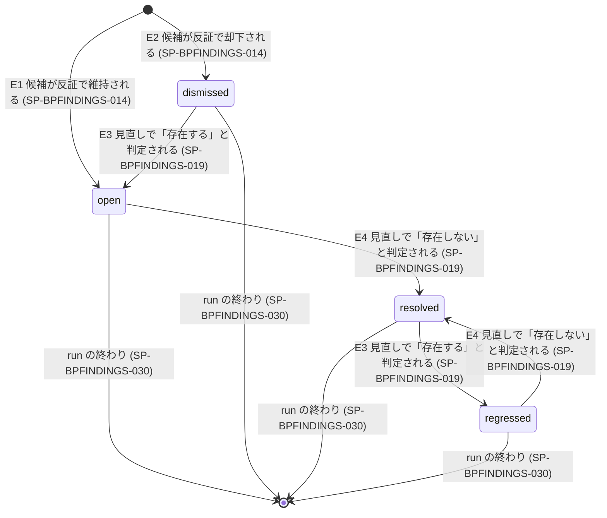

# 仕様書: 指摘と資産台帳

本文書は次の文書と同じ一式として扱う。相互に参照する記述は、この一式が揃っていることを前提とする。

- `docs/requirements/bp-operations.md`
- `docs/requirements/bp-designed-skill.md`
- `docs/design/skill-design-patterns.md`（以下「設計方針文書」）
- `docs/specifications/bp-entry.md`
- `docs/specifications/bp-authoring.md`
- `docs/specifications/bp-inspection.md`
- `docs/specifications/bp-findings.md`（本文書）
- `docs/specifications/bp-run.md`
- `docs/specifications/bp-conformance.md`

## 表記規約

本文書の仕様項目の語尾の区分は、`docs/requirements/bp-operations.md` の「表記規約」に従う。

## 対象範囲

本仕様書は、best-practices の 4 機能（create・review・update・audit）が共有する、資産台帳と指摘の扱いを定める。資産の単位と ID、指摘の ID と同一性、反証、指摘の状態とその遷移、カバレッジと skip 一覧、run をまたぐ指摘の扱い（保持規則）、update と機能の連鎖へ渡す指摘の形を扱う。実現する要求と仕様項目の対応はトレーサビリティ表が持つ。本仕様書は `####` 見出し 1 つを 1 仕様項目とする。

### 他の仕様書との境界

| 事項 | 正となる文書 |
|---|---|
| 資産台帳の作成・資産 ID・指摘 ID・反証・指摘の状態・カバレッジ・skip 一覧・指摘の形 | 本仕様書 |
| 検証役と反証役をいつ起動するか、担当の範囲をどう作るか（review・audit） | `docs/specifications/bp-inspection.md` |
| 検証役と反証役をいつ起動するか、書き直しと見直しの段の組み方（create・update） | `docs/specifications/bp-authoring.md` |
| 観点ごとの基準の集合（フローの観点・仕様の観点・create と update の検証の観点） | `docs/specifications/bp-conformance.md` |
| 監査の観点の集合と、未検査の観点の決め方 | `docs/specifications/bp-inspection.md` |
| 前の機能の結果を次の機能へ渡す手順 | `docs/specifications/bp-entry.md` |
| run の境界・停止の種類・BLOCKED と next_args・状態の置き場・CLI の共通の規則・役ごとのモデルと effort と権限・起動数の上限で止まったときの扱い | `docs/specifications/bp-run.md` |
| 共通の異常系（agent の失敗・続けられない失敗・途中終了） | `docs/specifications/bp-run.md` |
| 同時実行・反復の上限・要約の大きさの上限などの確定値 | `docs/specifications/bp-conformance.md` |

### 本仕様書が扱わないもの

| 扱わないもの | 根拠 |
|---|---|
| run をまたいで指摘の状態を resolved / regressed まで追う手段 | 保持規則 PR-BPOPERATIONS-022。裁定が下るまで、本仕様書は run の中の追跡だけを定める（SP-BPFINDINGS-019・026〜028） |
| 対象スキルが備える資産台帳の判定基準 | `docs/specifications/bp-conformance.md`（PR-BPDESIGNEDSKILL-001・013） |

## 用語定義

用語は `docs/requirements/bp-operations.md` の「用語」を正とし、複数の仕様書で使う語は `docs/specifications/bp-run.md` の用語定義に従う。本表は本仕様書で足す語だけを持つ。

| 語 | 定義 |
|---|---|
| 台帳 | 資産と、資産と各 agent の結果との結び付きの一覧（設計方針文書「資産台帳」）。`docs/specifications/bp-run.md` の状態 1 つに 1 つだけ置き、next_args で再開した run も同じ台帳を使う。CLI だけが書く。best-practices の仕様書で単独の「台帳」は資産台帳を指し、作業記録と証拠への参照をまとめる記録台帳（`docs/specifications/bp-run.md` の用語定義）を指さない |
| 台帳 ID | 台帳を識別する値。台帳を置いた状態の状態 ID（`docs/specifications/bp-run.md`）をそのまま使う |
| 記録した run | 台帳の各記録を書いた run の run ID（`docs/specifications/bp-run.md`） |
| run の種別 | 台帳が属する run が対象スキルを書き換えるか（create・update。以下「書き換える run」）、書き換えないか（review・audit。以下「書き換えない run」） |
| 資産 | 対象スキルのうち、CLI が決定的に安定した ID を付けられる単位（SP-BPFINDINGS-002） |
| 位置キー | 資産がファイルのどこにあるかを表す値。ファイルのパスと、ファイルの中の範囲の位置（SP-BPFINDINGS-002）からなる。内容を含まない |
| 内容の指紋 | 資産の内容から CLI が決定的に作る値。内容が 1 字でも変われば変わる |
| 担当 | 1 体の検証役に 1 回の起動で割り当てる資産の組（作り方は `docs/specifications/bp-inspection.md` と `docs/specifications/bp-authoring.md`）。作業記録を書く単位の「作業記録の担当」（役の名前と項目の ID の組：`docs/specifications/bp-run.md` の用語定義）とは別のもので、資産の組を持たない役（書き手・反証役・抽出役・運搬役）にも作業記録の担当はある |
| 担当の指紋の組 | 担当に含まれる全ての資産の、その起動の時点の内容の指紋の組 |
| 判定 | 検証役が担当の資産ごとに返す値。「候補あり」「確認済みで問題なし」「判断できない」の 3 つ（SP-BPFINDINGS-007） |
| 指摘の候補 | 検証役が返した、反証の前の指摘 |
| 観点 | 指摘をどの基準の集合に照らしたか。値の集合は SP-BPFINDINGS-010 |
| run の観点の集合 | その run が検証役を起動する観点の集合。review・audit は `docs/specifications/bp-inspection.md` の SP-BPINSPECTION-004、create・update は `docs/specifications/bp-authoring.md` の SP-BPAUTHORING-016 が決める。本仕様書の「観点ごと」は、run の観点の集合の観点ごとを指す |
| 指摘の種類 | 指摘が反した基準の識別子。観点ごとの閉集合から選ぶ（SP-BPFINDINGS-010） |
| 指摘の鍵 | 資産 ID・観点・指摘の種類の組。台帳の中で同じ指摘かどうかを決める（SP-BPFINDINGS-011） |
| 見直し | 書き換える run で、内容か担当の指紋の組が最後の判定と違う資産について、同じ観点の検証役が結果を返すこと（SP-BPFINDINGS-018） |
| 資産の結末 | 資産と観点の組ごとに CLI が決める、結果に載せる値（SP-BPFINDINGS-024） |
| 未反証の候補 | 反証役が結果を返さなかった指摘の候補（SP-BPFINDINGS-015） |

## 機能仕様

台帳の読み書きは全て CLI が行い、run の中で書き込みの CLI を呼ぶのは運搬役だけとする（設計方針文書「状態の書き込み」、CLI の共通の規則は `docs/specifications/bp-run.md`）。本章の「CLI は〜しなければならない」は、その CLI の振る舞いを定める。資産 ID・指摘 ID・内容の指紋・範囲の位置・指摘の種類の値の形は SP-BPFINDINGS-002・SP-BPFINDINGS-003・SP-BPFINDINGS-004・SP-BPFINDINGS-010・SP-BPFINDINGS-011 に置く。内部の操作名と保存形式は実装の設計で決める。

### 台帳と資産

#### SP-BPFINDINGS-001 台帳の作成
状態に台帳が無いとき、対象スキルを初めて検証する段の前に、script は運搬役を通じて CLI に台帳を作らせなければならない。CLI は、台帳 ID と run の種別を受け取り、状態の今の対象スキルのパスの一覧（`docs/specifications/bp-run.md` の SP-BPRUN-005。範囲は `docs/requirements/bp-operations.md` の「対象スキル」）の全てのファイルから資産を列挙して台帳に書かなければならない。

#### SP-BPFINDINGS-002 資産の単位
CLI は、次の規則で資産を切り出さなければならない（設計方針文書「資産台帳」の例「ファイル・節・行範囲」のうち、書き換えで行番号がずれても位置が保たれる節とファイルを単位にする）。

| ファイル | 資産 |
|---|---|
| Markdown の frontmatter | frontmatter 全体を 1 つの資産にする |
| Markdown の本文 | 見出しで区切った節ごとに 1 つの資産にする。最初の見出しより前の本文は 1 つの資産にする。コードブロックの中の行は見出しに数えない |
| それ以外のファイル | ファイル全体を 1 つの資産にする |

範囲の位置は行番号を使わず、文書の先頭から数えた見出しの並び（同じ並びが 2 回以上現れるときは出現の順で分ける）で表す。それ以外のファイルはパスだけで位置キーになる。値の形は次のとおりとする。

- Markdown は拡張子が `.md` か `.markdown` のファイルとする。
- パスは、symlink を辿った実体のパスの、対象スキルのパスの一覧の根からの相対パス（区切りは `/`）とする。根の外のファイル（自分の plugin の workflow script）は、`.claude-plugin/plugin.json` を持つ最も近い祖先のディレクトリからの相対パスの前に `plugin:` を付ける（`.agents/skills/` の symlink 越しでも `plugins/` 越しでも同じパスになる）。根の外で `.claude-plugin/plugin.json` を持つ祖先の無いファイル（根の中の symlink の実体を含む）はパスの一覧に入れない（端末ごとの絶対パスを ID に入れないため。パスの形はこの 2 つだけになる）。開始の操作・再開の開始・台帳の作成と取り直しは、そのファイルがあればそのパスを理由に示して拒否する。停止の操作は、そのファイルを対象スキルの指紋から除いて停止を書き、除いたパスを停止の記録の `excluded` に残す（止められない run を作らないため。パスの形は `docs/specifications/bp-run.md` の SP-BPRUN-011）。一覧の作成でも、そのファイルを理由付きで拒否する。
- 範囲の位置は、オブジェクトのキーを昇順に並べ空白を入れない JSON とする。frontmatter は `{"k":"fm"}`、最初の見出しより前の本文は `{"k":"pre"}`（空白だけなら資産にしない）、節は `{"h":[[<見出しのレベル>,"<見出しの文字列>"],…],"k":"sec","n":<出現の順>}`、それ以外のファイルは `{"k":"file"}` とする。`h` は文書の先頭から数えた祖先の見出しとその節の見出しの連鎖、`n` は同じ連鎖の 1 から数えた出現の順とする。
- 見出しは、ATX 見出し（行頭の 0〜3 個の空白、1〜6 個の `#`、空白か行末）と setext 見出し（空でない行と、その次の `=` だけか `-` だけの行。レベルはそれぞれ 1 と 2）とする。3 個以上の ``` か `~~~` で始まるフェンスの中の行は見出しに数えない。frontmatter は、1 行目が `---` のときの、次の `---` の行までとする。
- 節の範囲は、見出しの行から次の見出し（レベルを問わない）の行の前までとする。上位の節の範囲に下位の節は含まない。

#### SP-BPFINDINGS-003 資産 ID
資産 ID は位置キーから決定的に識別し、内容の指紋を含めてはならない。位置が同じで内容だけが変わった資産を同じ資産として照合できなければならない。異なる位置を同じ ID として扱う衝突は内部の失敗として止めなければならない。ID の符号化と短縮方法は実装の設計で決める。

#### SP-BPFINDINGS-004 内容の指紋
資産の内容の同一性と、判定が依存した全ての資産の版の組を、決定的な指紋で区別できなければならない。内容が変わった場合は新しい版として記録し、同じ版に依存する結果だけを現在の確認として数えなければならない。指紋の計算形式は実装の設計に委ねる。指紋の一致だけを意味の正しさの証拠にしてはならない。

#### SP-BPFINDINGS-005 台帳の取り直し
書き換える run で対象スキルを書き換えたとき、script は、次の検証の段の前に運搬役を通じて CLI に、状態の今の対象スキルのパスの一覧から資産を列挙し直させなければならない。再開した run の開始（`docs/specifications/bp-run.md` の SP-BPRUN-016）でも、機能によらず、CLI は同じく列挙し直さなければならない（台帳の結び付きとカバレッジを対象の今の内容に基づかせるため。設計方針文書「停止・再開と人間の入力」）。CLI は、列挙し直した結果を台帳に次のとおり足さなければならない。

| 列挙し直した資産 | 台帳に足す記録 |
|---|---|
| 台帳にある資産 ID で、内容の指紋が同じ | 足さない |
| 台帳にある資産 ID で、内容の指紋が違う | その資産の新しい内容の指紋 |
| 台帳に無い資産 ID | 新しい資産 |
| 台帳にあるが、列挙し直した結果に無い資産 ID | その資産が消えたこと |

#### SP-BPFINDINGS-006 資産の同一性を決める主体
資産 ID と、同じ資産かどうかの判定は、CLI だけが決めなければならない。agent は、担当として渡された資産 ID を結果に書くだけにし、資産 ID を作ってはならない（設計方針文書「資産台帳」）。

### 結果の結び付き

#### SP-BPFINDINGS-007 検証役が返す形
検証役は、担当に含まれる資産ごとに、判定を「候補あり」「確認済みで問題なし」「判断できない」のどれか 1 つとして返さなければならない。判定が「候補あり」の資産には、1 件以上の指摘の候補を添えなければならない。指摘の候補は次の項目を持たなければならない。

| 項目 | 中身 |
|---|---|
| 資産 ID | 担当として渡された資産 ID のどれか |
| 観点 | その検証役に割り当てられた観点 |
| 指摘の種類 | その観点の閉集合から選んだ値（SP-BPFINDINGS-010） |
| 引用 | 問題のある箇所の原文。行番号を添える（CLI が判断点の機械照合から作る候補で指す行が無いときは空の文字列：`docs/specifications/bp-inspection.md` の SP-BPINSPECTION-007） |
| 内容 | 基準にどう反しているか |
| 直し方 | どこをどう書き換えるか |

機能の文書は、検証役の結果に上の表の外の欄を足してよい（`docs/specifications/bp-inspection.md` の SP-BPINSPECTION-017 の未検査の観点の候補、`docs/specifications/bp-authoring.md` の SP-BPAUTHORING-017・SP-BPAUTHORING-038・SP-BPAUTHORING-039 の欄）。足した欄の値の検査は、その欄を定める仕様項目に従う。

#### SP-BPFINDINGS-008 「見た」の記録
検証役の結果を受け取ったとき、CLI は、結果に判定が書かれた資産ごとに、観点と担当の指紋の組とともに「見た」を記録しなければならない。「見た」は検証役や反証役を通さずに記録しなければならない（「見た」はカバレッジを数えるための記録で、正しさを示さない。設計方針文書「資産台帳」）。

#### SP-BPFINDINGS-009 「確認済みで問題なし」の記録
検証役が判定を「確認済みで問題なし」とした資産について、CLI は、その判定を観点と担当の指紋の組とともに台帳に記録しなければならない。

#### SP-BPFINDINGS-010 観点と指摘の種類の閉集合
CLI は、観点ごとに、指摘の種類として受け付ける値の閉集合を持たなければならない。観点と閉集合は次の文書が定めるものを使い、本仕様書で値を足してはならない。

| 観点 | 指摘の種類の閉集合の正 |
|---|---|
| フローの観点（review）と適合の観点（create・update） | `docs/specifications/bp-conformance.md` の「機能仕様」の章の判定基準の仕様項目 ID と、その仕様項目の判定の単位（SP-BPCONFORMANCE-002）の組。判定の単位が仕様項目そのものであるときは仕様項目 ID だけ。SP-BPCONFORMANCE-041 は除く（下の段落） |
| 仕様の観点（review） | `docs/specifications/bp-conformance.md` の「性能・容量」の章の確定値の仕様項目 ID（判定の単位は仕様項目そのもの） |
| 目標の観点と契約の観点（create・update） | `docs/specifications/bp-authoring.md` の SP-BPAUTHORING-016 の指摘の種類の閉集合の表 |
| 監査の観点（audit） | `docs/specifications/bp-inspection.md` の SP-BPINSPECTION-009 の監査の観点の一覧の識別子 |

SP-BPCONFORMANCE-041 は、機械の照合だけで判定する（同項：機械の照合だけで判定する）。CLI は、この仕様項目を、フローの観点と適合の観点の閉集合と、検証役に渡す判定の単位から除き、検証役の結果にこの種類の候補か、この単位の結果か未検査の候補があれば、SP-BPFINDINGS-034 のとおり拒否する。この除き方は本段落だけに置き、`docs/specifications/bp-authoring.md` と `docs/specifications/bp-inspection.md` は参照する。機械照合から作る指摘（SP-BPFINDINGS-014）は、この種類を持つ。

指摘の種類に判定の単位を含めるのは、1 つの仕様項目が原則の表の複数の行を判定の単位に持つからである（含めないと、同じ資産の別の行の違反が同じ鍵になり、1 件にまとまる）。CLI は、フローの観点・適合の観点・仕様の観点の閉集合を、判定基準の写し（`docs/specifications/bp-run.md` の SP-BPRUN-036）から決定的に作る。指摘の種類の値の形は次の表とする。

| 観点 | 指摘の種類の値 |
|---|---|
| フローの観点・適合の観点 | 判定の単位が設計方針文書の表の行なら `<仕様項目 ID>/<節の見出しの連鎖>/t<表の順>/r<行の順>`（例 `SP-BPCONFORMANCE-010/目標の固定/t1/r3`）。定義の箇条書きの項目なら `<仕様項目 ID>/<節の見出し>/b<箇条の順>`。判定の単位が仕様項目そのものなら仕様項目 ID |
| 仕様の観点 | 仕様項目 ID |
| 目標の観点・契約の観点 | `目標:<値>`・`契約:<値>`（値は SP-BPAUTHORING-016 の表の値。「（update だけ）」の値は update の run の閉集合にだけ入れ、値から「（update だけ）」を除く） |
| 監査の観点 | `PA-<番号>`（SP-BPINSPECTION-009 の識別子） |

節の見出しの連鎖・表と行の順は、固定した基準の中の位置を指す。CLI は基準とその適用範囲から指摘の種類を決定的に作り、agent が新しい種類を作ってはならない。必要な基準を読めない、または単位が無い場合は、空の基準で検査済みとせず止まらなければならない。単位を本文から読み出す内部の手順は実装の設計で決める。

#### SP-BPFINDINGS-011 指摘の鍵と指摘 ID
指摘の鍵は資産 ID・観点・指摘の種類の組とし、台帳の中で同じ鍵を同じ指摘として扱わなければならない。初めて現れた鍵には、台帳と鍵から決定的に指摘 ID を付けなければならない。同じ台帳の再開では同じ鍵の ID を保ち、別の台帳の指摘と混同してはならない。

消えた資産の照合で結び付く資産を足した場合も指摘 ID を変えず、足した資産の鍵も同じ指摘へ照合しなければならない。観点の識別値は flow・spec・conformance・goal・contract・audit とする。ID の符号化は実装の設計に委ねる。

#### SP-BPFINDINGS-036 同じ指摘の決め方
CLI は、同じ指摘かどうかを指摘の鍵の一致だけで決め、引用や内容の文言で決めてはならない（言い換えを別の指摘と数えないため。設計方針文書「状態の書き込み」）。CLI は、観点の違う 2 つの指摘を同じ指摘としてまとめてはならない。同じ違反が観点の違う 2 件の指摘にならないようにするのは、観点の判定の単位を定める文書である（review は `docs/specifications/bp-inspection.md` の SP-BPINSPECTION-007）。

#### SP-BPFINDINGS-012 重複する候補
指摘の候補の鍵が台帳の指摘と一致し、その指摘の最後の判定が「存在する」（SP-BPFINDINGS-018）か反証での却下（反証の却下で作った dismissed と、SP-BPFINDINGS-018 の表の 6 行の判定）であり、その判定と同じ担当の指紋の組に含まれる内容の指紋で候補が返ったならば、CLI はその候補を既存の指摘への重複として記録し、反証に回してはならず、指摘の状態を変えてはならない（書き換える run でのこの候補による見直しの判定は SP-BPFINDINGS-018 の重複の行が決める。SP-BPFINDINGS-019 は、最後の状態の記録を記録した run が今の run の指摘には同じ状態を今の担当の指紋の組とともに記録し、そうでない指摘には状態を記録せず見直しの判定だけを記録する）。

反証の段の項目は重複でない候補の指摘の鍵とし、同じ鍵の候補は 1 つの項目にまとまる（まとめる規則は `docs/specifications/bp-run.md` の SP-BPRUN-038）。script は、項目ごとに反証役を 1 体だけ起動し、まとめた全ての候補の引用・内容・直し方を渡す。CLI は、その反証の結果を、まとめた全ての候補の結果として記録する（まとめないと、同じ鍵の候補に別々の反証の結果が付き、SP-BPFINDINGS-035 の食い違いで止まるか、1 つの指摘に 2 つの状態が付く）。

### 反証

#### SP-BPFINDINGS-013 反証の実施
script は、重複でない全ての指摘の候補を、SP-BPFINDINGS-012 でまとめた鍵ごとに、その候補を返した検証役と別の context の反証役に渡さなければならない（生成した本人には自分の誤りが見えない。PR-BPOPERATIONS-031）。反証役は、まとめた鍵ごとに 1 つの判定として「維持」か「却下」のどちらかを選び、理由を添えて返さなければならない。反証役のモデルと effort は `docs/specifications/bp-run.md` の役ごとの割り当てに従う。CLI が作る候補は本項と SP-BPFINDINGS-012 の外にあり、SP-BPFINDINGS-014 の最後の段落に従う。

#### SP-BPFINDINGS-014 反証の結果の記録
CLI は、反証の結果を次のとおり記録しなければならない。

| 候補の鍵 | 反証の結果 | 記録 |
|---|---|---|
| 台帳に無い | 維持 | 新しい指摘 ID の指摘を作り、状態を open にする |
| 台帳に無い | 却下 | 新しい指摘 ID の指摘を作り、状態を dismissed にし、却下の理由を記録する |
| 台帳にある | 維持 | 見直しの「存在する」の材料にする（SP-BPFINDINGS-018） |
| 台帳にある | 却下 | 却下の理由を記録し、見直しの「存在しない」の材料にする（SP-BPFINDINGS-018） |

CLI が判断点の機械照合の不適合から作る指摘の候補（`docs/specifications/bp-inspection.md` の SP-BPINSPECTION-007。review だけで作る）は、検証役の結果ではないので、SP-BPFINDINGS-012 の重複の判定にかけず、反証の段の項目にせず（`docs/requirements/bp-operations.md` PR-BPOPERATIONS-031 のただし書き）、SP-BPFINDINGS-018 の R にも入れない。CLI は、その候補の鍵が台帳に無ければ、新しい指摘 ID の指摘を作り、状態を open にする。この状態の記録の担当の指紋の組（SP-BPFINDINGS-017）は、その資産の今の内容の指紋（SP-BPFINDINGS-004）1 つからなる組とする。鍵が台帳にあれば、記録を足さない（review は書き換えない run で、状態を遷移させず見直しの判定も持たない：SP-BPFINDINGS-016）。

#### SP-BPFINDINGS-015 未反証の候補
反証役が結果を返さなかったならば、CLI はその候補を未反証の候補として記録しなければならない。未反証の候補は、open の指摘にも dismissed の指摘にもしてはならない。結果が無い試行も区別して記録し、再送で未反証の記録を重ねてはならない。

### 指摘の状態

#### SP-BPFINDINGS-016 状態の集合
指摘の状態は open・dismissed・resolved・regressed の 4 つとする。書き換えない run の台帳では、CLI は resolved と regressed を記録してはならず、見直しの判定の要求（SP-BPFINDINGS-018）は拒否しなければならない。消えた資産の照合の結果は、拒否せずに見直しの判定だけとして記録する（SP-BPFINDINGS-037）（対象が書き換わらない run では resolved / regressed が決まらない。PR-BPOPERATIONS-032）。

#### SP-BPFINDINGS-017 状態の記録の仕方
CLI は、指摘の状態の変化を新しい記録として足し、前の記録を書き換えてはならない（設計方針文書「状態の書き込み」）。各記録には、そのときの担当の指紋の組と、記録した run を含めなければならない。同じ内容の書き込みが繰り返されたとき、CLI は台帳を変えてはならない。

#### SP-BPFINDINGS-018 見直しの判定
書き換える run の検証の段の終わりに、script は運搬役を通じて CLI に見直しを判定させなければならない。CLI は、台帳の指摘ごとに、次の 4 つの条件の値をその段の結果から決め、下の表を上の行から順に当て、最初に当たった行の判定を取らなければならない（上から順に当てるので、どの組も 1 つの行に決まる）。

- R: 指摘の資産を含み、指摘の最後の判定と違う担当の指紋の組で、同じ観点の検証役がその段で返した結果の集合。最後の判定は、判定が「存在する」か「存在しない」の、最後の状態の記録か見直しの判定の記録とし、「判定できない」の記録は数えない。
- 内容の指紋: 指摘の資産の今の内容の指紋が、最後の判定の担当の指紋の組の中の値から変わったか（変化・不変）。
- 同じ鍵の候補の内訳: R の中の、指摘の鍵と同じ鍵の候補が、無い・反証で維持されたものがある・未反証のものがある・全て重複（SP-BPFINDINGS-012）・全て反証で却下された、のどれか。
- 資産の判定: R の中のその資産の判定に「候補あり」か「確認済みで問題なし」があるか、全て「判断できない」か。

| 順 | 条件 | 判定 |
|---|---|---|
| 1 | R が空で、内容の指紋が変化 | 判定できない |
| 2 | R が空で、内容の指紋が不変 | 判定しない |
| 3 | R に、反証で維持された同じ鍵の候補がある | 存在する |
| 4 | R に、未反証の同じ鍵の候補がある | 判定できない |
| 5 | R に同じ鍵の候補が 1 件以上あり、その全てが重複である | 最後の判定と同じ値（最後の判定が「存在する」なら存在する、反証での却下なら存在しない） |
| 6 | R に同じ鍵の候補が 1 件以上あり、その全てが反証で却下された | 存在しない |
| 7 | R に同じ鍵の候補が無く、R がその資産を「候補あり」か「確認済みで問題なし」と判定した | 存在しない |
| 8 | R に同じ鍵の候補が無く、R の全てがその資産を「判断できない」と判定した | 判定できない（判断していない資産の指摘を resolved として報告しない：PR-BPOPERATIONS-033。依頼者の裁定） |

次の組は起こりえない。CLI は、次の組に当たったら判定を記録せず、内部の失敗として止まらなければならない。

- R が空なのに、同じ鍵の候補か、その資産の判定がある。
- R があるのに、その資産の判定が無い。
- 同じ鍵の候補に、重複と重複でないものが混ざる（1 つの段の中では資産の内容は全ての結果で同じで、重複は最後の判定と同じ内容の指紋の候補だけを指すので、全てが重複か、重複が 1 件も無いかのどちらかになる）。
- 全てが重複なのに、内容の指紋が変化している。
- 同じ鍵の候補があるのに、R の全てがその資産を「判断できない」と判定した。

照合で資産を足した指摘（資産が 2 つ以上ある指摘）は、消えていない資産ごとに、その資産を含む鍵だけで 4 つの条件の値を決めて表を当て、資産ごとの判定を「存在する」「判定できない」「存在しない」「判定しない」の順で最初に現れたものに畳む（どれかの資産で違反が残れば存在するとし、確かめていない資産があれば存在しないとしない）。資産ごとに当てるので、上の起こりえない組は資産をまたいで混ざっても起こらない。

指摘の資産が全て消えた場合は、本項を当てず、SP-BPFINDINGS-020 の照合の結果（記録は SP-BPFINDINGS-037）で判定する。

#### SP-BPFINDINGS-019 状態の遷移
指摘の最後の状態の記録を記録した run が今の run であるとき、CLI は、見直しの判定に従って、指摘の状態を次のとおり記録しなければならない（遷移の全体は「状態とイベント」の章）。ただし、書き換えない run の台帳の消えた資産の照合は SP-BPFINDINGS-037 に従い、状態を遷移させない。

| 現在の状態 | 存在する | 存在しない | 判定できない |
|---|---|---|---|
| open | open | resolved | open |
| dismissed | open | dismissed | dismissed |
| resolved | regressed | resolved | resolved |
| regressed | regressed | resolved | regressed |

見直しの判定が「判定しない」の指摘には、CLI は状態も見直しの判定も記録してはならない（どちらも前の記録のまま変わらない）。この run に見直しの判定の記録が無いことを、機能の文書は「記録なし」と呼ぶ（`docs/specifications/bp-authoring.md` の SP-BPAUTHORING-022）。

指摘の最後の状態の記録を記録した run が今の run でないならば、run をまたいで指摘の状態を追うかの裁定が下るまで、CLI は状態を記録してはならず、見直しの判定だけを「この run の見直しの判定」として記録しなければならない（PR-BPOPERATIONS-022。設計方針文書「水準と未決事項」は、再開で run が分かれる場合もこの未決事項に含める）。

#### SP-BPFINDINGS-020 消えた資産の指摘の照合
資産が消えたこと（SP-BPFINDINGS-005）が記録されたならば、script は、その資産に結び付いた指摘ごとに、その指摘の観点の検証役を起動し、指摘の引用・内容と、台帳にある今の資産 ID の一覧を渡さなければならない。検証役は、今の資産 ID の一覧から 1 つを選ぶか「該当なし」を選んで返さなければならない。結果の記録は SP-BPFINDINGS-037 に従う。この段の項目の順位（`docs/specifications/bp-run.md` の SP-BPRUN-038）は、指摘を台帳に作った順とする。

#### SP-BPFINDINGS-037 消えた資産の照合の結果の記録
CLI は、SP-BPFINDINGS-020 の検証役の結果について、資産 ID が選ばれたら「存在する」、「該当なし」が選ばれたら「存在しない」、検証役が結果を返さなかったら「判定できない」として SP-BPFINDINGS-019 を当てなければならない。資産 ID が選ばれたとき、CLI は指摘 ID を変えずに、その指摘に選ばれた資産を足して記録し、以後はその資産 ID を含む鍵も同じ指摘の鍵として照合しなければならない。「今の内容で判定したか」の扱いは SP-BPFINDINGS-021 に従う。書き換えない run の台帳では、CLI は状態を遷移させず（SP-BPFINDINGS-016 の resolved・regressed を記録しない。拒否はしない）、照合の結果を見直しの判定だけとして記録する（書き換えない run では resolved・regressed が決まらない：SP-BPFINDINGS-016）。

#### SP-BPFINDINGS-021 判定の時点の記録
CLI は、指摘ごとに、最後に判定したときの担当の指紋の組が、台帳の今の内容の指紋と一致するかを結果に載せなければならない（一致しない指摘の状態は、今の内容で確かめていない）。見直しの判定が「判定できない」のとき（SP-BPFINDINGS-018 の表の 1・4・8 行と、SP-BPFINDINGS-037 の結果なし）は、状態の記録を足しても最後に判定した時点を更新しない（今の内容で確かめていない）。資産が全て消えた指摘は、比べる今の内容の指紋が無いので、最後の判定が消えた資産の照合（SP-BPFINDINGS-037）の「存在しない」のときだけ今の内容で判定したとし、それ以外は判定していないとする（照合は台帳の今の資産の一覧に照らした判定である）。

### カバレッジと skip 一覧

#### SP-BPFINDINGS-022 カバレッジ
CLI は、run の観点の集合の観点ごとに、台帳の今の資産のうち、今の内容の指紋を含む担当の指紋の組で「見た」が 1 件以上ある資産の数と、台帳の今の資産の数を数え、その比をカバレッジとして返さなければならない。カバレッジは「見た」ことしか示さないので、CLI はカバレッジを正しさの値として返してはならない（設計方針文書「資産台帳」）。

#### SP-BPFINDINGS-023 skip 一覧
CLI は、run の観点の集合の観点ごとに、SP-BPFINDINGS-022 で「見た」が 0 件の資産を、資産 ID・パス・範囲の位置とともに skip 一覧として返さなければならない。

#### SP-BPFINDINGS-024 資産の結末
CLI は、台帳の今の資産と run の観点の集合の観点の組ごとに、今の内容の指紋を含む担当の指紋の組の記録だけから、上の行から順に最初に当たる値を資産の結末として決めなければならない。

| 順 | 条件 | 資産の結末 |
|---|---|---|
| 1 | 状態が open か regressed の指摘がある | 指摘あり |
| 2 | 判定が「候補あり」で、その候補が全て dismissed の指摘か重複になった | 却下された指摘だけ |
| 3 | 判定が「確認済みで問題なし」 | 確認済みで問題なし |
| 4 | 「見た」がある | 見ただけ |
| 5 | 上記以外 | skip |

CLI は、「確認済みで問題なし」の記録が無い資産を、資産の結末「確認済みで問題なし」として返してはならない（PR-BPOPERATIONS-033）。未反証の候補がある資産は、順 1〜3 に当たらなければ「見ただけ」になる。

#### SP-BPFINDINGS-025 skip 一覧への追加の起動
検証の段の結果を受け取った後に skip 一覧が空でないならば、script は、skip 一覧の資産だけを担当にして、その観点の検証役を追加で起動しなければならない（設計方針文書「資産台帳」）。script は、追加の起動の回のうち、新しく「見た」が記録された資産が 0 件になった回で追加の起動を止め、そのときの skip 一覧を結果に載せなければならない。追加の起動も起動数の上限に数え、上限で止まるときの扱いは `docs/specifications/bp-run.md` に従う。

### run をまたぐ指摘の扱い

#### SP-BPFINDINGS-026 台帳の範囲
台帳は状態 1 つに 1 つとし、next_args で再開した run は同じ台帳を読み書きしなければならない（再開した run は結果が状態に書かれた項目を処理し直さないため。`docs/specifications/bp-run.md` の SP-BPRUN-015）。CLI は、別の状態の台帳の指摘を今の台帳の指摘と照合する手段を持ってはならない。

#### SP-BPFINDINGS-027 入力に受け取った前の run の指摘
run をまたいで指摘の状態を追うかの裁定が下るまで、update は、入力に受け取った前の run の指摘を、自分の台帳の指摘として記録してはならない。前の run の指摘は修正の根拠として前提に置くだけにし（PR-BPOPERATIONS-003。前提への書き方は `docs/specifications/bp-run.md` の SP-BPRUN-004）、自分の台帳から状態を付けてはならない。

#### SP-BPFINDINGS-028 報告する指摘の状態
run をまたいで指摘の状態を追うかの裁定が下るまで、create と update は、結果に載せる指摘のうち、最後の状態の記録を記録した run が今の run である指摘にだけ状態を載せなければならない。それ以外の指摘（再開する前の run が最後の状態を記録した指摘）には状態を載せず、指摘 ID・最後の状態を記録した run・この run の見直しの判定（SP-BPFINDINGS-019）を載せなければならない。update は、入力に受け取った前の run の指摘に状態を付けてはならない（載せ方は `docs/specifications/bp-authoring.md` の SP-BPAUTHORING-033 の「受け取った修正の根拠」）。review と audit は、台帳の指摘の状態（open か dismissed）を、記録した run とともに全て載せなければならない。

## 外部インタフェース

### 指摘の形

#### SP-BPFINDINGS-029 結果に載せる指摘の項目
4 機能は、結果に載せる指摘ごとに次の項目を持たせなければならない。review と audit はこの形のまま update の修正の根拠として渡せるようにしなければならない（PR-BPOPERATIONS-036）。

| 項目 | 綴り | 中身 |
|---|---|---|
| 指摘 ID | `id` | SP-BPFINDINGS-011 |
| 機能 | `function` | 指摘を付けた機能（create・review・update・audit） |
| 観点 | `viewpoint` | SP-BPFINDINGS-010 |
| 指摘の種類 | `kind` | SP-BPFINDINGS-010 |
| 資産 | `assets` | 資産 ID・パス・範囲の位置。照合で資産を足した指摘（SP-BPFINDINGS-020）は全ての資産 |
| 引用 | `quote` | 行番号を添えた原文（指す行が無いときは SP-BPFINDINGS-007 の引用の行のとおり） |
| 内容 | `content` | 基準にどう反しているか |
| 直し方 | `fix` | どこをどう書き換えるか |
| 状態 | `state` | open・dismissed・resolved・regressed のどれか。SP-BPFINDINGS-028 が状態を載せないとする指摘には載せない |
| 状態を記録した run | `stateRun` | 最後の状態の記録を記録した run |
| この run の見直しの判定 | `judgement` | SP-BPFINDINGS-019 で状態を記録せずに判定だけを記録した指摘だけ |
| 却下の理由 | `dismissReason` | 状態が dismissed の指摘だけ。反証役が返した理由（PR-BPOPERATIONS-031） |
| 今の内容で判定したか | `judgedOnCurrent` | SP-BPFINDINGS-021 |

assets の各要素は `id`・`path`・`loc` を持つ。観点の値は SP-BPFINDINGS-011 の flow・spec・conformance・goal・contract・audit とし、判断の値は存在する/存在しない/判定できない/判定しないに対応する exists・absent・unknown・skip とする。

#### SP-BPFINDINGS-030 結果に載せる台帳の項目
4 機能は、結果に次の項目を載せなければならない。

| 項目 | review・audit の綴り | 中身 |
|---|---|---|
| 指摘の一覧 | `findings` | 台帳の全ての指摘。dismissed の指摘も含める（PR-BPOPERATIONS-031） |
| カバレッジ | `ledger` | 観点ごとの値（SP-BPFINDINGS-022） |
| skip 一覧 | `ledger` | 観点ごとの一覧（SP-BPFINDINGS-023・025） |
| 資産の結末 | `ledger` | 資産と観点の組ごとの値（SP-BPFINDINGS-024） |
| 未反証の候補 | `ledger` | SP-BPFINDINGS-015 の一覧 |
| 拒否された結果 | `ledger` | SP-BPFINDINGS-034 で台帳に入らなかった結果の件数と、それを返した担当 |
| 未検査の観点 | `uncheckedViewpoints` | review と audit だけ。中身は `docs/specifications/bp-inspection.md` が定める |

review・audit の ledger は coverage・skip・outcomes・unrefuted・rejected を持つ。outcomes の公開値は次の対応とし、SP-BPFINDINGS-024 の資産の結末を表さなければならない。

| SP-BPFINDINGS-024 の資産の結末 | outcomes の値 |
|---|---|
| 指摘あり | finding |
| 却下された指摘だけ | dismissed_only |
| 確認済みで問題なし | ok |
| 見ただけ | seen_only |
| skip | skip |

findings は ledger の外に置き、機能間で同じ形の指摘を渡せなければならない。create・update で返す位置は SP-BPAUTHORING-032〜034 に従う。

#### SP-BPFINDINGS-031 修正の根拠の形
update が受け取る修正の根拠は、次のどれかの形でなければならない（PR-BPOPERATIONS-015）。前の機能の結果を update に渡すとき（PR-BPOPERATIONS-038）、渡す側は結果の指摘の一覧を SP-BPFINDINGS-029 の形のまま渡さなければならない。入口の連鎖は、前の run の参照の形で渡す（入口が指摘を書き写すと、同じバイト列を保てない：`docs/specifications/bp-entry.md` の SP-BPENTRY-010）。

| 修正の根拠 | 形 |
|---|---|
| review・audit の指摘 | SP-BPFINDINGS-029 の項目。update が修正の根拠として扱うのは、状態が open の指摘だけとする（dismissed は反証で退けられた指摘である） |
| 利用者の修正の指示 | 種別「利用者の指示」と、指示の文言をそのまま。資産 ID・観点・指摘の種類・状態を持たない |
| 前の review・audit の run の参照 | `{"from": <状態 ID>}` だけを持つ。指す状態は、完了で止まった review・audit の状態で、対象スキルの根が update と同じでなければならない。その状態の返り値の指摘の一覧（SP-BPFINDINGS-029 の形）へ、内容と順序を変えずに展開し、並びのその位置で受け取った根拠として記録する。展開した指摘のうち update が扱うのは、上の「review・audit の指摘」の行と同じく open の指摘だけとする |

#### SP-BPFINDINGS-032 create と update の完了時に返す指摘
create と update が完了したとき、create と update は、SP-BPFINDINGS-030 の項目のうち、指摘の一覧（自分の台帳の指摘ごとの状態）と skip 一覧を、`docs/specifications/bp-authoring.md` が定める完了時の出力に含めなければならない（PR-BPOPERATIONS-014）。

## エラー処理と異常系

本章は台帳と指摘に固有の異常だけを扱う。agent の失敗・続けられない失敗・途中終了と、BLOCKED で止まるときの返し方は `docs/specifications/bp-run.md` が扱う。

#### SP-BPFINDINGS-033 資産が 0 件のとき
台帳の作成（SP-BPFINDINGS-001）で列挙した資産が 0 件ならば、CLI は台帳を作らずに理由を返し、script は BLOCKED で止まらなければならない（見る資産が無いまま「問題なし」と返さないため）。

#### SP-BPFINDINGS-034 台帳に無い値を含む結果
検証役・反証役の結果の、SP-BPFINDINGS-007・013・020 が定める欄の値が、台帳に無い資産 ID か、その観点の閉集合に無い指摘の種類か、同項の選択肢に無い値を含むならば、CLI はその結果の記録を拒否しなければならない（設計方針文書「状態の書き込み」）。機能の文書が CLI に照らさせる agent の結果（`docs/specifications/bp-inspection.md` の SP-BPINSPECTION-006 の適用の判定・SP-BPINSPECTION-015 の担当の組・SP-BPINSPECTION-017 の足した欄、`docs/specifications/bp-authoring.md` の SP-BPAUTHORING-017・SP-BPAUTHORING-039 の結果を含む）は、その結果を定める仕様項目が照らし、拒否した結果は本項に従って扱う。

拒否した結果は、その項目の結果が書かれなかったものとして扱い、黙って捨ててはならない。fan-out の項目は `docs/specifications/bp-run.md` の SP-BPRUN-028 で未着手に戻す（試行の上限で打ち切る）。fan-out でない段の agent の結果（適用の判定・担当の組を含む）は、script が同じ段の中でその agent を起動し直し、最初の 1 回を含めて試行の上限（`docs/specifications/bp-conformance.md` の SP-BPCONFORMANCE-031）の回まで拒否されたら、BLOCKED と拒否の理由を返して止まる（依頼者の裁定）。ただし、create・update の形式検証の段の `result` の拒否では、起動し直さずに BLOCKED で止まる（`docs/specifications/bp-authoring.md` の SP-BPAUTHORING-045）。回数の保持と上限の適用は SP-BPRUN-005 に従う。拒否された結果は「見た」にも数えず、その担当の資産は skip 一覧に残す。CLI は、拒否した結果の件数と担当を状態に記録しなければならない（置き場は `docs/specifications/bp-run.md` の SP-BPRUN-005）。結果の拒否は、SP-BPRUN-029 の BLOCKED の理由（状態の構造を指す ID の誤りと、記録との食い違い）に当てない。

#### SP-BPFINDINGS-035 台帳と食い違う書き込み
既にある記録と食い違う書き込み（同じ候補への 2 つの反証の結果、書き換えない run での resolved / regressed の記録など）が来たならば、CLI はその書き込みを拒否し、script は BLOCKED で止まらなければならない（設計方針文書「状態の書き込み」）。

## 状態とイベント

対象は**指摘 1 件の状態**である。run の停止と再開の状態は `docs/specifications/bp-run.md` が持つ。書き換えない run では、resolved と regressed は現れない（SP-BPFINDINGS-016）。イベントには E1〜E8 の番号を付け、この章の中だけで使う（`docs/specifications/bp-run.md` の E1〜E10 とは別の番号）。

### 状態遷移図



### 状態 × イベント表

> 対象の状態: open / dismissed / resolved / regressed

> 対象のイベント: E1 候補が反証で維持される / E2 候補が反証で却下される / E3 見直しで「存在する」と判定される / E4 見直しで「存在しない」と判定される / E5 見直しで「判定できない」となる（SP-BPFINDINGS-018 の表の 1・4・8 行と、SP-BPFINDINGS-037 の結果なし） / E6 重複する候補が返る / E7 書き換えない run で resolved か regressed の記録が求められる / E8 前の run が最後の状態を記録した指摘に、今の run で見直しの判定が出る

E1・E2 は台帳に無い鍵の候補についてのイベントで、台帳にある鍵の候補は E3〜E6・E8 になる。E3〜E5 は、指摘の最後の状態の記録を記録した run が今の run であるときの見直しの判定を指す。イベントの集合は閉じていない。台帳に無い値を含む結果（SP-BPFINDINGS-034）は台帳に入らないので、指摘の状態のイベントにならない。

| 現在の状態 | イベント | 種別 | 次の状態 | 定義済みか |
|---|---|---|---|---|
| open | E1 | — | — | 発生しない（台帳にある鍵の候補は E3〜E6・E8 になる） |
| open | E2 | — | — | 発生しない（台帳にある鍵の候補は E3〜E6・E8 になる） |
| open | E3 | 正常系エッジ | open | ✅ SP-BPFINDINGS-019 |
| open | E5 | 準正常系 | open | ✅ SP-BPFINDINGS-019・SP-BPFINDINGS-021 |
| open | E6 | 正常系エッジ | open | ✅ SP-BPFINDINGS-012 |
| open | E7 | 異常系 | open | ✅ SP-BPFINDINGS-016・SP-BPFINDINGS-035・SP-BPFINDINGS-037 |
| open | E8 | 準正常系 | open | ✅ SP-BPFINDINGS-019・SP-BPFINDINGS-028 |
| dismissed | E1 | — | — | 発生しない（台帳にある鍵の候補は E3〜E6・E8 になる） |
| dismissed | E2 | — | — | 発生しない（台帳にある鍵の候補は E3〜E6・E8 になる） |
| dismissed | E4 | 正常系エッジ | dismissed | ✅ SP-BPFINDINGS-019 |
| dismissed | E5 | 準正常系 | dismissed | ✅ SP-BPFINDINGS-019・SP-BPFINDINGS-021 |
| dismissed | E6 | 正常系エッジ | dismissed | ✅ SP-BPFINDINGS-012 |
| dismissed | E7 | 異常系 | dismissed | ✅ SP-BPFINDINGS-016・SP-BPFINDINGS-035・SP-BPFINDINGS-037 |
| dismissed | E8 | 準正常系 | dismissed | ✅ SP-BPFINDINGS-019・SP-BPFINDINGS-028 |
| resolved | E1 | — | — | 発生しない（台帳にある鍵の候補は E3〜E6・E8 になる） |
| resolved | E2 | — | — | 発生しない（台帳にある鍵の候補は E3〜E6・E8 になる） |
| resolved | E4 | 正常系エッジ | resolved | ✅ SP-BPFINDINGS-019 |
| resolved | E5 | 準正常系 | resolved | ✅ SP-BPFINDINGS-019・SP-BPFINDINGS-021 |
| resolved | E6 | 正常系エッジ | resolved | ✅ SP-BPFINDINGS-012・SP-BPFINDINGS-018 |
| resolved | E7 | — | — | 発生しない（書き換えない run には resolved の指摘が無い） |
| resolved | E8 | 準正常系 | resolved | ✅ SP-BPFINDINGS-019・SP-BPFINDINGS-028 |
| regressed | E1 | — | — | 発生しない（台帳にある鍵の候補は E3〜E6・E8 になる） |
| regressed | E2 | — | — | 発生しない（台帳にある鍵の候補は E3〜E6・E8 になる） |
| regressed | E3 | 正常系エッジ | regressed | ✅ SP-BPFINDINGS-019 |
| regressed | E5 | 準正常系 | regressed | ✅ SP-BPFINDINGS-019・SP-BPFINDINGS-021 |
| regressed | E6 | 正常系エッジ | regressed | ✅ SP-BPFINDINGS-012 |
| regressed | E7 | — | — | 発生しない（書き換えない run には regressed の指摘が無い） |
| regressed | E8 | 準正常系 | regressed | ✅ SP-BPFINDINGS-019・SP-BPFINDINGS-028 |

## 検証方法

対象の節・ファイルと版を変えた fixture で、資産/指摘の同一性、反証と却下理由、見直し、指摘状態、現在版かどうか、カバレッジ・skip を照合する。位置不変の変更、担当に含む別資産の変更、資産消失、重複/未反証、全判断不能、前 run の状態、空の資産集合、不正な参照と再送を含める。

見直しと状態遷移の閉じた表を全件検査し、到達しない組は明記した拒否になることを照合する。見た記録と「問題なし」を別に確認し、件数が正しいことを意味の正しさの証拠にしない。

検証方法の読み方と、決定的な検査・意味の判定・不適用の区別は、bp-run.md の「検証方法」を参照する。方法の正本は次の表の各 SP の 1 行とし、トレーサビリティ表は同じ方法を複製せずその行を参照する。

| 仕様項目 ID | 手段 | 入力と観測（条件・境界） |
|---|---|---|
| SP-BPFINDINGS-001 | 台帳初期化の結合テスト | 対象の根内/外の対象ファイルを列挙し、検証前に全資産が同じ台帳へ載ることを確認する。既存台帳と資産 0 件は再作成/正常完了にならないことを照合する。 |
| SP-BPFINDINGS-002 | 資産分割の fixture テスト | frontmatter、見出し前本文、階層/同名見出し、setext、フェンス内見出し、通常ファイル、symlink と plugin 外実体を与え、資産の範囲・位置・パスと拒否/除外を照合する。 |
| SP-BPFINDINGS-003 | 資産 ID の同一性テスト | 同じ位置の内容変更と異なる位置を与え、前者は同 ID、後者は別 ID であることを確認する。衝突を注入し内部失敗として止まることも照合する。 |
| SP-BPFINDINGS-004 | 指紋依存の決定的テスト | 資産自身/同じ担当の別資産/担当外を 1 つずつ変更し、資産版と依存集合の同一性、現在の確認としての計数を照合する。意味の正しさは指紋一致で判定しない。 |
| SP-BPFINDINGS-005 | 資産取直しの全組テスト | 不変/変更/追加/消失の資産を同時に含む対象を書換え・再開し、表どおりの追記と既存記録の保持を照合する。 |
| SP-BPFINDINGS-006 | ID 発行責務の静的照合・不正結果テスト | 資産 ID が決定的な正本だけから発行され、agent が存在しない ID を返す結果が拒否されることを確認する。意味判断の試走は不要である。 |
| SP-BPFINDINGS-007 | 検証結果の schema テスト | 判定 3 値と候補 0/1/複数、担当内/外資産、許可/不許可の種別、引用と機能固有欄を与え、候補ありの必須候補と受理条件を照合する。 |
| SP-BPFINDINGS-008 | 見た記録と結果の計数テスト | 各判定、重複結果、現版/旧版、拒否結果を与え、受理した判定だけが観点/依存版と結び付き、正しさの受理なしに見た記録になることを確認する。 |
| SP-BPFINDINGS-009 | 問題なしの記録テスト | 3 判定を対にし、確認済みで問題なしだけが該当観点・依存版の問題なし記録を作ることを確認する。候補あり/判断不能からの誤記録を負例にする。 |
| SP-BPFINDINGS-010 | 閉集合の生成・受理テスト | 各観点の有効種別と未知種別、単位の違う同仕様、機械照合単位を与え、閉集合と除外を照合する。基準不在/単位 0 件で空の検査済みにならないことも確認する。 |
| SP-BPFINDINGS-011 | 指摘 ID と鍵の同一性テスト | 資産・観点・種類・台帳を 1 要素ずつ変え、同鍵の再開は同 ID、異鍵/台帳は分離となることを確認する。消失照合で資産を足しても ID が変わらない例も試す。 |
| SP-BPFINDINGS-036 | 指摘鍵の同一性テスト | 同じ鍵で引用/内容だけを言い換えた候補と、観点/種類/資産が違う候補を与え、前者だけが同じ指摘となることを確認する。 |
| SP-BPFINDINGS-012 | 候補重複と反証の結合テスト | 同鍵/異鍵、同依存版/変更版、既存の存在/却下結果を組み合わせ、重複は状態不変・反証なし、同じ鍵の新候補は 1 反証結果にまとまることを確認する。 |
| SP-BPFINDINGS-013 | 独立 context と反証結果の照合 | 複数候補を同鍵/異鍵で渡し、生成と別 context が維持/却下と理由を 1 鍵 1 結果で返すことを確認する。機械照合の例外は 014 と分ける。 |
| SP-BPFINDINGS-014 | 反証記録表の全組テスト | 新/既存の鍵と維持/却下を組み合わせ、状態作成または見直し材料と却下理由を照合する。機械照合候補は反証せず初回だけ open になることも確認する。 |
| SP-BPFINDINGS-015 | 反証失敗・再送テスト | 反証結果なしと同じ失敗の再送を与え、候補が open/dismissed にならず、試行ごとの未反証記録だけが重複なく残ることを確認する。 |
| SP-BPFINDINGS-016 | 機能別状態の受理テスト | 書換えあり/なしの台帳へ 4 状態と見直しを要求し、readonly では resolved/regressed を拒否し、消失照合は見直しだけを残すことを確認する。 |
| SP-BPFINDINGS-017 | 追記と同内容再送のテスト | 状態を複数回遷移させ、依存版・記録 run と履歴が残ることを確認する。同じ更新の再送では台帳と履歴件数が変わらないことも照合する。 |
| SP-BPFINDINGS-018 | 見直し表の全数検査 | R の有無・内容変化・候補内訳・資産判定の全有効組と禁止組を列挙し、表の優先結果または内部失敗を照合する。複数資産への畳込みと全消失も含める。 |
| SP-BPFINDINGS-019 | 指摘状態表の全組テスト | 4 状態と存在/不存在/判定不能/判定しない、今/前 run を組み合わせ、次状態と記録の有無を照合する。readonly 消失照合と run 跨ぎの状態記録禁止も含める。 |
| SP-BPFINDINGS-020 | 消失した資産の照合 fixture | 指摘のある資産を削除し、現在の資産への一致/該当なしを独立確認する。入力が指摘内容と今の閉集合であること、項目順位が作成順であることも照合する。 |
| SP-BPFINDINGS-037 | 消失照合結果の全組テスト | 現在資産 ID/該当なし/結果なしと書換え有無を組み合わせ、見直し・状態・資産の追加と ID 保持を照合する。不正な資産 ID の拒否も含める。 |
| SP-BPFINDINGS-021 | 現版判定の全組テスト | 自身/依存資産の版一致・変化と判定不能、全資産消失を与え、今の内容で判定したかの値を照合する。判定不能で最終確認時点が更新されないことも確認する。 |
| SP-BPFINDINGS-022 | カバレッジの数値テスト | 複数資産で見た記録の 0 件/一部/全件と重複、旧版、内容変更を与え、観点別分子・分母・比を独立計算と照合する。正しさとは別の値であることも結果で確認する。 |
| SP-BPFINDINGS-023 | skip 集合の差集合テスト | 同じ対象に現版の見た記録あり/なし/旧版だけの資産を混ぜ、skip が現在未確認の全資産 ID ・パス・位置と一致することを確認する。 |
| SP-BPFINDINGS-024 | 資産結末の全組テスト | 指摘状態、候補の却下/重複/未反証、問題なし、見ただけを重ね、表の優先順で 5 値を返すことを確認する。問題なし記録が無い資産を ok にしない負例も試す。 |
| SP-BPFINDINGS-025 | 追加確認の進捗・停止テスト | skip の一部を新しく確認する回と 0 件の回を与え、skip だけを追加担当にし、進捗なしで止まり残りを返すことを確認する。追加起動が上限へ計上される境界も試す。 |
| SP-BPFINDINGS-026 | 台帳の再開・分離テスト | 同じ状態の再開で見た記録と指摘が引き継がれ、別状態の指摘 ID を今の台帳へ照合しないことを確認する。 |
| SP-BPFINDINGS-027 | 前 run 根拠を受ける update テスト | review/audit の指摘を修正根拠として渡し、入力前提には全件が残る一方、今の台帳へ状態付き指摘として登録されないことを確認する。 |
| SP-BPFINDINGS-028 | run 跨ぎの公開結果テスト | 今 run/前 run/入力根拠の指摘を混在させ、機能別に状態の有無、記録 run、当 run の見直しが表どおりとなることを確認する。 |
| SP-BPFINDINGS-029 | 指摘の公開 schema ・原文照合 | 各状態、前 run、資産追加、行なし機械指摘を含む結果で、必要キー・条件付きキー・資産と引用の原文・判断値の対応を照合する。結果を update へそのまま渡す例も試す。 |
| SP-BPFINDINGS-030 | 台帳出力の schema ・ enum テスト | 指摘・却下理由・ skip ・未反証・拒否を含む結果と各空集合で、機能別の欄と outcomes の 5 値対応を照合する。観点未検査を問題なしとして返さないことも確認する。 |
| SP-BPFINDINGS-031 | 修正根拠の入力テスト | open/dismissed、利用者指示、完了結果参照を混ぜ、受領内容の保持と扱う根拠の選別を照合する。未完了/別機能/別対象/余分な参照欄を拒否する例も含める。 |
| SP-BPFINDINGS-032 | 作成・修正の完了 schema テスト | skip が空で、指摘なし/合格を妨げない指摘がある正常完了では、今 run の指摘状態と空の skip が SP-BPAUTHORING-033 の欄へ載ることを確認する。skip 非空の負例では SP-BPAUTHORING-023・026 に従って完了を拒否し、SP-BPAUTHORING-034 の未完報告に残る skip が載ることを確認する。 |
| SP-BPFINDINGS-033 | 空集合境界のテスト | 空白だけの対象と 1 資産の対象を与え、0 資産では台帳を作らず理由付き BLOCKED となり、問題なし完了にしないことを確認する。 |
| SP-BPFINDINGS-034 | 不正結果と試行の結合テスト | 未知資産/種類/選択肢と機能固有欄の誤りを与え、拒否記録・見たに数えないこと・項目再試行/上限を照合する。形式結果拒否だけは AUTHOR045 の無再起動 BLOCKED になることも確認する。 |
| SP-BPFINDINGS-035 | 競合更新の決定的テスト | 同候補への異なる反証、readonly への禁止状態を要求し、競合が受理されず BLOCKED となり前の台帳が変わらないことを確認する。同内容の再送と対にする。 |

## トレーサビリティ表

整理後の契約を実装が満たすかは未検証である。旧版のテストの「完了」を持ち越さず、各行は現契約に対応する実行証拠が得られてから更新する。

| 要求 ID | 仕様項目 ID | 検証方法 | ステータス |
|---|---|---|---|
| PR-BPOPERATIONS-021 | SP-BPFINDINGS-001 | [検証方法](#検証方法) の SP-BPFINDINGS-001 行 | 未着手 |
| PR-BPOPERATIONS-033 | SP-BPFINDINGS-001 | [検証方法](#検証方法) の SP-BPFINDINGS-001 行 | 未着手 |
| PR-BPOPERATIONS-033 | SP-BPFINDINGS-002 | [検証方法](#検証方法) の SP-BPFINDINGS-002 行 | 未着手 |
| PR-BPOPERATIONS-021 | SP-BPFINDINGS-003 | [検証方法](#検証方法) の SP-BPFINDINGS-003 行 | 未着手 |
| PR-BPOPERATIONS-033 | SP-BPFINDINGS-003 | [検証方法](#検証方法) の SP-BPFINDINGS-003 行 | 未着手 |
| PR-BPOPERATIONS-021 | SP-BPFINDINGS-004 | [検証方法](#検証方法) の SP-BPFINDINGS-004 行 | 未着手 |
| PR-BPOPERATIONS-021 | SP-BPFINDINGS-005 | [検証方法](#検証方法) の SP-BPFINDINGS-005 行 | 未着手 |
| PR-BPOPERATIONS-021 | SP-BPFINDINGS-006 | [検証方法](#検証方法) の SP-BPFINDINGS-006 行 | 未着手 |
| PR-BPOPERATIONS-033 | SP-BPFINDINGS-007 | [検証方法](#検証方法) の SP-BPFINDINGS-007 行 | 未着手 |
| PR-BPOPERATIONS-033 | SP-BPFINDINGS-008 | [検証方法](#検証方法) の SP-BPFINDINGS-008 行 | 未着手 |
| PR-BPOPERATIONS-033 | SP-BPFINDINGS-009 | [検証方法](#検証方法) の SP-BPFINDINGS-009 行 | 未着手 |
| PR-BPDESIGNEDSKILL-051 | SP-BPFINDINGS-010 | [検証方法](#検証方法) の SP-BPFINDINGS-010 行 | 未着手 |
| PR-BPOPERATIONS-033 | SP-BPFINDINGS-010 | [検証方法](#検証方法) の SP-BPFINDINGS-010 行 | 未着手 |
| PR-BPOPERATIONS-021 | SP-BPFINDINGS-011 | [検証方法](#検証方法) の SP-BPFINDINGS-011 行 | 未着手 |
| PR-BPOPERATIONS-022 | SP-BPFINDINGS-011 | [検証方法](#検証方法) の SP-BPFINDINGS-011 行 | 未着手 |
| PR-BPOPERATIONS-021 | SP-BPFINDINGS-036 | [検証方法](#検証方法) の SP-BPFINDINGS-036 行 | 未着手 |
| PR-BPOPERATIONS-021 | SP-BPFINDINGS-012 | [検証方法](#検証方法) の SP-BPFINDINGS-012 行 | 未着手 |
| PR-BPOPERATIONS-031 | SP-BPFINDINGS-013 | [検証方法](#検証方法) の SP-BPFINDINGS-013 行 | 未着手 |
| PR-BPOPERATIONS-031 | SP-BPFINDINGS-014 | [検証方法](#検証方法) の SP-BPFINDINGS-014 行 | 未着手 |
| PR-BPOPERATIONS-032 | SP-BPFINDINGS-014 | [検証方法](#検証方法) の SP-BPFINDINGS-014 行 | 未着手 |
| PR-BPOPERATIONS-031 | SP-BPFINDINGS-015 | [検証方法](#検証方法) の SP-BPFINDINGS-015 行 | 未着手 |
| PR-BPOPERATIONS-032 | SP-BPFINDINGS-016 | [検証方法](#検証方法) の SP-BPFINDINGS-016 行 | 未着手 |
| PR-BPOPERATIONS-021 | SP-BPFINDINGS-017 | [検証方法](#検証方法) の SP-BPFINDINGS-017 行 | 未着手 |
| PR-BPOPERATIONS-021 | SP-BPFINDINGS-018 | [検証方法](#検証方法) の SP-BPFINDINGS-018 行 | 未着手 |
| PR-BPOPERATIONS-021 | SP-BPFINDINGS-019 | [検証方法](#検証方法) の SP-BPFINDINGS-019 行 | 未着手 |
| PR-BPOPERATIONS-022 | SP-BPFINDINGS-019 | [検証方法](#検証方法) の SP-BPFINDINGS-019 行 | 未着手 |
| PR-BPOPERATIONS-021 | SP-BPFINDINGS-020 | [検証方法](#検証方法) の SP-BPFINDINGS-020 行 | 未着手 |
| PR-BPOPERATIONS-021 | SP-BPFINDINGS-037 | [検証方法](#検証方法) の SP-BPFINDINGS-037 行 | 未着手 |
| PR-BPOPERATIONS-014 | SP-BPFINDINGS-021 | [検証方法](#検証方法) の SP-BPFINDINGS-021 行 | 未着手 |
| PR-BPOPERATIONS-014 | SP-BPFINDINGS-022 | [検証方法](#検証方法) の SP-BPFINDINGS-022 行 | 未着手 |
| PR-BPOPERATIONS-033 | SP-BPFINDINGS-022 | [検証方法](#検証方法) の SP-BPFINDINGS-022 行 | 未着手 |
| PR-BPOPERATIONS-014 | SP-BPFINDINGS-023 | [検証方法](#検証方法) の SP-BPFINDINGS-023 行 | 未着手 |
| PR-BPOPERATIONS-033 | SP-BPFINDINGS-023 | [検証方法](#検証方法) の SP-BPFINDINGS-023 行 | 未着手 |
| PR-BPOPERATIONS-033 | SP-BPFINDINGS-024 | [検証方法](#検証方法) の SP-BPFINDINGS-024 行 | 未着手 |
| PR-BPOPERATIONS-033 | SP-BPFINDINGS-025 | [検証方法](#検証方法) の SP-BPFINDINGS-025 行 | 未着手 |
| PR-BPOPERATIONS-022 | SP-BPFINDINGS-026 | [検証方法](#検証方法) の SP-BPFINDINGS-026 行 | 未着手 |
| PR-BPOPERATIONS-033 | SP-BPFINDINGS-026 | [検証方法](#検証方法) の SP-BPFINDINGS-026 行 | 未着手 |
| PR-BPOPERATIONS-022 | SP-BPFINDINGS-027 | [検証方法](#検証方法) の SP-BPFINDINGS-027 行 | 未着手 |
| PR-BPOPERATIONS-014 | SP-BPFINDINGS-028 | [検証方法](#検証方法) の SP-BPFINDINGS-028 行 | 未着手 |
| PR-BPOPERATIONS-022 | SP-BPFINDINGS-028 | [検証方法](#検証方法) の SP-BPFINDINGS-028 行 | 未着手 |
| PR-BPOPERATIONS-031 | SP-BPFINDINGS-029 | [検証方法](#検証方法) の SP-BPFINDINGS-029 行 | 未着手 |
| PR-BPOPERATIONS-036 | SP-BPFINDINGS-029 | [検証方法](#検証方法) の SP-BPFINDINGS-029 行 | 未着手 |
| PR-BPOPERATIONS-031 | SP-BPFINDINGS-030 | [検証方法](#検証方法) の SP-BPFINDINGS-030 行 | 未着手 |
| PR-BPOPERATIONS-033 | SP-BPFINDINGS-030 | [検証方法](#検証方法) の SP-BPFINDINGS-030 行 | 未着手 |
| PR-BPOPERATIONS-015 | SP-BPFINDINGS-031 | [検証方法](#検証方法) の SP-BPFINDINGS-031 行 | 未着手 |
| PR-BPOPERATIONS-036 | SP-BPFINDINGS-031 | [検証方法](#検証方法) の SP-BPFINDINGS-031 行 | 未着手 |
| PR-BPOPERATIONS-038 | SP-BPFINDINGS-031 | [検証方法](#検証方法) の SP-BPFINDINGS-031 行 | 未着手 |
| PR-BPOPERATIONS-014 | SP-BPFINDINGS-032 | [検証方法](#検証方法) の SP-BPFINDINGS-032 行 | 未着手 |
| PR-BPOPERATIONS-033 | SP-BPFINDINGS-033 | [検証方法](#検証方法) の SP-BPFINDINGS-033 行 | 未着手 |
| PR-BPOPERATIONS-033 | SP-BPFINDINGS-034 | [検証方法](#検証方法) の SP-BPFINDINGS-034 行 | 未着手 |
| PR-BPOPERATIONS-021 | SP-BPFINDINGS-035 | [検証方法](#検証方法) の SP-BPFINDINGS-035 行 | 未着手 |
