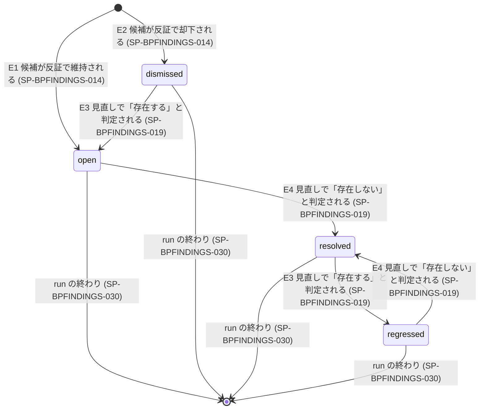

# 仕様書: 指摘と資産台帳

本文書は次の文書と同じ一式として扱う。相互に参照する記述は、この一式が揃っていることを前提とする。

- `docs/requirements/bp-operations.md`
- `docs/requirements/bp-designed-skill.md`
- `docs/design/skill-design-patterns.md`（以下「設計方針文書」）
- `docs/specifications/bp-entry.md`
- `docs/specifications/bp-authoring.md`
- `docs/specifications/bp-inspection.md`
- `docs/specifications/bp-findings.md`（本文書）
- `docs/specifications/bp-run.md`
- `docs/specifications/bp-conformance.md`

## 表記規約

本文書の仕様項目の語尾の区分は、`docs/requirements/bp-operations.md` の「表記規約」に従う。

## 対象範囲

本仕様書は、best-practices の 4 機能（create・review・update・audit）が共有する、資産台帳と指摘の扱いを定める。資産の単位と ID、指摘の ID と同一性、反証、指摘の状態とその遷移、カバレッジと skip 一覧、run をまたぐ指摘の扱い（保持規則）、update と機能の連鎖へ渡す指摘の形を扱う。実現する要求と仕様項目の対応はトレーサビリティ表が持つ。

### 他の仕様書との境界

| 事項 | 正となる文書 |
|---|---|
| 資産台帳の作成・資産 ID・指摘 ID・反証・指摘の状態・カバレッジ・skip 一覧・指摘の形 | 本仕様書 |
| 検証役と反証役をいつ起動するか、担当の範囲をどう作るか（review・audit） | `docs/specifications/bp-inspection.md` |
| 検証役と反証役をいつ起動するか、書き直しと見直しの段の組み方（create・update） | `docs/specifications/bp-authoring.md` |
| 観点ごとの基準の集合（フローの観点・仕様の観点・create と update の検証の観点） | `docs/specifications/bp-conformance.md` |
| 監査の観点の集合と、未検査の観点の決め方 | `docs/specifications/bp-inspection.md` |
| 前の機能の結果を次の機能へ渡す手順 | `docs/specifications/bp-entry.md` |
| run の境界・停止の種類・BLOCKED と next_args・状態の置き場・CLI の共通の規則・役ごとのモデルと effort と権限・起動数の上限で止まったときの扱い | `docs/specifications/bp-run.md` |
| 共通の異常系（agent の失敗・続けられない失敗・途中終了） | `docs/specifications/bp-run.md` |
| 同時実行・反復の上限・要約の大きさの上限などの確定値 | `docs/specifications/bp-conformance.md` |

### 本仕様書が扱わないもの

| 扱わないもの | 根拠 |
|---|---|
| run をまたいで指摘の状態を resolved / regressed まで追う手段 | 保持規則 PR-BPOPERATIONS-022・042。裁定が下るまで、本仕様書は run の中の追跡だけを定める（SP-BPFINDINGS-019・026〜028） |
| 対象スキルが備える資産台帳の判定基準 | `docs/specifications/bp-conformance.md`（PR-BPDESIGNEDSKILL-005・013・018） |

## 用語定義

用語は `docs/requirements/bp-operations.md` の「用語」を正とし、複数の仕様書で使う語は `docs/specifications/bp-run.md` の用語定義に従う。本表は本仕様書で足す語だけを持つ。

| 語 | 定義 |
|---|---|
| 台帳 | 資産と、資産と各 agent の結果との結び付きの一覧（設計方針文書「資産台帳」）。`docs/specifications/bp-run.md` の状態 1 つに 1 つだけ置き、next_args で再開した run も同じ台帳を使う。CLI だけが書く |
| 台帳 ID | 台帳を識別する値。台帳を置いた状態の状態 ID（`docs/specifications/bp-run.md`）をそのまま使う |
| 記録した run | 台帳の各記録を書いた run の run ID（`docs/specifications/bp-run.md`） |
| run の種別 | 台帳が属する run が対象スキルを書き換えるか（create・update。以下「書き換える run」）、書き換えないか（review・audit。以下「書き換えない run」） |
| 資産 | 対象スキルのうち、CLI が決定的に安定した ID を付けられる単位（SP-BPFINDINGS-002） |
| 位置キー | 資産がファイルのどこにあるかを表す値。ファイルのパスと、ファイルの中の範囲の位置（SP-BPFINDINGS-002）からなる。内容を含まない |
| 内容の指紋 | 資産の内容から CLI が決定的に作る値。内容が 1 字でも変われば変わる |
| 担当 | 1 体の検証役に 1 回の起動で割り当てる資産の組（作り方は `docs/specifications/bp-inspection.md` と `docs/specifications/bp-authoring.md`） |
| 担当の指紋の組 | 担当に含まれる全ての資産の、その起動の時点の内容の指紋の組 |
| 判定 | 検証役が担当の資産ごとに返す値。「候補あり」「確認済みで問題なし」「判断できない」の 3 つ（SP-BPFINDINGS-007） |
| 指摘の候補 | 検証役が返した、反証の前の指摘 |
| 観点 | 指摘をどの基準の集合に照らしたか。値の集合は SP-BPFINDINGS-010 |
| run の観点の集合 | その run が検証役を起動する観点の集合。review・audit は `docs/specifications/bp-inspection.md` の SP-BPINSPECTION-004、create・update は `docs/specifications/bp-authoring.md` の SP-BPAUTHORING-016 が決める。本仕様書の「観点ごと」は、run の観点の集合の観点ごとを指す |
| 指摘の種類 | 指摘が反した基準の識別子。観点ごとの閉集合から選ぶ（SP-BPFINDINGS-010） |
| 指摘の鍵 | 資産 ID・観点・指摘の種類の組。台帳の中で同じ指摘かどうかを決める（SP-BPFINDINGS-011） |
| 見直し | 書き換える run で、内容か担当の指紋の組が最後の判定と違う資産について、同じ観点の検証役が結果を返すこと（SP-BPFINDINGS-018） |
| 資産の結末 | 資産と観点の組ごとに CLI が決める、結果に載せる値（SP-BPFINDINGS-024） |
| 未反証の候補 | 反証役が結果を返さなかった指摘の候補（SP-BPFINDINGS-015） |

## 機能仕様

台帳の読み書きは全て CLI が行い、run の中で書き込みの CLI を呼ぶのは運搬役だけとする（設計方針文書「状態の書き込み」、CLI の共通の規則は `docs/specifications/bp-run.md`）。本章の「CLI は〜しなければならない」は、その CLI の振る舞いを定める。台帳の操作の名前と引数の綴りは `docs/specifications/bp-run.md` の TBD-SBPRUN-001 で扱い、資産 ID・指摘 ID・内容の指紋・範囲の位置・指摘の種類の値の形は SP-BPFINDINGS-002・SP-BPFINDINGS-003・SP-BPFINDINGS-004・SP-BPFINDINGS-010・SP-BPFINDINGS-011 に置く。台帳の操作の要求と応答の形・拒否の符号は `docs/specifications/bp-run.md` の SP-BPRUN-031 に従う。

### 台帳と資産

#### SP-BPFINDINGS-001 台帳の作成
状態に台帳が無いとき、対象スキルを初めて検証する段の前に、script は運搬役を通じて CLI に台帳を作らせなければならない。CLI は、台帳 ID と run の種別を受け取り、状態の今の対象スキルのパスの一覧（`docs/specifications/bp-run.md` の SP-BPRUN-005。範囲は `docs/requirements/bp-operations.md` の「対象スキル」）の全てのファイルから資産を列挙して台帳に書かなければならない。

#### SP-BPFINDINGS-002 資産の単位
CLI は、次の規則で資産を切り出さなければならない（設計方針文書「資産台帳」の例「ファイル・節・行範囲」のうち、書き換えで行番号がずれても位置が保たれる節とファイルを単位にする）。

| ファイル | 資産 |
|---|---|
| Markdown の frontmatter | frontmatter 全体を 1 つの資産にする |
| Markdown の本文 | 見出しで区切った節ごとに 1 つの資産にする。最初の見出しより前の本文は 1 つの資産にする。コードブロックの中の行は見出しに数えない |
| それ以外のファイル | ファイル全体を 1 つの資産にする |

範囲の位置は行番号を使わず、文書の先頭から数えた見出しの並び（同じ並びが 2 回以上現れるときは出現の順で分ける）で表す。それ以外のファイルはパスだけで位置キーになる。値の形は次のとおりとする。

- Markdown は拡張子が `.md` か `.markdown` のファイルとする。
- パスは、symlink を辿った実体のパスの、対象スキルのパスの一覧の根からの相対パス（区切りは `/`）とする。根の外のファイル（自分の plugin の workflow script）は、`.claude-plugin/plugin.json` を持つ最も近い祖先のディレクトリからの相対パスの前に `plugin:` を付ける（`.agents/skills/` の symlink 越しでも `plugins/` 越しでも同じパスになる）。
- 範囲の位置は、オブジェクトのキーを昇順に並べ空白を入れない JSON とする。frontmatter は `{"k":"fm"}`、最初の見出しより前の本文は `{"k":"pre"}`（空白だけなら資産にしない）、節は `{"h":[[<見出しのレベル>,"<見出しの文字列>"],…],"k":"sec","n":<出現の順>}`、それ以外のファイルは `{"k":"file"}` とする。`h` は文書の先頭から数えた祖先の見出しとその節の見出しの連鎖、`n` は同じ連鎖の 1 から数えた出現の順とする。
- 見出しは、ATX 見出し（行頭の 0〜3 個の空白、1〜6 個の `#`、空白か行末）と setext 見出し（空でない行と、その次の `=` だけか `-` だけの行。レベルはそれぞれ 1 と 2）とする。3 個以上の ``` か `~~~` で始まるフェンスの中の行は見出しに数えない。frontmatter は、1 行目が `---` のときの、次の `---` の行までとする。
- 節の範囲は、見出しの行から次の見出し（レベルを問わない）の行の前までとする。上位の節の範囲に下位の節は含まない。

#### SP-BPFINDINGS-003 資産 ID
CLI は、資産 ID を位置キーから決定的に作らなければならない。資産 ID は内容の指紋を含んではならない（含めると、書き換えた資産の ID が変わり、書き換えの前後で同じ指摘を照合できない）。資産 ID は、`A` と、パス・NUL・範囲の位置の JSON を連ねた文字列の sha256 を Crockford base32 にした先頭 10 文字とする（運搬役と検証役が写し間違えにくい短い ID にする）。CLI は、同じ資産 ID で位置キーが違う 2 つの資産を見つけたら、内部の失敗として止まる。

#### SP-BPFINDINGS-004 内容の指紋
CLI は、資産ごとに内容の指紋を作り、資産 ID とともに台帳に書かなければならない。内容の指紋は、資産の範囲のバイト列（改行を正規化しない）の sha256 の 16 進 64 文字とする。担当の指紋の組は、担当の資産 ID の昇順に `<資産 ID>:<内容の指紋>` を改行で連ねた文字列の sha256 の 16 進 64 文字とし、組の比較を 1 つの値で行う。

#### SP-BPFINDINGS-005 台帳の取り直し
書き換える run で対象スキルを書き換えたとき、script は、次の検証の段の前に運搬役を通じて CLI に、状態の今の対象スキルのパスの一覧から資産を列挙し直させなければならない。再開した run の開始（`docs/specifications/bp-run.md` の SP-BPRUN-016）でも、機能によらず、CLI は同じく列挙し直さなければならない（台帳の結び付きとカバレッジを対象の今の内容に基づかせるため。設計方針文書「停止・再開と人間の入力」）。CLI は、列挙し直した結果を台帳に次のとおり足さなければならない。

| 列挙し直した資産 | 台帳に足す記録 |
|---|---|
| 台帳にある資産 ID で、内容の指紋が同じ | 足さない |
| 台帳にある資産 ID で、内容の指紋が違う | その資産の新しい内容の指紋 |
| 台帳に無い資産 ID | 新しい資産 |
| 台帳にあるが、列挙し直した結果に無い資産 ID | その資産が消えたこと |

#### SP-BPFINDINGS-006 資産の同一性を決める主体
資産 ID と、同じ資産かどうかの判定は、CLI だけが決めなければならない。agent は、担当として渡された資産 ID を結果に書くだけにし、資産 ID を作ってはならない（設計方針文書「資産台帳」）。

### 結果の結び付き

#### SP-BPFINDINGS-007 検証役が返す形
検証役は、担当に含まれる資産ごとに、判定を「候補あり」「確認済みで問題なし」「判断できない」のどれか 1 つとして返さなければならない。判定が「候補あり」の資産には、1 件以上の指摘の候補を添えなければならない。指摘の候補は次の項目を持たなければならない。

| 項目 | 中身 |
|---|---|
| 資産 ID | 担当として渡された資産 ID のどれか |
| 観点 | その検証役に割り当てられた観点 |
| 指摘の種類 | その観点の閉集合から選んだ値（SP-BPFINDINGS-010） |
| 引用 | 問題のある箇所の原文。行番号を添える |
| 内容 | 基準にどう反しているか |
| 直し方 | どこをどう書き換えるか |

機能の文書は、検証役の結果に上の表の外の欄を足してよい（`docs/specifications/bp-inspection.md` の SP-BPINSPECTION-017 の未検査の観点の候補、`docs/specifications/bp-authoring.md` の SP-BPAUTHORING-017・SP-BPAUTHORING-038・SP-BPAUTHORING-039 の欄）。足した欄の値の検査は、その欄を定める仕様項目に従う。

#### SP-BPFINDINGS-008 「見た」の記録
検証役の結果を受け取ったとき、CLI は、結果に判定が書かれた資産ごとに、観点と担当の指紋の組とともに「見た」を記録しなければならない。「見た」は検証役や反証役を通さずに記録しなければならない（「見た」はカバレッジを数えるための記録で、正しさを示さない。設計方針文書「資産台帳」）。

#### SP-BPFINDINGS-009 「確認済みで問題なし」の記録
検証役が判定を「確認済みで問題なし」とした資産について、CLI は、その判定を観点と担当の指紋の組とともに台帳に記録しなければならない。

#### SP-BPFINDINGS-010 観点と指摘の種類の閉集合
CLI は、観点ごとに、指摘の種類として受け付ける値の閉集合を持たなければならない。観点と閉集合は次の文書が定めるものを使い、本仕様書で値を足してはならない。

| 観点 | 指摘の種類の閉集合の正 |
|---|---|
| フローの観点（review）と適合の観点（create・update） | `docs/specifications/bp-conformance.md` の「機能仕様」の章の判定基準の仕様項目 ID と、その仕様項目の判定の単位（SP-BPCONFORMANCE-002）の組。判定の単位が仕様項目そのものであるときは仕様項目 ID だけ |
| 仕様の観点（review） | `docs/specifications/bp-conformance.md` の「性能・容量」の章の確定値の仕様項目 ID（判定の単位は仕様項目そのもの） |
| 目標の観点と契約の観点（create・update） | `docs/specifications/bp-authoring.md` の SP-BPAUTHORING-016 の指摘の種類の閉集合の表 |
| 監査の観点（audit） | `docs/specifications/bp-inspection.md` の SP-BPINSPECTION-009 の監査の観点の一覧の識別子 |

指摘の種類に判定の単位を含めるのは、1 つの仕様項目が原則の表の複数の行を判定の単位に持つからである（含めないと、同じ資産の別の行の違反が同じ鍵になり、1 件にまとまる）。CLI は、フローの観点・適合の観点・仕様の観点の閉集合を、判定基準の写し（`docs/specifications/bp-run.md` の SP-BPRUN-036）から決定的に作る。指摘の種類の値の形は次の表とする。

| 観点 | 指摘の種類の値 |
|---|---|
| フローの観点・適合の観点 | 判定の単位が設計方針文書の表の行なら `<仕様項目 ID>/<節の見出しの連鎖>/t<表の順>/r<行の順>`（例 `SP-BPCONFORMANCE-010/目標の固定/t1/r3`）。定義の箇条書きの項目なら `<仕様項目 ID>/<節の見出し>/b<箇条の順>`。判定の単位が仕様項目そのものなら仕様項目 ID |
| 仕様の観点 | 仕様項目 ID |
| 目標の観点・契約の観点 | `目標:<値>`・`契約:<値>`（値は SP-BPAUTHORING-016 の表の値。「（update だけ）」の値は update の run の閉集合にだけ入れ、値から「（update だけ）」を除く） |
| 監査の観点 | `PA-1`〜`PA-6` |

節の見出しの連鎖は、参照した `##` の節から行を持つ節までの見出しを `/` で連ねたもの、表の順は行を持つ節の直下の表の 1 から数えた順（最初の列が「原則」でない表も数える）、行の順は表の本体の行の 1 から数えた順とする。行の順は、状態の中で写しが変わらない限り安定する（写しの指紋は照らす先として状態に残す：`docs/specifications/bp-inspection.md` の SP-BPINSPECTION-004・SP-BPINSPECTION-029）。CLI は、`docs/specifications/bp-conformance.md` の「機能仕様」の章の仕様項目ごとに、本文から判定の単位を次のとおり作る。

- 本文に「設計方針文書「<節>」の節の原則の表の全ての行」があれば、その `##` の節と子の節の、最初の列が「原則」の表の各行を単位にする。同じ本文に「同節の定義の箇条書き」があれば、その節の「**定義**」に続く箇条書きの各項目も単位にする。
- 本文に「設計方針文書「<節>」の節の、<子の節の見出しを「・」で連ねた並び>の各表の全ての行」があれば、並びの子の節と孫の節の全ての表の各行を単位にする（最初の列が「原則」でない検証方式の表も含む）。
- どちらも無い仕様項目は、仕様項目そのものを単位にする（設計方針文書の節を適用条件や例として引くだけの仕様項目を含む）。
- 参照した節が見つからないか、単位が 0 件になる仕様項目があれば、CLI は閉集合を作らずに内部の失敗として止まる。

#### SP-BPFINDINGS-011 指摘の鍵と指摘 ID
CLI は、指摘の候補ごとに指摘の鍵（資産 ID・観点・指摘の種類）を作らなければならない。CLI は、台帳の中で初めて現れた指摘の鍵について、台帳 ID と指摘の鍵から決定的に指摘 ID を作らなければならない（台帳 ID を含めるので、別の状態の指摘と同じ ID にならない。同じ状態の中では、再開をまたいでも同じ鍵は同じ指摘 ID になる）。指摘 ID は、`F` と、台帳 ID・資産 ID・観点・指摘の種類を NUL で連ねた文字列の sha256 を Crockford base32 にした先頭 10 文字とする。観点の値は `flow`（フローの観点）・`spec`（仕様の観点）・`conformance`（適合の観点）・`goal`（目標の観点）・`contract`（契約の観点）・`audit`（監査の観点）とする。消えた資産の照合で資産を足した指摘（SP-BPFINDINGS-037）は、指摘 ID を変えずに、足した資産の鍵も同じ指摘の鍵として照合する。同じ指摘の決め方は SP-BPFINDINGS-036 に従う。

#### SP-BPFINDINGS-036 同じ指摘の決め方
CLI は、同じ指摘かどうかを指摘の鍵の一致だけで決め、引用や内容の文言で決めてはならない（言い換えを別の指摘と数えないため。設計方針文書「状態の書き込み」）。CLI は、観点の違う 2 つの指摘を同じ指摘としてまとめてはならない。同じ違反が観点の違う 2 件の指摘にならないようにするのは、観点の判定の単位を定める文書である（review は `docs/specifications/bp-inspection.md` の SP-BPINSPECTION-007）。

#### SP-BPFINDINGS-012 重複する候補
指摘の候補の鍵が台帳の指摘と一致し、その指摘の最後の判定が「存在する」（SP-BPFINDINGS-018）か反証での却下であり、その判定と同じ担当の指紋の組に含まれる内容の指紋で候補が返ったならば、CLI はその候補を既存の指摘への重複として記録し、反証に回してはならず、指摘の状態を変えてはならない（書き換える run でのこの候補による見直しの判定は SP-BPFINDINGS-018 の重複の行が決める。SP-BPFINDINGS-019 は、最後の状態の記録を記録した run が今の run の指摘には同じ状態を今の担当の指紋の組とともに記録し、そうでない指摘には状態を記録せず見直しの判定だけを記録する）。

反証の段の項目は重複でない候補の指摘の鍵とし、同じ鍵の候補は 1 つの項目にまとまる（まとめる規則は `docs/specifications/bp-run.md` の SP-BPRUN-038）。script は、項目ごとに反証役を 1 体だけ起動し、まとめた全ての候補の引用・内容・直し方を渡す。CLI は、その反証の結果を、まとめた全ての候補の結果として記録する（まとめないと、同じ鍵の候補に別々の反証の結果が付き、SP-BPFINDINGS-035 の食い違いで止まるか、1 つの指摘に 2 つの状態が付く）。

### 反証

#### SP-BPFINDINGS-013 反証の実施
script は、重複でない全ての指摘の候補を、SP-BPFINDINGS-012 でまとめた鍵ごとに、その候補を返した検証役と別の context の反証役に渡さなければならない（生成した本人には自分の誤りが見えない。PR-BPOPERATIONS-031）。反証役は、まとめた鍵ごとに 1 つの判定として「維持」か「却下」のどちらかを選び、理由を添えて返さなければならない。反証役のモデルと effort は `docs/specifications/bp-run.md` の役ごとの割り当てに従う。

#### SP-BPFINDINGS-014 反証の結果の記録
CLI は、反証の結果を次のとおり記録しなければならない。

| 候補の鍵 | 反証の結果 | 記録 |
|---|---|---|
| 台帳に無い | 維持 | 新しい指摘 ID の指摘を作り、状態を open にする |
| 台帳に無い | 却下 | 新しい指摘 ID の指摘を作り、状態を dismissed にし、却下の理由を記録する |
| 台帳にある | 維持 | 見直しの「存在する」の材料にする（SP-BPFINDINGS-018） |
| 台帳にある | 却下 | 却下の理由を記録し、見直しの「存在しない」の材料にする（SP-BPFINDINGS-018） |

#### SP-BPFINDINGS-015 未反証の候補
反証役が結果を返さなかったならば、CLI はその候補を未反証の候補として記録しなければならない。未反証の候補は、open の指摘にも dismissed の指摘にもしてはならない。

### 指摘の状態

#### SP-BPFINDINGS-016 状態の集合
指摘の状態は open・dismissed・resolved・regressed の 4 つとする。書き換えない run の台帳では、CLI は resolved と regressed の記録を拒否しなければならない（対象が書き換わらない run では resolved / regressed が決まらない。PR-BPOPERATIONS-032）。

#### SP-BPFINDINGS-017 状態の記録の仕方
CLI は、指摘の状態の変化を新しい記録として足し、前の記録を書き換えてはならない（設計方針文書「状態の書き込み」）。各記録には、そのときの担当の指紋の組と、記録した run を含めなければならない。同じ内容の書き込みが繰り返されたとき、CLI は台帳を変えてはならない。

#### SP-BPFINDINGS-018 見直しの判定
書き換える run の検証の段の終わりに、script は運搬役を通じて CLI に見直しを判定させなければならない。CLI は、台帳の指摘ごとに、次の 4 つの条件の値をその段の結果から決め、下の表を上の行から順に当て、最初に当たった行の判定を取らなければならない（上から順に当てるので、どの組も 1 つの行に決まる）。

- R: 指摘の資産を含み、指摘の最後の判定と違う担当の指紋の組で、同じ観点の検証役がその段で返した結果の集合。最後の判定は、判定が「存在する」か「存在しない」の、最後の状態の記録か見直しの判定の記録とし、「判定できない」の記録は数えない。
- 内容の指紋: 指摘の資産の今の内容の指紋が、最後の判定の担当の指紋の組の中の値から変わったか（変化・不変）。
- 同じ鍵の候補の内訳: R の中の、指摘の鍵と同じ鍵の候補が、無い・反証で維持されたものがある・未反証のものがある・全て重複（SP-BPFINDINGS-012）・全て反証で却下された、のどれか。
- 資産の判定: R の中のその資産の判定に「候補あり」か「確認済みで問題なし」があるか、全て「判断できない」か。

| 順 | 条件 | 判定 |
|---|---|---|
| 1 | R が空で、内容の指紋が変化 | 判定できない |
| 2 | R が空で、内容の指紋が不変 | 判定しない |
| 3 | R に、反証で維持された同じ鍵の候補がある | 存在する |
| 4 | R に、未反証の同じ鍵の候補がある | 判定できない |
| 5 | R に同じ鍵の候補が 1 件以上あり、その全てが重複である | 最後の判定と同じ値（最後の判定が「存在する」なら存在する、反証での却下なら存在しない） |
| 6 | R に同じ鍵の候補が 1 件以上あり、その全てが反証で却下された | 存在しない |
| 7 | R に同じ鍵の候補が無く、R がその資産を「候補あり」か「確認済みで問題なし」と判定した | 存在しない |
| 8 | R に同じ鍵の候補が無く、R の全てがその資産を「判断できない」と判定した | 判定できない（判断していない資産の指摘を resolved として報告しない：PR-BPOPERATIONS-035。依頼者の裁定） |

次の組は起こりえない。CLI は、次の組に当たったら判定を記録せず、内部の失敗として止まらなければならない。

- R が空なのに、同じ鍵の候補か、その資産の判定がある。
- R があるのに、その資産の判定が無い。
- 同じ鍵の候補に、重複と重複でないものが混ざる（1 つの段の中では資産の内容は全ての結果で同じで、重複は最後の判定と同じ内容の指紋の候補だけを指すので、全てが重複か、重複が 1 件も無いかのどちらかになる）。
- 全てが重複なのに、内容の指紋が変化している。
- 同じ鍵の候補があるのに、R の全てがその資産を「判断できない」と判定した。

反証の結果は同じ鍵の候補ごとに 1 つにまとまる（SP-BPFINDINGS-012）ので、同じ鍵の候補に維持と却下が混ざるのは、照合で資産を足した指摘（鍵が 2 つ以上になる）だけである。このときも表の順で当て、3 行が 4・6 行より先に当たる。

指摘の資産が全て消えた場合は、本項を当てず、SP-BPFINDINGS-020 の照合の結果（記録は SP-BPFINDINGS-037）で判定する。照合で資産を足した指摘は、消えていない資産で本項を当てる。

#### SP-BPFINDINGS-019 状態の遷移
指摘の最後の状態の記録を記録した run が今の run であるとき、CLI は、見直しの判定に従って、指摘の状態を次のとおり記録しなければならない（遷移の全体は「状態とイベント」の章）。

| 現在の状態 | 存在する | 存在しない | 判定できない |
|---|---|---|---|
| open | open | resolved | open |
| dismissed | open | dismissed | dismissed |
| resolved | regressed | resolved | resolved |
| regressed | regressed | resolved | regressed |

見直しの判定が「判定しない」の指摘には、CLI は状態も見直しの判定も記録してはならない（どちらも前の記録のまま変わらない）。この run に見直しの判定の記録が無いことを、機能の文書は「記録なし」と呼ぶ（`docs/specifications/bp-authoring.md` の SP-BPAUTHORING-022）。

指摘の最後の状態の記録を記録した run が今の run でないならば、run をまたいで指摘の状態を追うかの裁定が下るまで、CLI は状態を記録してはならず、見直しの判定だけを「この run の見直しの判定」として記録しなければならない（PR-BPOPERATIONS-022・042。設計方針文書「水準と未決事項」は、再開で run が分かれる場合もこの未決事項に含める）。

#### SP-BPFINDINGS-020 消えた資産の指摘の照合
資産が消えたこと（SP-BPFINDINGS-005）が記録されたならば、script は、その資産に結び付いた指摘ごとに、その指摘の観点の検証役を起動し、指摘の引用・内容と、台帳にある今の資産 ID の一覧を渡さなければならない。検証役は、今の資産 ID の一覧から 1 つを選ぶか「該当なし」を選んで返さなければならない。結果の記録は SP-BPFINDINGS-037 に従う。この段の項目の順位（`docs/specifications/bp-run.md` の SP-BPRUN-038）は、指摘を台帳に作った順とする。

#### SP-BPFINDINGS-037 消えた資産の照合の結果の記録
CLI は、SP-BPFINDINGS-020 の検証役の結果について、資産 ID が選ばれたら「存在する」、「該当なし」が選ばれたら「存在しない」、検証役が結果を返さなかったら「判定できない」として SP-BPFINDINGS-019 を当てなければならない。資産 ID が選ばれたとき、CLI は指摘 ID を変えずに、その指摘に選ばれた資産を足して記録し、以後はその資産 ID を含む鍵も同じ指摘の鍵として照合しなければならない。

#### SP-BPFINDINGS-021 判定の時点の記録
CLI は、指摘ごとに、最後に判定したときの担当の指紋の組が、台帳の今の内容の指紋と一致するかを結果に載せなければならない（一致しない指摘の状態は、今の内容で確かめていない）。見直しの判定が「判定できない」のとき（SP-BPFINDINGS-018 の表の 1・4・8 行と、SP-BPFINDINGS-037 の結果なし）は、状態の記録を足しても最後に判定した時点を更新しない（今の内容で確かめていない）。

### カバレッジと skip 一覧

#### SP-BPFINDINGS-022 カバレッジ
CLI は、run の観点の集合の観点ごとに、台帳の今の資産のうち、今の内容の指紋を含む担当の指紋の組で「見た」が 1 件以上ある資産の数と、台帳の今の資産の数を数え、その比をカバレッジとして返さなければならない。カバレッジは「見た」ことしか示さないので、CLI はカバレッジを正しさの値として返してはならない（設計方針文書「資産台帳」）。

#### SP-BPFINDINGS-023 skip 一覧
CLI は、run の観点の集合の観点ごとに、SP-BPFINDINGS-022 で「見た」が 0 件の資産を、資産 ID・パス・範囲の位置とともに skip 一覧として返さなければならない。

#### SP-BPFINDINGS-024 資産の結末
CLI は、台帳の今の資産と run の観点の集合の観点の組ごとに、今の内容の指紋を含む担当の指紋の組の記録だけから、上の行から順に最初に当たる値を資産の結末として決めなければならない。

| 順 | 条件 | 資産の結末 |
|---|---|---|
| 1 | 状態が open か regressed の指摘がある | 指摘あり |
| 2 | 判定が「候補あり」で、その候補が全て dismissed の指摘か重複になった | 却下された指摘だけ |
| 3 | 判定が「確認済みで問題なし」 | 確認済みで問題なし |
| 4 | 「見た」がある | 見ただけ |
| 5 | 上記以外 | skip |

CLI は、「確認済みで問題なし」の記録が無い資産を、資産の結末「確認済みで問題なし」として返してはならない（PR-BPOPERATIONS-035）。未反証の候補がある資産は、順 1〜3 に当たらなければ「見ただけ」になる。

#### SP-BPFINDINGS-025 skip 一覧への追加の起動
検証の段の結果を受け取った後に skip 一覧が空でないならば、script は、skip 一覧の資産だけを担当にして、その観点の検証役を追加で起動しなければならない（設計方針文書「資産台帳」）。script は、追加の起動の回のうち、新しく「見た」が記録された資産が 0 件になった回で追加の起動を止め、そのときの skip 一覧を結果に載せなければならない。追加の起動も起動数の上限に数え、上限で止まるときの扱いは `docs/specifications/bp-run.md` に従う。

### run をまたぐ指摘の扱い

#### SP-BPFINDINGS-026 台帳の範囲
台帳は状態 1 つに 1 つとし、next_args で再開した run は同じ台帳を読み書きしなければならない（再開した run は結果が状態に書かれた項目を処理し直さないため。`docs/specifications/bp-run.md` の SP-BPRUN-015）。CLI は、別の状態の台帳の指摘を今の台帳の指摘と照合する手段を持ってはならない。

#### SP-BPFINDINGS-027 入力に受け取った前の run の指摘
run をまたいで指摘の状態を追うかの裁定が下るまで、update は、入力に受け取った前の run の指摘を、自分の台帳の指摘として記録してはならない。前の run の指摘は修正の根拠として前提に置くだけにし（PR-BPOPERATIONS-016。前提への書き方は `docs/specifications/bp-run.md` の SP-BPRUN-004）、自分の台帳から状態を付けてはならない。

#### SP-BPFINDINGS-028 報告する指摘の状態
run をまたいで指摘の状態を追うかの裁定が下るまで、create と update は、結果に載せる指摘のうち、最後の状態の記録を記録した run が今の run である指摘にだけ状態を載せなければならない。それ以外の指摘（再開する前の run が最後の状態を記録した指摘）には状態を載せず、指摘 ID・最後の状態を記録した run・この run の見直しの判定（SP-BPFINDINGS-019）を載せなければならない。update は、入力に受け取った前の run の指摘に状態を付けてはならない（載せ方は `docs/specifications/bp-authoring.md` の SP-BPAUTHORING-033 の「受け取った修正の根拠」）。review と audit は、台帳の指摘の状態（open か dismissed）を、記録した run とともに全て載せなければならない。

## 外部インタフェース

### 指摘の形

#### SP-BPFINDINGS-029 結果に載せる指摘の項目
4 機能は、結果に載せる指摘ごとに次の項目を持たせなければならない。review と audit はこの形のまま update の修正の根拠として渡せるようにしなければならない（PR-BPOPERATIONS-036）。

| 項目 | 中身 |
|---|---|
| 指摘 ID | SP-BPFINDINGS-011 |
| 機能 | 指摘を付けた機能（create・review・update・audit） |
| 観点 | SP-BPFINDINGS-010 |
| 指摘の種類 | SP-BPFINDINGS-010 |
| 資産 | 資産 ID・パス・範囲の位置。照合で資産を足した指摘（SP-BPFINDINGS-020）は全ての資産 |
| 引用 | 行番号を添えた原文 |
| 内容 | 基準にどう反しているか |
| 直し方 | どこをどう書き換えるか |
| 状態 | open・dismissed・resolved・regressed のどれか。SP-BPFINDINGS-028 が状態を載せないとする指摘には載せない |
| 状態を記録した run | 最後の状態の記録を記録した run |
| この run の見直しの判定 | SP-BPFINDINGS-019 で状態を記録せずに判定だけを記録した指摘だけ |
| 却下の理由 | 状態が dismissed の指摘だけ。反証役が返した理由（PR-BPOPERATIONS-043） |
| 今の内容で判定したか | SP-BPFINDINGS-021 |

#### SP-BPFINDINGS-030 結果に載せる台帳の項目
4 機能は、結果に次の項目を載せなければならない。

| 項目 | 中身 |
|---|---|
| 指摘の一覧 | 台帳の全ての指摘。dismissed の指摘も含める（PR-BPOPERATIONS-043） |
| カバレッジ | 観点ごとの値（SP-BPFINDINGS-022） |
| skip 一覧 | 観点ごとの一覧（SP-BPFINDINGS-023・025） |
| 資産の結末 | 資産と観点の組ごとの値（SP-BPFINDINGS-024） |
| 未反証の候補 | SP-BPFINDINGS-015 の一覧 |
| 拒否された結果 | SP-BPFINDINGS-034 で台帳に入らなかった結果の件数と、それを返した担当 |
| 未検査の観点 | review と audit だけ。中身は `docs/specifications/bp-inspection.md` が定める |

#### SP-BPFINDINGS-031 修正の根拠の形
update が受け取る修正の根拠は、次のどちらかの形でなければならない（PR-BPOPERATIONS-015）。前の機能の結果を update に渡すとき（PR-BPOPERATIONS-038）、渡す側は結果の指摘の一覧を SP-BPFINDINGS-029 の形のまま渡さなければならない。

| 修正の根拠 | 形 |
|---|---|
| review・audit の指摘 | SP-BPFINDINGS-029 の項目。update が修正の根拠として扱うのは、状態が open の指摘だけとする（dismissed は反証で退けられた指摘である） |
| 利用者の修正の指示 | 種別「利用者の指示」と、指示の文言をそのまま。資産 ID・観点・指摘の種類・状態を持たない |

#### SP-BPFINDINGS-032 create と update の完了時に返す指摘
create と update が完了したとき、create と update は、SP-BPFINDINGS-030 の項目のうち、指摘の一覧（自分の台帳の指摘ごとの状態）と skip 一覧を、`docs/specifications/bp-authoring.md` が定める完了時の出力に含めなければならない（PR-BPOPERATIONS-045・046）。

## エラー処理と異常系

本章は台帳と指摘に固有の異常だけを扱う。agent の失敗・続けられない失敗・途中終了と、BLOCKED で止まるときの返し方は `docs/specifications/bp-run.md` が扱う。

#### SP-BPFINDINGS-033 資産が 0 件のとき
台帳の作成（SP-BPFINDINGS-001）で列挙した資産が 0 件ならば、CLI は台帳を作らずに理由を返し、script は BLOCKED で止まらなければならない（見る資産が無いまま「問題なし」と返さないため）。

#### SP-BPFINDINGS-034 台帳に無い値を含む結果
検証役・反証役の結果の、SP-BPFINDINGS-007・013・020 が定める欄の値が、台帳に無い資産 ID か、その観点の閉集合に無い指摘の種類か、同項の選択肢に無い値を含むならば、CLI はその結果の記録を拒否しなければならない（設計方針文書「状態の書き込み」）。機能の文書が CLI に照らさせる agent の結果（`docs/specifications/bp-inspection.md` の SP-BPINSPECTION-006 の適用の判定・SP-BPINSPECTION-015 の担当の組・SP-BPINSPECTION-017 の足した欄、`docs/specifications/bp-authoring.md` の SP-BPAUTHORING-017・SP-BPAUTHORING-039 の結果など）は、その結果を定める仕様項目が照らし、拒否した結果は本項に従って扱う。

拒否した結果は、その項目の結果が書かれなかったものとして扱い、黙って捨ててはならない。fan-out の項目は `docs/specifications/bp-run.md` の SP-BPRUN-028 で未着手に戻す（試行の上限で打ち切る）。fan-out でない段の agent の結果（適用の判定・担当の組など）は、script が同じ段の中でその agent を起動し直し、最初の 1 回を含めて試行の上限（`docs/specifications/bp-conformance.md` の SP-BPCONFORMANCE-031）の回まで拒否されたら、BLOCKED と拒否の理由を返して止まる（依頼者の裁定）。この回数は状態の段ごとの繰り返しの回数に持ち、上限の当て方は `docs/specifications/bp-run.md` の SP-BPRUN-005 の同じ行に従う。拒否された結果は「見た」にも数えず、その担当の資産は skip 一覧に残す。CLI は、拒否した結果の件数と担当を状態に記録しなければならない（置き場は `docs/specifications/bp-run.md` の SP-BPRUN-005）。結果の拒否は、SP-BPRUN-029 の BLOCKED の理由（状態の構造を指す ID の誤りと、記録との食い違い）に当てない。

#### SP-BPFINDINGS-035 台帳と食い違う書き込み
既にある記録と食い違う書き込み（同じ候補への 2 つの反証の結果、書き換えない run での resolved / regressed の記録など）が来たならば、CLI はその書き込みを拒否し、script は BLOCKED で止まらなければならない（設計方針文書「状態の書き込み」）。

## 状態とイベント

対象は**指摘 1 件の状態**である。run の停止と再開の状態は `docs/specifications/bp-run.md` が持つ。書き換えない run では、resolved と regressed は現れない（SP-BPFINDINGS-016）。イベントには E1〜E8 の番号を付け、この章の中だけで使う（`docs/specifications/bp-run.md` の E1〜E10 とは別の番号）。

### 状態遷移図



### 状態 × イベント表

> 対象の状態: open / dismissed / resolved / regressed

> 対象のイベント: E1 候補が反証で維持される / E2 候補が反証で却下される / E3 見直しで「存在する」と判定される / E4 見直しで「存在しない」と判定される / E5 見直しで「判定できない」となる（SP-BPFINDINGS-018 の表の 1・4・8 行と、SP-BPFINDINGS-037 の結果なし） / E6 重複する候補が返る / E7 書き換えない run で resolved / regressed の記録が求められる / E8 前の run が最後の状態を記録した指摘に、今の run で見直しの判定が出る

E1・E2 は台帳に無い鍵の候補についてのイベントで、台帳にある鍵の候補は E3〜E6・E8 になる。E3〜E5 は、指摘の最後の状態の記録を記録した run が今の run であるときの見直しの判定を指す。イベントの集合は閉じていない。台帳に無い値を含む結果（SP-BPFINDINGS-034）は台帳に入らないので、指摘の状態のイベントにならない。

| 現在の状態 | イベント | 種別 | 次の状態 | 定義済みか |
|---|---|---|---|---|
| open | E1 | — | — | 発生しない（台帳にある鍵の候補は E3〜E6・E8 になる） |
| open | E2 | — | — | 発生しない（台帳にある鍵の候補は E3〜E6・E8 になる） |
| open | E3 | 正常系エッジ | open | ✅ SP-BPFINDINGS-019 |
| open | E5 | 準正常系 | open | ✅ SP-BPFINDINGS-019・SP-BPFINDINGS-021 |
| open | E6 | 正常系エッジ | open | ✅ SP-BPFINDINGS-012 |
| open | E7 | 異常系 | open | ✅ SP-BPFINDINGS-016・SP-BPFINDINGS-035 |
| open | E8 | 準正常系 | open | ✅ SP-BPFINDINGS-019・SP-BPFINDINGS-028 |
| dismissed | E1 | — | — | 発生しない（台帳にある鍵の候補は E3〜E6・E8 になる） |
| dismissed | E2 | — | — | 発生しない（台帳にある鍵の候補は E3〜E6・E8 になる） |
| dismissed | E4 | 正常系エッジ | dismissed | ✅ SP-BPFINDINGS-019 |
| dismissed | E5 | 準正常系 | dismissed | ✅ SP-BPFINDINGS-019・SP-BPFINDINGS-021 |
| dismissed | E6 | 正常系エッジ | dismissed | ✅ SP-BPFINDINGS-012 |
| dismissed | E7 | 異常系 | dismissed | ✅ SP-BPFINDINGS-016・SP-BPFINDINGS-035 |
| dismissed | E8 | 準正常系 | dismissed | ✅ SP-BPFINDINGS-019・SP-BPFINDINGS-028 |
| resolved | E1 | — | — | 発生しない（台帳にある鍵の候補は E3〜E6・E8 になる） |
| resolved | E2 | — | — | 発生しない（台帳にある鍵の候補は E3〜E6・E8 になる） |
| resolved | E4 | 正常系エッジ | resolved | ✅ SP-BPFINDINGS-019 |
| resolved | E5 | 準正常系 | resolved | ✅ SP-BPFINDINGS-019・SP-BPFINDINGS-021 |
| resolved | E6 | — | — | 発生しない（最後の判定が「存在しない」の指摘には重複を数えず、候補は反証を経て E3・E4・E8 のどれかになる。SP-BPFINDINGS-012） |
| resolved | E7 | — | — | 発生しない（書き換えない run には resolved の指摘が無い） |
| resolved | E8 | 準正常系 | resolved | ✅ SP-BPFINDINGS-019・SP-BPFINDINGS-028 |
| regressed | E1 | — | — | 発生しない（台帳にある鍵の候補は E3〜E6・E8 になる） |
| regressed | E2 | — | — | 発生しない（台帳にある鍵の候補は E3〜E6・E8 になる） |
| regressed | E3 | 正常系エッジ | regressed | ✅ SP-BPFINDINGS-019 |
| regressed | E5 | 準正常系 | regressed | ✅ SP-BPFINDINGS-019・SP-BPFINDINGS-021 |
| regressed | E6 | 正常系エッジ | regressed | ✅ SP-BPFINDINGS-012 |
| regressed | E7 | — | — | 発生しない（書き換えない run には regressed の指摘が無い） |
| regressed | E8 | 準正常系 | regressed | ✅ SP-BPFINDINGS-019・SP-BPFINDINGS-028 |

## 検証方法

各仕様項目をどう確かめるかは、トレーサビリティ表の検証方法列が正である。本章はそこで用いるテスト種別の意味を固定する。

| テスト種別 | 何を確かめるか |
|---|---|
| CLI の単体テスト | 台帳の CLI に決めた入力を与え、台帳の記録・ID・返り値を確かめる。agent を起動しない |
| script の結合テスト | 検証役・反証役の返り値を固定した偽の agent で script を走らせ、起動の内容と台帳の記録と結果を確かめる |

## TBD の宣言

本文書が所属先の TBD は無い。

## トレーサビリティ表

本表は、本仕様書がカバーする要求の分だけを持つ。

| 要求 ID | 仕様項目 ID | 検証方法 | ステータス |
|---|---|---|---|
| PR-BPOPERATIONS-033 | SP-BPFINDINGS-001 | CLI の単体テスト（ファイル 3 つの対象スキルで台帳を作り、全てのファイルの資産が列挙されることを確認） | 完了 |
| PR-BPOPERATIONS-044 | SP-BPFINDINGS-001 | script の結合テスト（最初の検証の段の前に台帳を作る CLI が運搬役から呼ばれることを確認） | 未着手 |
| PR-BPOPERATIONS-033 | SP-BPFINDINGS-002 | CLI の単体テスト（frontmatter・前置き・同名の見出し 2 つ・コードブロック内の `#` 行を含む Markdown と script 1 つを与え、資産の数と範囲の位置を確認） | 完了 |
| PR-BPOPERATIONS-044 | SP-BPFINDINGS-003 | CLI の単体テスト（節の本文だけを書き換えて列挙し直し、資産 ID が変わらないことを確認） | 完了 |
| PR-BPOPERATIONS-033 | SP-BPFINDINGS-003 | CLI の単体テスト（同じ入力で 2 回列挙し、資産 ID が一致することを確認） | 完了 |
| PR-BPOPERATIONS-021 | SP-BPFINDINGS-004 | CLI の単体テスト（1 字だけ変えた節の内容の指紋が変わり、他の節の指紋が変わらないことを確認） | 完了 |
| PR-BPOPERATIONS-021 | SP-BPFINDINGS-005 | CLI の単体テスト（変更・追加・削除・不変の資産を 1 つずつ含む書き換えの後に列挙し直し、表の 4 行どおりの記録を確認） | 完了 |
| PR-BPOPERATIONS-044 | SP-BPFINDINGS-006 | CLI の単体テスト（agent が台帳に無い資産 ID を返したとき記録が拒否されることを確認） | 完了 |
| PR-BPOPERATIONS-033 | SP-BPFINDINGS-007 | script の結合テスト（3 種の判定を返す偽の検証役で、各資産の判定が台帳に入ることを確認） | 未着手 |
| PR-BPOPERATIONS-033 | SP-BPFINDINGS-008 | CLI の単体テスト（指摘も問題なしも返さない「判断できない」の資産にも「見た」が記録されることを確認） | 完了 |
| PR-BPOPERATIONS-034 | SP-BPFINDINGS-008 | CLI の単体テスト（「見た」の記録が反証の結果を待たずに入ることを確認） | 完了 |
| PR-BPOPERATIONS-033 | SP-BPFINDINGS-009 | CLI の単体テスト（「確認済みで問題なし」が観点と担当の指紋の組とともに記録されることを確認） | 完了 |
| PR-BPOPERATIONS-033 | SP-BPFINDINGS-010 | CLI の単体テスト（閉集合に無い指摘の種類を含む候補の記録が拒否されることを確認） | 完了 |
| PR-BPOPERATIONS-044 | SP-BPFINDINGS-011 | CLI の単体テスト（引用と内容の文言だけが違う同じ鍵の候補 2 件が同じ指摘になることを確認） | 完了 |
| PR-BPOPERATIONS-022 | SP-BPFINDINGS-011 | CLI の単体テスト（同じ鍵の候補を別の台帳 ID の台帳に記録し、指摘 ID が異なることを確認。同じ台帳で再開の前後に記録し、指摘 ID が一致することを確認） | 完了 |
| PR-BPOPERATIONS-044 | SP-BPFINDINGS-012 | script の結合テスト（同じ担当を 2 体が見て同じ鍵の候補を返したとき、反証役の起動が 1 回で、その結果が 2 件の候補の両方に記録されることを計数） | 未着手 |
| PR-BPOPERATIONS-044 | SP-BPFINDINGS-036 | CLI の単体テスト（引用と内容の文言だけが違う同じ鍵の候補 2 件が同じ指摘になり、観点だけが違う 2 件が別の指摘 ID になることを確認） | 完了 |
| PR-BPOPERATIONS-033 | SP-BPFINDINGS-010 | CLI の単体テスト（同じ資産に、同じ仕様項目の原則の表の別の行の違反を 2 件記録し、別の指摘になることを確認） | 完了 |
| PR-BPOPERATIONS-031 | SP-BPFINDINGS-013 | script の結合テスト（全ての重複でない候補が、それを返した検証役と別の反証役に渡ることを確認） | 未着手 |
| PR-BPOPERATIONS-031 | SP-BPFINDINGS-014 | CLI の単体テスト（表の 4 行の入力を与え、記録を確認） | 完了 |
| PR-BPOPERATIONS-032 | SP-BPFINDINGS-014 | CLI の単体テスト（維持の候補が open、却下の候補が dismissed になることを確認） | 完了 |
| PR-BPOPERATIONS-043 | SP-BPFINDINGS-014 | CLI の単体テスト（dismissed の指摘に却下の理由が記録されることを確認） | 完了 |
| PR-BPOPERATIONS-031 | SP-BPFINDINGS-015 | script の結合テスト（反証役を結果なしにし、その候補が open にも dismissed にもならず未反証の候補になることを確認） | 未着手 |
| PR-BPOPERATIONS-032 | SP-BPFINDINGS-016 | CLI の単体テスト（書き換えない run の台帳に resolved を記録させ、拒否されることを確認） | 完了 |
| PR-BPOPERATIONS-044 | SP-BPFINDINGS-017 | CLI の単体テスト（状態の遷移の後に前の記録が残っていることと、同じ書き込みの繰り返しで台帳が変わらないことを確認） | 完了 |
| PR-BPOPERATIONS-021 | SP-BPFINDINGS-018 | CLI の単体テスト（表の 8 行の条件を 1 つずつ作り、判定を確認。条件の値の全ての組を列挙し、起こりうる組がどれかの行に当たり、どの行にも当たる組があり、起こりえない組が内部の失敗になることを確認） | 完了 |
| PR-BPOPERATIONS-021 | SP-BPFINDINGS-019 | CLI の単体テスト（4 状態 × 3 判定の 12 通りを与え、次の状態を確認） | 完了 |
| PR-BPOPERATIONS-022 | SP-BPFINDINGS-019 | CLI の単体テスト（前の run が open を記録した指摘に、再開した run で「存在しない」を与え、状態が記録されず見直しの判定だけが記録されることを確認） | 完了 |
| PR-BPOPERATIONS-021 | SP-BPFINDINGS-020 | script の結合テスト（指摘のある節を削除し、その指摘の観点の検証役が今の資産 ID の一覧とともに起動されることを確認） | 未着手 |
| PR-BPOPERATIONS-021 | SP-BPFINDINGS-037 | CLI の単体テスト（照合の検証役の資産 ID・「該当なし」・結果なしの 3 通りで、状態と資産の記録を確認） | 完了 |
| PR-BPOPERATIONS-021 | SP-BPFINDINGS-019 | CLI の単体テスト（内容の指紋も担当の指紋の組も最後の判定と同じ指摘に状態の記録も見直しの判定の記録も足されないことを確認） | 完了 |
| PR-BPOPERATIONS-045 | SP-BPFINDINGS-021 | CLI の単体テスト（最後の判定の後に資産を書き換え、見直さずに結果を作り、「今の内容で判定したか」が否になることを確認） | 完了 |
| PR-BPOPERATIONS-034 | SP-BPFINDINGS-022 | CLI の単体テスト（資産 4 つのうち 3 つに「見た」を記録し、カバレッジが 3/4 になることを確認。1 つを書き換えると 2/4 になることを確認） | 完了 |
| PR-BPOPERATIONS-046 | SP-BPFINDINGS-022 | script の結合テスト（create の完了時の結果に観点ごとのカバレッジが載ることを確認） | 未着手 |
| PR-BPOPERATIONS-034 | SP-BPFINDINGS-023 | CLI の単体テスト（「見た」が 0 件の資産が観点ごとの skip 一覧に載ることを確認） | 完了 |
| PR-BPOPERATIONS-046 | SP-BPFINDINGS-023 | script の結合テスト（update の完了時の結果に skip 一覧が載ることを確認） | 未着手 |
| PR-BPOPERATIONS-035 | SP-BPFINDINGS-024 | CLI の単体テスト（表の 5 行に当たる資産を 1 つずつ作り、結末を確認。「見た」だけの資産と未反証の候補だけの資産が「確認済みで問題なし」にならないことを確認） | 完了 |
| PR-BPOPERATIONS-034 | SP-BPFINDINGS-025 | script の結合テスト（1 回目の追加の起動で一部の資産が見られ、2 回目で 0 件になったとき、追加の起動が止まり残りの skip 一覧が結果に載ることを確認） | 未着手 |
| PR-BPOPERATIONS-035 | SP-BPFINDINGS-025 | script の結合テスト（追加の起動の担当に skip 一覧の資産だけが含まれることを確認） | 未着手 |
| PR-BPOPERATIONS-034 | SP-BPFINDINGS-026 | script の結合テスト（起動数の上限で止まった review を再開し、前の run の「見た」と指摘が再開後の結果に載ることを確認） | 未着手 |
| PR-BPOPERATIONS-022 | SP-BPFINDINGS-026 | CLI の単体テスト（別の状態の台帳の指摘 ID を指定した状態の記録が拒否されることを確認） | 完了 |
| PR-BPOPERATIONS-021 | SP-BPFINDINGS-005 | script の結合テスト（停止の間に対象スキルの節を 1 つ書き換えて再開し、その節の資産が skip 一覧に戻ることを確認） | 未着手 |
| PR-BPOPERATIONS-022 | SP-BPFINDINGS-027 | script の結合テスト（review の open の指摘を update に渡し、update の台帳にその指摘が記録されないことと、同じ鍵の update の指摘が別の ID になることを確認） | 未着手 |
| PR-BPOPERATIONS-042 | SP-BPFINDINGS-028 | script の結合テスト（update の結果で、受け取った指摘に状態が付かず指摘 ID だけが載り、状態の付いた指摘が全て update の台帳 ID と今の run の記録を持つことを確認） | 未着手 |
| PR-BPOPERATIONS-042 | SP-BPFINDINGS-028 | script の結合テスト（再開した update の結果で、前の run が最後の状態を記録した指摘に状態が載らず、記録した run と見直しの判定が載ることを確認） | 未着手 |
| PR-BPOPERATIONS-045 | SP-BPFINDINGS-028 | script の結合テスト（create の結果の指摘の状態が全て create の台帳の記録と一致することを確認） | 未着手 |
| PR-BPOPERATIONS-036 | SP-BPFINDINGS-029 | script の結合テスト（review の結果の指摘を update の入力にそのまま渡し、修正の根拠として受け付けられることを確認） | 未着手 |
| PR-BPOPERATIONS-043 | SP-BPFINDINGS-029 | CLI の単体テスト（dismissed の指摘の結果に却下の理由が載ることを確認） | 完了 |
| PR-BPOPERATIONS-034 | SP-BPFINDINGS-030 | script の結合テスト（review と audit の結果に表の項目が全て載ることを確認） | 未着手 |
| PR-BPOPERATIONS-043 | SP-BPFINDINGS-030 | script の結合テスト（dismissed の指摘が結果の指摘の一覧に含まれることを確認） | 未着手 |
| PR-BPOPERATIONS-036 | SP-BPFINDINGS-031 | script の結合テスト（open と dismissed の指摘を含む review の結果を update に渡し、open の指摘だけが修正の根拠になることを確認） | 未着手 |
| PR-BPOPERATIONS-038 | SP-BPFINDINGS-031 | script の結合テスト（review → update の連鎖で、update に渡る指摘が SP-BPFINDINGS-029 の項目を全て持つことを確認） | 未着手 |
| PR-BPOPERATIONS-015 | SP-BPFINDINGS-031 | script の結合テスト（利用者の指示だけを修正の根拠として渡し、資産 ID の無い根拠が受け付けられることを確認） | 未着手 |
| PR-BPOPERATIONS-045 | SP-BPFINDINGS-032 | script の結合テスト（update の完了時の出力に、台帳の指摘ごとの状態が全て載ることを確認） | 未着手 |
| PR-BPOPERATIONS-046 | SP-BPFINDINGS-032 | script の結合テスト（create の完了時の出力に skip 一覧が載ることを確認） | 未着手 |
| PR-BPOPERATIONS-035 | SP-BPFINDINGS-033 | CLI の単体テスト（ファイルが 0 件の対象スキルで台帳の作成が理由つきで失敗することを確認） | 完了 |
| PR-BPOPERATIONS-035 | SP-BPFINDINGS-034 | CLI の単体テスト（台帳に無い資産 ID を含む結果を拒否し、その担当の資産が skip 一覧に残り、拒否の件数と担当が状態に記録されることを確認）と script の結合テスト（検証役の結果の拒否で run が BLOCKED にならず、その項目が未着手に戻って試行の回数が増えることを確認） | 作成中 |
| PR-BPOPERATIONS-033 | SP-BPFINDINGS-010 | CLI の単体テスト（目標の観点・契約の観点の閉集合に無い指摘の種類を含む候補と、SP-BPINSPECTION-009 の一覧に無い監査の指摘の種類を含む候補の記録が拒否されることを確認） | 完了 |
| PR-BPOPERATIONS-044 | SP-BPFINDINGS-011 | CLI の単体テスト（同じ資産・同じ違反の候補を観点を変えて 2 件記録し、CLI がまとめず別の指摘 ID になることを確認） | 完了 |
| PR-BPOPERATIONS-034 | SP-BPFINDINGS-022 | CLI の単体テスト（run の観点の集合に無い観点についてカバレッジと skip 一覧が作られないことを確認） | 完了 |
| PR-BPOPERATIONS-035 | SP-BPFINDINGS-034 | CLI の単体テスト（機能の文書が足した欄を持つ結果が、足した欄を理由に拒否されないことを確認） | 完了 |
| PR-BPOPERATIONS-044 | SP-BPFINDINGS-035 | CLI の単体テスト（同じ候補に 2 つの異なる反証の結果を記録させ、2 つ目が拒否されることを確認） | 完了 |
| PR-BPOPERATIONS-021 | SP-BPFINDINGS-018 | script の結合テスト（反復 1 で資産 Y の候補が反証で却下され、反復 2 で別の資産だけを書き換え、検証役が Y に同じ鍵の候補を返すと、重複になり、見直しの判定が「存在しない」で dismissed が今の担当の指紋の組とともに記録され、「今の内容で判定したか」がはいになり、BLOCKED にならないことを確認） | 未着手 |
| PR-BPOPERATIONS-021 | SP-BPFINDINGS-020 | script の結合テスト（停止の間に指摘のある節を消した review を再開し、消えた資産の照合の段で検証役が指摘を台帳に作った順に起動され、状態が記録されず見直しの判定だけが記録されることを確認） | 未着手 |
| PR-BPOPERATIONS-035 | SP-BPFINDINGS-034 | script の結合テスト（一覧に無い資産 ID を含む担当の組を返す偽の抽出役が試行の上限の回まで起動し直され、上限の回でも拒否されると BLOCKED になり、途中の回で受理されると run が続くことを確認） | 未着手 |
