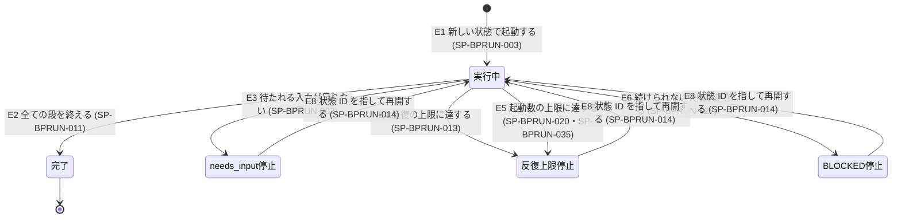

# 仕様書: best-practices の実行基盤

[設計時点の出典／旧規約 @ c7759f1]: https://github.com/yoshiysh/claude-plugins/blob/c7759f152c1e51369818f21e34a98cb0146e5e76/AGENTS.md
[repository-operations の現行案内]: https://github.com/yoshiysh/claude-plugins/blob/main/docs/guidelines/repository-operations.md

## 表記規約

仕様項目の語尾の区分は `docs/requirements/bp-operations.md` の「表記規約」に従う（必須 = 〜しなければならない、推奨 = 〜することが望ましい、許容 = 〜してもよい、禁止 = 〜してはならない）。主体「best-practices」「利用者」の意味も同文書に従う。

## 対象範囲

本文書は、best-practices 自身の実行基盤を定める。本文書は `####` 見出し 1 つを 1 仕様項目とする。扱うのは次のとおり。

- run の境界
- 状態と作業場所、状態を読み書きする CLI の責務
- 4 機能の各 run の作業記録・記録台帳・性能の記録の置き場と形式、保持と保存の失敗の停止
- 停止の種類と、next_args による再開
- 起動数の上限を渡されたときの扱い（不正な上限と、1 件も始められない上限の停止を含む）
- run の中の agent が読む判定基準の写し
- 役ごとのモデル・effort・権限の当て方
- 4 機能に共通の異常系

次の事柄は他の文書が定め、本文書は参照だけにする。

| 事柄 | 正本 |
|---|---|
| 依頼の振り分け、機能の連鎖、SKILL.md の Workflow callsite（起動数の上限を渡すかどうか） | `docs/specifications/bp-entry.md` |
| create・update の流れ（目標の固定、書く・検証する・書き直す、完了時と停止時の報告の中身） | `docs/specifications/bp-authoring.md` |
| review・audit の観点と流れ | `docs/specifications/bp-inspection.md` |
| 指摘と資産台帳（資産 ID・指摘 ID、指摘の状態、カバレッジと skip 一覧） | `docs/specifications/bp-findings.md` |
| 値（同時実行、反復の上限、試行の上限、要約の上限、best-practices 自身の役ごとのモデル・effort）と、対象スキルが満たす判定基準 | `docs/specifications/bp-conformance.md` |

### 本文書が実現する要求

本書の各仕様項目と要求の対応は、末尾のトレーサビリティ表を正とする。

## 用語定義

要求文書の用語（`docs/requirements/bp-operations.md`「用語」）と、設計方針文書（`docs/design/skill-design-patterns.md`）の用語（段・項目・CLI・作業ファイル・運搬役・next_args・再開・停止の種類）はそのまま使う。下の語は best-practices の仕様書の複数の文書で使う語で、定義はここだけに置く。

| 用語 | 意味 |
|---|---|
| 状態 | 1 つの機能の、再開で続く run の列が共有する、run の外に残る記録。CLI だけが書く。1 つの状態は 1 つの機能と 1 つの対象スキルに対応する（連鎖の機能はそれぞれ別の状態を持つ） |
| 状態 ID | 状態を指す ID。CLI が状態を作るときに発行する |
| run ID | 1 つの run を指す ID。CLI が run の開始を記録するときに発行する |
| 現在の run | 状態に最後に開始を記録した run |
| 作業場所 | 状態と作業ファイルを置く場所。状態 ID ごとに 1 つ |
| 前提 | 状態に書く入力。固定した目標、update の修正の根拠、needs_input への利用者の回答を指す。検証役による受理を通さない（設計方針文書「目標の固定」：生成した主張ではなく入力だから） |
| 修正の根拠の記録 ID | update の修正の根拠を前提に書いたときに、最初の run の開始の操作（SP-BPRUN-003・SP-BPRUN-004）が根拠ごとに返す記録の ID。利用者の指示は指摘 ID を持たない（SP-BPFINDINGS-031）ので、根拠を指すときはこの ID を使う |
| 起動数 | 1 つの run の中で script が `agent()` を呼んだ回数。呼んだ形を問わず（fan-out・pipeline の工程・until-pass の繰り返し・回収役・運搬役を含む）、結果が null になった呼び出しも 1 回に数える。対象スキルの起動数も同じ数え方とする |
| 起動数の上限 | best-practices 自身の Workflow が入力として受け取る、1 run の起動数の上限（PR-BPDESIGNEDSKILL-016 の上限を best-practices 自身に当てたもの） |
| 未着手の項目 | 段の項目のうち、結果が状態に書かれていないもの。起動数の上限で起動しなかった項目と、起動したが結果が書かれる前に run が終わった項目を含む。打ち切った項目と、破棄した未着手の項目は含まない |
| 破棄した未着手の項目 | 再開した run が、処理しないと決めた前の回の未着手の項目（SP-BPRUN-015） |
| 停止の記録 | run が止まるときに状態に書く記録（SP-BPRUN-011） |
| 書いたファイルの一覧 | create・update の run が対象スキルに書いたファイルと消したファイルのパス、書いたか消したかの印、それぞれが検証を通ったかの記録 |
| 判定基準の写し | run の中の agent と CLI が判定基準として読む文書の、plugin の中の写し（SP-BPRUN-036） |
| 対象スキルのパスの一覧 | 対象スキルを指す記録。根のディレクトリのパス 1 つと、列挙したときの対象スキルのファイルのパスの並び（根の中の全てのファイルと、callsite が起動する自分の plugin の workflow script）からなる。列挙の規則は `docs/specifications/bp-entry.md` の SP-BPENTRY-022。create の最初の一覧は根だけを持つ |
| 一覧の中 | あるパスが、対象スキルのパスの一覧の根のディレクトリの配下にあるか、一覧のパスのうち根の外にあるもの（自分の plugin の workflow script）と一致すること。パスは symlink を辿った実体のパスに正規化してから比べる（公開済みのスキルは `.agents/skills/` の symlink 越しに編集される：[repository-operations の現行案内]、設計時点の出典／旧規約：[設計時点の出典／旧規約 @ c7759f1]） |
| 項目の ID | 段の項目を指す ID。CLI が決定的に作る（SP-BPRUN-038） |
| 作業記録の担当 | 作業記録を 1 つ書く単位。run の中で起動した役の名前と、その起動が処理する項目の ID の組（SP-BPRUN-041）。`docs/specifications/bp-findings.md` の用語「担当」（検証役に割り当てる資産の組）とは別のもの |
| 記録台帳 | 作業記録と証拠への参照を持つもの（SP-BPRUN-042）。`docs/specifications/bp-findings.md` の台帳（資産台帳）とは別のもの |
| fan-out の項目 | 同じ段で、確定した集合の各項目ごとに agent を起動して処理する単位。観点と担当の組、指摘の鍵、消えた資産に結び付く指摘などを指す |

## 機能仕様

### run の境界

#### SP-BPRUN-001 機能ごとの run
best-practices は、create・review・update・audit のそれぞれを別の Workflow の run として起動しなければならない。1 つの run で 2 つ以上の機能を実行してはならない（機能の間で利用者の入力を挟めるのは run の境界だけだから）。機能を順に実行する連鎖は `docs/specifications/bp-entry.md` が定める。

#### SP-BPRUN-002 run の中で入力を待たない
best-practices の Workflow script は、run の途中で人間の承認・回答を待つ手順を持ってはならない。待たれる入力が要ると判断した時点で、script は needs_input で止まらなければならない（SP-BPRUN-011）。この規則は create と、create と同じ処理を行う update（PR-BPOPERATIONS-003）に当てる。

#### SP-BPRUN-003 run の開始
新規の run は入力を確かめ、受理したときだけ機能・対象スキルに対応する状態 ID と run ID を発行しなければならない。create は依頼文を、update は受け取った修正の根拠を欠かさず保存しなければならない。review・audit に依頼文または修正の根拠の入力・保存を要求してはならない。入力が不正な場合は状態と作業場所を作らず、機能ごとの定め（SP-BPAUTHORING-029・SP-BPINSPECTION-026）に従って止まらなければならない。

再開は同じ状態に新しい run ID を発行し、その run を現在の run としなければならない。同じ起動の再送は状態と run を重複して作ってはならず、同じ起動の識別に機能または対象の矛盾があれば拒否しなければならない。状態を作る途中の失敗でも、create の依頼文または update の修正の根拠が欠けた状態を再開可能として返してはならない。

#### SP-BPRUN-004 前提の書き込み
update の修正の根拠は、受け取った全件を開始時に保存し、根拠ごとに参照できる識別子を付けなければならない。利用者が足した回答は再開の始めに、固定した目標は固定が済んだ時点に保存し、いずれもその入力を使う検証より前に参照可能にしなければならない。

これらは入力として扱い、生成した主張の受理とは分けなければならない。入力の保存に検証役の合格を条件としてはならない。根拠として扱う範囲は SP-BPFINDINGS-031 が定める。

### 状態と作業場所

#### SP-BPRUN-005 再開と監査に必要な状態
状態は、停止・再開と後の監査で、次を辿れる論理的な記録を持たなければならない。

| 記録 | 必要な情報 |
|---|---|
| 入力と対象 | 機能、対象スキルとその版、依頼文、修正の根拠、回答、固定した目標と出所、update 前の比較基準 |
| 作業の進み | run ごとの識別、開始・終了、段、項目と順位、結果、試行と打ち切り、未着手と処理しないと決めた項目 |
| 回数 | 起動数、試行・反復・段ごとの繰り返しの累計、run の開始時点の値と適用した上限 |
| 変更と検証 | 書いた/消したファイル、検証した版と結果、合否、書き直しの根拠、形式検証の対象と結果 |
| 評価の根拠 | 判定基準と版、担当範囲、適用判定、判断点の照合、資産・指摘・見直し、未検査・拒否された結果 |
| 停止と監査 | 停止理由・段・残作業・再開情報、作業記録と証拠への参照、性能、保存できなかった範囲 |

試行の上限は同じ項目の累計に当て、再開で数え直してはならない。反復と段ごとの繰り返しの上限は現在の run の開始時からの増分に当てなければならない。成功した更新とその回数の記録が、中断や再送によって片方だけ反映された状態になってはならない。記録の内部キー、ファイル形式、排他・確定の手順は実装の設計で決める。

#### SP-BPRUN-006 状態の書き込みの規則
状態の書き込みは、設計方針文書「状態の書き込み」の原則に従い、次を全て満たさなければならない。

- 状態を書くのは CLI だけで、run の中で書き込みの CLI を呼ぶのは運搬役だけにする。
- 何を受理して書くかは script が決め、運搬役はその決定を CLI に渡すだけにする。
- 全ての書き込みを冪等にする。同じ内容の書き込みを繰り返しても状態は変わらない。
- 既にある記録と食い違う書き込みは、CLI が拒否する（拒否を受けた run の扱いは SP-BPRUN-029）。
- 記録は足すだけで書き換えない。状態の変化は新しい記録として足す。

#### SP-BPRUN-007 作業場所の置き場
作業場所は対象スキルの外に新しく設け、対象外の既存のファイルを状態や作業ファイルに転用してはならない。保存先は次の裁定済み制約に従わなければならない。

- root は、環境変数 `BP_STATE_ROOT` に絶対パスがあればそれを使い、無ければ起動時 cwd の git toplevel（git の外なら cwd）の `.best-practices` とする。
- 状態ごとの永続先は `<root>/states/<状態 ID>/` とする。
- root は symlink を辿った実体で判定し、対象スキルの配下または SP-BPRUN-039 の禁止先に当たる場合、状態と作業場所を作らず理由付きで拒否する。
- next_args は root を含まないため、新規起動と再開は同じ cwd（対象リポジトリの git toplevel）で行う。

保存の確定、ロック、記録と作業ファイルの内部配置は実装の設計に委ねる。

#### SP-BPRUN-039 作業場所を残す場所
作業場所は、run をまたいで残る場所に置かなければならない。次の場所に置いてはならない。

- `/tmp` 系の清掃で消える場所（未 push の成果が `/tmp` の清掃で失われた実測：設計時点の出典／旧規約：[設計時点の出典／旧規約 @ c7759f1]）
- Codex runner が run ごとに作る workspace（`<cwd>/dynamic-workflows/workspace/<workflow-slug>/<run-id>`。run ごとにパスが変わるので、次の run が同じ状態を指せない）

CLI は、`/tmp`・`/private/tmp`・`/var/tmp`・`/private/var/tmp`・`/var/folders`・`/private/var/folders`・`os.tmpdir()` とその実体のパスの配下を `/tmp` 系とする（macOS の `$TMPDIR` は `/var/folders` の配下で、OS が定期的に消す）。実体のパスに `dynamic-workflows`・`workspace` の連続する 2 つの要素を含むものを Codex runner の workspace とする。

#### SP-BPRUN-008 書き込み先の制限
best-practices の run が書き込む先は、次の判定表に従わなければならない。

> 条件の値: 機能 = create / update / review / audit
> 条件の値: 書き込む先 = 対象スキル / 作業場所 / 対象スキルと作業場所の外

| 条件: 機能 | 条件: 書き込む先 | 結果 |
|---|---|---|
| create | 対象スキル | 書き手だけが書いてよい（SP-BPRUN-009） |
| update | 対象スキル | 書き手だけが書いてよい（SP-BPRUN-009） |
| review | 対象スキル | 書いてはならない（SP-BPRUN-026 が確かめる） |
| audit | 対象スキル | 書いてはならない（SP-BPRUN-026 が確かめる） |
| * | 作業場所 | 状態は運搬役が CLI で書いてよい。作業ファイルは各役が書いてよい |
| * | 対象スキルと作業場所の外 | 書いてはならない |

対象スキルの範囲は `docs/requirements/bp-operations.md` の用語「対象スキル」に従う。

#### SP-BPRUN-009 書いたファイルの記録
create・update が書いたファイルと消したファイルは、パス・操作・run・検証を通ったかを記録しなければならない。範囲外のパスを含む結果でも、範囲内の変更の記録を捨ててはならない。検証済みの後に内容を変えたファイルを、前の検証で合格したと報告してはならない。完了条件を満たした時だけ対象版を検証済みとし、それ以外の停止で未検証のファイルを検証済みにしてはならない。

#### SP-BPRUN-038 作業の進みと項目の同一性
停止や記録の無い中断から、始めた段・終えた段と、結果のある項目・未着手・打ち切り・処理しないと決めた項目を区別できなければならない。同じ作業を同じ条件で再開しても項目の同一性と順位を保ち、新しい条件や検証し直す回の項目は前の結果と混同してはならない。結果を得た項目を段の終わりまで未保存のままにしてはならない。

停止報告と作業記録で使う段の名前は、機能の仕様が用いる次の名前とする。名前の存在は、内部 worker を必ず各段に 1 体置く指定ではない。

| create・update | review・audit |
|---|---|
| 開始、作り直す前の写し、目標の固定、書く、台帳、検証、追加の検証、反証、消えた資産の照合、見直し、合否、形式検証 | 開始、照らす先の決定、台帳の作成と資産の束、担当の作成、適用の判定（review だけ）、検証、追加の検証、反証、消えた資産の照合、照合と停止 |

項目の内部 ID の符号化、段の slug、回や部分の番号の持ち方は実装の設計で決める。

### run の記録

本節は、4 機能の各 run の作業記録・証拠・記録台帳・性能の記録を、`docs/requirements/bp-designed-skill.md` の PR-BPDESIGNEDSKILL-028・029・032・040・034・035・036 と同じように扱う置き場と形式を定める（PR-BPOPERATIONS-051）。内部の保存形式と操作名は実装の設計で決める。

#### SP-BPRUN-041 作業記録
起動した各担当の各試行について、担当・段・対象・入力・実行内容・結果・根拠・失敗・未確認と、適用した文書の一般規約の版・不変の参照を持つ作業記録を残さなければならない。入力は渡した対象・基準・前提・証拠をパスまたは ID で特定し、無い欄も無いと示さなければならない。証拠も作業場所に保存し、前の試行の記録を上書きしてはならない。

#### SP-BPRUN-042 記録台帳
記録台帳は、run・担当・試行と作業記録・証拠の対応を持ち、各記録から本体へ辿れるようにしなければならない。同じ担当の再試行を区別し、再送で記録を重複させず、前の試行の失敗や代わりの記録を残さなければならない。共有台帳は担当が直接更新せず、SP-BPRUN-006 の上位制約に従わなければならない。同じ内容は作業記録か台帳の一方を正本とし、他方は参照にしなければならない。

#### SP-BPRUN-043 文書の一般規約の写しと版
実行先で文書の一般規約（`docs/guidelines/documentation.md`）を読めなければならない。配布する基準の一部として正本と逐語で一致する版を用い、作業記録には適用した plugin version と、その内容の sha256 による不変の参照を残さなければならない。同期のコマンドや内部配置は実装の設計で決める。取得できないときは SP-BPRUN-045 に従う。

#### SP-BPRUN-044 記録の保持
作業記録・証拠・記録台帳は足すだけとし、CLI・script・各役は、保存できたものを利用者の削除の指示なしに消すか書き換えてはならない（PR-BPDESIGNEDSKILL-034）。新しい run は、前の run の記録を残したまま、自分の記録を足す（PR-BPDESIGNEDSKILL-034）。

#### SP-BPRUN-046 性能の記録
run の性能は、実際の開始・停止と作業の記録から導き、停止の記録の `performance` に残さなければならない。記録は次の 4 欄を持つ。

| 記録 | 綴り | 値 |
|---|---|---|
| 所要時間 | `durationMs` | 同じ run ID の停止の記録の `at` から run の開始の記録の `at`（SP-BPRUN-005）を引いたミリ秒の整数 |
| 人の介入 | `interventions` | `{answers, resumes}`。`answers` はその run の開始の操作が前提に書いた回答の件数、`resumes` は下の表の値 |
| 再試行 | `retries` | `{attempts, iterations, untilPass}`。`attempts` はその run が書いた試行の失敗の記録（SP-BPRUN-028）の件数、`iterations` は反復の回数（SP-BPRUN-013）のその run の開始時の値からの増分、`untilPass` はその run の開始時の値から段ごとの繰り返しの回数が 1 以上増えた段の名前だけを鍵とし、値をその増分（1 以上の整数）とするオブジェクト。増分が 0 の段は鍵に持たず、どの段も増えなければ `{}` とする |
| 費用 | `cost` | 下の費用の規則で得た JSON のオブジェクト。オブジェクトでない値を取得済みの費用として扱わない |

`resumes` は、CLI が現在の run の前の run（同じ状態の直前の run）から次の表で決める。

> 条件の値: 前の run = 無い / 停止の記録が needs_input か BLOCKED / 停止の記録がそれ以外の種類 / 停止の記録が無い

| 条件: 前の run | 結果 |
|---|---|
| 無い | 0（状態の最初の run） |
| 停止の記録が needs_input か BLOCKED | 1 |
| 停止の記録がそれ以外の種類 | 0 |
| 停止の記録が無い | 1（停止の記録を書かずに BLOCKED を返した run と、host の process の終了で終わった run） |

費用は host が実際に提供する測定値から得なければならない。native Workflow の `budget.spent()` が有限の数を返す場合、`{tokens: <測定値>}` とする。取得できない、有限でない、取得が失敗した場合は取得できなかったものとして扱い、caller が渡した値や推測で補ってはならない。

値を得られなかった欄は `{unavailable: true, host: <run の開始の記録の host>}` とし、0 と区別する（`host` は `native`（Claude Code の native Workflow）か `codex`（Codex runner））。

停止の記録を書かずに止まる run（状態を作らずに止まる run：SP-BPRUN-037 で入力に状態 ID が無いとき、`docs/specifications/bp-authoring.md` の SP-BPAUTHORING-029、`docs/specifications/bp-inspection.md` の SP-BPINSPECTION-026。SP-BPRUN-037 で agent を起動せずに止まる再開の run。停止の記録を書けずに BLOCKED を返す run：SP-BPRUN-027）は、性能の記録を返り値（SP-BPRUN-032）の `performance` に、上の表と同じ欄と形で載せる。このときの値は次の表とし、「取得できなかった」は `{unavailable: true, host: <script の入力の host>}` とする（script の入力の `host`：`docs/specifications/bp-entry.md` の SP-BPENTRY-013）。script は自分で時刻を読んで所要時間を埋めてはならない。

| 記録 | 値 |
|---|---|
| 所要時間 | CLI が停止の時刻を書かないので、取得できなかった |
| 人の介入・再試行 | 入力に状態 ID が無く状態を作らずに止まった run では、`interventions` は `{answers: 0, resumes: 0}`、`retries` は `{attempts: 0, iterations: 0, untilPass: {}}`。それ以外の run では取得できなかった |
| 費用 | 上の費用の規則で script が作ったオブジェクト。作れなければ取得できなかった |

停止の記録を書けた run は、返り値に `performance` を載せない（正本は停止の記録）。

### 停止

#### SP-BPRUN-010 停止の種類
best-practices の run は、次の判定表で「使う」とした停止のどれか 1 つで止まらなければならない。

> 条件の値: 機能 = create / update / review / audit
> 条件の値: 停止 = 完了 / 乾き / needs_input / 反復の上限 / BLOCKED

| 条件: 機能 | 条件: 停止 | 結果 |
|---|---|---|
| * | 完了 | 使う |
| * | 乾き | 使わない（best-practices は探索グラフ型の段を持たないので、乾きの定義が当たらない） |
| create | needs_input | 使う（PR-BPOPERATIONS-005） |
| update | needs_input | 使う（PR-BPOPERATIONS-003 により create と同じ） |
| review | needs_input | 使わない（needs_input を定める要求は create・update にだけある） |
| audit | needs_input | 使わない（needs_input を定める要求は create・update にだけある） |
| create | 反復の上限 | 使う（反復の回数：SP-BPRUN-013、起動数の上限：SP-BPRUN-020） |
| update | 反復の上限 | 使う（反復の回数：SP-BPRUN-013、起動数の上限：SP-BPRUN-020） |
| review | 反復の上限 | 起動数の上限で止まるときだけ使う（SP-BPRUN-020）。反復の回数では止まらない（流れは段の間に戻りを持たない：`docs/specifications/bp-inspection.md`。資産台帳の追加起動は反復に数えない：設計方針文書「形の判定」） |
| audit | 反復の上限 | review と同じ |
| * | BLOCKED | 使う（SP-BPRUN-027〜030） |

起動数の上限で止まるときの停止の種類と理由の書き方は SP-BPRUN-035 に従う。停止の記録には、反復の上限が反復の回数と起動数の上限のどちらで当たったかを残す（SP-BPRUN-011。再開した run の始め方が原因によって違う：`docs/specifications/bp-authoring.md` の SP-BPAUTHORING-035）。

#### SP-BPRUN-011 停止の記録
停止時は、停止の種類・理由・段、当たった上限、未着手の順位、起動数、未検証の変更、対象版の照合から除いたファイル、停止時刻と性能を記録しなければならない。BLOCKED のうち、検証役・反証役が結果を返せない場合は `verifiers`、必要な形式検証を実行できない場合は `formalUnrunnable`、性質が成り立たない場合は `formalFailed` と区別しなければならない。形式検証の結果の保存拒否や運搬の失敗に、この 3 つの原因を推測で付けてはならない。

対象版から除いたパスは `excluded` として、根の中なら根からの相対パス（symlink の位置）、根の外なら実体の絶対パスで残さなければならない。create・update は範囲外の変更も報告に残さなければならない。

停止を記録できたか確認して返し、記録できない場合は SP-BPRUN-027 に従わなければならない。状態を作る前に止まる場合は停止の記録を作らず、性能の取得不能と入力を直して新しく起動することを返さなければならない。

#### SP-BPRUN-012 停止で書いたファイルを戻さない
完了の前に止まったとき、run は、書いたファイルを消してはならず、書く前の内容に戻してもならない（戻すかどうかは利用者が決める：PR-BPOPERATIONS-040）。

#### SP-BPRUN-013 反復の上限の数え方
create・update の書き直しの反復の回数は、状態に累計で持たなければならない。反復の上限は、現在の run の開始時の累計からの増分に当てなければならない（増分ではなく累計に当てると、反復の上限で止まった run を再開したとき、利用者の入力が効く前に同じ理由ですぐに止まる：設計方針文書「停止・再開と人間の入力」）。上限の値は `docs/specifications/bp-conformance.md` の固定集合の反復型の反復の上限に従う。

### 再開

#### SP-BPRUN-014 再開の起動
完了以外で止まった run からは、next_args（SP-BPRUN-033）で新しい run を起動して再開しなければならない。次の手段を再開に使ってはならない。

- Claude Code の relaunch（同じ run を保存した結果から再生すること）
- Codex runner の checkpoint / resume（opt-in の別の機構で、本文書の状態を使わない）

BLOCKED からは、利用者が原因を直してから再開する。CLI は、完了した状態に新しい run を開始させてはならない。

#### SP-BPRUN-015 再開した run の始め方
再開した run は、次の順に進まなければならない。

1. SP-BPRUN-003 で状態の要約を読む。
2. 利用者が足した回答があれば、SP-BPRUN-004 で前提として書く。
3. 終えていない段から続ける。止まった段（停止の記録が無いときは SP-BPRUN-018 で決める）の未着手の項目だけを順位の順に処理し、結果が状態に書かれた項目と、終えた段の結果は処理し直さない。止まった段の項目が 0 件のとき（項目を持たない段か、項目を列挙する前に止まった段）は、その段を最初から行う。
4. 試行の回数・打ち切り・反復の回数・段ごとの繰り返しの回数は、状態の値をそのまま引き継ぐ。
5. 3 で前の回の未着手の項目を処理しないと決めたときは、それらを破棄した未着手の項目として運搬役に状態へ書かせる（書かないと、停止の記録の無い run からの再開（SP-BPRUN-018）が、破棄した項目を未着手の項目として拾う）。

機能の文書が再開した run の始め方を定めるときは、3 と 5 の代わりにそれに従う（create・update は `docs/specifications/bp-authoring.md` の SP-BPAUTHORING-035、review・audit は `docs/specifications/bp-inspection.md` の SP-BPINSPECTION-030）。

#### SP-BPRUN-016 再開時の対象スキルの照合
再開した run の開始では、CLI が対象スキルの今の指紋を作り、照らす基準の時点の指紋と照らさなければならない。照らす基準の時点は、前の run が状態に最後に記録した対象スキルの指紋の時点とする（停止の記録があれば停止時、無ければ前の run の開始かパスの一覧の取り直しのうち後のもの）。食い違ったときの指摘と資産台帳の扱いは `docs/specifications/bp-findings.md` に従う（前の run の後に対象が変わっていることがある：設計方針文書「停止・再開と人間の入力」）。

#### SP-BPRUN-017 現在でない run の書き込み
CLI は、次のどちらかに当たる書き込みを拒否し、状態を変えてはならない。

- 現在の run でない run の ID を持つ書き込み
- 現在の run の停止の記録を書いた後の、その run の書き込み

ただし、停止の記録を書いた run への同じ内容の停止の記録 の送り直しは、記録を足さずに受理する（停止の応答を失った運搬役の送り直しを受け付ける：SP-BPRUN-006）。停止の記録を書いた後の run への 停止の再送以外の書き込みは、操作の処理を走らせる前に拒否する（走らせると、作業ファイルを書くか、操作の内部の失敗の符号が拒否の符号にすり替わる）。

この拒否は、拒否を受けた古い run の運搬役にだけ返し、現在の run の停止の理由にしてはならない（前の run の遅れた書き込みが、新しい run が読んだ後の状態を変えないようにするため）。

#### SP-BPRUN-018 停止の記録の無い run からの再開
run が停止の記録を書かずに終わったとき（host の process の終了、Codex runner の run 全体の時間切れや資源の上限による失敗など）、状態は最後に書かれた記録のまま残る。利用者は、機能と対象スキルを指定して未完了の状態を照会し、得られた状態 ID と next_args で SP-BPRUN-014 と同じ手順の再開をしてよい。照会は、読めた未完了の状態ごとに state・nextArgs・stoppedStage・pending を返さなければならない。読めなかった状態は、状態 ID と読めなかった理由を unreadable に分けて返し、黙って一覧から除いてはならない。再開した run は、状態の段の進みと項目の記録から、止まった段と未着手の項目を決めなければならない。

- 段の開始の記録が 1 つも無いときは、機能の最初の段から始める。
- 未着手の項目は、止まった段で列挙した項目のうち、結果も打ち切りの印も破棄の記録も無いものとする。起動したが結果が状態に書かれていない項目を含む。

CLI は、止まった段を次の順に決める。

1. 現在の run の前の run に停止の記録があれば、その停止の記録の止まった段とする。
2. 1 に当たらなければ、段の開始の記録のうち段の終わりの記録が無いものの最後とする。
3. 2 も無く、終えた段だけがあれば、最後に終えた段とする。次の段は script が機能の段の表から決める（CLI は機能の段の並びを持たない）。
4. 段の開始の記録が 1 つも無ければ未開始とし、script は機能の最初の段から始める。

停止の記録の止まった段は、停止を書く時点で 2・3 の規則で決めたものとする。

### 起動数の上限

#### SP-BPRUN-019 起動数の上限の受け取り
best-practices 自身の Workflow は、起動数の上限を省略できる入力として受け取れなければならない（項目の綴りは `maxLaunches`：`docs/specifications/bp-entry.md` の SP-BPENTRY-013 の綴りの表）。上限を渡すかどうかは callsite が決める（`docs/specifications/bp-entry.md` の SP-BPENTRY-015）。値が 1 以上の整数でないときは SP-BPRUN-037 に従う。

#### SP-BPRUN-040 上限を渡されない run と、起動数の上限の数え方
上限を渡されない run で、script は `docs/specifications/bp-conformance.md` の SP-BPCONFORMANCE-025 に従わなければならない。起動数の上限は 1 run の起動数の総数に当て、同時に走る agent の数（SP-BPCONFORMANCE-027）とは別に数えなければならない（Codex runner の `limits.maxAgents` と `limits.concurrency` は別の上限で、前者を超えると run 全体が失敗する：runtime README の Contract と Explicit live execution の節）。

#### SP-BPRUN-020 上限に収まらない項目
上限を渡された run は、項目と停止の記録に必要な呼び出しを含め、SP-BPCONFORMANCE-022 の条件を満たす場合だけ新しい作業を始めなければならない。収まらない場合は新しい項目を始めず、始めた項目の終了後、残りの全項目を上限が無ければ処理する順の未着手として保存し、反復の上限で止まって next_args を返さなければならない。

理由には上限・起動数・保存した未着手件数を含めなければならない。件数と順位は実際に保存した残作業から決定的に導き、状態と異なる手元の一覧や推測を使ってはならない。

#### SP-BPRUN-021 最小の起動数
best-practices の最小の起動数は、create が 31、update が 32、review が 33、audit が 28 とする。新規と再開で同じ値を使わなければならない。上限がこの値以上であれば、最初の fan-out 項目の最悪の試行と、停止に必要な呼び出しを収められる設計でなければならない。内部の役の配置や運搬回数を変える場合も、この公開された受理境界を黙って変えてはならない。最小値に満たない入力は SP-BPRUN-037 に従う。

#### SP-BPRUN-037 不正な上限と、1 件も始められない上限
起動数の上限を渡された run が次のどちらかに当たるとき、Workflow は host によらず、`agent()` を 1 回も呼ばずに BLOCKED で止まらなければならない。best-practices 自身の run はこの項目に従い、`docs/specifications/bp-conformance.md` が対象スキルを PR-BPDESIGNEDSKILL-016・PR-BPDESIGNEDSKILL-019 に照らす判定の基準もこの項目を参照する。

| 当たること | 理由に書くこと |
|---|---|
| 上限の値が 1 以上の整数でない | 渡された値と、受け付ける値の範囲 |
| 上限が最小の起動数に満たない（best-practices 自身は SP-BPRUN-021、対象スキルは `docs/specifications/bp-conformance.md` の SP-BPCONFORMANCE-023） | 上限の値と要る最小の起動数、上限が 1 件の項目にも足りないこと |

- 上限を渡されなかったとみなして続けてはならない（上限の無い run になり、Codex runner の上限を超えて run 全体が失敗する）。
- 停止の種類は BLOCKED だけとする（同じ入力で起動し直しても同じ理由で止まるので、利用者が上限を直すまで続けられない。反復の上限で返すと、上限に達した通常の停止と見分けがつかない）。
- `agent()` を呼ばないので、状態は書かれない。入力に状態 ID があれば、その状態 ID を持つ next_args を返し、無ければ next_args を返さない。
- agent を起動する前の他の確かめ（`docs/specifications/bp-authoring.md` の SP-BPAUTHORING-029 の「agent の起動の前」の行）と同時に当たるときは、本項を先に当てる。

#### SP-BPRUN-022 次の run への持ち越し
起動数の上限で止まった run（SP-BPRUN-035）から再開した run は、SP-BPRUN-015 に従い、状態に残した未着手の項目から処理を続けなければならない（SP-BPRUN-035 の 2・3）。再開の起動に上限を渡すかどうかは `docs/specifications/bp-entry.md` の SP-BPENTRY-015 に従う。

#### SP-BPRUN-035 残した項目からの再開の手順
起動数の上限で止まった run から再開するとき、Workflow は host によらず次の手順に従わなければならない。best-practices 自身の run はこの手順を SP-BPRUN-015・SP-BPRUN-020 で実現し、`docs/specifications/bp-conformance.md` が対象スキルを PR-BPDESIGNEDSKILL-019 に照らす判定の基準もこの項目を参照する。

1. 止まった run は、処理していない項目を順位付きの未着手として run の外の状態に残し、停止の種類を反復の上限として返す。理由には、起動数の上限で止まったことを書く（依頼者の裁定。設計方針文書「停止・再開と人間の入力」の 5 種に新しい種類を足さない）。
2. 再開した run は、その未着手の項目を順位の順に処理する。
3. 結果が状態に残った項目は処理し直さない。ただし、create・update の追加の検証の段の未着手の項目は破棄してよい。追加の検証の項目は skip 一覧から作るので、再開の時点の skip 一覧から次の部分を作り直す（`docs/specifications/bp-findings.md` の SP-BPFINDINGS-025、`docs/specifications/bp-authoring.md` の SP-BPAUTHORING-035）。
4. 再開に使う next_args は起動数の上限を含まない。上限は起動のたびに callsite が host に応じて渡す（含めると、同じ next_args を Claude Code の native Workflow で起動したときに上限が渡り、PR-BPDESIGNEDSKILL-022 に反する）。

### 判定基準の写し

#### SP-BPRUN-036 判定基準の写し
配布先でも、run の判定に必要な BP 仕様、要求、設計方針文書と文書の一般規約を、正本と逐語で一致する判定基準として参照できなければならない（依頼者の裁定）。正本は repository の `docs/` とする。基準が参照する判定に必要な範囲と、隣接する開いた TBD の記録を落としてはならない。

run の中で使う基準と版を固定し、配布する基準の不足・正本との不一致を機械で検出できなければならない。基準が無い場合、記憶や prompt の言い換えを基準にしてはならない。読めない基準は SP-BPINSPECTION-005・027 と SP-BPCONFORMANCE-038 に従い停止または未検査とし、基準の外を未申告で参照して判定してはならない。

配布の内部配置、同期コマンド、参照を走査する手順と内部の定数名は実装の設計で決める。

### モデル・effort・権限

#### SP-BPRUN-023 役ごとのモデルと effort
script は、全ての agent の起動で model と effort を明示しなければならない。値は `docs/specifications/bp-conformance.md` の SP-BPCONFORMANCE-035 の、best-practices 自身の役の表に従う。

#### SP-BPRUN-024 生成と別の context での起動
script は、検証役と反証役を、書き手や指摘の候補を出した役とは別の agent の起動として起動しなければならない。同じ agent の起動の中で生成と検証をさせてはならない（生成した本人には自分の誤りが見えない）。

#### SP-BPRUN-025 役ごとの権限
各役が書き込んでよい先は次のとおりとする。

| 役 | 書いてよい先 |
|---|---|
| 書き手（create・update だけ） | 対象スキルと作業ファイル |
| 検証役・反証役・抽出役 | 作業ファイルだけ |
| 運搬役 | CLI を通した状態だけ |

host が役ごとに権限を分ける手段を持たないとき、その制限は役の prompt だけで伝わる。この場合、run は、その制限を確かめられなかった制限として返り値（SP-BPRUN-032）に書かなければならない。permission rules は Claude Code でも workflow の全ての subagent に同じく効き（設計方針文書「権限」）、Codex runner でも host の権限が全ての呼び出しに一律に効く（runtime README の Explicit writable and isolated checkouts の節）。

#### SP-BPRUN-026 対象を書き換えていないことの照合
review・audit の run は、停止の記録を書く前に、CLI に対象スキルの今の指紋を作らせ、開始時の指紋と照らさなければならない。食い違ったら、run は BLOCKED と理由（変わったファイルのパス）を返し、結果を完了として返してはならない（役ごとの権限を host が強制できない（SP-BPRUN-025）ので、PR-BPOPERATIONS-030 の違反を run の中で見つける手段がこの照合だけになる）。停止の時点で指紋から除いたファイル（SP-BPRUN-011 の `excluded`）が 1 件でもあれば、対象スキルが変わったとして同じく扱う（開始の操作は plugin の外のファイルを拒否するので、除いたファイルは開始の後に現れたものである）。

## 状態とイベント

状態は、CLI から見た 1 つの状態の段階である。停止の記録を書かずに終わった run は、CLI からは実行中と区別できないので、実行中に含める（SP-BPRUN-018）。イベントには E1〜E10 の番号を付け、この章の中だけで使う。状態を作らずに止まる run（SP-BPRUN-037・SP-BPAUTHORING-029・SP-BPINSPECTION-026）は、状態が無いのでこの章のイベントにならない。

E1 は状態を新しく作るので、既にある状態には起きない。E2〜E7 と E10 は run が走っている間にだけ起きる。

> 対象の状態: 実行中 / needs_input停止 / 反復上限停止 / BLOCKED停止 / 完了

> 対象のイベント: E1 新しい状態で起動する / E2 全ての段を終える / E3 待たれる入力が足りない / E4 反復の上限に達する / E5 起動数の上限に達する / E6 続けられない失敗が起きる / E7 run が停止の記録を書かずに終わる / E8 状態 ID を指して再開する / E9 現在でない run の書き込みが届く / E10 fan-out の項目の工程が欠ける

| 現在の状態 | イベント | 種別 | 次の状態 | 定義済みか |
|---|---|---|---|---|
| 実行中 | E1 | — | — | 発生しない |
| 実行中 | E7 | 異常系 | 実行中 | ✅ SP-BPRUN-018 |
| 実行中 | E8 | 準正常系 | 実行中 | ✅ SP-BPRUN-017 |
| 実行中 | E9 | 準正常系 | 実行中 | ✅ SP-BPRUN-017 |
| 実行中 | E10 | 準正常系 | 実行中 | ✅ SP-BPRUN-028 |
| needs_input停止 | E1 | — | — | 発生しない |
| needs_input停止 | E2 | — | — | 発生しない |
| needs_input停止 | E3 | — | — | 発生しない |
| needs_input停止 | E4 | — | — | 発生しない |
| needs_input停止 | E5 | — | — | 発生しない |
| needs_input停止 | E6 | — | — | 発生しない |
| needs_input停止 | E7 | — | — | 発生しない |
| needs_input停止 | E9 | 準正常系 | needs_input停止 | ✅ SP-BPRUN-017 |
| needs_input停止 | E10 | — | — | 発生しない |
| 反復上限停止 | E1 | — | — | 発生しない |
| 反復上限停止 | E2 | — | — | 発生しない |
| 反復上限停止 | E3 | — | — | 発生しない |
| 反復上限停止 | E4 | — | — | 発生しない |
| 反復上限停止 | E5 | — | — | 発生しない |
| 反復上限停止 | E6 | — | — | 発生しない |
| 反復上限停止 | E7 | — | — | 発生しない |
| 反復上限停止 | E9 | 準正常系 | 反復上限停止 | ✅ SP-BPRUN-017 |
| 反復上限停止 | E10 | — | — | 発生しない |
| BLOCKED停止 | E1 | — | — | 発生しない |
| BLOCKED停止 | E2 | — | — | 発生しない |
| BLOCKED停止 | E3 | — | — | 発生しない |
| BLOCKED停止 | E4 | — | — | 発生しない |
| BLOCKED停止 | E5 | — | — | 発生しない |
| BLOCKED停止 | E6 | — | — | 発生しない |
| BLOCKED停止 | E7 | — | — | 発生しない |
| BLOCKED停止 | E9 | 準正常系 | BLOCKED停止 | ✅ SP-BPRUN-017 |
| BLOCKED停止 | E10 | — | — | 発生しない |
| 完了 | E1 | — | — | 発生しない |
| 完了 | E2 | — | — | 発生しない |
| 完了 | E3 | — | — | 発生しない |
| 完了 | E4 | — | — | 発生しない |
| 完了 | E5 | — | — | 発生しない |
| 完了 | E6 | — | — | 発生しない |
| 完了 | E7 | — | — | 発生しない |
| 完了 | E8 | 準正常系 | 完了 | ✅ SP-BPRUN-014 |
| 完了 | E9 | 準正常系 | 完了 | ✅ SP-BPRUN-017 |
| 完了 | E10 | — | — | 発生しない |

## エラー処理と異常系

4 機能に共通の異常系はここだけに置く。機能に固有の異常系（create の目標を固定する入力の不足、update の修正の根拠が 0 件など）は `docs/specifications/bp-authoring.md`・`docs/specifications/bp-inspection.md` が持つ。

#### SP-BPRUN-027 fan-out の外の agent の失敗
fan-out 項目の外の担当が例外または結果なしで終わった場合、run は BLOCKED とし、失敗した段・役・host が返した失敗の内容を報告しなければならない。host が原因を返さない場合は、結果が無いことだけを報告しなければならない。

状態の更新の応答を失った場合、同じ更新を 1 回だけ再送してよいが、後の停止に必要な起動枠を残さなければならない。再送で同じ作業・状態・run を重複させてはならない。再送でも確認できない場合や拒否された場合、停止を保存できたと報告せず BLOCKED を返し、最後に保存できた記録を保持しなければならない。

停止の保存に失敗した場合も、記録から確認できる段と変更一覧を返さなければならない。読めない場合はその限界を理由に示し、段や変更一覧を推測で作ってはならない。保存した状態は SP-BPRUN-018 の中断として再開できなければならない。

#### SP-BPRUN-028 fan-out の項目の工程の欠け
fan-out 項目が結果を返さなかった場合、結果を書かず試行の失敗を記録して未着手に戻し、同じ段の中で再試行してよい。1 件の欠けだけで run を止めてはならない。試行の累計が SP-BPCONFORMANCE-031 に達した項目は理由付きの打ち切りとし、未着手から外さなければならない。

応答を失った更新を再送する場合、既に結果を保存した項目に試行失敗を重ねてはならない。保存された結果の有無を確認できないまま、欠けとして扱い続けてはならず、BLOCKED として限界を示さなければならない。

#### SP-BPRUN-029 全件の欠けと CLI の拒否
次のどちらかが起きたとき、run は BLOCKED と理由を返して止まらなければならない。

- 1 つの段で、現在の run で処理した項目が 1 件以上あり、その全てが打ち切りになった。前の run で打ち切った項目は、処理した項目にも打ち切りにも数えない（数えると、原因を直して再開した run が同じ BLOCKED を返し続ける：SP-BPRUN-014）。
- 現在の run の書き込みを、CLI が SP-BPRUN-006 の食い違いか、状態の構造を指す ID の誤りとして拒否した。状態の構造を指す ID は、CLI が発行して状態に置き、script が状態から取って書き込みに入れる ID（状態 ID・run ID・段の名前・項目の ID・担当 ID・指摘 ID・修正の根拠の記録 ID）とし、状態に無いその ID を指す書き込みを誤りとする。

agent の結果の中の値（検証役・反証役が返した資産 ID・指摘の種類・選択肢、検証役が選んだ記録 ID や仕様項目 ID など）の誤りは本項に当てず、`docs/specifications/bp-findings.md` の SP-BPFINDINGS-034 に従う。

#### SP-BPRUN-030 BLOCKED の理由
BLOCKED の理由は、利用者がどこを直してから再開すればよいかを特定できる内容でなければならない。少なくとも、止まった段、失敗した役か操作、失敗の内容を含める（理由が残らないと、どこから再開すればよいかが分からない：PR-BPOPERATIONS-013）。停止の記録を書けなかった BLOCKED で段を読めないときと段の記録が無いときは、段の代わりにそのことを書く（SP-BPRUN-027）。

#### SP-BPRUN-045 文書の一般規約の版を得られないとき
文書の一般規約の写し（SP-BPRUN-043）が無いか、作業記録に書く版か不変の参照を CLI が得られないとき、CLI は記録台帳の記録を足す操作を理由つきで拒否しなければならない。run は BLOCKED で止まる（配布物の欠け）。作業記録を版と不変の参照の無いまま書いて進めてはならない。理由（SP-BPRUN-030）には、得られなかったもの（写しのパスか版か不変の参照）を書く。

#### SP-BPRUN-047 結果を返さなかった担当の作業記録
担当が結果を返さない場合も、その担当・段・対象・入力・試行と、host が返した失敗の内容、対象全体が未確認であることを作業記録から辿れなければならない。実行内容・結果・根拠が無いことを区別し、途中の作業記録があれば参照を保持しなければならない。保存できない場合は SP-BPRUN-048 に従う。1 件の欠け自体の続行可否は SP-BPRUN-027・028 が定める。

#### SP-BPRUN-048 記録の保存の失敗
作業記録・証拠・記録台帳のどれかを保存できないとき、run は BLOCKED で止まらなければならない（PR-BPDESIGNEDSKILL-035）。停止の種類が完了でないことで、完了と報告しないことを表す。保存できたものは消さず、戻さない。返り値（SP-BPRUN-032）の `unsavedRecords` に保存できなかった範囲（作業記録・証拠・記録台帳のどれか、その担当とパス）を載せ、保存できなかった理由を理由（SP-BPRUN-030）に書く。停止の記録そのものを書けないときは SP-BPRUN-027 の停止の記録を書けない BLOCKED の扱いに従う。

## 外部インタフェース

#### SP-BPRUN-032 run の返り値
run は、どの停止でも次の項目を返さなければならない。機能に固有の返すもの（作ったスキル、指摘、カバレッジを含む）は `docs/specifications/bp-authoring.md`・`docs/specifications/bp-inspection.md` が定める。

| 項目 | 綴り | 返すとき |
|---|---|---|
| 停止の種類 | `stopKind` | 常に |
| 理由 | `reason` | 完了以外 |
| next_args | `nextArgs` | 完了以外。状態を作らずに止まったとき（SP-BPRUN-037 で入力に状態 ID が無いとき、`docs/specifications/bp-authoring.md` の SP-BPAUTHORING-029、`docs/specifications/bp-inspection.md` の SP-BPINSPECTION-026）は返さない |
| 状態 ID と run ID | `state`・`run` | 状態が書かれたとき |
| 起動数 | `launches` | 常に |
| 書いたファイルの一覧（パス、書いたか消したかの印、検証を通ったか） | `writtenFiles` | create・update で、1 つ以上書いたか消したとき（停止の記録を書けなかったときは SP-BPRUN-027） |
| 確かめられなかった役ごとの制限 | `unverifiedRoleLimits` | SP-BPRUN-025 に当たるとき。状態を作らずに止まった run は当たらない（対象スキルにも作業場所にも書く役を起動していない） |
| 性能の記録 | `performance` | 停止の記録を書かずに止まったとき（SP-BPRUN-046） |
| 保存できなかった記録 | `unsavedRecords` | 作業記録・証拠・記録台帳のどれかを保存できずに止まったとき（SP-BPRUN-048） |

項目の要素の形は次のとおりとする。

- `writtenFiles` の要素は `{path, action, verified}` とする。`path` は状態の書いたファイルの一覧のパスで、根の中のものは根からの相対パス（symlink の位置）、根の外のもの（自分の plugin の workflow script）は実体の絶対パスとする（SP-BPRUN-011 の `excluded` と同じ規則）。`action` は書いたなら `"write"`、消したなら `"delete"` とする。`verified` は、そのファイルが検証を通ったと一覧に追記されていれば `true`、それ以外（検証の結果がまだ無いときを含む）は `false` とし、`docs/specifications/bp-authoring.md` の SP-BPAUTHORING-034 の「検証を通っていない」と同じ意味にする。停止を保存できない場合の変更一覧も同じ形にする。
- `unverifiedRoleLimits` の要素は、SP-BPRUN-025 の表で未確認の役ごとの `{role, writable}` とし、`role` は表の役の列の値、`writable` は書いてよい先の列の値とする。`docs/specifications/bp-conformance.md` の SP-BPCONFORMANCE-020 の 4 項目の形は使わない（`residualRisks` と別の項目にするため）。

#### SP-BPRUN-033 next_args の中身
next_args は、機能と状態 ID だけを持たなければならない。綴りは `{"function":<機能>,"state":<状態 ID>}` とする。起動数の上限（SP-BPRUN-035 の 4）と利用者の回答を next_args に入れてはならない。それ以外に再開に要る値は、再開した run が状態から読む（再開は新しい run の起動なので、script の変数は残らない：設計方針文書「停止・再開と人間の入力」）。利用者の回答は、再開の run の入力として next_args と別に渡す（SP-BPRUN-004）。入力の受け取り方は `docs/specifications/bp-entry.md` が定める。

## 性能・容量

#### SP-BPRUN-034 起動数の記録
script は、run ごとに起動数を数え、停止の記録に書かせなければならない（SP-BPRUN-011）。停止の運搬役の送り直し（SP-BPRUN-027）の 1 回は、停止の記録の起動数に入らない（停止の記録の本文は送り直しでも変えられない）。停止の前の書き込みの運搬役とその送り直しは、停止の前に起きるので起動数に入る。起動数の上限を渡された run では、この数を SP-BPRUN-020 の確かめに使う。

## 検証方法

4 機能の入出力を観測し、状態の新規作成/再開/完了後拒否、同じ更新の再送、競合・古い run の拒否、途中終了、保存失敗、未着手の持越しを照合する。記録と証拠への到達、保持、文書規約の版、費用の取得不能、書き換えの範囲と未検証の出力を含める。

閉じた停止・状態・権限・上限の表は全件の組を検査し、再開では保存前後の記録と版を比較する。記録を戻すだけの模擬試験では実 host の制限や失敗を証明しない。有限の形式モデルを用いる場合は本文との対応、前提、探索範囲と未検証の性質を明示する。

## トレーサビリティ表

整理後の契約を実装が満たすかは未検証である。旧版のテストの「完了」を持ち越さず、各行は現契約に対応する実行証拠が得られてから更新する。

| 要求 ID | 仕様項目 ID | 検証方法 | ステータス |
|---|---|---|---|
| PR-BPOPERATIONS-005 | SP-BPRUN-001 | 入出力・停止・再開の fixture で「機能ごとの run」の本項の条件と観測結果を照合する。意味の判定は本物の agent の試走で別に確認する | 未着手 |
| PR-BPOPERATIONS-005 | SP-BPRUN-002 | 入出力・停止・再開の fixture で「run の中で入力を待たない」の本項の条件と観測結果を照合する。意味の判定は本物の agent の試走で別に確認する | 未着手 |
| PR-BPDESIGNEDSKILL-019 | SP-BPRUN-003 | 入出力・停止・再開の fixture で「run の開始」の本項の条件と観測結果を照合する。意味の判定は本物の agent の試走で別に確認する | 未着手 |
| PR-BPOPERATIONS-003 | SP-BPRUN-003 | 入出力・停止・再開の fixture で「run の開始」の本項の条件と観測結果を照合する。意味の判定は本物の agent の試走で別に確認する | 未着手 |
| PR-BPOPERATIONS-005 | SP-BPRUN-003 | 入出力・停止・再開の fixture で「run の開始」の本項の条件と観測結果を照合する。意味の判定は本物の agent の試走で別に確認する | 未着手 |
| PR-BPOPERATIONS-003 | SP-BPRUN-004 | 入出力・停止・再開の fixture で「前提の書き込み」の本項の条件と観測結果を照合する。意味の判定は本物の agent の試走で別に確認する | 未着手 |
| PR-BPOPERATIONS-005 | SP-BPRUN-004 | 入出力・停止・再開の fixture で「前提の書き込み」の本項の条件と観測結果を照合する。意味の判定は本物の agent の試走で別に確認する | 未着手 |
| PR-BPDESIGNEDSKILL-019 | SP-BPRUN-005 | 入出力・停止・再開の fixture で「再開と監査に必要な状態」の本項の条件と観測結果を照合する。意味の判定は本物の agent の試走で別に確認する | 未着手 |
| PR-BPOPERATIONS-003 | SP-BPRUN-005 | 入出力・停止・再開の fixture で「再開と監査に必要な状態」の本項の条件と観測結果を照合する。意味の判定は本物の agent の試走で別に確認する | 未着手 |
| PR-BPOPERATIONS-005 | SP-BPRUN-005 | 入出力・停止・再開の fixture で「再開と監査に必要な状態」の本項の条件と観測結果を照合する。意味の判定は本物の agent の試走で別に確認する | 未着手 |
| PR-BPOPERATIONS-051 | SP-BPRUN-005 | 入出力・停止・再開の fixture で「再開と監査に必要な状態」の本項の条件と観測結果を照合する。意味の判定は本物の agent の試走で別に確認する | 未着手 |
| PR-BPDESIGNEDSKILL-019 | SP-BPRUN-006 | 入出力・停止・再開の fixture で「状態の書き込みの規則」の本項の条件と観測結果を照合する。意味の判定は本物の agent の試走で別に確認する | 未着手 |
| PR-BPOPERATIONS-037 | SP-BPRUN-007 | 入出力・停止・再開の fixture で「作業場所の置き場」の本項の条件と観測結果を照合する。意味の判定は本物の agent の試走で別に確認する | 未着手 |
| PR-BPOPERATIONS-037 | SP-BPRUN-039 | 入出力・停止・再開の fixture で「作業場所を残す場所」の本項の条件と観測結果を照合する。意味の判定は本物の agent の試走で別に確認する | 未着手 |
| PR-BPOPERATIONS-030 | SP-BPRUN-008 | 入出力・停止・再開の fixture で「書き込み先の制限」の本項の条件と観測結果を照合する。意味の判定は本物の agent の試走で別に確認する | 未着手 |
| PR-BPOPERATIONS-037 | SP-BPRUN-008 | 入出力・停止・再開の fixture で「書き込み先の制限」の本項の条件と観測結果を照合する。意味の判定は本物の agent の試走で別に確認する | 未着手 |
| PR-BPOPERATIONS-040 | SP-BPRUN-009 | 入出力・停止・再開の fixture で「書いたファイルの記録」の本項の条件と観測結果を照合する。意味の判定は本物の agent の試走で別に確認する | 未着手 |
| PR-BPDESIGNEDSKILL-019 | SP-BPRUN-038 | 入出力・停止・再開の fixture で「作業の進みと項目の同一性」の本項の条件と観測結果を照合する。意味の判定は本物の agent の試走で別に確認する | 未着手 |
| PR-BPOPERATIONS-013 | SP-BPRUN-038 | 入出力・停止・再開の fixture で「作業の進みと項目の同一性」の本項の条件と観測結果を照合する。意味の判定は本物の agent の試走で別に確認する | 未着手 |
| PR-BPOPERATIONS-051 | SP-BPRUN-041 | 入出力・停止・再開の fixture で「作業記録」の本項の条件と観測結果を照合する。意味の判定は本物の agent の試走で別に確認する | 未着手 |
| PR-BPOPERATIONS-051 | SP-BPRUN-042 | 入出力・停止・再開の fixture で「記録台帳」の本項の条件と観測結果を照合する。意味の判定は本物の agent の試走で別に確認する | 未着手 |
| PR-BPOPERATIONS-051 | SP-BPRUN-043 | 入出力・停止・再開の fixture で「文書の一般規約の写しと版」の本項の条件と観測結果を照合する。意味の判定は本物の agent の試走で別に確認する | 未着手 |
| PR-BPOPERATIONS-051 | SP-BPRUN-044 | 入出力・停止・再開の fixture で「記録の保持」の本項の条件と観測結果を照合する。意味の判定は本物の agent の試走で別に確認する | 未着手 |
| PR-BPOPERATIONS-051 | SP-BPRUN-046 | 入出力・停止・再開の fixture で「性能の記録」の本項の条件と観測結果を照合する。意味の判定は本物の agent の試走で別に確認する | 未着手 |
| PR-BPDESIGNEDSKILL-019 | SP-BPRUN-010 | 入出力・停止・再開の fixture で「停止の種類」の本項の条件と観測結果を照合する。意味の判定は本物の agent の試走で別に確認する | 未着手 |
| PR-BPOPERATIONS-005 | SP-BPRUN-010 | 入出力・停止・再開の fixture で「停止の種類」の本項の条件と観測結果を照合する。意味の判定は本物の agent の試走で別に確認する | 未着手 |
| PR-BPOPERATIONS-010 | SP-BPRUN-010 | 入出力・停止・再開の fixture で「停止の種類」の本項の条件と観測結果を照合する。意味の判定は本物の agent の試走で別に確認する | 未着手 |
| PR-BPOPERATIONS-013 | SP-BPRUN-010 | 入出力・停止・再開の fixture で「停止の種類」の本項の条件と観測結果を照合する。意味の判定は本物の agent の試走で別に確認する | 未着手 |
| PR-BPDESIGNEDSKILL-019 | SP-BPRUN-011 | 入出力・停止・再開の fixture で「停止の記録」の本項の条件と観測結果を照合する。意味の判定は本物の agent の試走で別に確認する | 未着手 |
| PR-BPOPERATIONS-005 | SP-BPRUN-011 | 入出力・停止・再開の fixture で「停止の記録」の本項の条件と観測結果を照合する。意味の判定は本物の agent の試走で別に確認する | 未着手 |
| PR-BPOPERATIONS-010 | SP-BPRUN-011 | 入出力・停止・再開の fixture で「停止の記録」の本項の条件と観測結果を照合する。意味の判定は本物の agent の試走で別に確認する | 未着手 |
| PR-BPOPERATIONS-013 | SP-BPRUN-011 | 入出力・停止・再開の fixture で「停止の記録」の本項の条件と観測結果を照合する。意味の判定は本物の agent の試走で別に確認する | 未着手 |
| PR-BPOPERATIONS-040 | SP-BPRUN-011 | 入出力・停止・再開の fixture で「停止の記録」の本項の条件と観測結果を照合する。意味の判定は本物の agent の試走で別に確認する | 未着手 |
| PR-BPOPERATIONS-040 | SP-BPRUN-012 | 入出力・停止・再開の fixture で「停止で書いたファイルを戻さない」の本項の条件と観測結果を照合する。意味の判定は本物の agent の試走で別に確認する | 未着手 |
| PR-BPOPERATIONS-010 | SP-BPRUN-013 | 入出力・停止・再開の fixture で「反復の上限の数え方」の本項の条件と観測結果を照合する。意味の判定は本物の agent の試走で別に確認する | 未着手 |
| PR-BPDESIGNEDSKILL-019 | SP-BPRUN-014 | 入出力・停止・再開の fixture で「再開の起動」の本項の条件と観測結果を照合する。意味の判定は本物の agent の試走で別に確認する | 未着手 |
| PR-BPOPERATIONS-005 | SP-BPRUN-014 | 入出力・停止・再開の fixture で「再開の起動」の本項の条件と観測結果を照合する。意味の判定は本物の agent の試走で別に確認する | 未着手 |
| PR-BPDESIGNEDSKILL-019 | SP-BPRUN-015 | 入出力・停止・再開の fixture で「再開した run の始め方」の本項の条件と観測結果を照合する。意味の判定は本物の agent の試走で別に確認する | 未着手 |
| PR-BPOPERATIONS-013 | SP-BPRUN-015 | 入出力・停止・再開の fixture で「再開した run の始め方」の本項の条件と観測結果を照合する。意味の判定は本物の agent の試走で別に確認する | 未着手 |
| PR-BPDESIGNEDSKILL-019 | SP-BPRUN-016 | 入出力・停止・再開の fixture で「再開時の対象スキルの照合」の本項の条件と観測結果を照合する。意味の判定は本物の agent の試走で別に確認する | 未着手 |
| PR-BPDESIGNEDSKILL-019 | SP-BPRUN-017 | 入出力・停止・再開の fixture で「現在でない run の書き込み」の本項の条件と観測結果を照合する。意味の判定は本物の agent の試走で別に確認する | 未着手 |
| PR-BPOPERATIONS-005 | SP-BPRUN-017 | 入出力・停止・再開の fixture で「現在でない run の書き込み」の本項の条件と観測結果を照合する。意味の判定は本物の agent の試走で別に確認する | 未着手 |
| PR-BPOPERATIONS-013 | SP-BPRUN-018 | 入出力・停止・再開の fixture で「停止の記録の無い run からの再開」の本項の条件と観測結果を照合する。意味の判定は本物の agent の試走で別に確認する | 未着手 |
| PR-BPDESIGNEDSKILL-016 | SP-BPRUN-019 | 入出力・停止・再開の fixture で「起動数の上限の受け取り」の本項の条件と観測結果を照合する。意味の判定は本物の agent の試走で別に確認する | 未着手 |
| PR-BPDESIGNEDSKILL-021 | SP-BPRUN-040 | 入出力・停止・再開の fixture で「上限を渡されない run と、起動数の上限の数え方」の本項の条件と観測結果を照合する。意味の判定は本物の agent の試走で別に確認する | 未着手 |
| PR-BPDESIGNEDSKILL-016 | SP-BPRUN-020 | 入出力・停止・再開の fixture で「上限に収まらない項目」の本項の条件と観測結果を照合する。意味の判定は本物の agent の試走で別に確認する | 未着手 |
| PR-BPDESIGNEDSKILL-019 | SP-BPRUN-020 | 入出力・停止・再開の fixture で「上限に収まらない項目」の本項の条件と観測結果を照合する。意味の判定は本物の agent の試走で別に確認する | 未着手 |
| PR-BPDESIGNEDSKILL-016 | SP-BPRUN-021 | 入出力・停止・再開の fixture で「最小の起動数」の本項の条件と観測結果を照合する。意味の判定は本物の agent の試走で別に確認する | 未着手 |
| PR-BPDESIGNEDSKILL-016 | SP-BPRUN-037 | 入出力・停止・再開の fixture で「不正な上限と、1 件も始められない上限」の本項の条件と観測結果を照合する。意味の判定は本物の agent の試走で別に確認する | 未着手 |
| PR-BPOPERATIONS-013 | SP-BPRUN-037 | 入出力・停止・再開の fixture で「不正な上限と、1 件も始められない上限」の本項の条件と観測結果を照合する。意味の判定は本物の agent の試走で別に確認する | 未着手 |
| PR-BPDESIGNEDSKILL-019 | SP-BPRUN-022 | 入出力・停止・再開の fixture で「次の run への持ち越し」の本項の条件と観測結果を照合する。意味の判定は本物の agent の試走で別に確認する | 未着手 |
| PR-BPDESIGNEDSKILL-019 | SP-BPRUN-035 | 入出力・停止・再開の fixture で「残した項目からの再開の手順」の本項の条件と観測結果を照合する。意味の判定は本物の agent の試走で別に確認する | 未着手 |
| PR-BPOPERATIONS-008 | SP-BPRUN-036 | 入出力・停止・再開の fixture で「判定基準の写し」の本項の条件と観測結果を照合する。意味の判定は本物の agent の試走で別に確認する | 未着手 |
| PR-BPOPERATIONS-024 | SP-BPRUN-036 | 入出力・停止・再開の fixture で「判定基準の写し」の本項の条件と観測結果を照合する。意味の判定は本物の agent の試走で別に確認する | 未着手 |
| PR-BPOPERATIONS-025 | SP-BPRUN-036 | 入出力・停止・再開の fixture で「判定基準の写し」の本項の条件と観測結果を照合する。意味の判定は本物の agent の試走で別に確認する | 未着手 |
| PR-BPOPERATIONS-051 | SP-BPRUN-036 | 入出力・停止・再開の fixture で「判定基準の写し」の本項の条件と観測結果を照合する。意味の判定は本物の agent の試走で別に確認する | 未着手 |
| PR-BPOPERATIONS-009 | SP-BPRUN-023 | 入出力・停止・再開の fixture で「役ごとのモデルと effort」の本項の条件と観測結果を照合する。意味の判定は本物の agent の試走で別に確認する | 未着手 |
| PR-BPOPERATIONS-031 | SP-BPRUN-023 | 入出力・停止・再開の fixture で「役ごとのモデルと effort」の本項の条件と観測結果を照合する。意味の判定は本物の agent の試走で別に確認する | 未着手 |
| PR-BPOPERATIONS-009 | SP-BPRUN-024 | 入出力・停止・再開の fixture で「生成と別の context での起動」の本項の条件と観測結果を照合する。意味の判定は本物の agent の試走で別に確認する | 未着手 |
| PR-BPOPERATIONS-031 | SP-BPRUN-024 | 入出力・停止・再開の fixture で「生成と別の context での起動」の本項の条件と観測結果を照合する。意味の判定は本物の agent の試走で別に確認する | 未着手 |
| PR-BPOPERATIONS-030 | SP-BPRUN-025 | 入出力・停止・再開の fixture で「役ごとの権限」の本項の条件と観測結果を照合する。意味の判定は本物の agent の試走で別に確認する | 未着手 |
| PR-BPOPERATIONS-037 | SP-BPRUN-025 | 入出力・停止・再開の fixture で「役ごとの権限」の本項の条件と観測結果を照合する。意味の判定は本物の agent の試走で別に確認する | 未着手 |
| PR-BPOPERATIONS-030 | SP-BPRUN-026 | 入出力・停止・再開の fixture で「対象を書き換えていないことの照合」の本項の条件と観測結果を照合する。意味の判定は本物の agent の試走で別に確認する | 未着手 |
| PR-BPOPERATIONS-013 | SP-BPRUN-027 | 入出力・停止・再開の fixture で「fan-out の外の agent の失敗」の本項の条件と観測結果を照合する。意味の判定は本物の agent の試走で別に確認する | 未着手 |
| PR-BPOPERATIONS-013 | SP-BPRUN-028 | 入出力・停止・再開の fixture で「fan-out の項目の工程の欠け」の本項の条件と観測結果を照合する。意味の判定は本物の agent の試走で別に確認する | 未着手 |
| PR-BPOPERATIONS-013 | SP-BPRUN-029 | 入出力・停止・再開の fixture で「全件の欠けと CLI の拒否」の本項の条件と観測結果を照合する。意味の判定は本物の agent の試走で別に確認する | 未着手 |
| PR-BPOPERATIONS-013 | SP-BPRUN-030 | 入出力・停止・再開の fixture で「BLOCKED の理由」の本項の条件と観測結果を照合する。意味の判定は本物の agent の試走で別に確認する | 未着手 |
| PR-BPOPERATIONS-051 | SP-BPRUN-045 | 入出力・停止・再開の fixture で「文書の一般規約の版を得られないとき」の本項の条件と観測結果を照合する。意味の判定は本物の agent の試走で別に確認する | 未着手 |
| PR-BPOPERATIONS-051 | SP-BPRUN-047 | 入出力・停止・再開の fixture で「結果を返さなかった担当の作業記録」の本項の条件と観測結果を照合する。意味の判定は本物の agent の試走で別に確認する | 未着手 |
| PR-BPOPERATIONS-051 | SP-BPRUN-048 | 入出力・停止・再開の fixture で「記録の保存の失敗」の本項の条件と観測結果を照合する。意味の判定は本物の agent の試走で別に確認する | 未着手 |
| PR-BPOPERATIONS-005 | SP-BPRUN-032 | 入出力・停止・再開の fixture で「run の返り値」の本項の条件と観測結果を照合する。意味の判定は本物の agent の試走で別に確認する | 未着手 |
| PR-BPOPERATIONS-013 | SP-BPRUN-032 | 入出力・停止・再開の fixture で「run の返り値」の本項の条件と観測結果を照合する。意味の判定は本物の agent の試走で別に確認する | 未着手 |
| PR-BPOPERATIONS-040 | SP-BPRUN-032 | 入出力・停止・再開の fixture で「run の返り値」の本項の条件と観測結果を照合する。意味の判定は本物の agent の試走で別に確認する | 未着手 |
| PR-BPDESIGNEDSKILL-019 | SP-BPRUN-033 | 入出力・停止・再開の fixture で「next_args の中身」の本項の条件と観測結果を照合する。意味の判定は本物の agent の試走で別に確認する | 未着手 |
| PR-BPOPERATIONS-005 | SP-BPRUN-033 | 入出力・停止・再開の fixture で「next_args の中身」の本項の条件と観測結果を照合する。意味の判定は本物の agent の試走で別に確認する | 未着手 |
| PR-BPDESIGNEDSKILL-016 | SP-BPRUN-034 | 入出力・停止・再開の fixture で「起動数の記録」の本項の条件と観測結果を照合する。意味の判定は本物の agent の試走で別に確認する | 未着手 |

## ID の扱い

欠番: SP-BPRUN-031。内部実現を固定した項目を廃止した。外部の性質は対応する本文の契約で保持し、欠番は再利用しない。
