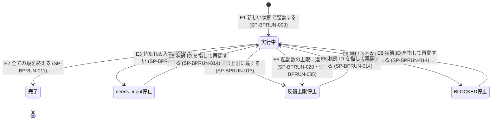

# 仕様書: best-practices の実行基盤

## 表記規約

仕様項目の語尾の区分は `docs/requirements/bp-operations.md` の「表記規約」に従う（必須 = 〜しなければならない、推奨 = 〜することが望ましい、許容 = 〜してもよい、禁止 = 〜してはならない）。主体「best-practices」「利用者」の意味も同文書に従う。

## 対象範囲

本文書は、best-practices 自身の実行基盤を定める。扱うのは次のとおり。

- run の境界
- 状態と作業場所、状態を読み書きする CLI の責務
- 停止の種類と、next_args による再開
- 起動数の上限を渡されたときの扱い（不正な上限と、1 件も始められない上限の停止を含む）
- run の中の agent が読む判定基準の写し
- 役ごとのモデル・effort・権限の当て方
- 4 機能に共通の異常系

次の事柄は他の文書が定め、本文書は参照だけにする。

| 事柄 | 正本 |
|---|---|
| 依頼の振り分け、機能の連鎖、SKILL.md の Workflow callsite（起動数の上限を渡すかどうか） | `docs/specifications/bp-entry.md` |
| create・update の流れ（目標の固定、書く・検証する・書き直す、完了時と停止時の報告の中身） | `docs/specifications/bp-authoring.md` |
| review・audit の観点と流れ | `docs/specifications/bp-inspection.md` |
| 指摘と資産台帳（資産 ID・指摘 ID、指摘の状態、カバレッジと skip 一覧） | `docs/specifications/bp-findings.md` |
| 値（同時実行、反復の上限、試行の上限、要約の上限、役ごとのモデル・effort の初期値）と、対象スキルが満たす判定基準 | `docs/specifications/bp-conformance.md` |

### 本文書が実現する要求

- 主担当: `docs/requirements/bp-operations.md` の PR-BPOPERATIONS-006・PR-BPOPERATIONS-013
- 併せて実現: PR-BPOPERATIONS-005・PR-BPOPERATIONS-008・PR-BPOPERATIONS-009・PR-BPOPERATIONS-012・PR-BPOPERATIONS-016・PR-BPOPERATIONS-020・PR-BPOPERATIONS-024・PR-BPOPERATIONS-025・PR-BPOPERATIONS-030・PR-BPOPERATIONS-031・PR-BPOPERATIONS-037・PR-BPOPERATIONS-040・PR-BPOPERATIONS-041、`docs/requirements/bp-designed-skill.md` の PR-BPDESIGNEDSKILL-016・PR-BPDESIGNEDSKILL-017・PR-BPDESIGNEDSKILL-019・PR-BPDESIGNEDSKILL-020・PR-BPDESIGNEDSKILL-021（この 5 件は best-practices 自身に当てたもの。主担当は `docs/specifications/bp-conformance.md`）

## 用語定義

要求文書の用語（`docs/requirements/bp-operations.md`「用語」）と、設計方針文書（`docs/design/skill-design-patterns.md`）の用語（段・項目・CLI・作業ファイル・運搬役・next_args・再開・停止の種類）はそのまま使う。下の語は best-practices の仕様書の複数の文書で使う語で、定義はここだけに置く。

| 用語 | 意味 |
|---|---|
| 状態 | 1 つの機能の、再開で続く run の列が共有する、run の外に残る記録。CLI だけが書く。1 つの状態は 1 つの機能と 1 つの対象スキルに対応する（連鎖の機能はそれぞれ別の状態を持つ） |
| 状態 ID | 状態を指す ID。CLI が状態を作るときに発行する |
| run ID | 1 つの run を指す ID。CLI が run の開始を記録するときに発行する |
| 現在の run | 状態に最後に開始を記録した run |
| 作業場所 | 状態と作業ファイルを置く場所。状態 ID ごとに 1 つ |
| 前提 | 状態に書く入力。固定した目標、update の修正の根拠、needs_input への利用者の回答を指す。検証役による受理を通さない（設計方針文書「目標の固定」：生成した主張ではなく入力だから） |
| 修正の根拠の記録 ID | update の修正の根拠を前提に書いたときに、最初の run の開始の操作（SP-BPRUN-003・SP-BPRUN-004）が根拠ごとに返す記録の ID。利用者の指示は指摘 ID を持たない（SP-BPFINDINGS-031）ので、根拠を指すときはこの ID を使う |
| 起動数 | 1 つの run の中で script が `agent()` を呼んだ回数。呼んだ形を問わず（fan-out・pipeline の工程・until-pass の繰り返し・回収役・運搬役を含む）、結果が null になった呼び出しも 1 回に数える。対象スキルの起動数も同じ数え方とする |
| 起動数の上限 | best-practices 自身の Workflow が入力として受け取る、1 run の起動数の上限（PR-BPDESIGNEDSKILL-016 の上限を best-practices 自身に当てたもの） |
| 未着手の項目 | 段の項目のうち、結果が状態に書かれていないもの。起動数の上限で起動しなかった項目と、起動したが結果が書かれる前に run が終わった項目を含む。打ち切った項目と、破棄した未着手の項目は含まない |
| 破棄した未着手の項目 | 再開した run が、処理しないと決めた前の回の未着手の項目（SP-BPRUN-015） |
| 停止の記録 | run が止まるときに状態に書く記録（SP-BPRUN-011） |
| 書いたファイルの一覧 | create・update の run が対象スキルに書いたファイルと消したファイルのパス、書いたか消したかの印、それぞれが検証を通ったかの記録 |
| 判定基準の写し | run の中の agent と CLI が判定基準として読む文書の、plugin の中の写し（SP-BPRUN-036） |
| 対象スキルのパスの一覧 | 対象スキルを指す記録。根のディレクトリのパス 1 つと、列挙したときの対象スキルのファイルのパスの並び（根の中の全てのファイルと、callsite が起動する自分の plugin の workflow script）からなる。列挙の規則は `docs/specifications/bp-entry.md` の SP-BPENTRY-022。create の最初の一覧は根だけを持つ |
| 一覧の中 | あるパスが、対象スキルのパスの一覧の根のディレクトリの配下にあるか、一覧のパスのうち根の外にあるもの（自分の plugin の workflow script）と一致すること。パスは symlink を辿った実体のパスに正規化してから比べる（公開済みのスキルは `.agents/skills/` の symlink 越しに編集される：AGENTS.md） |
| 項目の ID | 段の項目を指す ID。CLI が決定的に作る（SP-BPRUN-038） |
| fan-out の項目 | 機能の段の表（`docs/specifications/bp-inspection.md` の SP-BPINSPECTION-001、`docs/specifications/bp-authoring.md` の SP-BPAUTHORING-005）の「項目」の列が、項目ごとに役を起動する単位を定める段（列が「なし」でも「1 件」でもない段）の項目 |

## 機能仕様

### run の境界

#### SP-BPRUN-001 機能ごとの run
best-practices は、create・review・update・audit のそれぞれを別の Workflow の run として起動しなければならない。1 つの run で 2 つ以上の機能を実行してはならない（機能の間で利用者の入力を挟めるのは run の境界だけだから）。機能を順に実行する連鎖は `docs/specifications/bp-entry.md` が定める。

#### SP-BPRUN-002 run の中で入力を待たない
best-practices の Workflow script は、run の途中で人間の承認・回答を待つ手順を持ってはならない。待たれる入力が要ると判断した時点で、script は needs_input で止まらなければならない（SP-BPRUN-011）。この規則は create と、create と同じ処理を行う update（PR-BPOPERATIONS-017）に当てる。

#### SP-BPRUN-003 run の開始
script は、run の最初の起動として運搬役を起動し、CLI に run の開始を記録させなければならない。ただし、script が入力の値だけで行う確かめ（SP-BPRUN-037、`docs/specifications/bp-authoring.md` の SP-BPAUTHORING-029 の「agent の起動の前」の行）に当たったときは、運搬役も起動せずに止まる。

- 入力に状態 ID が無いとき: CLI は、まず入力を確かめる。CLI の開始の操作が確かめるのは、create・update では SP-BPAUTHORING-029 の「開始の操作」の行、review・audit では `docs/specifications/bp-inspection.md` の SP-BPINSPECTION-026 だけとする。要求の形の誤り（機能の値、`key`・`limits`・`target` の型、create の依頼文と update の修正の根拠の型）は、この入力の確かめに含めず、SP-BPRUN-031 の `E_INPUT` で同じく状態と作業場所を作らずに拒否する。当たれば、状態と作業場所を作らずに理由を返す。当たらなければ、状態と作業場所を新しく作り、状態 ID と run ID を発行する。create の依頼文と update の修正の根拠は、状態を作るのと同じ 1 回の書き込みで状態に書く（分けると、その間で止まった run を再開したとき、再開の入力に無い依頼文と修正の根拠が状態にも無い）。
- 入力に状態 ID があるとき（再開）: CLI はその状態に新しい run ID を登録し、その run を現在の run にする。

運搬役は、CLI が返す状態 ID・run ID・状態の要約を、script へ逐語で写して運ばなければならない（設計方針文書「状態の書き込み」）。

#### SP-BPRUN-004 前提の書き込み
前提は、次の時点で状態に書かなければならない。どれも検証の段より前とする。

| 前提 | 書く時点と書き方 |
|---|---|
| update の修正の根拠 | 最初の run の開始の操作（SP-BPRUN-003）で、受け取った全件を書く。根拠ごとに 1 つの前提の記録とし、CLI は根拠ごとに修正の根拠の記録 ID を返す。ここでは根拠を絞らない（絞るのは SP-BPFINDINGS-031） |
| 利用者が足した回答 | 再開した run の始め（SP-BPRUN-015 の 2）に、運搬役が CLI の「前提の追記」で書く |
| 固定した目標 | create・update が目標を固定したとき（固定の手順は `docs/specifications/bp-authoring.md`）に、運搬役が CLI の「前提の追記」で書く |

修正の根拠の形は `docs/specifications/bp-findings.md` に従う。

### 状態と作業場所

#### SP-BPRUN-005 状態の中身
状態は、次の記録を持たなければならない。指摘と資産台帳の記録は `docs/specifications/bp-findings.md` が定め、ここでは置き場だけを決める。各記録を書く時点は、その記録を定める仕様項目と、表の後の「記録の形と書く時点」に従う。

| 記録 | 中身 |
|---|---|
| 機能と対象スキル | 機能の名前、対象スキルのパスの一覧。一覧は取り直すたびに足し、最後の記録を今の一覧とする。取り直しで解決できなかった callsite は、その一覧の記録とともに書く（`docs/specifications/bp-authoring.md` の SP-BPAUTHORING-015） |
| 依頼文 | create の依頼文の逐語（SP-BPRUN-003、`docs/specifications/bp-authoring.md` の SP-BPAUTHORING-003） |
| 作り直す前の写し | update の写しを置いた作業場所の中のパスと、写しの各ファイルの内容の指紋（SP-BPAUTHORING-004）。写しの本体は作業場所に置く |
| run | run ID、起動数、停止の記録の有無 |
| 前提 | SP-BPRUN-004 の 3 つ |
| 段の進み | 始めた段、終えた段、止まった段 |
| 段ごとの繰り返しの回数 | 段の名前ごとの until-pass の繰り返しの回数の累計と、各 run の開始時の値。段の項目の ID が変わっても段ごとに引き継ぐ（`docs/specifications/bp-authoring.md` の SP-BPAUTHORING-007）。繰り返しの上限は、現在の run の開始時の累計からの増分に当てる（理由は SP-BPRUN-013 と同じ） |
| 項目 | 段ごとの項目の ID と列挙の順、結果が書かれたか（create・update の合否の段では結果の中身も：`docs/specifications/bp-authoring.md` の SP-BPAUTHORING-023）、試行の回数、打ち切りの印と理由 |
| 未着手の項目 | 順位付きの一覧（SP-BPRUN-020） |
| 破棄した未着手の項目 | 項目の ID と、破棄した run の ID（SP-BPRUN-015） |
| 反復の回数 | 累計と、各 run の開始時の値（SP-BPRUN-013） |
| 書いたファイルの一覧 | パス、書いたか消したかの印、書いた run の ID、検証を通ったか（SP-BPRUN-009） |
| 対象スキルの指紋 | 対象スキルを構成する各ファイルの内容から CLI が決定的に作る値。開始、パスの一覧の取り直し、停止のときに記録する（SP-BPRUN-016） |
| 停止の記録 | SP-BPRUN-011 の項目 |
| 照らす先 | 観点ごとの照らす先を読めたか、照らす先のパスと指紋、run の観点の集合（`docs/specifications/bp-inspection.md` の SP-BPINSPECTION-004） |
| 担当の組 | 担当 ID、組の資産 ID、担当の順（SP-BPINSPECTION-015、`docs/specifications/bp-authoring.md` の SP-BPAUTHORING-016） |
| 適用の判定 | 答えと引用、到達した形（SP-BPINSPECTION-006） |
| 未検査の観点 | SP-BPINSPECTION-025 の形 |
| 拒否された結果 | 拒否した結果の件数と、それを返した担当（`docs/specifications/bp-findings.md` の SP-BPFINDINGS-034） |
| 指摘と資産台帳 | `docs/specifications/bp-findings.md` |

記録の形と書く時点は次のとおりとする。

- 状態 1 つにつき、作業場所（SP-BPRUN-007）に追記だけの記録のファイル `log.jsonl` を 1 つ置く。1 行は CLI の 1 回の操作が足した記録の並び（`{"seq":<行の番号>,"run":<run ID>,"op":<操作>,"records":[…]}`）とし、1 行の全てが書かれるか、全く書かれないかのどちらかにする。開始の操作の最初の行は SP-BPRUN-007 の rename で確定させる（状態と依頼文と修正の根拠が 1 回の書き込みになる：SP-BPRUN-003）。
- 状態の見え方（段の進み・項目・未着手の項目・回数・現在の run・停止の有無）は、CLI が操作のたびに全ての行を順に当てて導き、別の写しを持たない。改行で終わらない末尾の行は書きかけで止まった行として、読むときに捨て、次の書き込みが切り詰める。
- CLI は、状態ごとの排他のロック（作業場所の `lock`）の中で「読む → 照らす → 足す」を行い、足した後に fsync する。ロックは、pid・host・時刻・nonce を書いた一時ファイルを link して作り（中身の無いロックが見える瞬間を作らない）、解放では自分の nonce のロックだけを消す。CLI は、他のプロセスが持つロックを、持ち主が死んでいるように見えても自動で破ってはならない（破る仕組みを重ねると、破る側の排他が同じ競合を持ち、2 体が同時に書き込む）。ロックを 10 秒待っても取れないときは、状態を変えずに `E_LOCK`（SP-BPRUN-031）を返し、理由に持ち主の情報（pid・host・時刻・nonce）、ロックのファイルのパス、他に CLI が動いていないことを確かめてから利用者がそのファイルを消すことを書く（fan-out の項目の運搬役は CLI を並行して呼ぶ）。
- 記録は種類ごとに同一性の鍵を持つ。同じ鍵で同じ内容の記録は足さず、同じ鍵で違う内容の記録は `E_CONFLICT` で拒否する（SP-BPRUN-006）。鍵は次の表とし、台帳の記録の鍵は `docs/specifications/bp-findings.md` の各項目の記録の単位に従う。

| 記録 | 同一性の鍵 | 足し方 |
|---|---|---|
| 状態の作成（機能・依頼文・limits・開始の `key`） | 状態に 1 つ | 開始の操作だけが書く |
| 修正の根拠 | 修正の根拠の記録 ID | 開始の操作だけが書く |
| run の開始 | run ID | 再開のたびに足す。最後のものが現在の run。開始の `key`、開始時の反復の回数と段ごとの繰り返しの回数、再開では照らした指紋の時点・変わったパス・台帳の取り直しの結果を持つ |
| 前提 | run・種類・本文の sha256 | 同じ本文は 1 つ |
| 対象スキルのパスの一覧 | 連番 | 取り直すたびに足す。最後のものが今の一覧 |
| 対象スキルの指紋 | run・時点（開始・取り直し・停止）・その run の中の連番 | 開始と停止は run に 1 つ。plugin の外を指す symlink の実体などパスの形を持たないファイルの扱いは `docs/specifications/bp-findings.md` の SP-BPFINDINGS-002 に従う（停止では除いて `excluded` に残し、開始・再開では拒否する） |
| 段の開始と項目の列挙 | 段・回（追加の検証の段だけ、回の中の部分の番号も） | 同じ段・回・部分で鍵の並びの違う列挙は拒否する。追加の検証の段は、同じ回に部分の列挙を足して項目を足す（`docs/specifications/bp-findings.md` の SP-BPFINDINGS-025） |
| 項目の結果 | 項目の ID | 1 項目に 1 つ。合否の段では反復の番号を同じ記録に持つ |
| 試行の失敗 | 項目の ID・試行の番号 | 番号が今の回数 + 1 のときだけ足す。今の回数以下は同じ書き込みの繰り返しとして照らす |
| 打ち切り | 項目の ID | 試行の回数が状態の limits の試行の上限に達した書き込みで、CLI が同じ行に足す |
| 破棄 | 項目の ID | 1 項目に 1 つ |
| 段の終わり | 段・回 | 1 つ |
| 段ごとの繰り返しの回数 | 段・番号 | 番号が今の回数 + 1 のときだけ足す |
| 書いたファイル | run・パス・反復の番号・書いたか消したかの印 | 1 つ |
| 検証を通ったか | run・パス・反復の番号 | 1 つ |
| 停止 | run | run に 1 つ。書いた後のその run の書き込みの扱いは SP-BPRUN-017 に従う |
| 作り直す前の写し | 状態に 1 つ | 写しの操作だけが書く（`docs/specifications/bp-authoring.md` の SP-BPAUTHORING-004） |
| 機能の文書が足した検証役の結果の欄 | 項目の ID | 検証役の結果と同じ 1 行で書く（`docs/specifications/bp-authoring.md` の SP-BPAUTHORING-017・SP-BPAUTHORING-038・SP-BPAUTHORING-039） |

- 項目の結果は、項目の agent が返った直後に、その項目の工程の中の運搬役が書く。段の終わりにまとめて書いてはならない（まとめると、段の途中で止まった run の再開で、結果のある項目を処理し直す：SP-BPRUN-038）。合否の段の結果は、反復の回数の + 1 と同じ記録で書く（`docs/specifications/bp-authoring.md` の SP-BPAUTHORING-024）。
- 検証を通っていないファイルは、パスごとに、最後の書いたファイルの記録より後の最後の「検証を通ったか」の記録が「通った」でないものとする（通った後に書き直したか、通った後に落ちたファイルを通ったと数えない）。
- 回数ごとの数え方は次の表とする。上限の値は、開始の操作が受け取った limits（試行の上限 `attempts`・反復の上限 `iterations`・until-pass の上限 `untilPass`。値は script の定数：`docs/specifications/bp-conformance.md` の SP-BPCONFORMANCE-036）を状態に書いたものとし、CLI が上限に達したかを状態の limits から判定して出力で返す。script は同じ判定を自分で計算し直さない（判定が 2 箇所に割れる）。

| 回数 | 状態に持つ値 | 上限を当てる値 |
|---|---|---|
| 試行の回数（SP-BPRUN-028） | 項目ごとの累計 | 累計（再開しても数え直さない：`docs/specifications/bp-conformance.md` の SP-BPCONFORMANCE-031） |
| 反復の回数（SP-BPRUN-013） | 累計と、各 run の開始時の値 | 現在の run の開始時の値からの増分 |
| 段ごとの繰り返しの回数 | 段ごとの累計と、各 run の開始時の値 | 現在の run の開始時の値からの増分 |

#### SP-BPRUN-006 状態の書き込みの規則
状態の書き込みは、設計方針文書「状態の書き込み」の原則に従い、次を全て満たさなければならない。

- 状態を書くのは CLI だけで、run の中で書き込みの CLI を呼ぶのは運搬役だけにする。
- 何を受理して書くかは script が決め、運搬役はその決定を CLI に渡すだけにする。
- 全ての書き込みを冪等にする。同じ内容の書き込みを繰り返しても状態は変わらない。
- 既にある記録と食い違う書き込みは、CLI が拒否する（拒否を受けた run の扱いは SP-BPRUN-029）。
- 記録は足すだけで書き換えない。状態の変化は新しい記録として足す。

#### SP-BPRUN-007 作業場所の置き場
作業場所は、対象スキルの外に新しく作らなければならない。対象スキルの外にある既存のファイルを状態や作業ファイルの置き場に使ってはならない。作業場所を残す場所は SP-BPRUN-039 に従う。作業場所のパスは次のとおりとする（依頼者の裁定）。

- 状態の root は、環境変数 `BP_STATE_ROOT`（絶対パス）があればそれとし、無ければ CLI を起動した cwd の git toplevel（git の外なら cwd）の `.best-practices` とする（Codex runner の経路では、request の `cwd` の配下は workspace として書ける。`/tmp` 系も書き込み先に含まれうるが、清掃で消えるので置かない（SP-BPRUN-039）。`~/.local/state` は Codex の文書の読みでは書き込み先に含まれない。どれも実測していない）。
- 状態ごとの作業場所は `<root>/states/<状態 ID>/` とし、記録 `log.jsonl`、ロック `lock`、作業ファイルを置く `work/` を持つ。
- 開始の `key` の記録は `<root>/states/.key-<key の sha256 の 16 進>` とし、中身は状態 ID とする（SP-BPRUN-031）。`.` で始まる名前は状態として列挙しない。
- 開始の操作は、`<root>/states/.staging-<状態 ID>/` に最初の記録を書き、rename で `<root>/states/<状態 ID>/` に確定させる。既にある `<状態 ID>` のディレクトリには書かない。書き込みが失敗したら staging を消し、状態を残さない。
- 開始の操作は、root を symlink を辿った実体のパスに正規化し、SP-BPRUN-039 の場所か対象スキルの根の配下に当たれば、状態と作業場所を作らずに `E_PLACE` で拒否する。
- next_args は root を持たない（SP-BPRUN-033）ので、最初の起動と再開は同じ cwd（対象スキルのリポジトリの git toplevel）から行う。

#### SP-BPRUN-039 作業場所を残す場所
作業場所は、run をまたいで残る場所に置かなければならない。次の場所に置いてはならない。

- `/tmp` 系の清掃で消える場所（未 push の成果が `/tmp` の清掃で失われた実測がある：AGENTS.md）
- Codex runner が run ごとに作る workspace（`<cwd>/dynamic-workflows/workspace/<workflow-slug>/<run-id>`。run ごとにパスが変わるので、次の run が同じ状態を指せない）

CLI は、`/tmp`・`/private/tmp`・`/var/tmp`・`/private/var/tmp`・`/var/folders`・`/private/var/folders`・`os.tmpdir()` とその実体のパスの配下を `/tmp` 系とする（macOS の `$TMPDIR` は `/var/folders` の配下で、OS が定期的に消す）。実体のパスに `dynamic-workflows`・`workspace` の連続する 2 つの要素を含むものを Codex runner の workspace とする。

#### SP-BPRUN-008 書き込み先の制限
best-practices の run が書き込む先は、次の判定表に従わなければならない。

> 条件の値: 機能 = create / update / review / audit
> 条件の値: 書き込む先 = 対象スキル / 作業場所 / 対象スキルと作業場所の外

| 条件: 機能 | 条件: 書き込む先 | 結果 |
|---|---|---|
| create | 対象スキル | 書き手だけが書いてよい（SP-BPRUN-009） |
| update | 対象スキル | 書き手だけが書いてよい（SP-BPRUN-009） |
| review | 対象スキル | 書いてはならない（SP-BPRUN-026 が確かめる） |
| audit | 対象スキル | 書いてはならない（SP-BPRUN-026 が確かめる） |
| * | 作業場所 | 状態は運搬役が CLI で書いてよい。作業ファイルは各役が書いてよい |
| * | 対象スキルと作業場所の外 | 書いてはならない |

対象スキルの範囲は `docs/requirements/bp-operations.md` の用語「対象スキル」に従う。

#### SP-BPRUN-009 書いたファイルの記録
書き手は、書いたファイルと消したファイルのパスを結果として返さなければならない。script は、そのパスのうち対象スキルのパスの一覧の中のもの（`docs/specifications/bp-authoring.md` の SP-BPAUTHORING-015）を、書いたか消したかの印とともに、運搬役に書いたファイルの一覧として状態へ書かせなければならない。検証の結果が出たら、script は各ファイルが検証を通ったかを同じ一覧に追記させなければならない。

#### SP-BPRUN-038 段の開始と項目の列挙
script は、段を始めるたびに、運搬役を通じて CLI に、段を始めたことと段の項目の一覧を状態へ書かせなければならない（書かないと、停止の記録を書かずに終わった run から再開したとき、止まった段と未着手の項目が状態から決まらない：SP-BPRUN-018）。項目を持たない段も、段を始めたことを書く。

CLI は、項目の ID を、段の名前、機能の文書が区別させる回（`docs/specifications/bp-authoring.md` の SP-BPAUTHORING-036）、項目の鍵（機能の段の表の「項目」の列が定める単位を、状態にある ID の組で表したもの）から決定的に作らなければならない。同じ入力からは同じ ID を作る（再開で同じ段を列挙し直しても、結果のある項目を同じ ID で見分けるため）。項目の ID は、段の slug、回があれば `.` と回、`-`、項目の鍵を正規化した JSON（オブジェクトのキーを昇順に並べ、空白を入れない JSON）の sha256 を Crockford base32 にした先頭 8 文字、を連ねた文字列とする（例 `verify.2-3KF9Q2M7`）。回は 1 以上の整数とし、回を持たない段の ID は回を持たない。CLI は、同じ ID で鍵が違う項目を見つけたら、内部の失敗として止まる。消えた資産の照合の段は、機能によらず、照合する取り直しの番号（項目の鍵の `gone`）を回にする（再開や反復のたびに取り直しの番号が増えるので、同じ段・回の列挙が食い違わない）。回が無いか、鍵の `gone` と違う列挙は `E_INPUT` で拒否する。項目の鍵が状態の構造を指す ID（`asset`・`assignment`・`finding`・`item`・`ground` の欄）を持つとき、CLI はその ID が状態にあることを確かめ、無ければ `E_UNKNOWN_ID` で拒否する（SP-BPRUN-029）。段の slug は次の表とする。

| 段 | slug |
|---|---|
| 開始 | `start` |
| 作り直す前の写し | `snapshot` |
| 目標の固定 | `goal` |
| 書く | `write` |
| 台帳 | `ledger` |
| 照らす先の決定 | `targets` |
| 台帳の作成と資産の束 | `bundle` |
| 担当の作成 | `assign` |
| 適用の判定 | `applicability` |
| 検証・観点ごとの検証 | `verify` |
| 追加の検証 | `verify-extra` |
| 反証 | `refute` |
| 消えた資産の照合 | `vanish` |
| 見直し | `rejudge` |
| 合否 | `gate` |
| 照合と停止 | `close` |

CLI は、項目の ID の一覧を、機能の文書が定める順位の順（review・audit は `docs/specifications/bp-inspection.md` の SP-BPINSPECTION-016・SP-BPINSPECTION-018、create・update は `docs/specifications/bp-authoring.md` の SP-BPAUTHORING-041、消えた資産の照合の段は `docs/specifications/bp-findings.md` の SP-BPFINDINGS-020）で返し、その順を状態に書かなければならない。同じ段で同じ項目の鍵を 2 回以上列挙したときは、1 つの項目にまとめる。追加の検証の段は、同じ回の中で部分の番号（`part`）ごとに列挙を足し、項目を部分の順に足す（`docs/specifications/bp-findings.md` の SP-BPFINDINGS-025 の追加の起動の回）。同じ鍵をまとめる規則は本項だけに置く（反証の段の項目は `docs/specifications/bp-findings.md` の SP-BPFINDINGS-012）。

### 停止

#### SP-BPRUN-010 停止の種類
best-practices の run は、次の判定表で「使う」とした停止のどれか 1 つで止まらなければならない。

> 条件の値: 機能 = create / update / review / audit
> 条件の値: 停止 = 完了 / 乾き / needs_input / 反復の上限 / BLOCKED

| 条件: 機能 | 条件: 停止 | 結果 |
|---|---|---|
| * | 完了 | 使う |
| * | 乾き | 使わない（best-practices は探索グラフ型の段を持たないので、乾きの定義が当たらない） |
| create | needs_input | 使う（PR-BPOPERATIONS-005） |
| update | needs_input | 使う（PR-BPOPERATIONS-017 により create と同じ） |
| review | needs_input | 使わない（needs_input を定める要求は create・update にだけある） |
| audit | needs_input | 使わない（needs_input を定める要求は create・update にだけある） |
| create | 反復の上限 | 使う（反復の回数：SP-BPRUN-013、起動数の上限：SP-BPRUN-020） |
| update | 反復の上限 | 使う（反復の回数：SP-BPRUN-013、起動数の上限：SP-BPRUN-020） |
| review | 反復の上限 | 起動数の上限で止まるときだけ使う（SP-BPRUN-020）。反復の回数では止まらない（流れは段の間に戻りを持たない：`docs/specifications/bp-inspection.md`。資産台帳の追加起動は反復に数えない：設計方針文書「形の判定」） |
| audit | 反復の上限 | review と同じ |
| * | BLOCKED | 使う（SP-BPRUN-027〜030） |

起動数の上限で止まるときの停止の種類と理由の書き方は SP-BPRUN-035 に従う。停止の記録には、反復の上限が反復の回数と起動数の上限のどちらで当たったかを残す（SP-BPRUN-011。再開した run の始め方が原因によって違う：`docs/specifications/bp-authoring.md` の SP-BPAUTHORING-035）。

#### SP-BPRUN-011 停止の記録
run が止まるとき、script は運搬役に、次の項目を停止の記録として状態へ書かせなければならない。

- 停止の種類と理由。反復の上限では、当たった上限が反復の回数（SP-BPRUN-013）か起動数の上限（SP-BPRUN-020）か
- 止まった段
- 未着手の項目の順位付きの一覧
- その run の起動数
- create・update では、書いたファイルの一覧のうち検証を通っていないものと、書き手が返した一覧の外のパス（`docs/specifications/bp-authoring.md` の SP-BPAUTHORING-015・SP-BPAUTHORING-031）
- 指紋から除いたファイル `excluded`（plugin の外にあるファイル。根の中のものは根からの相対パス（symlink の位置）、根の外のものは実体の絶対パス：`docs/specifications/bp-findings.md` の SP-BPFINDINGS-002）
- BLOCKED の原因の区分 `cause`（検証役・反証役が結果を返せないときだけ `verifiers`。再開の始め方を分ける：`docs/specifications/bp-authoring.md` の SP-BPAUTHORING-005）
- 停止の要求を正規化した JSON の sha256 `asked`（送り直しの照合に使う：SP-BPRUN-031）

script は、停止の記録が書かれたことを CLI の出力で確かめてから、返り値（SP-BPRUN-032）を返さなければならない。運搬役か CLI が失敗して停止の記録を書けないときは SP-BPRUN-027 に従う。状態に書かずに止まるとき（SP-BPRUN-037、`docs/specifications/bp-authoring.md` の SP-BPAUTHORING-029、`docs/specifications/bp-inspection.md` の SP-BPINSPECTION-026）は、停止の記録を書かない。

#### SP-BPRUN-012 停止で書いたファイルを戻さない
完了の前に止まったとき、run は、書いたファイルを消してはならず、書く前の内容に戻してもならない（戻すかどうかは利用者が決める：PR-BPOPERATIONS-040）。

#### SP-BPRUN-013 反復の上限の数え方
create・update の書き直しの反復の回数は、状態に累計で持たなければならない。反復の上限は、現在の run の開始時の累計からの増分に当てなければならない（増分ではなく累計に当てると、反復の上限で止まった run を再開したとき、利用者の入力が効く前に同じ理由ですぐに止まる：設計方針文書「停止・再開と人間の入力」）。上限の値は `docs/specifications/bp-conformance.md` の固定集合の反復型の反復の上限に従う。

### 再開

#### SP-BPRUN-014 再開の起動
完了以外で止まった run からは、next_args（SP-BPRUN-033）で新しい run を起動して再開しなければならない。次の手段を再開に使ってはならない。

- Claude Code の relaunch（同じ run を保存した結果から再生すること）
- Codex runner の checkpoint / resume（opt-in の別の機構で、本文書の状態を使わない）

BLOCKED からは、利用者が原因を直してから再開する。CLI は、完了した状態に新しい run を開始させてはならない。

#### SP-BPRUN-015 再開した run の始め方
再開した run は、次の順に進まなければならない。

1. SP-BPRUN-003 で状態の要約を読む。
2. 利用者が足した回答があれば、SP-BPRUN-004 で前提として書く。
3. 終えていない段から続ける。止まった段（停止の記録が無いときは SP-BPRUN-018 で決める）の未着手の項目だけを順位の順に処理し、結果が状態に書かれた項目と、終えた段の結果は処理し直さない。止まった段の項目が 0 件のとき（項目を持たない段か、項目を列挙する前に止まった段）は、その段を最初から行う。
4. 試行の回数・打ち切り・反復の回数・段ごとの繰り返しの回数は、状態の値をそのまま引き継ぐ。
5. 3 で前の回の未着手の項目を処理しないと決めたときは、それらを破棄した未着手の項目として運搬役に状態へ書かせる（書かないと、停止の記録の無い run からの再開（SP-BPRUN-018）が、破棄した項目を未着手の項目として拾う）。

機能の文書が再開した run の始め方を定めるときは、3 と 5 の代わりにそれに従う（create・update は `docs/specifications/bp-authoring.md` の SP-BPAUTHORING-035、review・audit は `docs/specifications/bp-inspection.md` の SP-BPINSPECTION-030）。

#### SP-BPRUN-016 再開時の対象スキルの照合
再開した run の開始では、CLI が対象スキルの今の指紋を作り、照らす基準の時点の指紋と照らさなければならない。照らす基準の時点は、前の run が状態に最後に記録した対象スキルの指紋の時点とする（停止の記録があれば停止時、無ければ前の run の開始かパスの一覧の取り直しのうち後のもの）。食い違ったときの指摘と資産台帳の扱いは `docs/specifications/bp-findings.md` に従う（前の run の後に対象が変わっていることがある：設計方針文書「停止・再開と人間の入力」）。

#### SP-BPRUN-017 現在でない run の書き込み
CLI は、次のどちらかに当たる書き込みを拒否し、状態を変えてはならない。

- 現在の run でない run の ID を持つ書き込み
- 現在の run の停止の記録を書いた後の、その run の書き込み

ただし、停止の記録を書いた run への同じ内容の `stop` の送り直しは、記録を足さずに受理する（停止の応答を失った運搬役の送り直しを受け付ける：SP-BPRUN-031）。

この拒否は、拒否を受けた古い run の運搬役にだけ返し、現在の run の停止の理由にしてはならない（前の run の遅れた書き込みが、新しい run が読んだ後の状態を変えないようにするため）。

#### SP-BPRUN-018 停止の記録の無い run からの再開
run が停止の記録を書かずに終わったとき（host の process の終了、Codex runner の run 全体の時間切れや資源の上限による失敗など）、状態は最後に書かれた記録のまま残る。利用者は、CLI が列挙する未完了の状態（機能と対象スキルから、状態 ID と再開に使う next_args を返す：SP-BPRUN-031）から状態 ID と next_args を得て、SP-BPRUN-014 と同じ手順で再開してよい。再開した run は、状態の段の進みと項目の記録から、止まった段と未着手の項目を決めなければならない。

- 段の開始の記録が 1 つも無いときは、機能の最初の段から始める。
- 未着手の項目は、止まった段で列挙した項目のうち、結果も打ち切りの印も破棄の記録も無いものとする。起動したが結果が状態に書かれていない項目を含む。

CLI は、止まった段を次の順に決める。

1. 現在の run の前の run に停止の記録があれば、その停止の記録の止まった段とする。
2. 1 に当たらなければ、段の開始の記録のうち段の終わりの記録が無いものの最後とする。
3. 2 も無く、終えた段だけがあれば、最後に終えた段とする。次の段は script が機能の段の表から決める（CLI は機能の段の並びを持たない）。
4. 段の開始の記録が 1 つも無ければ未開始とし、script は機能の最初の段から始める。

停止の記録の止まった段は、停止を書く時点で 2・3 の規則で決めたものとする。

### 起動数の上限

#### SP-BPRUN-019 起動数の上限の受け取り
best-practices 自身の Workflow は、起動数の上限を省略できる入力として受け取れなければならない（項目の綴りは `maxLaunches`：`docs/specifications/bp-entry.md` の SP-BPENTRY-013 の綴りの表）。上限を渡すかどうかは callsite が決める（`docs/specifications/bp-entry.md` の SP-BPENTRY-015）。値が 1 以上の整数でないときは SP-BPRUN-037 に従う。

#### SP-BPRUN-040 上限を渡されない run と、起動数の上限の数え方
上限を渡されない run で、script は `docs/specifications/bp-conformance.md` の SP-BPCONFORMANCE-025 に従わなければならない。起動数の上限は 1 run の起動数の総数に当て、同時に走る agent の数（SP-BPCONFORMANCE-027）とは別に数えなければならない（Codex runner の `limits.maxAgents` と `limits.concurrency` は別の上限で、前者を超えると run 全体が失敗する：runtime README の Contract と Explicit live execution の節）。

#### SP-BPRUN-020 上限に収まらない項目
起動数の上限を渡された run で、script は、`docs/specifications/bp-conformance.md` の SP-BPCONFORMANCE-022 に従い、項目と agent の起動が上限に収まるかを起動の前に確かめなければならない。確かめの式と予約分は同項に従い、式に入れる best-practices 自身の段ごとの値は、create・update は SP-BPRUN-021 の表、review・audit は TBD-SBPRUN-003 で決める。収まらないとき、script はその agent を起動せず、始めた項目の終わりを待ってから、次の手順で止まらなければならない。

1. 始めなかった項目を、未着手の項目として順位付きで状態に書かせる。順位は、上限が無ければ起動していた順（段の順、段の中では CLI が列挙した項目の順：SP-BPRUN-038）とする。未着手の項目の並びの正本は CLI が状態から導いた並びとし、create・update の script は停止の要求に `pending` を入れずに CLI に導かせる（まとめた要求の途中で運搬役が止まると、script の手元の並びが状態とずれる）。
2. SP-BPRUN-035 のとおり反復の上限で停止の記録を書かせ、next_args を返す。

#### SP-BPRUN-021 最小の起動数
best-practices 自身の run の最小の起動数は機能ごとの定数とし、script が自分の定数から決定的に計算しなければならない。最小の起動数は、その run で最初に始める fan-out の項目を始めるまでの段の最悪の回数の和に、その項目の最悪の回数と予約分を足したものを、最初の run と再開した run の全ての経路について求め、その最も大きいものとする（SP-BPRUN-037 の「1 件も始められない」と同じ考え方で、上限がこの値以上なら、どの経路でもその run の最初の fan-out の項目を始められる）。create・update の段ごとの最悪の回数は次の表とする（値は script の定数 `WORST`・`RESERVE` に 1 箇所だけ置き、表との一致はテストが照らす。review・audit の値は TBD-SBPRUN-003）。

| 値 | 回数 | 中身 |
|---|---|---|
| `worst(再開の破棄)` | 1 | 再開した run が止まった段の未着手の項目の破棄と段の終わりを書く運搬役 1（SP-BPRUN-015 の 5。最初の run には無い） |
| `worst(開始)` | 2 | 開始の運搬役 1 + 応答を失ったときの同じ key での送り直し 1（状態 ID は開始の応答でしか得られない） |
| `worst(fan-out の項目)` | 15 | 試行の上限 3 回 ×（検証役・反証役・消えた資産の照合の検証役 1 + 結果を書く運搬役 1 + その応答を失ったときの送り直し 1 + 試行の失敗を書く運搬役 1 + その応答を失ったときの送り直し 1） |
| `worst(目標の固定の 1 回)` | 2 | 書き手 1 + 出所の照合の運搬役 1。until-pass の上限の回数まで繰り返す |
| `worst(書く)` | 3 | 書き手 1 + 項目の結果と書いたファイルを書く運搬役 1 + パスの一覧の取り直し・台帳・担当・検証の段の開始をまとめた運搬役 1 |
| `worst(段の境の運搬役)` | 1 | 段の開始・終わりと読み出しをまとめた 1 回の運搬役 |
| `R`（予約分） | 1 | 停止の運搬役。書いたファイルの照らし合わせ（`files-scan`）・停止（`stop`）・返り値（`outcome`）を 1 回で運ぶ |

create の最小の起動数は 30、update は 31 とする。最も大きくなる経路は、目標の固定より前で止まった run の再開で、内訳は、開始 2、再開の破棄 1、（update だけ）作り直す前の写し 1、目標の固定の段の開始 1、目標の固定 2 × 3、書く段の開始 1、書く 3、最初の fan-out の項目（検証の段の適合の観点）15、予約分 1 である。再開の開始で消えた資産が見つかる経路では、目標の固定より前の消えた資産の照合の段の項目が最初の fan-out の項目になり、開始 2、再開の破棄 1、（update だけ）写し 1、段の開始 1、その項目 15、予約分 1 で収まる（その run が上限で止まっても、次の再開は続きから検証の段へ進む）。再開した run も、最初の run と同じ値を使わなければならない（上限の確かめは agent を起動する前に行う。止まった段を知るには状態を読む運搬役の起動が要るので、止まった段に応じて計算し直せない）。上限がこの値に満たないときは SP-BPRUN-037 に従う。

#### SP-BPRUN-037 不正な上限と、1 件も始められない上限
起動数の上限を渡された run が次のどちらかに当たるとき、Workflow は host によらず、`agent()` を 1 回も呼ばずに BLOCKED で止まらなければならない。best-practices 自身の run はこの項目に従い、`docs/specifications/bp-conformance.md` が対象スキルを PR-BPDESIGNEDSKILL-016・PR-BPDESIGNEDSKILL-019 に照らす判定の基準もこの項目を参照する。

| 当たること | 理由に書くこと |
|---|---|
| 上限の値が 1 以上の整数でない | 渡された値と、受け付ける値の範囲 |
| 上限が最小の起動数に満たない（best-practices 自身は SP-BPRUN-021、対象スキルは `docs/specifications/bp-conformance.md` の SP-BPCONFORMANCE-023） | 上限の値と要る最小の起動数、上限が 1 件の項目にも足りないこと |

- 上限を渡されなかったとみなして続けてはならない（上限の無い run になり、Codex runner の上限を超えて run 全体が失敗する）。
- 停止の種類は BLOCKED だけとする（同じ入力で起動し直しても同じ理由で止まるので、利用者が上限を直すまで続けられない。反復の上限で返すと、上限に達した通常の停止と見分けがつかない）。
- `agent()` を呼ばないので、状態は書かれない。入力に状態 ID があれば、その状態 ID を持つ next_args を返し、無ければ next_args を返さない。
- agent を起動する前の他の確かめ（`docs/specifications/bp-authoring.md` の SP-BPAUTHORING-029 の「agent の起動の前」の行）と同時に当たるときは、本項を先に当てる。

#### SP-BPRUN-022 次の run への持ち越し
起動数の上限で止まった run（SP-BPRUN-035）から再開した run は、SP-BPRUN-015 に従い、状態に残した未着手の項目から処理を続けなければならない（SP-BPRUN-035 の 2・3）。再開の起動に上限を渡すかどうかは `docs/specifications/bp-entry.md` の SP-BPENTRY-015 に従う。

#### SP-BPRUN-035 残した項目からの再開の手順
起動数の上限で止まった run から再開するとき、Workflow は host によらず次の手順に従わなければならない。best-practices 自身の run はこの手順を SP-BPRUN-015・SP-BPRUN-020 で実現し、`docs/specifications/bp-conformance.md` が対象スキルを PR-BPDESIGNEDSKILL-020 に照らす判定の基準もこの項目を参照する。

1. 止まった run は、処理していない項目を順位付きの未着手として run の外の状態に残し、停止の種類を反復の上限として返す。理由には、起動数の上限で止まったことを書く（依頼者の裁定。設計方針文書「停止・再開と人間の入力」の 5 種に新しい種類を足さない）。
2. 再開した run は、その未着手の項目を順位の順に処理する。
3. 結果が状態に残った項目は処理し直さない。ただし、create・update の追加の検証の段の未着手の項目は破棄してよい。追加の検証の項目は skip 一覧から作るので、再開の時点の skip 一覧から次の部分を作り直す（`docs/specifications/bp-findings.md` の SP-BPFINDINGS-025、`docs/specifications/bp-authoring.md` の SP-BPAUTHORING-035）。
4. 再開に使う next_args は起動数の上限を含まない。上限は起動のたびに callsite が host に応じて渡す（含めると、同じ next_args を Claude Code の native Workflow で起動したときに上限が渡り、PR-BPDESIGNEDSKILL-023 に反する）。

### 判定基準の写し

#### SP-BPRUN-036 判定基準の写し
run の中の agent と CLI が判定基準として読む文書は、次の写しでなければならない（配布先には repository の `docs/` が入らない：AGENTS.md「実体が plugins/ 側にある理由」。依頼者の裁定）。

- `docs/specifications/bp-conformance.md`
- `docs/specifications/bp-conformance.md` が `docs/` のパスで参照する全ての文書。`docs/requirements/bp-designed-skill.md` と設計方針文書（`docs/design/skill-design-patterns.md`）のほか、bp-conformance が対象スキルの判定基準として参照する項目（本文書の SP-BPRUN-035・SP-BPRUN-037、`docs/specifications/bp-entry.md` の SP-BPENTRY-014、`docs/specifications/bp-findings.md` の指摘の形）を持つ仕様書を含む

正本は `docs/` の文書とする。写しは、リポジトリの script が正本から 1 字も変えずに、best-practices を配布する plugin の `references/` へ書く。`make test` は次の 2 つを検出し、どちらかに当たれば失敗しなければならない。

- 写しが正本と食い違う。
- `docs/specifications/bp-conformance.md` が `docs/` のパスで参照する文書のうち、写しの無いものがある（参照先が写しの外にあると、配布先でその基準を判定できない）。

run の中の agent と CLI は写しだけを判定基準として読み、正本の `docs/`、agent の記憶、prompt に書き写した写しを判定基準として当ててはならない（当てると、照らしていない基準を照らしたと返す）。写す script のコマンド名と写しのパスは TBD-SBPRUN-001 で決める。

### モデル・effort・権限

#### SP-BPRUN-023 役ごとのモデルと effort
script は、全ての agent の起動で model と effort を明示しなければならない。値は `docs/specifications/bp-conformance.md` の SP-BPCONFORMANCE-035 の、best-practices 自身の役の初期値の表に従う。

#### SP-BPRUN-024 生成と別の context での起動
script は、検証役と反証役を、書き手や指摘の候補を出した役とは別の agent の起動として起動しなければならない。同じ agent の起動の中で生成と検証をさせてはならない（生成した本人には自分の誤りが見えない）。

#### SP-BPRUN-025 役ごとの権限
各役が書き込んでよい先は次のとおりとする。

| 役 | 書いてよい先 |
|---|---|
| 書き手（create・update だけ） | 対象スキルと作業ファイル |
| 検証役・反証役・抽出役 | 作業ファイルだけ |
| 運搬役 | CLI を通した状態だけ |

host が役ごとに権限を分ける手段を持たないとき、その制限は役の prompt だけで伝わる。この場合、run は、その制限を確かめられなかった制限として返り値（SP-BPRUN-032）に書かなければならない。permission rules は Claude Code でも workflow の全ての subagent に同じく効き（設計方針文書「権限」）、Codex runner でも host の権限が全ての呼び出しに一律に効く（runtime README の Explicit writable and isolated checkouts の節）。

#### SP-BPRUN-026 対象を書き換えていないことの照合
review・audit の run は、停止の記録を書く前に、CLI に対象スキルの今の指紋を作らせ、開始時の指紋と照らさなければならない。食い違ったら、run は BLOCKED と理由（変わったファイルのパス）を返し、結果を完了として返してはならない（役ごとの権限を host が強制できない（SP-BPRUN-025）ので、PR-BPOPERATIONS-030 の違反を run の中で見つける手段がこの照合だけになる）。停止の時点で指紋から除いたファイル（SP-BPRUN-011 の `excluded`）が 1 件でもあれば、対象スキルが変わったとして同じく扱う（開始の操作は plugin の外のファイルを拒否するので、除いたファイルは開始の後に現れたものである）。

## 状態とイベント

状態は、CLI から見た 1 つの状態の段階である。停止の記録を書かずに終わった run は、CLI からは実行中と区別できないので、実行中に含める（SP-BPRUN-018）。イベントには E1〜E10 の番号を付け、この章の中だけで使う。状態を作らずに止まる run（SP-BPRUN-037・SP-BPAUTHORING-029・SP-BPINSPECTION-026）は、状態が無いのでこの章のイベントにならない。

E1 は状態を新しく作るので、既にある状態には起きない。E2〜E7 と E10 は run が走っている間にだけ起きる。

> 対象の状態: 実行中 / needs_input停止 / 反復上限停止 / BLOCKED停止 / 完了

> 対象のイベント: E1 新しい状態で起動する / E2 全ての段を終える / E3 待たれる入力が足りない / E4 反復の上限に達する / E5 起動数の上限に達する / E6 続けられない失敗が起きる / E7 run が停止の記録を書かずに終わる / E8 状態 ID を指して再開する / E9 現在でない run の書き込みが届く / E10 fan-out の項目の工程が欠ける

| 現在の状態 | イベント | 種別 | 次の状態 | 定義済みか |
|---|---|---|---|---|
| 実行中 | E1 | — | — | 発生しない |
| 実行中 | E7 | 異常系 | 実行中 | ✅ SP-BPRUN-018 |
| 実行中 | E8 | 準正常系 | 実行中 | ✅ SP-BPRUN-017 |
| 実行中 | E9 | 準正常系 | 実行中 | ✅ SP-BPRUN-017 |
| 実行中 | E10 | 準正常系 | 実行中 | ✅ SP-BPRUN-028 |
| needs_input停止 | E1 | — | — | 発生しない |
| needs_input停止 | E2 | — | — | 発生しない |
| needs_input停止 | E3 | — | — | 発生しない |
| needs_input停止 | E4 | — | — | 発生しない |
| needs_input停止 | E5 | — | — | 発生しない |
| needs_input停止 | E6 | — | — | 発生しない |
| needs_input停止 | E7 | — | — | 発生しない |
| needs_input停止 | E9 | 準正常系 | needs_input停止 | ✅ SP-BPRUN-017 |
| needs_input停止 | E10 | — | — | 発生しない |
| 反復上限停止 | E1 | — | — | 発生しない |
| 反復上限停止 | E2 | — | — | 発生しない |
| 反復上限停止 | E3 | — | — | 発生しない |
| 反復上限停止 | E4 | — | — | 発生しない |
| 反復上限停止 | E5 | — | — | 発生しない |
| 反復上限停止 | E6 | — | — | 発生しない |
| 反復上限停止 | E7 | — | — | 発生しない |
| 反復上限停止 | E9 | 準正常系 | 反復上限停止 | ✅ SP-BPRUN-017 |
| 反復上限停止 | E10 | — | — | 発生しない |
| BLOCKED停止 | E1 | — | — | 発生しない |
| BLOCKED停止 | E2 | — | — | 発生しない |
| BLOCKED停止 | E3 | — | — | 発生しない |
| BLOCKED停止 | E4 | — | — | 発生しない |
| BLOCKED停止 | E5 | — | — | 発生しない |
| BLOCKED停止 | E6 | — | — | 発生しない |
| BLOCKED停止 | E7 | — | — | 発生しない |
| BLOCKED停止 | E9 | 準正常系 | BLOCKED停止 | ✅ SP-BPRUN-017 |
| BLOCKED停止 | E10 | — | — | 発生しない |
| 完了 | E1 | — | — | 発生しない |
| 完了 | E2 | — | — | 発生しない |
| 完了 | E3 | — | — | 発生しない |
| 完了 | E4 | — | — | 発生しない |
| 完了 | E5 | — | — | 発生しない |
| 完了 | E6 | — | — | 発生しない |
| 完了 | E7 | — | — | 発生しない |
| 完了 | E8 | 準正常系 | 完了 | ✅ SP-BPRUN-014 |
| 完了 | E9 | 準正常系 | 完了 | ✅ SP-BPRUN-017 |
| 完了 | E10 | — | — | 発生しない |

## エラー処理と異常系

4 機能に共通の異常系はここだけに置く。機能に固有の異常系（create の目標を固定する入力の不足、update の修正の根拠が 0 件など）は `docs/specifications/bp-authoring.md`・`docs/specifications/bp-inspection.md` が持つ。

#### SP-BPRUN-027 fan-out の外の agent の失敗
fan-out の項目の工程の外で直接起動した agent（運搬役を含む）が、例外を投げるか結果を返さなかったとき（Codex runner で agent の時間切れが null を返したときを含む）、run は BLOCKED と理由を返して止まらなければならない。理由には、失敗した段・役・host が返した失敗の内容を含めなければならない。停止の記録を書く運搬役が失敗したときは、停止の記録を書かずに BLOCKED と理由を返し、状態は SP-BPRUN-018 の扱いになる。ただし、新しい状態の開始の運搬役が応答を失ったときは、同じ key の開始を 1 回だけ送り直す（状態 ID は開始の応答でしか得られず、同じ key の開始は同じ状態を返す：SP-BPRUN-031）。

#### SP-BPRUN-028 fan-out の項目の工程の欠け
fan-out の項目の工程が結果を返さなかったとき、script はその項目の結果を書かず、試行の回数を 1 増やして状態に書かせ、その項目を未着手に戻さなければならない。1 件の欠けだけで run を止めてはならない。script は同じ段の中でその項目を再び起動してよい。試行の回数が `docs/specifications/bp-conformance.md` の試行の上限（SP-BPCONFORMANCE-031）に達したら、打ち切りの印と理由を書かせ、未着手から外さなければならない。打ち切った項目が見るはずだった資産の扱いは `docs/specifications/bp-findings.md` に従う。工程の中の運搬役が応答を失ったとき（CLI が書いたかが分からない）は、同じ要求を 1 回だけ送り直し、送り直しの応答も 1 回目と同じく分類する。`E_RESULT`・`E_TRANSPORT`・`E_LOCK`（CLI は状態を変えていない）は工程の欠けとして試行の回数を 1 増やし、送り直しでも応答が無ければ BLOCKED にする。試行の失敗を書く運搬役も、応答を失ったら同じ要求を 1 回だけ送り直す。1 回目の応答を失った後の送り直しが `E_TRANSPORT`・`E_LOCK` だったときは、1 回目を CLI が書いたかが分からないので、試行の失敗の要求に `ifNoResult` を付け、CLI は項目に結果があれば記録を足さずに `resulted: true` を返す。script はその項目を結果のある項目として扱う。

#### SP-BPRUN-029 全件の欠けと CLI の拒否
次のどちらかが起きたとき、run は BLOCKED と理由を返して止まらなければならない。

- 1 つの段で、処理した項目が 1 件以上あり、その全てが打ち切りになった。
- 現在の run の書き込みを、CLI が SP-BPRUN-006 の食い違いか、状態の構造を指す ID の誤りとして拒否した。状態の構造を指す ID は、CLI が発行して状態に置き、script が状態から取って書き込みに入れる ID（状態 ID・run ID・段の名前・項目の ID・担当 ID・指摘 ID・修正の根拠の記録 ID）とし、状態に無いその ID を指す書き込みを誤りとする。

agent の結果の中の値（検証役・反証役が返した資産 ID・指摘の種類・選択肢、検証役が選んだ記録 ID や仕様項目 ID など）の誤りは本項に当てず、`docs/specifications/bp-findings.md` の SP-BPFINDINGS-034 に従う。

#### SP-BPRUN-030 BLOCKED の理由
BLOCKED の理由は、利用者がどこを直してから再開すればよいかを特定できる内容でなければならない。少なくとも、止まった段、失敗した役か操作、失敗の内容を含める（理由が残らないと、どこから再開すればよいかが分からない：PR-BPOPERATIONS-013）。

## 外部インタフェース

#### SP-BPRUN-031 CLI の操作
CLI は、本書群が CLI の処理と定めたものを全て操作として持たなければならない（run の開始：SP-BPRUN-003、前提の追記：SP-BPRUN-004、段の開始：SP-BPRUN-038、パスの一覧の作成と取り直し：`docs/specifications/bp-entry.md` の SP-BPENTRY-022・`docs/specifications/bp-authoring.md` の SP-BPAUTHORING-015、未完了の状態の列挙：SP-BPRUN-018、要約の読み出し：`docs/specifications/bp-conformance.md` の SP-BPCONFORMANCE-033 など）。パスの一覧の作成と取り直しは、解決できなかった callsite を `SKILL.md` の行番号とともに返す。判定基準を写す script のコマンド名と写しのパス（SP-BPRUN-036）は TBD-SBPRUN-001 で決める。best-practices の Workflow の入力の項目の綴りは `docs/specifications/bp-entry.md` の SP-BPENTRY-013 の綴りの表に従う。資産 ID と指摘 ID の作り方は `docs/specifications/bp-findings.md` に従う。項目の ID の形は SP-BPRUN-038、作業場所のパスは SP-BPRUN-007 に従う。

CLI の呼び方と要求・応答の形は次のとおりとする。操作の名前・記録の種類・段の slug・next_args の綴り・作業場所の既定・要約の上限は、CLI の 1 箇所の定数（`scripts/bp/constants.mjs`）に置き、script はそこから写した名前を運搬役の要求に埋める。

- 呼び方は `node <スキルのディレクトリ>/scripts/bp-state.mjs <操作> < <要求の JSON>` とする。要求は JSON のオブジェクト 1 つとし、`start`（新規）・`list`・`key`・`paths`・`units`（状態を読まない操作）を除く操作は `state` を持ち、書き込みの操作は `state` と `run` を持つ。
- 要求は `sum` を持たなければならない。`sum` は、`sum` を除いた要求を正規化した JSON（オブジェクトのキーを昇順に並べ、空白を入れない JSON）の、UTF-16 の code unit ごとの FNV-1a 32bit（初期値 `0x811c9dc5`、乗数 `0x01000193`）を 8 桁の小文字の 16 進にしたものとする（script は import を持てないので、同じ式を自分で書ける形にする）。CLI は `sum` を計算し直し、合わなければ状態を変えずに `E_TRANSPORT` を返す。応答も同じ式の `sum` を持ち、script は運搬役が返した応答の `sum` を照らす。
- 大きい値（検証役の結果など）は、運搬役に写させず、作業ファイルで渡してよい。create・update の script は、検証役の結果を既定で作業ファイルで渡す（script の定数 `PAYLOAD_MODE`）。本物の agent が返り値と作業ファイルに同じ JSON を書けるか（`E_TRANSPORT` の率）は実測しておらず、公開前の本物の agent での試走（依頼者の裁定 Q5）で測る。要求に `payloadFile`（作業場所の `work/` からの相対パス）と `payloadSum`（ファイルの中身の JSON に同じ式を当てた値）を入れると、CLI はファイルを読み、`payloadSum` が合えば中身のオブジェクトの欄を要求に足して扱う。`work/` の外のパス、読めないファイル、合わない `payloadSum`、要求と同じ欄を持つ中身は `E_TRANSPORT` で拒否する。
- 応答は JSON のオブジェクト 1 つとし、受理は `{"ok":true,"op":<操作>,…}`、拒否は `{"ok":false,"code":<符号>,"reason":<理由>}` とする。同じ内容の書き込みの繰り返しは受理とし、`"same":true` を返す。終了コードは受理 0、拒否 2、内部の失敗 1 とする。

| 符号 | 意味 | script の扱い |
|---|---|---|
| `E_CONFLICT` | 既にある記録と食い違う（SP-BPRUN-006、`docs/specifications/bp-findings.md` の SP-BPFINDINGS-035） | BLOCKED（SP-BPRUN-029） |
| `E_UNKNOWN_ID` | 状態に無い状態 ID・run ID・段の名前・項目の ID・担当 ID・指摘 ID・修正の根拠の記録 ID を指す | BLOCKED（SP-BPRUN-029） |
| `E_STALE_RUN` | SP-BPRUN-017 が拒否する書き込み | 古い run にだけ返す。現在の run の停止の理由にしない（SP-BPRUN-017） |
| `E_RESULT` | agent の結果の値が台帳・閉集合・選択肢に無い（`docs/specifications/bp-findings.md` の SP-BPFINDINGS-034）。CLI は拒否した結果の件数と担当を記録してから返す | 項目を未着手に戻すか起動し直す。BLOCKED にしない（書く段の設計の説明のパスの拒否は除く：`docs/specifications/bp-authoring.md` の SP-BPAUTHORING-013） |
| `E_INPUT` | 要求の形の誤り、開始の操作の入力の確かめ（`docs/specifications/bp-authoring.md` の SP-BPAUTHORING-029 の「開始の操作」の行、`docs/specifications/bp-inspection.md` の SP-BPINSPECTION-026）、完了した状態の再開（SP-BPRUN-014）、資産が 0 件の台帳（`docs/specifications/bp-findings.md` の SP-BPFINDINGS-033）、判定基準の写しが無い（TBD-SBPRUN-001） | `start` への拒否なら状態を作らずに止まる。それ以外は BLOCKED |
| `E_PLACE` | 作業場所が SP-BPRUN-007・SP-BPRUN-039 の禁じる場所 | BLOCKED |
| `E_TRANSPORT`・`E_LOCK` | 要求か作業ファイルの写しの崩れ、ロックの待ちの超過（理由にロックの持ち主とパスと消し方を書く。CLI はロックを破らない：SP-BPRUN-005） | 運搬役の失敗（fan-out の項目の工程の中なら SP-BPRUN-028、外なら SP-BPRUN-027） |
| `E_INTERNAL` | CLI の内部の失敗（ID の衝突、SP-BPFINDINGS-018 の起こりえない組など）。終了コード 1 | BLOCKED |

状態 ID は `bp-` と UTC の `YYYYMMDDHHMMSS` と `-` と乱数の 8 文字（Crockford base32 の小文字）、run ID は `r1`・`r2`…、修正の根拠の記録 ID は受け取った順の `G1`・`G2`…、前提の記録 ID は書いた順の `P1`・`P2`…、担当 ID は `S` と段の slug と段ごとの連番（例 `Sverify2`）とする。

| 操作 | 実現する項目 | 受け取るもの | 返すもの |
|---|---|---|---|
| `start` | SP-BPRUN-003・SP-BPRUN-004・SP-BPRUN-014・SP-BPRUN-016、`docs/specifications/bp-findings.md` の SP-BPFINDINGS-005 | 新規: `key`、`function`、`target`（`root` と、根の外のファイルの `files`）、`limits`、create の `request`、update の `grounds`。再開: `key`、`state`、利用者が回答を足したときだけ `answer`（回答の文言。run の開始と同じ 1 行で前提として書く） | `state`・`run`・`workDir`・`groundIds`・`progress`（script が再開の始め方を決め、書き手と検証役に渡す入力を作るのに要る状態の値）・`summary`。再開では加えて、照らした基準の時点 `baseline` と変わったパス `changed`、台帳の取り直しの件数と消えた資産と結び付いた指摘 `retake`、止まった段 `stoppedStage` と未着手の項目 `pending` |
| `premise` | SP-BPRUN-004 | `kind`（`answer`・`goal`）、`text` | 前提の記録 ID |
| `stage-start` | SP-BPRUN-038 | `stage`、`round`（省略できる）、`keys`（項目の鍵の並び）、追加の検証の段だけ `part`（回の中の部分の番号。部分ごとに鍵の並びを足す：`docs/specifications/bp-findings.md` の SP-BPFINDINGS-025） | 項目の ID の並び `items` と、項目ごとの試行の回数・結果の有無・打ち切り・破棄 `status` |
| `item-result` | SP-BPRUN-005・SP-BPRUN-006 | `item`、`result`、合否の段だけ `iteration` | 反復の回数と上限に達したか |
| `item-fail` | SP-BPRUN-028 | `item`、`attempt`（今の回数 + 1）、`reason`、`ifNoResult`（省略できる） | 試行の回数と打ち切ったか。`ifNoResult` を付けた要求で項目に結果があれば、記録を足さずに `resulted: true` |
| `stage-repeat` | SP-BPRUN-005、`docs/specifications/bp-findings.md` の SP-BPFINDINGS-034 | `stage`、`n`（今の回数 + 1）、当てる上限 `limitKey` | 段ごとの繰り返しの回数と上限に達したか |
| `stage-finish` | SP-BPRUN-005 | `stage`、`round` | 受理 |
| `discard` | SP-BPRUN-015 | `items` | 受理 |
| `files` | SP-BPRUN-009 | `entries`（`{path, iteration, action: write\|delete}` か `{path, iteration, verified}`。`iteration` は 1 以上の整数の反復の番号） 。1 つの要求に書いたファイルの記録（`action`）と検証の記録（`verified`）を混ぜてはならず、混ぜた要求は `E_INPUT`（要求の中の順に意味を持たせない）。一覧の中でも plugin の外にあるファイル（開始の後に作られたものなど）は理由つきの `E_INPUT` | 記録したパスと、一覧の外のパス `outside`（記録しない） |
| `stop` | SP-BPRUN-011・SP-BPRUN-020・SP-BPRUN-026・SP-BPRUN-034 | `kind`、`reason`、反復の上限だけ `limitHit`（`iteration`・`launch`）、`pending`（省くと CLI が状態から導いた並びを書く）、`launches`、`outside`、BLOCKED だけ `cause`（省略できる。`verifiers` は検証役・反証役が結果を返せないことによる BLOCKED：`docs/specifications/bp-authoring.md` の SP-BPAUTHORING-005）、review・audit だけ `onTargetChanged: "blocked"` | 書いた停止の記録と、完了以外は `nextArgs`。create・update の完了は、最後の合否が `pass` でなければ `E_CONFLICT` で拒否し、書いたファイルの一覧で検証を通っていないファイルに検証を通った記録を同じ 1 行で足す（`docs/specifications/bp-authoring.md` の SP-BPAUTHORING-026） |
| `summary` | `docs/specifications/bp-conformance.md` の SP-BPCONFORMANCE-033 | — | 要約の文字列・字数・省いたものの種類と件数 |
| `list` | SP-BPRUN-018 | `function`、`target` | 未完了の状態ごとの `state`・`nextArgs`・`stoppedStage`・`pending` と、読めなかった状態の `unreadable`（状態 ID と理由。飛ばした状態を宣言する） |
| `ledger-create` | `docs/specifications/bp-findings.md` の SP-BPFINDINGS-001・SP-BPFINDINGS-002・SP-BPFINDINGS-033 | — | `ledger`（台帳 ID）と `assets`（資産ごとの `id`・`path`・`loc`・`digest`）。資産が 0 件なら `E_INPUT` |
| `ledger-retake` | `docs/specifications/bp-findings.md` の SP-BPFINDINGS-005 | — | `counts`（`unchanged`・`changed`・`added`・`gone` の件数）、消えた資産 `gone`（`id`・`path`・`loc`）、取り直しの番号 `retake`（足した記録が無ければ `null`）、消えた資産に結び付いた指摘 ID を台帳に作った順に並べた `affected` |
| `assignments` | `docs/specifications/bp-findings.md` の SP-BPFINDINGS-025・SP-BPFINDINGS-034 | `stage` と、`groups`（資産 ID の組の並び。抽出役の結果）、`rule: "all"`（台帳の今の資産の全てを 1 つの担当にする）、`rule: "skip"` と `viewpoint`（その観点の skip 一覧を 1 つの担当にする）のどれか。`groups` だけ `attempt`（省略時は段ごとの繰り返しの回数 + 1） | `assignments`（担当ごとの `id`・`assets`・`fpset`）。同じ段で資産と担当の指紋の組が同じ担当には同じ ID を返す。台帳の今の資産に無い ID を含む `groups` は、拒否の記録を足して `E_RESULT` |
| `verdicts` | `docs/specifications/bp-findings.md` の SP-BPFINDINGS-006〜SP-BPFINDINGS-012・SP-BPFINDINGS-034・SP-BPFINDINGS-036 | `item`（検証か追加の検証の段の項目）、`assignment`、`viewpoint`、`result`（`judgements`: `{asset, judgement}` の並び。`judgement` は `candidate`・`ok`・`unsure`。`candidates`: `{asset, viewpoint, kind, quote, content, fix}` の並び。ほかの欄は機能の文書が足してよい。create・update の足した欄 `applicability`・`units`・`residualRisks`（適合）・`basisConstraints`（目標）・`contractChanges`（契約）は必ず持ち、欠けた結果と値を `docs/specifications/bp-authoring.md` の SP-BPAUTHORING-017・SP-BPAUTHORING-038・SP-BPAUTHORING-039 で照らし、同じ 1 行で項目ごとに記録する） | `seen`・`judgedOk`・`judgedUnsure`・`duplicates` の件数と、反証に回す鍵 `refutationKeys`。値が台帳・閉集合・選択肢に無ければ、拒否の記録を足して `E_RESULT` |
| `refutation-items` | `docs/specifications/bp-findings.md` の SP-BPFINDINGS-012・SP-BPFINDINGS-013 | `stages`（`{"stage":<段の slug>,"round":<回か null>}` の 1 つ以上の並び）、`texts`（省略できる。`true` なら候補の引用・内容・直し方も返す） | その段の重複でない候補の鍵 `keys`（`{asset, viewpoint, kind}`。最初に現れた順で、同じ鍵は 1 つ）。`texts` のときは加えて、鍵ごとにまとめた全ての候補の文言 `candidates` |
| `refutation` | `docs/specifications/bp-findings.md` の SP-BPFINDINGS-013〜SP-BPFINDINGS-015・SP-BPFINDINGS-035 | `item`（反証の段の項目。鍵は `refutation-items` が返した鍵、回は検証の段と同じ回）、`verdict`（`uphold`・`reject`。結果なしは `null`）、`reason` | `finding`（指摘 ID。未反証なら `null`）、`created`（この項目で指摘を作ったか）、`state`（作ったときの状態）、`unrefuted` |
| `review-judge` | `docs/specifications/bp-findings.md` の SP-BPFINDINGS-018・SP-BPFINDINGS-019・SP-BPFINDINGS-021 | `stages`（`refutation-items` と同じ形）、`round`（見直しの回。省略できる） | `judgements`（台帳の指摘ごとに `finding`・`value`（`exists`・`absent`・`unknown`・`skip`）・`row`（表の順）・`recorded`（`state`・`judgement`・`none`）・`state`。資産が全て消えた指摘は `value: null`・`recorded: "none"`・`vanished: true`）。書き換えない run の台帳では `E_CONFLICT` |
| `vanish-match` | `docs/specifications/bp-findings.md` の SP-BPFINDINGS-020・SP-BPFINDINGS-037 | `item`（消えた資産の照合の段の項目。鍵は `{"finding":<指摘 ID>,"gone":<取り直しの番号>}`）、`choice`（資産 ID・`none`。結果なしは `null`） | `finding`・`value`・`recorded`・`state`。鍵の指摘の資産がその取り直しで消えていなければ `E_CONFLICT`。台帳の今の資産に無い ID は、拒否の記録を足して `E_RESULT` |
| `report` | `docs/specifications/bp-findings.md` の SP-BPFINDINGS-021〜SP-BPFINDINGS-024・SP-BPFINDINGS-028〜SP-BPFINDINGS-030 | `viewpoints`（run の観点の集合の観点の並び）、`fields`（省略できる。返す欄の名前の並びで、その欄だけを返す） | `run`、台帳の今の資産 `assets`（`id`・`path`・`loc`）、`findings`（SP-BPFINDINGS-029 の項目: `id`・`function`・`viewpoint`・`kind`・`assets`・`quote`・`content`・`fix`・`state`・`stateRun`・`judgement`・`dismissReason`・`judgedOnCurrent`）、観点ごとの `coverage`・`skip`、`outcomes`（`finding`・`dismissed_only`・`ok`・`seen_only`・`skip`）、`unrefuted`、`rejected` |
| `kinds` | `docs/specifications/bp-findings.md` の SP-BPFINDINGS-010 | `viewpoint` | `kinds`（値 `value` と、検証役に見せる意味の 1 行 `meaning`）。判定基準の写しが無ければ `E_INPUT` |
| `key` | SP-BPRUN-031 の `start` の `key` | — | 起動ごとの `key`（乱数。script は乱数を作れないので callsite が得て入力に渡す）。状態を持たない |
| `paths` | `docs/specifications/bp-entry.md` の SP-BPENTRY-006・SP-BPENTRY-022・SP-BPENTRY-023 | `root`（対象スキルのディレクトリの絶対パス） | `root`（実体のパス）・`plugin`（属する plugin の名前か `null`）・`files`（根の外の自分の plugin の workflow script）・`unresolved`（解決できなかった自分の callsite の `{line, text}`）。状態を持たない |
| `paths-retake` | `docs/specifications/bp-authoring.md` の SP-BPAUTHORING-015、SP-BPRUN-005・SP-BPRUN-016 | `iteration`（反復の番号。run と組で送り直しを見分ける鍵） | 取り直した一覧の番号 `n`・`files`・`unresolved`。一覧と対象スキルの指紋（時点は取り直し）を同じ 1 行で書く |
| `snapshot` | `docs/specifications/bp-authoring.md` の SP-BPAUTHORING-004 | — | 写しの置き場 `dir`（作業場所の `work/snapshot/`。根の中は `root/`、根の外は `plugin/` の下）・ファイルごとの指紋 `files`・`verified`。状態に 1 つで、記録があれば作り直さずに照らし、食い違えば `E_CONFLICT` と食い違ったパス `mismatched`。update だけ |
| `goal-check` | `docs/specifications/bp-authoring.md` の SP-BPAUTHORING-006・SP-BPAUTHORING-007・SP-BPAUTHORING-009 | `item`（目標の固定の段の項目）、`n`（段ごとの繰り返しの番号。今の回数 + 1）、`goal`（書き手が固定した目標。欄は `deliverables`・`scope`・`prohibitions`・`numeric`・`deixis` で、各要素は `{text, sources}`。出所は `{kind: request\|answer\|snapshot\|ground, quote, path, ground}`） | `passed`・通らなかった要素と理由 `failures`・前提の記録 ID `premise`・`untilPass`（回数と上限に達したか）。繰り返しの回数の + 1 を目標の sha256 とともに書き、通ったら同じ 1 行で前提の固定した目標・項目の結果・段の終わりを書く。同じ番号に違う目標が届いたときと、目標を固定した後の項目に別の番号が届いたときは `E_CONFLICT` |
| `files-scan` | `docs/specifications/bp-authoring.md` の SP-BPAUTHORING-015 の 3 段落目 | `iteration` | 最後に記録した指紋と食い違う一覧の中のファイルを、書いたか消したかの印とともに書いたファイルの一覧に書き、そのパス `recorded` と指紋から除いたファイル `excluded` を返す。create・update だけ |
| `units` | `docs/specifications/bp-conformance.md` の SP-BPCONFORMANCE-003・SP-BPCONFORMANCE-018、`docs/specifications/bp-authoring.md` の SP-BPAUTHORING-017 | — | 適用の判定表の行ごとの `rows`（`row`・形・資産台帳・fan-out・当たる要求 `requirements`・判定の単位 `units`（`value`・`meaning`）・強いられた未検査の単位 `forced`）。判定基準の写しから作る読み出しだけの操作 |
| `gate` | `docs/specifications/bp-authoring.md` の SP-BPAUTHORING-021〜SP-BPAUTHORING-025、SP-BPRUN-013 | `number`（反復の番号。合否の段の回） | 合否 `decision`（`pass`・`fail`・`unverifiable`）、指摘ごとの合否 `findings`、判定の単位ごとの結果 `units`、強いられた未検査 `forced`、検証が成り立たない理由 `unverifiable`、不合格の理由 `failing`、進み方 `next`（`complete`・`rewrite`・`iterationLimit`・`blocked`）、書き直しの入力 `rewrite`、`iterations`。合否の段の項目の結果と反復の回数の + 1 を同じ 1 行で書く。create・update だけ |
| `outcome` | SP-BPRUN-032、`docs/specifications/bp-authoring.md` の SP-BPAUTHORING-032〜SP-BPAUTHORING-034 | — | 現在の run の停止の記録と状態から作る run の返り値（綴りは同項目の表の「綴り」の列）。停止の記録が無ければ `E_INPUT`。create・update だけ |

- `stop` は、受け取った `pending` が、状態から導いた止まった段の未着手の項目の並び（CLI が列挙した順：SP-BPRUN-020）と同じでなければ `E_CONFLICT` で拒否する（script の取り違えを構造で止める）。`pending` を省いた要求は、状態から導いた並びを停止の記録に書く。検証を通っていないファイルは、CLI が書いたファイルの一覧から導いて停止の記録に書く。`onTargetChanged` を持つ要求で、対象スキルの指紋が現在の run の開始時と食い違うときは、受け取った種類と理由の代わりに BLOCKED と変わったパスを、同じ 1 行の停止の記録として書く（何を書くかは要求が先に指示しているので、受理を決めるのは script のまま：SP-BPRUN-006）。
- `start` の新規の要求は、`limits` の `attempts`・`iterations`・`untilPass` が 1 以上の整数でなければ、状態を作らずに `E_INPUT` で拒否する。
- `start` は `key`（英数字と `.`・`_`・`-` だけの文字列。callsite が CLI の `key` の操作で起動ごとに得て、入力の `key` で script に渡す）を持たなければならない（運搬役の失敗で開始を送り直しても、状態と run を増やさない）。新規の開始は、同じ key の状態があれば、機能と対象スキルの根が同じなら新しく作らずにその状態と最初の run を `same: true` で返し、違えば `E_CONFLICT` で拒否する。CLI は、状態を作ってから key の記録を一時ファイルの link で作る。key の記録が無い状態を指すときは、理由つきの `E_CONFLICT` で拒否する（利用者が記録を消してから起動し直す）。状態を作ってから key の記録を書くまでの間で止まったときは、その状態は key の記録を持たない未完了の状態として残り、`list` に現れる。同じ key の送り直しは新しい状態を作り、残った状態は利用者が消してよい。再開は、現在の run が同じ key で始めた run なら、新しい run を足さずにその run を `same: true` で返す。
- 結果を書いた項目への `verdicts`・`refutation`・`vanish-match` の送り直しは、最初の結果の記録とだけ照らし、同じなら `same: true`、違えば `E_CONFLICT` を返す（後の書き込みで変わった台帳から分類し直すと、同じ結果から記録が増える）。
- 停止を書いた run への `stop` は、指紋を計算し直さず、受け取った要求（`kind`・`reason`・`limitHit`・`pending`・`launches`・`outside`・`onTargetChanged`・`cause`）を正規化した JSON の sha256 を、停止の記録に残した値（`asked`）と照らす。同じなら記録を足さずに `same: true` を返し、違えば `E_STALE_RUN` で拒否する（停止の後に対象スキルが変わってから届いた送り直しも、同じ停止として受ける）。
- 受理の応答の `ok`・`op`・`sum` は CLI の予約欄とし、操作の出力はこの名前の欄を持ってはならない（持つと受理の印を上書きし、応答の `ok` で受理を見分ける運搬役が誤る）。衝突は `E_INTERNAL` とする。

全ての書き込みの操作は、SP-BPRUN-006 と SP-BPRUN-017 に反する書き込みを拒否し、拒否の理由を出力しなければならない。

#### SP-BPRUN-032 run の返り値
run は、どの停止でも次の項目を返さなければならない。機能に固有の返すもの（作ったスキル、指摘、カバレッジなど）は `docs/specifications/bp-authoring.md`・`docs/specifications/bp-inspection.md` が定める。

| 項目 | 綴り | 返すとき |
|---|---|---|
| 停止の種類 | `stopKind` | 常に |
| 理由 | `reason` | 完了以外 |
| next_args | `nextArgs` | 完了以外。状態を作らずに止まったとき（SP-BPRUN-037 で入力に状態 ID が無いとき、`docs/specifications/bp-authoring.md` の SP-BPAUTHORING-029、`docs/specifications/bp-inspection.md` の SP-BPINSPECTION-026）は返さない |
| 状態 ID と run ID | `state`・`run` | 状態が書かれたとき |
| 起動数 | `launches` | 常に |
| 書いたファイルの一覧（パス、書いたか消したかの印、検証を通ったか） | `writtenFiles` | create・update で、1 つ以上書いたか消したとき |
| 確かめられなかった役ごとの制限 | `unverifiedRoleLimits` | SP-BPRUN-025 に当たるとき。状態を作らずに止まった run は当たらない（対象スキルにも作業場所にも書く役を起動していない） |

#### SP-BPRUN-033 next_args の中身
next_args は、機能と状態 ID だけを持たなければならない。綴りは `{"function":<機能>,"state":<状態 ID>}` とする。起動数の上限（SP-BPRUN-035 の 4）と利用者の回答を next_args に入れてはならない。それ以外に再開に要る値は、再開した run が状態から読む（再開は新しい run の起動なので、script の変数は残らない：設計方針文書「停止・再開と人間の入力」）。利用者の回答は、再開の run の入力として next_args と別に渡す（SP-BPRUN-004）。入力の受け取り方は `docs/specifications/bp-entry.md` が定める。

## 性能・容量

#### SP-BPRUN-034 起動数の記録
script は、run ごとに起動数を数え、停止の記録に書かせなければならない（SP-BPRUN-011）。起動数の上限を渡された run では、この数を SP-BPRUN-020 の確かめに使う。

## 検証方法

各仕様項目は、次の 4 つの手段のどれかで確かめる。項目ごとの手段と測るものは、トレーサビリティ表の検証方法の列に置く。

| 手段 | 中身 |
|---|---|
| CLI の単体テスト | 作業場所の写しに対して CLI の操作を呼び、状態の記録・拒否・出力を照らす |
| script の模擬実行 | agent を模擬の backend に置き換えて script を走らせ、起動の数と順、停止の記録、返り値を照らす（Codex runner の runtime は模擬の backend でのテストを持つ：runtime README の Install and verify without inference の節） |
| 静的な照合 | script の本文を読み、agent の起動ごとの model・effort の明示と、入力を待つ手順の有無を照らす |
| `make test` の実行 | 判定基準の写しを正本から変えた作業コピーと、bp-conformance に写しの無い `docs/` の文書への参照を足した作業コピーで `make test` を走らせ、失敗することを照らす |

トレーサビリティ表のステータスは、best-practices の仕様書（bp-*.md）で次の基準にそろえる。

- 行の検証方法のテストが入り、通ったら「完了」とする。
- script の模擬実行・結合テスト・静的な照合の行で機能を名指ししないものは、4 機能（create・review・update・audit）のどれでも確かめるまで「作成中」とする。機能の文書（bp-authoring・bp-inspection）の行は、その文書の機能で確かめれば「完了」とする。CLI の単体テストの行は機能によらない。needs_input・書き手・書いたファイルのように create・update にしか無いものを確かめる行も、機能を名指ししなければこの基準のとおり「作成中」とする（例外を置かない）。
- 「fixture の run」の行は、`docs/specifications/bp-authoring.md` の「検証方法」の本物の agent での試走で確かめるまで「作成中」とする。

## TBD の宣言

本文書が所属先の TBD。どれも着手を止めない（blocking: false）。どれも、最初の実装でテストとともに決め、本書へ書き戻す（設計方針文書「水準と未決事項」：CLI の形とキー・ID の作り方は最初の実装でテストとともに決める）。

| TBD ID | 決めること | 決めない理由 | blocking | 保持規則 |
|---|---|---|---|---|
| TBD-SBPRUN-001 | 判定基準を写す script のコマンド名と写しのパス（SP-BPRUN-036）と、SP-BPRUN-031 の表に無い review・audit の段の操作（照らす先の決定など）の名前と入出力 | 写す script と写しの検査、review・audit の段の操作はまだ実装しておらず、形・綴り・パスは最初の実装でテストとともに決めると、上位文書（`docs/requirements/bp-operations.md`・設計方針文書「水準と未決事項」）が定めている | false | 決まるまで、綴りとパスを CLI の外（script・SKILL.md・agent の prompt）に書き分けてはならず、CLI の 1 箇所の定数から参照する。足す操作は SP-BPRUN-031 の要求・応答の形と符号に従う。写しが置かれるまで、写しの置き場が無いとき、CLI は閉集合を要する操作（`verdicts`・`kinds`）を理由つきの `E_INPUT` で拒否する |
| TBD-SBPRUN-003 | best-practices 自身の review・audit の段ごとの値（段ごとの最悪の回数、段ごとの運搬役の回数、最小の起動数の定数）。値は SP-BPCONFORMANCE-022 の式で求める。create・update の値は SP-BPRUN-021 に書き戻した | 値は script の段の組み方で決まり、最初の実装でテストとともに決める細部である（設計方針文書「水準と未決事項」） | false | SP-BPRUN-020・SP-BPRUN-021 |

## トレーサビリティ表

| 要求 ID | 仕様項目 ID | 検証方法 | ステータス |
|---|---|---|---|
| PR-BPOPERATIONS-006 | SP-BPRUN-001 | script の模擬実行（1 つの run が 1 つの機能だけを実行する） | 作成中 |
| PR-BPOPERATIONS-006 | SP-BPRUN-002 | 静的な照合（入力を待つ手順が無い）と script の模擬実行（入力の不足で needs_input を返す） | 作成中 |
| PR-BPOPERATIONS-006 | SP-BPRUN-003 | script の模擬実行（値だけの確かめに当たらない入力で、最初の起動が開始の運搬役である。依頼文が空の create、修正の根拠が 0 件の update、不正な上限、最小の起動数に満たない上限では、運搬役も起動しない） | 完了 |
| PR-BPOPERATIONS-006 | SP-BPRUN-014 | CLI の単体テスト（完了した状態への開始を拒否する） | 完了 |
| PR-BPOPERATIONS-006 | SP-BPRUN-017 | CLI の単体テスト（現在でない run の書き込みを拒否し、状態が変わらない） | 完了 |
| PR-BPOPERATIONS-005 | SP-BPRUN-002 | script の模擬実行（目標の固定に要る回答が無いとき needs_input と理由を返す） | 作成中 |
| PR-BPOPERATIONS-005 | SP-BPRUN-004 | script の模擬実行（再開で足した回答が前提として書かれる） | 作成中 |
| PR-BPOPERATIONS-005 | SP-BPRUN-010 | script の模擬実行（create・update だけが needs_input で止まる） | 作成中 |
| PR-BPOPERATIONS-005 | SP-BPRUN-032 | script の模擬実行（needs_input の返り値に理由と next_args がある） | 作成中 |
| PR-BPOPERATIONS-005 | SP-BPRUN-033 | script の模擬実行（next_args が機能と状態 ID だけを持つ） | 作成中 |
| PR-BPOPERATIONS-009 | SP-BPRUN-023 | 静的な照合（検証役の起動の model と effort が SP-BPCONFORMANCE-035 の検証役の値である） | 作成中 |
| PR-BPOPERATIONS-009 | SP-BPRUN-024 | script の模擬実行（検証役が書き手と別の起動である） | 作成中 |
| PR-BPOPERATIONS-031 | SP-BPRUN-023 | 静的な照合（反証役の起動の model と effort が SP-BPCONFORMANCE-035 の反証役の値である） | 作成中 |
| PR-BPOPERATIONS-031 | SP-BPRUN-024 | script の模擬実行（反証役が候補を出した役と別の起動である） | 作成中 |
| PR-BPOPERATIONS-012 | SP-BPRUN-010 | script の模擬実行（検証を通らないまま反復の上限で止まる） | 作成中 |
| PR-BPOPERATIONS-012 | SP-BPRUN-011 | CLI の単体テスト（停止の記録に種類・理由・検証を通っていないファイルが残る） | 完了 |
| PR-BPOPERATIONS-012 | SP-BPRUN-013 | script の模擬実行（再開した run が開始時からの増分で上限を数え、すぐには止まらない） | 作成中 |
| PR-BPOPERATIONS-013 | SP-BPRUN-010 | script の模擬実行（続けられない失敗で BLOCKED を返す） | 作成中 |
| PR-BPOPERATIONS-013 | SP-BPRUN-011 | CLI の単体テスト（BLOCKED の停止の記録に理由が残る） | 完了 |
| PR-BPOPERATIONS-013 | SP-BPRUN-018 | script の模擬実行（停止の記録の無い状態から再開し、止まった段の結果の無い項目を処理し直す。段の開始の記録が無い状態では最初の段から始める） | 作成中 |
| PR-BPOPERATIONS-013 | SP-BPRUN-037 | script の模擬実行（最小に満たない上限で agent を起動せず BLOCKED を返し、状態が変わらない） | 作成中 |
| PR-BPOPERATIONS-013 | SP-BPRUN-027 | script の模擬実行（運搬役の失敗で BLOCKED を返す。停止の記録の運搬役の失敗では記録を書かずに返す） | 作成中 |
| PR-BPOPERATIONS-013 | SP-BPRUN-028 | script の模擬実行（1 件の欠けで run が止まらず、試行の上限で打ち切る） | 作成中 |
| PR-BPOPERATIONS-013 | SP-BPRUN-029 | script の模擬実行（全件の打ち切りと、状態に無い run ID・項目の ID を指す書き込みの拒否で BLOCKED を返す。検証役の結果の台帳に無い資産 ID では BLOCKED にならない） | 作成中 |
| PR-BPOPERATIONS-013 | SP-BPRUN-030 | script の模擬実行（BLOCKED の理由に段・役か操作・失敗の内容がある） | 作成中 |
| PR-BPOPERATIONS-013 | SP-BPRUN-031 | CLI の単体テスト（SP-BPRUN-006・SP-BPRUN-017 に反する書き込みを各操作が拒否し、拒否の理由を出力する） | 完了 |
| PR-BPOPERATIONS-016 | SP-BPRUN-004 | script の模擬実行（update の最初の run で修正の根拠の全件が開始の操作で前提として書かれる） | 完了 |
| PR-BPOPERATIONS-016 | SP-BPRUN-003 | CLI の単体テスト（開始の操作が状態と修正の根拠を 1 回の書き込みで書き、書き込みが失敗すると状態も根拠も残らない） | 完了 |
| PR-BPOPERATIONS-016 | SP-BPRUN-005 | CLI の単体テスト（前提の記録が検証の受理を経ずに書ける） | 完了 |
| PR-BPOPERATIONS-037 | SP-BPRUN-007 | CLI の単体テスト（作業場所を対象スキルの外の既存のファイルに作らない） | 完了 |
| PR-BPOPERATIONS-037 | SP-BPRUN-039 | CLI の単体テスト（作業場所を `/tmp` 系と Codex runner の run ごとの workspace に作らない） | 完了 |
| PR-BPOPERATIONS-037 | SP-BPRUN-008 | script の模擬実行（create の run が判定表の外へ書き込まない） | 作成中 |
| PR-BPOPERATIONS-037 | SP-BPRUN-025 | 静的な照合（書き手の prompt が書いてよい先を対象スキルと作業ファイルに限る） | 作成中 |
| PR-BPOPERATIONS-020 | SP-BPRUN-007 | CLI の単体テスト（作業場所を対象スキルの外の既存のファイルに作らない） | 完了 |
| PR-BPOPERATIONS-020 | SP-BPRUN-008 | script の模擬実行（update の run が判定表の外へ書き込まない） | 作成中 |
| PR-BPOPERATIONS-020 | SP-BPRUN-025 | 静的な照合（書き手の prompt が書いてよい先を対象スキルと作業ファイルに限る） | 作成中 |
| PR-BPOPERATIONS-030 | SP-BPRUN-008 | script の模擬実行（review・audit の run が対象スキルに書き込まない） | 未着手 |
| PR-BPOPERATIONS-030 | SP-BPRUN-025 | 静的な照合（review・audit に書き手の役が無い）と script の模擬実行（確かめられなかった制限が返り値に載る） | 未着手 |
| PR-BPOPERATIONS-030 | SP-BPRUN-026 | script の模擬実行（run の中で対象スキルを変えると BLOCKED を返し、完了を返さない） | 未着手 |
| PR-BPOPERATIONS-040 | SP-BPRUN-009 | CLI の単体テスト（書いたファイルの一覧が run ごとに残る） | 完了 |
| PR-BPOPERATIONS-040 | SP-BPRUN-012 | script の模擬実行（完了の前の停止で書いたファイルが残る） | 作成中 |
| PR-BPOPERATIONS-041 | SP-BPRUN-009 | CLI の単体テスト（検証を通ったかが一覧に追記される） | 完了 |
| PR-BPOPERATIONS-041 | SP-BPRUN-011 | CLI の単体テスト（停止の記録に検証を通っていないファイルが載る） | 完了 |
| PR-BPOPERATIONS-041 | SP-BPRUN-032 | script の模擬実行（停止の返り値に理由と、書いたファイルの検証の有無がある） | 作成中 |
| PR-BPDESIGNEDSKILL-016 | SP-BPRUN-019 | 静的な照合（Workflow が上限を省略できる入力として受け取る） | 作成中 |
| PR-BPDESIGNEDSKILL-016 | SP-BPRUN-037 | script の模擬実行（0・小数・文字列の上限で `agent()` を 0 回呼び、BLOCKED と渡された値を返す） | 作成中 |
| PR-BPDESIGNEDSKILL-021 | SP-BPRUN-040 | script の模擬実行（上限を渡さない run が件数と起動数に上限を置かない） | 作成中 |
| PR-BPDESIGNEDSKILL-017 | SP-BPRUN-020 | script の模擬実行（同時実行を 2 以上にして項目を重ねて走らせ、上限を渡した run の起動数が上限以下で、予約分の運搬役が起動できる） | 作成中 |
| PR-BPDESIGNEDSKILL-017 | SP-BPRUN-021 | script の模擬実行（review と create のそれぞれで、最小の起動数が機能ごとの定数で、再開した run でも同じ値を使う） | 作成中 |
| PR-BPDESIGNEDSKILL-017 | SP-BPRUN-037 | script の模擬実行（review と create のそれぞれで、最小に 1 足りない上限で agent を 1 体も起動せず、最小と同じ上限では起動する） | 作成中 |
| PR-BPDESIGNEDSKILL-017 | SP-BPRUN-034 | script の模擬実行（停止の記録の起動数が実際の起動数と一致する） | 作成中 |
| PR-BPDESIGNEDSKILL-019 | SP-BPRUN-010 | script の模擬実行（上限に達した run が反復の上限で止まり、理由に起動数の上限がある） | 作成中 |
| PR-BPDESIGNEDSKILL-019 | SP-BPRUN-011 | CLI の単体テスト（反復の上限の停止の記録に、当たった上限が反復の回数か起動数の上限かが残る） | 完了 |
| PR-BPDESIGNEDSKILL-019 | SP-BPRUN-020 | CLI の単体テスト（起動しなかった項目が上限の無いときの起動順で未着手として残る） | 完了 |
| PR-BPDESIGNEDSKILL-020 | SP-BPRUN-003 | script の模擬実行（再開の run に新しい run ID が登録され現在の run になる） | 作成中 |
| PR-BPDESIGNEDSKILL-020 | SP-BPRUN-005 | CLI の単体テスト（未着手の項目・試行の回数・反復の回数が状態に残る） | 完了 |
| PR-BPDESIGNEDSKILL-020 | SP-BPRUN-006 | CLI の単体テスト（同じ書き込みの繰り返しで状態が変わらず、食い違う書き込みを拒否する） | 完了 |
| PR-BPDESIGNEDSKILL-020 | SP-BPRUN-014 | script の模擬実行（next_args で起動した新しい run が続きから進む） | 作成中 |
| PR-BPDESIGNEDSKILL-020 | SP-BPRUN-015 | script の模擬実行（再開した run が止まった段の未着手の項目だけを順位の順に処理する。項目を持たない段で上限に当たって止まった run の再開では、その段を最初から行う） | 作成中 |
| PR-BPDESIGNEDSKILL-020 | SP-BPRUN-016 | CLI の単体テスト（停止時と再開時の指紋の食い違いを出力する。停止の記録の無い状態では、最後に記録した指紋と照らす） | 完了 |
| PR-BPDESIGNEDSKILL-020 | SP-BPRUN-038 | CLI の単体テスト（同じ段を同じ入力で列挙し直すと同じ項目の ID と順が返り、同じ鍵の 2 回の列挙が 1 項目になる） | 完了 |
| PR-BPOPERATIONS-013 | SP-BPRUN-038 | script の模擬実行（段の途中で run を止め、停止の記録の無い状態から再開すると、列挙した項目のうち結果の無いものだけが処理される） | 作成中 |
| PR-BPDESIGNEDSKILL-020 | SP-BPRUN-017 | CLI の単体テスト（前の run の遅れた書き込みが新しい run の状態を変えない） | 完了 |
| PR-BPDESIGNEDSKILL-020 | SP-BPRUN-022 | script の模擬実行（起動数の上限で止まった run からの再開で未着手の項目から続け、next_args に上限が無い） | 作成中 |
| PR-BPDESIGNEDSKILL-020 | SP-BPRUN-035 | 静的な照合（bp-conformance の判定基準がこの手順を参照する）と script の模擬実行（上限で止めて再開し、未着手の項目を順位の順に処理し、結果のある項目を処理し直さない） | 作成中 |
| PR-BPDESIGNEDSKILL-020 | SP-BPRUN-033 | script の模擬実行（next_args だけで状態を指して再開できる） | 作成中 |
| PR-BPOPERATIONS-008 | SP-BPRUN-036 | `make test` の実行（写しを正本から 1 字変えると失敗し、bp-conformance に写しの無い `docs/` の文書への参照を足すと失敗する）と静的な照合（create・update の検証役の prompt が写しのパスだけを渡し、`docs/` のパスを渡さない） | 作成中 |
| PR-BPOPERATIONS-024 | SP-BPRUN-036 | 静的な照合（review のフローの観点の照らす先が写しのパスである） | 未着手 |
| PR-BPOPERATIONS-025 | SP-BPRUN-036 | 静的な照合（review の仕様の観点の照らす先が写しのパスである） | 未着手 |
| PR-BPOPERATIONS-016 | SP-BPRUN-004 | CLI の単体テスト（修正の根拠 3 件を開始の操作に渡すと記録 ID が 3 つ返り、dismissed の指摘も絞らずに書かれる） | 完了 |
| PR-BPOPERATIONS-040 | SP-BPRUN-009 | CLI の単体テスト（消したファイルが消したの印とともに書いたファイルの一覧に残る） | 完了 |
| PR-BPOPERATIONS-013 | SP-BPRUN-015 | script の模擬実行（新しい反復から始めた再開で前の回の未着手の項目が破棄した項目として書かれ、その後の停止の記録の無い run からの再開で処理されない） | 作成中 |
| PR-BPOPERATIONS-005 | SP-BPRUN-011 | script の模擬実行（状態を作らずに needs_input で止まる run が停止の記録を書かず、next_args を返さない） | 作成中 |
