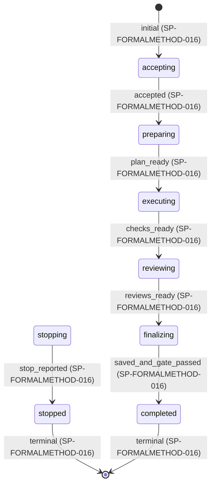

# 仕様書: 形式手法による検証

## 表記規約

必須を「しなければならない」、禁止を「してはならない」、許容を「してもよい」で表す。表中の動作、型の制約及び受入条件も規範である。

## 対象範囲

本書は `####` 見出し 1 つを 1 仕様項目とする。

[要求文書](../requirements/formal-method.md) の PR-FORMALMETHOD-001〜015 を実現する formal-method の入力、成果物、手順、実行、停止及び新しい run での再開を定める。単独依頼と他スキルからの依頼は同じ契約を使う。

対象の変更、呼び出し元の作成工程、認証及び道具自体の内部実装は扱わない。既存の plural 名の formal-methods とその実装は本仕様の実現済みの根拠にしない。要求源は上記の現行要求文書だけとする。

設計原則は [skill-design-patterns.md](../design/skill-design-patterns.md)、作業記録の共通要求は [bp-designed-skill.md](../requirements/bp-designed-skill.md) の PR-BPDESIGNEDSKILL-028〜036・038〜040・042 を参照する。本仕様が追加する保存の形は共通要求を免除しない。

## 用語定義

| 語 | 意味 |
|---|---|
| 性質 | 検証する命題。必要性、出所、前提及び範囲を持つ |
| 必要な性質 | 依頼範囲の要求・目標から抽出した性質。依頼元が明示的に範囲を変更するまでは全て必要として扱う |
| 検査 | 版が固定されたモデル、性質及び範囲に対する一回の道具の実行又はその独立確認 |
| adapter | 道具ごとの入力生成、実行、結果の読み取り及び依存関係抽出の能力を宣言する境界 |
| モデル世代（`generation`） | run 内で固定した対象・モデル・計画の版。1 から始まる正の整数。検査開始前の変更で増加する |
| 所有世代（`owner_generation`） | 保存先の書込所有者を区別する永続な単調増加の正の整数。モデル世代とは別の値 |
| 対応表 | 出所から性質、モデル、検査及び証拠までを辿る有向の参照関係 |
| 部分 | 分割したモデルの一単位。所有する状態と境界契約を持つ |
| 証拠 | 固定した入力、実行結果、反例、確認記録など、判断の根拠となる保存物 |
| 未検証 | 必要だが形式的に確認できていない性質又は範囲。未確認は意味の確認なども含む上位の区分 |

## 機能仕様

### 入出力と責務

#### SP-FORMALMETHOD-001 依頼と入力の固定

formal-method は次の `Request` を受け付け、入力を固定して `request.json` と内容指紋を保存しなければならない。文字列の識別子は空でなく、同じ型の集合内で一意とする。内容指紋は SHA-256、構造データは UTF-8 の鍵を辞書順にした JSON、ファイルは生バイト列に対して計算する。集合の順序が意味を持つ場合は配列の順序を保持する。

| フィールド | 型・制約 |
|---|---|
| `schema` | 本契約の識別子 `formal-method.request/1` |
| `targets` | 1 件以上の `TargetRef`。取得後は取得時点、版、バイト列の指紋を必ず固定する |
| `goals` | 1 件以上の `{id, text, source?}` |
| `known_requirements`, `constraints` | `{id, text, source?}` の配列。未指定時は空配列 |
| `scope` | `{include: string[], exclude: {item, reason}[]}`。未指定時は targets と goals の全体。外部依存は仮定として識別し勝手に対象へ加えない |
| `resources` | `{cpu_slots, memory_bytes, wall_ms, per_check_ms, retries}`。正の整数、ただし retries は 0 以上。未指定値はホストの明示設定から補い、設定の版と取得元を保存する。解決できない値があれば依頼元へ確認して停止し、無期限又は無制限として実行しない |
| `storage` | `{root_uri, document_rules_uri, document_rules_revision}`。実行先で読み書きできる場所と、適用する文書規約の不変の版。呼び出し元の指定がなければ実行環境の作業領域とリポジトリの文書規約を解決し保存する |
| `resume` | 任意の `{previous_run_uri: string, answers: Answer[], changes: Change[]}`。形式は SP-FORMALMETHOD-014 |

`TargetRef` は `{id: string, uri: string, revision?: string, content_hash?: string}` とする。指定された版・指紋は取得内容と照合し、不一致なら停止する。`SourceRef` は `{target_id: string, span: string}` とし、goals、known_requirements、constraints 及び Change の `source` はこの型とする。`Change` は次のタグ付き直和とし、指定された型以外の欄は受け付けない。

| `kind` | 他の必須フィールド | 意味 |
|---|---|---|
| `target` | `target: TargetRef` | 同じ id の対象の差替え。対象の追加・削除は新 Request.targets 全体に反映する |
| `assumption` | `id: string, operation: "upsert", text: string, source?: SourceRef` | モデルの前提を追加又は差替え |
| `assumption` | `id: string, operation: "remove"` | 前提を削除 |

changes は前 run との差分であり、変更後の対象集合・前提集合を組み立てて request.json に固定する。差替え先の id、削除する前提又は source が解決できない場合、同じ id に矛盾する変更がある場合は入力エラーとする。前 run にない対象の追加は新 Request.targets で指定し、changes との不一致を拒否する。scope の変更は新 Request.scope 全体で明示し、旧 scope からの差分と依頼元の入力を記録する。各 run の include から抽出した性質は全て必要であり、任意の性質を示す入力は持たない。

未知のフィールド、型違い、重複 ID、取得できない対象、特定できない目標は入力エラーとして停止しなければならない。対象を取得できても版を固定できなければ、その内容を検証対象として使ってはならない。依頼元へ返す範囲は固定した include と exclude を含み、除外や未確認を成功へ取り込んではならない。

#### SP-FORMALMETHOD-002 役割と工程

工程の値と順序は SP-FORMALMETHOD-003 の stage 表を正本とする。同じ run で前段へ戻せるのは preparing における検査開始前の revise だけとし、性質整理・モデル化・計画のうち影響する最上流段へ戻す。検査開始後の対象・モデル・前提・範囲の変更、必要な反例又は独立不合格の確定後の修正は停止して新 run の restart_stage から行う。変更後の検査と独立確認を省いてはならない。

| 役割 | 責務 | 禁止する作用 |
|---|---|---|
| 制御役 | 段の選択、担当起動、保存済み成果物の参照の受渡し、停止・返却 | 本文、モデル、判定の生成・修正・自己採点 |
| 抽出役 | 入力から出所付きの要素と性質を整理 | 要求の裁定、対象の変更 |
| モデル作成役 | 対応表、モデル、範囲、分割及び検査計画を作成 | 自分の意味の確認を独立確認として扱う |
| 実行器 | 固定済み計画の検査、状態の機械検査、結果の正規化 | モデル・範囲の暗黙変更 |
| 独立検証者 | 原典と生成物から意味、保証、反例及び検出能力を確認 | 作成側の会話・推論履歴の継承、対象や成果物の修正 |
| 記録器 | 担当別の記録を受け取り、一人の書込者として共有台帳を更新 | 記録内容の意味の書換え |

意味を生成・判定する担当は context を分離し、モデル・effort・権限と受け取った資料の版を作業記録へ残さなければならない。独立検証者には原典、固定成果物及び検査結果を渡し、作成理由の会話を渡してはならない。修正後は修正を担当しなかった context で再確認する。

#### SP-FORMALMETHOD-003 成果物と返り値

各 run は一意の `run_id` とモデル世代 `generation` を持ち、同じ root 内の他 run の記録を上書きしてはならない。成果物は次の参照可能な集合とし、空の集合も空である理由を保存する。

| 成果物 | 必須の内容 |
|---|---|
| `request.json` | SP-FORMALMETHOD-001 の固定入力、取得情報 |
| `inventory.json` | 出所付きの要求・目標・状態・入力・出力・制約・出来事・結果及び性質、非形式化の理由 |
| `model/` と `mapping.json` | 形式モデル、性質・前提・範囲、対応表、図と省略条件 |
| `dependencies.json`, `partitions.json` | 依存グラフ、分割候補、採否、境界契約、合成の義務。分割不採用も記録 |
| `plan.json` | 道具の選択、検査一覧、依存順序、資源見積り、予算、期待結果 |
| `checks/`, `reviews/` | 検査ごとの入力・生出力・終了情報・判定・反例・独立確認・変異検査 |
| `events.jsonl`, `ledger.json` | 状態イベント、担当別記録と証拠への参照、指紋、出所 |
| `report.json`, `report.md` | 同じ返り値の機械可読版と人向け表示。JSON を正本とする |

`Result` は `{schema:"formal-method.result/1", run_id, generation, status, stage, scope, properties, questions, artifacts, unsaved, resume, metrics, limitations}` を持つ。`status` は `completed` 又は `stopped`、`properties` は性質ごとの `{property_id, source_ids, verdict, assurance, evidence_refs, reason?}`、`artifacts` は `{uri, hash, kind}`、`unsaved` は `{kind, reason}` の配列とする。`stage` と `resume` は停止時も必須である。人向け表示で JSON にない成功を付け加えてはならない。

`stage` と `resume.restart_stage` の値域と上流からの順序は次の表だけで定める。工程は仕事の位置、状態は run の制御状態であり、相互に置き換えてはならない。停止時は停止を引き起こした処理の stage を保持する。`stopping`・`stopped` はその stage を引き継ぎ、`completed` は `finalize` を持つ。再開不能時の restart_stage は null、再開可能時はこの列挙の値とする。

| 順位 | stage | 工程 | 実行中の状態 |
|---|---|---|---|
| 1 | `intake` | 受付 | accepting |
| 2 | `extract` | 性質整理 | preparing |
| 3 | `model` | モデル化 | preparing |
| 4 | `plan` | 計画 | preparing |
| 5 | `check` | 検査 | executing |
| 6 | `review` | 独立確認 | reviewing |
| 7 | `finalize` | 集約・保存 | finalizing |

### 性質と形式モデル

#### SP-FORMALMETHOD-004 性質の抽出と網羅性

抽出役は取得した対象の全文又は依頼範囲で区切った全区間を走査し、各要素を `{id, kind, source:{target_id, revision, span, quote_hash}, text}` として保存しなければならない。コードは symbol とファイルの範囲、構造データはキー又は JSON Pointer、散文は行範囲を span に使う。走査対象と未読区間を明示し、未読が残れば網羅済みとしてはならない。

各要素について、安全性、到達可能性、進行性、入出力の関係、数値・論理条件、境界、失敗・停止・再開の適用有無を記録しなければならない。適用なしは根拠を持つ。性質は `{id, source_ids, statement, formalizable, rationale, model_refs, assumptions, scope, alternatives}` とし、複数性質への分解と複数出所への対応を許す。

独立検証者は各出所について性質の脱落・追加・意味の変更を照合しなければならない。形式化できない性質は理由を記録し、別手段による確認の方法・結果・独立検証者を記録する。別手段がないか確認できなければ未確認として残す。形式化可能で model_refs が空の性質は未検証（verdict=unconfirmed）とし、削除や任意化で完了条件から外してはならない。

#### SP-FORMALMETHOD-005 モデルの忠実さ、範囲及び保証

モデル作成役は、対象、状態変数の型・領域・初期条件、出来事の入力・guard・更新・変更しない変数、性質、仮定、外部環境及び対象外を記述しなければならない。状態遷移が適用されない検証でも、入出力と事前・事後条件及び適用しない理由を示す。

対応表は `{source_id, property_id, model_ref, check_ids, relation, reason?}` の行を持ち、参照解決、未対応、重複及び除外を機械照合しなければならない。意味の確認は、原典の量化、否定、条件、時間順序、単位及び例外をモデルが保つかを独立検証者が項目ごとに判定する。参照が存在するだけでは意味の一致にならない。

性質ごとの `assurance` は `{kind, bounds, assumptions, exclusions, fairness, proof_refs}` とする。kind は `finite_exhaustive`、`bounded`、`inductive`、`deductive`、`nonformal` のいずれかとする。有限全探索では全領域、bounded では探索深さと各領域の上下限・包含、帰納法では基底・帰納段階・不変条件、演繹証明では定理と未解決の証明義務を記録する。道具の成功だけを根拠に kind を強めてはならない。

進行性では環境の応答、scheduler、公平性、停止しないという仮定を明記し、仮定しなければ進まない経路を隠してはならない。仮定の整合性、初期状態の存在及び非自明な到達例を検査し、矛盾した仮定による空虚な成功を検証済みとしてはならない。

#### SP-FORMALMETHOD-006 状態・出来事・経路と図

状態遷移を扱うモデルでは状態、出来事、結果を名前付きの閉集合として宣言するか、閉じない理由と未確認の範囲を示さなければならない。閉集合では直積の全組を生成し、各組を `allowed`、`forbidden`、`uncovered` に分類する。allowed は guard と更新、forbidden は禁止の出所、uncovered は不足情報を参照する。guard が満たされる領域とその否定側を検査し、単に遷移が無いことを禁止の根拠にしてはならない。

目標、完了、停止、回答及び再開先への到達性を性質として登録し、経路の対象内・対象外と理由を対応付けなければならない。経路を閉集合にしたときは全経路の終点又は再開先を機械照合する。無限の経路を有限列挙したように報告してはならず、記号的な経路集合又は有界探索の保証を SP-FORMALMETHOD-005 に従って示す。

adapter がモデルから図を導出できるならば、状態・出来事・guard 又は関係を読める Mermaid 又は SVG を導出しなければならない。図の各 node/edge とモデル参照を保存し、余分な辺・欠けた辺を機械比較する。条件を省いた辺には省略条件の参照を付ける。導出できなければ理由を報告し、手書きの図をモデルと一致すると断定してはならない。

#### SP-FORMALMETHOD-007 道具の選択と adapter

Rust を実行基盤の第一候補、SMT ソルバ（候補は Z3）を検証器の第一候補として評価しなければならない。適合しない場合はその理由と採用候補の比較を記録する。TLA+・TLC、Alloy、Dafny、Lean を必須集合としてはならない。

| 性質・対象 | 比較する能力 |
|---|---|
| 整数・実数・論理・制約 | SMT、量化・理論の対応、反例生成、unknown の可能性 |
| 並行・イベント・進行性 | 状態探索、時間論理、公平性、有界と無界の保証 |
| 関係・構造・有限領域 | 関係モデル探索、領域境界と対称性の扱い |
| コードの事前事後条件・メモリ・停止性 | 言語の意味との対応、仕様抽出、証明義務又はモデル検査 |
| 数学的定理・無界の性質 | 証明支援、帰納法、証明項の独立検査 |

選択記録は候補ごとの `{adapter_id, version, supported_properties, assurance, unavailable_features, environment, setup_estimate, execution_estimate, resource_estimate, selected, reason}` とし、不明な見積りを 0 としてはならない。適合する道具がなければ未実行として停止する。

adapter は `{id, version, executable, executable_hash, tool_version, config, capabilities}` を宣言し、`prepare`、`validate`、`dependencies`、`diagram`、`execute`、`decode` の入出力と利用可否を持たなければならない。各操作は固定入力の参照を受け、出力参照、診断、資源情報を返す。execute は argument 配列、環境変数の許可集合、期限、メモリ上限、CPU 枠、作業ディレクトリを受ける。秘密値は記録せず、取得条件の同一性を確認できる参照を残す。

終了コードと stdout の文字列だけを全 adapter 共通の成功規則にしてはならない。decode は道具の版に対応した結果形式を検証し、未解決義務、部分探索、unknown、crash を区別する。未知の形式は実行失敗とする。道具の導入や build の失敗は準備失敗として保存し、別候補で保証を保てる場合だけ新たな計画を作る。

### 依存関係と合成

#### SP-FORMALMETHOD-008 依存グラフと分割候補

実行器は形式モデルの構文木又は道具の機械出力から、変数・遷移・性質・仮定を node、読み取り・書き込み・呼出し・参照を型付き edge とする有向グラフを導出しなければならない。node と edge はモデルのファイル・範囲又は構文識別子を持つ。文字列検索だけの推定は確定 edge と区別し、未抽出の構文や動的参照と理由を未確認として出す。

候補導出は次の決定的手順とする。書込み先とその遷移を同じ候補に置き、参照グラフの強連結成分を計算して縮約する。性質は参照先の成分へ接続し、複数成分を参照する性質は横断性質として残す。成分間の edge 数を依存の強さとし、同点は node ID の辞書順とする。入力グラフの指紋、算法の版、edge 種別の扱い、成分及び横断性質を保存し、同一入力から同一候補を得られなければ失敗とする。

候補ごとに採用する部分、又は統合して採用しない理由をモデル作成役が記録する。未抽出の関係が境界に影響する場合はその分割を独立検査可能としてはならない。依存が強いまとまりを得たことと、部分ごとの検証が合成できることを区別する。

#### SP-FORMALMETHOD-009 所有権と非循環な合成

分割する場合は変数の書込所有者を一つに定め、全遷移を一つの部分又は明示的な同期遷移へ割り当てなければならない。境界 edge ごとに `{edge_id, producer, consumer, shared_symbols, assumption, guarantee, owner, discharge_check_ids}` を作り、跨る edge の脱落、二重所有、未所有及び frame 条件の欠落を機械検出する。

合成計画は、初期条件、各部分の事前・事後条件と frame、環境の仮定、同期又は共有状態の整合性、全体性質への含意を独立した証明義務として持たなければならない。`consumer.assumption` を `producer.guarantee` から導く義務は、その producer の結論だけを循環的に仮定して証明してはならない。義務の依存グラフを作り、環境又は単独に証明済みの基底から有向非循環順に解消する。循環が残るときは該当部分を統合して検査するか、共同不変条件について初期成立と全遷移による保存を証明してから相互の仮定を使う。

抽象化・詳細化を用いる場合は、具体状態から抽象状態への対応、初期条件の包含、各具体遷移の抽象遷移又は stutter への対応、対象の全体性質の保存を義務として検査する。進行性では stutter の無限反復を許すかと公平性の保存を別に検査する。義務が不明・未実行・失敗なら全体を検証済みにしてはならない。

分割前の要求・変数・遷移・性質・edge と、分割後の所有・境界・合成義務を全列挙で照合し、未対応と除外理由を保存しなければならない。横断性質は合成後に検査するか、全体性質への含意の証明で解消する。部分の成功数を全体の成功として集計してはならない。

### 実行、独立確認及び判定

#### SP-FORMALMETHOD-010 計画と資源を守る実行

計画は各検査の `{id, property_ids, input_refs, adapter_ref, assumptions, scope, expected, depends_on, cpu_slots, memory_bytes, deadline_ms, attempts}` と、依存関係を含む。生成・独立確認・合成義務も実行予算に含め、停止記録と返却のための時間・メモリを確保しなければならない。容量見積りが得られない検査は単独で上限を設けて試し、実測を計画へ反映する。

scheduler は依存が解消された検査から ID 順に、空き CPU 枠と残りメモリの両方に収まる検査だけを起動しなければならない。同じ出力への書込みや未証明の部分間依存があれば同時実行しない。run の wall_ms 又は検査期限に達したら停止要求を送り、応答しない子 process は終了させる。結果を回収できない検査も一覧から消してはならない。

deadline_ms は attempt 開始からの経過時間の上限とし、Request.resources.per_check_ms 以下にする。attempts は初回を含む正の整数で、1 + Request.resources.retries 以下にする。run の期限は受付開始の単調時計に wall_ms を加えた時点とし、再試行で延長しない。各検査の CPU・メモリ要求は run 上限以下でなければ計画を拒否する。

再試行は計画値以下とし、attempt ごとの失敗と出力を保持する。同じ入力の再試行は結果を上書きせず、検査開始前のモデル又は範囲の変更は同じ run のモデル世代を増やし、検査開始後の変更は停止して新しい run で検査する。必要な検査の失敗又は反例を確定したら新規 dispatch を止め、実行中の検査を停止・回収して停止報告を固定する。停止処理中を含め、独立した結果が後着した場合は SP-FORMALMETHOD-014 に従う。

#### SP-FORMALMETHOD-011 結果、反例と原因の切分け

性質の `verdict` は `verified`、`confirmed_nonformal`、`counterexample`、`not_run`、`unknown`、`timeout`、`execution_error`、`unconfirmed` の 8 値のいずれかとする。verified は道具の成功、SP-FORMALMETHOD-005 の対応、必要な合成義務及び SP-FORMALMETHOD-012 の独立確認が全て成立した範囲に限る。confirmed_nonformal は SP-FORMALMETHOD-004 の別手段と独立確認が成立したときだけ使い、assurance.kind を nonformal とする。verified の assurance.kind は nonformal にしてはならない。

未対応の組合せにも分類対象 ID とモデル上のセル、原典、期待する分類及び実際の分類を結び付け、下記の原因切分けを適用しなければならない。原典に遷移があるのに抽出・モデル化・分類で消えた場合は、その工程の欠陥とし、依頼元の判断不足へ付け替えてはならない。

反例には `{property_id, source_ids, model_revision, input, trace_or_witness, violated_condition, replay_ref}` を保存しなければならない。独立検証者は反例をモデル上で再現し、対象の出所へ戻して、要求の不足、モデルの欠陥、分類処理の欠陥、要求された性質の違反又は原因未確認に分類する。根拠が足りなければ原因未確認とし、モデルの欠陥だけで要求不足にしてはならない。

要求に判断が必要なら `{id, issue, affected_refs, options, answer_schema}` を作り依頼元へ問い、回答前に依存するモデル・検査を進めてはならない。質問は複数持てる。回答に依存しない作業の結果を保持するが、その run は停止とする。選択肢の有無を理由に要求を自動補完してはならない。

#### SP-FORMALMETHOD-012 独立確認と検出能力

実行器による決定的検査は、構文・型、参照、入力指紋、全計画検査の結果の有無、道具の結果形式、証明義務、反例の再実行及び出力指紋を確認しなければならない。独立検証者は原典からの抽出、モデルの意味、仮定と保証の範囲、分割境界、空虚性及び結果の結論を確認する。両者は別々の記録と verdict を持ち、一方の成功で他方を代替してはならない。

性質に違反する入力又はモデルの変異を作れるなら、モデル作成役は実行前に `{property_id, mutation_ref, expected_violation, expected_detector}` を固定し、実行器は期待した違反を検出できることを検査しなければならない。単なる構文エラーは意味の違反の検出と数えない。独立検証者はその変異が意図した性質を壊すことと、無関係の失敗を検出成功にしていないことを確認する。

変異を用意できなければ性質別の理由と、別の検出能力確認又は未確認を記録しなければならない。独立確認が失敗・不能なら未確認として停止する。その判定を同じ run 内の修正で消してはならない。検査前の構文・対応の自己点検で見つけたモデル欠陥は preparing 内で新しいモデル世代へ修正できるが、必要な検査の反例又は独立確認の不合格が確定した後は新しい run でのみ修正・再検証する。修正された原典、モデル、adapter 又は判定は影響先を対応表で求め、その検査と独立確認を再実行する。

#### SP-FORMALMETHOD-013 再利用と性能

保存済み検査の再利用キーは、対象及びモデルの版と内容、道具と adapter の種類・版・実行体指紋・設定、依存証拠と取得条件、性質、仮定、範囲、判定規則の版、有効な時点の正規化データから作らなければならない。各項目を照合し、不明・欠落・不一致が一つでもあれば miss として実行する。有効な時点は固定時点、又は明示された有効期間と再利用時点の包含関係で表し、指定がない外部状態依存の証拠は再取得する。

hash の一致だけで参照先の存在を省略してはならない。再利用元の検査と独立確認の証拠を検証し、再利用先の新しい対応表と必要範囲を確認する。停止 run の完了判定を流用せず、検査単位で適用する。負の結果も診断として参照できるが成功へ変換してはならない。

性能は run と検査ごとに準備、build、検査、確認、保存の所要時間、CPU 時間、実行中のピーク常駐メモリ（バイト）、費用、人の介入、再試行、環境の版、local/CI、初回/cache を記録しなければならない。取得できない値は `unavailable` と理由を持ち、測定値 0 と区別する。

性能比較は性質・仮定・範囲・判定規則が一致する組だけを比較対象とし、環境差と cold/warm の別を記載する。改善候補は測定上の問題と結び付け、検査対象・仮定・範囲・結果の扱いが保存されることを決定的照合と独立確認で示してから採用する。保証を減らした計画は別の検証範囲として依頼元に返し、改善と呼んではならない。

### 記録と停止・再開

#### SP-FORMALMETHOD-014 永続化と新しい run

記録器は担当別の不変の作業記録と証拠を先に保存し、内容指紋を照合してから共有台帳へ参照を登録しなければならない。担当が共有台帳へ直接書くことは禁止する。同一内容の正本は一つにし、他の記録は参照を使う。適用する文書規約は実行先で読める不変の版として保存し、各記録へその参照を付ける。

保存先の storage adapter は、次の能力を検査できる契約として宣言し、起動時に能力確認の証拠を保存しなければならない。ファイルシステム・OS の機構・外部保存サービスの特定の実現手段は固定しない。この能力確認は stage=intake の入力固定前に行い、能力が不明又は不足なら受付時の準備失敗として停止し、書込みや回収を開始してはならない。

| 操作 | 事前条件 | 成功後の保証・失敗時の扱い |
|---|---|---|
| `acquire` | root と run が特定できる | 所有者が一人である証拠と所有札を返す。既存所有者の終了又は失効と旧所有者の書込拒否を証明できなければ「実行中又は所有不明」として停止 |
| `fence` | acquire 済み | root の `ownership` 記録に owner_generation を不可分かつ永続に増加保存して所有札へ結び付ける。子へ所有札を渡さない |
| `commit` | 所有札と owner_generation が現 ownership と一致 | 証拠を保存してから台帳参照と状態イベントを確定する。確定前の中間書込みは読者に見えず、成功応答した確定記録は crash 後も再読込できる。旧所有世代の書込みは作用前に拒否 |
| `recover_children` | acquire/fence 済み、子の不変の実行識別子・所有情報を参照できる | 所有する子の終了を確認し、未終了なら終了・回収してから再開を許す。識別子再利用・所有不明なら回収不能として停止し、他 process を終了しない |

全ての台帳・状態への書込みはこの所有者を経由する。ownership は `{root_uri, run_id, owner_generation, owner_token_ref}`、確定イベントは `{sequence, run_id, generation, owner_generation, previous_event_hash, input_hash, output_hash, payload}` を持つ。owner_generation と所有札の照合は各書込みの確定時にも行い、照合と作用の間の所有者交代を許してはならない。`generation` は常にモデル世代であり、後着結果の同名フィールドも同じ意味である。

子は固有 attempt の未確定出力にだけ書き、台帳・状態・ownership を変更しない。未終端記録だけから crash を推定してはならない。回収者は acquire/fence と子の回収を終え、以前の確定イベントから復元した後に新 run を開始する。

記録器は commit の事後に参照先を再読込し指紋を確認する。必要な記録の保存に失敗したら処理を止め、保存できたものを保持し、保存できなかった範囲と理由を返り値で報告する。返り値自体も保存不能なら依頼元への直接返却を試み、保存したと報告してはならない。

停止報告を一度確定した run の status は stopped のまま保持する。後着結果は `{original_run_id, generation, check_id, attempt, received_at, producer, input_hash, output_ref}` として追記保存し、以前の report と判定を更新してはならない。保存不能時は同じ保存失敗の扱いとする。利用者の削除指示があるまで過去の記録、証拠、判定と参照を保持する。

`Answer` は `{question_id: string, decision: JSON値, source: string, answered_at: string}` とし、decision は質問の answer_schema と照合する。source は回答者又は回答の出所、answered_at はUTCのISO 8601時刻とする。再開入力の answers 内の question_id は一意とする。再開は新しい run_id を割り当てる。`resume` の返却は `{possible, previous_run_uri, checkpoint_ref, required_inputs, required_environment, restart_stage, reason?}` を持つ。必要な記録・対象・環境を再取得できなければ possible=false と理由を返す。回答待ちも resume を使い、一回の質問又は一回の再開という固定上限を設けない。

再開時は保存状態、停止理由、未確認、SP-FORMALMETHOD-001 の Change と新 Request の対象・scope・前提及び回答を照合し、変更の依存先を無効化して stage 表で最も順位の小さい影響段を restart_stage として続ける。質問 ID の不一致、回答の型違い、相反する回答は未解消として止める。後着結果と以前の成功は SP-FORMALMETHOD-013 を通った検査だけを再利用する。以前の run を再開後の完了に変更してはならない。

#### SP-FORMALMETHOD-015 完了ゲートと停止報告

completed は、依頼範囲の必要な性質全てについて対応・検査・独立確認・必要な合成・検出能力確認が成立し、質問が解消され、必要な記録を保存して再読込できた場合だけ返さなければならない。形式化できない性質は独立した別手段による確認が成立すれば、その方法と保証を明示してゲートを通せる。未対応・未実行・unknown・時間切れ・実行失敗・未確認及び未保存はゲートを通さない。

停止報告は、停止段、理由、確認済みと未確認、生成済みと未作成、未保存、実行中又は中止した検査、質問、再開可否と必要入力を区別しなければならない。必要な性質の反例は「検査できた」という理由で completed にせず stopped とする。停止までに得た結果も捨てず、依頼範囲を超えた保証や意図への適合を報告してはならない。

#### SP-FORMALMETHOD-016 run の状態遷移

run の制御状態は図と例外表の和集合を正本とし、宣言した状態×イベントの各組を一箇所だけに対応させなければならない。主フローは図、残りは例外表に置き、重複・欠落・未定義の行き先を機械検査する。図の各辺と例外表の「定義済みか」は本項目を参照し、条件と作用は次のイベント規則を参照する。self_event という集約イベントと図の省略一覧は使わない。初期・終端の記号は軸のイベントではなく、判定の開始と確定を表す。

| イベント | 許可された組合せでの条件・作用 |
|---|---|
| accepted | 入力を固定して保存できたときだけ進む |
| plan_ready | 抽出・モデル・対応・計画が固定され準備できたときだけ進む |
| checks_ready | 全計画検査を回収し必要な失敗がないときだけ進む |
| reviews_ready | 全独立確認が成立したときだけ進む |
| revise | 検査開始前に preparing 内のモデル欠陥を直す。影響を無効化してモデル世代を増やす |
| saved_and_gate_passed | SP-FORMALMETHOD-015 のゲートが成立したときだけ判定を確定する |
| halt | 入力不備、判断待ち、反例、未検証、独立確認不能、資源枯渇、割込み、準備・実行・保存失敗を理由に新規起動を止める。stopping では追加理由として追記する |
| stop_reported | 停止報告を保存又は未保存範囲を依頼元へ返却して停止判定を固定する |
| late_result | 出所と世代を確認して追記保存する。未計画・入力不一致は診断とし成功へ使わず、終端の判定を変更しない |
| duplicate_result | 同一検査の重複を診断保存する。判定を変更しない |
| restart_request | 元 run を変えず、SP-FORMALMETHOD-014 で新 run の受付を行う |

例外表の「異常系（拒否）」は、その組合せのイベントを拒否し、状態を保持して診断を保存する規則を表す。「準正常系」と「異常系（停止）」は上の許可された作用を表す。条件が不成立のイベントと未宣言イベントも拒否規則を適用する。非終端で診断保存に失敗した場合は halt を発行し、終端では未保存範囲を直接返却して判定を保持する。必要な反例又は独立不合格が確定した場合は、その後のイベント dispatch より halt を優先する。

回答は元 run の遷移ではなく restart_request の入力とする。stopped/completed は判定が固定された終端であり、記録の追記と新 run の受付は終端後も可能とする。process crash 後の回収は SP-FORMALMETHOD-014 の所有を確保してから保存済み範囲だけで停止報告を作り、新 run で続ける。

## 状態とイベント

図と例外表は SP-FORMALMETHOD-016 の索引である。主フローの条件と作用は同項目に従う。

> 対象の状態: accepting / preparing / executing / reviewing / finalizing / stopping / stopped / completed

> 対象のイベント: accepted / plan_ready / checks_ready / reviews_ready / revise / saved_and_gate_passed / halt / stop_reported / late_result / duplicate_result / restart_request

| 現在の状態 | イベント | 種別 | 次の状態 | 定義済みか |
|---|---|---|---|---|
| accepting | plan_ready | 異常系（拒否） | accepting | ✅ SP-FORMALMETHOD-016 |
| accepting | checks_ready | 異常系（拒否） | accepting | ✅ SP-FORMALMETHOD-016 |
| accepting | reviews_ready | 異常系（拒否） | accepting | ✅ SP-FORMALMETHOD-016 |
| accepting | revise | 異常系（拒否） | accepting | ✅ SP-FORMALMETHOD-016 |
| accepting | saved_and_gate_passed | 異常系（拒否） | accepting | ✅ SP-FORMALMETHOD-016 |
| accepting | halt | 異常系（停止） | stopping | ✅ SP-FORMALMETHOD-016 |
| accepting | stop_reported | 異常系（拒否） | accepting | ✅ SP-FORMALMETHOD-016 |
| accepting | late_result | 準正常系 | accepting | ✅ SP-FORMALMETHOD-016 |
| accepting | duplicate_result | 異常系（拒否） | accepting | ✅ SP-FORMALMETHOD-016 |
| accepting | restart_request | 異常系（拒否） | accepting | ✅ SP-FORMALMETHOD-016 |
| preparing | accepted | 異常系（拒否） | preparing | ✅ SP-FORMALMETHOD-016 |
| preparing | checks_ready | 異常系（拒否） | preparing | ✅ SP-FORMALMETHOD-016 |
| preparing | reviews_ready | 異常系（拒否） | preparing | ✅ SP-FORMALMETHOD-016 |
| preparing | revise | 準正常系 | preparing | ✅ SP-FORMALMETHOD-016 |
| preparing | saved_and_gate_passed | 異常系（拒否） | preparing | ✅ SP-FORMALMETHOD-016 |
| preparing | halt | 異常系（停止） | stopping | ✅ SP-FORMALMETHOD-016 |
| preparing | stop_reported | 異常系（拒否） | preparing | ✅ SP-FORMALMETHOD-016 |
| preparing | late_result | 準正常系 | preparing | ✅ SP-FORMALMETHOD-016 |
| preparing | duplicate_result | 異常系（拒否） | preparing | ✅ SP-FORMALMETHOD-016 |
| preparing | restart_request | 異常系（拒否） | preparing | ✅ SP-FORMALMETHOD-016 |
| executing | accepted | 異常系（拒否） | executing | ✅ SP-FORMALMETHOD-016 |
| executing | plan_ready | 異常系（拒否） | executing | ✅ SP-FORMALMETHOD-016 |
| executing | reviews_ready | 異常系（拒否） | executing | ✅ SP-FORMALMETHOD-016 |
| executing | revise | 異常系（拒否） | executing | ✅ SP-FORMALMETHOD-016 |
| executing | saved_and_gate_passed | 異常系（拒否） | executing | ✅ SP-FORMALMETHOD-016 |
| executing | halt | 異常系（停止） | stopping | ✅ SP-FORMALMETHOD-016 |
| executing | stop_reported | 異常系（拒否） | executing | ✅ SP-FORMALMETHOD-016 |
| executing | late_result | 準正常系 | executing | ✅ SP-FORMALMETHOD-016 |
| executing | duplicate_result | 異常系（拒否） | executing | ✅ SP-FORMALMETHOD-016 |
| executing | restart_request | 異常系（拒否） | executing | ✅ SP-FORMALMETHOD-016 |
| reviewing | accepted | 異常系（拒否） | reviewing | ✅ SP-FORMALMETHOD-016 |
| reviewing | plan_ready | 異常系（拒否） | reviewing | ✅ SP-FORMALMETHOD-016 |
| reviewing | checks_ready | 異常系（拒否） | reviewing | ✅ SP-FORMALMETHOD-016 |
| reviewing | revise | 異常系（拒否） | reviewing | ✅ SP-FORMALMETHOD-016 |
| reviewing | saved_and_gate_passed | 異常系（拒否） | reviewing | ✅ SP-FORMALMETHOD-016 |
| reviewing | halt | 異常系（停止） | stopping | ✅ SP-FORMALMETHOD-016 |
| reviewing | stop_reported | 異常系（拒否） | reviewing | ✅ SP-FORMALMETHOD-016 |
| reviewing | late_result | 準正常系 | reviewing | ✅ SP-FORMALMETHOD-016 |
| reviewing | duplicate_result | 異常系（拒否） | reviewing | ✅ SP-FORMALMETHOD-016 |
| reviewing | restart_request | 異常系（拒否） | reviewing | ✅ SP-FORMALMETHOD-016 |
| finalizing | accepted | 異常系（拒否） | finalizing | ✅ SP-FORMALMETHOD-016 |
| finalizing | plan_ready | 異常系（拒否） | finalizing | ✅ SP-FORMALMETHOD-016 |
| finalizing | checks_ready | 異常系（拒否） | finalizing | ✅ SP-FORMALMETHOD-016 |
| finalizing | reviews_ready | 異常系（拒否） | finalizing | ✅ SP-FORMALMETHOD-016 |
| finalizing | revise | 異常系（拒否） | finalizing | ✅ SP-FORMALMETHOD-016 |
| finalizing | halt | 異常系（停止） | stopping | ✅ SP-FORMALMETHOD-016 |
| finalizing | stop_reported | 異常系（拒否） | finalizing | ✅ SP-FORMALMETHOD-016 |
| finalizing | late_result | 準正常系 | finalizing | ✅ SP-FORMALMETHOD-016 |
| finalizing | duplicate_result | 異常系（拒否） | finalizing | ✅ SP-FORMALMETHOD-016 |
| finalizing | restart_request | 異常系（拒否） | finalizing | ✅ SP-FORMALMETHOD-016 |
| stopping | accepted | 異常系（拒否） | stopping | ✅ SP-FORMALMETHOD-016 |
| stopping | plan_ready | 異常系（拒否） | stopping | ✅ SP-FORMALMETHOD-016 |
| stopping | checks_ready | 異常系（拒否） | stopping | ✅ SP-FORMALMETHOD-016 |
| stopping | reviews_ready | 異常系（拒否） | stopping | ✅ SP-FORMALMETHOD-016 |
| stopping | revise | 異常系（拒否） | stopping | ✅ SP-FORMALMETHOD-016 |
| stopping | saved_and_gate_passed | 異常系（拒否） | stopping | ✅ SP-FORMALMETHOD-016 |
| stopping | halt | 異常系（停止） | stopping | ✅ SP-FORMALMETHOD-016 |
| stopping | late_result | 準正常系 | stopping | ✅ SP-FORMALMETHOD-016 |
| stopping | duplicate_result | 異常系（拒否） | stopping | ✅ SP-FORMALMETHOD-016 |
| stopping | restart_request | 異常系（拒否） | stopping | ✅ SP-FORMALMETHOD-016 |
| stopped | accepted | 異常系（拒否） | stopped | ✅ SP-FORMALMETHOD-016 |
| stopped | plan_ready | 異常系（拒否） | stopped | ✅ SP-FORMALMETHOD-016 |
| stopped | checks_ready | 異常系（拒否） | stopped | ✅ SP-FORMALMETHOD-016 |
| stopped | reviews_ready | 異常系（拒否） | stopped | ✅ SP-FORMALMETHOD-016 |
| stopped | revise | 異常系（拒否） | stopped | ✅ SP-FORMALMETHOD-016 |
| stopped | saved_and_gate_passed | 異常系（拒否） | stopped | ✅ SP-FORMALMETHOD-016 |
| stopped | halt | 異常系（拒否） | stopped | ✅ SP-FORMALMETHOD-016 |
| stopped | stop_reported | 異常系（拒否） | stopped | ✅ SP-FORMALMETHOD-016 |
| stopped | late_result | 準正常系 | stopped | ✅ SP-FORMALMETHOD-016 |
| stopped | duplicate_result | 異常系（拒否） | stopped | ✅ SP-FORMALMETHOD-016 |
| stopped | restart_request | 準正常系 | stopped | ✅ SP-FORMALMETHOD-016 |
| completed | accepted | 異常系（拒否） | completed | ✅ SP-FORMALMETHOD-016 |
| completed | plan_ready | 異常系（拒否） | completed | ✅ SP-FORMALMETHOD-016 |
| completed | checks_ready | 異常系（拒否） | completed | ✅ SP-FORMALMETHOD-016 |
| completed | reviews_ready | 異常系（拒否） | completed | ✅ SP-FORMALMETHOD-016 |
| completed | revise | 異常系（拒否） | completed | ✅ SP-FORMALMETHOD-016 |
| completed | saved_and_gate_passed | 異常系（拒否） | completed | ✅ SP-FORMALMETHOD-016 |
| completed | halt | 異常系（拒否） | completed | ✅ SP-FORMALMETHOD-016 |
| completed | stop_reported | 異常系（拒否） | completed | ✅ SP-FORMALMETHOD-016 |
| completed | late_result | 準正常系 | completed | ✅ SP-FORMALMETHOD-016 |
| completed | duplicate_result | 準正常系 | completed | ✅ SP-FORMALMETHOD-016 |
| completed | restart_request | 準正常系 | completed | ✅ SP-FORMALMETHOD-016 |

進行には道具と独立検証者の応答、保存先の可用性が必要であり、応答しない場合は期限によって停止へ到達する。完了への到達は必要な性質が成立する場合に限り、反例・判断待ち・実行不能を完了に到達させる公平性は仮定しない。

## エラー処理と異常系

エラーの正規化と保存は SP-FORMALMETHOD-007・010〜015 に従う。入力不備は受付、判断待ちは発見段、道具導入不能は計画、unknown・timeout・crash は検査、意味の不一致は独立確認、保存不能は発見段を停止段として返す。複数の失敗は最初の停止理由と追加理由を区別する。process crash で返却できなかった記録も再起動時に未保存・未確認として残し、成功を推定しない。

## 外部インタフェース

依頼元との境界は SP-FORMALMETHOD-001 の Request、003 の Result、011 の質問及び014 の Answer/resume とする。特定の CLI 名、BP 専用の mode、特定のホストの会話機能に依存させてはならない。CLI、Workflow、直接対話はいずれも同じ型へ変換し、ホストが質問応答や子 process の制御を提供できない場合は必要な環境を示して停止する。

## 検証方法

次の表は将来の実装の受入条件であり、この文書の作成時に実装済みとする記録ではない。各ケースでは返り値だけでなく固定入力、成果物の内容・指紋、状態イベント及び独立確認を観測する。正常例に加えて、期待する結果だけを変えた負例を用い、参照の存在検査と意味の確認を分ける。

| ケース | 操作と期待する観測 | 仕様項目 |
|---|---|---|
| AC-01 | 単独とスキル経由で同じ対象・目標を与え、同じ範囲を固定する。対象なし・目標なし・範囲外の追加は停止又は除外となり成功へ混入しない | SP-FORMALMETHOD-001〜003 |
| AC-02 | 要求、状態、入出力、制約を含む原典へ性質の脱落を一つ注入し、全文走査と独立照合で検出する。非形式化の性質は別手段の確認と未確認の双方を区別する | SP-FORMALMETHOD-004 |
| AC-03 | 状態×出来事の guard 境界、禁止、未対応、失敗、回答、再開を含むモデルから全セルを生成し、到達不能の目標と省いた経路が未検証になる。図の辺の追加・削除を検出する | SP-FORMALMETHOD-005〜006 |
| AC-04 | ID は結び付くが否定・量化・時系列が逆のモデルを意味の確認で落とす。有限探索を無界証明とする報告と矛盾した仮定も落とす | SP-FORMALMETHOD-005・012 |
| AC-05 | SMT、時間性質、コード契約、数学的証明の候補を能力で比較する。導入不能・版違い・未知出力・unsupported は未実行又は失敗になり、手法固定で範囲を捨てない | SP-FORMALMETHOD-007 |
| AC-06 | 同一モデルから同一グラフ・候補を再生成する。跨る edge、動的な未抽出参照、採否を追跡する。候補だけで独立検査可能とする判定を拒否する | SP-FORMALMETHOD-008 |
| AC-07 | 境界 edge、所有者、frame、分割前要素を一つずつ欠落させ検出する。相互仮定だけの合成を拒否し、共同不変条件の基底・保存又は統合検査を要求する。詳細化と進行性保存の義務未解決は全体成功にしない | SP-FORMALMETHOD-009 |
| AC-08 | 要求不足・モデル欠陥・分類欠陥・原因不明を含む反例をそれぞれ再現し根拠を確認する。複数質問の未回答、型違い、相反回答、未知のChangeタグ・不明な差替え/削除先・前提変更・scope差分を投入し、影響する検査の無効化と依存停止を確認する。原典に存在する遷移の抽出漏れはモデル側の欠陥となり要求不足の質問にしない | SP-FORMALMETHOD-011・014 |
| AC-09 | 成功・反例・未実行・unknown・timeout・crash を同時に返す計画で各結果を保持し、必要な失敗で停止する。変異の未検出と独立確認未実行を成功にしない | SP-FORMALMETHOD-010〜012・015 |
| AC-10 | CPU とメモリ境界の検査を並列起動し上限を超えない。依存がある検査は先行の証拠を待つ。割込み時は完了・未完了と後着結果を保持する | SP-FORMALMETHOD-010・014 |
| AC-11 | 再利用キーの各項目を一つずつ変えた場合及び証拠欠落で miss となる。一致時だけ元証拠を参照し、停止 run の判定は不変とする | SP-FORMALMETHOD-013〜014 |
| AC-12 | cold/warm、local/CI、準備/build/検査及び測定不能を区別する。範囲を減らした高速化と条件不一致の優劣を拒否する | SP-FORMALMETHOD-013 |
| AC-13 | 証拠保存前、台帳登録前、状態確定前及び報告保存時の失敗・crash を注入する。部分保存と未保存を区別し、旧 run の記録を保持してstage表の順位に従う最上流の restart_stage と元の停止stageを観測して新 run を開始する | SP-FORMALMETHOD-014〜015 |
| AC-14 | 必要な未対応・未実行・unknown・timeout・実行失敗・未確認・未保存を一つずつ残すとゲートが落ちる。全条件成立時だけ completed となり、形式・非形式の保証を越えない | SP-FORMALMETHOD-003・015 |
| AC-15 | 未知フィールド、型違い、重複ID、版/指紋不一致、取得した版を固定できない対象、未解決resources、0/負の資源値を投入し、停止・対象不使用・無制限実行なしを観測する。retries=0では初回だけを許す | SP-FORMALMETHOD-001・SP-FORMALMETHOD-010 |
| AC-16 | CPU/メモリ要求、deadline_ms、attemptsを各上限の直前・同値・直後にし、計画の許可/拒否を確認する。wall期限到達時の停止要求、非応答の子の終了、ID順起動、再試行で期限不延長を観測する。秘密値を入れた実行で全記録への非露出と同一性参照の保持を確認する | SP-FORMALMETHOD-007・SP-FORMALMETHOD-010 |
| AC-17 | acquire失敗・所有不明・不足能力で準備停止し、未終端だけからcrashを推定しないことを確認する。owner_generation更新前後の旧所有札を使い書込み拒否と無作用を観測する。子の台帳書込みを拒否し、回収時は所有する子だけを終了する。識別子再利用・所有不明で回収不能とし、他processを終了しない | SP-FORMALMETHOD-014 |
| AC-18 | 図の主フローと例外表から8×11セルを機械導出し、欠落・重複・未定義の行き先・辺の仕様ID欠落・主フローの表への混入を変異で検出する。全セルの期待する行き先と種別、拒否時の診断保存/状態不変を確認し、reviseのpreparing限定、独立不合格時halt優先、duplicate_result、非終端restart_request拒否、保存失敗時の規則を観測する | SP-FORMALMETHOD-016 |

## トレーサビリティ表

各行は要求の全受入箇条書きを対象とする。対応の意味と実装受入ケースを併記し、ID の連結だけで要求を満たしたと判定しない。

| 要求 ID | 仕様項目 ID | 検証方法 |
|---|---|---|
| PR-FORMALMETHOD-001 | SP-FORMALMETHOD-001・SP-FORMALMETHOD-002・SP-FORMALMETHOD-003 | AC-01・15で入力型と固定対象・範囲・不足停止を照合し、単独/呼出しの同一入力から同じ範囲となることを確認する。 |
| PR-FORMALMETHOD-002 | SP-FORMALMETHOD-004・SP-FORMALMETHOD-012・SP-FORMALMETHOD-015 | AC-02・14で原典全域と観点の抽出一覧を独立照合し、脱落と非形式化の理由、別手段又は未確認の区別を確認する。 |
| PR-FORMALMETHOD-003 | SP-FORMALMETHOD-005・SP-FORMALMETHOD-006 | AC-03で対象の状態×出来事と閉経路集合を機械生成し、guard・禁止・未対応・到達性・除外理由を確認する。 |
| PR-FORMALMETHOD-004 | SP-FORMALMETHOD-004・SP-FORMALMETHOD-005・SP-FORMALMETHOD-012 | AC-02・04で対応表の参照解決を機械照合し、原典とモデルの否定・量化・時間条件を独立検証者が照合する。 |
| PR-FORMALMETHOD-005 | SP-FORMALMETHOD-005・SP-FORMALMETHOD-007 | AC-04・05で能力/環境/資源に基づく選択記録と保証を照合し、有限境界・無界証明・公平性の誤報を負例で検出する。 |
| PR-FORMALMETHOD-006 | SP-FORMALMETHOD-006 | AC-03で対象モデルから図を導出し、辺・参照・省略条件を照合して追加/欠落辺を検出する。 |
| PR-FORMALMETHOD-007 | SP-FORMALMETHOD-008 | AC-06で依存グラフと候補を再生成し、出所・強さ・採否・未抽出関係と独立性の判定を照合する。 |
| PR-FORMALMETHOD-008 | SP-FORMALMETHOD-009 | AC-07で境界edgeと責任・分割前後要素を機械照合し、循環仮定・未解決の全体含意/詳細化を負例で検出する。 |
| PR-FORMALMETHOD-009 | SP-FORMALMETHOD-011・SP-FORMALMETHOD-014・SP-FORMALMETHOD-015 | AC-08・14で原因別の反例/未対応セルを独立再現し、質問の依存停止、回答とChange照合、新runへの反映を観測する。 |
| PR-FORMALMETHOD-010 | SP-FORMALMETHOD-003・SP-FORMALMETHOD-010・SP-FORMALMETHOD-011・SP-FORMALMETHOD-015 | AC-09・14で全適用性質の検査と8判定の返却を照合し、出所付き反例、必要失敗の停止と範囲付き成果物を確認する。 |
| PR-FORMALMETHOD-011 | SP-FORMALMETHOD-002・SP-FORMALMETHOD-012 | AC-04・09で決定的検査と独立意味確認の別記録を照合し、期待済みの違反変異の検出又は不能理由/未確認を確認する。 |
| PR-FORMALMETHOD-012 | SP-FORMALMETHOD-010・SP-FORMALMETHOD-015 | AC-09・10・16で依存順序とCPU/メモリ/期限/再試行境界を観測し、途中停止を含む全計画検査の集約を照合する。 |
| PR-FORMALMETHOD-013 | SP-FORMALMETHOD-013・SP-FORMALMETHOD-014 | AC-11で再利用キーを各項目変異させ、不一致・欠落・後着での再利用拒否と一致時の元証拠参照を確認する。 |
| PR-FORMALMETHOD-014 | SP-FORMALMETHOD-013 | AC-12で準備/build/検査、環境/cache別の測定記録を照合し、比較条件不一致・保証を減らす改善の負例を拒否する。 |
| PR-FORMALMETHOD-015 | SP-FORMALMETHOD-002・SP-FORMALMETHOD-003・SP-FORMALMETHOD-014・SP-FORMALMETHOD-015・SP-FORMALMETHOD-016 | AC-10・11・13・17・18で共通記録、未完了/未保存、所有と回収、後着追記と旧判定、新runの再開位置及びrun全セルを観測する。 |
