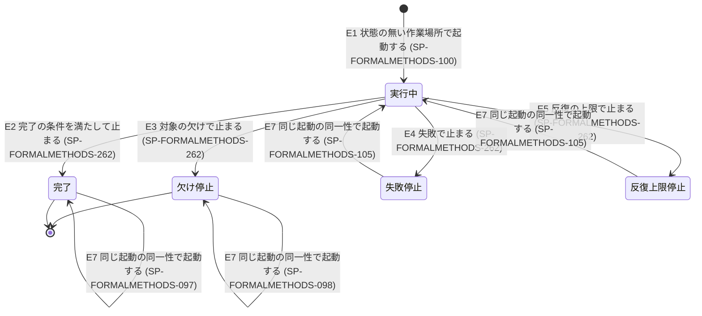

# 仕様書: formal-methods の手順・状態・成果物の形

## 表記規約

本文書の規範の語尾（必須・推奨・許容・禁止の 4 区分）と語の意味は、要求文書 `docs/requirements/formal-methods.md` の「表記規約」と「用語」に揃える。要求文書が意味を委ねる語は、設計方針文書の「用語」と「停止・再開と人間の入力」の節に揃える。

## 対象範囲

本文書は `####` 見出し 1 つを 1 仕様項目とする。本文書は、要求文書の要求を実現する formal-methods の入力・入口の step・step の並び・役・状態と CLI・各検査の手順・成果物の形・停止と返り値を定める。本文書の表は formal-methods の表の正本である。

欠番: SP-FORMALMETHODS-001〜SP-FORMALMETHODS-080・SP-FORMALMETHODS-435・SP-FORMALMETHODS-451

### 本文書が実現する要求

要求文書の全ての要求を本文書だけで実現し、どの仕様項目が実現するかはトレーサビリティ表が持つ。best-practices の要求は、取り込みの表（SP-FORMALMETHODS-136）が挙げる範囲だけを満たす。

### 本文書が扱わないもの

| 扱わないもの | どこが扱うか |
|---|---|
| 形式手法の原則 | 設計方針文書 |
| 作業記録・記録台帳・文書の一般規約の語の意味 | `docs/requirements/bp-operations.md` の「用語」 |
| best-practices の要求の文 | `docs/requirements/bp-designed-skill.md` |
| best-practices の実行基盤の規則のうち本文書が参照するもの | `docs/specifications/bp-run.md`・`docs/specifications/bp-conformance.md`（参照する仕様項目は本文の各項目が ID で示す） |
| 道具の内部仕様と使い方 | 各道具の一次資料 |
| コードの層の単位を切る材料を作る部分の中身 | 定めない（差し込み口の形だけを SP-FORMALMETHODS-106 が定める） |
| 検査対象と上流の修正 | 呼び出し側か利用者 |

## 用語定義

要求文書の「用語」の語はそのまま使う。下の語は本文書だけで使う語で、定義はここだけに置く。

| 用語 | 意味 |
|---|---|
| 状態の root | 作業場所と記録台帳と取得した道具を置くディレクトリ（SP-FORMALMETHODS-087） |
| 状態の鍵 | 起動の同一性から CLI が作る、作業場所の名前（SP-FORMALMETHODS-086） |
| 入口の判定 | 入口の step で、CLI の `entry` の操作が返す判定（SP-FORMALMETHODS-094） |
| 起動のロック | 1 つの起動が作業場所を持っていることを示すファイル `run.lock`（SP-FORMALMETHODS-101） |
| 更新の時刻 | 起動のロックに書く、その起動の CLI の操作が最後にロックを書き直した時刻（SP-FORMALMETHODS-292） |
| 操作のロック | CLI の 1 回の操作の間だけ持つファイル `op.lock`（SP-FORMALMETHODS-104） |
| 起動の札 | 起動のロックを作った起動に CLI が渡す文字列。暗号論的な乱数 128 bit を Crockford base32 の小文字にした 26 文字 |
| run ID | 1 つの状態の中の run を指す ID。`r1`・`r2`… |
| 現在の run | 状態に最後に開始を記録した run |
| 抜き出し | CLI が入力の集合の markdown から決定的に作る、構造のある部分の一覧（SP-FORMALMETHODS-152） |
| 要素 ID | 抜き出しの要素ごとに CLI が作る ID |
| 行範囲 | ファイルのパスと、開始と終了の行と、行の中の開始と終了の文字位置の組 |
| 単位 ID | 単位ごとに CLI が作る ID。根の単位は `U0` |
| 継ぎ目 ID | 継ぎ目ごとに CLI が作る ID |
| 性質 ID | 性質ごとに CLI が作る ID |
| 欠け ID | 欠けごとに CLI が作る ID |
| 停止の行 | 要求文書の PR-FORMALMETHODS-175 の表の行。綴りは次の対応とする：`done` は 1 行目、`limit` は 2 行目、`blocked-defect` は 3 行目、`blocked-previous` は 4 行目、`blocked-failure` は 5 行目、`blocked-save` は 6 行目、`blocked-entry` は 7 行目、`blocked-unrecorded` は 8 行目。9 行目（停止の記録の無い終わり）は返り値を持たず、綴りを持たない |
| 完了した状態 | 停止の行 `done` の停止の記録を持つ状態 |
| 起動数 | `docs/specifications/bp-run.md` の用語「起動数」と同じ数え方で数えた、formal-methods の 1 run の `agent()` の呼び出しの数 |
| 予約分 | 起動数の上限の中に、停止の記録を書くために残す起動の数（SP-FORMALMETHODS-271） |
| 正規化した JSON | `docs/specifications/bp-run.md` の SP-BPRUN-038 が項目の鍵に当てる JSON の正規化と同じ形にした JSON |
| 要素数 | モデルの中で個数を変えられる集まり（例：run・項目・単位）ごとの、要素の個数 |
| 上流の要求文書 | 上流のうち、`PR-` で始まる ID を `####` 見出しに持つ規範文を 1 件以上持つ文書 |
| 組の本文 | 組の抽出役が選んだ行範囲から CLI が逐語で写した文字列（SP-FORMALMETHODS-153） |
| `書き換える類` | 組の動詞の分類のうち `直す`・`書き換える`・`記録する`・`作る` |
| 組 ID | `T` と、規範文の要素 ID と、その規範文の中の組の連番を連ねた文字列 |
| 定数の表 | CLI のモジュール `scripts/fm/constants.mjs` に置く値の表（SP-FORMALMETHODS-336） |
| Workflow の入力 | callsite が Workflow に渡す `{input, entry}` の組（SP-FORMALMETHODS-081・SP-FORMALMETHODS-304） |

## 機能仕様

### 入力と機能

#### SP-FORMALMETHODS-081 入力の形
formal-methods の Workflow は、利用者が単独で起動したときも呼び出し側がスキル呼び出しで起動したときも、次の表の欄を持つオブジェクト `input` を受け取らなければならない。

| 欄 | 綴り | 値 | 入力に無いとき |
|---|---|---|---|
| 文書の層 | `layer` | `requirements`・`specification`・`code` のいずれか | 入力の拒否（SP-FORMALMETHODS-095） |
| 機能 | `function` | `build`（作る機能）・`audit` のいずれか | 入力の拒否 |
| 検査対象 | `target` | ファイルのパス 1 つ | 入力の拒否 |
| 上流 | `upstream` | `{path, kind}` の並び。`path` はファイルのパス、`kind` は上流の文書の種別で `requirements`（要求）・`specification`（仕様）・`principle`（原則の出所）のいずれか | 空の並び |
| 作られた物 | `artifacts` | ファイルのパスの並び | 空の並び |
| モデル | `model` | ディレクトリのパス 1 つ | `audit` では入力の拒否。`build` では読まない |
| 重い検査の要否 | `heavy` | `required`（要）・`skipped`（不要）のいずれか | SP-FORMALMETHODS-193 で決める |
| 手法 | `method` | 文字列 1 つ（受け付ける値は SP-FORMALMETHODS-298） | 手法の表で決める |
| 有限範囲 | `bounds` | `{elements, iterations, states}` の一部か全て | 既定値の表で決める |
| 抽象化 | `abstraction` | 丸めの名前の並び | 既定値の表で決める |
| 書いてよい先 | `outDir` | ディレクトリのパス 1 つ | 作業場所の `models/` に残す |
| 起動数の上限 | `limits.launches` | 数 | 上限を置かない |
| next_args | `nextArgs` | SP-FORMALMETHODS-265 の形 | 起動の同一性から状態を決める |

#### SP-FORMALMETHODS-304 Workflow の入力の entry
script は、Workflow の入力の `entry`（CLI の `entry` の応答の逐語）が無いか、応答の `sum`（`docs/specifications/bp-run.md` の SP-BPRUN-031 の `sum` と同じ式）が合わないとき、`agent()` を呼ばずに、理由 `entry` を持つ停止の行 `blocked-entry` で止まらなければならない。

#### SP-FORMALMETHODS-082 機能の決め方
CLI は、run で行う機能を `input.function` の値だけから決めなければならない。

#### SP-FORMALMETHODS-083 表の外の欄
CLI は、`input` のうち SP-FORMALMETHODS-081 の表に無い欄を、起動の同一性にも入口の判定にも使ってはならない。

#### SP-FORMALMETHODS-084 起動の同一性の表し方
CLI は、起動の同一性を、次の表の欄を持つオブジェクトとして作らなければならない。

| 欄 | 中身 |
|---|---|
| `function` | `input.function` |
| `layer` | `input.layer` |
| `heavy` | `input.heavy`。無ければ `null` |
| `method` | `input.method`。無ければ `null` |
| `bounds` | `input.bounds`。無ければ `null` |
| `abstraction` | `input.abstraction` を昇順に並べたもの。無ければ `null` |
| `outDir` | `input.outDir` の symlink を辿った実体の絶対パス（ディレクトリがまだ無ければ絶対パス）。無ければ `null` |
| `inputs` | 入力の集合の要素 `{role, path, fingerprint}` を `role`・`path` の昇順に並べたもの。`role` は `target`・`upstream`・`artifact`・`model`・`tbd` のいずれか、`path` は symlink を辿った実体の絶対パス、`fingerprint` は SP-FORMALMETHODS-085 の指紋。`upstream` の要素は、`input.upstream` の `kind` を欄 `kind` にも持つ。`artifact` の要素は `input.artifacts` の要素ごとに持つ。`model` の要素は `audit` のときだけ持ち、`build` で渡された `input.model` は入れない。`tbd` の要素は SP-FORMALMETHODS-092 が定める |

#### SP-FORMALMETHODS-085 指紋の算法
CLI は、指紋を次の表の算法で作らなければならない。

| 対象 | 指紋 |
|---|---|
| ファイル | バイト列（改行を正規化しない）の sha256 を小文字の 16 進 64 文字にしたもの |
| ディレクトリ | 配下の全てのファイルについて「ディレクトリからの相対パス・NUL・そのファイルの指紋・改行」を相対パスの昇順に連ねたバイト列の sha256 を、小文字の 16 進 64 文字にしたもの |
| 無いファイル | `null` |

#### SP-FORMALMETHODS-086 状態の鍵
CLI は、状態の鍵を、`fm-` と、起動の同一性を正規化した JSON の UTF-8 のバイト列の sha256 を Crockford base32 の小文字にした先頭 26 文字を連ねた文字列としなければならない。

26 文字は 130 bit に当たり、128 bit 以上の長さにすることで、同じ状態の root の中で違う起動の同一性の鍵が重なる確率は無視できる大きさである。

#### SP-FORMALMETHODS-087 状態の root の決め方
CLI の `entry` は、状態の root を、環境変数 `FM_STATE_ROOT`（絶対パス）があればその値に、無ければ CLI を起動したディレクトリが属する git の作業ツリーの根（git の外ならそのディレクトリ）の `.formal-methods` にしなければならない。

#### SP-FORMALMETHODS-326 状態の root を応答で返す
CLI の `entry` は、決めた状態の root を、絶対パスで応答に入れなければならない。

#### SP-FORMALMETHODS-327 作業場所の中のもの
CLI は、状態の root の配下の作業場所 `states/<状態の鍵>/` の中に、次の表のもの以外を置いてはならない。

| 作業場所の中のもの | 中身 |
|---|---|
| `log.jsonl` | 状態の記録（SP-FORMALMETHODS-119） |
| `run.lock` | 起動のロック（SP-FORMALMETHODS-101） |
| `op.lock` | 操作のロック（SP-FORMALMETHODS-104） |
| `work/` | 作業ファイルと作業記録 |
| `extract/` | 抜き出し（SP-FORMALMETHODS-152）と単位の契約の式（SP-FORMALMETHODS-171） |
| `scope.json` と、その一時ファイル | 範囲と限界の記録（SP-FORMALMETHODS-241・SP-FORMALMETHODS-242） |
| `models/` | run の中で作るモデルの置き場（単位ごとに `models/<単位 ID>/`） |

#### SP-FORMALMETHODS-305 状態の root を cwd に依らせない
CLI の `start` から後の操作は、cwd から状態の root を決めずに、要求に入れられた `entry` の応答の状態の root の絶対パスを使わなければならない。

#### SP-FORMALMETHODS-088 記録台帳の置き場
CLI は、記録台帳を、作業場所の外の、状態の root の直下のファイル `ledger.jsonl` に置かなければならない。

#### SP-FORMALMETHODS-089 役の書き込み先
script は、役に渡す書き込み先を、作業場所の `work/` と `models/` に限らなければならない。

#### SP-FORMALMETHODS-328 CLI の書き込み先
CLI は、書き込み先を、作業場所・状態の root の `tools/`（取得した道具の置き場）・`ledger.jsonl`・`ledger.lock` と、作る機能の完了のときに限り `input.outDir`（SP-FORMALMETHODS-255）に限らなければならない。

#### SP-FORMALMETHODS-090 他のスキルを呼ばない
formal-methods の SKILL.md・Workflow script・役の prompt は、他のスキルを呼ぶ手順を持ってはならない。

#### SP-FORMALMETHODS-091 役に渡す検査の材料
script は、役に検査の材料として渡すファイルを、入力の集合の要素のファイルと、CLI がそれらから作った作業場所の中の抜き出しと作業ファイルに限らなければならない。

#### SP-FORMALMETHODS-092 入力の集合に入れる .tbd.json
CLI は、SP-FORMALMETHODS-190 で安定の判定の範囲に入る文書ごとに、その文書の拡張子 `.md` を `.tbd.json` に替えた同じ場所のパスを、`role` が `tbd` の要素として、そのファイルが無いときも指紋を `null` にして入力の集合に入れなければならない。

### 入口の step

#### SP-FORMALMETHODS-093 入口の step で entry を呼ぶ
SKILL.md の callsite は、Workflow を起動する前に CLI の `entry` の操作を呼ばなければならない。

agent を起動せずに入力を確かめるには、ファイルを読む CLI を agent の外で動かすしかなく、Workflow script はファイルにも shell にも触れない（設計方針文書「状態の書き込み」）。

#### SP-FORMALMETHODS-329 entry の応答を Workflow に渡す
SKILL.md の callsite は、`entry` の応答を逐語で Workflow の入力の `entry` に入れなければならない。

#### SP-FORMALMETHODS-330 agent の前に次の手を決める
script は、`agent()` を呼ぶ前に、Workflow の入力の `entry` の入口の判定から、SP-FORMALMETHODS-094 の表の次の手を決めなければならない。

#### SP-FORMALMETHODS-094 入口の判定
CLI の `entry` は、次の表の順に条件を当て、最初に当たった行の入口の判定を返さなければならない。

| 順 | 条件 | 入口の判定 | script の次の手 |
|---|---|---|---|
| 1 | SP-FORMALMETHODS-095 の表のいずれかに当たる | `reject` | agent を起動せずに停止の行 `blocked-entry` で止まる |
| 2 | 作業場所の状態が完了した状態である | `return-done` | agent を起動せずに前の完了の結果を返す（SP-FORMALMETHODS-097） |
| 2 | 作業場所の状態が前の結果を返す状態である（SP-FORMALMETHODS-285） | `return-previous` | agent を起動せずに状態にある対象の欠けを返す（SP-FORMALMETHODS-098） |
| 3 | `input.limits.launches` があり、SP-FORMALMETHODS-099 の起動数に満たない | `too-few-launches` | agent を起動せずに停止の行 `blocked-entry` で止まる |
| 4 | 作業場所の状態があり、順 2 のどちらでもない | `continue` | 運搬役を起動して `start` で続きを記録する |
| 4 | 作業場所に状態が無い | `new` | 運搬役を起動して `start` で新しい状態を作る |

順 2 の 2 行と順 4 の 2 行は、それぞれ条件が互いに排他である。

#### SP-FORMALMETHODS-331 入口の判定で見る作業場所
CLI の `entry` は、入口の判定で見る作業場所を、`input.nextArgs` があればそれが指す状態の作業場所に、無ければ起動の同一性から決まる作業場所にしなければならない。

#### SP-FORMALMETHODS-285 前の結果を返す状態の判定
CLI は、完了した状態でない状態のうち、次の表の条件を全て満たすものを、停止の記録の有無を問わず前の結果を返す状態と判定しなければならない。

| 条件 | 作る機能 | audit |
|---|---|---|
| 入力の変化の印が無い | PR-FORMALMETHODS-121 の印（SP-FORMALMETHODS-257）を持つ step が無い | 同じ |
| 帰属の step を終えた | `attribution` の step の終わりの記録がある | 同じ |
| 対象の欠けがある | 帰属が `target` か `upstream` の欠けがある | 帰属が `target`・`upstream`・`model` のいずれかの欠けがある |
| 止まる条件を満たした | 欠けを書いた step の終わりの記録か、規則の散在の欠けを伴う収束しないという判定の記録がある（PR-FORMALMETHODS-152・PR-FORMALMETHODS-163） | SP-FORMALMETHODS-108 の表が回すとした全ての step の終わりの記録がある（PR-FORMALMETHODS-153） |

作る機能の止まる条件は欠けを書いた step で満ち、audit の止まる条件は欠けがあっても全ての step を終えて満ちる点が違う。

#### SP-FORMALMETHODS-095 入力の拒否の確かめ方
CLI の `entry` は、要求文書の PR-FORMALMETHODS-043 の表の各行を次の表の確かめ方で判定した結果の、当たった行の綴りを全て、応答の `rejected` の並びに入れなければならない。

23 行目の確かめ方のうち性質の種別に拠るもの（SP-FORMALMETHODS-202 の行 28〜33）は、`entry` の時点では性質の種別が決まっていないので `entry` の判定に入らない。それを当てる CLI の command と停止の行は TBD-SFORMALMETHODS-010 の決まっていない事項である。

| PR-FORMALMETHODS-043 の表の行 | 綴り | 確かめ方 |
|---|---|---|
| 1 行目 | `layer` | `input.layer` が SP-FORMALMETHODS-081 の 3 つの値のいずれでもない |
| 2 行目 | `code-layer` | `input.layer` が `code` である（Rust のコードかどうかは `input.target` のファイルの拡張子が `.rs` かで見分けるが、TBD-SFORMALMETHODS-009 の裁定が下るまで、Rust のコードかどうかを問わず当てる） |
| 3 行目 | `target` | `input.target` が無いか、ファイルとして読めない |
| 4 行目 | `no-norm` | `input.layer` が `requirements` か `specification` で、SP-FORMALMETHODS-152 の抜き出しで検査対象の規範文が 0 件である |
| 5 行目 | `function` | `input.function` が `build`・`audit` のいずれでもない |
| 6 行目 | `model` | `audit` で `input.model` が無いか、ディレクトリとして読めない |
| 7 行目 | `artifact` | `input.artifacts` の要素のいずれかがファイルとして読めない |
| 8 行目 | `audit-heavy` | `audit` で `input.heavy` がある |
| 9 行目 | `heavy` | `build` で `input.heavy` があり、`required`・`skipped` のいずれでもない |
| 10 行目 | `audit-method` | `audit` で `input.method` があり、モデルの `check.json`（SP-FORMALMETHODS-218）の道具と違う |
| 11 行目 | `upstream` | `input.upstream` の要素のいずれかの `path` がファイルとして読めない |
| 12 行目 | `upstream-kind` | `input.upstream` の要素のいずれかが `kind` を持たないか、`kind` が `requirements`・`specification`・`principle` のいずれでもない |
| 13 行目 | `upstream-layer` | `input.upstream` の要素のいずれかの `kind` が `principle` でなく、`input.layer` より上の文書の層でもない（`specification` より上は `requirements`、`code` より上は `requirements` と `specification` で、`requirements` より上の文書の層は無い） |
| 14 行目 | `tbd` | SP-FORMALMETHODS-092 で入力の集合に入れた `.tbd.json` のうちファイルがあるもののいずれかが、読めないか、JSON でないか、`docs/specifications/authoring.md` の未確定事項の形式でない |
| 15 行目 | `out-dir` | `input.outDir` があり、そのディレクトリ（無ければ最も近い既にある親のディレクトリ）に書き込みの権限が無い。ファイルもディレクトリも作らずに権限だけを確かめる |
| 16 行目 | `workspace` | 状態の root と作業場所（無ければ最も近い既にある親のディレクトリ）に書き込みの権限が無い。ファイルもディレクトリも作らずに権限だけを確かめる |
| 17 行目 | `next-args-missing` | `input.nextArgs.state` の作業場所に `log.jsonl` が無い |
| 18 行目 | `state-broken` | `log.jsonl` が読めないか、改行で終わる行のいずれかが JSON でないか、SP-FORMALMETHODS-119 の記録の形でない |
| 19 行目 | `next-args-shape` | `input.nextArgs` が SP-FORMALMETHODS-265 の形でない |
| 20 行目 | `next-args-identity` | 状態に書いた起動の同一性とこの起動の起動の同一性を正規化した JSON が違う |
| 21 行目 | `running` | 作業場所に起動のロックがあり、SP-FORMALMETHODS-102 で走っている起動のものと判定される |
| 22 行目 | `launches` | `input.limits.launches` があり、1 以上の整数でない |
| 23 行目 | `method` | 次のどれかに当たる：`build` か `audit` で `input.method` があり、`TOOLS`（SP-FORMALMETHODS-204）の道具の名前のいずれでもない（SP-FORMALMETHODS-298）。`input.method` があり、その道具の `TOOLS` の行の版か SHA-256 が決まっていない（SP-FORMALMETHODS-297・SP-FORMALMETHODS-432）。`build` で `input.method` が `tlc` か `alloy` で、性質の種別が `finite`・`contract`・`theorem` の性質がある（性質の種別が決まって SP-FORMALMETHODS-202 を引くときに、道具を動かす前に当てる）。`audit` で、`input.method` の有無に依らず、モデルの `check.json` から読めた道具が `TOOLS` の道具でないか、その道具の `TOOLS` の行の版か SHA-256 が決まっていない（`check.json` が無いか道具を読めないモデルは SP-FORMALMETHODS-449 に従う）。`audit` で `input.method` とモデルの `check.json` の道具が違うことは 10 行目で当て、23 行目にも当たれば両方の綴りを `rejected` に入れる。`build` で `input.method` が無い入力はこの行に当たらず、手法の表が版の決まっていない道具を引いたときは SP-FORMALMETHODS-433 で止まる |
| 24 行目 | `bounds` | `input.bounds` か `input.abstraction` が SP-FORMALMETHODS-144 の受け付ける値の外にある |

#### SP-FORMALMETHODS-096 拒否で書かないもの
CLI の `entry` は、入口の判定が `reject` か `too-few-launches` のとき、状態の root の配下にファイルもディレクトリも作ってはならない。

範囲と限界の記録を作らないことは、状態に書かずに止まる全ての run について SP-FORMALMETHODS-290 が定める。

#### SP-FORMALMETHODS-097 前の完了を返す
入口の判定が `return-done` のとき、script は、`agent()` を呼ばずに、`entry` の応答が状態から写した前の完了の返り値を停止の行 `done` の返り値として返さなければならない。

#### SP-FORMALMETHODS-098 前の結果を返す
入口の判定が `return-previous` のとき、script は、`agent()` を呼ばずに、`entry` の応答が状態から写した対象の欠けと範囲と限界の記録を停止の行 `blocked-previous` の返り値として返さなければならない。

#### SP-FORMALMETHODS-099 入口で状態を書くのに要る起動数
CLI の `entry` は、入口の step で状態を書くのに要る起動数を、`start` の起動の単位の `worst`（SP-FORMALMETHODS-270）と予約分（SP-FORMALMETHODS-271）の和としなければならない。

#### SP-FORMALMETHODS-100 続きか新しい状態か
CLI の `start` は、入口の判定ごとに、次の表の書き込みをしなければならない。

| 入口の判定 | 書き込み |
|---|---|
| `continue` | 作業場所の状態に、新しい run ID を現在の run として登録する |
| `new` | 他の状態の鍵の作業場所を読まずに、作業場所に新しい状態を作る |

#### SP-FORMALMETHODS-101 起動のロックを作る
CLI の `entry` は、入口の判定が `continue` か `new` のとき、起動の札・状態の鍵・作った時刻・更新の時刻・`entry` を動かした host 名を書いた一時ファイルを、作業場所の `run.lock` へ link しなければならない。

#### SP-FORMALMETHODS-332 走っていない起動のロックを消す
CLI の `entry` は、既にある `run.lock` が SP-FORMALMETHODS-102 で走っていない起動のものと判定されるとき、link の前にそれを消さなければならない。

#### SP-FORMALMETHODS-333 link が失敗したとき
CLI の `entry` は、`run.lock` への link が失敗したとき、SP-FORMALMETHODS-095 の `running` で拒否しなければならない。

#### SP-FORMALMETHODS-102 走っていない起動のロック
CLI の `entry` は、作業場所の起動のロックを、更新の時刻が今の時刻より `LOCK_STALE_MS`（定数の表）以上前のときだけ、走っていない起動のものと判定しなければならない。

`LOCK_STALE_MS` は、callsite が Codex runner に渡す 1 run の時間の上限（定数の表の `RUNNER_REQUEST.timeoutMs`）と同じ値であり、役の 1 起動の時間の上限 `AGENT_TIMEOUT_MS` の 12 倍、検査器の 1 回の実行の時間の上限 `TOOL_RUN_TIMEOUT_MS` の 15 倍である。走っている起動では、更新の時刻を書き直す間隔は役の 1 起動の時間以下に収まる（検査器の実行の間は SP-FORMALMETHODS-293 が書き直す）ので、走っている起動のロックを走っていないと判定しない。

#### SP-FORMALMETHODS-292 ロックの更新の時刻を書き直す
CLI は、起動の札を持つ全ての操作の始めに、札の合う起動のロックの更新の時刻を今の時刻に書き直さなければならない。

#### SP-FORMALMETHODS-293 道具の実行の間の更新
CLI の `tool-run` は、検査器が動いている間、`LOCK_HEARTBEAT_MS`（定数の表）ごとに起動のロックの更新の時刻を書き直さなければならない。

`LOCK_HEARTBEAT_MS` の 60,000 ミリ秒は `LOCK_STALE_MS` の 60 分の 1 であり、書き直しの 1 回が遅れてもロックが走っていないと判定されることは無い。

#### SP-FORMALMETHODS-324 役の時間の上限を runner に渡す
SKILL.md の callsite は、Codex runner の経路で、`entry` の応答の定数の表の `AGENT_TIMEOUT_MS` を runner の request の `limits.agentTimeoutMs` に渡さなければならない。

役の 1 起動は、運搬役が `tool-run` を呼ぶときは検査器の実行の時間を含む。`tool-run` の 1 回は `TOOL_RUN_TIMEOUT_MS` で打ち切られ（SP-FORMALMETHODS-339）、運搬役の 1 起動で呼ぶ `tool-run` は 1 回に限る（SP-FORMALMETHODS-340）ので、その運搬役も `AGENT_TIMEOUT_MS` の中で終わる。

#### SP-FORMALMETHODS-325 native Workflow で役の時間を守らせられないことの記録
CLI は、`start` の要求の経路 `host` が `native` の run の範囲と限界の記録の `notes` に、「Claude Code の native Workflow では役の 1 起動の時間の上限を守らせられず、上限を超えて CLI を呼ばずに動く役があると、起動のロックが走っていない起動のものと判定されうる」という注記を書かなければならない。

#### SP-FORMALMETHODS-103 起動のロックの解放
SKILL.md の callsite は、Workflow が返った後（返り値の有無と停止の行を問わない）に、CLI の `release` を起動の札とともに呼ばなければならない。

`stop` の操作による解放は SP-FORMALMETHODS-122 の `stop` の行が定める。

#### SP-FORMALMETHODS-295 札の合わないロックを消さない
CLI は、`release` と `stop` で、要求の起動の札と合わない起動のロックを消してはならない。

#### SP-FORMALMETHODS-104 CLI の操作の排他
CLI は、状態を読み書きする操作ごとに、`docs/specifications/bp-run.md` の SP-BPRUN-005 が状態ごとの排他のロックに定める作り方・解放・待つ時間・`E_LOCK` の返し方で、作業場所の `op.lock` を持たなければならない。

#### SP-FORMALMETHODS-296 記録台帳のロック
CLI は、`ledger.jsonl` を書く間、状態の root の `ledger.lock` を SP-FORMALMETHODS-104 と同じ規則で持たなければならない。

#### SP-FORMALMETHODS-105 続ける step の決め方
CLI の `start` は、入口の判定が `continue` のとき、次の表の順に当てて最初に当たった行の step と項目を、続ける step として返さなければならない。

| 順 | 状態 | 続ける step と項目 |
|---|---|---|
| 1 | PR-FORMALMETHODS-121 で止まった step がある | その step を、その始めから |
| 2 | 未着手の項目が残る step がある | その最初の step を、その未着手の項目から順位の順に |
| 3 | 終えていない step がある | その最初の step を、その始めから |

#### SP-FORMALMETHODS-106 差し込み口
CLI は、単位を切る材料を作る部分を、文書の層を鍵にした定数 `MATERIAL_MAKERS` に次の表の行だけで登録しなければならない。

| 文書の層 | 登録する関数 | 受け取るもの | 返すもの |
|---|---|---|---|
| `requirements` | 組から作る関数（SP-FORMALMETHODS-166） | 入力の集合と抜き出しと組 | SP-FORMALMETHODS-167 の 3 つの表（検査対象の状態の表・操作の表・条件の表）の行の並び |
| `specification` | 材料の抽出役の結果から作る関数（SP-FORMALMETHODS-167） | 入力の集合と抜き出しと材料の抽出役の結果 | 同上 |

#### SP-FORMALMETHODS-334 コードの層の行を持たない
TBD-SFORMALMETHODS-009 の裁定が下るまで、CLI は、`MATERIAL_MAKERS` に `code` の行を持ってはならない。

コードの層の単位を切る材料と、コードの層で回す step は、どちらも TBD-SFORMALMETHODS-009 の裁定で決まる。

### step の表

#### SP-FORMALMETHODS-107 step の並び
script は、step を次の表の順に始めなければならない。

| 順 | step | slug | 項目 | 起動する役 |
|---|---|---|---|---|
| 1 | 入口 | `entry` | なし | 運搬役（`start`） |
| 2 | 抜き出し | `extract` | なし | 運搬役（`extract`） |
| 3 | 組の抽出 | `tuples` | 規範文 1 件（SP-FORMALMETHODS-156 で展開した上流の参照先を含む） | 組の抽出役 2 体・組の検証役・運搬役 |
| 4 | 軽い検査の照合 | `light` | 組み立てる判定の表 1 つか、照合の選択の問い 1 つ | 判定の表の組み立て役・判定の表の検証役・照合の選択役・運搬役 |
| 5 | 単位 | `units` | 単位の選択の問い 1 つ | 材料の抽出役・単位の選択役・運搬役 |
| 6 | 縦 | `vertical` | 縦の対応の組 1 つ | 縦の判定役・縦の検証役・運搬役 |
| 7 | 性質の洗い出し | `properties` | 規範文 1 件 | 性質の役・性質の検証役・運搬役 |
| 8 | 重い検査の選定 | `select` | 重い検査の候補 1 件 | 費用の見積もり役・運搬役 |
| 9 | 道具 | `tools` | 道具 1 つ | 運搬役（`tool-fetch`） |
| 10 | モデルの作成 | `model` | 重い検査の範囲に入れた単位 1 つ | モデルを書く役・モデルの検証役・運搬役 |
| 11 | 忠実さ | `fidelity` | 作る機能は単位 1 つ、audit は対応表の行 1 件 | 作る機能はモデルを書く役・モデルの検証役、audit は忠実さの判定役。どちらも運搬役 |
| 12 | 検査と検出力 | `check` | 性質 1 件 | 運搬役（`tool-run`）・モデルを書く役・モデルの検証役 |
| 13 | 規則の散在 | `scatter` | 収束しなかった欠け 1 件 | 散在の選択役・散在の検証役・運搬役 |
| 14 | 帰属 | `attribution` | 欠け 1 件 | 帰属の判定役・運搬役 |
| 15 | 照合と停止 | `close` | なし | 運搬役 1 体（`stop`。`stop` の 1 回の操作がこの step の全てを行う：SP-FORMALMETHODS-122） |

#### SP-FORMALMETHODS-306 step を終えてから次へ進む
script は、step の全ての項目の結果か打ち切りが状態に書かれ、CLI の `step-end` がその step を終えたと返してから、次の step を始めなければならない。

#### SP-FORMALMETHODS-108 文書の層と検査の表
script は、文書の層・機能・上流の要求文書の有無から、次の表で回す step を決めなければならない。

> 条件の値: 文書の層 = requirements / specification / code
> 条件の値: 機能 = build / audit
> 条件の値: 上流の要求文書 = ある / 無い

| 条件: 文書の層 | 条件: 機能 | 条件: 上流の要求文書 | 結果 |
|---|---|---|---|
| code | * | * | 入口で拒否する（SP-FORMALMETHODS-095 の `code-layer`。TBD-SFORMALMETHODS-009 の裁定が下るまで） |
| requirements | build | * | `extract`・`tuples`・`light`・`units`・`properties`・`select`・`check` を回し、SP-FORMALMETHODS-193 で重い検査を行うときに `tools`・`model`・`fidelity` を回す。`vertical` は回さない（空の縦は SP-FORMALMETHODS-245） |
| requirements | audit | * | `extract`・`tuples`・`light`・`units`・`tools`・`fidelity`・`check` を回す。`vertical` は回さない（空の縦は SP-FORMALMETHODS-245） |
| specification | build | ある | `extract`・`tuples`・`light`・`units`・`vertical`・`properties`・`select`・`check` を回し、SP-FORMALMETHODS-193 で重い検査を行うときに `tools`・`model`・`fidelity` を回す |
| specification | build | 無い | `extract`・`tuples`・`light`・`units`・`properties`・`select`・`check` を回し、SP-FORMALMETHODS-193 で重い検査を行うときに `tools`・`model`・`fidelity` を回す。`vertical` は回さない（空の縦は SP-FORMALMETHODS-245） |
| specification | audit | ある | `extract`・`tuples`・`light`・`units`・`vertical`・`tools`・`fidelity`・`check` を回す |
| specification | audit | 無い | `extract`・`tuples`・`light`・`units`・`tools`・`fidelity`・`check` を回す。`vertical` は回さない（空の縦は SP-FORMALMETHODS-245） |

上流の要求文書の意味は用語定義にあり、重い検査の回し方は SP-FORMALMETHODS-199・SP-FORMALMETHODS-287 が定める。作る機能で重い検査を行わないときの `check` の項目は SP-FORMALMETHODS-443 が定める。

#### SP-FORMALMETHODS-307 最後に回す step
script は、SP-FORMALMETHODS-108 の表が回すとした step を全て終えたとき、または SP-FORMALMETHODS-109・SP-FORMALMETHODS-110・SP-FORMALMETHODS-252 で止めると決めたとき、最後に次の表の step を回さなければならない。

| 欠け | 最後に回す step |
|---|---|
| ある | `attribution`、続けて `close` |
| 無い | `close` |

#### SP-FORMALMETHODS-109 作る機能が欠けで止まる step
作る機能の script は、ある step の結果に検査対象か上流に位置を持つ欠けがあるとき、その step の全ての項目と CLI の判定を終えてから `attribution` に進まなければならない。

#### SP-FORMALMETHODS-110 audit は全ての確かめを終えてから止まる
audit の script は、欠けを見つけても、SP-FORMALMETHODS-108 の表が回すとした全ての step を終えてから `attribution` に進まなければならない。

#### SP-FORMALMETHODS-111 step の開始と項目の列挙
script は、step の項目を、運搬役を通じて CLI の `step-start` に step の slug と項目の鍵の並びを渡して状態に書かせた後に始めなければならない。

#### SP-FORMALMETHODS-112 項目の ID
CLI は、項目の ID を、`docs/specifications/bp-run.md` の SP-BPRUN-038 の項目の ID と同じ作り方（段の slug を SP-FORMALMETHODS-107 の step の slug に、回を無しにする）で決定的に作らなければならない。

#### SP-FORMALMETHODS-113 起動数の上限で step を終えられないとき
起動数の上限で step の項目を始められなくなったとき、script は、その step で既に欠けが見つかっていても、停止の行 `limit` で止まらなければならない。

止まる前に始めた項目の終わりを待つことは SP-FORMALMETHODS-421 が定める。

### 役

#### SP-FORMALMETHODS-114 役の一覧
script は、全ての `agent()` の呼び出しで、次の表の役のいずれかを、表の `model` と `effort` を明示して起動しなければならない。

| 役 | 起動する step | 返すもの | `model` | `effort` |
|---|---|---|---|---|
| 運搬役 | 全て | CLI の応答の逐語の写し | `haiku` | `low` |
| 組の抽出役 | `tuples`（規範文ごとに独立に 2 体） | 組の要素の行範囲と閉集合からの選択（SP-FORMALMETHODS-153） | `sonnet` | `medium` |
| 組の検証役 | `tuples` | 2 体の選択が食い違う要素ごとの選択（SP-FORMALMETHODS-155） | `opus` | `high` |
| 判定の表の組み立て役 | `light` | 組の条件の欄から組み立てた判定の表（SP-FORMALMETHODS-162） | `opus` | `high` |
| 判定の表の検証役 | `light` | 組み立てた判定の表の支持か退け（SP-FORMALMETHODS-163） | `opus` | `high` |
| 照合の選択役 | `light` | 定義を読む規則・直す組と止まる組・端の状況を扱う組の、閉集合からの選択（SP-FORMALMETHODS-160・SP-FORMALMETHODS-161） | `sonnet` | `medium` |
| 材料の抽出役 | `units`（仕様の層） | 状態と操作の表と条件の表の行範囲と選択（SP-FORMALMETHODS-167） | `sonnet` | `medium` |
| 単位の選択役 | `units` | 単位の選択の問いへの、閉集合からの選択と行範囲（SP-FORMALMETHODS-173〜SP-FORMALMETHODS-188） | `sonnet` | `medium` |
| 縦の判定役 | `vertical` | 結べない縦の対応の補いと、詳細化の判定（SP-FORMALMETHODS-182・SP-FORMALMETHODS-185） | `opus` | `high` |
| 縦の検証役 | `vertical` | 補った対応の支持か退け（SP-FORMALMETHODS-182） | `opus` | `high` |
| 性質の役 | `properties` | 性質・性質の種別・仕分けの記録（SP-FORMALMETHODS-246・SP-FORMALMETHODS-247） | `opus` | `high` |
| 性質の検証役 | `properties` | 性質ごとの支持か不支持と、文書の項目ごとの漏れ（SP-FORMALMETHODS-246） | `opus` | `high` |
| 費用の見積もり役 | `select` | 重い検査の候補ごとの費用の選択（SP-FORMALMETHODS-194） | `sonnet` | `medium` |
| モデルを書く役 | `model`・`fidelity`・`check` | モデル・変異・宣言と、モデルの欠けの直し | `opus` | `high` |
| モデルの検証役 | `model`・`fidelity`・`check` | モデルと変異と直しの支持か退けと、欠けごとの「既存」か「直しが持ち込んだ」（SP-FORMALMETHODS-251） | `opus` | `high` |
| 忠実さの判定役 | `fidelity`（audit） | 対応表の行ごとの忠実さの判定（SP-FORMALMETHODS-225） | `opus` | `high` |
| 散在の選択役 | `scatter` | 規則を書いた位置の行範囲（SP-FORMALMETHODS-253） | `sonnet` | `medium` |
| 散在の検証役 | `scatter` | 選んだ位置の支持か退け（SP-FORMALMETHODS-253） | `opus` | `high` |
| 帰属の判定役 | `attribution`（欠けごとに 1 回目と 2 回目を別の起動で） | 根拠の位置・上流の定めの有無・直し方の候補（SP-FORMALMETHODS-238） | `opus` | `high` |

model と effort は、書き手と検証役を `opus`・`high`、閉集合から選ぶ役を `sonnet`・`medium`、運搬役を `haiku`・`low` とする `docs/specifications/bp-conformance.md` の SP-BPCONFORMANCE-035 の best-practices の役の区分に合わせている。

#### SP-FORMALMETHODS-115 生成と検証の別の context
script は、性質・モデル・変異と、散在の選択役の選択を、それを作った役と別の起動として新しく起動した検証役（性質の検証役・モデルの検証役・散在の検証役）に確かめさせなければならない。

#### SP-FORMALMETHODS-116 個別の確かめ方の割り当て
script は、次の表の出力を、表の確かめ方だけで確かめなければならない。

| 出力 | 確かめ方 |
|---|---|
| 組 | 2 体の抽出と組の検証役（SP-FORMALMETHODS-154・SP-FORMALMETHODS-155） |
| AI の判断の印を付けた判定の表 | 判定の表の検証役（SP-FORMALMETHODS-163） |
| 縦の対応の補い | 縦の検証役（SP-FORMALMETHODS-182） |
| 帰属の判定 | 別の起動の 2 回目の判定（SP-FORMALMETHODS-238） |
| 性質・モデル・変異・規則の散在の選択 | SP-FORMALMETHODS-115 |

#### SP-FORMALMETHODS-117 callsite は中身を作らない
SKILL.md の callsite のセッションは、組・モデル・判定・修正のどれについても、中身を自分で作ってはならない。

#### SP-FORMALMETHODS-341 script は中身を作らない
Workflow script は、組・モデル・判定・修正のどれについても、中身を自分で作ってはならない。

#### SP-FORMALMETHODS-118 役の prompt に渡すもの
script は、役の prompt に、CLI が作った状態の要約、その役が処理する項目、入力の集合と作業場所の中の読むべきパス、写しのパス、CLI が配るとしたヒントだけを渡さなければならない。

### 状態と CLI

#### SP-FORMALMETHODS-119 状態の記録
CLI は、作業場所の `log.jsonl` に、次の表の記録を、`docs/specifications/bp-run.md` の SP-BPRUN-005 の `log.jsonl` と同じ行の形と読み方で書かなければならない。

| 記録 | 中身 | 同一性の鍵 |
|---|---|---|
| 状態の作成 | 状態の鍵、起動の同一性、文書の層 | 状態に 1 つ |
| run の開始 | run ID、開始の時刻、`limits`、開始時の各回数、この run に当てる定数の表の値、経路 `host` | run ID |
| step の開始と項目 | step の slug、項目の ID と鍵の並び、照らした指紋 | step の slug・その step の開始の連番 |
| 抜き出し | 抜き出しのファイルのパスと指紋 | run ID・ファイルのパス |
| 項目の結果 | 項目の ID、受理した結果（各 step の仕様項目が定める形）、作業記録のパス | 項目の ID・その項目の受理の連番 |
| 試行の失敗 | 項目の ID、試行の番号、失敗の内容 | 項目の ID・試行の番号 |
| 試行の打ち切り | 項目の ID、累計の試行の回数 | 項目の ID・打ち切りの連番 |
| 戻した項目 | 項目の ID、戻した run ID | 項目の ID・run ID |
| CLI の判定 | 判定の種類、入力の要素 ID の並び、出力 | step の slug・判定の種類・入力の指紋 |
| 欠け | 欠け ID と SP-FORMALMETHODS-234 の欄 | 欠け ID |
| 単位と継ぎ目の切り方 | 単位 ID・持つ状態・操作・単位の契約・親の単位、継ぎ目 ID・組 ID の並び・持ち主の単位 | 単位 ID・継ぎ目 ID |
| 修正の回 | 回の番号（状態の中の通し番号）、行った run ID、直した欠け ID、欠けごとの持ち込みの判定。回の番号の順に足す | 回の番号 |
| ヒント | ヒント ID、本文、`defaults`、追記の時刻、配った step、既読の印 | ヒント ID |
| step の終わり | step の slug、照らした指紋 | step の slug・その step の開始の連番 |
| 停止の記録 | 停止の行、理由、未着手の項目の順位付きの並び、起動数、性能の記録、返り値。完了では完了の条件の照合の結果（SP-FORMALMETHODS-266・SP-FORMALMETHODS-267）を照合の証拠として持つ | run ID |

#### SP-FORMALMETHODS-343 上限と回数の判定に使う定数
CLI は、上限と回数の判定（SP-FORMALMETHODS-248・SP-FORMALMETHODS-251・SP-FORMALMETHODS-254）に、現在の run の開始の記録にある定数の表の値を使わなければならない。

#### SP-FORMALMETHODS-120 状態の書き込みの規則
CLI は、状態への書き込みを、`docs/specifications/bp-run.md` の SP-BPRUN-006 の規則に従い、次の表で扱わなければならない。

| 書き込み | 扱い |
|---|---|
| 同じ同一性の鍵で同じ内容 | 記録を足さずに受理する |
| 同じ同一性の鍵で違う内容 | 状態を変えずに `E_CONFLICT` で拒否する |
| 状態にある ID とその書き込み自身が作る ID の外の ID を指す | 状態を変えずに `E_UNKNOWN_ID` で拒否する |

#### SP-FORMALMETHODS-121 状態の要約
CLI は、役に渡す状態の要約を、`docs/specifications/bp-conformance.md` の SP-BPCONFORMANCE-033 の上限と宣言の規則に従って、状態から決定的に作らなければならない。

#### SP-FORMALMETHODS-336 定数の表
CLI は、次の表の値を、CLI のモジュール `scripts/fm/constants.mjs` の 1 か所に置かなければならない。

| 定数 | 値 | 根拠 |
|---|---|---|
| `ATTEMPTS` | 3 | `docs/specifications/bp-conformance.md` の SP-BPCONFORMANCE-031 の試行の上限と同じ値（SP-FORMALMETHODS-248） |
| `FIX_ROUNDS` | 3 | 同文書の SP-BPCONFORMANCE-029 の反復の上限と同じ値（SP-FORMALMETHODS-254） |
| `CONVERGENCE_WIDTH` | 2 | SP-FORMALMETHODS-251 |
| `RESERVE` | 2 | SP-FORMALMETHODS-271 |
| `WORST` | step ごとの値 | SP-FORMALMETHODS-270 |
| `LOCK_STALE_MS` | 3,600,000 | SP-FORMALMETHODS-102 |
| `LOCK_HEARTBEAT_MS` | 60,000 | SP-FORMALMETHODS-293 |
| `AGENT_TIMEOUT_MS` | 300,000 | best-practices が Codex runner に渡す `agentTimeoutMs`（`plugins/skill-creator/skills/skill-creator-best-practices/scripts/select_runtime.js`）と同じ値 |
| `TOOL_RUN_TIMEOUT_MS` | 240,000 | SP-FORMALMETHODS-339 |
| `RUNNER_REQUEST` | `{timeoutMs: 3600000, maxAgents: 1000}` | best-practices の `RUNNER_REQUEST`（`plugins/skill-creator/skills/skill-creator-best-practices/scripts/bp/ops-entry.mjs`）と同じ値 |
| `DEFAULT_BOUND` | 3 | SP-FORMALMETHODS-144 |
| `STATE_BOUND` | 1,000,000 | SP-FORMALMETHODS-144 |
| `JAVA_MIN_MAJOR` | 11 | SP-FORMALMETHODS-301 |

#### SP-FORMALMETHODS-337 定数の表を entry で返す
CLI の `entry` は、定数の表の全ての値を、応答の `constants` に入れなければならない。

#### SP-FORMALMETHODS-338 script は定数を entry から読む
Workflow script は、定数の表の値を、Workflow の入力の `entry` の `constants` からだけ読まなければならない。

#### SP-FORMALMETHODS-344 callsite は定数を entry から読む
SKILL.md の callsite は、定数の表の値を、`entry` の応答の `constants` からだけ読まなければならない。

#### SP-FORMALMETHODS-123 現在でない run の書き込み
CLI は、現在の run でない run ID を持つ書き込み、起動のロックの札と合わない札を持つ書き込み、停止の記録を書いた後のその run の書き込み（SP-FORMALMETHODS-284 の送り直しを除く）を、状態を変えずに `E_STALE_RUN` で拒否しなければならない。

拒否を受けた run の扱いは SP-FORMALMETHODS-283 が定める。

#### SP-FORMALMETHODS-124 作業記録
run の中で起動した各役は、自分の試行ごとに 1 つの作業記録を、作業場所の `work/` に試行ごとに別のパスで、文書の一般規約の写し（SP-FORMALMETHODS-130）に従った次の表の欄で書かなければならない。

| 欄 | 中身 |
|---|---|
| 担当 | 役の名前と項目の ID |
| step | SP-FORMALMETHODS-107 の表の step の名前 |
| 対象 | 処理した項目の鍵 |
| 入力 | 項目のほかに渡されたものを、パスか ID で指した並び。無ければ「なし」 |
| 実行内容 | 役が行ったこと |
| 結果 | 役が返した結果。結果のファイルがあればそのパス |
| 根拠 | 結果の根拠の行範囲かパス |
| 失敗 | 役の中で起きた失敗。無ければ「なし」 |
| 未確認 | 役が確かめなかったもの。無ければ「なし」 |
| 適用した一般規約の版 | prompt で渡された formal-methods の plugin の version（SP-FORMALMETHODS-126） |
| 一般規約の不変の参照 | prompt で渡された一般規約の写しの sha256（SP-FORMALMETHODS-126） |

#### SP-FORMALMETHODS-125 記録台帳
CLI は、作業記録のパスを受け取った `item-result` と `item-fail` の操作の中で、状態の root の `ledger.jsonl` に、状態の鍵・run ID・担当・試行の番号・作業記録のパス・証拠のパスを持つ記録を、状態の鍵・run ID・担当・試行の番号を同一性の鍵として足さなければならない。

#### SP-FORMALMETHODS-126 適用した一般規約の版
script は、役の prompt に、formal-methods の plugin の version と、写しの一覧（SP-FORMALMETHODS-130）にある一般規約の写しの sha256 を渡さなければならない。

#### SP-FORMALMETHODS-127 記録の保持
CLI・script・各役は、保存できた作業記録・証拠・状態の記録・記録台帳を、`docs/specifications/bp-run.md` の SP-BPRUN-044 の保持の規則で扱わなければならない。

#### SP-FORMALMETHODS-128 性能の記録
CLI は、`stop` の操作で、現在の run の次の表の性能の記録を停止の記録に書かなければならない。

| 欄 | 綴り | 値 |
|---|---|---|
| 所要時間 | `durationMs` | 停止の記録の時刻から run の開始の時刻を引いたミリ秒の整数 |
| 人の介入 | `interventions` | `{hints}`。その run が配ったヒントの件数 |
| 再試行 | `retries` | `{attempts, fixRounds}`。その run が書いた試行の失敗の件数と、その run の修正の回の数 |
| 費用 | `cost` | `docs/specifications/bp-run.md` の SP-BPRUN-046 の費用の規則で script が作った値。取得できないときは `{unavailable: true}` |

#### SP-FORMALMETHODS-129 記録の保存の失敗
作業記録・証拠・記録台帳のいずれかを保存できなかったとき、script は、新しい項目を始めずに停止の行 `blocked-failure` で止まらなければならない。

保存できなかった範囲と理由は返り値の `unsaved`（SP-FORMALMETHODS-264）が持つ。

### 写し

#### SP-FORMALMETHODS-130 写しの置き場と一覧
formal-methods のスキルのディレクトリは、次の表の写しと、写しごとに正本のパス・写した commit の ID・写しの sha256 を書いた写しの一覧 `references/upstream/manifest.json` を持たなければならない。

| 正本 | 写しのパス |
|---|---|
| 設計方針文書 `docs/design/skill-design-patterns.md` | `references/upstream/design/skill-design-patterns.md` |
| 文書の一般規約 `docs/guidelines/documentation.md` | `references/upstream/guidelines/documentation.md` |

#### SP-FORMALMETHODS-345 写しのパスの作り方
同期の道具 `tools/sync-formal-methods-copies` は、写しを、正本の `docs/` からの相対パスを `references/upstream/` の配下に置いたパスに書かなければならない。

#### SP-FORMALMETHODS-131 規則の出所として docs/ を読まない
SKILL.md・Workflow script・CLI・役の prompt は、run の手順・表・規則の出所として、写しの置き場の外の `docs/` のファイルを開いてはならない。

#### SP-FORMALMETHODS-346 写しの中の参照の読み方
script は、写しを読む役の prompt に、写しの中の `docs/X` の参照を写しの置き場の `references/upstream/X` として読ませる指示を入れなければならない。

#### SP-FORMALMETHODS-132 写しを作る道具
リポジトリの `tools/sync-formal-methods-copies` は、写しと写しの一覧を、`git show <commit>:<正本のパス>` で読んだ正本の commit の内容だけから作らなければならない。

#### SP-FORMALMETHODS-133 写しの検査
`make test` は、同期の道具の検査の mode で、写しが今の正本と 1 字でも違う、写しの一覧の commit の正本の内容が写しと違う、写しの一覧の commit が正本のパスを最後に変えた commit でない、写しの一覧の sha256 が写しと違う、写しの置き場に一覧に無いファイルがある、のいずれかに当たれば失敗しなければならない。

#### SP-FORMALMETHODS-134 自分の文書での参照の仕方
スキルの作り手は、自分の文書が設計方針文書の原則か文書の一般規約に拠る箇所に、正本か写しの文書名と節名を書かなければならない。

#### SP-FORMALMETHODS-299 正本の文を写して持たない
スキルの作り手は、設計方針文書・文書の一般規約・best-practices の要求文書と仕様書に拠る箇所を、SP-FORMALMETHODS-134 の参照の形だけで書かなければならない。

### 機械で確かめる原則

#### SP-FORMALMETHODS-135 機械で確かめる原則の満たし方
設計方針文書「機械で確かめる」の表の各行を、formal-methods は次の表の仕様項目で満たさなければならない。

| 同節の行の主題 | 満たす仕様項目 |
|---|---|
| 性質の洗い出しと、形式化できない性質の理由と別の確認の記録 | SP-FORMALMETHODS-246・SP-FORMALMETHODS-247 |
| 閉じた有限の対象の全数列挙 | SP-FORMALMETHODS-161（`table-gap`）・SP-FORMALMETHODS-202（`finite` の行） |
| 件数・ID・カバレッジの数え上げを検査器が行う | SP-FORMALMETHODS-161・SP-FORMALMETHODS-210・SP-FORMALMETHODS-223 |
| 性質ごとの検査器・前提と範囲・残りの宣言 | SP-FORMALMETHODS-241 |
| 既存のテストや eval のケースの性質への変換 | 当てる対象が無い（formal-methods は検査対象のテストや eval のケースを入力に受けない） |
| 書き下す試みによる抜けの検出と、書き下せない部分の対象外 | SP-FORMALMETHODS-162・SP-FORMALMETHODS-198 |
| 仕様とコードの網羅を決定的な ID と結び付きで数える | SP-FORMALMETHODS-182・SP-FORMALMETHODS-212 |
| 完了の照合の決定的な部分を CLI が持つ | SP-FORMALMETHODS-262・SP-FORMALMETHODS-266・SP-FORMALMETHODS-267 |

### 取り込みの表

#### SP-FORMALMETHODS-136 取り込みの表
formal-methods は、次の表の各行の BP の ID の範囲の要求のうち、仕分けの列で満たすとしたものを、満たす仕様項目の列の仕様項目で満たさなければならない。

| 行 | BP の ID の範囲 | 仕分け | 満たす仕様項目 |
|---|---|---|---|
| 停止と再開 | PR-BPDESIGNEDSKILL-007 | 満たす。ただし PR-FORMALMETHODS-031 が除く行（SP-FORMALMETHODS-138）には従わない | SP-FORMALMETHODS-094・SP-FORMALMETHODS-105・SP-FORMALMETHODS-140・SP-FORMALMETHODS-146〜SP-FORMALMETHODS-150・SP-FORMALMETHODS-256〜SP-FORMALMETHODS-262・SP-FORMALMETHODS-285・SP-FORMALMETHODS-308・SP-FORMALMETHODS-309 |
| 状態の書き込み | PR-BPDESIGNEDSKILL-012 | 満たす | SP-FORMALMETHODS-104・SP-FORMALMETHODS-119〜SP-FORMALMETHODS-123 |
| run の記録 | PR-BPDESIGNEDSKILL-028〜PR-BPDESIGNEDSKILL-030・PR-BPDESIGNEDSKILL-032〜PR-BPDESIGNEDSKILL-036・PR-BPDESIGNEDSKILL-038〜PR-BPDESIGNEDSKILL-040・PR-BPDESIGNEDSKILL-042 | 満たす。範囲の外の PR-BPDESIGNEDSKILL-031（許容）・PR-BPDESIGNEDSKILL-037・PR-BPDESIGNEDSKILL-041 は取り込まない | SP-FORMALMETHODS-088・SP-FORMALMETHODS-124〜SP-FORMALMETHODS-129 |
| 役ごとの agent のモデルと effort | PR-BPDESIGNEDSKILL-048 | 満たす | SP-FORMALMETHODS-114 |
| 起動数の上限 | PR-BPDESIGNEDSKILL-016・PR-BPDESIGNEDSKILL-017・PR-BPDESIGNEDSKILL-019〜PR-BPDESIGNEDSKILL-023 | 満たす。範囲の外の PR-BPDESIGNEDSKILL-018 は取り込まない | SP-FORMALMETHODS-269〜SP-FORMALMETHODS-274・SP-FORMALMETHODS-291 |

#### SP-FORMALMETHODS-137 取り込みの表の範囲を引く
スキルの作り手は、自分の文書で best-practices の要求を満たすべきものとして引くとき、取り込みの表の行の BP の ID の範囲の中の要求だけを引かなければならない。

#### SP-FORMALMETHODS-138 待たれる入力の行に従わない
formal-methods は、設計方針文書の「停止・再開と人間の入力」の節の表のうち、needs_input で止めることと待たれる入力を受けることを定める行と、needs_input の判断材料を返すことを定める行に従ってはならない。

### 停止の種類

#### SP-FORMALMETHODS-139 対象の欠けを直した後の起動
CLI の `entry` は、対象の欠けで止まった後に検査対象か上流の中身が変わった起動の入口の判定を、前の状態に書き込まずに、指紋の変わった起動の同一性から決まる作業場所で決めなければならない。

#### SP-FORMALMETHODS-140 停止の種類
formal-methods の返り値の停止の種類 `stopKind` は、`done`（完了）・`limit`（反復の上限）・`blocked`（BLOCKED）のいずれかでなければならない。

#### SP-FORMALMETHODS-141 BLOCKED の理由の区分
CLI は、BLOCKED の返り値の理由の区分 `reasonClass` を、停止の行から次の表で決めなければならない。

| 停止の行 | `reasonClass` |
|---|---|
| `blocked-defect` | `target-defect`（対象の欠け） |
| `blocked-previous` | `target-defect` |
| `blocked-failure` | `failure`（失敗） |
| `blocked-save` | `failure` |
| `blocked-entry` | `failure` |
| `blocked-unrecorded` | `failure` |

### 人の入力

#### SP-FORMALMETHODS-142 人の答えを待たない
formal-methods は、人の答えを待つ手順を持ってはならない。

#### SP-FORMALMETHODS-347 人の入力はヒントだけ
run の途中で人が入れる入力を、formal-methods は、CLI の `hint-add` で足されたヒントとしてだけ受け取らなければならない。

#### SP-FORMALMETHODS-143 判断が要るものを欠けとして返す
役が、検査対象か上流の解釈を、要求文書・既定値の表・本文書の役の判断と検証の手順のいずれでも決められないと返したとき、script は、その解釈を、役が添えた根拠の行範囲を位置とする `judgement-needed` の欠けとして CLI に書かせなければならない。

#### SP-FORMALMETHODS-144 既定値の表
有限範囲と抽象化が入力で指定されていないとき、CLI は、次の表の既定値を使わなければならない。

| 値 | 綴り | 既定値 | 受け付ける値 |
|---|---|---|---|
| 要素数の上限 | `bounds.elements` | 集まりごとに、SP-FORMALMETHODS-348 で上限の行が選ばれていれば SP-FORMALMETHODS-350 で読んだ値 + 1、選ばれていなければ `DEFAULT_BOUND` | 1 以上の整数（入力で指定した値は全ての集まりに当てる） |
| 反復回数の上限 | `bounds.iterations` | SP-FORMALMETHODS-348 で反復の回数の上限の行が選ばれていれば SP-FORMALMETHODS-350 で読んだ値 + 1、選ばれていなければ `DEFAULT_BOUND` | 1 以上の整数 |
| 状態数の上限 | `bounds.states` | `STATE_BOUND`（検査器が数える、重複を除いた到達状態の数） | 1 以上の整数 |
| 抽象化 | `abstraction` | `["data-presence", "failure-class"]` | `data-presence`（データの中身を有無に丸める）と `failure-class`（失敗理由を区分に丸める）の重複の無い部分集合（空の並びを含む） |
| `bounds` の一部だけが入力にあるとき | — | 入力に無い欄だけに既定値を使う | — |

`DEFAULT_BOUND` と `STATE_BOUND` の値は定数の表にある。上限 + 1 は、上限を超えたときの振る舞いを確かめるための値である。`STATE_BOUND` は実測から決めた値である。`tests/formal/bp-prd` のモデルを TLC v1.7.4（4 worker、Java 11）で検査すると、`MaxRuns = 2` で 32,808 状態を 5.0 秒、`MaxRuns = 3` で 234,350 状態を 28.6 秒で探索した（約 8,200 状態毎秒）。`STATE_BOUND` の状態数はこの速さで約 2 分に当たり、検査器の 1 回の時間の上限 `TOOL_RUN_TIMEOUT_MS`（SP-FORMALMETHODS-339）に収まる。

#### SP-FORMALMETHODS-145 入力の指定を優先する
CLI は、手法・有限範囲・抽象化が入力で指定されたとき、その値を、既定値の表とヒントの `defaults` より優先して使わなければならない。

#### SP-FORMALMETHODS-146 ヒントの追記
CLI の `hint-add` は、停止の記録を足さずに、追記を次の表で扱わなければならない。

| 追記 | 扱い |
|---|---|
| 完了していなくて前の結果を返す状態でない状態への、本文と `defaults`（既定値の表の綴りを鍵とし、受け付ける値だけを持つ）の追記 | ヒントとして足す |
| 完了した状態か前の結果を返す状態への追記 | `E_INPUT` で拒否する |
| 受け付ける値の外の値を持つ `defaults` | `E_INPUT` で拒否する |

`hint-add` は運搬役でなく利用者が呼ぶ書き込みの操作であり、設計方針文書の「状態の書き込み」の節の表の 1 行目が挙げる、人間によるヒントの追記の例外に当たる。

#### SP-FORMALMETHODS-147 ヒントを配る役と既読
CLI は、`step-start` の時点で読まれていない全てのヒントを、その step で起動する役へ配るヒントとして返さなければならない。

続きから起動した run で止まっていた間に足されたヒントは、`start` の後に始まる最初の step の `step-start` が配るヒントに含まれる。

#### SP-FORMALMETHODS-308 ヒントの既読
CLI は、ヒントを配った役の結果を `item-result` で受理した時点で、そのヒントに既読の印を付けなければならない。

#### SP-FORMALMETHODS-148 ヒントが効く範囲
CLI は、ヒントの `defaults` を、そのヒントを配った step から後で使う既定値の表の値に、入力で指定されていない欄に限って当てなければならない。

#### SP-FORMALMETHODS-309 ヒントの本文の使い道
script は、ヒントの本文を、配った役の prompt に判断の材料として渡すことの外に使ってはならない。

#### SP-FORMALMETHODS-149 ヒントで止まらない
script は、ヒントの追記と配達を理由に止まってはならない。

#### SP-FORMALMETHODS-150 ヒントのために終えた step をやり直さない
続きから起動した run の script は、読まれていないヒントがあることを理由に、終えた step の項目を起動し直してはならない。

### 軽い検査

#### SP-FORMALMETHODS-151 軽い検査を先に回す
script は、作る機能でも audit でも、状態に `light` の step の終わりが記録されるまで、`units` から後の step を始めてはならない。

続きから起動した run では、状態にある `light` の step の終わりの記録がこの条件を満たす（SP-FORMALMETHODS-256）。

#### SP-FORMALMETHODS-152 抜き出し
CLI の `extract` は、入力の集合の各 markdown の次の表の要素を、要素 ID と行範囲を持つ抜き出しとして作業場所の `extract/` に書かなければならない。

| 要素 | 見分け方 |
|---|---|
| 規範文 | `####` 見出しの先頭の `PR-<領域>-<連番>` か `SP-<領域>-<連番>` の ID と、次の見出しまでの本文 |
| 行為の区分 | 規範文の本文の文のうち、`なければならない`・`てはならない`・`ことが望ましい`・`てもよい` で終わる文の語尾（義務・禁止・推奨・許容）。どれでも終わらない規範文は `none` |
| 用語の表 | 見出しが「用語」か「用語定義」の節の表の、1 列目の語と 2 列目の定義 |
| 判定の表 | `> 条件の値: <名前> = <値> / <値> …` の行の直後の表。列名が `条件: <名前>` の列のセルは、宣言した値か、全ての値を表す `*` |
| その他の表 | 判定の表でない表の列名と行 |
| 状態遷移図 | `mermaid` の `stateDiagram-v2` の遷移の行 |
| トレーサビリティ表 | 見出しが「トレーサビリティ表」の節の表の、要求 ID と仕様項目 ID の列 |
| ID の参照 | 本文に現れる `PR-`・`SP-`・`TBD-`・`RK-` の ID |
| 節の参照 | 上流のファイルのパスに続く同じ文の中の `「<見出し>」` と、`「<見出し>」の節` |
| 節 | `##` から `####` の見出しごとの、見出しの行から同じか浅い次の見出しの直前までの範囲と、その範囲のバイト列の指紋 |

| 抜き出しの要素の欄 | 形 |
|---|---|
| 要素 ID | `docs/specifications/bp-findings.md` の SP-BPFINDINGS-003 の資産 ID と同じ作り方で、接頭辞を `E`、位置キーを行範囲にしたもの |
| 行範囲 | 用語定義の「行範囲」の形 |

#### SP-FORMALMETHODS-349 数の上限の行を抜き出す
CLI の `extract` は、検査対象の文のうち、整数に「以下」「以内」「未満」のいずれかが続く文の行範囲を、数の上限の行として抜き出しに入れなければならない。

#### SP-FORMALMETHODS-153 組の形
CLI は、組を、次の表の欄を持つ記録として状態に書かなければならない。

| 欄 | 中身 | 決める者 |
|---|---|---|
| 規範文 | 規範文の要素 ID | CLI |
| 主体 | 行範囲か `none`、本文、用語の表の語か `none` | 抽出役（行範囲と語）・CLI（本文） |
| 組の対象 | 行範囲か `none`、本文、用語の表の語か `none`、実体（どのファイル・どの記録かを示す用語の定義の行範囲か `none`）、範囲（組の対象を含む、書き換えてよい範囲か扱える範囲を定める用語の表の語か、`outside`（どの範囲にも入らない）か、`n/a`（範囲を問わない）） | 抽出役・CLI（本文） |
| 行為 | 区分（抜き出しの行為の区分）、動詞の分類（`確かめる`・`直す`・`書き換える`・`記録する`・`作る`・`読む`・`返す`・`止まる`・`判定する`・`その他` のいずれか） | CLI（区分）・抽出役（動詞の分類） |
| 条件 | 行範囲と本文の並び。各条件の種類（`event`・`state`・`unobservable`） | 抽出役・CLI（本文と、SP-FORMALMETHODS-164 の `unobservable`） |
| 例外 | 行範囲と本文の並び | 抽出役・CLI（本文） |
| 関門 | 規範文が「直すまで通らない」ことを定めるか（`true`・`false`） | 抽出役 |
| 類推 | 規範文に無く類推で埋めた欄の名前の並び | 抽出役 |

組の本文・`書き換える類`・組 ID の意味は用語定義にある。

#### SP-FORMALMETHODS-154 組を 2 回独立に抽出する
script は、規範文ごとに、互いの出力を渡さずに組の抽出役を 2 体起動しなければならない。

#### SP-FORMALMETHODS-310 2 体の選択を照らす
CLI の `judge` は、同じ規範文の 2 体の組の抽出役の選択を欄ごとに照らした結果の、食い違った欄を返さなければならない。

#### SP-FORMALMETHODS-155 抽出の食い違いを検証役に選ばせる
script は、SP-FORMALMETHODS-310 で食い違った欄ごとに、組の抽出役と別に起動した組の検証役に、2 つの選択のどちらかか `neither` を選ばせなければならない。

#### SP-FORMALMETHODS-351 選ばれた選択だけで組を確定する
CLI は、食い違った欄を、組の検証役が選んだ選択だけで組に書かなければならない。

#### SP-FORMALMETHODS-352 neither の欄を欠けにする
CLI は、組の検証役が `neither` を選んだ欄を、その規範文の行範囲を位置とする `verifier-rejected` の欠けとして書かなければならない。

#### SP-FORMALMETHODS-156 上流の参照先を展開する
CLI は、検査対象の規範文の ID の参照と節の参照のうち、参照先が入力の上流の文書の規範文か節に 1 つだけ決まるものについて、参照先の規範文と、参照先の節の中の規範文と表の行（表の行は 1 行を 1 つの規範文とみなす）を、`tuples` の step の項目に加えなければならない。

#### SP-FORMALMETHODS-157 展開できない参照
CLI は、検査対象の規範文の参照のうち、参照先の文書が入力の上流に無いものを、参照の元の行範囲と参照先の ID かパスと節の名前をつけて、範囲と限界の記録の対象外に理由「展開できない参照」で書かなければならない。

#### SP-FORMALMETHODS-158 仕様の層での上流の要求文書
仕様の層の検査対象の run では、CLI は、上流の要求文書の規範文を、SP-FORMALMETHODS-156 で展開した参照先に限って `tuples` の step の項目に入れなければならない。

#### SP-FORMALMETHODS-159 結びつけられない語
CLI は、主体か組の対象の行範囲があって用語の表の語が `none` の組ごとに、その要素の行範囲を位置とする `unlinked-term` の欠けを書かなければならない。

#### SP-FORMALMETHODS-160 実体の同一性
script は、組の対象の語のうち検査対象と上流の用語の表の 2 つ以上が定義する語ごとに、`light` の step の項目として、照合の選択役にどの定義を読むかを定める文の行範囲か `none` を選ばせなければならない。

#### SP-FORMALMETHODS-311 定義を読む規則の無い語
CLI は、SP-FORMALMETHODS-160 の選択が `none` の語を、その語を定義する全ての行範囲を位置とする `identity` の欠けとして書かなければならない。

#### SP-FORMALMETHODS-161 型に照らす
CLI の `judge` は、`light` の step で全ての組を次の表の全ての型に照らした結果として、当たった組ごとに、その組の要素の行範囲を位置とし組 ID と本文を反例とするその型の欠けを書かなければならない。

| 型 | CLI の判定 |
|---|---|
| `out-of-scope` | 動詞の分類が `確かめる` か `直す` の義務の組で、組の対象の範囲が `outside` |
| `no-repair-path` | 関門が `true` の組で、照合の選択役が選んだ直す組と止まる組がどちらも `none` |
| `edge-case` | 主体か組の対象の本文が「全て」「各」「どの」「いずれの」のいずれかを含む義務の組で、端の状況（0 件の入力・拒否された入力・完了以外の停止・続きからの起動）のいずれかについて、照合の選択役が選んだ扱う組が `none` |
| `term-drift` | 同じ用語の表の語を組の対象の語に持つ組の間で、範囲が 2 通り以上ある |
| `inferred-concept` | 類推が空でない |
| `unrealizable` | 主体の語・動詞の分類・組の対象の語が同じ義務の組と禁止の組の組で、両方の条件が真で両方の例外が偽になる割り当てが、条件と例外の本文を空白を詰めた逐語で同一とみなす命題の割り当てとして存在する |
| `table-gap` | 判定の表（抜き出しの判定の表と SP-FORMALMETHODS-162 で組み立てた判定の表）の条件の値の積の組のうち、当たる行が 0 個か 2 個以上の組がある |
| `identity` | SP-FORMALMETHODS-160 |
| `missing-subject` | 主体の行範囲が `none` |
| `missing-location` | 動詞の分類が `書き換える類` か `読む` の組で、組の対象の実体が `none` |

端の状況の 4 つは、要求文書が「全ての〜」の義務の破れとして扱った状況（候補が 0 件のとき：PR-FORMALMETHODS-098、拒否された入力：PR-FORMALMETHODS-043、完了以外の停止：PR-FORMALMETHODS-175、続きからの起動：PR-FORMALMETHODS-193）から取っている。

#### SP-FORMALMETHODS-353 照合の選択を light の項目にする
script は、`no-repair-path` と `edge-case` の照合に使う照合の選択役の選択を、`light` の step の項目として選ばせなければならない。

#### SP-FORMALMETHODS-162 判定の表を組み立てる
script は、主体の語・組の対象の語・動詞の分類が同じで条件を持つ組が 2 件以上あり、どの組の規範文も抜き出しの判定の表を持たない組の集まり（CLI が列挙する）ごとに、判定の表の組み立て役に、組の条件の欄から `> 条件の値:` の形の判定の表を組み立てさせなければならない。

#### SP-FORMALMETHODS-312 組み立てた判定の表の印
CLI は、判定の表の組み立て役の結果を、AI の判断の印 `aiAssembled: true` を付けて状態に書かなければならない。

#### SP-FORMALMETHODS-163 組み立てた判定の表を検証役に選ばせる
script は、AI の判断の印を付けた判定の表ごとに、組み立てた役と別に起動した判定の表の検証役に、支持か退けを選ばせなければならない。

#### SP-FORMALMETHODS-354 支持された表だけを照合に使う
CLI は、AI の判断の印を付けた判定の表のうち、判定の表の検証役が支持したものだけを `table-gap` の照合に使わなければならない。

#### SP-FORMALMETHODS-355 退けられた表を欠けにする
CLI は、判定の表の検証役が退けた判定の表を、根拠の組の規範文の行範囲を位置とする `verifier-rejected` の欠けとして書かなければならない。

#### SP-FORMALMETHODS-164 保持規則の組
CLI は、条件の本文が「裁定が下るまで」を含む組の条件の種類を `unobservable` にしなければならない。

#### SP-FORMALMETHODS-314 保持規則の組を両方の値で照らす
CLI は、`unobservable` の条件を持つ組を、`unrealizable` と `table-gap` の照合で、その条件を真に固定した場合と偽に固定した場合の両方で照らさなければならない。

#### SP-FORMALMETHODS-300 unrealizable の照合の限界を記録する
CLI は、`light` の step を終えた run の範囲と限界の記録の `notes` に、「`unrealizable` の照合は、条件と例外の本文が空白を詰めた逐語で一致する組どうしだけを同じ命題とみなしており、言い換えた条件どうしの矛盾は見ていない」という注記を書かなければならない。

### 単位

#### SP-FORMALMETHODS-165 単位を切る文書の層
script は、`units` の step を、検査対象の文書の層が `MATERIAL_MAKERS` に行を持つときに限って始めなければならない。

#### SP-FORMALMETHODS-166 要求の層の単位を作る
要求の層の検査対象では、CLI は、動詞の分類が `書き換える類` の組の主体の語ごとに、1 つの単位を作らなければならない。

2 つ以上の主体が書き換える組の対象の語の扱いは SP-FORMALMETHODS-176 が定める。

#### SP-FORMALMETHODS-357 節で単位を区切らない
CLI は、単位の境界に文書の節の境界を使ってはならない。

#### SP-FORMALMETHODS-358 要求の層の単位の状態
要求の層の検査対象では、CLI は、各単位に、その主体だけが書き換える組の対象の語を、検査対象の状態として持たせなければならない。

#### SP-FORMALMETHODS-359 要求の層の単位の操作
要求の層の検査対象では、CLI は、各単位に、その主体の `書き換える類` の組を、外からの操作として持たせなければならない。

#### SP-FORMALMETHODS-167 仕様の層の単位を切る材料
仕様の層の検査対象では、script は、材料の抽出役に、検査対象から次の 3 つの表の行の行範囲と選択を返させなければならない。

| 表 | 行の欄 |
|---|---|
| 検査対象の状態の表 | 状態の語（用語の表の語）、取りうる値の並び（行範囲）、定めた規範文の要素 ID |
| 操作の表 | 操作の名前（行範囲）、操作の持ち主（用語の表の語）、変える状態の語の並び、定めた規範文の要素 ID |
| 条件の表 | 操作の名前、種類（`pre`・`post`・`inv`）、状態の語、値の並び（状態の表の値から選ぶ）、定めた規範文の要素 ID |

この 3 つの表の本文の写し方は、SP-FORMALMETHODS-153 の組の本文の写し方と同じである。

#### SP-FORMALMETHODS-168 仕様の層の単位を作る
仕様の層の検査対象では、CLI は、検査対象の状態を変える操作の持ち主ごとに、1 つの単位を作らなければならない。

#### SP-FORMALMETHODS-360 仕様の層の単位の状態と操作
仕様の層の検査対象では、CLI は、各単位に、その持ち主だけが変える状態とその持ち主の操作を持たせなければならない。

単位の契約は SP-FORMALMETHODS-170・SP-FORMALMETHODS-171 が定める。

#### SP-FORMALMETHODS-169 根の単位
CLI は、検査対象の全体を、次の表の子と継ぎ目を持つ根の単位 `U0` にしなければならない。

| `U0` が持つもの | 中身 |
|---|---|
| 子 | 他の単位の親を持たない単位 |
| 継ぎ目 | その子どうしをまたぐ横の継ぎ目 |

#### SP-FORMALMETHODS-170 要求の層の単位の契約
要求の層の検査対象では、CLI は、単位の契約を次の表の仮定と保証の組にしなければならない。

| 単位の契約 | 中身 |
|---|---|
| 仮定 | その単位の組の条件の、組 ID と本文の並び |
| 保証 | その単位の義務と禁止の組の、組 ID の並び |

#### SP-FORMALMETHODS-171 仕様の層の単位の契約
仕様の層の検査対象では、CLI は、条件の表の行ごとの `<状態の語> \in {<値の並び>}` の TLA+ の式の、操作と種類ごとの連言を、単位の契約として作業場所の `extract/contracts/<単位 ID>.tla` に書かなければならない。

#### SP-FORMALMETHODS-172 単位の契約の表と式を照らす
CLI の `judge` は、`extract/contracts/` の式を読み直して条件の表の行の並びに戻した結果と条件の表の、一致しない行ごとに、条件の表の行の行範囲を位置とする `mismatch` の欠けを書かなければならない。

#### SP-FORMALMETHODS-173 種類の列挙を選ばせる
script は、`units` の step の最初の項目で、単位の選択役に、検査対象か上流から停止・再開・拒否の種類を列挙した表か箇条の行範囲を 1 つか、`none` を選ばせなければならない。

#### SP-FORMALMETHODS-361 種類の列挙を読む
CLI は、選ばれた行範囲の表の行か箇条の値を、停止・再開・拒否の種類の列挙として読まなければならない。

#### SP-FORMALMETHODS-362 種類と状態の組を選ばせる
script は、種類の列挙の値と各単位の検査対象の状態の語の組ごとに、`units` の step の項目として、単位の選択役にその組の義務と担い手を定める組 ID か `none` を選ばせなければならない。

#### SP-FORMALMETHODS-363 coverage-gap を書く
CLI は、SP-FORMALMETHODS-362 の選択が `none` の組を、その単位の状態を定めた行範囲と種類の列挙の行範囲を位置とする `coverage-gap` の欠けとして書かなければならない。

#### SP-FORMALMETHODS-174 停止・再開・拒否の種類が無いとき
単位の選択役が種類の列挙に `none` を選んだとき、CLI は、範囲と限界の記録の対象外に、`coverage-gap` を理由「停止・再開・拒否の種類が検査対象と上流に無い」で書かなければならない。

このとき種類の列挙の値が無いので、SP-FORMALMETHODS-362 の項目も `coverage-gap` の欠けもできない。

#### SP-FORMALMETHODS-175 外の主体の契約を選ばせる
script は、単位を持たない主体の語を条件の本文に含む組ごとに、`units` の step の項目として、単位の選択役にその主体の契約を示す検査対象か上流の文の行範囲か `none` を選ばせなければならない。

#### SP-FORMALMETHODS-364 外の契約を仮定に書く
CLI は、SP-FORMALMETHODS-175 で行範囲が選ばれた継ぎ目を、その文を引いた仮定として範囲と限界の記録の `premises` に書かなければならない。

#### SP-FORMALMETHODS-365 示せない外の契約を欠けにする
CLI は、SP-FORMALMETHODS-175 の選択が `none` の継ぎ目を、その組の行範囲を位置とする `missing-external-contract` の欠けとして書かなければならない。

#### SP-FORMALMETHODS-348 数の上限の行を選ばせる
script は、`units` の step で、重い検査の候補の単位の検査対象の状態の語ごとと、反復の回数について、単位の選択役に、その数の上限を定める行を SP-FORMALMETHODS-349 の数の上限の行から 1 つか、`none` を選ばせなければならない。

#### SP-FORMALMETHODS-350 上限の行から数を読む
CLI は、SP-FORMALMETHODS-348 で選ばれた行から、次の表の規則で上限の値を読まなければならない。

| 行の境界包含語 | 上限の値 |
|---|---|
| 整数 n に続く「以下」か「以内」 | n |
| 整数 n に続く「未満」 | n − 1 |
| 1 つの行に上の組が 2 つ以上ある | 行の中で最初に現れる組を、上の 2 行で読む |

### 並列

#### SP-FORMALMETHODS-176 書き手を並べる仕組みの確かめ
script は、2 つ以上の主体（仕様の層では操作の持ち主）が書き換える検査対象の状態ごとに、`units` の step の項目として、単位の選択役に、要求文書の PR-FORMALMETHODS-076 が挙げる、書き手を 1 つずつ通す仕組みを定める検査対象か上流の文の行範囲か `none` を選ばせなければならない。

#### SP-FORMALMETHODS-177 並べる仕組みのある状態の単位
CLI は、並べる仕組みの文が選ばれた状態を書き換える主体を、1 つの単位にまとめなければならない。

#### SP-FORMALMETHODS-366 仕組みを通らない書き込みを欠けにする
CLI は、並べる仕組みの文が選ばれた状態を書き換える組のうち、主体・組の対象・条件の本文のいずれにも仕組みの語（選んだ文の主体か組の対象の用語の表の語）を含まない組を、その組の行範囲を位置とする `interleaving-break` の欠けとして書かなければならない。

呼ばれる順の交ざり方のうち、仕組みを通らない書き込みがあれば、仕組みが順序を保証しない交ざり方が残る。

#### SP-FORMALMETHODS-178 並べる仕組みの無い状態の単位
CLI は、並べる仕組みの選択が `none` の状態を書き換える単位を、まとめて 1 つの単位にしなければならない。

#### SP-FORMALMETHODS-367 並べる仕組みの無さを欠けにする
CLI は、並べる仕組みの選択が `none` の状態を、その状態を書き換える組の全ての行範囲を位置とする `no-serializer` の欠けとして書かなければならない。

### 階層と 2 つの軸

#### SP-FORMALMETHODS-179 使う関係の階層
CLI は、使う関係の階層を、次の表の規則で、深さを決め打ちせずに作らなければならない。

| 規則 | 中身 |
|---|---|
| 使う関係 | ある単位の組の条件の本文が別の単位の検査対象の状態の語を含むとき、前者が後者を使う |
| 親と子 | 使う単位を親、使われる単位を子とする |
| 親の単位の確かめに渡すもの | 子の単位の組を渡さず、子の単位の契約だけを渡す |

#### SP-FORMALMETHODS-180 作る関係の木
CLI は、動詞の分類が `作る` の組の主体の単位から組の対象への辺を、使う関係の階層と別の作る関係の木として持たなければならない。

#### SP-FORMALMETHODS-368 作られた物の要求文書を選ばせる
script は、`units` の step で、作る関係の辺ごとに、単位の選択役に作られた物の要求文書を上流から選ばせるか、`none` を選ばせなければならない。

#### SP-FORMALMETHODS-369 作る関係の辺を縦に準じて照らす
script は、要求文書が選ばれた作る関係の辺を、`vertical` の step で、その要求文書を上の層、作る単位の組を下の層とする縦の対応として、SP-FORMALMETHODS-182・SP-FORMALMETHODS-313・SP-FORMALMETHODS-185 の手順にかけなければならない。

#### SP-FORMALMETHODS-370 要求文書の無い作る関係の辺
CLI は、要求文書の選択が `none` の作る関係の辺を、範囲と限界の記録の対象外に理由「作られた物の要求文書が上流に無い」で書かなければならない。

#### SP-FORMALMETHODS-315 作る関係のための縦の step
script は、要求文書が選ばれた作る関係の辺があるとき、SP-FORMALMETHODS-108 の表に依らず、その辺のために `vertical` の step を回さなければならない。

#### SP-FORMALMETHODS-181 横の欠けを書く step
CLI は、横の合成の欠けを、`units` の step でだけ書かなければならない。

#### SP-FORMALMETHODS-356 縦の欠けを書く step
CLI は、縦の詳細化の欠けを、`vertical` の step でだけ書かなければならない。

#### SP-FORMALMETHODS-323 縦の欠けの上の層
CLI は、縦の詳細化の欠けの上の層を、要求文書か作られた物の要求文書に限らなければならない。

欠けの軸の欄は SP-FORMALMETHODS-234 が定める。

#### SP-FORMALMETHODS-182 縦の対応を結ぶ
`vertical` の step で、CLI の `judge` は、検査対象のトレーサビリティ表から要求 ID と仕様項目 ID の対応を結んだ結果として、表に現れない上流の要求文書の要求と検査対象の仕様項目ごとに `traceability` の欠けを書かなければならない。

#### SP-FORMALMETHODS-313 結べない縦の対応を補わせる
script は、トレーサビリティ表に現れない検査対象の仕様項目ごとに、縦の判定役に、対応する上流の要求を補わせなければならない。

#### SP-FORMALMETHODS-371 補った対応の印
CLI は、縦の判定役が補った対応を、AI の判断の印 `aiLinked: true` を付けて書かなければならない。

#### SP-FORMALMETHODS-372 補った対応を検証役に選ばせる
script は、補った対応ごとに、縦の判定役と別に起動した縦の検証役に、支持か退けを選ばせなければならない。

#### SP-FORMALMETHODS-373 支持された対応だけを使う
script は、縦の検証役が支持した補った対応だけを、SP-FORMALMETHODS-185 の確かめに使わなければならない。

#### SP-FORMALMETHODS-374 退けられた対応を欠けにする
CLI は、縦の検証役が退けた対応を、その仕様項目の行範囲を位置とする `verifier-rejected` の欠けとして書かなければならない。

#### SP-FORMALMETHODS-183 横の継ぎ目を拾う
CLI は、組の対象の本文が ID か節の参照だけの組と、組の対象の語が同じで実体が違うか両方とも `none` の組の組み合わせを除いて、組の対象の語と実体が同じ組のうち 2 つ以上の単位にまたがる組の集まりを横の継ぎ目にしなければならない。

#### SP-FORMALMETHODS-184 頼る保証を選ばせる
script は、横の継ぎ目ごとに、親の単位の組のうち継ぎ目の組の対象を条件に含む組それぞれについて、`units` の step の項目として、単位の選択役に頼る子の単位の保証の組 ID か `none` を選ばせなければならない。

#### SP-FORMALMETHODS-375 単位の契約の破れを欠けにする
CLI は、SP-FORMALMETHODS-184 の選択が `none` の組を、その組の行範囲を位置とする `contract-break` の欠けとして書かなければならない。

#### SP-FORMALMETHODS-286 全体の保証に読み替えない
CLI は、持ち主として持つ継ぎ目のうち確かめていない継ぎ目が 1 つでも残る単位を、範囲と限界の記録の `checked` に確かめた単位として入れてはならない。

#### SP-FORMALMETHODS-185 詳細化を判定させる
script は、結んだ縦の対応ごとに、縦の判定役に、下の層の規範文が上の層の規範文を詳細化しているか（`refines`）、上の層に無い振る舞いを足しているか（`adds`）、上の層の振る舞いを落としているか（`drops`）を、根拠の行範囲とともに選ばせなければならない。

#### SP-FORMALMETHODS-376 詳細化の破れを欠けにする
CLI は、SP-FORMALMETHODS-185 の `adds` と `drops` を、その行範囲を位置とする `refinement-break` の欠けとして書かなければならない。

#### SP-FORMALMETHODS-186 継ぎ目の持ち主
CLI は、横の継ぎ目の持ち主を、使う関係の階層で継ぎ目のまたぐ全ての単位を子孫に持つ単位のうち、根から最も遠い単位にしなければならない。

### 循環

#### SP-FORMALMETHODS-187 終端条件を選ばせる
script は、使う関係の強連結成分のうち 2 つ以上の単位を持つものごとに、`units` の step の項目として、単位の選択役に終端条件（起点と、厳密に前の手に戻る依存か、往復ごとに減る量）を示す文の行範囲か `none` を選ばせなければならない。

#### SP-FORMALMETHODS-377 終端条件のある循環を分けたまま確かめる
CLI は、SP-FORMALMETHODS-187 で行範囲が選ばれた循環の単位を、分けたまま確かめなければならない。

#### SP-FORMALMETHODS-378 終端条件の無い循環をまとめる
CLI は、SP-FORMALMETHODS-187 の選択が `none` の循環の単位を、まとめて 1 つの単位にしなければならない。

#### SP-FORMALMETHODS-379 終端条件を確かめられないことを欠けにしない
CLI は、SP-FORMALMETHODS-187 の選択が `none` であることを、欠けとして書いてはならない。

#### SP-FORMALMETHODS-188 終わらない経路
CLI は、SP-FORMALMETHODS-187 で `none` が選ばれた循環のうち、成分の外の単位を使う辺を 1 本も持たないものを、その成分の単位の組の行範囲を位置とする `non-terminating` の欠けとして書かなければならない。

外へ出る辺の無い循環は、どの経路を辿っても循環の外へ出られないので、終わらない経路が見つかったことになる。終端条件の文が選ばれた循環は、要求文書の PR-FORMALMETHODS-094 により欠けにしないので、ここに当てない。

### 費用の 2 段

#### SP-FORMALMETHODS-189 安定の判定
CLI の `judge` は、要求が安定しているかを、`extract`・`tuples`・`light` の step で書いた欠けのうち検査対象に位置を持つものが 0 件で、かつ SP-FORMALMETHODS-191 で数えた着手不能の未確定事項が 0 件のときだけ真としなければならない。

#### SP-FORMALMETHODS-190 安定の判定の範囲に入る文書
CLI は、安定の判定の範囲に入る文書を、次の表で決めなければならない。

> 条件の値: 検査対象の層 = requirements / specification
> 条件の値: 上流の要求文書の有無 = ある / 無い

| 条件: 検査対象の層 | 条件: 上流の要求文書の有無 | 結果 |
|---|---|---|
| requirements | * | 検査対象 |
| specification | ある | 上流の要求文書の全て |
| specification | 無い | 検査対象 |

#### SP-FORMALMETHODS-191 .tbd.json の読み方
CLI は、着手不能の未確定事項を、CLI の定数 `TBD_READING` に置く次の表の規則で数えなければならない。

| 範囲に入る文書の `.tbd.json` | 着手不能の未確定事項 |
|---|---|
| 無い | 0 件 |
| JSON のオブジェクトで、`tbd` が並び | `tbd` の要素のうち `blocking` が `true` のものの件数 |
| JSON のオブジェクトでないか、`tbd` が並びでない | 数えずに、そのファイルを位置とする `judgement-needed` の欠けを書く |

`TBD_READING` は `docs/specifications/authoring.md` の未確定事項の形式（`id`・`text`・`blocking` を持つ要素の並び）を読む規則であり、スキルのディレクトリの中にあるので run の中で `docs/` を読まずに済む。

#### SP-FORMALMETHODS-192 重い検査の候補
CLI は、重い検査の候補を、`U0` を除く単位のうち外からの操作を 1 つ以上持つもの（根の単位と範囲が同じになった単位を含む）としなければならない。

#### SP-FORMALMETHODS-193 重い検査の要否
作る機能の CLI の `judge` は、`select` の step の始めに、重い検査の要否を次の表で決めなければならない。

> 条件の値: 指定 = required / skipped / 無い
> 条件の値: 安定 = 真 / 偽
> 条件の値: 候補 = 0 件 / 1 件以上

| 条件: 指定 | 条件: 安定 | 条件: 候補 | 結果 |
|---|---|---|---|
| required | * | 0 件 | 行わない。「対象なし」の記録は SP-FORMALMETHODS-268 |
| required | * | 1 件以上 | 全ての候補に行う。費用の比較で候補を外さない |
| skipped | * | * | 行わない。保留（理由「不要と指定された」）を範囲と限界の記録と返り値に載せる |
| 無い | 偽 | * | 行わない。保留（理由「要求が安定していない」）を範囲と限界の記録と返り値に載せる |
| 無い | 真 | 0 件 | 行わない。「対象なし」の記録は SP-FORMALMETHODS-268 |
| 無い | 真 | 1 件以上 | SP-FORMALMETHODS-194 の費用の比較で範囲を決めて行う。全ての候補を外したときの保留は SP-FORMALMETHODS-196 |

#### SP-FORMALMETHODS-194 費用を選ばせる
SP-FORMALMETHODS-193 で費用の比較を行うとき、script は、候補ごとに費用の見積もり役に、検証の費用と手戻りの費用をそれぞれ `小`・`中`・`大` から根拠の行範囲とともに選ばせなければならない。

#### SP-FORMALMETHODS-382 費用で範囲に入れる
CLI は、`小`＜`中`＜`大` の順で手戻りの費用が検証の費用以上の候補だけを、重い検査の範囲に入れなければならない。

#### SP-FORMALMETHODS-383 費用の比べた結果を記録する
CLI は、候補ごとの 2 つの選択・根拠・範囲に入れたかを、状態と範囲と限界の記録に書かなければならない。

#### SP-FORMALMETHODS-195 費用で一部の候補を外したとき
費用の比較で一部の候補を外したとき、CLI は、外した候補を、単位 ID で名指しして、範囲と限界の記録の対象外に理由「費用の比較」で書かなければならない。

#### SP-FORMALMETHODS-196 費用で全ての候補を外したとき
費用の比較で全ての候補を外したとき、CLI は、保留を理由「費用の比較」で範囲と限界の記録と返り値に載せなければならない。

範囲に入れた候補が無いので、`model` から後の step は回らない（SP-FORMALMETHODS-108）。

#### SP-FORMALMETHODS-197 保留にした候補の名指し
CLI は、保留を載せるとき、重い検査の候補が 1 件以上あれば、保留の記録に全ての候補の単位 ID を並べなければならない。

#### SP-FORMALMETHODS-198 重い検査に向かない部分
作る機能の script は、性質の役が重い検査に向かないとした文書の項目を、次の表の理由と回す先の確認方法のどちらも付けて、範囲と限界の記録の対象外に CLI に書かせなければならない。

| 理由 | 回す先の確認方法 |
|---|---|
| 状態も関係の制約も持たない文面・書式の規範文 | PR のレビュー |
| 意味の妥当性そのものが問いの規範文 | 呼び出し側の検証 |

#### SP-FORMALMETHODS-199 単位ごとのモデル
作る機能の script は、重い検査のモデルを、範囲に入れた単位ごとに 1 つ、その単位の検査対象の状態と外からの操作と、子の単位の単位の契約だけから作らせなければならない。

#### SP-FORMALMETHODS-287 全体を 1 つにしたモデルを作らない
作る機能の script は、どの文書の層でも、単位に分けずに検査対象の全部を写した 1 つのモデルを、役に作らせてはならない。

#### SP-FORMALMETHODS-200 下流への依存の広がりの順
CLI は、範囲に入れた単位を、その単位を使う関係で直接か間接に使う単位の数と、その単位の検査対象の状態の語を本文に含む検査対象の規範文の数の和の降順（同じ値は単位 ID の昇順）に並べなければならない。

#### SP-FORMALMETHODS-316 並べた順に形式化する
script は、`model` の step の項目を、SP-FORMALMETHODS-200 で CLI が並べた順に始めなければならない。

### 手法と道具

#### SP-FORMALMETHODS-201 性質の種別
CLI は、性質の種別を、次の表の値のいずれかに限って受理しなければならない。

| 性質の種別 | 当たる性質 |
|---|---|
| `transition` | 状態・遷移・停止・再開・順序・進行の性質 |
| `relation` | 範囲・権限・用語・ID・関係の整合の制約 |
| `finite` | 判定の表・enum の写像・件数のような、閉じた有限の対象の全数の性質 |
| `contract` | プログラムの入出力と更新の事前条件・事後条件・不変条件 |
| `theorem` | 定義や公理から導く一般の性質 |

#### SP-FORMALMETHODS-428 性質の種別は性質ごとに 1 つ
性質の役は、2 つ以上の性質の種別に当たる規範文を、種別ごとの性質に分け、分けた性質ごとに性質の種別を 1 つだけ付けて返さなければならない。

分けた性質は、それぞれ SP-FORMALMETHODS-202 の表の 1 行を引く。

#### SP-FORMALMETHODS-429 表の外の種別を拒否する
CLI は、SP-FORMALMETHODS-201 の表の値のどれでもない性質の種別を持つ性質を含む性質の役の結果を、`E_RESULT` で拒否しなければならない。

拒否した結果は SP-FORMALMETHODS-248 の試行の失敗になり、試行の上限に達すると SP-FORMALMETHODS-414 で止まる。

#### SP-FORMALMETHODS-202 手法の表
CLI は、作る機能の性質ごとの手法と道具を、性質の種別・文書の層の区分・`input.method`・指定の道具で書けるか・コードで書ける道具から引いた次の表の 1 行で決めなければならない。

> 条件の値: 性質の種別 = transition / relation / finite / contract / theorem
> 条件の値: 層の区分 = 文書 / コード
> 条件の値: 手法の指定 = 無い / tlc / alloy / その他の道具
> 条件の値: 指定の道具で書けるか = 書ける / 書けない
> 条件の値: コードで書ける道具 = verus / kani / 無い

| 行 | 条件: 性質の種別 | 条件: 層の区分 | 条件: 手法の指定 | 条件: 指定の道具で書けるか | 条件: コードで書ける道具 | 結果 |
|---|---|---|---|---|---|---|
| 1 | transition | 文書 | 無い | * | * | 状態遷移のモデル検査。道具は `tlc` |
| 2 | transition | 文書 | tlc | * | * | 状態遷移のモデル検査。道具は `tlc` |
| 3 | transition | 文書 | alloy | * | * | 状態遷移のモデル検査。道具は `alloy` |
| 4 | relation | 文書 | 無い | * | * | 関係の制約の有限範囲の検査。道具は `tlc` |
| 5 | relation | 文書 | tlc | * | * | 関係の制約の有限範囲の検査。道具は `tlc` |
| 6 | relation | 文書 | alloy | * | * | 関係の制約の有限範囲の検査。道具は `alloy` |
| 7 | finite | 文書 | 無い | * | * | 全数列挙。性質の役が書いた照合の script を CLI が動かし（SP-FORMALMETHODS-430・SP-FORMALMETHODS-440）、道具を使わない |
| 8 | contract | 文書 | 無い | * | * | プログラムの契約の証明。道具は `dafny`（文書から書いた Dafny のモデル） |
| 9 | theorem | * | 無い | * | * | 定理の証明。道具は `lean` |
| 10 | transition | コード | 無い | * | verus | コードの検査。道具は `verus` |
| 11 | transition | コード | 無い | * | kani | コードの検査。道具は `kani` |
| 12 | transition | コード | 無い | * | 無い | 層の区分を `文書` としてこの表を引き直した行 |
| 13 | relation | コード | 無い | * | verus | コードの検査。道具は `verus` |
| 14 | relation | コード | 無い | * | kani | コードの検査。道具は `kani` |
| 15 | relation | コード | 無い | * | 無い | 層の区分を `文書` としてこの表を引き直した行 |
| 16 | finite | コード | 無い | * | verus | コードの検査。道具は `verus` |
| 17 | finite | コード | 無い | * | kani | コードの検査。道具は `kani` |
| 18 | finite | コード | 無い | * | 無い | 層の区分を `文書` としてこの表を引き直した行 |
| 19 | contract | コード | 無い | * | verus | コードの検査。道具は `verus` |
| 20 | contract | コード | 無い | * | kani | コードの検査。道具は `kani` |
| 21 | contract | コード | 無い | * | 無い | 層の区分を `文書` としてこの表を引き直した行 |
| 22 | * | * | その他の道具 | 書ける | * | 指定の道具の検査。道具は `input.method` の道具 |
| 23 | * | * | その他の道具 | 書けない | * | 手法の指定を `無い` としてこの表を引き直した行 |
| 24 | transition | コード | tlc | * | * | 層の区分を `文書` としてこの表を引き直した行。`verus`・`kani` を試さない |
| 25 | transition | コード | alloy | * | * | 層の区分を `文書` としてこの表を引き直した行。`verus`・`kani` を試さない |
| 26 | relation | コード | tlc | * | * | 層の区分を `文書` としてこの表を引き直した行。`verus`・`kani` を試さない |
| 27 | relation | コード | alloy | * | * | 層の区分を `文書` としてこの表を引き直した行。`verus`・`kani` を試さない |
| 28 | finite | * | tlc | * | * | 道具を引かない。入力を SP-FORMALMETHODS-095 の 23 行目 `method` で拒否する |
| 29 | contract | * | tlc | * | * | 道具を引かない。入力を SP-FORMALMETHODS-095 の 23 行目 `method` で拒否する |
| 30 | theorem | * | tlc | * | * | 道具を引かない。入力を SP-FORMALMETHODS-095 の 23 行目 `method` で拒否する |
| 31 | finite | * | alloy | * | * | 道具を引かない。入力を SP-FORMALMETHODS-095 の 23 行目 `method` で拒否する |
| 32 | contract | * | alloy | * | * | 道具を引かない。入力を SP-FORMALMETHODS-095 の 23 行目 `method` で拒否する |
| 33 | theorem | * | alloy | * | * | 道具を引かない。入力を SP-FORMALMETHODS-095 の 23 行目 `method` で拒否する |

層の区分は、`input.layer` が `requirements` か `specification` のとき `文書`、`code` のとき `コード` である。手法の指定の `その他の道具` は、`input.method` が `tlc`・`alloy` 以外の `TOOLS` の道具の名前のときである。指定の道具で書けるかは、性質の役が SP-FORMALMETHODS-459 の欄 `method_fit` に付ける値で、手法の指定が `その他の道具` のときだけ見る。コードで書ける道具は、性質の役が SP-FORMALMETHODS-444 の欄 `code_tool` に付ける値で、層の区分が `コード` のときだけ見る。行 23 から層の区分が `コード` の行を引き直した性質は、行 10〜21 のとおり `verus` 先・`kani` 次で道具を決める。行 28〜33 を引いた性質があるときに、どの CLI の command がどの停止の行で止めるかは TBD-SFORMALMETHODS-010 の決まっていない事項である。

#### SP-FORMALMETHODS-431 audit の道具
CLI は、`check.json` から道具を読めるモデルの audit の性質の道具を、手法の表を引かずに、モデルの `check.json` の道具としなければならない。

#### SP-FORMALMETHODS-449 道具を読めない audit のモデルを入口で拒否しない
`audit` で `input.model` に `check.json` が無いか `check.json` から道具を読めないモデルを入口でどう扱うか（SP-FORMALMETHODS-095 の 23 行目 `method` に当てるか）と、そのモデルの `tools` の step が使う道具をどう決めるかの裁定が下るまで、CLI は、そのモデルを `check.json` が無いことか道具を読めないことを理由に SP-FORMALMETHODS-095 の 23 行目 `method` で拒否してはならない。

#### SP-FORMALMETHODS-450 道具を読めない audit のモデルの道具を推さない
SP-FORMALMETHODS-449 の裁定が下るまで、CLI は、そのモデルの道具を `check.json` の外（`input.method`・モデルのファイルの拡張子・手法の表）から決めて `tool-fetch` か `tool-run` を動かしてはならない。

#### SP-FORMALMETHODS-298 手法の指定の受け付ける値
CLI の `entry` は、`input.method` の値が `TOOLS`（SP-FORMALMETHODS-204）の道具の名前のいずれでもないとき、作る機能でも audit でも、SP-FORMALMETHODS-095 の `method` で拒否しなければならない。

作る機能の `tlc`・`alloy` の指定は `transition`・`relation` の性質に当たり、`finite`・`contract`・`theorem` の性質がある入力は SP-FORMALMETHODS-095 の 23 行目 `method` で拒否される（SP-FORMALMETHODS-202 の行 28〜33）。`kani`・`dafny`・`verus`・`lean` の指定は、性質の役が指定の道具で書けると判断した性質に当たり、書けないと判断した性質は手法の指定が無いときと同じ行を引く（SP-FORMALMETHODS-202 の行 22・23、要求文書の PR-FORMALMETHODS-285）。

#### SP-FORMALMETHODS-432 版の決まっていない道具の指定の拒否
道具ごとの版の裁定（`dafny` は TBD-SFORMALMETHODS-003、`kani` は TBD-SFORMALMETHODS-004、`verus` は TBD-SFORMALMETHODS-005、`lean` は TBD-SFORMALMETHODS-006）が下るまで、CLI の `entry` は、`input.method` がその道具の入力を、道具の集合で扱えない指定として SP-FORMALMETHODS-095 の `method` で拒否しなければならない。

#### SP-FORMALMETHODS-297 Alloy の版が決まるまでの拒否
TBD-SFORMALMETHODS-002 の裁定が下るまで、CLI の `entry` は、`input.method` が `alloy` の入力を、道具の集合で扱えない指定として SP-FORMALMETHODS-095 の `method` で拒否しなければならない。

#### SP-FORMALMETHODS-203 引いた手法の表の行の記録
CLI は、性質ごとに、引いた手法の表の行の番号と、引くのに使った性質の種別と `input.method` を、状態と範囲と限界の記録に書かなければならない。

#### SP-FORMALMETHODS-204 道具の固定した版の集合
CLI は、道具の固定した版の閉じた集合を、CLI の定数 `TOOLS` に次の表の行だけで持たなければならない。

| 道具 | 検査の仕方 | 取得するもの | 版 | 取得元 | SHA-256 |
|---|---|---|---|---|---|
| `tlc` | 探索 | `tla2tools.jar` | v1.7.4 | `https://github.com/tlaplus/tlaplus/releases/download/v1.7.4/tla2tools.jar` | `936a262061c914694dfd669a543be24573c45d5aa0ff20a8b96b23d01e050e88` |
| `alloy` | 探索 | Alloy の jar | TBD-SFORMALMETHODS-002 | TBD-SFORMALMETHODS-002 | TBD-SFORMALMETHODS-002 |
| `kani` | 探索 | TBD-SFORMALMETHODS-004 | TBD-SFORMALMETHODS-004 | TBD-SFORMALMETHODS-004 | TBD-SFORMALMETHODS-004 |
| `dafny` | 証明 | TBD-SFORMALMETHODS-003 | TBD-SFORMALMETHODS-003 | TBD-SFORMALMETHODS-003 | TBD-SFORMALMETHODS-003 |
| `verus` | 証明 | TBD-SFORMALMETHODS-005 | TBD-SFORMALMETHODS-005 | TBD-SFORMALMETHODS-005 | TBD-SFORMALMETHODS-005 |
| `lean` | 証明 | TBD-SFORMALMETHODS-006 | TBD-SFORMALMETHODS-006 | TBD-SFORMALMETHODS-006 | TBD-SFORMALMETHODS-006 |

検査の仕方の `探索` は有限範囲を切って状態か入力を探す道具、`証明` は有限範囲を切らずに証明で確かめる道具である。`finite` の性質の照合の script（SP-FORMALMETHODS-202 の行 7）は CLI が動かすものであり、取得する道具ではない。`tlc` を動かす Java の実行環境は、要求文書の前提により run の起動の前に用意されているので、取得する道具に含めない（版の確かめは SP-FORMALMETHODS-301）。`alloy` を動かす Java の実行環境も、要求文書の前提により run の起動の前に用意されているので、取得する道具に含めない。無いか版が足りないときの止まり方は要求文書の PR-FORMALMETHODS-332 と SP-FORMALMETHODS-434 の 2 段落目に従い、`alloy` に求める Java の版の下限は TBD-SFORMALMETHODS-002 の裁定が下るまで決まっていない。`kani`・`dafny`・`verus`・`lean` を動かす実行環境とその版の下限は、TBD-SFORMALMETHODS-008 の裁定が下るまで決まっていない。

#### SP-FORMALMETHODS-301 TLC を動かす Java の版を確かめる
CLI の `tool-fetch` は、`tlc` の要求で `java -version` の主版が `JAVA_MIN_MAJOR`（定数の表）未満か `java` を動かせないとき、`tlc` を返さずに、試行の失敗として数えない停止の行 `blocked-failure` の応答を返さなければならない。

`JAVA_MIN_MAJOR` の 11 は、`tests/formal/bp-prd/README.md` が TLC v1.7.4 に求める版（Java 11 以降）であり、`.github/workflows/verification.yml` もこの版で TLC を動かす。環境の版は run の中で直せないので、試行の失敗として数えて試し直しても結果は変わらない。

#### SP-FORMALMETHODS-288 版の決まっていない道具
TBD-SFORMALMETHODS-002〜TBD-SFORMALMETHODS-006 のうちその道具の行の裁定が下るまで、CLI は、`TOOLS` の版と SHA-256 が決まっていない行の道具を、取得も使用もしてはならない。

#### SP-FORMALMETHODS-433 版の決まっていない道具を引いたとき
CLI の `tool-fetch` は、`TOOLS` の版と SHA-256 が決まっていない行の道具の要求に、取得をせずに、試行の失敗として数えない停止の行 `blocked-failure` の応答を返さなければならない。

版の決まっていない道具は run の中で版を決められないので、試行の失敗として数えて試し直しても結果は変わらない。

#### SP-FORMALMETHODS-434 道具の実行環境を確かめる
TBD-SFORMALMETHODS-008 の裁定が下るまで、CLI の `tool-fetch` は、`kani`・`dafny`・`verus`・`lean` の要求に、その道具を返してはならない。

実行環境が無いか版が足りないときの止まり方は、`tlc` の Java と同じく試行の失敗として数えない停止の行 `blocked-failure` とする（SP-FORMALMETHODS-301）。確かめる実行環境と版の下限は TBD-SFORMALMETHODS-008 の裁定で決まる。

#### SP-FORMALMETHODS-205 道具を取得する
CLI の `tool-fetch` は、状態の root の `tools/<道具>-<版>/` に道具が無いとき、`TOOLS` の取得元から取得しなければならない。

#### SP-FORMALMETHODS-384 使うたびに道具を照合する
CLI の `tool-fetch` と `tool-run` は、道具を使うたびに、ファイルの SHA-256 を `TOOLS` の値と照らさなければならない。

#### SP-FORMALMETHODS-385 照合に落ちた道具を消す
CLI の `tool-fetch` は、SHA-256 の合わない道具のファイルを消さなければならない。

#### SP-FORMALMETHODS-335 照合に落ちたときの応答
CLI の `tool-fetch` は、SHA-256 の合わない道具を照らしたとき、取得の失敗を返さなければならない。

#### SP-FORMALMETHODS-386 照合を通った道具だけを動かす
CLI の `tool-run` は、SP-FORMALMETHODS-384 の照合を通った道具だけを動かさなければならない。

#### SP-FORMALMETHODS-206 道具を用意できないとき
script は、`tools` の step の項目が、道具の取得の失敗（取得に要る許可が無いことによる失敗を含む）と照合の失敗で試行の上限（SP-FORMALMETHODS-248）に達したとき、SP-FORMALMETHODS-249 に当たる場合を除き、別の手法か道具に替えずに停止の行 `blocked-failure` で止まらなければならない。

### モデルの作成と忠実さ

#### SP-FORMALMETHODS-207 抜き出しから生成してから抽象化する
CLI の `judge` は、`model` の step で単位ごとにモデルを書く役を起動する前に、その単位に関わる抜き出しの列挙・記録の鍵・用語の表の語・ID・判定の表の行を定数として持つ TLA+ の module `Generated.tla`（道具が `alloy` のときは同じ中身の `Generated.als`）を、作業場所の `models/<単位 ID>/` に書かなければならない。

#### SP-FORMALMETHODS-208 手で写した部分の記録
作る機能のモデルを書く役は、モデルの各定義について、生成したもの（`Generated` の要素 ID）か手で写したもの（元の行範囲と、抜き出しから生成できない理由）かを、作業場所の `models/<単位 ID>/provenance.json` に書かなければならない。

#### SP-FORMALMETHODS-209 丸めたものの記録
CLI は、作る機能のモデルが使った抽象化の値ごとに、丸めたもの・丸め方・丸めたことでモデルに現れなくなるものを、範囲と限界の記録の丸めに書かなければならない。

#### SP-FORMALMETHODS-210 有限範囲の記録
作る機能のモデルを書く役は、`TOOLS` の検査の仕方が `探索` の道具のモデルで、作業場所の `models/<単位 ID>/` の `bounds.json` に、次の表の欄を書かなければならない。

| 欄 | 中身 |
|---|---|
| 値 | 集まりごとの要素数、反復回数、状態数の上限。道具が `kani` のときは、反復回数の上限を `check.json` の検査器の引数の unwind の上限とし、unwind の別の値を持たない |
| 根拠 | 値ごとに、既定値の表・入力・ヒントのどれから決めたか。既定値の表で上限 + 1 を使ったときは、使った SP-FORMALMETHODS-348 の選択の項目の ID |
| 結んだ行 | 値ごとに、SP-FORMALMETHODS-348 で選ばれた上限の行の行範囲（あれば） |
| 狭めた理由 | 既定値か入力の値より小さい値にしたときの理由 |

#### SP-FORMALMETHODS-436 証明の道具に有限範囲の記録を当てない
CLI は、`TOOLS` の検査の仕方が `証明` の道具のモデルに、SP-FORMALMETHODS-317・SP-FORMALMETHODS-302・SP-FORMALMETHODS-303・SP-FORMALMETHODS-398 を当ててはならない。

#### SP-FORMALMETHODS-317 届かない境界値の記録
CLI は、`bounds.json` の値が結んだ行の数に届かないものを、届かない旨として範囲と限界の記録の `premises` に書かなければならない。

#### SP-FORMALMETHODS-302 有限範囲を狭めたときの記録
CLI は、`bounds.json` の値が既定値か入力の値より小さいものを、狭めた値と理由とともに範囲と限界の記録の `premises` に書かなければならない。

#### SP-FORMALMETHODS-303 状態数の上限で探索を打ち切る
道具が `tlc` のとき、CLI の `tool-run` は、検査器の進み具合の行 `distinct states found` の重複を除いた到達状態の数が `bounds.json` の状態数の上限に達したとき、検査器を止めなければならない。

`alloy` の検査器の出力から到達状態の数を読む方法は TBD-SFORMALMETHODS-002 の、`kani` の読み方は TBD-SFORMALMETHODS-007 の裁定が下るまで決まっておらず、それまでこの項目はそれらの道具に当たらない。それらの道具の検査は SP-FORMALMETHODS-339 の時間の上限で止まる。

#### SP-FORMALMETHODS-387 打ち切った探索の記録
CLI は、SP-FORMALMETHODS-303 か SP-FORMALMETHODS-339 で止めた検査の性質の結果を、「探索を打ち切った」と打ち切った上限（状態数か時間）として範囲と限界の記録の `results` に書かなければならない。

打ち切った性質の反例が無いことは、探索した範囲の外の保証にならない。

#### SP-FORMALMETHODS-339 検査器の 1 回の時間の上限
CLI の `tool-run` は、検査器を動かし始めてから `TOOL_RUN_TIMEOUT_MS`（定数の表）が経ったとき、検査器を止めなければならない。

`TOOL_RUN_TIMEOUT_MS` の 240,000 ミリ秒（4 分）は、`tool-run` を呼ぶ運搬役の 1 起動が役の時間の上限 `AGENT_TIMEOUT_MS`（300,000 ミリ秒）の中で終わるように、運搬役の起動と CLI の前後の処理に 60,000 ミリ秒を残した値である。`STATE_BOUND` の探索は、実測の速さでこの上限に収まる（SP-FORMALMETHODS-144）。

#### SP-FORMALMETHODS-340 運搬役 1 起動の tool-run は 1 回
script は、運搬役の 1 起動に、`tool-run` を 1 回だけ呼ばせなければならない。

#### SP-FORMALMETHODS-380 検査器のプロセスグループ
CLI の `tool-run` は、検査器を、それだけを入れたプロセスグループで動かさなければならない。

検査器の作業ディレクトリの置き場は SP-FORMALMETHODS-381、止めた後の扱いは SP-FORMALMETHODS-388 が定める。

#### SP-FORMALMETHODS-342 止めた検査器の子プロセス
CLI の `tool-run` は、検査器を止めるとき、その検査器のプロセスグループの全てのプロセスに SIGKILL を送らなければならない。

#### SP-FORMALMETHODS-381 検査器の作業ディレクトリの置き場
CLI の `tool-run` は、検査器の作業ディレクトリ（TLC の metadir と `java.io.tmpdir`）を、作業場所の `work/` の中に置かなければならない。

#### SP-FORMALMETHODS-388 止めた検査器の作業ディレクトリを消す
CLI の `tool-run` は、止めた検査器の作業ディレクトリを、応答を返す前に消さなければならない。

#### SP-FORMALMETHODS-211 前提と公平性の宣言
作る機能のモデルを書く役は、作業場所の `models/<単位 ID>/` の `assumptions.json` に、モデルの前提の並びと、進行性の性質ごとに公平性を置いた行動の並びと、各行動が環境の行動（利用者の入力・障害の回復・外の主体の行動）か formal-methods の検査対象の主体の行動かの印を書かなければならない。

#### SP-FORMALMETHODS-289 環境の行動を自動と仮定しない
作る機能のモデルを書く役は、`assumptions.json` で環境の行動の印を付けた行動に公平性を置いてはならない。

#### SP-FORMALMETHODS-212 対応表
作る機能のモデルを書く役は、作業場所の `models/<単位 ID>/` の `correspondence.json` に、モデルが写した検査対象の節の各行を、対応する性質 ID の並びか、理由をつけた対象外のどちらかに割り当てて書かなければならない。

#### SP-FORMALMETHODS-318 割り当ての無い行を数える
CLI の `judge` は、`correspondence.json` で割り当ての無い写した節の行ごとに、`fidelity` のモデルの欠けを書かなければならない。

#### SP-FORMALMETHODS-213 節の固定
作る機能のモデルを書く役は、モデルが写した検査対象と上流の節ごとに、パス・見出しの行・SP-FORMALMETHODS-152 の節の指紋を、作業場所の `models/<単位 ID>/` の `sections.json` に書かなければならない。

#### SP-FORMALMETHODS-319 節の固定を照らす
CLI の `judge` は、`sections.json` の指紋が今の節の指紋と食い違う節を返さなければならない。

#### SP-FORMALMETHODS-214 忠実さの層の宣言
作る機能のモデルを書く役は、作業場所の `models/<単位 ID>/` の `layers.json` に、次の表の 5 つの忠実さの層ごとに、`mapped`（写した）か、`not-mapped`（写していない）とその理由を書かなければならない。

| 忠実さの層 | 綴り | 写す元 |
|---|---|---|
| 状態・遷移 | `transition` | 状態遷移図・状態とイベントの表・手順の並び・続きからの起動の規則 |
| 記録と同一性 | `record` | 記録の表・同一性の鍵・同じ書き込みを繰り返しても記録が変わらない規則 |
| データの形 | `data` | 入力・返り値・操作の欄 |
| 判定の表 | `table` | 判定の表 |
| 用語と範囲 | `term` | 用語の表・書き換えてよい範囲 |

#### SP-FORMALMETHODS-215 写した忠実さの層の間の照合
CLI の `judge` は、`mapped` の層の組ごとに次の表の照合を行った結果の、食い違う要素ごとに `mismatch` の欠けを書かなければならない。

| 層の組 | 照らすこと |
|---|---|
| `record` × `data` | 記録の表の鍵の列の値が、その記録を書く操作の受け取る欄に全て含まれる |
| `record` × `transition` | 記録を書く遷移ごとに、同じ鍵の記録が 1 つに保たれることを、モデルの性質として持つ |
| `table` × `transition` | 判定の表の結果の行き先の集合が、モデルの遷移の行き先の集合と一致する |
| `term` × 他の層 | モデルが使う名前が、用語の表の語か抜き出しの要素 ID に対応する |

#### SP-FORMALMETHODS-320 照らさなかった層の組
CLI は、片方が `not-mapped` の層の組を、照らさなかった組として範囲と限界の記録の `notes` に書かなければならない。

#### SP-FORMALMETHODS-216 状態の投影を作る
CLI の `judge` は、`transition` の層を写したモデルについて、検査器が出力した到達状態のグラフを、`layers.json` が名指す状態の変数に投影しなければならない。

#### SP-FORMALMETHODS-389 投影を図と照らす
CLI の `judge` は、投影の頂点と辺の集合と、検査対象の状態遷移図の状態と遷移の集合の、食い違う頂点か辺ごとに `mismatch` の欠けを書かなければならない。

#### SP-FORMALMETHODS-390 照らす図が無いとき
CLI は、検査対象に状態遷移図が無いとき、照合する図が無いことを範囲と限界の記録の `notes` に書かなければならない。

#### SP-FORMALMETHODS-217 列挙の欠落の注記
CLI は、作る機能の範囲と限界の記録に、「イベント・遷移の列挙そのものの欠落は、モデルの中を見ても機械では見つからない」という注記を書かなければならない。

#### SP-FORMALMETHODS-218 再実行できる形
作る機能のモデルを書く役は、作業場所の `models/<単位 ID>/` の `check.json` に、検査器のコマンドの引数の並び・設定のファイルのパス・`assumptions.json` のパス・道具と版・道具が `tlc` のときの型の制約（欄 `type_constraint`。モデルの状態の述語の定義の名前 1 つ）を書かなければならない。

#### SP-FORMALMETHODS-452 モデルの説明の検査の節
作る機能のモデルを書く役は、`models/<単位 ID>/README.md` の見出しの行 `## 検査` の節に、`check.json` の設定の性質の名前を、その性質が確かめることの説明とともに、`- ` で始まる 1 行ずつに、行の最初のバッククォートで囲んで挙げなければならない。

#### SP-FORMALMETHODS-321 check.json だけから動かす
CLI の `tool-run` は、`check.json` の中身だけから検査器を動かさなければならない。

#### SP-FORMALMETHODS-219 遷移から転記した条件
作る機能のモデルを書く役は、イベントの有効条件と事後条件を遷移から転記した条件を置くとき、その定義に次の表の 3 つを持たせなければならない。

| 持たせるもの | 置き場 |
|---|---|
| 転記の印 | `provenance.json` の、その定義の記録 |
| 対になる要求の側の性質の性質 ID | `provenance.json` の、その定義の記録 |
| 注記「この条件は遷移からの転記であり、検査対象から独立した仕様ではない」 | モデルの、その定義の直前 |

#### SP-FORMALMETHODS-220 作る機能が確かめる中身
作る機能の script は、作ったモデルの忠実さ・検査・検出力を、`fidelity` と `check` の step で、audit と同じ SP-FORMALMETHODS-222〜SP-FORMALMETHODS-231 の手順で確かめなければならない。

#### SP-FORMALMETHODS-221 モデルの欠けを run の中で直す
作る機能の script は、`model`・`fidelity`・`check` の step でモデルの欠けが見つかったとき、SP-FORMALMETHODS-251〜SP-FORMALMETHODS-254 の条件で止まる場合を除き、修正の回を行ってモデルの欠けを直さなければならない。

### audit が確かめる中身

#### SP-FORMALMETHODS-222 検査の性質の集合を作る
CLI の `judge` は、モデルの検査の設定から、性質の集合（道具が `tlc` なら `.cfg` の `INVARIANT`・`INVARIANTS`・`PROPERTY`・`PROPERTIES` の名前、`alloy` なら `check` の名前）を作らなければならない。

`kani`・`dafny`・`verus`・`lean` の性質の集合の作り方は、TBD-SFORMALMETHODS-007 の裁定が下るまで決まっていない。

#### SP-FORMALMETHODS-437 mutations.json の形
作る機能のモデルを書く役は、`mutations.json` を、欄 `id`（変異の識別子）と欄 `properties`（その変異で落ちるべき性質の名前の 1 つ以上の並び）を持つ変異の配列として書かなければならない。

#### SP-FORMALMETHODS-391 変異と witness の無い性質を欠けにする
CLI の `judge` は、`TOOLS` の検査の仕方が `探索` の道具の性質の集合のうち、意味の違う変異が 1 つも無いか、`witness.json` に前件の状態への到達例が無い性質を、`vacuous` の欠けとして書かなければならない。

性質に意味の違う変異があるとは、`mutations.json` のうちその性質の名前を `properties` に持つ変異で、SP-FORMALMETHODS-446 で `tool-run` を動かして SP-FORMALMETHODS-223 の数え方で反例が出たものが 1 つ以上あることである。

#### SP-FORMALMETHODS-445 変異の置き場
作る機能のモデルを書く役は、`mutations.json` の変異ごとに、変異が変えたモデルを、`models/<単位 ID>/mutants/<変異の id>.patch` に、`models/<単位 ID>/` を基準にした unified diff の形で書かなければならない。

`mutations.json` の変異の欄は SP-FORMALMETHODS-437 の `id` と `properties` だけとし、patch の置き場は `id` から決まる。audit では、変異は `input.model` の `mutants/<変異の id>.patch` に置かれている。

#### SP-FORMALMETHODS-446 変異を当てた写しで検査する
CLI の `judge` は、変異と、その変異の `properties` の性質の組ごとに、モデルの置き場（作る機能は `models/<単位 ID>/`、audit は `input.model`）を作業場所に写し、その写しに `patch -p0 -F 0` でその変異の `mutants/<変異の id>.patch` を当て、写しの `check.json` の設定をその性質の名前だけを残して CLI が作った設定に替えた写しの `check.json` で、`tool-run` を動かさなければならない。

#### SP-FORMALMETHODS-447 当てられない変異
CLI は、`mutants/<変異の id>.patch` が無いか `patch -p0 -F 0` で当てられない変異を、検出力を確かめられないものとして試行の失敗に数えなければならない。

試行の上限に達したときの止まり方は SP-FORMALMETHODS-248 が定める。

#### SP-FORMALMETHODS-223 反例の有無の数え方
CLI は、役の申告を使わずに、性質ごとの反例の有無を、`tool-run` が保存した検査器の終了コードと出力の違反の行（`tlc` では違反した性質の名前を含む行、`alloy` では反例の見つかった `check` の行）から数えなければならない。

`kani`・`dafny`・`verus`・`lean` の違反の行と証明の未完了の印は、TBD-SFORMALMETHODS-007 の裁定が下るまで決まっていない。

#### SP-FORMALMETHODS-438 証明の未完了の印を合格にしない
CLI は、`TOOLS` の検査の仕方が `証明` の道具の性質を、検査器の出力に証明の未完了の印があるとき、終了コードと違反の行に依らず合格としてはならない。

#### SP-FORMALMETHODS-439 違反の行の決まっていない道具を合格にしない
TBD-SFORMALMETHODS-007 の裁定が下るまで、CLI は、`kani`・`dafny`・`verus`・`lean` の性質を合格としてはならない。

#### SP-FORMALMETHODS-224 空振り
CLI の `judge` は、`check` の step で、`TOOLS` の検査の仕方が `探索` の道具の性質について、次の表の条件に当たる性質・変異・説明を、`vacuous` の欠けとして書かなければならない。

| 空振り | CLI の判定 |
|---|---|
| 恒真の性質 | 初期の状態と遷移を型の制約だけに替えた設定で `tool-run` を動かしても、その性質の反例が出ない |
| 前件が常に真の性質 | `witness.json` の前件の否定を到達できるかの検査で、到達例が出ない |
| どの検査にも使われていない変異 | `mutations.json` の変異のうち、`properties` のどの名前も、`check.json` の設定のファイルから SP-FORMALMETHODS-222 の手順で作る性質の集合に無い |
| 説明と実際の検査の食い違い | モデルの置き場の `README.md` が名指す検査の名前の集合と、検査の設定の性質の名前の集合が違う |

意味の違う変異が無い性質と前件への到達例が無い性質は、SP-FORMALMETHODS-391 が `vacuous` の欠けにする。`tlc` の性質の恒真の性質の行は SP-FORMALMETHODS-453・SP-FORMALMETHODS-461、前件が常に真の性質の行は SP-FORMALMETHODS-454、説明と実際の検査の食い違いの行の検査の名前の集合は SP-FORMALMETHODS-457 で確かめる。`alloy` の性質に恒真の性質の行と前件が常に真の性質の行を当てる設定の作り方は TBD-SFORMALMETHODS-002 の、`kani` の性質のものは TBD-SFORMALMETHODS-007 の裁定が下るまで決まっておらず、それまで `kani` の性質は SP-FORMALMETHODS-439 で合格にならない。

#### SP-FORMALMETHODS-453 恒真の性質の行の設定
CLI の `judge` は、`tlc` の性質の恒真の性質の行を、性質ごとに、次の表のとおり作った写しで `tool-run` を動かして判定しなければならない。

| 写しに置くもの | 中身 |
|---|---|
| モデルの置き場 | 作業場所に写したモデルの置き場 |
| 型の遷移のモジュール | 主のモジュールと同じディレクトリのファイル `FMTypeCheck.tla`。主のモジュールを `EXTENDS` し、`FMTypeNext == <型の制約の名前>'` だけを定義したモジュール `FMTypeCheck` |
| `check.json` の引数の並び | 主のモジュールの要素を `FMTypeCheck.tla` に替えたもの |
| `check.json` の設定 | 元の設定の文から `SPECIFICATION`・`INIT`・`NEXT`・`INVARIANT`・`INVARIANTS`・`PROPERTY`・`PROPERTIES` の文を除き、それ以外の文（`CONSTANT`・`CONSTANTS`・`CONSTRAINT`・`CONSTRAINTS`・`ACTION_CONSTRAINT`・`SYMMETRY`・`VIEW` を含む）を元のまま残し、`INIT <型の制約の名前>`・`NEXT FMTypeNext` と、その性質の名前 1 つだけの `INVARIANT` か `PROPERTY`（元の設定で挙がっていた方）を足したもの |

主のモジュールは、写しの `check.json` の引数の並びのうち、モデルの置き場の `.tla` のファイルを名指す要素（拡張子の有無を問わない）である。`PROPERTY` の性質も、公平性の無いこの `INIT`・`NEXT` で検査する。型の制約の名前は、`check.json` の欄 `type_constraint`（SP-FORMALMETHODS-218）の値である。

#### SP-FORMALMETHODS-454 前件が常に真の性質の行の設定
CLI の `judge` は、`tlc` の性質の前件が常に真の性質の行を、性質ごとに、主のモジュール（SP-FORMALMETHODS-453）と引数の並びの主のモジュールの要素を替えず、元の設定の文から `INVARIANT`・`INVARIANTS`・`PROPERTY`・`PROPERTIES` の文だけを除き、`SPECIFICATION` か `INIT`・`NEXT` と定数を含むそれ以外の文を元のまま残し、`witness.json` がその性質の前件として名指す定義の名前 1 つだけの `INVARIANT` を足した設定に替えた写しで `tool-run` を動かし、SP-FORMALMETHODS-223 の数え方で反例が出たことを前件の否定に到達したこととしなければならない。

#### SP-FORMALMETHODS-460 替えた設定の置き方
CLI の `judge` は、SP-FORMALMETHODS-453・SP-FORMALMETHODS-454 の替えた設定を写しの `check.json` の設定のファイルのパスに書き、写しの引数の並びに `-config` があればその値をそのパスに替え、無ければ主のモジュールの要素の直前に `-config <そのパス>` を足さなければならない。

#### SP-FORMALMETHODS-461 型の制約の性質に恒真の性質の行を当てない
CLI の `judge` は、`check.json` の欄 `type_constraint` の値と同じ名前の性質に、SP-FORMALMETHODS-224 の恒真の性質の行を当ててはならず、その行の `vacuous` の欠けを書いてはならない。

同じ名前かは名前の文字列だけで決め、型の制約を推さない（SP-FORMALMETHODS-455）。前件が常に真の性質の行と変異の行は、その性質にも当てる。

#### SP-FORMALMETHODS-455 型の制約を推さない
CLI は、型の制約を、定義の名前の決まりや `.cfg` の `INVARIANT` から推してはならない。

#### SP-FORMALMETHODS-456 空振りの写しの検査が終わらないとき
CLI の `judge` は、SP-FORMALMETHODS-453・SP-FORMALMETHODS-454 の写しで動かした `tool-run` の終了コードが成功でも違反でもないとき、その性質を、検出力を確かめられないものとして試行の失敗に数えなければならない。

#### SP-FORMALMETHODS-457 説明が名指す検査の名前の集合
CLI の `judge` は、説明と実際の検査の食い違いの行の、名指す検査の名前の集合を、モデルの置き場（作る機能は `models/<単位 ID>/`、audit は `input.model`）の直下の `README.md` の、見出しの行 `## 検査` から次の見出しの行の手前までの節にある、`- ` で始まる行ごとの最初のバッククォートで囲んだ文字列の集合としなければならない。節の外と、各行の 2 つ目以降のバッククォートは数えない。

#### SP-FORMALMETHODS-458 空振りの確かめに要るものが無いモデル
CLI の `judge` は、道具が `tlc` で `check.json` に `type_constraint` が無いモデル、主のモジュール（SP-FORMALMETHODS-453）がちょうど 1 つでないモデル、`README.md` が無いモデル、`README.md` に `## 検査` の節が無いモデルを、次の表のとおり書かなければならない。

| 機能 | 無いもの | 書くもの |
|---|---|---|
| 作る機能 | `type_constraint` | そのモデルの `vacuous` の欠け |
| 作る機能 | ちょうど 1 つの主のモジュール | そのモデルの `vacuous` の欠け |
| audit | ちょうど 1 つの主のモジュール | SP-FORMALMETHODS-399 のとおり、恒真の性質の行と前件が常に真の性質の行を確かめていない範囲として範囲と限界の記録に書き、欠けにしない |
| 作る機能 | `README.md` か `## 検査` の節 | そのモデルの `vacuous` の欠け |
| audit | `type_constraint` | SP-FORMALMETHODS-399 のとおり、恒真の性質の行を確かめていない範囲として範囲と限界の記録に書き、欠けにしない |
| audit | `README.md` か `## 検査` の節 | SP-FORMALMETHODS-399 のとおり、説明と実際の検査の食い違いの行を確かめていない範囲として範囲と限界の記録に書き、欠けにしない |

#### SP-FORMALMETHODS-440 finite の性質の合否
CLI は、`check` の step で、SP-FORMALMETHODS-202 の行 7 を引いた `finite` の性質を、`run.json`（SP-FORMALMETHODS-430）の引数の並びで動かした script の終了コードが 0 で、script が標準出力の最後の行に書いた照らした件数が `run.json` の数え方で出所から数えた件数と一致し、その件数が 0 でないときに限り合格とし、それ以外を反例としなければならない。

#### SP-FORMALMETHODS-441 finite の性質の空振り
CLI は、`check` の step で、SP-FORMALMETHODS-202 の行 7 を引いた `finite` の性質の出所の写しの `run.json` が名指す 1 行を `run.json` の替える文字列に替えた入力で script を動かして終了コードが 0 のとき、その性質を `vacuous` の欠けとして書かなければならない。

#### SP-FORMALMETHODS-442 finite の性質に検査器の数え方を当てない
CLI は、SP-FORMALMETHODS-202 の行 7 を引いた `finite` の性質に、SP-FORMALMETHODS-223 の反例の数え方と、SP-FORMALMETHODS-224・SP-FORMALMETHODS-391 の空振りの判定を当ててはならない。

行 7 を引いた `finite` の性質は、手法の指定が無い要求と仕様の文書の層の `finite` の性質と、行 18 か行 23 から行 7 を引き直した `finite` の性質である。行 16・17 を引いたコードの層の `finite` の性質と、行 22 を引いた `finite` の性質は道具の性質であり、SP-FORMALMETHODS-223・SP-FORMALMETHODS-224・SP-FORMALMETHODS-391・SP-FORMALMETHODS-438・SP-FORMALMETHODS-439 が当たる。

#### SP-FORMALMETHODS-443 重い検査を行わないときの check の項目
作る機能の script は、SP-FORMALMETHODS-193 で重い検査を行わないとき、`check` の step の項目を `finite` の性質だけにしなければならない。

`transition`・`relation`・`contract`・`theorem` の性質の検査は要求文書の用語「重い検査」に含まれ、重い検査を行わない run では、SP-FORMALMETHODS-193 が載せる保留に入る。

#### SP-FORMALMETHODS-225 忠実さの項目
audit の script は、`fidelity` の step の項目を、モデルの `correspondence.json` の行ごと（`correspondence.json` が無ければ検査対象の規範文ごと）にしなければならない。

#### SP-FORMALMETHODS-392 忠実さを判定させる
script は、`fidelity` の step の項目ごとに、忠実さの判定役に、その行の規範とモデルの遷移・性質が一致するかを、`faithful`・`looser`（文書の違反を見逃す）・`stronger`（文書に無い違反を出す）・`unmapped` から、根拠の行範囲とモデルの定義の名前とともに選ばせなければならない。

#### SP-FORMALMETHODS-393 緩いモデルと強いモデルを欠けにする
CLI は、SP-FORMALMETHODS-392 の `looser` と `stronger` を、`fidelity` の欠けとして書かなければならない。

#### SP-FORMALMETHODS-226 忠実さの層の抜け
CLI の `judge` は、検査対象が持つ忠実さの層（`transition` は状態遷移図か状態とイベントの表、`record` は列名に「鍵」を含む表、`data` は列名に「綴り」か「欄」を含む表、`table` は判定の表、`term` は用語の表を持つとき）のうち、モデルの `layers.json` に `mapped` も理由つきの `not-mapped` も無い層を、`fidelity-layer` の欠けとして書かなければならない。

#### SP-FORMALMETHODS-227 足した制約を挙げさせる
script は、忠実さの判定役に、モデルの制約（`CONSTRAINT`・`ASSUME`・公平性・初期の状態の絞り込み、`alloy` では `fact`）のうち、検査対象と上流に根拠の行が無いものを名前で挙げさせなければならない。

#### SP-FORMALMETHODS-394 足した制約を欠けにする
CLI は、SP-FORMALMETHODS-227 で挙げられた制約ごとに、`added-constraint` の欠けを書かなければならない。

#### SP-FORMALMETHODS-395 足した制約を外して動かす
CLI の `tool-run` は、SP-FORMALMETHODS-227 で挙げられた制約ごとに、その制約を外した設定で検査器を動かさなければならない。

#### SP-FORMALMETHODS-396 外して出た反例を添える
CLI は、SP-FORMALMETHODS-395 で出た反例を、その制約の `added-constraint` の欠けの反例に添えなければならない。

#### SP-FORMALMETHODS-228 節の固定が無い節を欠けにする
CLI の `judge` は、`provenance.json` の手で写した部分の元の行範囲を含む節のうち、`sections.json` に無いものを、`pin-and-rerun` の欠けとして書かなければならない。

#### SP-FORMALMETHODS-397 落ちない節の固定を欠けにする
CLI の `judge` は、作業場所の `work/` に作った検査対象と上流の写しの固定した節を 1 字ずつ変えて節の固定の照合を動かしても落ちない節を、`pin-and-rerun` の欠けとして書かなければならない。

#### SP-FORMALMETHODS-229 再実行で同じ結果になること
CLI の `judge` は、次の表の当たるときに `pin-and-rerun` の欠けを書かなければならない。

| 当たるとき | 欠けの中身 |
|---|---|
| `check.json` の検査を `tool-run` で 2 回動かして、性質ごとの反例の有無が 2 回の間か `check.json` に記録された結果と違う | 結果の違った検査 |
| モデルに `check.json` が無い | 再実行できないこと |

`check.json` が無いか道具を読めないモデルでは、SP-FORMALMETHODS-450 により 1 行目の `tool-run` を動かさない。

#### SP-FORMALMETHODS-230 有限範囲の対応を選ばせる
script は、モデルの有限範囲の定数ごとに、忠実さの判定役に、対応する検査対象の数の下限か上限の行範囲か、`none` を選ばせなければならない。

#### SP-FORMALMETHODS-398 届かない定数を欠けにする
CLI は、定数の値が SP-FORMALMETHODS-230 で選ばれた行の数に届かず、`bounds.json` に届かない旨の記録が無い定数を、`finite-range` の欠けとして書かなければならない。

#### SP-FORMALMETHODS-231 生成と手で写すことの境目
CLI の `judge` は、モデルの定義のうち、本文が空白を詰めて抜き出しの列挙・記録の鍵・用語の表の語・ID・判定の表の行のいずれかと一致するのに `provenance.json` で生成の印を持たないものと、`provenance.json` に生成か手写しの記録を持たないものを、`hand-copied` の欠けとして書かなければならない。

#### SP-FORMALMETHODS-232 記録のファイルが無いモデルを拒否しない
CLI の `entry` は、audit のモデルのディレクトリに formal-methods が作る記録のファイル（`provenance.json`・`correspondence.json`・`sections.json`・`layers.json`・`bounds.json`・`mutations.json`・`witness.json`・`check.json`）が無いことを、入口の拒否に使ってはならない。`check.json` から道具を読めないことの入口での扱いは SP-FORMALMETHODS-449 に従う。

#### SP-FORMALMETHODS-399 無いファイルに拠る確かめ
CLI は、audit で無いファイルに拠る確かめを、SP-FORMALMETHODS-222〜SP-FORMALMETHODS-231 の欠けか、範囲と限界の記録の確かめていない範囲として書かなければならない。

#### SP-FORMALMETHODS-233 audit の返し方
CLI は、返り値の欠けを、帰属が `model` の欠けを `defects.model` に、帰属が `target` か `upstream` の欠けを `defects.document` に分けて返さなければならない。

### 欠けの形と帰属

#### SP-FORMALMETHODS-236 帰属の規則
CLI は、欠けの帰属を、次の順に当てて最初に当たった規則で決めなければならない。

| 順 | 当たるとき | 帰属 |
|---|---|---|
| 1 | 欠けがモデルの検査（SP-FORMALMETHODS-207〜SP-FORMALMETHODS-231）で見つかり、根拠がモデルの定義にある | `model` |
| 2 | 欠けが上流に定めが無いことによる（`basis` に `line` が `null` の上流の要素がある） | その上流の文書（`upstream`） |
| 3 | `basis` が 2 つの文書の層にまたがる | 上の文書の層の文書 |
| 4 | 上記のいずれでもない | `basis`（無ければ `locations`）の位置がある文書（`target` か `upstream`） |

順 2 から順 4 は要求文書の PR-FORMALMETHODS-143・PR-FORMALMETHODS-142・PR-FORMALMETHODS-140 に当たり、この順は PR-FORMALMETHODS-246 の当てる順である。

#### SP-FORMALMETHODS-237 上流に定めが無い欠けの位置
CLI は、帰属の規則の順 2 に当たる欠けの `locations` に、定めの無い入力の上流の文書ごとに `{file: <その文書のパス>, line: null}` の要素を入れなければならない。

#### SP-FORMALMETHODS-238 帰属を判定させる
`attribution` の step で、script は、欠けごとに帰属の判定役に、`basis`（根拠の規範文の行範囲の並び）と上流に定めが無いかを選ばせるか、`undecided` を選ばせなければならない。

#### SP-FORMALMETHODS-400 決まらない帰属をもう一度判定させる
script は、1 回目が `undecided` の欠けを、1 回目と別に起動した帰属の判定役に、もう一度選ばせなければならない。

#### SP-FORMALMETHODS-401 あいまいとする
CLI は、2 回目も `undecided` か、2 回の選択が食い違う欠けの `ambiguous` を真にしなければならない。

#### SP-FORMALMETHODS-402 あいまいな欠けの帰属先
CLI は、`ambiguous` が真の欠けを、どちらかの判定が根拠に引いた文のある文書（無ければ欠けの `locations` の文書）に帰属させなければならない。

#### SP-FORMALMETHODS-403 帰属の規則に使う basis
CLI は、`ambiguous` が偽の欠けに、帰属の判定役が選んだ `basis` と欠けを書いた step が持たせた `basis` だけを使って、SP-FORMALMETHODS-236 の規則を当てなければならない。

#### SP-FORMALMETHODS-239 直し方の候補
CLI は、帰属の判定役が欠けごとに返す直し方の候補のうち、帰属した文書と違う文書を直す候補と、それより下の文書の層を差し戻し先に指す候補を、`E_RESULT` で拒否しなければならない。

#### SP-FORMALMETHODS-240 性質の違反
CLI は、作る機能の `check` の step の検査か audit の再実行で性質の反例が出たとき、その性質ごとに、反例の跡のファイルを反例とする `property-violation` の欠けを書かなければならない。

### 範囲と限界の記録

#### SP-FORMALMETHODS-241 範囲と限界の記録の形
CLI は、状態に書いて止まる run と完了する run の範囲と限界の記録を、次の表の欄を持つ JSON のオブジェクトとして作らなければならない。

| 欄 | 綴り | 中身 |
|---|---|---|
| 検査対象 | `target` | 検査対象のパスと指紋、文書の層、上流のパスと指紋 |
| 確かめた性質 | `properties` | 性質 ID・性質の文・性質の種別・仕分けの記録（SP-FORMALMETHODS-247） |
| 手法と道具 | `methods` | 性質ごとの手法の表の行（SP-FORMALMETHODS-203）と、道具と版と SHA-256 |
| 前提 | `premises` | 外の主体の契約の仮定（SP-FORMALMETHODS-175）、モデルの前提と公平性（SP-FORMALMETHODS-211）、有限範囲と届かない旨（SP-FORMALMETHODS-210）、丸め（SP-FORMALMETHODS-209） |
| 確かめた範囲 | `checked` | 回した step と、確かめた単位・継ぎ目・縦の対応・性質の ID |
| 結果 | `results` | step ごとの欠けの件数と欠け ID、性質ごとの反例の有無、重い検査の結果（行った・保留・対象なし） |
| 確かめていない範囲 | `unchecked` | `notRun`（未実施）・`outOfScope`（対象外。空の縦を含む）・`onHold`（保留）の 3 つの並び。各要素は、ID があれば ID、無ければ名前と、理由を持つ |
| 注記 | `notes` | SP-FORMALMETHODS-217・SP-FORMALMETHODS-300・SP-FORMALMETHODS-325 の注記、照らさなかった層の組（SP-FORMALMETHODS-320）、照合する図が無いこと（SP-FORMALMETHODS-390）、残った漏れと不支持の性質（SP-FORMALMETHODS-246） |

#### SP-FORMALMETHODS-242 範囲と限界の記録の一時ファイル
CLI の `stop` は、状態に書いて止まる run と完了する run の範囲と限界の記録を、停止の記録を足す前に作業場所の一時ファイルに書かなければならない。

#### SP-FORMALMETHODS-404 一時ファイルを書けないとき
CLI の `stop` は、範囲と限界の記録の一時ファイルを書けないとき、停止の行を `blocked-save` にしなければならない。

#### SP-FORMALMETHODS-405 一時ファイルを scope.json にする
CLI の `stop` は、停止の記録を足せたとき、範囲と限界の記録の一時ファイルを `scope.json` へ rename しなければならない。

#### SP-FORMALMETHODS-406 停止の記録を足せないときの一時ファイル
CLI の `stop` は、停止の記録を足せなかったとき、範囲と限界の記録の一時ファイルを消さなければならない。

#### SP-FORMALMETHODS-243 範囲と限界の記録を返す
CLI は、状態に書いて止まる run・完了する run・前の結果を返す run の返り値に、範囲と限界の記録を次の表で載せなければならない。

| 作業場所の `scope.json` | 返り値に載せるもの |
|---|---|
| ある | `scope` としてその中身 |
| 無い | `scopeMissing` として、無いことと状態から導いた確かめていない範囲 |

#### SP-FORMALMETHODS-244 状態に書かずに止まる run の返り値
script は、停止の行 `blocked-entry` と `blocked-unrecorded` の返り値に、軽い検査を終えていなければ `lightCheck: "not-run"` を載せなければならない。

#### SP-FORMALMETHODS-290 状態に書かずに止まる run の範囲と限界の記録
停止の行 `blocked-entry` と `blocked-unrecorded` の run について、CLI の `entry` と `stop` は、作業場所に `scope.json` とその一時ファイルを残してはならない。

#### SP-FORMALMETHODS-245 空の縦
上流に検査対象より上の文書の層の文書が無いとき、CLI は、状態に書いて止まる run と完了する run の範囲と限界の記録の `outOfScope` に、名前「空の縦」と理由「上流に検査対象より上の文書の層の文書が無い」の要素を入れなければならない。

要求の層の検査対象には上の文書の層が無いので、要求の層の run はこの要素を常に持つ。

### 性質の洗い出し

#### SP-FORMALMETHODS-246 性質の洗い出しの項目
作る機能の script は、`properties` の step の項目を、検査対象の規範文 1 件ずつにしなければならない。

#### SP-FORMALMETHODS-407 性質を洗い出させる
script は、`properties` の step の項目ごとに、性質の役に、性質の文・由来の行範囲・性質の種別・仕分けの記録を返させなければならない。

#### SP-FORMALMETHODS-444 コードで書ける道具を返させる
`input.layer` が `code` のとき、script は、性質の役に、SP-FORMALMETHODS-407 の結果と並べて、性質ごとの欄 `code_tool` を、Verus で検査の対象に書けるなら `verus`、Verus で書けず Kani で書けるなら `kani`、どちらでも書けないなら `無い` として返させなければならない。

#### SP-FORMALMETHODS-459 指定の道具で書けるかを返させる
作る機能で `input.method` が `tlc`・`alloy` 以外の `TOOLS` の道具の名前のとき、script は、性質の役に、SP-FORMALMETHODS-407 の結果と並べて、性質ごとの欄 `method_fit` を、外部の資料を調べて指定の道具で検査の対象に書けると判断したなら `書ける`、書けないと判断したなら `書けない` として返させなければならない。

#### SP-FORMALMETHODS-430 finite の性質の照合の script
性質の役は、`finite` の性質ごとに、集合の出所から全件を読んで照らす決定的な script と、次の表の欄を持つ `run.json` を、作業場所の `work/finite/<性質 ID>/` に書かなければならない。

| 欄 | 中身 |
|---|---|
| 引数の並び | script を動かすコマンドの引数の並び |
| 出所 | 集合の出所のファイルのパスの並び |
| 数え方 | 出所のパスごとの、照らす対象 1 件ごとの行範囲の並び（1 件が複数の行にまたがるときは、その行範囲を 1 つとする）。CLI は行範囲の数を出所から数えた件数とする |
| 変える行 | 空振りの確かめで出所の写しの替える 1 行のパスと行番号。数え方に挙げたいずれかの行範囲の中の 1 行とする |
| 替える文字列 | 変える行に替えて置く文字列 |

#### SP-FORMALMETHODS-448 照らす対象の外の変える行を受理しない
CLI は、`run.json` の変える行が数え方のどの行範囲にも入らない性質の役の結果を、`E_RESULT` で拒否しなければならない。

#### SP-FORMALMETHODS-408 性質を検証役に確かめさせる
script は、性質の役が返した性質ごとに、性質の検証役に支持か不支持と、項目ごとの漏れの行範囲を返させなければならない。

#### SP-FORMALMETHODS-409 支持された性質だけを書く
CLI は、性質の検証役が支持した性質だけを状態に書かなければならない。

#### SP-FORMALMETHODS-410 漏れを 1 回だけ渡し直す
script は、性質の検証役が返した漏れの行範囲を、性質の役に 1 回だけ渡し直さなければならない。

#### SP-FORMALMETHODS-411 残った漏れと不支持の性質を記録する
CLI は、渡し直した後も残る漏れと、不支持の性質を、範囲と限界の記録の `notes` に書かなければならない。

#### SP-FORMALMETHODS-247 仕分けの記録
CLI は、次の表の仕分けの記録を欠く性質の役の結果を受理してはならない。

| 欄 | 中身 |
|---|---|
| 形式化できるか | `yes`・`no` |
| できない理由 | `no` のとき、`状態として表せない`・`意味の妥当性が問いである`・`範囲を有限に切れない` のいずれか |
| 別の確認 | `no` のとき、`PR のレビュー`・`呼び出し側の検証` のいずれかと、run の中では未確認であること |

### 失敗と回数

#### SP-FORMALMETHODS-248 試行の失敗を書く
script は、項目を持つ役の起動が結果を返さないか、CLI がその結果を `E_RESULT` で拒否したとき、運搬役に CLI の `item-fail` で試行の失敗を書かせなければならない。

#### SP-FORMALMETHODS-412 試行の回数を累計で数える
CLI の `item-fail` は、状態に持つ項目ごとの試行の回数の累計に、1 を足さなければならない。

#### SP-FORMALMETHODS-420 試行の上限に達したかを返す
CLI の `item-fail` は、累計が試行の上限 `ATTEMPTS`（定数の表。最初の 1 回を含める）に達したかを、応答に入れなければならない。

#### SP-FORMALMETHODS-413 上限に達していない項目を試し直す
script は、`item-fail` が試行の上限に達していないと返した項目を、試し直さなければならない。

#### SP-FORMALMETHODS-414 上限に達した項目で止まる
script は、`item-fail` が試行の上限に達したと返したとき、SP-FORMALMETHODS-249 に当たる場合を除き、停止の行 `blocked-failure` で止まらなければならない。

#### SP-FORMALMETHODS-249 起動数の上限と試行の上限が同時に当たるとき
script は、試行の上限に達した項目があり、かつ起動数の上限で始められない項目があるとき、停止の行 `limit` で止まらなければならない。

#### SP-FORMALMETHODS-250 試行の上限の項目を戻した記録
CLI の `start` は、入口の判定が `continue` のとき、前の run までに試行の上限に達した項目ごとに、戻した項目の記録を書かなければならない。

#### SP-FORMALMETHODS-415 戻した項目を未着手にする
CLI の `start` は、戻した項目を、未着手の項目として続ける step の項目に入れなければならない。

#### SP-FORMALMETHODS-416 戻した項目に 1 回の試行を許す
CLI は、戻した項目に、その run の中で 1 回の試行を、累計の試行の回数に依らず許さなければならない。

#### SP-FORMALMETHODS-251 収束しないという判定
CLI の `judge` は、状態に書いた修正の回の結果の並び（前の run の回を含む）の最後の `CONVERGENCE_WIDTH`（定数の表）回のどれでも、モデルの検証役が「直しが持ち込んだ」とした欠けが 1 件以上あるとき、収束しないと判定しなければならない。

`CONVERGENCE_WIDTH` の 2 は、「続いて」を観測できる幅（2 以上）のうち、修正の回の上限 `FIX_ROUNDS`（SP-FORMALMETHODS-254）より小さい唯一の値である。

#### SP-FORMALMETHODS-425 収束の判定に使う回
CLI は、収束の判定に、モデルの修正の回の結果だけを使わなければならない。

#### SP-FORMALMETHODS-252 収束しないとき
収束しないと判定したとき、作る機能の script は、SP-FORMALMETHODS-113 に当たる場合を除き、修正の回を続けずに BLOCKED で止まらなければならない。

止まるまでに回す step は SP-FORMALMETHODS-260 が定め、停止の行は SP-FORMALMETHODS-262 が決める。

#### SP-FORMALMETHODS-253 規則を書いた位置を選ばせる
`scatter` の step で、script は、収束しなかった欠けごとに、散在の選択役に、その欠けが帰属する文書（帰属が `model` ならモデルが写した検査対象と上流の文書）の中でその欠けに関わる規則を書いた位置の行範囲を、全て選ばせなければならない。

#### SP-FORMALMETHODS-417 選んだ位置を検証役に確かめさせる
script は、散在の選択役が選んだ位置ごとに、散在の検証役に支持か退けを選ばせなければならない。

#### SP-FORMALMETHODS-418 規則の散在を欠けにする
CLI は、散在の検証役が支持した位置が 2 か所以上の欠けごとに、支持された全ての位置を `locations` とする `scattered-rules` の欠けを書かなければならない。

#### SP-FORMALMETHODS-254 修正の回の上限
CLI は、修正の回の累計と修正の回の上限 `FIX_ROUNDS`（定数の表）から、次の表で修正の回を続けるかを決めなければならない。

| 状態 | 決めること |
|---|---|
| 収束しないと判定する前に、累計が上限に達し、モデルの欠けが残る | 停止の行 `limit` を返す |
| 累計が上限に達した状態から続きから起動した run で、モデルの欠けが残る | その run の修正の回を 1 回行わせてから、1 行目を当てる |
| 累計が上限より小さい | 修正の回を続けさせる |

#### SP-FORMALMETHODS-255 書いてよい先に書けないとき
CLI の `stop` は、作る機能の `done` を決める前に、作業場所の `models/` のモデルを `input.outDir`（あるとき）へ写した写しの指紋が元と一致しないか写せないとき、停止の行を `blocked-failure` にしなければならない。

### 続きからの起動

#### SP-FORMALMETHODS-256 終えた step を起動し直さない
続きから起動した run の script は、SP-FORMALMETHODS-257 でやり直す step を除き、状態に終わりの記録がある step の項目を起動し直してはならない。

#### SP-FORMALMETHODS-426 終えた step の結果を状態から使う
続きから起動した run の script は、終えた step の結果・欠け・単位と継ぎ目の切り方を、状態から読んで使わなければならない。

状態に `light` の step の終わりがあれば、SP-FORMALMETHODS-151 の条件はその記録で満たす。

#### SP-FORMALMETHODS-257 入力の変化の印
CLI は、指紋の食い違いを見つけた操作で、その step に入力の変化の印を書かなければならない。

#### SP-FORMALMETHODS-419 入力の変化の印の step の結果を使わない
CLI の `start` は、入力の変化の印を持つ step の項目の結果と欠けを使わない印を書かなければならない。

その step をその始めから続けることは SP-FORMALMETHODS-105 が定める。

#### SP-FORMALMETHODS-258 入力の指紋を照らす時点
CLI は、次の表の操作の始めに作り直した入力の集合の全てのファイルの指紋が、起動の同一性の `inputs` の指紋と 1 つでも違うとき、表の扱いをしなければならない。

| 操作 | 1 つでも違うときの扱い |
|---|---|
| `start` | 書き込みを行わずに、変わったファイルのパスを持つ `E_INPUT_CHANGED` を返す（script の扱いは SP-FORMALMETHODS-283 の `start` の行） |
| `step-start`・`step-end` | 書き込みを行わずに、変わったファイルのパスを持つ `E_INPUT_CHANGED` を返す |
| `stop` | 要求された停止の行の代わりに、変わったファイルのパスを持つ `blocked-failure` の停止の記録を書く |

#### SP-FORMALMETHODS-259 run をまたぐ欠けの結び付けの保持規則
設計方針文書の「水準と未決事項」に残る run をまたぐ指摘の追跡の裁定が下るまで、CLI は、違う run で見つけた欠けを欠け ID で対応づけて、収束しないと判定してはならない。

同じ状態の中の試行の回数と修正の回の累計の持ち越し、修正の回の結果の並びによる判定（SP-FORMALMETHODS-251）、終えた step の結果の読み継ぎは、要求文書の PR-FORMALMETHODS-173 によりこの保持規則に当たらない。

#### SP-FORMALMETHODS-260 修正と再検証を同じ run で行わない
script は、SP-FORMALMETHODS-109・SP-FORMALMETHODS-110・SP-FORMALMETHODS-252 で止まると決めた run の中で、`scatter`（SP-FORMALMETHODS-252 のときだけ）・`attribution`・`close` のほかの step を始めてはならない。

検査対象か上流を直したものは、起動の同一性が変わるので、別の run が新しい状態で確かめる（SP-FORMALMETHODS-139）。

#### SP-FORMALMETHODS-261 停止の記録の無い終わりの後の起動
停止の記録を書かずに終わった状態に同じ起動の同一性の起動が来たとき、CLI の `entry` は、その状態が前の結果を返す状態（SP-FORMALMETHODS-285）でなく起動のロックが解放されていれば（SP-FORMALMETHODS-103・SP-FORMALMETHODS-102）、入口の判定を `continue` にしなければならない。

続ける step は、最後に受理した書き込みまでの状態から SP-FORMALMETHODS-105 が決める。

#### SP-FORMALMETHODS-294 続きからの起動の入力
SKILL.md の callsite は、続きから起動するとき、前の起動と同じ `input` に、返り値の `nextArgs` を足して渡さなければならない。

### 停止の表と返り値

#### SP-FORMALMETHODS-262 CLI が決める停止の行
CLI の `stop` は、停止の行を、次の表の順 5〜10 に当てて最初に当たった行に決めなければならない。

| 順 | 当たるとき | 停止の行 | 決める者 |
|---|---|---|---|
| 1 | `stop` の運搬役が送り直し（SP-FORMALMETHODS-284）でも失敗したか、CLI が停止の記録の書き込みを拒否したか、`start` が run ID を返す前に失敗したか拒否した（`E_INPUT_CHANGED` を含む） | `blocked-unrecorded` | script（SP-FORMALMETHODS-424） |
| 2 | 入口の判定が `reject` か `too-few-launches` か、Workflow の入力の `entry` が無いか壊れている（SP-FORMALMETHODS-304） | `blocked-entry` | script |
| 3 | 入口の判定が `return-done` | `done`（前の完了を返す） | script |
| 4 | 入口の判定が `return-previous` | `blocked-previous` | script |
| 5 | 入力の指紋の食い違い（SP-FORMALMETHODS-258） | `blocked-failure` | CLI の `stop` |
| 6 | 状態が SP-FORMALMETHODS-285 の前の結果を返す状態の条件を満たす | `blocked-defect` | CLI の `stop` |
| 7 | 道具を用意できない（SP-FORMALMETHODS-249 に当たる場合を除く）・TLC を動かす Java の実行環境が無いか版が足りない（SP-FORMALMETHODS-301）・試行の上限（SP-FORMALMETHODS-249 に当たる場合を除く）・書いてよい先に書けない・規則の散在の欠けが無い収束しないという判定・作業記録と証拠と記録台帳の保存の失敗・項目を持たない運搬役の失敗（SP-FORMALMETHODS-282）・状態の書き込みを CLI が拒否した（SP-FORMALMETHODS-266・SP-FORMALMETHODS-267 による `done` の拒否を含む） | `blocked-failure` | CLI の `stop` |
| 8 | 作業場所への範囲と限界の記録かモデルの保存の失敗 | `blocked-save` | CLI の `stop` |
| 9 | 修正の回の上限・起動数の上限で step を終えられない・起動数の上限と試行の上限が同時に当たる | `limit` | CLI の `stop` |
| 10 | 順 1〜9 のいずれにも当たらず、SP-FORMALMETHODS-266 か SP-FORMALMETHODS-267 の完了の条件を満たす | `done` | CLI の `stop` |

順 6 が作る機能と audit で違う状態に当たること、入力の指紋の食い違いで止まった状態が順 6 に当たらないことは、SP-FORMALMETHODS-285 の表にある。

#### SP-FORMALMETHODS-424 script が決める停止の行
script は、SP-FORMALMETHODS-262 の表の順 1〜4 に当たるとき、`stop` を呼ばずに、最初に当たった行の停止の行で止まらなければならない。

#### SP-FORMALMETHODS-263 保存の失敗がほかの行と重なるとき
保存の失敗が SP-FORMALMETHODS-262 の順 1〜9 のほかの要因と同時にあるとき、CLI と script は、次の表のとおりに扱わなければならない。

| 決まった停止の行 | 保存できなかった範囲と限界の記録とモデル | 返り値の `unsaved` |
|---|---|---|
| `blocked-unrecorded` | SP-FORMALMETHODS-264 の `blocked-unrecorded` の行のとおり | 当たった全ての保存の失敗の、保存できなかった範囲と理由 |
| それ以外 | 返り値だけで返す | 当たった全ての保存の失敗の、保存できなかった範囲と理由 |

#### SP-FORMALMETHODS-266 作る機能の完了の条件
CLI は、作る機能の `done` を、SP-FORMALMETHODS-108 の表が回すとした全ての step の終わりが状態にあり、軽い検査とモデルの欠けが 1 件も無く、全ての性質が仕分けの記録を持ち、重い検査を行った場合は `fidelity` と `check` の全ての確かめの結果が状態にあり、範囲と限界の記録の `unchecked` が確かめていない範囲を名指しで持つときに限って受理しなければならない。

#### SP-FORMALMETHODS-267 audit の完了の条件
CLI は、audit の `done` を、SP-FORMALMETHODS-108 の表が回すとした全ての step の終わりが状態にあり、軽い検査とモデルの欠けが 1 件も無く、範囲と限界の記録が SP-FORMALMETHODS-241 の全ての欄と名指しの `unchecked` を持つときに限って受理しなければならない。

#### SP-FORMALMETHODS-268 重い検査の対象なし
CLI は、SP-FORMALMETHODS-193 で重い検査の結果を「対象なし」としたとき、確かめていない範囲に入れずに、範囲と限界の記録の `results` に「対象なし」と、内訳（切った単位の ID の並びと、どの単位も外からの操作を持たないこと）を書かなければならない。

### 起動数の上限

#### SP-FORMALMETHODS-269 起動数の上限の受け取り
formal-methods の Workflow は、起動数の上限を、省略できる入力 `input.limits.launches` として受け取らなければならない。

#### SP-FORMALMETHODS-270 上限を渡された run の確かめ
起動数の上限 `L` を渡された run で、script は、起動の単位を始める前に、`docs/specifications/bp-conformance.md` の SP-BPCONFORMANCE-022 の確かめの式を、`worst` を次の表の値、`R` を SP-FORMALMETHODS-271 の値として当てなければならない。

| 起動の単位 | `worst` |
|---|---|
| 項目を持つ step の項目 1 件 | 試行の上限（SP-FORMALMETHODS-248）×（1 回の試行で起動する役の数 + 結果を書く運搬役の数） |
| 項目を持たない運搬役の 1 起動（`start`・`extract`・`step-start`・`step-end`・`judge`・`tool-fetch` を項目の外で呼ぶもの） | 1（失敗したら試し直さない：SP-FORMALMETHODS-282） |

#### SP-FORMALMETHODS-271 停止の記録を書く起動を残す予約分
script は、`stop` の運搬役の起動とその送り直しの 1 回を SP-FORMALMETHODS-270 の確かめで締め出さずに、その 2 起動を予約分 `R`（定数の表の `RESERVE`）として起動数の上限の中に常に残さなければならない。

`stop` が 1 回の操作で行うこと（SP-FORMALMETHODS-122）のため、予約分は `stop` の運搬役とその送り直しの 2 起動だけである。

#### SP-FORMALMETHODS-272 上限に収まらないとき新しい単位を始めない
script は、SP-FORMALMETHODS-270 で単位を始められなくなったとき、新しい単位を始めてはならない。

#### SP-FORMALMETHODS-421 始めた単位の終わりを待つ
script は、SP-FORMALMETHODS-270 で単位を始められなくなったとき、始めた単位の終わりを待ってから `stop` を呼ばなければならない。

#### SP-FORMALMETHODS-422 始めなかった項目を未着手として残す
CLI の `stop` は、起動数の上限で止まるとき、始めなかった項目を、上限が無ければ始めていた順の順位付きの未着手として停止の記録に書かなければならない。

続きから起動した run が続ける項目は SP-FORMALMETHODS-105 が定める。

#### SP-FORMALMETHODS-423 上限で止まった理由
CLI の `stop` は、起動数の上限で止まるとき、停止の記録の理由に、上限・その時点の起動数・残った件数を書かなければならない。

#### SP-FORMALMETHODS-273 上限を渡されない run
script は、`input.limits.launches` を渡されない run を、`docs/specifications/bp-run.md` の SP-BPRUN-040 が上限を渡されない run に当てる規則で扱わなければならない。

#### SP-FORMALMETHODS-274 起動数の上限を Codex runner の経路で渡す
SKILL.md の callsite は、Codex runner の経路で、`entry` の応答の定数の表の `RUNNER_REQUEST.maxAgents` を `input.limits.launches` に渡さなければならない。

#### SP-FORMALMETHODS-427 runner の request の上限
SKILL.md の callsite は、Codex runner の request の `limits.timeoutMs` と `limits.maxAgents` に、`entry` の応答の定数の表の `RUNNER_REQUEST` の値を渡さなければならない。

#### SP-FORMALMETHODS-291 native Workflow の経路では上限を渡さない
SKILL.md の callsite は、Claude Code の native Workflow の経路では `input.limits.launches` を渡してはならない。

### このスキル自身への適用（開発時）

#### SP-FORMALMETHODS-275 自分の要求文書に軽い検査を当てる
スキルの作り手は、要求文書を変える PR ごとに、変えた後の要求文書を検査対象とし重い検査の要否を `skipped` とした formal-methods の作る機能の run の、返り値の範囲と限界の記録と欠けを PR に残さなければならない。

#### SP-FORMALMETHODS-276 安定したら重い検査を当てる
SP-FORMALMETHODS-275 の run で要求文書が安定と判定されたとき、スキルの作り手は、同じ要求文書に重い検査の要否を指定しない formal-methods の作る機能の run の、返り値の範囲と限界の記録と欠けを PR に残さなければならない。

#### SP-FORMALMETHODS-277 自身のモデルの置き場
スキルの作り手は、`tests/formal/formal-methods/` に、formal-methods 自身に当てたモデルを置かなければならない。

#### SP-FORMALMETHODS-322 自身のモデルを make test で動かす
`make test` は、`tests/formal/formal-methods/` のモデルの検査を動かさなければならない。

#### SP-FORMALMETHODS-278 自身の性質の仕分け
スキルの作り手は、要求文書の節を足すか変える PR ごとに、formal-methods 自身の性質の仕分けを次の表に保たなければならない。

| 性質 | 拠る要求 | 形式化 | 検査器かできない理由 |
|---|---|---|---|
| 入口の判定の当てる順と拒否の閉集合 | PR-FORMALMETHODS-043・PR-FORMALMETHODS-155・PR-FORMALMETHODS-177・PR-FORMALMETHODS-192・PR-FORMALMETHODS-193・PR-FORMALMETHODS-229・PR-FORMALMETHODS-231 | できる | CLI の単体テストでの全ての条件の組の全数列挙 |
| 停止の行の当てる順と、停止の行ごとに残すもの | PR-FORMALMETHODS-175・PR-FORMALMETHODS-232・PR-FORMALMETHODS-251〜PR-FORMALMETHODS-254・PR-FORMALMETHODS-259・PR-FORMALMETHODS-260・PR-FORMALMETHODS-263 | できる | CLI の単体テストでの全数列挙 |
| 停止と続きからの起動の遷移（回数と修正の回の結果の持ち越し・収束の判定・戻した項目・入力が変わった step のやり直しを含む） | PR-FORMALMETHODS-121・PR-FORMALMETHODS-156・PR-FORMALMETHODS-158〜PR-FORMALMETHODS-160・PR-FORMALMETHODS-162・PR-FORMALMETHODS-165〜PR-FORMALMETHODS-167・PR-FORMALMETHODS-170・PR-FORMALMETHODS-247・PR-FORMALMETHODS-256・PR-FORMALMETHODS-258・PR-FORMALMETHODS-265・PR-FORMALMETHODS-266 | できる | TLC の状態遷移のモデル検査 |
| ヒントの追記・配達・既読・拒否 | PR-FORMALMETHODS-017〜PR-FORMALMETHODS-020・PR-FORMALMETHODS-230・PR-FORMALMETHODS-234・PR-FORMALMETHODS-250 | できる | TLC の状態遷移のモデル検査 |
| 起動数の上限の確かめと予約分 | PR-FORMALMETHODS-037・PR-FORMALMETHODS-154・PR-FORMALMETHODS-155 | できる | script の模擬実行での全数列挙 |
| 安定の判定と重い検査の要否 | PR-FORMALMETHODS-096〜PR-FORMALMETHODS-101・PR-FORMALMETHODS-179・PR-FORMALMETHODS-240〜PR-FORMALMETHODS-244 | できる | CLI の単体テストでの全数列挙 |
| 帰属の規則の当てる順 | PR-FORMALMETHODS-140〜PR-FORMALMETHODS-143・PR-FORMALMETHODS-246 | できる | CLI の単体テストでの全数列挙 |
| 組の要素が本文の逐語の写しであること | PR-FORMALMETHODS-052・PR-FORMALMETHODS-196 | できる | CLI の単体テスト |
| 写しの一致 | PR-FORMALMETHODS-027・PR-FORMALMETHODS-028 | できる | `make test` |
| 組の抽出が規範文の意味を写しているか | PR-FORMALMETHODS-051・PR-FORMALMETHODS-053 | できない | 意味の妥当性が問いである |
| 単位の切り方が検査対象の意図に合うか | PR-FORMALMETHODS-067〜PR-FORMALMETHODS-069・PR-FORMALMETHODS-225 | できない | 意味の妥当性が問いである |
| 性質の洗い出しに漏れが無いか | PR-FORMALMETHODS-151 | できない | 意味の妥当性が問いである |
| モデルの忠実さの判定と費用の見積もりの妥当性 | PR-FORMALMETHODS-104・PR-FORMALMETHODS-130 | できない | 意味の妥当性が問いである |
| 直し方の候補の妥当性 | PR-FORMALMETHODS-138 | できない | 意味の妥当性が問いである |

#### SP-FORMALMETHODS-279 形式化できるものを機械で確かめる
リポジトリの検証は、SP-FORMALMETHODS-278 の表で「できる」とした行を、その行の検査器で `make test` から確かめなければならない。

#### SP-FORMALMETHODS-280 形式化できないものを PR のレビューで確かめる
スキルの作り手は、自分の文書を変える PR ごとに、SP-FORMALMETHODS-278 の表で「できない」とした行を原文と照らして確かめた方法と結果を、PR に残さなければならない。

#### SP-FORMALMETHODS-281 自身への適用の範囲の記録
スキルの作り手は、formal-methods 自身に軽い検査か重い検査を当てるたびに、次の表に 1 行を足さなければならない。

| 確かめた文書 | 確かめた範囲 | 結果 | 確かめていない範囲 |
|---|---|---|---|

## 状態とイベント

この章の状態は、作業場所の `log.jsonl` から CLI が導く段階を指す。停止の記録を持たない状態は、run が走っているか host に終わらされたかを記録から見分けられないので、どちらも実行中として扱う（SP-FORMALMETHODS-261）。E1〜E9 はこの章だけの番号である。状態を作らずに止まる run（SP-FORMALMETHODS-096）は、この章のイベントを起こさない。

E1 は作業場所に状態が無いときだけ起きるので、既にある状態には起きない。E9 は、ある状態と同じ検査対象で中身か指定の違う起動が来ることで、その起動は別の状態の鍵の作業場所を使う（SP-FORMALMETHODS-139）。E2〜E6 は run が走っている間にだけ起きる。失敗停止は停止の行 `blocked-failure` と `blocked-save` を、欠け停止は `blocked-defect` を指す。

主フローの遷移（実行中 × E2〜E5 と、反復上限停止・失敗停止・欠け停止・完了 × E7 の 8 組）は、`docs/specifications/authoring.md` の「状態とイベントの記述」の節が状態 × イベント表に含めないと定めているので、表に行を置かず、上の状態遷移図が持つ。

> 対象の状態: 実行中 / 反復上限停止 / 失敗停止 / 欠け停止 / 完了

> 対象のイベント: E1 状態の無い作業場所で起動する / E2 完了の条件を満たして止まる / E3 対象の欠けで止まる / E4 失敗で止まる / E5 反復の上限で止まる / E6 停止の記録を書かずに終わる / E7 同じ起動の同一性で起動する / E8 ヒントを足す / E9 起動の同一性の違う起動が来る

| 現在の状態 | イベント | 種別 | 次の状態 | 定義済みか |
|---|---|---|---|---|
| 実行中 | E1 | — | — | 発生しない（状態がある） |
| 実行中 | E6 | 異常系 | 実行中 | ✅ SP-FORMALMETHODS-261 |
| 実行中 | E7 | 準正常系 | 実行中 | ✅ SP-FORMALMETHODS-095（走っている起動があれば `running` で拒否）・SP-FORMALMETHODS-098 と SP-FORMALMETHODS-285（前の結果を返す状態なら前の結果を返す）・SP-FORMALMETHODS-261（それ以外は続き） |
| 実行中 | E8 | 準正常系 | 実行中 | ✅ SP-FORMALMETHODS-146 |
| 実行中 | E9 | 準正常系 | 実行中 | ✅ SP-FORMALMETHODS-139（この状態を書き換えない） |
| 反復上限停止 | E1 | — | — | 発生しない（状態がある） |
| 反復上限停止 | E2 | — | — | 発生しない（run が走っていない） |
| 反復上限停止 | E3 | — | — | 発生しない（run が走っていない） |
| 反復上限停止 | E4 | — | — | 発生しない（run が走っていない） |
| 反復上限停止 | E5 | — | — | 発生しない（run が走っていない） |
| 反復上限停止 | E6 | — | — | 発生しない（run が走っていない） |
| 反復上限停止 | E8 | 準正常系 | 反復上限停止 | ✅ SP-FORMALMETHODS-146 |
| 反復上限停止 | E9 | 準正常系 | 反復上限停止 | ✅ SP-FORMALMETHODS-139（この状態を書き換えない） |
| 失敗停止 | E1 | — | — | 発生しない（状態がある） |
| 失敗停止 | E2 | — | — | 発生しない（run が走っていない） |
| 失敗停止 | E3 | — | — | 発生しない（run が走っていない） |
| 失敗停止 | E4 | — | — | 発生しない（run が走っていない） |
| 失敗停止 | E5 | — | — | 発生しない（run が走っていない） |
| 失敗停止 | E6 | — | — | 発生しない（run が走っていない） |
| 失敗停止 | E8 | 準正常系 | 失敗停止 | ✅ SP-FORMALMETHODS-146 |
| 失敗停止 | E9 | 準正常系 | 失敗停止 | ✅ SP-FORMALMETHODS-139（この状態を書き換えない） |
| 欠け停止 | E1 | — | — | 発生しない（状態がある） |
| 欠け停止 | E2 | — | — | 発生しない（run が走っていない） |
| 欠け停止 | E3 | — | — | 発生しない（run が走っていない） |
| 欠け停止 | E4 | — | — | 発生しない（run が走っていない） |
| 欠け停止 | E5 | — | — | 発生しない（run が走っていない） |
| 欠け停止 | E6 | — | — | 発生しない（run が走っていない） |
| 欠け停止 | E8 | 準正常系 | 欠け停止 | ✅ SP-FORMALMETHODS-146（追記を拒否する） |
| 欠け停止 | E9 | 準正常系 | 欠け停止 | ✅ SP-FORMALMETHODS-139（この状態を書き換えない） |
| 完了 | E1 | — | — | 発生しない（状態がある） |
| 完了 | E2 | — | — | 発生しない（run が走っていない） |
| 完了 | E3 | — | — | 発生しない（run が走っていない） |
| 完了 | E4 | — | — | 発生しない（run が走っていない） |
| 完了 | E5 | — | — | 発生しない（run が走っていない） |
| 完了 | E6 | — | — | 発生しない（run が走っていない） |
| 完了 | E8 | 準正常系 | 完了 | ✅ SP-FORMALMETHODS-146（追記を拒否する） |
| 完了 | E9 | 準正常系 | 完了 | ✅ SP-FORMALMETHODS-139（この状態を書き換えない） |

## エラー処理と異常系

#### SP-FORMALMETHODS-282 結果を返さない役
script は、`agent()` が null を返したか例外を投げたとき、起動の種類ごとに次の表の扱いをしなければならない。

| 起動 | 扱い |
|---|---|
| 項目を持つ step の項目の役と、その結果を書く運搬役 | その項目の試行の失敗（SP-FORMALMETHODS-248） |
| `start` の運搬役（run ID を受け取る前）と、`start` の拒否 | `stop` を呼ばずに停止の行 `blocked-unrecorded` で止まる（run ID が無いので停止の記録を書けない）。拒否が `E_INPUT_CHANGED` なら返り値に `changedFiles` を載せる |
| 項目を持たない運搬役（`extract`・`step-start`・`step-end`・`judge`・項目の外の `tool-fetch`） | 試し直さずに、`stop` の運搬役に停止の行 `blocked-failure` の停止の記録を書かせる（`docs/specifications/bp-run.md` の SP-BPRUN-027 と同じく、項目の外の agent の失敗を BLOCKED にする） |
| `stop` の運搬役 | SP-FORMALMETHODS-284 で 1 回送り直し、それも失敗すれば停止の行 `blocked-unrecorded` で止まる |

#### SP-FORMALMETHODS-283 CLI の拒否の扱い
script は、CLI の拒否の符号ごとに、次の表の扱いをしなければならない。

| 符号 | 扱い |
|---|---|
| `E_RESULT` | その項目の試行の失敗（SP-FORMALMETHODS-248） |
| `E_TRANSPORT`・`E_LOCK` | 運搬役の失敗として、SP-FORMALMETHODS-282 の表のその運搬役の行 |
| `E_STALE_RUN` | `docs/specifications/bp-run.md` の SP-BPRUN-017 が古い run への拒否に定める扱いと同じ |
| `E_INPUT_CHANGED` | `start` への拒否なら SP-FORMALMETHODS-282 の `start` の行。`step-start`・`step-end` への拒否なら、新しい項目を始めずに `stop` の運搬役に停止の記録を書かせる（`stop` が `blocked-failure` を決める：SP-FORMALMETHODS-258） |
| `E_CONFLICT`・`E_UNKNOWN_ID`・`E_INPUT`・`E_INTERNAL` | 状態の書き込みの拒否として停止の行 `blocked-failure`（`start` と `stop` への拒否は `blocked-unrecorded`） |

#### SP-FORMALMETHODS-284 停止の送り直し
`stop` の運搬役が失敗したとき、script は、予約分（SP-FORMALMETHODS-271）の中で同じ内容の `stop` を 1 回だけ送り直さなければならない。

同じ内容の `stop` の送り直しを CLI がどう受理するかは、`docs/specifications/bp-run.md` の SP-BPRUN-017 のただし書きと同じである。

## 外部インタフェース

CLI の操作・返り値・欠けの形を置く。入力の形は SP-FORMALMETHODS-081・SP-FORMALMETHODS-304 にある。

#### SP-FORMALMETHODS-122 CLI の操作
CLI `scripts/fm-state.mjs` は、次の表の操作を持たなければならない。

| 操作 | 呼ぶ者 | 受け取るもの | 返すもの |
|---|---|---|---|
| `entry` | SKILL.md の callsite | `input` | 入口の判定、`rejected`、状態の root と作業場所の絶対パス、状態の鍵、起動の札、前の完了か前の結果の返り値、定数の表の値 `constants`、`sum` |
| `release` | SKILL.md の callsite | 状態の root、状態の鍵、起動の札 | 解放したか |
| `start` | 運搬役 | 状態の root、状態の鍵、起動の札、`input`、この run に当てる定数（SP-FORMALMETHODS-119）、経路 `host`（`native`・`codex`。script が Workflow の入力から入れる） | run ID、続ける step と項目、状態の要約 |
| `extract` | 運搬役 | 状態の鍵、run ID | 抜き出しのパスと要素の件数 |
| `step-start` | 運搬役 | step の slug、項目の鍵の並び | 項目の ID の並び、配るヒント |
| `item-result` | 運搬役 | 項目の ID、結果（作業ファイルのパスで渡してよい）、作業記録のパス | 受理か拒否 |
| `item-fail` | 運搬役 | 項目の ID、試行の番号、失敗の内容 | 累計の試行の回数、打ち切ったか |
| `judge` | 運搬役 | 判定の種類（SP-FORMALMETHODS-161 ほかの CLI の判定） | 判定の出力と、見つけた欠け ID |
| `tool-fetch` | 運搬役 | 道具の名前 | 置き場のパス、照合の結果、Java の版の確かめの結果（`tlc` のとき） |
| `tool-run` | 運搬役 | 性質 ID か変異 ID、検査の設定のパス | 検査器の終了コード・出力のパス・反例の有無・打ち切ったか（SP-FORMALMETHODS-303・SP-FORMALMETHODS-339） |
| `step-end` | 運搬役 | step の slug | 照らした指紋、step を終えたか |
| `stop` | 運搬役 | 停止の要求（SP-FORMALMETHODS-262）、性能の記録の `cost` | 決めた停止の行と返り値。1 回の操作の中で、`close` の step の開始、書いてよい先への写し（SP-FORMALMETHODS-255）、範囲と限界の記録の書き込み（SP-FORMALMETHODS-242）、停止の記録、札の合う起動のロックの解放を行う |
| `summary` | 運搬役と役 | 状態の鍵 | 状態の要約（SP-FORMALMETHODS-121） |
| `hint-add` | 利用者 | 状態の鍵、本文、`defaults` | ヒント ID か拒否 |

| 要求と応答 | 形 |
|---|---|
| 呼び方・要求・応答・`sum`・終了コード | `docs/specifications/bp-run.md` の SP-BPRUN-031 と同じ形 |
| `start` から後の書き込みの操作の要求 | 状態の root・状態の鍵・run ID・起動の札を持つ |
| 拒否の符号 | `E_CONFLICT`・`E_UNKNOWN_ID`・`E_STALE_RUN`・`E_RESULT`・`E_INPUT`・`E_INPUT_CHANGED`・`E_TRANSPORT`・`E_LOCK`・`E_INTERNAL` のいずれか（script の扱いは SP-FORMALMETHODS-283） |

#### SP-FORMALMETHODS-264 停止の行ごとの返り値の欄の並び
formal-methods の返り値は、呼ばれ方に依らず、停止の行ごとに次の表の欄を表の並びの順のキーで持つ 1 つのオブジェクトでなければならない。

| 停止の行 | 欄の並び |
|---|---|
| `done` | `stopKind`・`stopRow`・`defects`・`scope` か `scopeMissing`・`launches`・`models` |
| `limit` | `stopKind`・`stopRow`・`reason`・`defects`・`scope`・`nextArgs`・`launches`・`models` |
| `blocked-defect` | `stopKind`・`stopRow`・`reasonClass`・`reason`・`defects`・`scope`・`unsaved`（保存の失敗があるときだけ）・`launches`・`models` |
| `blocked-previous` | `stopKind`・`stopRow`・`reasonClass`・`reason`・`defects`・`scope` か `scopeMissing`・`launches`・`models` |
| `blocked-failure` | `stopKind`・`stopRow`・`reasonClass`・`reason`・`defects`・`scope`・`changedFiles`（入力の指紋の食い違いのときだけ）・`unsaved`（保存の失敗のときだけ）・`nextArgs`・`launches`・`models` |
| `blocked-save` | `stopKind`・`stopRow`・`reasonClass`・`reason`・`defects`・`scope`・`unsaved`・`nextArgs`・`launches`・`models` |
| `blocked-entry` | `stopKind`・`stopRow`・`reasonClass`・`reason`・`lightCheck`・`nextArgs`（起動の同一性の構成要素に入らない入力を拒否し、起動の同一性から決まる作業場所に状態があるときだけ）・`launches`・`models`・`performance` |
| `blocked-unrecorded` | `stopKind`・`stopRow`・`reasonClass`・`reason`・`defects`・`scopeMissing`・`lightCheck`（軽い検査を終えていないときだけ）・`changedFiles`（入力の指紋の食い違いのときだけ）・`unsaved`（保存の失敗があるときだけ）・`nextArgs`（作業場所に状態があるときだけ）・`launches`・`models`・`performance` |

| 欄 | 中身 |
|---|---|
| `stopKind` | SP-FORMALMETHODS-140 |
| `stopRow` | 停止の行の綴り |
| `reasonClass` | SP-FORMALMETHODS-141 |
| `reason` | 止まった step、役か操作、失敗の内容か当たった上限と値。`blocked-entry` では `rejected` の並びか `too-few-launches` と要る起動数 |
| `defects` | `{model, document}`（SP-FORMALMETHODS-233）。各要素は SP-FORMALMETHODS-234 の形 |
| `scope` | 範囲と限界の記録（SP-FORMALMETHODS-241） |
| `scopeMissing` | `{missing: true, unchecked}`。`unchecked` は状態から導いた確かめていない範囲。`blocked-unrecorded` で入力の指紋の食い違いを状態に書けなかったときは、続きからの起動と前の結果を返す起動が、その食い違いを状態から知れないことを含む |
| `lightCheck` | 軽い検査を終えていないとき `"not-run"` |
| `changedFiles` | 指紋の変わったファイルのパスの並び |
| `unsaved` | `{record, path, cause}` の並び |
| `nextArgs` | SP-FORMALMETHODS-265 |
| `launches` | その run の起動数 |
| `models` | 役ごとの、`agent()` に指定したモデルと、host が記録したモデル（記録が無ければ `host-default`） |
| `performance` | 停止の行が `blocked-entry` か `blocked-unrecorded` のときの、SP-FORMALMETHODS-128 と同じ欄 |

#### SP-FORMALMETHODS-265 next_args の形
next_args は、`{"state": <状態の鍵>}` の形の、状態の鍵だけを持つ JSON のオブジェクトでなければならない。

続きからの起動の入力の渡し方は SP-FORMALMETHODS-294 が定める。

#### SP-FORMALMETHODS-234 欠けの形
CLI は、欠けを、次の表の欄を持つ記録として状態に書かなければならない。

| 欄 | 綴り | 中身 |
|---|---|---|
| 欠け ID | `id` | `D` と、型・位置の並び・反例を正規化した JSON の sha256 を Crockford base32 にした先頭 10 文字を連ねた文字列（10 文字は `docs/specifications/bp-findings.md` の SP-BPFINDINGS-003 の資産 ID と同じ長さで、運搬役と役が写し間違えにくい短さにする） |
| 型 | `type` | SP-FORMALMETHODS-235 の綴り |
| 軸 | `axis` | `horizontal`・`vertical`・`none` のいずれか（SP-FORMALMETHODS-181） |
| 位置 | `locations` | `{file, line}` の並び。`line` は行範囲の開始の行。上流に定めが無いことを示す要素だけ `line` を `null` にする |
| 反例 | `counterexample` | 軽い検査と単位の欠けでは組 ID と本文の並び、検査器の欠けでは反例の跡のファイルのパス。作れない型では `null` |
| 直し方の候補 | `candidates` | 候補の文の並び（SP-FORMALMETHODS-239） |
| 帰属 | `attribution` | `{to, ambiguous, basis}`。`to` は `target`・`upstream`・`model` のいずれか、`ambiguous` は真偽、`basis` は根拠の規範文の位置の並び |
| 差し戻し先 | `returnTo` | `{doc, layer}`。`doc` は帰属した文書のパス（`model` ではモデルの置き場）、`layer` はその文書の層（`requirements`・`specification`）か、層を持たない上流の文書と `model` では `null` |

#### SP-FORMALMETHODS-235 欠けの型の綴り
CLI は、欠けの型を、次の表の綴りのいずれかに限って受理しなければならない。

| 綴り | 欠けの型 |
|---|---|
| `out-of-scope`・`no-repair-path`・`edge-case`・`term-drift`・`inferred-concept`・`unrealizable`・`table-gap`・`identity`・`missing-subject`・`missing-location` | 組を照らす型（SP-FORMALMETHODS-161） |
| `coverage-gap`・`missing-external-contract` | 単位を切った後に照らす型と、示せない外の契約（SP-FORMALMETHODS-173・SP-FORMALMETHODS-175） |
| `unlinked-term` | 用語の表に結びつけられない語（SP-FORMALMETHODS-159） |
| `verifier-rejected` | 検証役の退けと、決められない抽出の食い違い（SP-FORMALMETHODS-155・SP-FORMALMETHODS-163・SP-FORMALMETHODS-182） |
| `no-serializer` | 並べる仕組みの無さ（SP-FORMALMETHODS-178） |
| `traceability` | トレーサビリティ表の欠け（SP-FORMALMETHODS-182） |
| `non-terminating` | 終わらない経路（SP-FORMALMETHODS-188） |
| `vacuous` | 空振り（SP-FORMALMETHODS-222・SP-FORMALMETHODS-224） |
| `fidelity` | 緩いモデルと強いモデル（SP-FORMALMETHODS-225）と、対応表の割り当ての無い行（SP-FORMALMETHODS-212） |
| `fidelity-layer` | 忠実さの層の抜け（SP-FORMALMETHODS-226） |
| `added-constraint` | 足した制約（SP-FORMALMETHODS-227）と、環境の行動に置いた公平性（SP-FORMALMETHODS-211） |
| `pin-and-rerun` | 節の固定と再実行（SP-FORMALMETHODS-228・SP-FORMALMETHODS-229） |
| `finite-range` | 有限範囲（SP-FORMALMETHODS-230） |
| `hand-copied` | 生成と手で写すこと（SP-FORMALMETHODS-231） |
| `scattered-rules` | 規則の散在（SP-FORMALMETHODS-253） |
| `judgement-needed` | 判断が要るもの（SP-FORMALMETHODS-143・SP-FORMALMETHODS-191） |
| `property-violation` | 性質の違反（SP-FORMALMETHODS-240） |
| `contract-break` | 単位の契約の破れ（SP-FORMALMETHODS-184） |
| `refinement-break` | 詳細化の破れ（SP-FORMALMETHODS-185） |
| `interleaving-break` | 交ざり方の破れ（SP-FORMALMETHODS-177） |
| `mismatch` | 照合の不一致（SP-FORMALMETHODS-172・SP-FORMALMETHODS-215・SP-FORMALMETHODS-216） |

## 検証方法

各仕様項目の確かめ方は、次の 5 つの手段のどれかとし、項目ごとの手段と測るものはトレーサビリティ表の検証方法の列が持つ。

| 手段 | 何を見るか |
|---|---|
| CLI の単体テスト | 作業場所の写しで CLI の操作を呼んだときの、状態の記録・拒否の符号・応答・書いたファイル |
| script の模擬実行 | `agent()` を模擬に替えて Workflow script を動かしたときの、起動の数と順・停止の行・返り値 |
| 静的な照合 | SKILL.md・Workflow script・CLI・役の prompt の本文と、本文書の表・定数との一致、禁じた手順の有無 |
| `make test` の実行 | リポジトリと、変異を当てた作業コピーでの `make test` の結果 |
| PR のレビュー | PR の差分と PR に残した記録を原文と照らした結果 |

トレーサビリティ表のステータスは、行の仕様項目を実装する変更が入ったら「作成中」、行の検証方法の確かめが通ったら「完了」、それ以外は「未着手」とする。

## トレーサビリティ表

| 要求 ID | 仕様項目 ID | 検証方法 | ステータス |
|---|---|---|---|
| PR-FORMALMETHODS-001 | SP-FORMALMETHODS-081 | 静的な照合（SKILL.md の callsite と Workflow script が受け取る `input` の欄の集合が SP-FORMALMETHODS-081 の表と一致しない件数を測る） | 未着手 |
| PR-FORMALMETHODS-042 | SP-FORMALMETHODS-081 | 静的な照合（SKILL.md の callsite と Workflow script が受け取る `input` の欄の集合が SP-FORMALMETHODS-081 の表と一致しない件数を測る） | 未着手 |
| PR-FORMALMETHODS-001 | SP-FORMALMETHODS-304 | script の模擬実行（`entry` が無いか、`entry` の応答の `sum` が合わない Workflow の入力で、script が `agent()` を呼んだ件数と、停止の行が `blocked-entry` でない件数を測る） | 未着手 |
| PR-FORMALMETHODS-041 | SP-FORMALMETHODS-304 | script の模擬実行（`entry` が無いか、`entry` の応答の `sum` が合わない Workflow の入力で、script が `agent()` を呼んだ件数と、停止の行が `blocked-entry` でない件数を測る） | 未着手 |
| PR-FORMALMETHODS-043 | SP-FORMALMETHODS-304 | script の模擬実行（`entry` が無いか、`entry` の応答の `sum` が合わない Workflow の入力で、script が `agent()` を呼んだ件数と、停止の行が `blocked-entry` でない件数を測る） | 未着手 |
| PR-FORMALMETHODS-007 | SP-FORMALMETHODS-082 | CLI の単体テスト（`function` の値ごとに入口の判定が決める機能が入力の値と違う件数を測る） | 未着手 |
| PR-FORMALMETHODS-009 | SP-FORMALMETHODS-082 | CLI の単体テスト（`function` の値ごとに入口の判定が決める機能が入力の値と違う件数を測る） | 未着手 |
| PR-FORMALMETHODS-009 | SP-FORMALMETHODS-083 | CLI の単体テスト（SP-FORMALMETHODS-081 の表に無い欄を足した入力で、起動の同一性と入口の判定が変わる件数を測る） | 未着手 |
| PR-FORMALMETHODS-004 | SP-FORMALMETHODS-084 | CLI の単体テスト（SP-FORMALMETHODS-084 の表の欄の 1 つだけを変えた入力の組で、起動の同一性の値が変わらない組の件数を測る） | 未着手 |
| PR-FORMALMETHODS-168 | SP-FORMALMETHODS-084 | CLI の単体テスト（SP-FORMALMETHODS-084 の表の欄の 1 つだけを変えた入力の組で、起動の同一性の値が変わらない組の件数を測る） | 未着手 |
| PR-FORMALMETHODS-170 | SP-FORMALMETHODS-084 | CLI の単体テスト（SP-FORMALMETHODS-084 の表の欄の 1 つだけを変えた入力の組で、起動の同一性の値が変わらない組の件数を測る） | 未着手 |
| PR-FORMALMETHODS-004 | SP-FORMALMETHODS-085 | CLI の単体テスト（既知のバイト列のファイルとディレクトリで、指紋が SP-FORMALMETHODS-085 の表の算法の値と違う件数を測る） | 未着手 |
| PR-FORMALMETHODS-121 | SP-FORMALMETHODS-085 | CLI の単体テスト（既知のバイト列のファイルとディレクトリで、指紋が SP-FORMALMETHODS-085 の表の算法の値と違う件数を測る） | 未着手 |
| PR-FORMALMETHODS-264 | SP-FORMALMETHODS-085 | CLI の単体テスト（既知のバイト列のファイルとディレクトリで、指紋が SP-FORMALMETHODS-085 の表の算法の値と違う件数を測る） | 未着手 |
| PR-FORMALMETHODS-004 | SP-FORMALMETHODS-086 | CLI の単体テスト（同じ起動の同一性から違う状態の鍵が作られる件数と、違う起動の同一性から同じ状態の鍵が作られる件数を測る） | 未着手 |
| PR-FORMALMETHODS-004 | SP-FORMALMETHODS-087 | CLI の単体テスト（環境変数の有無と git の内外の組ごとに、`entry` が決めた状態の root が SP-FORMALMETHODS-087 の規則と違う件数を測る） | 未着手 |
| PR-FORMALMETHODS-147 | SP-FORMALMETHODS-087 | CLI の単体テスト（環境変数の有無と git の内外の組ごとに、`entry` が決めた状態の root が SP-FORMALMETHODS-087 の規則と違う件数を測る） | 未着手 |
| PR-FORMALMETHODS-004 | SP-FORMALMETHODS-326 | CLI の単体テスト（`entry` の応答のうち、状態の root を絶対パスで持たないものの件数を測る） | 未着手 |
| PR-FORMALMETHODS-004 | SP-FORMALMETHODS-327 | CLI の単体テスト（CLI の操作の後に、作業場所 `states/<状態の鍵>/` の中に SP-FORMALMETHODS-327 の表に無いものが残った件数を測る） | 未着手 |
| PR-FORMALMETHODS-147 | SP-FORMALMETHODS-327 | CLI の単体テスト（CLI の操作の後に、作業場所 `states/<状態の鍵>/` の中に SP-FORMALMETHODS-327 の表に無いものが残った件数を測る） | 未着手 |
| PR-FORMALMETHODS-004 | SP-FORMALMETHODS-305 | CLI の単体テスト（`entry` と違う cwd から呼んだ `start` から後の操作のうち、`entry` が返した状態の root と違う root を使ったものの件数を測る） | 未着手 |
| PR-FORMALMETHODS-005 | SP-FORMALMETHODS-305 | CLI の単体テスト（`entry` と違う cwd から呼んだ `start` から後の操作のうち、`entry` が返した状態の root と違う root を使ったものの件数を測る） | 未着手 |
| PR-FORMALMETHODS-005 | SP-FORMALMETHODS-088 | CLI の単体テスト（起動の同一性の違う 2 つの状態の作業記録の記録台帳の記録が、状態の root の `ledger.jsonl` の外に書かれた件数を測る） | 未着手 |
| PR-FORMALMETHODS-003 | SP-FORMALMETHODS-089 | script の模擬実行（役に渡す prompt のうち、作業場所の `work/` と `models/` の外を書き込み先に指すものの件数を測る） | 未着手 |
| PR-FORMALMETHODS-003 | SP-FORMALMETHODS-328 | CLI の単体テスト（CLI の操作が書いたパスのうち、SP-FORMALMETHODS-328 の書き込み先の外を指すものの件数を測る） | 未着手 |
| PR-FORMALMETHODS-002 | SP-FORMALMETHODS-090 | 静的な照合（SKILL.md・Workflow script・役の prompt の中の、他のスキルを呼ぶ手順の件数を測る） | 未着手 |
| PR-FORMALMETHODS-023 | SP-FORMALMETHODS-091 | script の模擬実行（役に渡した検査の材料のパスのうち、入力の集合の外のパスの件数を測る） | 未着手 |
| PR-FORMALMETHODS-023 | SP-FORMALMETHODS-092 | CLI の単体テスト（安定の判定の範囲に入る文書ごとに、`tbd` の要素が入力の集合に無い件数を測る） | 未着手 |
| PR-FORMALMETHODS-101 | SP-FORMALMETHODS-092 | CLI の単体テスト（安定の判定の範囲に入る文書ごとに、`tbd` の要素が入力の集合に無い件数を測る） | 未着手 |
| PR-FORMALMETHODS-103 | SP-FORMALMETHODS-092 | CLI の単体テスト（安定の判定の範囲に入る文書ごとに、`tbd` の要素が入力の集合に無い件数を測る） | 未着手 |
| PR-FORMALMETHODS-041 | SP-FORMALMETHODS-093 | 静的な照合（SKILL.md の callsite が Workflow を起動する前に CLI の `entry` を呼ばない経路の件数を測る） | 未着手 |
| PR-FORMALMETHODS-043 | SP-FORMALMETHODS-093 | 静的な照合（SKILL.md の callsite が Workflow を起動する前に CLI の `entry` を呼ばない経路の件数を測る） | 未着手 |
| PR-FORMALMETHODS-155 | SP-FORMALMETHODS-093 | 静的な照合（SKILL.md の callsite が Workflow を起動する前に CLI の `entry` を呼ばない経路の件数を測る） | 未着手 |
| PR-FORMALMETHODS-041 | SP-FORMALMETHODS-329 | 静的な照合（SKILL.md の callsite のうち、`entry` の応答を書き換えて Workflow の入力の `entry` に入れる経路の件数を測る） | 未着手 |
| PR-FORMALMETHODS-001 | SP-FORMALMETHODS-329 | 静的な照合（SKILL.md の callsite のうち、`entry` の応答を書き換えて Workflow の入力の `entry` に入れる経路の件数を測る） | 未着手 |
| PR-FORMALMETHODS-041 | SP-FORMALMETHODS-330 | script の模擬実行（入口の判定ごとに、script が `agent()` を呼ぶ前に SP-FORMALMETHODS-094 の表の SP-FORMALMETHODS-330 の手を決めなかった件数を測る） | 未着手 |
| PR-FORMALMETHODS-043 | SP-FORMALMETHODS-330 | script の模擬実行（入口の判定ごとに、script が `agent()` を呼ぶ前に SP-FORMALMETHODS-094 の表の SP-FORMALMETHODS-330 の手を決めなかった件数を測る） | 未着手 |
| PR-FORMALMETHODS-155 | SP-FORMALMETHODS-330 | script の模擬実行（入口の判定ごとに、script が `agent()` を呼ぶ前に SP-FORMALMETHODS-094 の表の SP-FORMALMETHODS-330 の手を決めなかった件数を測る） | 未着手 |
| PR-FORMALMETHODS-177 | SP-FORMALMETHODS-094 | CLI の単体テスト（拒否・前の完了・前の結果・上限・続き・新しい状態の条件の全ての組で、入口の判定が SP-FORMALMETHODS-094 の表の順で当てた行と違う件数を測る） | 未着手 |
| PR-FORMALMETHODS-043 | SP-FORMALMETHODS-094 | CLI の単体テスト（拒否・前の完了・前の結果・上限・続き・新しい状態の条件の全ての組で、入口の判定が SP-FORMALMETHODS-094 の表の順で当てた行と違う件数を測る） | 未着手 |
| PR-FORMALMETHODS-155 | SP-FORMALMETHODS-094 | CLI の単体テスト（拒否・前の完了・前の結果・上限・続き・新しい状態の条件の全ての組で、入口の判定が SP-FORMALMETHODS-094 の表の順で当てた行と違う件数を測る） | 未着手 |
| PR-FORMALMETHODS-192 | SP-FORMALMETHODS-094 | CLI の単体テスト（拒否・前の完了・前の結果・上限・続き・新しい状態の条件の全ての組で、入口の判定が SP-FORMALMETHODS-094 の表の順で当てた行と違う件数を測る） | 未着手 |
| PR-FORMALMETHODS-193 | SP-FORMALMETHODS-094 | CLI の単体テスト（拒否・前の完了・前の結果・上限・続き・新しい状態の条件の全ての組で、入口の判定が SP-FORMALMETHODS-094 の表の順で当てた行と違う件数を測る） | 未着手 |
| PR-FORMALMETHODS-229 | SP-FORMALMETHODS-094 | CLI の単体テスト（拒否・前の完了・前の結果・上限・続き・新しい状態の条件の全ての組で、入口の判定が SP-FORMALMETHODS-094 の表の順で当てた行と違う件数を測る） | 未着手 |
| PR-FORMALMETHODS-231 | SP-FORMALMETHODS-094 | CLI の単体テスト（拒否・前の完了・前の結果・上限・続き・新しい状態の条件の全ての組で、入口の判定が SP-FORMALMETHODS-094 の表の順で当てた行と違う件数を測る） | 未着手 |
| PR-FORMALMETHODS-193 | SP-FORMALMETHODS-331 | CLI の単体テスト（`nextArgs` の有無ごとに、`entry` が入口の判定で見た作業場所が SP-FORMALMETHODS-331 の規則と違う件数を測る） | 未着手 |
| PR-FORMALMETHODS-229 | SP-FORMALMETHODS-331 | CLI の単体テスト（`nextArgs` の有無ごとに、`entry` が入口の判定で見た作業場所が SP-FORMALMETHODS-331 の規則と違う件数を測る） | 未着手 |
| PR-FORMALMETHODS-043 | SP-FORMALMETHODS-331 | CLI の単体テスト（`nextArgs` の有無ごとに、`entry` が入口の判定で見た作業場所が SP-FORMALMETHODS-331 の規則と違う件数を測る） | 未着手 |
| PR-FORMALMETHODS-231 | SP-FORMALMETHODS-285 | CLI の単体テスト（停止の記録の有無・帰属ごとの欠けの有無・`attribution` の step の終わりの有無・PR-FORMALMETHODS-121 の印の有無・機能の全ての組で、前の結果を返す状態の判定が SP-FORMALMETHODS-285 の表と違う件数を測る。audit で帰属が `model` の欠けだけを持つ組を含める） | 未着手 |
| PR-FORMALMETHODS-192 | SP-FORMALMETHODS-285 | CLI の単体テスト（停止の記録の有無・帰属ごとの欠けの有無・`attribution` の step の終わりの有無・PR-FORMALMETHODS-121 の印の有無・機能の全ての組で、前の結果を返す状態の判定が SP-FORMALMETHODS-285 の表と違う件数を測る。audit で帰属が `model` の欠けだけを持つ組を含める） | 未着手 |
| PR-FORMALMETHODS-193 | SP-FORMALMETHODS-285 | CLI の単体テスト（停止の記録の有無・帰属ごとの欠けの有無・`attribution` の step の終わりの有無・PR-FORMALMETHODS-121 の印の有無・機能の全ての組で、前の結果を返す状態の判定が SP-FORMALMETHODS-285 の表と違う件数を測る。audit で帰属が `model` の欠けだけを持つ組を含める） | 未着手 |
| PR-FORMALMETHODS-153 | SP-FORMALMETHODS-285 | CLI の単体テスト（停止の記録の有無・帰属ごとの欠けの有無・`attribution` の step の終わりの有無・PR-FORMALMETHODS-121 の印の有無・機能の全ての組で、前の結果を返す状態の判定が SP-FORMALMETHODS-285 の表と違う件数を測る。audit で帰属が `model` の欠けだけを持つ組を含める） | 未着手 |
| PR-FORMALMETHODS-043 | SP-FORMALMETHODS-095 | CLI の単体テスト（SP-FORMALMETHODS-095 の表の行ごとに当たる入力を作り、`reject` と行の綴りを返さない件数を測る） | 未着手 |
| PR-FORMALMETHODS-043 | SP-FORMALMETHODS-096 | CLI の単体テスト（`reject` と `too-few-launches` の判定の前後で、状態の root の配下のファイルとディレクトリの集合とバイト列が変わった件数を測る） | 未着手 |
| PR-FORMALMETHODS-150 | SP-FORMALMETHODS-096 | CLI の単体テスト（`reject` と `too-few-launches` の判定の前後で、状態の root の配下のファイルとディレクトリの集合とバイト列が変わった件数を測る） | 未着手 |
| PR-FORMALMETHODS-192 | SP-FORMALMETHODS-097 | script の模擬実行（`return-done` の入口の判定で、`agent()` を呼んだ件数と、返り値の `defects`・`scope` が状態の前の完了の記録と違う件数を測る） | 未着手 |
| PR-FORMALMETHODS-231 | SP-FORMALMETHODS-098 | script の模擬実行（`return-previous` の入口の判定で、`agent()` を呼んだ件数と、返り値の `defects` が状態の対象の欠けと違う件数を測る） | 未着手 |
| PR-FORMALMETHODS-155 | SP-FORMALMETHODS-099 | CLI の単体テスト（`limits.launches` が SP-FORMALMETHODS-099 の起動数とその 1 つ少ない値の入力で、入口の判定が `too-few-launches` と `continue`・`new` のどちらかにならない件数を測る） | 未着手 |
| PR-FORMALMETHODS-193 | SP-FORMALMETHODS-100 | CLI の単体テスト（`continue` で状態の記録が引き継がれない件数と、`new` で別の状態の鍵の作業場所の記録が読まれた件数を測る） | 未着手 |
| PR-FORMALMETHODS-229 | SP-FORMALMETHODS-100 | CLI の単体テスト（`continue` で状態の記録が引き継がれない件数と、`new` で別の状態の鍵の作業場所の記録が読まれた件数を測る） | 未着手 |
| PR-FORMALMETHODS-249 | SP-FORMALMETHODS-100 | CLI の単体テスト（`continue` で状態の記録が引き継がれない件数と、`new` で別の状態の鍵の作業場所の記録が読まれた件数を測る） | 未着手 |
| PR-FORMALMETHODS-043 | SP-FORMALMETHODS-101 | CLI の単体テスト（2 つの `entry` を同じ作業場所に同時に呼んだとき、両方が `continue` か `new` を返した件数を測る） | 未着手 |
| PR-FORMALMETHODS-043 | SP-FORMALMETHODS-332 | CLI の単体テスト（走っていない起動のものと判定される `run.lock` がある作業場所で、`entry` が link の前にそれを消さなかった件数を測る） | 未着手 |
| PR-FORMALMETHODS-043 | SP-FORMALMETHODS-333 | CLI の単体テスト（走っている起動のロックが残る作業場所で、`entry` が `running` で拒否しなかった件数を測る） | 未着手 |
| PR-FORMALMETHODS-043 | SP-FORMALMETHODS-102 | CLI の単体テスト（更新の時刻が今から `LOCK_STALE_MS` 以上前のロックと未満前のロックで、`entry` が走っていない起動のものと判定するかが SP-FORMALMETHODS-102 の規則と違う件数を測る） | 未着手 |
| PR-FORMALMETHODS-043 | SP-FORMALMETHODS-292 | CLI の単体テスト（起動の札を持つ CLI の操作のうち、起動のロックの更新の時刻を書き直さなかったものの件数を測る） | 未着手 |
| PR-FORMALMETHODS-043 | SP-FORMALMETHODS-293 | CLI の単体テスト（`tool-run` が `LOCK_HEARTBEAT_MS` を超えて動いた間に、起動のロックの更新の時刻が `LOCK_HEARTBEAT_MS` を超えて書き直されなかった区間の件数を測る） | 未着手 |
| PR-FORMALMETHODS-043 | SP-FORMALMETHODS-324 | 静的な照合（SKILL.md の callsite のうち、Codex runner の経路で runner の request の `limits.agentTimeoutMs` に定数の表の `AGENT_TIMEOUT_MS` を渡さないものの件数を測る） | 未着手 |
| PR-FORMALMETHODS-043 | SP-FORMALMETHODS-325 | CLI の単体テスト（`start` の `host` が `native` の run の `scope.json` のうち、`notes` に SP-FORMALMETHODS-325 の注記を持たないものの件数を測る） | 未着手 |
| PR-FORMALMETHODS-145 | SP-FORMALMETHODS-325 | CLI の単体テスト（`start` の `host` が `native` の run の `scope.json` のうち、`notes` に SP-FORMALMETHODS-325 の注記を持たないものの件数を測る） | 未着手 |
| PR-FORMALMETHODS-043 | SP-FORMALMETHODS-103 | script の模擬実行（停止の記録を書いた run と、Workflow が返った後の callsite で、起動のロックが残った件数を測る） | 未着手 |
| PR-FORMALMETHODS-193 | SP-FORMALMETHODS-103 | script の模擬実行（停止の記録を書いた run と、Workflow が返った後の callsite で、起動のロックが残った件数を測る） | 未着手 |
| PR-FORMALMETHODS-043 | SP-FORMALMETHODS-295 | CLI の単体テスト（札の合わない `release` と `stop` で、起動のロックが消えた件数を測る） | 未着手 |
| PR-FORMALMETHODS-034 | SP-FORMALMETHODS-104 | CLI の単体テスト（同じ状態への書き込みの操作を並行に呼んだとき、`log.jsonl` に書きかけの行か交ざった行が残った件数を測る） | 未着手 |
| PR-FORMALMETHODS-035 | SP-FORMALMETHODS-296 | CLI の単体テスト（並行に呼んだ `item-result` が `ledger.jsonl` に書きかけの行か交ざった行を残した件数を測る） | 未着手 |
| PR-FORMALMETHODS-034 | SP-FORMALMETHODS-296 | CLI の単体テスト（並行に呼んだ `item-result` が `ledger.jsonl` に書きかけの行か交ざった行を残した件数を測る） | 未着手 |
| PR-FORMALMETHODS-195 | SP-FORMALMETHODS-105 | CLI の単体テスト（止まった step・未着手の項目・停止の行の組ごとに、`start` が返す続ける step と項目の並びが SP-FORMALMETHODS-105 の表と違う件数を測る） | 未着手 |
| PR-FORMALMETHODS-041 | SP-FORMALMETHODS-105 | CLI の単体テスト（止まった step・未着手の項目・停止の行の組ごとに、`start` が返す続ける step と項目の並びが SP-FORMALMETHODS-105 の表と違う件数を測る） | 未着手 |
| PR-FORMALMETHODS-256 | SP-FORMALMETHODS-105 | CLI の単体テスト（止まった step・未着手の項目・停止の行の組ごとに、`start` が返す続ける step と項目の並びが SP-FORMALMETHODS-105 の表と違う件数を測る） | 未着手 |
| PR-FORMALMETHODS-045 | SP-FORMALMETHODS-106 | 静的な照合（CLI の定数 `MATERIAL_MAKERS` の行と SP-FORMALMETHODS-106 の表の行の食い違いの件数と、材料を作る部分の出力のうち SP-FORMALMETHODS-167 の 3 つの表の形でないものの件数を測る） | 未着手 |
| PR-FORMALMETHODS-066 | SP-FORMALMETHODS-106 | 静的な照合（CLI の定数 `MATERIAL_MAKERS` の行と SP-FORMALMETHODS-106 の表の行の食い違いの件数と、材料を作る部分の出力のうち SP-FORMALMETHODS-167 の 3 つの表の形でないものの件数を測る） | 未着手 |
| PR-FORMALMETHODS-043 | SP-FORMALMETHODS-334 | 静的な照合（TBD-SFORMALMETHODS-009 の裁定の前に `MATERIAL_MAKERS` に `code` の行がある件数を測る） | 未着手 |
| PR-FORMALMETHODS-045 | SP-FORMALMETHODS-334 | 静的な照合（`MATERIAL_MAKERS` に `code` の行がある件数を測る） | 未着手 |
| PR-FORMALMETHODS-041 | SP-FORMALMETHODS-107 | script の模擬実行（機能と文書の層の組ごとに、step を SP-FORMALMETHODS-107 の表の順と違う順で始めた件数を測る） | 未着手 |
| PR-FORMALMETHODS-050 | SP-FORMALMETHODS-107 | script の模擬実行（機能と文書の層の組ごとに、step を SP-FORMALMETHODS-107 の表の順と違う順で始めた件数を測る） | 未着手 |
| PR-FORMALMETHODS-041 | SP-FORMALMETHODS-306 | script の模擬実行（step の全ての項目の結果か打ち切りが状態に書かれる前に、 SP-FORMALMETHODS-306 の step を始めた件数を測る） | 未着手 |
| PR-FORMALMETHODS-050 | SP-FORMALMETHODS-306 | script の模擬実行（step の全ての項目の結果か打ち切りが状態に書かれる前に、 SP-FORMALMETHODS-306 の step を始めた件数を測る） | 未着手 |
| PR-FORMALMETHODS-152 | SP-FORMALMETHODS-306 | script の模擬実行（step の全ての項目の結果か打ち切りが状態に書かれる前に、 SP-FORMALMETHODS-306 の step を始めた件数を測る） | 未着手 |
| PR-FORMALMETHODS-048 | SP-FORMALMETHODS-108 | script の模擬実行（SP-FORMALMETHODS-108 の表の行ごとに、回した step の集合が結果の列と違う件数を測る） | 未着手 |
| PR-FORMALMETHODS-046 | SP-FORMALMETHODS-108 | script の模擬実行（SP-FORMALMETHODS-108 の表の行ごとに、回した step の集合が結果の列と違う件数を測る） | 未着手 |
| PR-FORMALMETHODS-228 | SP-FORMALMETHODS-108 | script の模擬実行（SP-FORMALMETHODS-108 の表の行ごとに、回した step の集合が結果の列と違う件数を測る） | 未着手 |
| PR-FORMALMETHODS-237 | SP-FORMALMETHODS-108 | script の模擬実行（SP-FORMALMETHODS-108 の表の行ごとに、回した step の集合が結果の列と違う件数を測る） | 未着手 |
| PR-FORMALMETHODS-223 | SP-FORMALMETHODS-108 | script の模擬実行（SP-FORMALMETHODS-108 の表の行ごとに、回した step の集合が結果の列と違う件数を測る） | 未着手 |
| PR-FORMALMETHODS-227 | SP-FORMALMETHODS-108 | script の模擬実行（SP-FORMALMETHODS-108 の表の行ごとに、回した step の集合が結果の列と違う件数を測る） | 未着手 |
| PR-FORMALMETHODS-226 | SP-FORMALMETHODS-108 | script の模擬実行（SP-FORMALMETHODS-108 の表の行ごとに、回した step の集合が結果の列と違う件数を測る） | 未着手 |
| PR-FORMALMETHODS-044 | SP-FORMALMETHODS-108 | script の模擬実行（SP-FORMALMETHODS-108 の表の行ごとに、回した step の集合が結果の列と違う件数を測る） | 未着手 |
| PR-FORMALMETHODS-188 | SP-FORMALMETHODS-108 | script の模擬実行（SP-FORMALMETHODS-108 の表の行ごとに、回した step の集合が結果の列と違う件数を測る） | 未着手 |
| PR-FORMALMETHODS-245 | SP-FORMALMETHODS-108 | script の模擬実行（SP-FORMALMETHODS-108 の表の行ごとに、回した step の集合が結果の列と違う件数を測る） | 未着手 |
| PR-FORMALMETHODS-043 | SP-FORMALMETHODS-108 | script の模擬実行（SP-FORMALMETHODS-108 の表の行ごとに、回した step の集合が結果の列と違う件数を測る） | 未着手 |
| PR-FORMALMETHODS-066 | SP-FORMALMETHODS-108 | script の模擬実行（SP-FORMALMETHODS-108 の表の行ごとに、回した step の集合が結果の列と違う件数を測る） | 未着手 |
| PR-FORMALMETHODS-048 | SP-FORMALMETHODS-307 | script の模擬実行（SP-FORMALMETHODS-307 の条件に当たる run で、欠けがあるのに `attribution` を回さずに止まった件数と、`close` の外で止まった件数を測る。`blocked-unrecorded` を除く） | 未着手 |
| PR-FORMALMETHODS-152 | SP-FORMALMETHODS-307 | script の模擬実行（SP-FORMALMETHODS-307 の条件に当たる run で、欠けがあるのに `attribution` を回さずに止まった件数と、`close` の外で止まった件数を測る。`blocked-unrecorded` を除く） | 未着手 |
| PR-FORMALMETHODS-153 | SP-FORMALMETHODS-307 | script の模擬実行（SP-FORMALMETHODS-307 の条件に当たる run で、欠けがあるのに `attribution` を回さずに止まった件数と、`close` の外で止まった件数を測る。`blocked-unrecorded` を除く） | 未着手 |
| PR-FORMALMETHODS-152 | SP-FORMALMETHODS-109 | script の模擬実行（作る機能で対象の欠けを持つ step の後に、その step の項目を残したまま `attribution` に進んだ件数を測る） | 未着手 |
| PR-FORMALMETHODS-050 | SP-FORMALMETHODS-109 | script の模擬実行（作る機能で対象の欠けを持つ step の後に、その step の項目を残したまま `attribution` に進んだ件数を測る） | 未着手 |
| PR-FORMALMETHODS-153 | SP-FORMALMETHODS-110 | script の模擬実行（audit で欠けを見つけた step の後に、SP-FORMALMETHODS-108 の表が回すとした step を飛ばした件数を測る） | 未着手 |
| PR-FORMALMETHODS-137 | SP-FORMALMETHODS-110 | script の模擬実行（audit で欠けを見つけた step の後に、SP-FORMALMETHODS-108 の表が回すとした step を飛ばした件数を測る） | 未着手 |
| PR-FORMALMETHODS-195 | SP-FORMALMETHODS-111 | CLI の単体テスト（`step-start` を経ずに書かれた項目の結果の件数と、同じ step を列挙し直したときに項目の ID が変わった件数を測る） | 未着手 |
| PR-FORMALMETHODS-264 | SP-FORMALMETHODS-111 | CLI の単体テスト（`step-start` を経ずに書かれた項目の結果の件数と、同じ step を列挙し直したときに項目の ID が変わった件数を測る） | 未着手 |
| PR-FORMALMETHODS-034 | SP-FORMALMETHODS-111 | CLI の単体テスト（`step-start` を経ずに書かれた項目の結果の件数と、同じ step を列挙し直したときに項目の ID が変わった件数を測る） | 未着手 |
| PR-FORMALMETHODS-034 | SP-FORMALMETHODS-112 | CLI の単体テスト（同じ step と項目の鍵から違う項目の ID が作られた件数を測る） | 未着手 |
| PR-FORMALMETHODS-159 | SP-FORMALMETHODS-112 | CLI の単体テスト（同じ step と項目の鍵から違う項目の ID が作られた件数を測る） | 未着手 |
| PR-FORMALMETHODS-154 | SP-FORMALMETHODS-113 | script の模擬実行（step の途中で起動数の上限に当たった run で、停止の行が `limit` でない件数を測る。既に欠けがある step を含める） | 未着手 |
| PR-FORMALMETHODS-036 | SP-FORMALMETHODS-114 | 静的な照合（Workflow script の `agent()` の呼び出しのうち、SP-FORMALMETHODS-114 の表の役でないものと、`model` と `effort` を表の値で明示しないものの件数を測る） | 未着手 |
| PR-FORMALMETHODS-038 | SP-FORMALMETHODS-114 | 静的な照合（Workflow script の `agent()` の呼び出しのうち、SP-FORMALMETHODS-114 の表の役でないものと、`model` と `effort` を表の値で明示しないものの件数を測る） | 未着手 |
| PR-FORMALMETHODS-038 | SP-FORMALMETHODS-115 | script の模擬実行（性質・モデル・変異・規則の散在の選択を、それを作った起動と同じ起動か同じ context の続きで確かめた件数を測る） | 未着手 |
| PR-FORMALMETHODS-039 | SP-FORMALMETHODS-116 | 静的な照合（SP-FORMALMETHODS-116 の表の出力ごとに、表の確かめ方と違う確かめ方で確かめる script の経路の件数を測る） | 未着手 |
| PR-FORMALMETHODS-040 | SP-FORMALMETHODS-117 | 静的な照合（SKILL.md の callsite の手順のうち、組・モデル・判定・修正の中身を作る手順の件数を測る） | 未着手 |
| PR-FORMALMETHODS-040 | SP-FORMALMETHODS-341 | 静的な照合（Workflow script のうち、組・モデル・判定・修正の中身を作る箇所の件数を測る） | 未着手 |
| PR-FORMALMETHODS-018 | SP-FORMALMETHODS-118 | script の模擬実行（役の prompt のうち、状態の要約・その役の項目・入力の集合と作業場所のパス・写しのパス・配るヒントの外のものを含む件数を測る） | 未着手 |
| PR-FORMALMETHODS-023 | SP-FORMALMETHODS-118 | script の模擬実行（役の prompt のうち、状態の要約・その役の項目・入力の集合と作業場所のパス・写しのパス・配るヒントの外のものを含む件数を測る） | 未着手 |
| PR-FORMALMETHODS-021 | SP-FORMALMETHODS-118 | script の模擬実行（役の prompt のうち、状態の要約・その役の項目・入力の集合と作業場所のパス・写しのパス・配るヒントの外のものを含む件数を測る） | 未着手 |
| PR-FORMALMETHODS-168 | SP-FORMALMETHODS-119 | CLI の単体テスト（SP-FORMALMETHODS-119 の表の記録ごとに、書く操作を通した後に状態から読めない件数を測る） | 未着手 |
| PR-FORMALMETHODS-159 | SP-FORMALMETHODS-119 | CLI の単体テスト（SP-FORMALMETHODS-119 の表の記録ごとに、書く操作を通した後に状態から読めない件数を測る） | 未着手 |
| PR-FORMALMETHODS-166 | SP-FORMALMETHODS-119 | CLI の単体テスト（SP-FORMALMETHODS-119 の表の記録ごとに、書く操作を通した後に状態から読めない件数を測る） | 未着手 |
| PR-FORMALMETHODS-265 | SP-FORMALMETHODS-119 | CLI の単体テスト（SP-FORMALMETHODS-119 の表の記録ごとに、書く操作を通した後に状態から読めない件数を測る） | 未着手 |
| PR-FORMALMETHODS-034 | SP-FORMALMETHODS-119 | CLI の単体テスト（SP-FORMALMETHODS-119 の表の記録ごとに、書く操作を通した後に状態から読めない件数を測る） | 未着手 |
| PR-FORMALMETHODS-248 | SP-FORMALMETHODS-343 | CLI の単体テスト（定数の表を変えた後に続きから起動した run で、上限と回数の判定がその run の開始の記録の値と違う値を使った件数を測る） | 未着手 |
| PR-FORMALMETHODS-251 | SP-FORMALMETHODS-343 | CLI の単体テスト（定数の表を変えた後に続きから起動した run で、上限と回数の判定がその run の開始の記録の値と違う値を使った件数を測る） | 未着手 |
| PR-FORMALMETHODS-254 | SP-FORMALMETHODS-343 | CLI の単体テスト（定数の表を変えた後に続きから起動した run で、上限と回数の判定がその run の開始の記録の値と違う値を使った件数を測る） | 未着手 |
| PR-FORMALMETHODS-258 | SP-FORMALMETHODS-343 | CLI の単体テスト（定数の表を変えた後に続きから起動した run で、上限と回数の判定がその run の開始の記録の値と違う値を使った件数を測る） | 未着手 |
| PR-FORMALMETHODS-034 | SP-FORMALMETHODS-120 | CLI の単体テスト（SP-FORMALMETHODS-120 の表の書き込みごとに、扱いが表と違う件数を測る） | 未着手 |
| PR-FORMALMETHODS-034 | SP-FORMALMETHODS-121 | CLI の単体テスト（要約の字数が `docs/specifications/bp-conformance.md` の SP-BPCONFORMANCE-033 の上限を超えた件数と、載せなかったものの宣言を欠く要約の件数を測る） | 未着手 |
| PR-FORMALMETHODS-037 | SP-FORMALMETHODS-336 | 静的な照合（CLI・script・SKILL.md の中で、SP-FORMALMETHODS-336 の表の値を `scripts/fm/constants.mjs` の外に書いた箇所の件数を測る） | 未着手 |
| PR-FORMALMETHODS-158 | SP-FORMALMETHODS-336 | 静的な照合（CLI・script・SKILL.md の中で、SP-FORMALMETHODS-336 の表の値を `scripts/fm/constants.mjs` の外に書いた箇所の件数を測る） | 未着手 |
| PR-FORMALMETHODS-162 | SP-FORMALMETHODS-336 | 静的な照合（CLI・script・SKILL.md の中で、SP-FORMALMETHODS-336 の表の値を `scripts/fm/constants.mjs` の外に書いた箇所の件数を測る） | 未着手 |
| PR-FORMALMETHODS-165 | SP-FORMALMETHODS-336 | 静的な照合（CLI・script・SKILL.md の中で、SP-FORMALMETHODS-336 の表の値を `scripts/fm/constants.mjs` の外に書いた箇所の件数を測る） | 未着手 |
| PR-FORMALMETHODS-043 | SP-FORMALMETHODS-336 | 静的な照合（CLI・script・SKILL.md の中で、SP-FORMALMETHODS-336 の表の値を `scripts/fm/constants.mjs` の外に書いた箇所の件数を測る） | 未着手 |
| PR-FORMALMETHODS-037 | SP-FORMALMETHODS-337 | CLI の単体テスト（`entry` の応答の `constants` が `scripts/fm/constants.mjs` の値と違う件数を測る） | 未着手 |
| PR-FORMALMETHODS-043 | SP-FORMALMETHODS-337 | CLI の単体テスト（`entry` の応答の `constants` が `scripts/fm/constants.mjs` の値と違う件数を測る） | 未着手 |
| PR-FORMALMETHODS-037 | SP-FORMALMETHODS-338 | 静的な照合（Workflow script のうち、定数の表の値を Workflow の入力の `entry` の `constants` の外から得る箇所の件数を測る） | 未着手 |
| PR-FORMALMETHODS-043 | SP-FORMALMETHODS-338 | 静的な照合（Workflow script のうち、定数の表の値を Workflow の入力の `entry` の `constants` の外から得る箇所の件数を測る） | 未着手 |
| PR-FORMALMETHODS-037 | SP-FORMALMETHODS-344 | 静的な照合（SKILL.md の callsite のうち、定数の表の値を `entry` の応答の `constants` の外から得る箇所の件数を測る） | 未着手 |
| PR-FORMALMETHODS-043 | SP-FORMALMETHODS-344 | 静的な照合（SKILL.md の callsite のうち、定数の表の値を `entry` の応答の `constants` の外から得る箇所の件数を測る） | 未着手 |
| PR-FORMALMETHODS-034 | SP-FORMALMETHODS-123 | CLI の単体テスト（現在でない run ID か合わない起動の札を持つ書き込みと、停止の記録を書いた後の同じ run の書き込みを受理した件数を測る） | 未着手 |
| PR-FORMALMETHODS-035 | SP-FORMALMETHODS-124 | script の模擬実行（起動した役の試行のうち、`work/` に SP-FORMALMETHODS-124 の表の欄を持つ作業記録を残さなかった件数と、前の試行の作業記録を書き換えた件数を測る） | 未着手 |
| PR-FORMALMETHODS-035 | SP-FORMALMETHODS-125 | CLI の単体テスト（作業記録を受理した `item-result` と `item-fail` のうち、`ledger.jsonl` に記録を足さなかった件数を測る） | 未着手 |
| PR-FORMALMETHODS-005 | SP-FORMALMETHODS-125 | CLI の単体テスト（作業記録を受理した `item-result` と `item-fail` のうち、`ledger.jsonl` に記録を足さなかった件数を測る） | 未着手 |
| PR-FORMALMETHODS-035 | SP-FORMALMETHODS-126 | script の模擬実行（役の prompt のうち、plugin の version と、写しの一覧の一般規約の写しの sha256 を持たないものの件数を測る） | 未着手 |
| PR-FORMALMETHODS-035 | SP-FORMALMETHODS-127 | CLI の単体テスト（CLI の操作のうち、作業記録・証拠・`log.jsonl`・`ledger.jsonl` の既にある行かファイルを消すか書き換えるものの件数を測る） | 未着手 |
| PR-FORMALMETHODS-035 | SP-FORMALMETHODS-128 | CLI の単体テスト（`stop` の書いた停止の記録のうち、SP-FORMALMETHODS-128 の表の欄を欠くものの件数を測る） | 未着手 |
| PR-FORMALMETHODS-035 | SP-FORMALMETHODS-129 | script の模擬実行（作業記録・証拠・記録台帳の保存に失敗した run のうち、停止の行が `blocked-failure` でないものの件数を測る） | 未着手 |
| PR-FORMALMETHODS-175 | SP-FORMALMETHODS-129 | script の模擬実行（作業記録・証拠・記録台帳の保存に失敗した run のうち、停止の行が `blocked-failure` でないものの件数を測る） | 未着手 |
| PR-FORMALMETHODS-021 | SP-FORMALMETHODS-130 | `make test` の実行（写しの一覧の行ごとに、写しのファイルが無いか、一覧の欄を欠く件数を測る） | 未着手 |
| PR-FORMALMETHODS-026 | SP-FORMALMETHODS-130 | `make test` の実行（写しの一覧の行ごとに、写しのファイルが無いか、一覧の欄を欠く件数を測る） | 未着手 |
| PR-FORMALMETHODS-021 | SP-FORMALMETHODS-345 | `make test` の実行（写しのうち、パスが正本の `docs/` からの相対パスを `references/upstream/` の配下に置いたものと違う件数を測る） | 未着手 |
| PR-FORMALMETHODS-026 | SP-FORMALMETHODS-345 | `make test` の実行（写しのうち、パスが正本の `docs/` からの相対パスを `references/upstream/` の配下に置いたものと違う件数を測る） | 未着手 |
| PR-FORMALMETHODS-021 | SP-FORMALMETHODS-131 | 静的な照合（SKILL.md・Workflow script・CLI・役の prompt のうち、run の手順・表・規則の出所として `docs/` のパスを開く箇所の件数を測る） | 未着手 |
| PR-FORMALMETHODS-022 | SP-FORMALMETHODS-131 | 静的な照合（SKILL.md・Workflow script・CLI・役の prompt のうち、run の手順・表・規則の出所として `docs/` のパスを開く箇所の件数を測る） | 未着手 |
| PR-FORMALMETHODS-021 | SP-FORMALMETHODS-346 | 静的な照合（役の prompt のうち、写しの中の `docs/X` の参照を `references/upstream/X` と読ませる指示を持たないものの件数を測る） | 未着手 |
| PR-FORMALMETHODS-022 | SP-FORMALMETHODS-346 | 静的な照合（役の prompt のうち、写しの中の `docs/X` の参照を `references/upstream/X` と読ませる指示を持たないものの件数を測る） | 未着手 |
| PR-FORMALMETHODS-026 | SP-FORMALMETHODS-132 | `make test` の実行（同期の道具が写しを作るときに、作業ツリーの内容を読んだ件数を測る） | 未着手 |
| PR-FORMALMETHODS-027 | SP-FORMALMETHODS-133 | `make test` の実行（写しを 1 字変えた作業コピーと、一覧の commit を変えた作業コピーで、`make test` が失敗しない件数を測る） | 未着手 |
| PR-FORMALMETHODS-028 | SP-FORMALMETHODS-133 | `make test` の実行（写しを 1 字変えた作業コピーと、一覧の commit を変えた作業コピーで、`make test` が失敗しない件数を測る） | 未着手 |
| PR-FORMALMETHODS-025 | SP-FORMALMETHODS-134 | PR のレビュー（自分の文書のうち、設計方針文書の原則と文書の一般規約に節名を伴わずに拠った箇所の件数を測る） | 未着手 |
| PR-FORMALMETHODS-024 | SP-FORMALMETHODS-299 | PR のレビュー（自分の文書のうち、SP-FORMALMETHODS-134 の参照の形の外で、設計方針文書・文書の一般規約・best-practices の要求文書と仕様書に拠った箇所の件数を測る） | 未着手 |
| PR-FORMALMETHODS-029 | SP-FORMALMETHODS-135 | PR のレビュー（設計方針文書の「機械で確かめる」の節の表の行ごとに、SP-FORMALMETHODS-135 の表の満たし方の仕様項目が無いか、その行を満たさない件数を測る） | 未着手 |
| PR-FORMALMETHODS-030 | SP-FORMALMETHODS-136 | PR のレビュー（SP-FORMALMETHODS-136 の表の行ごとに、BP の ID の範囲の要求のうち仕分けで満たすとしたものが、満たす仕様項目で満たされていない件数を測る） | 未着手 |
| PR-FORMALMETHODS-034 | SP-FORMALMETHODS-136 | PR のレビュー（SP-FORMALMETHODS-136 の表の行ごとに、BP の ID の範囲の要求のうち仕分けで満たすとしたものが、満たす仕様項目で満たされていない件数を測る） | 未着手 |
| PR-FORMALMETHODS-035 | SP-FORMALMETHODS-136 | PR のレビュー（SP-FORMALMETHODS-136 の表の行ごとに、BP の ID の範囲の要求のうち仕分けで満たすとしたものが、満たす仕様項目で満たされていない件数を測る） | 未着手 |
| PR-FORMALMETHODS-036 | SP-FORMALMETHODS-136 | PR のレビュー（SP-FORMALMETHODS-136 の表の行ごとに、BP の ID の範囲の要求のうち仕分けで満たすとしたものが、満たす仕様項目で満たされていない件数を測る） | 未着手 |
| PR-FORMALMETHODS-037 | SP-FORMALMETHODS-136 | PR のレビュー（SP-FORMALMETHODS-136 の表の行ごとに、BP の ID の範囲の要求のうち仕分けで満たすとしたものが、満たす仕様項目で満たされていない件数を測る） | 未着手 |
| PR-FORMALMETHODS-031 | SP-FORMALMETHODS-136 | PR のレビュー（SP-FORMALMETHODS-136 の表の行ごとに、BP の ID の範囲の要求のうち仕分けで満たすとしたものが、満たす仕様項目で満たされていない件数を測る） | 未着手 |
| PR-FORMALMETHODS-030 | SP-FORMALMETHODS-137 | PR のレビュー（自分の文書のうち、取り込みの表の範囲の外の best-practices の要求を満たすべきものとして引く箇所の件数を測る） | 未着手 |
| PR-FORMALMETHODS-034 | SP-FORMALMETHODS-137 | PR のレビュー（自分の文書のうち、取り込みの表の範囲の外の best-practices の要求を満たすべきものとして引く箇所の件数を測る） | 未着手 |
| PR-FORMALMETHODS-035 | SP-FORMALMETHODS-137 | PR のレビュー（自分の文書のうち、取り込みの表の範囲の外の best-practices の要求を満たすべきものとして引く箇所の件数を測る） | 未着手 |
| PR-FORMALMETHODS-036 | SP-FORMALMETHODS-137 | PR のレビュー（自分の文書のうち、取り込みの表の範囲の外の best-practices の要求を満たすべきものとして引く箇所の件数を測る） | 未着手 |
| PR-FORMALMETHODS-037 | SP-FORMALMETHODS-137 | PR のレビュー（自分の文書のうち、取り込みの表の範囲の外の best-practices の要求を満たすべきものとして引く箇所の件数を測る） | 未着手 |
| PR-FORMALMETHODS-031 | SP-FORMALMETHODS-138 | 静的な照合（Workflow script と CLI のうち、needs_input で止まる経路と待たれる入力を受ける経路の件数を測る） | 未着手 |
| PR-FORMALMETHODS-011 | SP-FORMALMETHODS-138 | 静的な照合（Workflow script と CLI のうち、needs_input で止まる経路と待たれる入力を受ける経路の件数を測る） | 未着手 |
| PR-FORMALMETHODS-012 | SP-FORMALMETHODS-138 | 静的な照合（Workflow script と CLI のうち、needs_input で止まる経路と待たれる入力を受ける経路の件数を測る） | 未着手 |
| PR-FORMALMETHODS-236 | SP-FORMALMETHODS-139 | CLI の単体テスト（対象の欠けで止まった状態の検査対象を直してから起動した入力で、入口の判定が `new` でない件数と、前の状態が書き換わった件数を測る） | 未着手 |
| PR-FORMALMETHODS-229 | SP-FORMALMETHODS-139 | CLI の単体テスト（対象の欠けで止まった状態の検査対象を直してから起動した入力で、入口の判定が `new` でない件数と、前の状態が書き換わった件数を測る） | 未着手 |
| PR-FORMALMETHODS-032 | SP-FORMALMETHODS-140 | 静的な照合（返り値の `stopKind` の値の集合が `done`・`limit`・`blocked` の 3 つと違う件数を測る） | 未着手 |
| PR-FORMALMETHODS-011 | SP-FORMALMETHODS-140 | 静的な照合（返り値の `stopKind` の値の集合が `done`・`limit`・`blocked` の 3 つと違う件数を測る） | 未着手 |
| PR-FORMALMETHODS-012 | SP-FORMALMETHODS-140 | 静的な照合（返り値の `stopKind` の値の集合が `done`・`limit`・`blocked` の 3 つと違う件数を測る） | 未着手 |
| PR-FORMALMETHODS-033 | SP-FORMALMETHODS-141 | CLI の単体テスト（停止の行ごとに、返り値の `reasonClass` が SP-FORMALMETHODS-141 の表と違う件数を測る） | 未着手 |
| PR-FORMALMETHODS-011 | SP-FORMALMETHODS-142 | 静的な照合（SKILL.md・Workflow script・役の prompt のうち、人の答えを待つ手順の件数を測る） | 未着手 |
| PR-FORMALMETHODS-017 | SP-FORMALMETHODS-347 | 静的な照合（SKILL.md・Workflow script・役の prompt のうち、ヒントの外の経路で run の途中の人の入力を受ける手順の件数を測る） | 未着手 |
| PR-FORMALMETHODS-013 | SP-FORMALMETHODS-143 | script の模擬実行（役が「文書と本文書の手順で決まらない」と返した解釈のうち、`judgement-needed` の欠けにならなかった件数を測る） | 未着手 |
| PR-FORMALMETHODS-014 | SP-FORMALMETHODS-144 | CLI の単体テスト（有限範囲と抽象化の入力が無い run で、上限の行の選択の有無ごとに使った値が SP-FORMALMETHODS-144 の表の既定値と違う件数と、受け付ける値の外の入力を拒否しなかった件数を測る） | 未着手 |
| PR-FORMALMETHODS-016 | SP-FORMALMETHODS-144 | CLI の単体テスト（有限範囲と抽象化の入力が無い run で、上限の行の選択の有無ごとに使った値が SP-FORMALMETHODS-144 の表の既定値と違う件数と、受け付ける値の外の入力を拒否しなかった件数を測る） | 未着手 |
| PR-FORMALMETHODS-043 | SP-FORMALMETHODS-144 | CLI の単体テスト（有限範囲と抽象化の入力が無い run で、上限の行の選択の有無ごとに使った値が SP-FORMALMETHODS-144 の表の既定値と違う件数と、受け付ける値の外の入力を拒否しなかった件数を測る） | 未着手 |
| PR-FORMALMETHODS-116 | SP-FORMALMETHODS-144 | CLI の単体テスト（有限範囲と抽象化の入力が無い run で、上限の行の選択の有無ごとに使った値が SP-FORMALMETHODS-144 の表の既定値と違う件数と、受け付ける値の外の入力を拒否しなかった件数を測る） | 未着手 |
| PR-FORMALMETHODS-016 | SP-FORMALMETHODS-145 | CLI の単体テスト（手法・有限範囲・抽象化を入力で指定した run で、使った値が入力の値と違う件数を測る。既定値を変えるヒントを足した状態を含める） | 未着手 |
| PR-FORMALMETHODS-019 | SP-FORMALMETHODS-145 | CLI の単体テスト（手法・有限範囲・抽象化を入力で指定した run で、使った値が入力の値と違う件数を測る。既定値を変えるヒントを足した状態を含める） | 未着手 |
| PR-FORMALMETHODS-017 | SP-FORMALMETHODS-146 | CLI の単体テスト（完了した状態と前の結果を返す状態への `hint-add` を受理した件数と、走っている状態への `hint-add` で状態の停止の記録が足された件数を測る） | 未着手 |
| PR-FORMALMETHODS-234 | SP-FORMALMETHODS-146 | CLI の単体テスト（完了した状態と前の結果を返す状態への `hint-add` を受理した件数と、走っている状態への `hint-add` で状態の停止の記録が足された件数を測る） | 未着手 |
| PR-FORMALMETHODS-020 | SP-FORMALMETHODS-146 | CLI の単体テスト（完了した状態と前の結果を返す状態への `hint-add` を受理した件数と、走っている状態への `hint-add` で状態の停止の記録が足された件数を測る） | 未着手 |
| PR-FORMALMETHODS-018 | SP-FORMALMETHODS-147 | CLI の単体テスト（ヒントを足した後に始まった step の役の prompt に配られなかった読まれていないヒントの件数を測る） | 未着手 |
| PR-FORMALMETHODS-230 | SP-FORMALMETHODS-147 | CLI の単体テスト（ヒントを足した後に始まった step の役の prompt に配られなかった読まれていないヒントの件数を測る） | 未着手 |
| PR-FORMALMETHODS-018 | SP-FORMALMETHODS-308 | CLI の単体テスト（役の結果の受理の前に既読の印が付いたヒントの件数と、受理の後も印が付かないヒントの件数を測る） | 未着手 |
| PR-FORMALMETHODS-230 | SP-FORMALMETHODS-308 | CLI の単体テスト（役の結果の受理の前に既読の印が付いたヒントの件数と、受理の後も印が付かないヒントの件数を測る） | 未着手 |
| PR-FORMALMETHODS-019 | SP-FORMALMETHODS-148 | CLI の単体テスト（`defaults` を持つヒントを配った step で、入力に指定の無い有限範囲と抽象化の値が `defaults` の値でない件数を測る） | 未着手 |
| PR-FORMALMETHODS-019 | SP-FORMALMETHODS-309 | script の模擬実行（ヒントの本文を、配った役の prompt の外の判断（step の選択・停止の決定・既定値）に使った件数を測る） | 未着手 |
| PR-FORMALMETHODS-020 | SP-FORMALMETHODS-149 | script の模擬実行（ヒントの追記と配達の前後で、script が停止を決めた件数を測る） | 未着手 |
| PR-FORMALMETHODS-250 | SP-FORMALMETHODS-150 | script の模擬実行（続きから起動した run で、読まれていないヒントがあることを理由に終えた step の項目を起動し直した件数を測る） | 未着手 |
| PR-FORMALMETHODS-050 | SP-FORMALMETHODS-151 | script の模擬実行（作る機能と audit の run で、`light` の step を終える前に `units` から後の step を始めた件数を測る。続きから起動した run で `light` を終えた状態を含める） | 未着手 |
| PR-FORMALMETHODS-248 | SP-FORMALMETHODS-151 | script の模擬実行（作る機能と audit の run で、`light` の step を終える前に `units` から後の step を始めた件数を測る。続きから起動した run で `light` を終えた状態を含める） | 未着手 |
| PR-FORMALMETHODS-113 | SP-FORMALMETHODS-152 | CLI の単体テスト（既知の markdown から抜き出した要素のうち、SP-FORMALMETHODS-152 の表の見分け方と違う要素と、行範囲か要素 ID が表の形と違う要素の件数を測る） | 未着手 |
| PR-FORMALMETHODS-196 | SP-FORMALMETHODS-152 | CLI の単体テスト（既知の markdown から抜き出した要素のうち、SP-FORMALMETHODS-152 の表の見分け方と違う要素と、行範囲か要素 ID が表の形と違う要素の件数を測る） | 未着手 |
| PR-FORMALMETHODS-051 | SP-FORMALMETHODS-152 | CLI の単体テスト（既知の markdown から抜き出した要素のうち、SP-FORMALMETHODS-152 の表の見分け方と違う要素と、行範囲か要素 ID が表の形と違う要素の件数を測る） | 未着手 |
| PR-FORMALMETHODS-116 | SP-FORMALMETHODS-349 | CLI の単体テスト（既知の markdown から、整数に「以下」「以内」「未満」が続く文の行範囲を、数の上限の行として抜き出さなかった件数を測る） | 未着手 |
| PR-FORMALMETHODS-209 | SP-FORMALMETHODS-349 | CLI の単体テスト（既知の markdown から、整数に「以下」「以内」「未満」が続く文の行範囲を、数の上限の行として抜き出さなかった件数を測る） | 未着手 |
| PR-FORMALMETHODS-051 | SP-FORMALMETHODS-153 | CLI の単体テスト（受理した組のうち、SP-FORMALMETHODS-153 の表の欄を欠くものと、本文の欄が行範囲の逐語の写しと違うものの件数を測る） | 未着手 |
| PR-FORMALMETHODS-196 | SP-FORMALMETHODS-153 | CLI の単体テスト（受理した組のうち、SP-FORMALMETHODS-153 の表の欄を欠くものと、本文の欄が行範囲の逐語の写しと違うものの件数を測る） | 未着手 |
| PR-FORMALMETHODS-052 | SP-FORMALMETHODS-153 | CLI の単体テスト（受理した組のうち、SP-FORMALMETHODS-153 の表の欄を欠くものと、本文の欄が行範囲の逐語の写しと違うものの件数を測る） | 未着手 |
| PR-FORMALMETHODS-057 | SP-FORMALMETHODS-153 | CLI の単体テスト（受理した組のうち、SP-FORMALMETHODS-153 の表の欄を欠くものと、本文の欄が行範囲の逐語の写しと違うものの件数を測る） | 未着手 |
| PR-FORMALMETHODS-059 | SP-FORMALMETHODS-153 | CLI の単体テスト（受理した組のうち、SP-FORMALMETHODS-153 の表の欄を欠くものと、本文の欄が行範囲の逐語の写しと違うものの件数を測る） | 未着手 |
| PR-FORMALMETHODS-064 | SP-FORMALMETHODS-153 | CLI の単体テスト（受理した組のうち、SP-FORMALMETHODS-153 の表の欄を欠くものと、本文の欄が行範囲の逐語の写しと違うものの件数を測る） | 未着手 |
| PR-FORMALMETHODS-053 | SP-FORMALMETHODS-154 | script の模擬実行（規範文ごとに、互いの出力を渡さずに起動した組の抽出役が 2 体でない件数を測る） | 未着手 |
| PR-FORMALMETHODS-053 | SP-FORMALMETHODS-310 | CLI の単体テスト（2 体の選択が 1 欄だけ違う結果の組で、食い違いの欄として返さなかった件数を測る） | 未着手 |
| PR-FORMALMETHODS-054 | SP-FORMALMETHODS-310 | CLI の単体テスト（2 体の選択が 1 欄だけ違う結果の組で、食い違いの欄として返さなかった件数を測る） | 未着手 |
| PR-FORMALMETHODS-054 | SP-FORMALMETHODS-155 | script の模擬実行（SP-FORMALMETHODS-310 で食い違った欄のうち、組の抽出役と別に起動した組の検証役に選ばせなかったものの件数を測る） | 未着手 |
| PR-FORMALMETHODS-054 | SP-FORMALMETHODS-351 | CLI の単体テスト（食い違った欄のうち、組の検証役が選んだ選択と違う値で組に書かれたものの件数を測る） | 未着手 |
| PR-FORMALMETHODS-053 | SP-FORMALMETHODS-351 | CLI の単体テスト（食い違った欄のうち、組の検証役が選んだ選択と違う値で組に書かれたものの件数を測る） | 未着手 |
| PR-FORMALMETHODS-063 | SP-FORMALMETHODS-352 | CLI の単体テスト（組の検証役が `neither` を選んだ欄のうち、`verifier-rejected` の欠けにならなかったものの件数を測る） | 未着手 |
| PR-FORMALMETHODS-054 | SP-FORMALMETHODS-352 | CLI の単体テスト（組の検証役が `neither` を選んだ欄のうち、`verifier-rejected` の欠けにならなかったものの件数を測る） | 未着手 |
| PR-FORMALMETHODS-055 | SP-FORMALMETHODS-156 | CLI の単体テスト（検査対象の規範文が参照する上流の規範文と節のうち、組の抽出の項目に入らなかったものの件数を測る） | 未着手 |
| PR-FORMALMETHODS-056 | SP-FORMALMETHODS-157 | CLI の単体テスト（参照先の文書が入力の上流に無い参照のうち、範囲と限界の記録の対象外に参照の元の位置と参照先の名前で載らなかった件数を測る） | 未着手 |
| PR-FORMALMETHODS-235 | SP-FORMALMETHODS-158 | CLI の単体テスト（仕様の層の run で、上流の要求文書の規範文のうち、SP-FORMALMETHODS-156 で展開した参照先でないものが組の抽出の項目に入った件数を測る） | 未着手 |
| PR-FORMALMETHODS-057 | SP-FORMALMETHODS-159 | CLI の単体テスト（主体か組の対象の用語の表の語が `none` で、本文が `none` でない組のうち、`unlinked-term` の欠けにならなかった件数を測る） | 未着手 |
| PR-FORMALMETHODS-058 | SP-FORMALMETHODS-159 | CLI の単体テスト（主体か組の対象の用語の表の語が `none` で、本文が `none` でない組のうち、`unlinked-term` の欠けにならなかった件数を測る） | 未着手 |
| PR-FORMALMETHODS-060 | SP-FORMALMETHODS-160 | script の模擬実行（2 つ以上の用語の表が定義する組の対象の語のうち、照合の選択役の項目にならなかったものの件数を測る） | 未着手 |
| PR-FORMALMETHODS-060 | SP-FORMALMETHODS-311 | CLI の単体テスト（定義を読む規則の選択が `none` の語のうち、`identity` の欠けにならなかった件数を測る） | 未着手 |
| PR-FORMALMETHODS-061 | SP-FORMALMETHODS-311 | CLI の単体テスト（定義を読む規則の選択が `none` の語のうち、`identity` の欠けにならなかった件数を測る） | 未着手 |
| PR-FORMALMETHODS-061 | SP-FORMALMETHODS-161 | CLI の単体テスト（型ごとに当たる組と当たらない組を作り、SP-FORMALMETHODS-161 の表の判定と違う結果を返した件数と、全ての組を全ての型に照らさなかった件数を測る） | 未着手 |
| PR-FORMALMETHODS-061 | SP-FORMALMETHODS-353 | script の模擬実行（関門が `true` の組と「全ての〜」の義務の組のうち、`light` の step の項目として照合の選択役に選ばせなかったものの件数を測る） | 未着手 |
| PR-FORMALMETHODS-062 | SP-FORMALMETHODS-162 | script の模擬実行（CLI が列挙した組の集まりのうち、判定の表の組み立て役の項目にならなかったものの件数を測る） | 未着手 |
| PR-FORMALMETHODS-135 | SP-FORMALMETHODS-162 | script の模擬実行（CLI が列挙した組の集まりのうち、判定の表の組み立て役の項目にならなかったものの件数を測る） | 未着手 |
| PR-FORMALMETHODS-062 | SP-FORMALMETHODS-312 | CLI の単体テスト（判定の表の組み立て役の結果として書いた判定の表のうち、`aiAssembled: true` を持たないものの件数を測る） | 未着手 |
| PR-FORMALMETHODS-197 | SP-FORMALMETHODS-163 | script の模擬実行（AI の判断の印を付けた判定の表のうち、組み立てた役と別に起動した判定の表の検証役に選ばせなかったものの件数を測る） | 未着手 |
| PR-FORMALMETHODS-197 | SP-FORMALMETHODS-354 | CLI の単体テスト（退けられた判定の表を `table-gap` の照合に使った件数を測る） | 未着手 |
| PR-FORMALMETHODS-061 | SP-FORMALMETHODS-354 | CLI の単体テスト（退けられた判定の表を `table-gap` の照合に使った件数を測る） | 未着手 |
| PR-FORMALMETHODS-063 | SP-FORMALMETHODS-355 | CLI の単体テスト（退けられた判定の表のうち、`verifier-rejected` の欠けにならなかったものの件数を測る） | 未着手 |
| PR-FORMALMETHODS-064 | SP-FORMALMETHODS-164 | CLI の単体テスト（「裁定が下るまで」を条件に持つ規範文の組のうち、条件の種類が `unobservable` でないものの件数を測る） | 未着手 |
| PR-FORMALMETHODS-198 | SP-FORMALMETHODS-314 | CLI の単体テスト（`unobservable` の条件を持つ組のうち、`unrealizable` と `table-gap` の照合をその条件の真と偽の両方で行わなかったものの件数を測る） | 未着手 |
| PR-FORMALMETHODS-145 | SP-FORMALMETHODS-300 | CLI の単体テスト（`light` の step を終えた run の `scope.json` のうち、`notes` に SP-FORMALMETHODS-300 の注記を持たないものの件数を測る） | 未着手 |
| PR-FORMALMETHODS-146 | SP-FORMALMETHODS-300 | CLI の単体テスト（`light` の step を終えた run の `scope.json` のうち、`notes` に SP-FORMALMETHODS-300 の注記を持たないものの件数を測る） | 未着手 |
| PR-FORMALMETHODS-066 | SP-FORMALMETHODS-165 | script の模擬実行（`MATERIAL_MAKERS` に行の無い文書の層の run で、`units` の step を始めた件数を測る） | 未着手 |
| PR-FORMALMETHODS-067 | SP-FORMALMETHODS-166 | CLI の単体テスト（組の集合から切った単位のうち、動詞の分類が `書き換える類` の組の主体の語ごとに 1 つでないものの件数を測る） | 未着手 |
| PR-FORMALMETHODS-068 | SP-FORMALMETHODS-166 | CLI の単体テスト（組の集合から切った単位のうち、動詞の分類が `書き換える類` の組の主体の語ごとに 1 つでないものの件数を測る） | 未着手 |
| PR-FORMALMETHODS-199 | SP-FORMALMETHODS-166 | CLI の単体テスト（組の集合から切った単位のうち、動詞の分類が `書き換える類` の組の主体の語ごとに 1 つでないものの件数を測る） | 未着手 |
| PR-FORMALMETHODS-069 | SP-FORMALMETHODS-357 | CLI の単体テスト（文書の節の境界で分けた単位の件数を測る） | 未着手 |
| PR-FORMALMETHODS-067 | SP-FORMALMETHODS-358 | CLI の単体テスト（要求の層の単位のうち、その主体だけが書き換える組の対象の語を検査対象の状態として持たないものの件数を測る） | 未着手 |
| PR-FORMALMETHODS-199 | SP-FORMALMETHODS-358 | CLI の単体テスト（要求の層の単位のうち、その主体だけが書き換える組の対象の語を検査対象の状態として持たないものの件数を測る） | 未着手 |
| PR-FORMALMETHODS-199 | SP-FORMALMETHODS-359 | CLI の単体テスト（要求の層の単位のうち、その主体の `書き換える類` の組を外からの操作として持たないものの件数を測る） | 未着手 |
| PR-FORMALMETHODS-224 | SP-FORMALMETHODS-167 | CLI の単体テスト（材料の抽出役の選択から作った表の行のうち、本文が行範囲の逐語でないものと、 SP-FORMALMETHODS-167 の表の欄を欠くものの件数を測る） | 未着手 |
| PR-FORMALMETHODS-225 | SP-FORMALMETHODS-168 | CLI の単体テスト（状態と操作の表から切った単位のうち、1 つの状態を変える操作が 2 つ以上の単位に割れた件数を測る） | 未着手 |
| PR-FORMALMETHODS-067 | SP-FORMALMETHODS-168 | CLI の単体テスト（状態と操作の表から切った単位のうち、1 つの状態を変える操作が 2 つ以上の単位に割れた件数を測る） | 未着手 |
| PR-FORMALMETHODS-199 | SP-FORMALMETHODS-360 | CLI の単体テスト（仕様の層の単位のうち、その持ち主だけが変える状態とその持ち主の操作を持たないものの件数を測る） | 未着手 |
| PR-FORMALMETHODS-225 | SP-FORMALMETHODS-360 | CLI の単体テスト（仕様の層の単位のうち、その持ち主だけが変える状態とその持ち主の操作を持たないものの件数を測る） | 未着手 |
| PR-FORMALMETHODS-070 | SP-FORMALMETHODS-169 | CLI の単体テスト（切った単位の集合のうち、根の単位 `U0` が無いものと、親を持たない単位どうしの継ぎ目の持ち主が `U0` でないものの件数を測る） | 未着手 |
| PR-FORMALMETHODS-200 | SP-FORMALMETHODS-169 | CLI の単体テスト（切った単位の集合のうち、根の単位 `U0` が無いものと、親を持たない単位どうしの継ぎ目の持ち主が `U0` でないものの件数を測る） | 未着手 |
| PR-FORMALMETHODS-071 | SP-FORMALMETHODS-170 | CLI の単体テスト（要求の層の単位の契約のうち、仮定が単位の組の条件の集合と、保証が単位の義務と禁止の組の集合と違うものの件数を測る） | 未着手 |
| PR-FORMALMETHODS-072 | SP-FORMALMETHODS-171 | CLI の単体テスト（条件の表の行から写した式のうち、 SP-FORMALMETHODS-171 の規則と違うものの件数を測る） | 未着手 |
| PR-FORMALMETHODS-201 | SP-FORMALMETHODS-172 | CLI の単体テスト（式の 1 つを書き換えた作業コピーで、`mismatch` の欠けが出なかった件数を測る） | 未着手 |
| PR-FORMALMETHODS-073 | SP-FORMALMETHODS-173 | script の模擬実行（`units` の step の最初の項目で、単位の選択役に停止・再開・拒否の種類の列挙の行範囲か `none` を選ばせなかった件数を測る） | 未着手 |
| PR-FORMALMETHODS-073 | SP-FORMALMETHODS-361 | CLI の単体テスト（選ばれた行範囲の表か箇条から読んだ種類の列挙が、行の値と違う件数を測る） | 未着手 |
| PR-FORMALMETHODS-073 | SP-FORMALMETHODS-362 | script の模擬実行（種類の列挙の値と単位の検査対象の状態の語の組のうち、単位の選択役の項目にならなかったものの件数を測る） | 未着手 |
| PR-FORMALMETHODS-073 | SP-FORMALMETHODS-363 | CLI の単体テスト（扱う組の選択が `none` の組のうち、`coverage-gap` の欠けにならなかったものの件数を測る） | 未着手 |
| PR-FORMALMETHODS-239 | SP-FORMALMETHODS-174 | CLI の単体テスト（種類の列挙の選択が `none` の run で、`coverage-gap` を対象外として範囲と限界の記録に書かなかった件数と、`coverage-gap` の欠けを書いた件数を測る） | 未着手 |
| PR-FORMALMETHODS-074 | SP-FORMALMETHODS-175 | script の模擬実行（単位を持たない主体の語を条件に含む組のうち、単位の選択役の項目にならなかったものの件数を測る） | 未着手 |
| PR-FORMALMETHODS-075 | SP-FORMALMETHODS-175 | script の模擬実行（単位を持たない主体の語を条件に含む組のうち、単位の選択役の項目にならなかったものの件数を測る） | 未着手 |
| PR-FORMALMETHODS-073 | SP-FORMALMETHODS-175 | script の模擬実行（単位を持たない主体の語を条件に含む組のうち、単位の選択役の項目にならなかったものの件数を測る） | 未着手 |
| PR-FORMALMETHODS-074 | SP-FORMALMETHODS-364 | CLI の単体テスト（契約の文が選ばれた継ぎ目のうち、範囲と限界の記録の `premises` にその文を引いた仮定が無いものの件数を測る） | 未着手 |
| PR-FORMALMETHODS-075 | SP-FORMALMETHODS-365 | CLI の単体テスト（SP-FORMALMETHODS-175 の選択が `none` の継ぎ目のうち、`missing-external-contract` の欠けにならなかったものの件数を測る） | 未着手 |
| PR-FORMALMETHODS-116 | SP-FORMALMETHODS-348 | script の模擬実行（重い検査の候補の単位の検査対象の状態の語と反復の回数のうち、単位の選択役の項目にならなかったものの件数を測る） | 未着手 |
| PR-FORMALMETHODS-134 | SP-FORMALMETHODS-348 | script の模擬実行（重い検査の候補の単位の検査対象の状態の語と反復の回数のうち、単位の選択役の項目にならなかったものの件数を測る） | 未着手 |
| PR-FORMALMETHODS-209 | SP-FORMALMETHODS-348 | script の模擬実行（重い検査の候補の単位の検査対象の状態の語と反復の回数のうち、単位の選択役の項目にならなかったものの件数を測る） | 未着手 |
| PR-FORMALMETHODS-116 | SP-FORMALMETHODS-350 | CLI の単体テスト（既知の数の上限の行から読んだ値が SP-FORMALMETHODS-350 の表の規則と違う件数を測る） | 未着手 |
| PR-FORMALMETHODS-209 | SP-FORMALMETHODS-350 | CLI の単体テスト（既知の数の上限の行から読んだ値が SP-FORMALMETHODS-350 の表の規則と違う件数を測る） | 未着手 |
| PR-FORMALMETHODS-076 | SP-FORMALMETHODS-176 | CLI の単体テスト（2 つ以上の主体か持ち主が書き換える状態のうち、並べる仕組みの選択の項目が作られなかったものの件数を測る） | 未着手 |
| PR-FORMALMETHODS-077 | SP-FORMALMETHODS-177 | CLI の単体テスト（並べる仕組みの文が選ばれた状態のうち、書き換える主体が 1 つの単位にまとまっていないものの件数を測る） | 未着手 |
| PR-FORMALMETHODS-202 | SP-FORMALMETHODS-366 | CLI の単体テスト（並べる仕組みの文が選ばれた状態を書き換える組のうち、仕組みの語を本文に持たないのに `interleaving-break` の欠けにならなかったものの件数を測る） | 未着手 |
| PR-FORMALMETHODS-078 | SP-FORMALMETHODS-178 | CLI の単体テスト（並べる仕組みの選択が `none` の状態のうち、書き換える単位がまとめられていないものの件数を測る） | 未着手 |
| PR-FORMALMETHODS-203 | SP-FORMALMETHODS-367 | CLI の単体テスト（並べる仕組みの選択が `none` の状態のうち、`no-serializer` の欠けにならなかったものの件数を測る） | 未着手 |
| PR-FORMALMETHODS-079 | SP-FORMALMETHODS-179 | CLI の単体テスト（使う関係の組から作った階層のうち、 SP-FORMALMETHODS-179 の表の規則と違う親子の件数と、深さを定数で切った件数と、親の単位の確かめに子の単位の組を渡した件数を測る） | 未着手 |
| PR-FORMALMETHODS-080 | SP-FORMALMETHODS-179 | CLI の単体テスト（使う関係の組から作った階層のうち、 SP-FORMALMETHODS-179 の表の規則と違う親子の件数と、深さを定数で切った件数と、親の単位の確かめに子の単位の組を渡した件数を測る） | 未着手 |
| PR-FORMALMETHODS-081 | SP-FORMALMETHODS-179 | CLI の単体テスト（使う関係の組から作った階層のうち、 SP-FORMALMETHODS-179 の表の規則と違う親子の件数と、深さを定数で切った件数と、親の単位の確かめに子の単位の組を渡した件数を測る） | 未着手 |
| PR-FORMALMETHODS-204 | SP-FORMALMETHODS-180 | CLI の単体テスト（動詞の分類が `作る` の組から作った辺が、使う関係の階層に混ざった件数を測る） | 未着手 |
| PR-FORMALMETHODS-255 | SP-FORMALMETHODS-368 | script の模擬実行（作る関係の辺のうち、`units` の step で単位の選択役の項目にならなかったものの件数を測る） | 未着手 |
| PR-FORMALMETHODS-255 | SP-FORMALMETHODS-369 | script の模擬実行（要求文書が選ばれた作る関係の辺のうち、`vertical` の step で縦の対応として照らされなかったものの件数を測る） | 未着手 |
| PR-FORMALMETHODS-255 | SP-FORMALMETHODS-370 | CLI の単体テスト（要求文書の選択が `none` の作る関係の辺のうち、範囲と限界の記録の対象外に無いものの件数を測る） | 未着手 |
| PR-FORMALMETHODS-255 | SP-FORMALMETHODS-315 | script の模擬実行（要求文書が選ばれた作る関係の辺を持ち、SP-FORMALMETHODS-108 の表では `vertical` を回さない run で、`vertical` の step を回さなかった件数を測る） | 未着手 |
| PR-FORMALMETHODS-082 | SP-FORMALMETHODS-181 | CLI の単体テスト（横の合成の欠けを `units` の外の step で書いた件数を測る） | 未着手 |
| PR-FORMALMETHODS-082 | SP-FORMALMETHODS-356 | CLI の単体テスト（縦の詳細化の欠けを `vertical` の外の step で書いた件数を測る） | 未着手 |
| PR-FORMALMETHODS-205 | SP-FORMALMETHODS-356 | CLI の単体テスト（縦の詳細化の欠けを `vertical` の外の step で書いた件数を測る） | 未着手 |
| PR-FORMALMETHODS-205 | SP-FORMALMETHODS-323 | CLI の単体テスト（縦の欠けのうち、上の層が要求文書でも作られた物の要求文書でもないものの件数を測る） | 未着手 |
| PR-FORMALMETHODS-082 | SP-FORMALMETHODS-323 | CLI の単体テスト（縦の欠けのうち、上の層が要求文書でも作られた物の要求文書でもないものの件数を測る） | 未着手 |
| PR-FORMALMETHODS-083 | SP-FORMALMETHODS-182 | CLI の単体テスト（トレーサビリティ表の行を欠いた作業コピーで、`traceability` の欠けが出なかった件数を測る） | 未着手 |
| PR-FORMALMETHODS-085 | SP-FORMALMETHODS-182 | CLI の単体テスト（トレーサビリティ表の行を欠いた作業コピーで、`traceability` の欠けが出なかった件数を測る） | 未着手 |
| PR-FORMALMETHODS-226 | SP-FORMALMETHODS-182 | CLI の単体テスト（トレーサビリティ表の行を欠いた作業コピーで、`traceability` の欠けが出なかった件数を測る） | 未着手 |
| PR-FORMALMETHODS-084 | SP-FORMALMETHODS-313 | script の模擬実行（トレーサビリティ表に現れない仕様項目のうち、縦の判定役に対応を補わせなかったものの件数を測る） | 未着手 |
| PR-FORMALMETHODS-084 | SP-FORMALMETHODS-371 | CLI の単体テスト（縦の判定役が補った対応のうち、`aiLinked: true` を持たずに書かれたものの件数を測る） | 未着手 |
| PR-FORMALMETHODS-206 | SP-FORMALMETHODS-372 | script の模擬実行（補った対応のうち、縦の判定役と別に起動した縦の検証役に選ばせなかったものの件数を測る） | 未着手 |
| PR-FORMALMETHODS-206 | SP-FORMALMETHODS-373 | script の模擬実行（退けられた補った対応を、SP-FORMALMETHODS-185 の確かめに使った件数を測る） | 未着手 |
| PR-FORMALMETHODS-083 | SP-FORMALMETHODS-373 | script の模擬実行（退けられた補った対応を、SP-FORMALMETHODS-185 の確かめに使った件数を測る） | 未着手 |
| PR-FORMALMETHODS-063 | SP-FORMALMETHODS-374 | CLI の単体テスト（縦の検証役が退けた対応のうち、`verifier-rejected` の欠けにならなかったものの件数を測る） | 未着手 |
| PR-FORMALMETHODS-206 | SP-FORMALMETHODS-374 | CLI の単体テスト（縦の検証役が退けた対応のうち、`verifier-rejected` の欠けにならなかったものの件数を測る） | 未着手 |
| PR-FORMALMETHODS-086 | SP-FORMALMETHODS-183 | CLI の単体テスト（参照の連鎖と、名前が同じで実体が違う組を含む作業コピーで、それらが継ぎ目に入った件数と、2 つ以上の単位にまたがる同じ組の対象の組が継ぎ目に入らなかった件数を測る） | 未着手 |
| PR-FORMALMETHODS-087 | SP-FORMALMETHODS-183 | CLI の単体テスト（参照の連鎖と、名前が同じで実体が違う組を含む作業コピーで、それらが継ぎ目に入った件数と、2 つ以上の単位にまたがる同じ組の対象の組が継ぎ目に入らなかった件数を測る） | 未着手 |
| PR-FORMALMETHODS-088 | SP-FORMALMETHODS-184 | script の模擬実行（横の継ぎ目の親の単位の組のうち、継ぎ目の組の対象を条件に含むのに単位の選択役の項目にならなかったものの件数を測る） | 未着手 |
| PR-FORMALMETHODS-088 | SP-FORMALMETHODS-375 | CLI の単体テスト（頼る保証の選択が `none` の組のうち、`contract-break` の欠けにならなかったものの件数を測る） | 未着手 |
| PR-FORMALMETHODS-091 | SP-FORMALMETHODS-286 | CLI の単体テスト（確かめていない継ぎ目が残る単位のうち、範囲と限界の記録の `checked` に確かめた単位として載ったものの件数を測る） | 未着手 |
| PR-FORMALMETHODS-089 | SP-FORMALMETHODS-185 | script の模擬実行（結んだ縦の対応のうち、縦の判定役に詳細化を判定させなかったものの件数を測る） | 未着手 |
| PR-FORMALMETHODS-089 | SP-FORMALMETHODS-376 | CLI の単体テスト（`adds`・`drops` の判定のうち、`refinement-break` の欠けにならなかったものの件数を測る） | 未着手 |
| PR-FORMALMETHODS-090 | SP-FORMALMETHODS-186 | CLI の単体テスト（横の継ぎ目のうち、持ち主が継ぎ目のまたぐ全ての単位を含むいちばん近い上の単位でないものの件数を測る） | 未着手 |
| PR-FORMALMETHODS-092 | SP-FORMALMETHODS-187 | script の模擬実行（2 つ以上の単位を持つ使う関係の強連結成分のうち、単位の選択役の項目にならなかったものの件数を測る） | 未着手 |
| PR-FORMALMETHODS-093 | SP-FORMALMETHODS-187 | script の模擬実行（2 つ以上の単位を持つ使う関係の強連結成分のうち、単位の選択役の項目にならなかったものの件数を測る） | 未着手 |
| PR-FORMALMETHODS-092 | SP-FORMALMETHODS-377 | CLI の単体テスト（終端条件の文が選ばれた循環のうち、単位がまとめられたものの件数を測る） | 未着手 |
| PR-FORMALMETHODS-093 | SP-FORMALMETHODS-378 | CLI の単体テスト（SP-FORMALMETHODS-187 の選択が `none` の循環のうち、単位が 1 つにまとめられていないものの件数を測る） | 未着手 |
| PR-FORMALMETHODS-094 | SP-FORMALMETHODS-379 | CLI の単体テスト（SP-FORMALMETHODS-187 の選択が `none` であることだけを理由に書いた欠けの件数を測る） | 未着手 |
| PR-FORMALMETHODS-095 | SP-FORMALMETHODS-188 | CLI の単体テスト（SP-FORMALMETHODS-187 で `none` が選ばれ、外の単位を使う辺を持たない循環で `non-terminating` の欠けが出なかった件数と、終端条件の文が選ばれた循環で出た件数を測る） | 未着手 |
| PR-FORMALMETHODS-100 | SP-FORMALMETHODS-189 | CLI の単体テスト（軽い検査の欠けの件数と着手不能の未確定事項の件数の組ごとに、安定の判定が「両方 0 件のときだけ真」と違う件数を測る） | 未着手 |
| PR-FORMALMETHODS-101 | SP-FORMALMETHODS-190 | CLI の単体テスト（文書の層と上流の要求文書の有無の組ごとに、範囲に入る文書が SP-FORMALMETHODS-190 の表と違う件数を測る） | 未着手 |
| PR-FORMALMETHODS-102 | SP-FORMALMETHODS-191 | CLI の単体テスト（`.tbd.json` の有無と中身の組ごとに、数えた着手不能の未確定事項の件数が SP-FORMALMETHODS-191 の規則と違う件数を測る） | 未着手 |
| PR-FORMALMETHODS-103 | SP-FORMALMETHODS-191 | CLI の単体テスト（`.tbd.json` の有無と中身の組ごとに、数えた着手不能の未確定事項の件数が SP-FORMALMETHODS-191 の規則と違う件数を測る） | 未着手 |
| PR-FORMALMETHODS-096 | SP-FORMALMETHODS-192 | CLI の単体テスト（切った単位のうち、検査対象の状態を書き換える操作を 1 つ以上持つのに候補に入らないものと、`U0` が候補に入った件数を測る） | 未着手 |
| PR-FORMALMETHODS-188 | SP-FORMALMETHODS-192 | CLI の単体テスト（切った単位のうち、検査対象の状態を書き換える操作を 1 つ以上持つのに候補に入らないものと、`U0` が候補に入った件数を測る） | 未着手 |
| PR-FORMALMETHODS-096 | SP-FORMALMETHODS-193 | CLI の単体テスト（SP-FORMALMETHODS-193 の表の条件の全ての組で、決めた要否と記録が結果の列と違う件数を測る） | 未着手 |
| PR-FORMALMETHODS-240 | SP-FORMALMETHODS-193 | CLI の単体テスト（SP-FORMALMETHODS-193 の表の条件の全ての組で、決めた要否と記録が結果の列と違う件数を測る） | 未着手 |
| PR-FORMALMETHODS-097 | SP-FORMALMETHODS-193 | CLI の単体テスト（SP-FORMALMETHODS-193 の表の条件の全ての組で、決めた要否と記録が結果の列と違う件数を測る） | 未着手 |
| PR-FORMALMETHODS-098 | SP-FORMALMETHODS-193 | CLI の単体テスト（SP-FORMALMETHODS-193 の表の条件の全ての組で、決めた要否と記録が結果の列と違う件数を測る） | 未着手 |
| PR-FORMALMETHODS-179 | SP-FORMALMETHODS-193 | CLI の単体テスト（SP-FORMALMETHODS-193 の表の条件の全ての組で、決めた要否と記録が結果の列と違う件数を測る） | 未着手 |
| PR-FORMALMETHODS-099 | SP-FORMALMETHODS-193 | CLI の単体テスト（SP-FORMALMETHODS-193 の表の条件の全ての組で、決めた要否と記録が結果の列と違う件数を測る） | 未着手 |
| PR-FORMALMETHODS-242 | SP-FORMALMETHODS-193 | CLI の単体テスト（SP-FORMALMETHODS-193 の表の条件の全ての組で、決めた要否と記録が結果の列と違う件数を測る） | 未着手 |
| PR-FORMALMETHODS-104 | SP-FORMALMETHODS-194 | script の模擬実行（SP-FORMALMETHODS-193 で費用の比較を行う run の候補のうち、費用の見積もり役に 2 つの費用を選ばせなかったものの件数を測る） | 未着手 |
| PR-FORMALMETHODS-207 | SP-FORMALMETHODS-194 | script の模擬実行（SP-FORMALMETHODS-193 で費用の比較を行う run の候補のうち、費用の見積もり役に 2 つの費用を選ばせなかったものの件数を測る） | 未着手 |
| PR-FORMALMETHODS-104 | SP-FORMALMETHODS-382 | CLI の単体テスト（費用の選択の組ごとに、範囲に入れたかが「`小`＜`中`＜`大` の順で手戻りの費用が検証の費用以上のときだけ入れる」と違う件数を測る） | 未着手 |
| PR-FORMALMETHODS-207 | SP-FORMALMETHODS-383 | CLI の単体テスト（費用を比べた候補のうち、2 つの選択・根拠・範囲に入れたかが状態か範囲と限界の記録に無いものの件数を測る） | 未着手 |
| PR-FORMALMETHODS-243 | SP-FORMALMETHODS-195 | CLI の単体テスト（費用で外した候補が 1 件以上で範囲に入れた候補が 1 件以上の run で、外した候補が対象外（理由「費用の比較」）に名指しで載らない件数を測る） | 未着手 |
| PR-FORMALMETHODS-244 | SP-FORMALMETHODS-196 | CLI の単体テスト（費用で全ての候補を外した run で、保留の理由が「費用の比較」でない件数を測る） | 未着手 |
| PR-FORMALMETHODS-241 | SP-FORMALMETHODS-197 | CLI の単体テスト（保留を載せた run のうち、候補が 1 件以上あるのに保留の記録が候補の単位 ID を持たない件数を測る） | 未着手 |
| PR-FORMALMETHODS-098 | SP-FORMALMETHODS-197 | CLI の単体テスト（保留を載せた run のうち、候補が 1 件以上あるのに保留の記録が候補の単位 ID を持たない件数を測る） | 未着手 |
| PR-FORMALMETHODS-105 | SP-FORMALMETHODS-198 | script の模擬実行（性質の役が向かないとした文書の項目のうち、範囲と限界の記録の対象外に SP-FORMALMETHODS-198 の表の理由と回す先を持たないものの件数を測る） | 未着手 |
| PR-FORMALMETHODS-188 | SP-FORMALMETHODS-199 | 静的な照合（作る機能が書いたモデルのうち、範囲に入れた単位の 1 つに対応しないものの件数を測る） | 未着手 |
| PR-FORMALMETHODS-245 | SP-FORMALMETHODS-287 | 静的な照合（作る機能が書いたモデルのうち、検査対象の全体を 1 つにしたものの件数を、どの文書の層の run についても測る） | 未着手 |
| PR-FORMALMETHODS-189 | SP-FORMALMETHODS-200 | CLI の単体テスト（範囲に入れた単位の並びのうち、依存の広がりの降順と違う並びの件数を測る） | 未着手 |
| PR-FORMALMETHODS-189 | SP-FORMALMETHODS-316 | script の模擬実行（`model` の step の項目を、SP-FORMALMETHODS-200 の並びと違う順に始めた件数を測る） | 未着手 |
| PR-FORMALMETHODS-106 | SP-FORMALMETHODS-201 | CLI の単体テスト（性質の役の結果のうち、性質の種別が SP-FORMALMETHODS-201 の表の値のいずれでもないものを受理した件数を測る） | 未着手 |
| PR-FORMALMETHODS-106 | SP-FORMALMETHODS-202 | CLI の単体テスト（性質の種別・層の区分・`input.method`・指定の道具で書けるか・コードで書ける道具の組ごとに、引いた行が SP-FORMALMETHODS-202 の表と違う件数を測る） | 未着手 |
| PR-FORMALMETHODS-107 | SP-FORMALMETHODS-202 | CLI の単体テスト（性質の種別・層の区分・`input.method`・指定の道具で書けるか・コードで書ける道具の組ごとに、引いた行が SP-FORMALMETHODS-202 の表と違う件数を測る） | 未着手 |
| PR-FORMALMETHODS-108 | SP-FORMALMETHODS-202 | CLI の単体テスト（性質の種別・層の区分・`input.method`・指定の道具で書けるか・コードで書ける道具の組ごとに、引いた行が SP-FORMALMETHODS-202 の表と違う件数を測る） | 未着手 |
| PR-FORMALMETHODS-043 | SP-FORMALMETHODS-202 | CLI の単体テスト（性質の種別・層の区分・`input.method`・指定の道具で書けるか・コードで書ける道具の組ごとに、引いた行が SP-FORMALMETHODS-202 の表と違う件数を測る） | 未着手 |
| PR-FORMALMETHODS-043 | SP-FORMALMETHODS-298 | CLI の単体テスト（作る機能と audit で `TOOLS` の道具の名前の外の値を `input.method` に渡した入力で、`entry` が `method` で拒否しなかった件数を測る） | 未着手 |
| PR-FORMALMETHODS-108 | SP-FORMALMETHODS-298 | CLI の単体テスト（作る機能と audit で `TOOLS` の道具の名前の外の値を `input.method` に渡した入力で、`entry` が `method` で拒否しなかった件数を測る） | 未着手 |
| PR-FORMALMETHODS-109 | SP-FORMALMETHODS-298 | CLI の単体テスト（作る機能と audit で `TOOLS` の道具の名前の外の値を `input.method` に渡した入力で、`entry` が `method` で拒否しなかった件数を測る） | 未着手 |
| PR-FORMALMETHODS-107 | SP-FORMALMETHODS-297 | CLI の単体テスト（`TOOLS` の `alloy` の行に版と SHA-256 が無い間に、`input.method` が `alloy` の入力を `entry` が拒否しなかった件数を測る） | 未着手 |
| PR-FORMALMETHODS-109 | SP-FORMALMETHODS-297 | CLI の単体テスト（`TOOLS` の `alloy` の行に版と SHA-256 が無い間に、`input.method` が `alloy` の入力を `entry` が拒否しなかった件数を測る） | 未着手 |
| PR-FORMALMETHODS-043 | SP-FORMALMETHODS-297 | CLI の単体テスト（`TOOLS` の `alloy` の行に版と SHA-256 が無い間に、`input.method` が `alloy` の入力を `entry` が拒否しなかった件数を測る） | 未着手 |
| PR-FORMALMETHODS-208 | SP-FORMALMETHODS-203 | CLI の単体テスト（性質のうち、引いた手法の表の行の番号が状態と範囲と限界の記録に無いものの件数を測る） | 未着手 |
| PR-FORMALMETHODS-109 | SP-FORMALMETHODS-204 | 静的な照合（CLI の定数 `TOOLS` の行と SP-FORMALMETHODS-204 の表の行の食い違いの件数を測る） | 未着手 |
| PR-FORMALMETHODS-109 | SP-FORMALMETHODS-301 | CLI の単体テスト（Java の主版が `JAVA_MIN_MAJOR` 未満か `java` が無い環境で、`tool-fetch` が `tlc` を返した件数と、停止の行が `blocked-failure` でない件数を測る） | 未着手 |
| PR-FORMALMETHODS-110 | SP-FORMALMETHODS-301 | CLI の単体テスト（Java の主版が `JAVA_MIN_MAJOR` 未満か `java` が無い環境で、`tool-fetch` が `tlc` を返した件数と、停止の行が `blocked-failure` でない件数を測る） | 未着手 |
| PR-FORMALMETHODS-111 | SP-FORMALMETHODS-301 | CLI の単体テスト（Java の主版が `JAVA_MIN_MAJOR` 未満か `java` が無い環境で、`tool-fetch` が `tlc` を返した件数と、停止の行が `blocked-failure` でない件数を測る） | 未着手 |
| PR-FORMALMETHODS-109 | SP-FORMALMETHODS-288 | CLI の単体テスト（`TOOLS` の版と SHA-256 が TBD-SFORMALMETHODS-002〜TBD-SFORMALMETHODS-006 の行の道具を、`tool-fetch` か `tool-run` が取得か使用した件数を測る） | 未着手 |
| PR-FORMALMETHODS-110 | SP-FORMALMETHODS-288 | CLI の単体テスト（`TOOLS` の版と SHA-256 が TBD-SFORMALMETHODS-002〜TBD-SFORMALMETHODS-006 の行の道具を、`tool-fetch` か `tool-run` が取得か使用した件数を測る） | 未着手 |
| PR-FORMALMETHODS-107 | SP-FORMALMETHODS-288 | CLI の単体テスト（`TOOLS` の版と SHA-256 が TBD-SFORMALMETHODS-002〜TBD-SFORMALMETHODS-006 の行の道具を、`tool-fetch` か `tool-run` が取得か使用した件数を測る） | 未着手 |
| PR-FORMALMETHODS-109 | SP-FORMALMETHODS-205 | CLI の単体テスト（状態の root の `tools/<道具>-<版>/` に道具が無い作業コピーで、`tool-fetch` が `TOOLS` の取得元から取得しなかった件数を測る） | 未着手 |
| PR-FORMALMETHODS-110 | SP-FORMALMETHODS-384 | CLI の単体テスト（SHA-256 の違うファイルを置いた作業コピーで、`tool-fetch` か `tool-run` が照合をせずに道具を返すか動かした件数を測る） | 未着手 |
| PR-FORMALMETHODS-110 | SP-FORMALMETHODS-385 | CLI の単体テスト（SHA-256 の合わない道具のファイルのうち、`tool-fetch` が消さずに残したものの件数を測る） | 未着手 |
| PR-FORMALMETHODS-109 | SP-FORMALMETHODS-385 | CLI の単体テスト（SHA-256 の合わない道具のファイルのうち、`tool-fetch` が消さずに残したものの件数を測る） | 未着手 |
| PR-FORMALMETHODS-110 | SP-FORMALMETHODS-335 | CLI の単体テスト（SHA-256 の合わない道具を照らした `tool-fetch` のうち、取得の失敗を返さなかったものの件数を測る） | 未着手 |
| PR-FORMALMETHODS-111 | SP-FORMALMETHODS-335 | CLI の単体テスト（SHA-256 の合わない道具を照らした `tool-fetch` のうち、取得の失敗を返さなかったものの件数を測る） | 未着手 |
| PR-FORMALMETHODS-110 | SP-FORMALMETHODS-386 | CLI の単体テスト（照合を通らない道具を `tool-run` が動かした件数を測る） | 未着手 |
| PR-FORMALMETHODS-111 | SP-FORMALMETHODS-206 | script の模擬実行（取得か照合の失敗が試行の上限に達した run のうち、停止の行が `blocked-failure` でないものと、別の手法か道具に替えて続けたものの件数を測る。許可が無くて取得できない場合を含める） | 未着手 |
| PR-FORMALMETHODS-112 | SP-FORMALMETHODS-206 | script の模擬実行（取得か照合の失敗が試行の上限に達した run のうち、停止の行が `blocked-failure` でないものと、別の手法か道具に替えて続けたものの件数を測る。許可が無くて取得できない場合を含める） | 未着手 |
| PR-FORMALMETHODS-113 | SP-FORMALMETHODS-207 | CLI の単体テスト（範囲に入れた単位ごとに、`Generated.tla` が抜き出しの列挙・記録の鍵・用語の表の語・ID・判定の表の行を欠く件数と、モデルを書く役の起動の前に作られていない件数を測る） | 未着手 |
| PR-FORMALMETHODS-114 | SP-FORMALMETHODS-208 | CLI の単体テスト（モデルの定義のうち、`provenance.json` に生成か手写しの印を持たないものと、手写しの印に元の行範囲と理由を欠くものの件数を測る） | 未着手 |
| PR-FORMALMETHODS-115 | SP-FORMALMETHODS-209 | CLI の単体テスト（モデルが使った抽象化の値のうち、範囲と限界の記録の丸めに、丸めたものと丸め方と現れなくなるものの 3 つを持たないものの件数を測る） | 未着手 |
| PR-FORMALMETHODS-116 | SP-FORMALMETHODS-210 | CLI の単体テスト（モデルの `bounds.json` のうち、要素数・反復回数・状態数の上限の値と根拠を欠くものと、根拠が SP-FORMALMETHODS-348 の選択の項目の ID を指さないのに上限 + 1 を使ったものの件数を測る） | 未着手 |
| PR-FORMALMETHODS-209 | SP-FORMALMETHODS-210 | CLI の単体テスト（モデルの `bounds.json` のうち、要素数・反復回数・状態数の上限の値と根拠を欠くものと、根拠が SP-FORMALMETHODS-348 の選択の項目の ID を指さないのに上限 + 1 を使ったものの件数を測る） | 未着手 |
| PR-FORMALMETHODS-209 | SP-FORMALMETHODS-317 | CLI の単体テスト（`bounds.json` の値が結んだ行の数に届かないモデルで、範囲と限界の記録に届かない旨が無い件数を測る） | 未着手 |
| PR-FORMALMETHODS-116 | SP-FORMALMETHODS-317 | CLI の単体テスト（`bounds.json` の値が結んだ行の数に届かないモデルで、範囲と限界の記録に届かない旨が無い件数を測る） | 未着手 |
| PR-FORMALMETHODS-116 | SP-FORMALMETHODS-302 | CLI の単体テスト（既定値か入力の値より小さい値を使ったモデルで、範囲と限界の記録の `premises` に狭めた値と理由が無い件数を測る） | 未着手 |
| PR-FORMALMETHODS-117 | SP-FORMALMETHODS-302 | CLI の単体テスト（既定値か入力の値より小さい値を使ったモデルで、範囲と限界の記録の `premises` に狭めた値と理由が無い件数を測る） | 未着手 |
| PR-FORMALMETHODS-116 | SP-FORMALMETHODS-303 | CLI の単体テスト（状態数の上限を小さくしたモデルで、検査器を上限の後も動かし続けた件数を測る） | 未着手 |
| PR-FORMALMETHODS-134 | SP-FORMALMETHODS-303 | CLI の単体テスト（状態数の上限を小さくしたモデルで、検査器を上限の後も動かし続けた件数を測る） | 未着手 |
| PR-FORMALMETHODS-116 | SP-FORMALMETHODS-387 | CLI の単体テスト（状態数の上限か時間の上限で止めた検査のうち、範囲と限界の記録の `results` に「探索を打ち切った」と打ち切った上限が無いものの件数を測る） | 未着手 |
| PR-FORMALMETHODS-145 | SP-FORMALMETHODS-387 | CLI の単体テスト（状態数の上限か時間の上限で止めた検査のうち、範囲と限界の記録の `results` に「探索を打ち切った」と打ち切った上限が無いものの件数を測る） | 未着手 |
| PR-FORMALMETHODS-116 | SP-FORMALMETHODS-339 | CLI の単体テスト（`TOOL_RUN_TIMEOUT_MS` を超えて動く設定で、`tool-run` が検査器を止めなかった件数を測る） | 未着手 |
| PR-FORMALMETHODS-126 | SP-FORMALMETHODS-339 | CLI の単体テスト（`TOOL_RUN_TIMEOUT_MS` を超えて動く設定で、`tool-run` が検査器を止めなかった件数を測る） | 未着手 |
| PR-FORMALMETHODS-116 | SP-FORMALMETHODS-340 | script の模擬実行（運搬役の 1 起動の prompt のうち、`tool-run` を 2 回以上呼ばせるものの件数を測る） | 未着手 |
| PR-FORMALMETHODS-037 | SP-FORMALMETHODS-340 | script の模擬実行（運搬役の 1 起動の prompt のうち、`tool-run` を 2 回以上呼ばせるものの件数を測る） | 未着手 |
| PR-FORMALMETHODS-116 | SP-FORMALMETHODS-380 | CLI の単体テスト（`tool-run` が動かした検査器のうち、`tool-run` と別のプロセスグループで動かなかったものの件数を測る） | 未着手 |
| PR-FORMALMETHODS-116 | SP-FORMALMETHODS-342 | CLI の単体テスト（`tool-run` が止めた検査器について、プロセスグループの中のプロセスが残った件数を測る） | 未着手 |
| PR-FORMALMETHODS-116 | SP-FORMALMETHODS-381 | CLI の単体テスト（`tool-run` が動かした検査器の作業ディレクトリのうち、作業場所の `work/` の外にあったものの件数を測る） | 未着手 |
| PR-FORMALMETHODS-003 | SP-FORMALMETHODS-381 | CLI の単体テスト（`tool-run` が動かした検査器の作業ディレクトリのうち、作業場所の `work/` の外にあったものの件数を測る） | 未着手 |
| PR-FORMALMETHODS-116 | SP-FORMALMETHODS-388 | CLI の単体テスト（`tool-run` が止めた検査器の作業ディレクトリが、`tool-run` の返った後に残った件数を測る） | 未着手 |
| PR-FORMALMETHODS-117 | SP-FORMALMETHODS-211 | CLI の単体テスト（モデルの `assumptions.json` のうち、前提の並びか公平性を置いた行動の並びか行動の印を欠くものの件数を測る） | 未着手 |
| PR-FORMALMETHODS-118 | SP-FORMALMETHODS-289 | CLI の単体テスト（`assumptions.json` で環境の行動の印を持つ行動に公平性を置いたモデルのうち、`added-constraint` のモデルの欠けにならなかった件数を測る） | 未着手 |
| PR-FORMALMETHODS-119 | SP-FORMALMETHODS-212 | CLI の単体テスト（写した節の行のうち、`correspondence.json` で性質 ID の並びにも理由つきの対象外にも割り当てられていないものの件数を、CLI が数えた件数と照らす） | 未着手 |
| PR-FORMALMETHODS-210 | SP-FORMALMETHODS-212 | CLI の単体テスト（写した節の行のうち、`correspondence.json` で性質 ID の並びにも理由つきの対象外にも割り当てられていないものの件数を、CLI が数えた件数と照らす） | 未着手 |
| PR-FORMALMETHODS-210 | SP-FORMALMETHODS-318 | CLI の単体テスト（`correspondence.json` に割り当ての無い行を持つモデルで、CLI が数えた件数と `fidelity` のモデルの欠けの件数が行の数と違う件数を測る） | 未着手 |
| PR-FORMALMETHODS-119 | SP-FORMALMETHODS-318 | CLI の単体テスト（`correspondence.json` に割り当ての無い行を持つモデルで、CLI が数えた件数と `fidelity` のモデルの欠けの件数が行の数と違う件数を測る） | 未着手 |
| PR-FORMALMETHODS-120 | SP-FORMALMETHODS-213 | CLI の単体テスト（写した節のうち、`sections.json` に節のパス・見出し・指紋を持たないものと、節を 1 字変えた作業コピーで照合が落ちない件数を測る） | 未着手 |
| PR-FORMALMETHODS-120 | SP-FORMALMETHODS-319 | CLI の単体テスト（節を 1 字変えた作業コピーで、`sections.json` の照合が食い違う節を返さなかった件数を測る） | 未着手 |
| PR-FORMALMETHODS-133 | SP-FORMALMETHODS-319 | CLI の単体テスト（節を 1 字変えた作業コピーで、`sections.json` の照合が食い違う節を返さなかった件数を測る） | 未着手 |
| PR-FORMALMETHODS-122 | SP-FORMALMETHODS-214 | CLI の単体テスト（モデルの `layers.json` のうち、 SP-FORMALMETHODS-214 の表の 5 つの層のいずれかについて `mapped` か `not-mapped` と理由を欠くものの件数を測る） | 未着手 |
| PR-FORMALMETHODS-123 | SP-FORMALMETHODS-215 | CLI の単体テスト（SP-FORMALMETHODS-215 の表の層の組ごとに食い違いを入れた作業コピーで、`mismatch` の欠けが出なかった件数を測る） | 未着手 |
| PR-FORMALMETHODS-123 | SP-FORMALMETHODS-320 | CLI の単体テスト（片方が `not-mapped` の層の組が、範囲と限界の記録の `notes` に照らさなかった組として無い件数を測る） | 未着手 |
| PR-FORMALMETHODS-145 | SP-FORMALMETHODS-320 | CLI の単体テスト（片方が `not-mapped` の層の組が、範囲と限界の記録の `notes` に照らさなかった組として無い件数を測る） | 未着手 |
| PR-FORMALMETHODS-124 | SP-FORMALMETHODS-216 | CLI の単体テスト（既知の到達状態のグラフで、`layers.json` が名指す状態の変数への投影が手で作った投影と違う件数を測る） | 未着手 |
| PR-FORMALMETHODS-211 | SP-FORMALMETHODS-389 | CLI の単体テスト（投影と検査対象の状態遷移図の遷移を 1 つずつ食い違わせた作業コピーで、`mismatch` の欠けが出なかった件数を測る） | 未着手 |
| PR-FORMALMETHODS-211 | SP-FORMALMETHODS-390 | CLI の単体テスト（状態遷移図を持たない検査対象の run の `scope.json` のうち、`notes` に照合する図が無いことを持たないものの件数を測る） | 未着手 |
| PR-FORMALMETHODS-145 | SP-FORMALMETHODS-390 | CLI の単体テスト（状態遷移図を持たない検査対象の run の `scope.json` のうち、`notes` に照合する図が無いことを持たないものの件数を測る） | 未着手 |
| PR-FORMALMETHODS-125 | SP-FORMALMETHODS-217 | CLI の単体テスト（作る機能の範囲と限界の記録のうち、 SP-FORMALMETHODS-217 の注記を欠くものの件数を測る） | 未着手 |
| PR-FORMALMETHODS-126 | SP-FORMALMETHODS-218 | CLI の単体テスト（`check.json` の中身だけから `tool-run` を呼び直して、出力の終了コードと反例の有無が記録と違う件数を測る） | 未着手 |
| PR-FORMALMETHODS-126 | SP-FORMALMETHODS-321 | CLI の単体テスト（`check.json` の外の値を検査の引数に使った `tool-run` の件数を測る） | 未着手 |
| PR-FORMALMETHODS-215 | SP-FORMALMETHODS-321 | CLI の単体テスト（`check.json` の外の値を検査の引数に使った `tool-run` の件数を測る） | 未着手 |
| PR-FORMALMETHODS-190 | SP-FORMALMETHODS-219 | 静的な照合（モデルのうち、遷移から転記した条件の印を持つ定義で、対になる要求の側の性質の性質 ID と、独立した仕様でない旨の注記のいずれかを欠くものの件数を測る） | 未着手 |
| PR-FORMALMETHODS-257 | SP-FORMALMETHODS-219 | 静的な照合（モデルのうち、遷移から転記した条件の印を持つ定義で、対になる要求の側の性質の性質 ID と、独立した仕様でない旨の注記のいずれかを欠くものの件数を測る） | 未着手 |
| PR-FORMALMETHODS-008 | SP-FORMALMETHODS-220 | script の模擬実行（作る機能の `fidelity` と `check` の step のうち、SP-FORMALMETHODS-222〜SP-FORMALMETHODS-231 の確かめと違う手順で作ったモデルを確かめた件数を測る） | 未着手 |
| PR-FORMALMETHODS-157 | SP-FORMALMETHODS-221 | script の模擬実行（作る機能でモデルの欠けが見つかった step のうち、修正の回を行わずに SP-FORMALMETHODS-221 の step へ進んだか止まった件数を測る。上限と収束の判定で止まる場合を除く） | 未着手 |
| PR-FORMALMETHODS-127 | SP-FORMALMETHODS-222 | CLI の単体テスト（既知の検査の設定から作った性質の集合が、設定の性質の名前と違う件数を測る） | 未着手 |
| PR-FORMALMETHODS-127 | SP-FORMALMETHODS-391 | CLI の単体テスト（`mutations.json` に意味の違う変異を 1 つ以上持たない性質と、`witness.json` に前件への到達例を持たない性質のうち、`vacuous` の欠けにならなかったものの件数を測る） | 未着手 |
| PR-FORMALMETHODS-128 | SP-FORMALMETHODS-223 | CLI の単体テスト（既知の検査器の出力から数えた性質ごとの反例の有無が、出力の違反の行と違う件数と、役の申告を反例の有無に使った件数を測る） | 未着手 |
| PR-FORMALMETHODS-129 | SP-FORMALMETHODS-224 | CLI の単体テスト（SP-FORMALMETHODS-224 の表の当たる条件ごとに作ったモデルで、`vacuous` の欠けが出なかった件数を測る） | 未着手 |
| PR-FORMALMETHODS-130 | SP-FORMALMETHODS-225 | script の模擬実行（audit の `fidelity` の step の項目が、`correspondence.json` の行（無ければ検査対象の規範文）と 1 対 1 でない件数を測る） | 未着手 |
| PR-FORMALMETHODS-130 | SP-FORMALMETHODS-392 | script の模擬実行（`fidelity` の step の項目のうち、忠実さの判定役に判定させなかったものの件数を測る） | 未着手 |
| PR-FORMALMETHODS-212 | SP-FORMALMETHODS-393 | CLI の単体テスト（`looser`・`stronger` の判定のうち、`fidelity` の欠けにならなかったものの件数を測る） | 未着手 |
| PR-FORMALMETHODS-131 | SP-FORMALMETHODS-226 | CLI の単体テスト（検査対象が持つ忠実さの層のうち、`layers.json` に `mapped` も理由つきの `not-mapped` も無いものが `fidelity-layer` の欠けにならなかった件数を測る） | 未着手 |
| PR-FORMALMETHODS-132 | SP-FORMALMETHODS-227 | script の模擬実行（根拠の行の無い制約を持つモデルで、忠実さの判定役にその制約を挙げさせなかった件数を測る） | 未着手 |
| PR-FORMALMETHODS-132 | SP-FORMALMETHODS-394 | CLI の単体テスト（挙げられた制約のうち、`added-constraint` の欠けにならなかったものの件数を測る） | 未着手 |
| PR-FORMALMETHODS-213 | SP-FORMALMETHODS-395 | CLI の単体テスト（挙げられた制約のうち、その制約を外した設定で `tool-run` が動かなかったものの件数を測る） | 未着手 |
| PR-FORMALMETHODS-213 | SP-FORMALMETHODS-396 | CLI の単体テスト（制約を外して反例が出た検査のうち、その反例が `added-constraint` の欠けの反例に無いものの件数を測る） | 未着手 |
| PR-FORMALMETHODS-133 | SP-FORMALMETHODS-228 | CLI の単体テスト（手で写した部分の元の節のうち、`sections.json` に無いのに `pin-and-rerun` の欠けにならなかったものの件数を測る） | 未着手 |
| PR-FORMALMETHODS-214 | SP-FORMALMETHODS-397 | CLI の単体テスト（写しの固定した節を 1 字変えても照合が落ちない固定のうち、`pin-and-rerun` の欠けにならなかったものの件数を測る） | 未着手 |
| PR-FORMALMETHODS-215 | SP-FORMALMETHODS-229 | CLI の単体テスト（結果を変える乱数を持つモデルで、`pin-and-rerun` の欠けが出なかった件数を測る） | 未着手 |
| PR-FORMALMETHODS-134 | SP-FORMALMETHODS-230 | script の模擬実行（モデルの有限範囲の定数のうち、忠実さの判定役に対応する行を選ばせなかったものの件数を測る） | 未着手 |
| PR-FORMALMETHODS-216 | SP-FORMALMETHODS-398 | CLI の単体テスト（選ばれた行の数に届かず、`bounds.json` に届かない旨の記録の無い定数のうち、`finite-range` の欠けにならなかったものの件数を測る） | 未着手 |
| PR-FORMALMETHODS-135 | SP-FORMALMETHODS-231 | CLI の単体テスト（抜き出しの要素と同じ値を手で書いた定義と、手で写した記録の無い定義を持つモデルで、`hand-copied` の欠けが出なかった件数を測る） | 未着手 |
| PR-FORMALMETHODS-217 | SP-FORMALMETHODS-231 | CLI の単体テスト（抜き出しの要素と同じ値を手で書いた定義と、手で写した記録の無い定義を持つモデルで、`hand-copied` の欠けが出なかった件数を測る） | 未着手 |
| PR-FORMALMETHODS-136 | SP-FORMALMETHODS-232 | CLI の単体テスト（formal-methods が作る記録のファイルの無いモデルの audit で、`entry` が拒否した件数を測る） | 未着手 |
| PR-FORMALMETHODS-136 | SP-FORMALMETHODS-399 | CLI の単体テスト（記録のファイルが無いモデルの audit で、そのファイルに拠る確かめが欠けにも確かめていない範囲にも載らなかった件数を測る） | 未着手 |
| PR-FORMALMETHODS-146 | SP-FORMALMETHODS-399 | CLI の単体テスト（記録のファイルが無いモデルの audit で、そのファイルに拠る確かめが欠けにも確かめていない範囲にも載らなかった件数を測る） | 未着手 |
| PR-FORMALMETHODS-137 | SP-FORMALMETHODS-233 | CLI の単体テスト（audit の返り値の欠けのうち、帰属が `model` で `defects.document` にあるものと、帰属が `target`・`upstream` で `defects.model` にあるものの件数を測る） | 未着手 |
| PR-FORMALMETHODS-140 | SP-FORMALMETHODS-236 | CLI の単体テスト（モデルの欠け・上流に定めが無い欠け・2 つの層にまたがる根拠の欠け・1 つの文書に位置を持つ欠けの全ての重なりの組で、帰属が SP-FORMALMETHODS-236 の順で当てた結果と違う件数を測る） | 未着手 |
| PR-FORMALMETHODS-141 | SP-FORMALMETHODS-236 | CLI の単体テスト（モデルの欠け・上流に定めが無い欠け・2 つの層にまたがる根拠の欠け・1 つの文書に位置を持つ欠けの全ての重なりの組で、帰属が SP-FORMALMETHODS-236 の順で当てた結果と違う件数を測る） | 未着手 |
| PR-FORMALMETHODS-142 | SP-FORMALMETHODS-236 | CLI の単体テスト（モデルの欠け・上流に定めが無い欠け・2 つの層にまたがる根拠の欠け・1 つの文書に位置を持つ欠けの全ての重なりの組で、帰属が SP-FORMALMETHODS-236 の順で当てた結果と違う件数を測る） | 未着手 |
| PR-FORMALMETHODS-143 | SP-FORMALMETHODS-236 | CLI の単体テスト（モデルの欠け・上流に定めが無い欠け・2 つの層にまたがる根拠の欠け・1 つの文書に位置を持つ欠けの全ての重なりの組で、帰属が SP-FORMALMETHODS-236 の順で当てた結果と違う件数を測る） | 未着手 |
| PR-FORMALMETHODS-246 | SP-FORMALMETHODS-236 | CLI の単体テスト（モデルの欠け・上流に定めが無い欠け・2 つの層にまたがる根拠の欠け・1 つの文書に位置を持つ欠けの全ての重なりの組で、帰属が SP-FORMALMETHODS-236 の順で当てた結果と違う件数を測る） | 未着手 |
| PR-FORMALMETHODS-261 | SP-FORMALMETHODS-237 | CLI の単体テスト（帰属の規則の順 2 に当たった欠けのうち、`locations` に定めの無い上流の文書の要素を持たないものの件数を測る） | 未着手 |
| PR-FORMALMETHODS-144 | SP-FORMALMETHODS-238 | script の模擬実行（`attribution` の step の欠けのうち、帰属の判定役の 1 回目を経なかったものの件数を測る） | 未着手 |
| PR-FORMALMETHODS-140 | SP-FORMALMETHODS-238 | script の模擬実行（`attribution` の step の欠けのうち、帰属の判定役の 1 回目を経なかったものの件数を測る） | 未着手 |
| PR-FORMALMETHODS-144 | SP-FORMALMETHODS-400 | script の模擬実行（1 回目が `undecided` の欠けのうち、1 回目と別に起動した帰属の判定役の 2 回目を経なかったものの件数を測る） | 未着手 |
| PR-FORMALMETHODS-218 | SP-FORMALMETHODS-401 | CLI の単体テスト（2 回目も `undecided` か 2 回の選択が食い違う欠けのうち、`ambiguous` が真でないものの件数を測る） | 未着手 |
| PR-FORMALMETHODS-262 | SP-FORMALMETHODS-402 | CLI の単体テスト（`ambiguous` が真の欠けのうち、判定が根拠に引いた文のある文書（無ければ `locations` の文書）に帰属しなかったものの件数を測る） | 未着手 |
| PR-FORMALMETHODS-140 | SP-FORMALMETHODS-403 | CLI の単体テスト（`ambiguous` が偽の欠けのうち、帰属の判定役の `basis` と欠けを書いた step の `basis` の外を使って SP-FORMALMETHODS-236 の規則を当てたものの件数を測る） | 未着手 |
| PR-FORMALMETHODS-142 | SP-FORMALMETHODS-403 | CLI の単体テスト（`ambiguous` が偽の欠けのうち、帰属の判定役の `basis` と欠けを書いた step の `basis` の外を使って SP-FORMALMETHODS-236 の規則を当てたものの件数を測る） | 未着手 |
| PR-FORMALMETHODS-143 | SP-FORMALMETHODS-403 | CLI の単体テスト（`ambiguous` が偽の欠けのうち、帰属の判定役の `basis` と欠けを書いた step の `basis` の外を使って SP-FORMALMETHODS-236 の規則を当てたものの件数を測る） | 未着手 |
| PR-FORMALMETHODS-006 | SP-FORMALMETHODS-239 | CLI の単体テスト（直し方の候補のうち、帰属した文書と違う文書を直す候補か、帰属した文書より下の文書の層で補う候補を受理した件数を測る） | 未着手 |
| PR-FORMALMETHODS-138 | SP-FORMALMETHODS-239 | CLI の単体テスト（直し方の候補のうち、帰属した文書と違う文書を直す候補か、帰属した文書より下の文書の層で補う候補を受理した件数を測る） | 未着手 |
| PR-FORMALMETHODS-233 | SP-FORMALMETHODS-240 | CLI の単体テスト（作る機能の重い検査と audit の再実行で反例が出た性質のうち、`property-violation` の欠けにならなかった件数を測る） | 未着手 |
| PR-FORMALMETHODS-145 | SP-FORMALMETHODS-241 | CLI の単体テスト（状態に書いて止まる run と完了する run の `scope.json` のうち、 SP-FORMALMETHODS-241 の表の欄を欠くものと、確かめていない範囲の要素に ID か名前と理由を欠くものの件数を測る） | 未着手 |
| PR-FORMALMETHODS-146 | SP-FORMALMETHODS-241 | CLI の単体テスト（状態に書いて止まる run と完了する run の `scope.json` のうち、 SP-FORMALMETHODS-241 の表の欄を欠くものと、確かめていない範囲の要素に ID か名前と理由を欠くものの件数を測る） | 未着手 |
| PR-FORMALMETHODS-147 | SP-FORMALMETHODS-242 | CLI の単体テスト（状態に書いて止まる run と完了する run の `stop` のうち、停止の記録を足す前に範囲と限界の記録を一時ファイルに書かなかったものの件数を測る） | 未着手 |
| PR-FORMALMETHODS-147 | SP-FORMALMETHODS-404 | CLI の単体テスト（範囲と限界の記録の一時ファイルを書けない作業コピーで、`stop` が決めた停止の行が `blocked-save` でない件数を測る） | 未着手 |
| PR-FORMALMETHODS-175 | SP-FORMALMETHODS-404 | CLI の単体テスト（範囲と限界の記録の一時ファイルを書けない作業コピーで、`stop` が決めた停止の行が `blocked-save` でない件数を測る） | 未着手 |
| PR-FORMALMETHODS-147 | SP-FORMALMETHODS-405 | CLI の単体テスト（停止の記録を足せた `stop` のうち、一時ファイルを `scope.json` へ rename しなかったものの件数を測る） | 未着手 |
| PR-FORMALMETHODS-150 | SP-FORMALMETHODS-406 | CLI の単体テスト（停止の記録を足せなかった `stop` のうち、範囲と限界の記録の一時ファイルを残したものの件数を測る） | 未着手 |
| PR-FORMALMETHODS-148 | SP-FORMALMETHODS-243 | CLI の単体テスト（状態に書いて止まる run・完了する run・前の結果を返す run の返り値のうち、`scope` も `scopeMissing` も無いものの件数を測る） | 未着手 |
| PR-FORMALMETHODS-149 | SP-FORMALMETHODS-244 | script の模擬実行（`blocked-entry` と、`light` の終わりの前の `blocked-unrecorded` で止まった run の返り値のうち、`lightCheck` が `not-run` でないものの件数を測る） | 未着手 |
| PR-FORMALMETHODS-150 | SP-FORMALMETHODS-290 | CLI の単体テスト（`blocked-entry` と `blocked-unrecorded` で止まった run のうち、作業場所に `scope.json` か範囲と限界の記録の一時ファイルが残ったものの件数を測る） | 未着手 |
| PR-FORMALMETHODS-044 | SP-FORMALMETHODS-245 | CLI の単体テスト（上流に検査対象より上の文書の層の文書が無い run の `scope.json` のうち、`outOfScope` に空の縦を持たないものの件数を測る） | 未着手 |
| PR-FORMALMETHODS-151 | SP-FORMALMETHODS-246 | script の模擬実行（`properties` の step の項目のうち、検査対象の規範文の 1 件に対応しないものと、対応する項目の無い規範文の件数を測る） | 未着手 |
| PR-FORMALMETHODS-151 | SP-FORMALMETHODS-407 | script の模擬実行（`properties` の step の項目のうち、性質の役に性質の文・由来の行範囲・性質の種別・仕分けの記録を返させなかったものの件数を測る） | 未着手 |
| PR-FORMALMETHODS-178 | SP-FORMALMETHODS-407 | script の模擬実行（`properties` の step の項目のうち、性質の役に性質の文・由来の行範囲・性質の種別・仕分けの記録を返させなかったものの件数を測る） | 未着手 |
| PR-FORMALMETHODS-038 | SP-FORMALMETHODS-408 | script の模擬実行（性質の役が返した性質のうち、性質の検証役の支持か不支持を経なかったものの件数を測る） | 未着手 |
| PR-FORMALMETHODS-038 | SP-FORMALMETHODS-409 | CLI の単体テスト（性質の検証役が不支持とした性質を書いた件数を測る） | 未着手 |
| PR-FORMALMETHODS-151 | SP-FORMALMETHODS-409 | CLI の単体テスト（性質の検証役が不支持とした性質を書いた件数を測る） | 未着手 |
| PR-FORMALMETHODS-151 | SP-FORMALMETHODS-410 | script の模擬実行（漏れの行範囲を持つ項目のうち、性質の役に渡し直した回数が 1 回でないものの件数を測る） | 未着手 |
| PR-FORMALMETHODS-151 | SP-FORMALMETHODS-411 | CLI の単体テスト（渡し直した後も残る漏れと不支持の性質のうち、範囲と限界の記録の `notes` に無いものの件数を測る） | 未着手 |
| PR-FORMALMETHODS-146 | SP-FORMALMETHODS-411 | CLI の単体テスト（渡し直した後も残る漏れと不支持の性質のうち、範囲と限界の記録の `notes` に無いものの件数を測る） | 未着手 |
| PR-FORMALMETHODS-178 | SP-FORMALMETHODS-247 | CLI の単体テスト（書いた性質のうち、 SP-FORMALMETHODS-247 の表の欄を欠くものの件数を測る） | 未着手 |
| PR-FORMALMETHODS-151 | SP-FORMALMETHODS-247 | CLI の単体テスト（書いた性質のうち、 SP-FORMALMETHODS-247 の表の欄を欠くものの件数を測る） | 未着手 |
| PR-FORMALMETHODS-158 | SP-FORMALMETHODS-248 | script の模擬実行（結果を返さないか `E_RESULT` で拒否された項目の役の起動のうち、運搬役に `item-fail` を書かせなかったものの件数を測る） | 未着手 |
| PR-FORMALMETHODS-159 | SP-FORMALMETHODS-248 | script の模擬実行（結果を返さないか `E_RESULT` で拒否された項目の役の起動のうち、運搬役に `item-fail` を書かせなかったものの件数を測る） | 未着手 |
| PR-FORMALMETHODS-159 | SP-FORMALMETHODS-412 | CLI の単体テスト（`item-fail` の後に、状態の項目ごとの試行の回数の累計が 1 増えなかった件数を測る。続きから起動した run を含める） | 未着手 |
| PR-FORMALMETHODS-258 | SP-FORMALMETHODS-412 | CLI の単体テスト（`item-fail` の後に、状態の項目ごとの試行の回数の累計が 1 増えなかった件数を測る。続きから起動した run を含める） | 未着手 |
| PR-FORMALMETHODS-258 | SP-FORMALMETHODS-420 | CLI の単体テスト（`item-fail` の応答のうち、累計が試行の上限 `ATTEMPTS` に達したかが正しくないものの件数を測る） | 未着手 |
| PR-FORMALMETHODS-158 | SP-FORMALMETHODS-420 | CLI の単体テスト（`item-fail` の応答のうち、累計が試行の上限 `ATTEMPTS` に達したかが正しくないものの件数を測る） | 未着手 |
| PR-FORMALMETHODS-158 | SP-FORMALMETHODS-413 | script の模擬実行（試行の上限に達していない項目のうち、試し直さなかったものの件数を測る） | 未着手 |
| PR-FORMALMETHODS-158 | SP-FORMALMETHODS-414 | script の模擬実行（試行の上限に達した項目がある run のうち、SP-FORMALMETHODS-249 に当たらないのに停止の行が `blocked-failure` でないものの件数を測る） | 未着手 |
| PR-FORMALMETHODS-175 | SP-FORMALMETHODS-414 | script の模擬実行（試行の上限に達した項目がある run のうち、SP-FORMALMETHODS-249 に当たらないのに停止の行が `blocked-failure` でないものの件数を測る） | 未着手 |
| PR-FORMALMETHODS-156 | SP-FORMALMETHODS-249 | script の模擬実行（試行の上限に達した項目があり、起動数の上限で項目を始められない run のうち、停止の行が `limit` でない件数を測る） | 未着手 |
| PR-FORMALMETHODS-160 | SP-FORMALMETHODS-250 | CLI の単体テスト（続きから起動した run で、前の run までに試行の上限に達した項目のうち、戻した項目の記録が無いものの件数を測る） | 未着手 |
| PR-FORMALMETHODS-160 | SP-FORMALMETHODS-415 | CLI の単体テスト（戻した項目のうち、`start` が返す続ける step の未着手の項目に入らなかったものの件数を測る） | 未着手 |
| PR-FORMALMETHODS-247 | SP-FORMALMETHODS-416 | CLI の単体テスト（戻した項目のうち、この run で 1 回も試されずに試行の上限に当たったものの件数を測る） | 未着手 |
| PR-FORMALMETHODS-162 | SP-FORMALMETHODS-251 | CLI の単体テスト（修正の回の持ち込みの判定の並びごとに、収束しないという判定が SP-FORMALMETHODS-251 の規則と違う件数を測る。前の run の修正の回を含む状態を含める） | 未着手 |
| PR-FORMALMETHODS-265 | SP-FORMALMETHODS-251 | CLI の単体テスト（修正の回の持ち込みの判定の並びごとに、収束しないという判定が SP-FORMALMETHODS-251 の規則と違う件数を測る。前の run の修正の回を含む状態を含める） | 未着手 |
| PR-FORMALMETHODS-266 | SP-FORMALMETHODS-251 | CLI の単体テスト（修正の回の持ち込みの判定の並びごとに、収束しないという判定が SP-FORMALMETHODS-251 の規則と違う件数を測る。前の run の修正の回を含む状態を含める） | 未着手 |
| PR-FORMALMETHODS-161 | SP-FORMALMETHODS-425 | CLI の単体テスト（収束しないという判定に、モデルの修正の回の外の記録（文書の修正）を使った件数を測る） | 未着手 |
| PR-FORMALMETHODS-163 | SP-FORMALMETHODS-252 | script の模擬実行（収束しないと判定した run で、修正の回を続けた件数を測る） | 未着手 |
| PR-FORMALMETHODS-164 | SP-FORMALMETHODS-253 | script の模擬実行（収束しなかった欠けのうち、`scatter` の step で散在の選択役に位置を選ばせなかったものの件数を測る） | 未着手 |
| PR-FORMALMETHODS-038 | SP-FORMALMETHODS-253 | script の模擬実行（収束しなかった欠けのうち、`scatter` の step で散在の選択役に位置を選ばせなかったものの件数を測る） | 未着手 |
| PR-FORMALMETHODS-038 | SP-FORMALMETHODS-417 | script の模擬実行（散在の選択役が選んだ位置のうち、散在の検証役の支持か退けを経なかったものの件数を測る） | 未着手 |
| PR-FORMALMETHODS-164 | SP-FORMALMETHODS-418 | CLI の単体テスト（支持された位置が 2 か所以上の欠けのうち、全ての位置をつけた `scattered-rules` の欠けにならなかったものの件数と、1 か所以下で `scattered-rules` が出た件数を測る） | 未着手 |
| PR-FORMALMETHODS-219 | SP-FORMALMETHODS-418 | CLI の単体テスト（支持された位置が 2 か所以上の欠けのうち、全ての位置をつけた `scattered-rules` の欠けにならなかったものの件数と、1 か所以下で `scattered-rules` が出た件数を測る） | 未着手 |
| PR-FORMALMETHODS-165 | SP-FORMALMETHODS-254 | CLI の単体テスト（修正の回の累計とモデルの欠けの組ごとに、止まった停止の行と、続きから起動した run で行った修正の回の数が SP-FORMALMETHODS-254 の表と違う件数を測る） | 未着手 |
| PR-FORMALMETHODS-166 | SP-FORMALMETHODS-254 | CLI の単体テスト（修正の回の累計とモデルの欠けの組ごとに、止まった停止の行と、続きから起動した run で行った修正の回の数が SP-FORMALMETHODS-254 の表と違う件数を測る） | 未着手 |
| PR-FORMALMETHODS-167 | SP-FORMALMETHODS-254 | CLI の単体テスト（修正の回の累計とモデルの欠けの組ごとに、止まった停止の行と、続きから起動した run で行った修正の回の数が SP-FORMALMETHODS-254 の表と違う件数を測る） | 未着手 |
| PR-FORMALMETHODS-174 | SP-FORMALMETHODS-255 | CLI の単体テスト（書いてよい先に書けない作業コピーで、作る機能の `stop` が `done` を決めた件数と、完了の外の停止で書いてよい先にモデルを書いた件数を測る） | 未着手 |
| PR-FORMALMETHODS-175 | SP-FORMALMETHODS-255 | CLI の単体テスト（書いてよい先に書けない作業コピーで、作る機能の `stop` が `done` を決めた件数と、完了の外の停止で書いてよい先にモデルを書いた件数を測る） | 未着手 |
| PR-FORMALMETHODS-170 | SP-FORMALMETHODS-256 | script の模擬実行（続きから起動した run で、状態に終わりの記録がある step の項目を起動し直した件数を測る。PR-FORMALMETHODS-121 で止まった step を除く） | 未着手 |
| PR-FORMALMETHODS-248 | SP-FORMALMETHODS-256 | script の模擬実行（続きから起動した run で、状態に終わりの記録がある step の項目を起動し直した件数を測る。PR-FORMALMETHODS-121 で止まった step を除く） | 未着手 |
| PR-FORMALMETHODS-170 | SP-FORMALMETHODS-426 | script の模擬実行（続きから起動した run で、終えた step の結果・欠け・単位と継ぎ目の切り方を状態の外から作り直した件数を測る） | 未着手 |
| PR-FORMALMETHODS-248 | SP-FORMALMETHODS-426 | script の模擬実行（続きから起動した run で、終えた step の結果・欠け・単位と継ぎ目の切り方を状態の外から作り直した件数を測る） | 未着手 |
| PR-FORMALMETHODS-168 | SP-FORMALMETHODS-426 | script の模擬実行（続きから起動した run で、終えた step の結果・欠け・単位と継ぎ目の切り方を状態の外から作り直した件数を測る） | 未着手 |
| PR-FORMALMETHODS-121 | SP-FORMALMETHODS-257 | CLI の単体テスト（指紋の食い違いを見つけた操作のうち、その step に入力の変化の印を書かなかったものの件数を測る） | 未着手 |
| PR-FORMALMETHODS-256 | SP-FORMALMETHODS-257 | CLI の単体テスト（指紋の食い違いを見つけた操作のうち、その step に入力の変化の印を書かなかったものの件数を測る） | 未着手 |
| PR-FORMALMETHODS-256 | SP-FORMALMETHODS-419 | CLI の単体テスト（入力の変化の印を持つ状態から続きから起動した run で、その step の項目の結果と欠けを使った件数を測る） | 未着手 |
| PR-FORMALMETHODS-264 | SP-FORMALMETHODS-258 | CLI の単体テスト（SP-FORMALMETHODS-258 の表の操作の直前に入力の集合のファイルを 1 つ変えた作業コピーで、表の扱いと違う件数を測る） | 未着手 |
| PR-FORMALMETHODS-121 | SP-FORMALMETHODS-258 | CLI の単体テスト（SP-FORMALMETHODS-258 の表の操作の直前に入力の集合のファイルを 1 つ変えた作業コピーで、表の扱いと違う件数を測る） | 未着手 |
| PR-FORMALMETHODS-172 | SP-FORMALMETHODS-259 | CLI の単体テスト（収束しないという判定と停止の決定に、別の run の欠けを欠け ID で結び付けた件数と、試行の回数・修正の回の累計と結果・終えた step の結果を続きからの起動で読み継がなかった件数を測る） | 未着手 |
| PR-FORMALMETHODS-173 | SP-FORMALMETHODS-259 | CLI の単体テスト（収束しないという判定と停止の決定に、別の run の欠けを欠け ID で結び付けた件数と、試行の回数・修正の回の累計と結果・終えた step の結果を続きからの起動で読み継がなかった件数を測る） | 未着手 |
| PR-FORMALMETHODS-191 | SP-FORMALMETHODS-260 | script の模擬実行（対象の欠けで止まると決めた run で、`scatter`・`attribution`・`close` のほかの step を始めた件数を測る） | 未着手 |
| PR-FORMALMETHODS-152 | SP-FORMALMETHODS-260 | script の模擬実行（対象の欠けで止まると決めた run で、`scatter`・`attribution`・`close` のほかの step を始めた件数を測る） | 未着手 |
| PR-FORMALMETHODS-153 | SP-FORMALMETHODS-260 | script の模擬実行（対象の欠けで止まると決めた run で、`scatter`・`attribution`・`close` のほかの step を始めた件数を測る） | 未着手 |
| PR-FORMALMETHODS-163 | SP-FORMALMETHODS-260 | script の模擬実行（対象の欠けで止まると決めた run で、`scatter`・`attribution`・`close` のほかの step を始めた件数を測る） | 未着手 |
| PR-FORMALMETHODS-193 | SP-FORMALMETHODS-261 | CLI の単体テスト（停止の記録を書かずに終わった状態に同じ起動の同一性で起動した `entry` のうち、入口の判定が SP-FORMALMETHODS-094 の表と違う件数を測る） | 未着手 |
| PR-FORMALMETHODS-175 | SP-FORMALMETHODS-261 | CLI の単体テスト（停止の記録を書かずに終わった状態に同じ起動の同一性で起動した `entry` のうち、入口の判定が SP-FORMALMETHODS-094 の表と違う件数を測る） | 未着手 |
| PR-FORMALMETHODS-193 | SP-FORMALMETHODS-294 | 静的な照合（SKILL.md の callsite のうち、続きから起動するときに前の起動と違う `input` を渡すものの件数を測る） | 未着手 |
| PR-FORMALMETHODS-176 | SP-FORMALMETHODS-294 | 静的な照合（SKILL.md の callsite のうち、続きから起動するときに前の起動と違う `input` を渡すものの件数を測る） | 未着手 |
| PR-FORMALMETHODS-175 | SP-FORMALMETHODS-262 | CLI の単体テスト（停止の要因の全ての組で、`stop` が決めた停止の行が SP-FORMALMETHODS-262 の表の順で当てた行と違う件数を測る） | 未着手 |
| PR-FORMALMETHODS-251 | SP-FORMALMETHODS-262 | CLI の単体テスト（停止の要因の全ての組で、`stop` が決めた停止の行が SP-FORMALMETHODS-262 の表の順で当てた行と違う件数を測る） | 未着手 |
| PR-FORMALMETHODS-259 | SP-FORMALMETHODS-262 | CLI の単体テスト（停止の要因の全ての組で、`stop` が決めた停止の行が SP-FORMALMETHODS-262 の表の順で当てた行と違う件数を測る） | 未着手 |
| PR-FORMALMETHODS-252 | SP-FORMALMETHODS-262 | CLI の単体テスト（停止の要因の全ての組で、`stop` が決めた停止の行が SP-FORMALMETHODS-262 の表の順で当てた行と違う件数を測る） | 未着手 |
| PR-FORMALMETHODS-260 | SP-FORMALMETHODS-262 | CLI の単体テスト（停止の要因の全ての組で、`stop` が決めた停止の行が SP-FORMALMETHODS-262 の表の順で当てた行と違う件数を測る） | 未着手 |
| PR-FORMALMETHODS-254 | SP-FORMALMETHODS-262 | CLI の単体テスト（停止の要因の全ての組で、`stop` が決めた停止の行が SP-FORMALMETHODS-262 の表の順で当てた行と違う件数を測る） | 未着手 |
| PR-FORMALMETHODS-175 | SP-FORMALMETHODS-424 | script の模擬実行（停止の要因の全ての組で、script が決めた停止の行が SP-FORMALMETHODS-262 の表の順 1〜4 で当てた行と違う件数を測る） | 未着手 |
| PR-FORMALMETHODS-232 | SP-FORMALMETHODS-424 | script の模擬実行（停止の要因の全ての組で、script が決めた停止の行が SP-FORMALMETHODS-262 の表の順 1〜4 で当てた行と違う件数を測る） | 未着手 |
| PR-FORMALMETHODS-253 | SP-FORMALMETHODS-263 | CLI の単体テスト（保存の失敗とほかの停止の要因の組で、範囲と限界の記録とモデルの扱いと返り値の `unsaved` が SP-FORMALMETHODS-263 の表と違う件数を測る。`blocked-unrecorded` の組を含める） | 未着手 |
| PR-FORMALMETHODS-263 | SP-FORMALMETHODS-263 | CLI の単体テスト（保存の失敗とほかの停止の要因の組で、範囲と限界の記録とモデルの扱いと返り値の `unsaved` が SP-FORMALMETHODS-263 の表と違う件数を測る。`blocked-unrecorded` の組を含める） | 未着手 |
| PR-FORMALMETHODS-178 | SP-FORMALMETHODS-266 | CLI の単体テスト（SP-FORMALMETHODS-266 の条件の 1 つを欠く状態で、作る機能の `stop` が `done` を受理した件数を測る） | 未着手 |
| PR-FORMALMETHODS-099 | SP-FORMALMETHODS-266 | CLI の単体テスト（SP-FORMALMETHODS-266 の条件の 1 つを欠く状態で、作る機能の `stop` が `done` を受理した件数を測る） | 未着手 |
| PR-FORMALMETHODS-180 | SP-FORMALMETHODS-267 | CLI の単体テスト（SP-FORMALMETHODS-267 の条件の 1 つを欠く状態で、audit の `stop` が `done` を受理した件数を測る） | 未着手 |
| PR-FORMALMETHODS-179 | SP-FORMALMETHODS-268 | CLI の単体テスト（SP-FORMALMETHODS-193 で「対象なし」とした run の `scope.json` のうち、`results` に「対象なし」と内訳を持たないものの件数と、`unchecked` に入れたものの件数を測る） | 未着手 |
| PR-FORMALMETHODS-037 | SP-FORMALMETHODS-269 | script の模擬実行（`limits.launches` を渡した run と渡さない run の両方で、Workflow が入力を受け取れなかった件数を測る） | 未着手 |
| PR-FORMALMETHODS-037 | SP-FORMALMETHODS-270 | script の模擬実行（`limits.launches` を渡した run の起動数が上限を超えた件数と、SP-FORMALMETHODS-270 の `worst` の表の値で確かめずに単位を始めた件数を測る） | 未着手 |
| PR-FORMALMETHODS-037 | SP-FORMALMETHODS-271 | script の模擬実行（起動数の上限で止まった run のうち、停止の記録を書く運搬役とその送り直しを起動できなかった件数を測る） | 未着手 |
| PR-FORMALMETHODS-037 | SP-FORMALMETHODS-272 | script の模擬実行（SP-FORMALMETHODS-270 で単位を始められなくなった後に、新しい単位を始めた件数を測る） | 未着手 |
| PR-FORMALMETHODS-037 | SP-FORMALMETHODS-421 | script の模擬実行（SP-FORMALMETHODS-270 で単位を始められなくなった run で、始めた単位の終わりを待たずに `stop` を呼んだ件数を測る） | 未着手 |
| PR-FORMALMETHODS-037 | SP-FORMALMETHODS-422 | CLI の単体テスト（起動数の上限で止まった状態のうち、始めなかった項目が、上限が無ければ始めていた順の順位付きの未着手として停止の記録に無い件数を測る） | 未着手 |
| PR-FORMALMETHODS-037 | SP-FORMALMETHODS-423 | CLI の単体テスト（起動数の上限で止まった停止の記録のうち、理由に上限・その時点の起動数・残った件数のいずれかが無いものの件数を測る） | 未着手 |
| PR-FORMALMETHODS-037 | SP-FORMALMETHODS-273 | 静的な照合（Workflow script のうち、`limits.launches` が無いときに項目の件数か起動数を定数で切る箇所の件数を測る） | 未着手 |
| PR-FORMALMETHODS-037 | SP-FORMALMETHODS-274 | 静的な照合（SKILL.md の callsite のうち、Codex runner の経路で `input.limits.launches` に定数の表の `RUNNER_REQUEST.maxAgents` を渡さないものの件数を測る） | 未着手 |
| PR-FORMALMETHODS-037 | SP-FORMALMETHODS-427 | 静的な照合（SKILL.md の callsite のうち、Codex runner の request の `limits.timeoutMs` と `limits.maxAgents` に定数の表の `RUNNER_REQUEST` の値を渡さないものの件数を測る） | 未着手 |
| PR-FORMALMETHODS-043 | SP-FORMALMETHODS-427 | 静的な照合（SKILL.md の callsite のうち、Codex runner の request の `limits.timeoutMs` と `limits.maxAgents` に定数の表の `RUNNER_REQUEST` の値を渡さないものの件数を測る） | 未着手 |
| PR-FORMALMETHODS-037 | SP-FORMALMETHODS-291 | 静的な照合（SKILL.md の callsite のうち、native Workflow の経路で `limits.launches` を渡すものの件数を測る） | 未着手 |
| PR-FORMALMETHODS-181 | SP-FORMALMETHODS-275 | PR のレビュー（要求文書を変えた PR のうち、formal-methods の軽い検査を当てた範囲と限界の記録と欠けを PR に残していないものの件数を測る） | 未着手 |
| PR-FORMALMETHODS-182 | SP-FORMALMETHODS-276 | PR のレビュー（要求文書が安定と判定された PR のうち、重い検査を当てた範囲と限界の記録を PR に残していないものの件数を測る） | 未着手 |
| PR-FORMALMETHODS-183 | SP-FORMALMETHODS-277 | 静的な照合（formal-methods 自身に当てたモデルのうち、`tests/formal/formal-methods/` の外に置いたものの件数を測る） | 未着手 |
| PR-FORMALMETHODS-183 | SP-FORMALMETHODS-322 | `make test` の実行（`tests/formal/formal-methods/` のモデルの検査を、`make test` が動かさない件数を測る） | 未着手 |
| PR-FORMALMETHODS-185 | SP-FORMALMETHODS-322 | `make test` の実行（`tests/formal/formal-methods/` のモデルの検査を、`make test` が動かさない件数を測る） | 未着手 |
| PR-FORMALMETHODS-184 | SP-FORMALMETHODS-278 | PR のレビュー（formal-methods の要求の節ごとに、 SP-FORMALMETHODS-278 の表に仕分けの行が無いものの件数を測る） | 未着手 |
| PR-FORMALMETHODS-185 | SP-FORMALMETHODS-279 | `make test` の実行（SP-FORMALMETHODS-278 の表で「できる」とした行のうち、表の検査器が `make test` に入っていない件数を測る） | 未着手 |
| PR-FORMALMETHODS-186 | SP-FORMALMETHODS-280 | PR のレビュー（formal-methods の自分の文書を変えた PR のうち、SP-FORMALMETHODS-278 の表で「できない」とした行を確かめた方法と結果を PR に残していないものの件数を測る） | 未着手 |
| PR-FORMALMETHODS-222 | SP-FORMALMETHODS-280 | PR のレビュー（formal-methods の自分の文書を変えた PR のうち、SP-FORMALMETHODS-278 の表で「できない」とした行を確かめた方法と結果を PR に残していないものの件数を測る） | 未着手 |
| PR-FORMALMETHODS-187 | SP-FORMALMETHODS-281 | PR のレビュー（formal-methods 自身に軽い検査か重い検査を当てた PR のうち、SP-FORMALMETHODS-281 の表に行を足していないものの件数を測る） | 未着手 |
| PR-FORMALMETHODS-158 | SP-FORMALMETHODS-282 | script の模擬実行（役と運搬役が null を返すか例外を投げた起動の種類ごとに、script の扱いが SP-FORMALMETHODS-282 の表と違う件数を測る） | 未着手 |
| PR-FORMALMETHODS-175 | SP-FORMALMETHODS-282 | script の模擬実行（役と運搬役が null を返すか例外を投げた起動の種類ごとに、script の扱いが SP-FORMALMETHODS-282 の表と違う件数を測る） | 未着手 |
| PR-FORMALMETHODS-175 | SP-FORMALMETHODS-283 | script の模擬実行（SP-FORMALMETHODS-283 の表の符号ごとに CLI に拒否させ、script の扱いが表と違う件数を測る） | 未着手 |
| PR-FORMALMETHODS-034 | SP-FORMALMETHODS-283 | script の模擬実行（SP-FORMALMETHODS-283 の表の符号ごとに CLI に拒否させ、script の扱いが表と違う件数を測る） | 未着手 |
| PR-FORMALMETHODS-175 | SP-FORMALMETHODS-284 | script の模擬実行（`stop` の運搬役が失敗した run で、送り直しが 0 回か 2 回以上の件数と、送り直しを起動数の上限の外で起動した件数を測る） | 未着手 |
| PR-FORMALMETHODS-232 | SP-FORMALMETHODS-284 | script の模擬実行（`stop` の運搬役が失敗した run で、送り直しが 0 回か 2 回以上の件数と、送り直しを起動数の上限の外で起動した件数を測る） | 未着手 |
| PR-FORMALMETHODS-034 | SP-FORMALMETHODS-122 | CLI の単体テスト（SP-FORMALMETHODS-122 の表の操作ごとに、受け取るものを渡して表の返すものを返さない件数を測る） | 未着手 |
| PR-FORMALMETHODS-045 | SP-FORMALMETHODS-122 | CLI の単体テスト（SP-FORMALMETHODS-122 の表の操作ごとに、受け取るものを渡して表の返すものを返さない件数を測る） | 未着手 |
| PR-FORMALMETHODS-109 | SP-FORMALMETHODS-122 | CLI の単体テスト（SP-FORMALMETHODS-122 の表の操作ごとに、受け取るものを渡して表の返すものを返さない件数を測る） | 未着手 |
| PR-FORMALMETHODS-128 | SP-FORMALMETHODS-122 | CLI の単体テスト（SP-FORMALMETHODS-122 の表の操作ごとに、受け取るものを渡して表の返すものを返さない件数を測る） | 未着手 |
| PR-FORMALMETHODS-176 | SP-FORMALMETHODS-264 | CLI の単体テスト（停止の行ごとに、返り値のオブジェクトのキーの並びが SP-FORMALMETHODS-264 の表の並びと違う件数を測る） | 未着手 |
| PR-FORMALMETHODS-175 | SP-FORMALMETHODS-264 | CLI の単体テスト（停止の行ごとに、返り値のオブジェクトのキーの並びが SP-FORMALMETHODS-264 の表の並びと違う件数を測る） | 未着手 |
| PR-FORMALMETHODS-148 | SP-FORMALMETHODS-264 | CLI の単体テスト（停止の行ごとに、返り値のオブジェクトのキーの並びが SP-FORMALMETHODS-264 の表の並びと違う件数を測る） | 未着手 |
| PR-FORMALMETHODS-001 | SP-FORMALMETHODS-264 | CLI の単体テスト（停止の行ごとに、返り値のオブジェクトのキーの並びが SP-FORMALMETHODS-264 の表の並びと違う件数を測る） | 未着手 |
| PR-FORMALMETHODS-149 | SP-FORMALMETHODS-264 | CLI の単体テスト（停止の行ごとに、返り値のオブジェクトのキーの並びが SP-FORMALMETHODS-264 の表の並びと違う件数を測る） | 未着手 |
| PR-FORMALMETHODS-263 | SP-FORMALMETHODS-264 | CLI の単体テスト（停止の行ごとに、返り値のオブジェクトのキーの並びが SP-FORMALMETHODS-264 の表の並びと違う件数を測る） | 未着手 |
| PR-FORMALMETHODS-176 | SP-FORMALMETHODS-265 | CLI の単体テスト（返り値の `nextArgs` のうち、SP-FORMALMETHODS-265 の形でないものの件数を測る） | 未着手 |
| PR-FORMALMETHODS-138 | SP-FORMALMETHODS-234 | CLI の単体テスト（状態と返り値の欠けのうち、 SP-FORMALMETHODS-234 の表の欄を欠くものと、反例か差し戻し先を作れる型なのにそれを欠くものの件数を測る） | 未着手 |
| PR-FORMALMETHODS-139 | SP-FORMALMETHODS-234 | CLI の単体テスト（状態と返り値の欠けのうち、 SP-FORMALMETHODS-234 の表の欄を欠くものと、反例か差し戻し先を作れる型なのにそれを欠くものの件数を測る） | 未着手 |
| PR-FORMALMETHODS-138 | SP-FORMALMETHODS-235 | CLI の単体テスト（欠けの型が SP-FORMALMETHODS-235 の表の綴りのいずれでもない書き込みを受理した件数を測る） | 未着手 |
| PR-FORMALMETHODS-267 | SP-FORMALMETHODS-235 | CLI の単体テスト（欠けの型が SP-FORMALMETHODS-235 の表の綴りのいずれでもない書き込みを受理した件数を測る） | 未着手 |
| PR-FORMALMETHODS-268 | SP-FORMALMETHODS-395 | CLI の単体テスト（挙げられた制約のうち、その制約を外した設定で `tool-run` が動かなかったものの件数を測る） | 未着手 |
| PR-FORMALMETHODS-269 | SP-FORMALMETHODS-241 | CLI の単体テスト（状態に書いて止まる run と完了する run の `scope.json` のうち、 SP-FORMALMETHODS-241 の表の欄を欠くものと、確かめていない範囲の要素に ID か名前と理由を欠くものの件数を測る） | 未着手 |
| PR-FORMALMETHODS-270 | SP-FORMALMETHODS-418 | CLI の単体テスト（支持された位置が 2 か所以上の欠けのうち、全ての位置をつけた `scattered-rules` の欠けにならなかったものの件数と、1 か所以下で `scattered-rules` が出た件数を測る） | 未着手 |
| PR-FORMALMETHODS-271 | SP-FORMALMETHODS-412 | CLI の単体テスト（`item-fail` の後に、状態の項目ごとの試行の回数の累計が 1 増えなかった件数を測る。続きから起動した run を含める） | 未着手 |
| PR-FORMALMETHODS-272 | SP-FORMALMETHODS-308 | CLI の単体テスト（役の結果の受理の前に既読の印が付いたヒントの件数と、受理の後も印が付かないヒントの件数を測る） | 未着手 |
| PR-FORMALMETHODS-273 | SP-FORMALMETHODS-273 | 静的な照合（Workflow script のうち、`limits.launches` が無いときに項目の件数か起動数を定数で切る箇所の件数を測る） | 未着手 |
| PR-FORMALMETHODS-274 | SP-FORMALMETHODS-156 | CLI の単体テスト（検査対象の規範文が参照する上流の規範文と節のうち、組の抽出の項目に入らなかったものの件数を測る） | 未着手 |
| PR-FORMALMETHODS-275 | SP-FORMALMETHODS-160 | script の模擬実行（2 つ以上の用語の表が定義する組の対象の語のうち、照合の選択役の項目にならなかったものの件数を測る） | 未着手 |
| PR-FORMALMETHODS-276 | SP-FORMALMETHODS-153 | CLI の単体テスト（受理した組のうち、SP-FORMALMETHODS-153 の表の欄を欠くものと、本文の欄が行範囲の逐語の写しと違うものの件数を測る） | 未着手 |
| PR-FORMALMETHODS-277 | SP-FORMALMETHODS-351 | CLI の単体テスト（食い違った欄のうち、組の検証役が選んだ選択と違う値で組に書かれたものの件数を測る） | 未着手 |
| PR-FORMALMETHODS-278 | SP-FORMALMETHODS-169 | CLI の単体テスト（切った単位の集合のうち、根の単位 `U0` が無いものと、親を持たない単位どうしの継ぎ目の持ち主が `U0` でないものの件数を測る） | 未着手 |
| PR-FORMALMETHODS-279 | SP-FORMALMETHODS-390 | CLI の単体テスト（状態遷移図を持たない検査対象の run の `scope.json` のうち、`notes` に照合する図が無いことを持たないものの件数を測る） | 未着手 |
| PR-FORMALMETHODS-280 | SP-FORMALMETHODS-399 | CLI の単体テスト（記録のファイルが無いモデルの audit で、そのファイルに拠る確かめが欠けにも確かめていない範囲にも載らなかった件数を測る） | 未着手 |
| PR-FORMALMETHODS-281 | SP-FORMALMETHODS-081 | 静的な照合（SKILL.md の callsite と Workflow script が受け取る `input` の欄の集合が SP-FORMALMETHODS-081 の表と一致しない件数を測る） | 未着手 |
| PR-FORMALMETHODS-282 | SP-FORMALMETHODS-172 | CLI の単体テスト（式の 1 つを書き換えた作業コピーで、`mismatch` の欠けが出なかった件数を測る） | 未着手 |
| PR-FORMALMETHODS-283 | SP-FORMALMETHODS-081 | 静的な照合（SKILL.md の callsite と Workflow script が受け取る `input` の欄の集合が SP-FORMALMETHODS-081 の表と一致しない件数を測る） | 未着手 |
| PR-FORMALMETHODS-284 | SP-FORMALMETHODS-183 | CLI の単体テスト（参照の連鎖と、名前が同じで実体が違う組を含む作業コピーで、それらが継ぎ目に入った件数と、2 つ以上の単位にまたがる同じ組の対象の組が継ぎ目に入らなかった件数を測る） | 未着手 |
| PR-FORMALMETHODS-285 | SP-FORMALMETHODS-202 | CLI の単体テスト（性質の種別・層の区分・`input.method`・指定の道具で書けるか・コードで書ける道具の組ごとに、引いた行が SP-FORMALMETHODS-202 の表と違う件数を測る） | 未着手 |
| PR-FORMALMETHODS-287 | SP-FORMALMETHODS-240 | CLI の単体テスト（作る機能の重い検査と audit の再実行で反例が出た性質のうち、`property-violation` の欠けにならなかった件数を測る） | 未着手 |
| PR-FORMALMETHODS-288 | SP-FORMALMETHODS-221 | script の模擬実行（作る機能でモデルの欠けが見つかった step のうち、修正の回を行わずに SP-FORMALMETHODS-221 の step へ進んだか止まった件数を測る。上限と収束の判定で止まる場合を除く） | 未着手 |
| PR-FORMALMETHODS-289 | SP-FORMALMETHODS-234 | CLI の単体テスト（状態と返り値の欠けのうち、 SP-FORMALMETHODS-234 の表の欄を欠くものと、反例か差し戻し先を作れる型なのにそれを欠くものの件数を測る） | 未着手 |
| PR-FORMALMETHODS-290 | SP-FORMALMETHODS-425 | CLI の単体テスト（収束しないという判定に、モデルの修正の回の外の記録（文書の修正）を使った件数を測る） | 未着手 |
| PR-FORMALMETHODS-291 | SP-FORMALMETHODS-130 | `make test` の実行（写しの一覧の行ごとに、写しのファイルが無いか、一覧の欄を欠く件数を測る） | 未着手 |
| PR-FORMALMETHODS-292 | SP-FORMALMETHODS-133 | `make test` の実行（写しを 1 字変えた作業コピーと、一覧の commit を変えた作業コピーで、`make test` が失敗しない件数を測る） | 未着手 |
| PR-FORMALMETHODS-293 | SP-FORMALMETHODS-145 | CLI の単体テスト（手法・有限範囲・抽象化を入力で指定した run で、使った値が入力の値と違う件数を測る。既定値を変えるヒントを足した状態を含める） | 未着手 |
| PR-FORMALMETHODS-294 | SP-FORMALMETHODS-258 | CLI の単体テスト（SP-FORMALMETHODS-258 の表の操作の直前に入力の集合のファイルを 1 つ変えた作業コピーで、表の扱いと違う件数を測る） | 未着手 |
| PR-FORMALMETHODS-295 | SP-FORMALMETHODS-147 | CLI の単体テスト（ヒントを足した後に始まった step の役の prompt に配られなかった読まれていないヒントの件数を測る） | 未着手 |
| PR-FORMALMETHODS-296 | SP-FORMALMETHODS-296 | CLI の単体テスト（並行に呼んだ `item-result` が `ledger.jsonl` に書きかけの行か交ざった行を残した件数を測る） | 未着手 |
| PR-FORMALMETHODS-297 | SP-FORMALMETHODS-135 | PR のレビュー（設計方針文書の「機械で確かめる」の節の表の行ごとに、SP-FORMALMETHODS-135 の表の満たし方の仕様項目が無いか、その行を満たさない件数を測る） | 未着手 |
| PR-FORMALMETHODS-298 | SP-FORMALMETHODS-279 | `make test` の実行（SP-FORMALMETHODS-278 の表で「できる」とした行のうち、表の検査器が `make test` に入っていない件数を測る） | 未着手 |
| PR-FORMALMETHODS-299 | SP-FORMALMETHODS-185 | script の模擬実行（結んだ縦の対応のうち、縦の判定役に詳細化を判定させなかったものの件数を測る） | 未着手 |
| PR-FORMALMETHODS-300 | SP-FORMALMETHODS-081 | 静的な照合（SKILL.md の callsite と Workflow script が受け取る `input` の欄の集合が SP-FORMALMETHODS-081 の表と一致しない件数を測る） | 未着手 |
| PR-FORMALMETHODS-301 | SP-FORMALMETHODS-183 | CLI の単体テスト（参照の連鎖と、名前が同じで実体が違う組を含む作業コピーで、それらが継ぎ目に入った件数と、2 つ以上の単位にまたがる同じ組の対象の組が継ぎ目に入らなかった件数を測る） | 未着手 |
| PR-FORMALMETHODS-302 | SP-FORMALMETHODS-239 | CLI の単体テスト（直し方の候補のうち、帰属した文書と違う文書を直す候補か、帰属した文書より下の文書の層で補う候補を受理した件数を測る） | 未着手 |
| PR-FORMALMETHODS-303 | SP-FORMALMETHODS-146 | CLI の単体テスト（完了した状態と前の結果を返す状態への `hint-add` を受理した件数と、走っている状態への `hint-add` で状態の停止の記録が足された件数を測る） | 未着手 |
| PR-FORMALMETHODS-304 | SP-FORMALMETHODS-146 | CLI の単体テスト（完了した状態と前の結果を返す状態への `hint-add` を受理した件数と、走っている状態への `hint-add` で状態の停止の記録が足された件数を測る） | 未着手 |
| PR-FORMALMETHODS-305 | SP-FORMALMETHODS-178 | CLI の単体テスト（並べる仕組みの選択が `none` の状態のうち、書き換える単位がまとめられていないものの件数を測る） | 未着手 |
| PR-FORMALMETHODS-306 | SP-FORMALMETHODS-182 | CLI の単体テスト（トレーサビリティ表の行を欠いた作業コピーで、`traceability` の欠けが出なかった件数を測る） | 未着手 |
| PR-FORMALMETHODS-307 | SP-FORMALMETHODS-240 | CLI の単体テスト（作る機能の重い検査と audit の再実行で反例が出た性質のうち、`property-violation` の欠けにならなかった件数を測る） | 未着手 |
| PR-FORMALMETHODS-308 | SP-FORMALMETHODS-236 | CLI の単体テスト（モデルの欠け・上流に定めが無い欠け・2 つの層にまたがる根拠の欠け・1 つの文書に位置を持つ欠けの全ての重なりの組で、帰属が SP-FORMALMETHODS-236 の順で当てた結果と違う件数を測る） | 未着手 |
| PR-FORMALMETHODS-309 | SP-FORMALMETHODS-186 | CLI の単体テスト（横の継ぎ目のうち、持ち主が継ぎ目のまたぐ全ての単位を含むいちばん近い上の単位でないものの件数を測る） | 未着手 |
| PR-FORMALMETHODS-310 | SP-FORMALMETHODS-115 | script の模擬実行（性質・モデル・変異・規則の散在の選択を、それを作った起動と同じ起動か同じ context の続きで確かめた件数を測る） | 未着手 |
| PR-FORMALMETHODS-311 | SP-FORMALMETHODS-116 | 静的な照合（SP-FORMALMETHODS-116 の表の出力ごとに、表の確かめ方と違う確かめ方で確かめる script の経路の件数を測る） | 未着手 |
| PR-FORMALMETHODS-312 | SP-FORMALMETHODS-241 | CLI の単体テスト（状態に書いて止まる run と完了する run の `scope.json` のうち、 SP-FORMALMETHODS-241 の表の欄を欠くものと、確かめていない範囲の要素に ID か名前と理由を欠くものの件数を測る） | 未着手 |
| PR-FORMALMETHODS-313 | SP-FORMALMETHODS-236 | CLI の単体テスト（モデルの欠け・上流に定めが無い欠け・2 つの層にまたがる根拠の欠け・1 つの文書に位置を持つ欠けの全ての重なりの組で、帰属が SP-FORMALMETHODS-236 の順で当てた結果と違う件数を測る） | 未着手 |
| PR-FORMALMETHODS-314 | SP-FORMALMETHODS-115 | script の模擬実行（性質・モデル・変異・規則の散在の選択を、それを作った起動と同じ起動か同じ context の続きで確かめた件数を測る） | 未着手 |
| PR-FORMALMETHODS-315 | SP-FORMALMETHODS-241 | CLI の単体テスト（状態に書いて止まる run と完了する run の `scope.json` のうち、 SP-FORMALMETHODS-241 の表の欄を欠くものと、確かめていない範囲の要素に ID か名前と理由を欠くものの件数を測る） | 未着手 |
| PR-FORMALMETHODS-316 | SP-FORMALMETHODS-240 | CLI の単体テスト（作る機能の重い検査と audit の再実行で反例が出た性質のうち、`property-violation` の欠けにならなかった件数を測る） | 未着手 |
| PR-FORMALMETHODS-317 | SP-FORMALMETHODS-396 | CLI の単体テスト（制約を外して反例が出た検査のうち、その反例が `added-constraint` の欠けの反例に無いものの件数を測る） | 未着手 |
| PR-FORMALMETHODS-318 | SP-FORMALMETHODS-394 | CLI の単体テスト（挙げられた制約のうち、`added-constraint` の欠けにならなかったものの件数を測る） | 未着手 |
| PR-FORMALMETHODS-319 | SP-FORMALMETHODS-179 | CLI の単体テスト（使う関係の組から作った階層のうち、 SP-FORMALMETHODS-179 の表の規則と違う親子の件数と、深さを定数で切った件数と、親の単位の確かめに子の単位の組を渡した件数を測る） | 未着手 |
| PR-FORMALMETHODS-320 | SP-FORMALMETHODS-405 | CLI の単体テスト（停止の記録を足せた `stop` のうち、一時ファイルを `scope.json` へ rename しなかったものの件数を測る） | 未着手 |
| PR-FORMALMETHODS-321 | SP-FORMALMETHODS-150 | script の模擬実行（続きから起動した run で、読まれていないヒントがあることを理由に終えた step の項目を起動し直した件数を測る） | 未着手 |
| PR-FORMALMETHODS-322 | SP-FORMALMETHODS-234 | CLI の単体テスト（状態と返り値の欠けのうち、 SP-FORMALMETHODS-234 の表の欄を欠くものと、反例か差し戻し先を作れる型なのにそれを欠くものの件数を測る） | 未着手 |
| PR-FORMALMETHODS-323 | SP-FORMALMETHODS-115 | script の模擬実行（性質・モデル・変異・規則の散在の選択を、それを作った起動と同じ起動か同じ context の続きで確かめた件数を測る） | 未着手 |
| PR-FORMALMETHODS-324 | SP-FORMALMETHODS-243 | CLI の単体テスト（状態に書いて止まる run・完了する run・前の結果を返す run の返り値のうち、`scope` も `scopeMissing` も無いものの件数を測る） | 未着手 |
| PR-FORMALMETHODS-325 | SP-FORMALMETHODS-146 | CLI の単体テスト（完了した状態と前の結果を返す状態への `hint-add` を受理した件数と、走っている状態への `hint-add` で状態の停止の記録が足された件数を測る） | 未着手 |
| PR-FORMALMETHODS-326 | SP-FORMALMETHODS-146 | CLI の単体テスト（完了した状態と前の結果を返す状態への `hint-add` を受理した件数と、走っている状態への `hint-add` で状態の停止の記録が足された件数を測る） | 未着手 |
| PR-FORMALMETHODS-286 | SP-FORMALMETHODS-431 | CLI の単体テスト（audit の性質のうち、検査に使った道具が `check.json` の道具と違うものの件数を測る） | 未着手 |
| PR-FORMALMETHODS-106 | SP-FORMALMETHODS-428 | CLI の単体テスト（性質の役が返した性質のうち、種別を 2 つ以上持つものの件数を測る） | 未着手 |
| PR-FORMALMETHODS-106 | SP-FORMALMETHODS-429 | CLI の単体テスト（SP-FORMALMETHODS-202 の表に無い種別の性質のうち、`E_RESULT` で拒否されなかったものの件数を測る） | 未着手 |
| PR-FORMALMETHODS-109 | SP-FORMALMETHODS-432 | CLI の単体テスト（版が決まっていない道具を指定した入力のうち、入口で拒否されなかったものの件数を測る） | 未着手 |
| PR-FORMALMETHODS-109 | SP-FORMALMETHODS-433 | CLI の単体テスト（版が決まっていない道具への `tool-fetch` のうち、試行の失敗として数えたものの件数を測る） | 未着手 |
| PR-FORMALMETHODS-043 | SP-FORMALMETHODS-432 | CLI の単体テスト（版が決まっていない道具を指定した入力のうち、入口で拒否されなかったものの件数を測る） | 未着手 |
| PR-FORMALMETHODS-332 | SP-FORMALMETHODS-434 | CLI の単体テスト（`tool-fetch` の返り値のうち、`kani`・`dafny`・`verus`・`lean` を返したものの件数を測る） | 未着手 |
| PR-FORMALMETHODS-330 | SP-FORMALMETHODS-436 | CLI の単体テスト（証明の道具のモデルに SP-FORMALMETHODS-317・SP-FORMALMETHODS-302・SP-FORMALMETHODS-303・SP-FORMALMETHODS-398 を当てた件数を測る） | 未着手 |
| PR-FORMALMETHODS-127 | SP-FORMALMETHODS-437 | CLI の単体テスト（`mutations.json` のうち、SP-FORMALMETHODS-437 の形と違うものを受理した件数を測る） | 未着手 |
| PR-FORMALMETHODS-328 | SP-FORMALMETHODS-438 | CLI の単体テスト（証明が終わっていない印を含む結果のうち、合格としたものの件数を測る） | 未着手 |
| PR-FORMALMETHODS-108 | SP-FORMALMETHODS-438 | CLI の単体テスト（証明が終わっていない印を含む結果のうち、合格としたものの件数を測る） | 未着手 |
| PR-FORMALMETHODS-128 | SP-FORMALMETHODS-439 | CLI の単体テスト（`kani`・`dafny`・`verus`・`lean` の性質のうち、合格としたものの件数を測る） | 未着手 |
| PR-FORMALMETHODS-327 | SP-FORMALMETHODS-430 | CLI の単体テスト（有限の性質のうち、`work/finite/<性質 ID>/` に script か `run.json` を欠くものの件数を測る） | 未着手 |
| PR-FORMALMETHODS-327 | SP-FORMALMETHODS-440 | CLI の単体テスト（有限の性質の実行のうち、終了の値・最後の行の件数・元の件数の照合の結果と合否が違うものの件数を測る） | 未着手 |
| PR-FORMALMETHODS-327 | SP-FORMALMETHODS-441 | CLI の単体テスト（1 行を変えた写しで件数が変わらなかった有限の性質のうち、空振りの欠けにならなかったものの件数を測る） | 未着手 |
| PR-FORMALMETHODS-327 | SP-FORMALMETHODS-442 | CLI の単体テスト（有限の性質に SP-FORMALMETHODS-223・SP-FORMALMETHODS-224・SP-FORMALMETHODS-391 を当てた件数を測る） | 未着手 |
| PR-FORMALMETHODS-327 | SP-FORMALMETHODS-443 | CLI の単体テスト（重い検査を行わない作る機能の `check` の項目のうち、有限の性質でないものの件数を測る） | 未着手 |
| PR-FORMALMETHODS-331 | SP-FORMALMETHODS-202 | CLI の単体テスト（性質の種別・層の区分・`input.method`・指定の道具で書けるか・コードで書ける道具の組ごとに、引いた行が SP-FORMALMETHODS-202 の表と違う件数を測る） | 未着手 |
| PR-FORMALMETHODS-329 | SP-FORMALMETHODS-391 | CLI の単体テスト（探索の道具の性質ごとに、その性質だけを残した設定で破れない変異を意味のある変異として数えた件数を測る） | 未着手 |
| PR-FORMALMETHODS-331 | SP-FORMALMETHODS-444 | script の模擬実行（`input.layer` が `code` の `properties` の step の項目のうち、性質の役に `code_tool` を `verus`・`kani`・`無い` のどれかで返させなかったものの件数を測る） | 未着手 |
| PR-FORMALMETHODS-127 | SP-FORMALMETHODS-445 | CLI の単体テスト（作る機能のモデルのうち、`mutations.json` の変異に `mutants/<変異の id>.patch` を持たないものの件数を測る） | 未着手 |
| PR-FORMALMETHODS-129 | SP-FORMALMETHODS-446 | CLI の単体テスト（変異と性質の組ごとに、patch を当てた写しでその性質だけを残した設定以外で `tool-run` を動かした件数を測る） | 未着手 |
| PR-FORMALMETHODS-129 | SP-FORMALMETHODS-447 | CLI の単体テスト（patch が無いか当てられない変異のうち、試行の失敗に数えなかったものの件数を測る） | 未着手 |
| PR-FORMALMETHODS-327 | SP-FORMALMETHODS-448 | CLI の単体テスト（変える行が数え方のどの行範囲にも入らない `run.json` のうち、`E_RESULT` で拒否しなかったものの件数を測る） | 未着手 |
| PR-FORMALMETHODS-286 | SP-FORMALMETHODS-449 | CLI の単体テスト（`check.json` が無いか道具を読めないモデルの audit の入力のうち、`method` で拒否したものの件数を測る） | 未着手 |
| PR-FORMALMETHODS-286 | SP-FORMALMETHODS-450 | CLI の単体テスト（`check.json` が無いか道具を読めないモデルの audit の入力のうち、`tool-fetch` か `tool-run` を動かしたものの件数を測る） | 未着手 |
| PR-FORMALMETHODS-285 | SP-FORMALMETHODS-459 | script の模擬実行（`input.method` が `tlc`・`alloy` 以外の道具の名前の作る機能の `properties` の step の項目のうち、性質の役に `method_fit` を `書ける`・`書けない` のどれかで返させなかったものの件数を測る） | 未着手 |
| PR-FORMALMETHODS-333 | SP-FORMALMETHODS-202 | CLI の単体テスト（`input.method` が `tlc` か `alloy` の作る機能の入力に `finite`・`contract`・`theorem` の性質を与えた組のうち、道具を動かしたか `method` で拒否しなかったものの件数を測る） | 未着手 |
| PR-FORMALMETHODS-129 | SP-FORMALMETHODS-452 | script の模擬実行（作る機能のモデルのうち、`README.md` の `## 検査` の節に `check.json` の設定の性質の名前が 1 行ずつ挙がっていないものの件数を測る） | 未着手 |
| PR-FORMALMETHODS-129 | SP-FORMALMETHODS-453 | CLI の単体テスト（`tlc` の性質ごとに、恒真の性質の行で SP-FORMALMETHODS-453 の表と違う写しで `tool-run` を動かした件数を測る） | 未着手 |
| PR-FORMALMETHODS-129 | SP-FORMALMETHODS-454 | CLI の単体テスト（`tlc` の性質ごとに、前件が常に真の性質の行で SP-FORMALMETHODS-454 と違う設定の写しで `tool-run` を動かした件数を測る） | 未着手 |
| PR-FORMALMETHODS-129 | SP-FORMALMETHODS-455 | CLI の単体テスト（`type_constraint` の無い `check.json` のモデルで、型の制約の名前を推して写しを作った件数を測る） | 未着手 |
| PR-FORMALMETHODS-129 | SP-FORMALMETHODS-456 | CLI の単体テスト（終了コードが成功でも違反でもない空振りの写しの `tool-run` のうち、試行の失敗に数えなかったものの件数を測る） | 未着手 |
| PR-FORMALMETHODS-129 | SP-FORMALMETHODS-457 | CLI の単体テスト（`README.md` の `## 検査` の節の行ごとに、名指す検査の名前の集合に入れた文字列が最初のバッククォートで囲んだ文字列と違う件数を測る） | 未着手 |
| PR-FORMALMETHODS-129 | SP-FORMALMETHODS-458 | CLI の単体テスト（SP-FORMALMETHODS-458 の表の行ごとに作ったモデルで、書いたものが表と違う件数を測る） | 未着手 |
| PR-FORMALMETHODS-129 | SP-FORMALMETHODS-460 | CLI の単体テスト（`-config` の有る引数の並びと無い引数の並びの `tlc` のモデルで、替えた設定のパスを `tool-run` が読まなかった件数を測る） | 未着手 |
| PR-FORMALMETHODS-129 | SP-FORMALMETHODS-461 | CLI の単体テスト（`type_constraint` と同じ名前の性質のうち、恒真の性質の行を当てたか、その行の `vacuous` の欠けを書いたものの件数を測る） | 未着手 |
