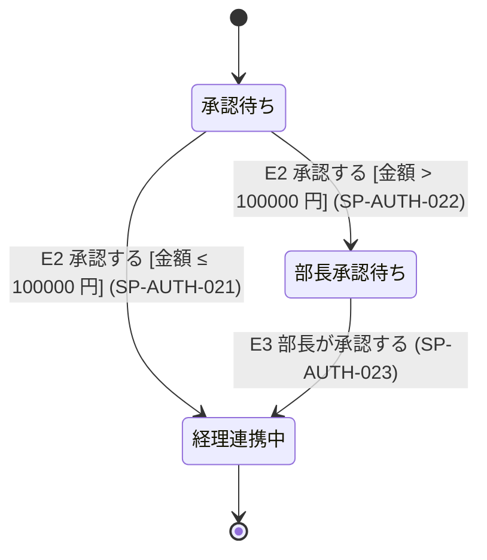

# 認証の仕様

本書は `####` 見出し 1 つを 1 仕様項目とする。

## 仕様項目

#### SP-AUTH-001 ログイン処理

PR-AUTH-001 を実現する。応答を返さなければならない。

#### SP-AUTH-002 承認処理

PR-AUTH-002 と PR-AUTH-009 を実現する。

#### SP-AUTH-010 金額の区分

> 条件の値: 金額 = 金額 ≤ 100000 円 / 金額 > 100000 円

システムは、申請の金額を区分しなければならない。

#### SP-AUTH-011 件数の上限

システムは、`1 件 ≤ 件数 ≤ 100 件` でなければならない。

#### SP-AUTH-012 件数の超過

`件数 > 100 件` のとき、システムは要求を拒否しなければならない。

#### SP-AUTH-013 経路ごとの承認

> 条件の値: 経路 = 社内 / 社外

`経路 = 社外` のとき、システムは承認を求めなければならない。
`経路 = 社内` のとき、システムは承認を求めずに保存しなければならない。

#### SP-AUTH-014 結末

> 条件の値: 結末 = 完了 / 中断 / 失敗

システムは run の結末を 1 つに決めなければならない。

#### SP-AUTH-015 種別の扱い

`種別 = 特別` のとき、システムは記録を残さなければならない。

#### SP-AUTH-016 件数の目安

システムは、`件数 ≤ 50 件` を目安にする。

#### SP-AUTH-018 区域ごとの保存

> 条件の値: 経路 = 甲 / 乙

`経路 = 甲` のとき、システムは記録を保存しなければならない。

## 状態とイベント

#### SP-AUTH-020 承認の状態

> 条件の値: 金額 = SP-AUTH-010

> 対象の状態: 承認待ち / 部長承認待ち
> 対象のイベント: E2 承認する / E3 部長が承認する

| 現在の状態 | イベント | 種別 | 次の状態 | 定義済みか |
|---|---|---|---|---|
| 承認待ち | E3 | — | — | 発生しない |
| 部長承認待ち | E2 | — | — | 発生しない |

#### SP-AUTH-021 少額の承認

システムは、承認された少額の申請を経理に連携しなければならない。

#### SP-AUTH-022 高額の承認

システムは、承認された高額の申請を部長の承認に回さなければならない。

#### SP-AUTH-023 部長の承認

システムは、部長が承認した申請を経理に連携しなければならない。

## トレーサビリティ表

| 要求 ID | 仕様項目 ID | 検証方法 | ステータス |
|---|---|---|---|
| PR-AUTH-001 | SP-AUTH-001 | 結合テスト | 未着手 |
| PR-AUTH-002 | SP-AUTH-002 | 結合テスト | 未着手 |
| PR-AUTH-003 | SP-AUTH-002 | 結合テスト | 未着手 |
