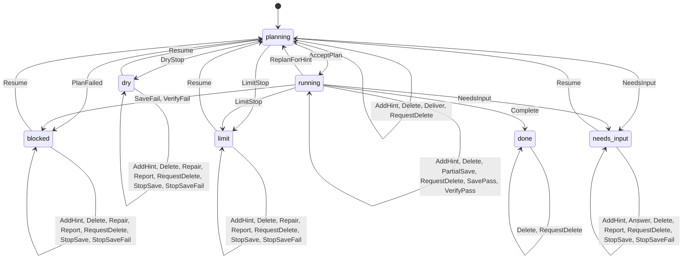

# BP 要求の形式モデル

`BP.tla` は `bp-designed-skill.md` と `bp-operations.md` の一部、および設計方針の停止・再開とヒントを手動で抽象化した TLA+ の状態機械である。TLC で、指定した有限範囲の到達状態、遷移上の安全性と公平性を前提とする進行性を調べる。PRD からモデルを自動生成するものではない。

## 状態遷移

次は TLC の到達状態グラフを `phase` に射影し、同じ始点・終点の遷移をまとめた図である。状態変数の違いや遷移のガードは省略している。`check.sh` は毎回 TLC の DOT 出力からこの図を Rust の `project_graph.rs` で導出し、以下と比較する。開始状態も DOT の初期ノードから読み、初期ノードの欠落・複数は拒否する。図には到達可能な実行時遷移だけが含まれ、破線の時間経過（stuttering）や変異は含まない。

<!-- state-graph:start -->

<!-- state-graph:end -->

- `planning`: 計画役が未読ヒントを受け取り、出力が CLI に受け付けられたときだけ既読にする。計画役が失敗した場合は未読に戻して停止する。
- `running`: 検証と保存は順不同。部分保存後に保存が失敗する場合を含む。部分保存と全体の保存成功は別の状態である。保存に成功すると現在の run の記録が完全に保存済みになる。実行中に届いたヒントは計画段階に戻ってから受け付ける。
- `blocked`: 失敗理由を記録し報告する。原因が解消され、報告済みで run の上限内なら、次の run は `planning` から始まり、検証と保存を再び未実施に戻す。停止中にもヒントを追加できる。ヒントだけで BLOCKED の原因が解決したとは扱わない。
- `dry`・`limit`: 乾き、反復上限による停止。報告後に、利用者側の再開操作を受けると次 run を計画から開始する。停止中にもヒントを追加できる。
- `needs_input`: 待たれる人間の回答が必要な停止。報告と回答の後、上限内なら次の run は計画から始まり、検証と保存を再び未実施に戻す。ヒントと回答は別の入力として扱う。
- `done`: 検証と保存が成功し、未読・配達中のヒントがない。完了後はヒントを追加しない。保存済み記録の削除は利用者から指示された場合だけ行う。

停止した run の記録が部分保存を含め完全に保存できていなければ、停止状態で残りを保存するか、保存失敗として未保存範囲に加える。いずれかの結果を得てから停止理由・未保存範囲を報告する。未保存範囲は run 単位に、保存失敗の理由は `storage` の1種類に抽象化する。元の停止理由とは別に報告した保存失敗理由を保持し、未保存範囲があるときの理由の欠落・誤りを検査する。

停止と理由の報告は有効な到達先であり、常に完了まで進むことは要求していない。停止後の原因解消や利用者の入力は外部環境の行動とし、自動的に起こるとは仮定しない。停止報告には元の停止理由、保存失敗理由と、run 番号の集合に抽象化した未保存範囲を載せ、一致を検証する。停止理由は停止中の状態に保持し、再開時にクリアする。過去の run の理由の本文と実際の記録の対応はこのモデルでは扱わない。

## 実行

TLC `v1.7.4` の `tla2tools.jar`（SHA-256 `936a262061c914694dfd669a543be24573c45d5aa0ff20a8b96b23d01e050e88`）、Java 11 以降、Rust (`rustc`)、`shasum` が必要。TLC は公式リリースから取得する。

```bash
gh release download v1.7.4 --repo tlaplus/tlaplus --pattern tla2tools.jar --dir /path/to/tools
TLA2TOOLS=/path/to/tools/tla2tools.jar JAVA=/path/to/java RUSTC=/path/to/rustc tests/formal/bp-prd/check.sh
```

`JAVA` と `RUSTC` は省略すれば PATH の `java` と `rustc`。指定した jar の SHA-256 が違えば停止する。対象の PRD 2文書と停止・ヒント規則の設計方針文書の SHA-256 を `PRD.sha256` と照合し、変化した場合はモデルと要求・設計の対応を再検証してから更新する。各検査の TLC 作業ディレクトリは repo 外の一時領域に置く。終了時に削除する。図の投影元である状態全体の DOT を保存するには、出力先の**絶対パス**を指定する。

```bash
TLC_DOT=/path/to/state-graph.dot TLA2TOOLS=/path/to/tools/tla2tools.jar tests/formal/bp-prd/check.sh
```

`TLC_DOT` の図は到達した状態変数の組を含むため大きい。Graphviz の `dot -Tsvg state-graph.dot -o state-graph.svg` で描画できる。README の射影は `project_graph.rs` の出力を囲みの内側に置き、`check.sh` の比較を通す。図だけを編集しても検査は通らない。

## 性質と要求

| 性質 | 対応 |
|---|---|
| 検証と現在の run の記録保存が成功するまで完了しない。検証の失敗時は停止する | PR-BPDESIGNEDSKILL-025・027・028・029・039、PR-BPOPERATIONS-010 |
| 保存失敗時は停止し、削除指示がなければ保存できた記録を失わない。停止報告の元の理由・保存失敗理由・未保存範囲は停止状態と一致する | PR-BPDESIGNEDSKILL-035 |
| 削除指示の前は保存済み記録を保持する | PR-BPDESIGNEDSKILL-034・038 |
| 担当は共有台帳に直接書き込まない | PR-BPDESIGNEDSKILL-030 |
| 計画が CLI に受理されるまで実行段階へ進まない。停止には理由があり、報告と原因解消の後で再開する。新しい run は計画役から始まりヒントを受け付けて既読にする | 設計方針「停止・再開と人間の入力」 |

`Spec` は通常の遷移と弱公平性を持つ。計画・検証・保存・完了・停止中の記録保存（成功または失敗）・停止報告・準備済みの再開が、実行可能なままなら、いずれ実行されると仮定する。その前提下で、稼働中の run はいずれ完了か停止へ到達し、停止理由がいずれ報告され、報告と修復が済んだ再開は計画へ進む。停止中に利用者が入力することや、永久障害が自然に直ることは仮定しない。

## イベントの欠落検査

`EventContract` はモデル内の遷移 `Next` とは別に、22種のイベントについて有効な状態の条件を列挙し、条件を満たす到達状態では、そのイベントに対応する遷移が `Next` に含まれることを検査する。対象はヒント追加・配達・計画受理・計画失敗・入力待ち・乾き・反復上限・再計画・検証成功/失敗・部分保存・保存成功/失敗・完了・停止時の保存成功/失敗・停止報告・修復・回答・再開・削除指示・削除である。`check.sh` は22種それぞれを `Next` から除いた変異に対して、同じ契約の反例を確認する。

`OutcomeContract` は22種について、遷移が起きたときに結果として要求される主要な次状態を、遷移の実装とは別に列挙する。実際の遷移とその事後条件が一致しない場合に反例を返す。計画失敗を入力待ちに誤分類する場合など、主要な8種類の結果の変異が検出されることを確かめる。この事後条件は主要な状態変数に限り、書込みの完全なフレーム条件を証明するものではない。

`NoUnspecifiedTransitions` は、定めた22イベントのいずれにも該当しない遷移を禁止する。計画未受理のまま実行へ進む未定義の遷移を追加した変異が、この契約と `RunningRequiresAcceptedPlan` の両方で別々に検出されることを確かめる。

これは列挙したイベントとガードに限る。イベントの列挙や条件自体が PRD・設計から欠けている場合は検出できないため、設計の原文との照合が必要である。ガードに合わない入力の拒否応答もモデル化していない。

## 負例と到達可能性

`check.sh` は、検証失敗や保存失敗で止まらない、未検証・未保存のまま完了する、現在の run と異なる記録を保存したまま完了する、停止した run の記録を保存できたか未保存と報告したかを確認せず報告する、部分保存だけで完全保存と見なして報告する、部分保存済み記録の破棄、指示なしの削除、担当による台帳書き込みという10の変異が各不変条件の反例になることを確かめる。さらに、元の停止理由の誤り、保存失敗理由の誤り・省略や未保存範囲を欠いた報告、ヒントを CLI の受理前に既読にする変異、報告や修復を待たずに再開する変異を検出する。未保存範囲は最大2 run の run 番号集合に抽象化している。

BLOCKED・needs_input・乾き・反復上限で停止中に追加されたヒントを次の run で受け付ける状態、部分保存後に保存失敗して停止する状態、部分保存のまま入力待ちに移った後に残りの保存が成功または失敗して報告する両方の状態、2 run の記録を共に保持する状態が**到達可能**であることも確認する。ヒントの停止中追加・再開をそれぞれ無効化した変異では前者が到達不能になることを確認し、経路の欠落を空成功として扱わない。公平性を取り除いた検査は進行性の反例を返す。

## 対象と限界

- モデルは最大2 run・ヒント1件・記録2件に限定する。`deleteRequested` は対象ごとの削除指示を区別せず、指示後に作成した記録への効力も区別しない。
- 正常モデルの遷移規則には要求を織り込んでいる。結果はモデル内の性質についての確認であり、PRD からモデルへの翻訳の完全性、要求が利用者の意図を満たすこと、実装がモデルに従うことの証明ではない。
- 実際の通信、永続化、破損、並行実行、遅延した書き込み、失敗理由の具体的な内容や run ごとの詳細の対応、指示の認証、削除対象の粒度、形式化対象の洗い出しの網羅は検査していない。モデルに書かれていない出来事の欠落も自動では検出できない。ガードに合わない操作は遷移として無効であり、実装が明示的な拒否応答を返すことは検査していない。
- 再開時は検証・保存を常にやり直す安全側のモデルであり、依存条件が一致する結果の再利用はモデル化していない。各 run の保存は run 番号を単位として抽象化しており、担当や証拠ごとの保存は区別しない。
- 検証・保存・計画・報告自体の実行が永遠に拒まれる環境は進行性の前提外。TLC の到達状態の探索にはハッシュ衝突のごく小さな可能性がある。`CHECK_DEADLOCK FALSE` は停止・完了を有効な終端とするためで、停止後に外部入力なしで再開する保証を意味しない。
