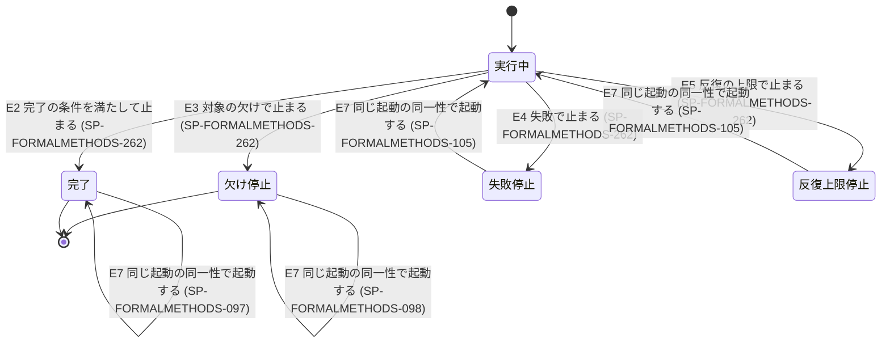

# formal-methods 仕様の形式モデル

この形式モデルは `specifications/formal-methods` の状態遷移を写した TLA+ 状態機械モデルである。

## 状態遷移



## 検証する性質

| 性質 | 内容 |
|---|---|
| `TypeOK` | 状態変数が仕様書で定義された状態集合に含まれる |
| `DeadlockFree` | 終端状態以外の状態において、ステップ上限に達するまで次の遷移が存在する |
| `ValidTerminal` | 終端状態に到達した実行パスの妥当性 |

## 実行

```bash
node --test check.test.mjs
```

または TLC によるモデル検査:

```bash
java -cp /path/to/tla2tools.jar tlc2.TLC FormalMethods.tla -config FormalMethods.cfg
```
