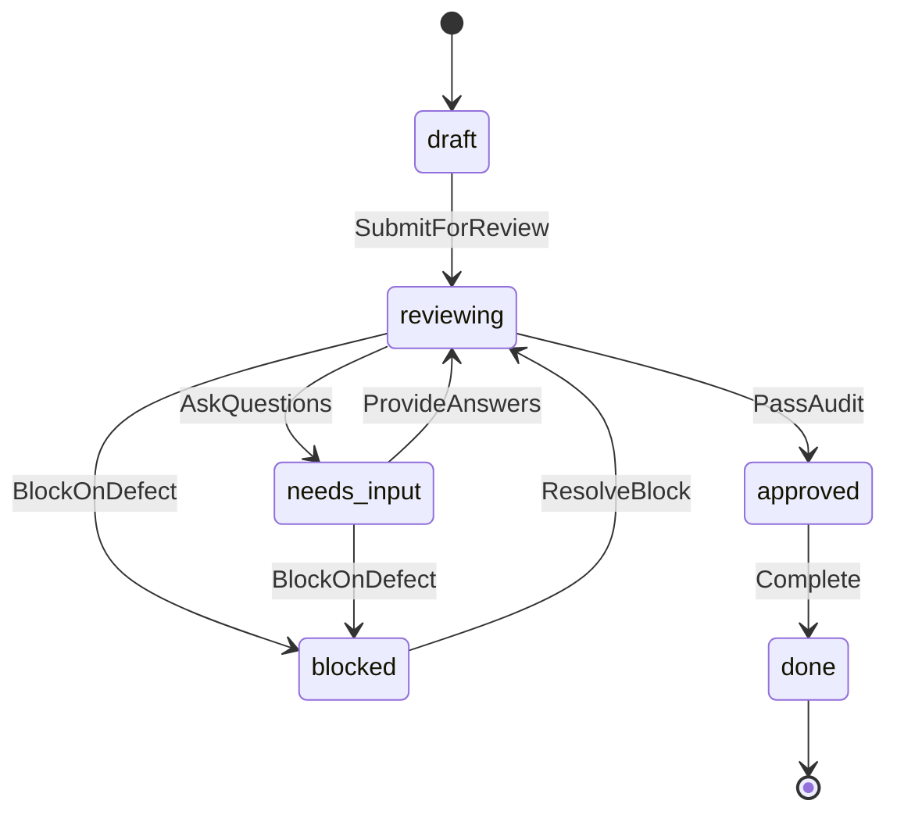

# PRD / SPEC 成果物の形式モデル

`PrdSpec.tla` は、`prd-spec` が出力する要求仕様書（PRD）および仕様書（SPEC）における状態機械・レビューサイクル・質問回答・監査合否のライフサイクルを抽象化した TLA+ 形式仕様モデルである。
CI では有界モデル検査器（`check.test.mjs`）により有限探索範囲（`MaxQuestions = 2`, `MaxPasses = 2`）内の全到達可能状態に対する不変条件保持と終端状態（`done`）への可達性を自動検査する。

## 状態遷移



### モデル上の状態と prd-spec 実装の対応

| モデルの phase | prd-spec の状態 / status | 説明 |
|---|---|---|
| `draft` | S2 (writer) | 初稿の執筆段階 |
| `reviewing` | S4 (auditor) / S6 | 監査・レビュー実行段階 |
| `needs_input` | `needs_answers` | 未確定事項（論点）の回答待ち停止点 |
| `blocked` | `blocked` | 欠陥・反復上限等による停止（再開可能・不能の双方を抽象化） |
| `approved` | S7 (resolver) | 監査に合格し納品前承認された段階 |
| `done` | `done` | 全文書の検証完了・納品完了（終端状態） |

- `done` は終端状態であり、以降の遷移を持たない（デッドロックフリーではなく、終端状態可達性を検証する）。
- 実装のゲート回数上限（`MAX_GATES`）や個別論点 ID は、有限集合 `1..MaxQuestions` として抽象化している。

## 検証する性質（Invariants）

| 性質 | 内容 |
|---|---|
| `TypeOK` | 全ての状態変数が許容される型と範囲にあること |
| `NoUnresolvedQuestionsOnApproval` | `approved` または `done` に達したとき、未回答の問いが残存していないこと |
| `NoBlockingOnCompletion` | `done` に達したとき、blocking な指摘が 0 件であり、かつ監査合格フラグが立っていること（`blockingIssues` は本モデルでは構成上 0 であり未モデル化） |
| `ValidTerminal` | 完了状態に到達したすべての実行経路において、すべての問いが回答され監査を通っていること |

## 対象と限界

- **自動検査の範囲**: CI および `make check` では Node.js テストランナーを通じて `check.test.mjs` が実行され、有限範囲（`MaxQuestions = 2`, `MaxPasses = 2`）の状態空間全 16 状態を網羅探索して不変条件を検査する。
- **未モデル化の要素**: 各種エラー理由ごとの個別リカバリ分岐や、`blockingIssues` の詳細な増減ロジックは本モデルには含まず、抽象化された非決定的遷移として扱う。

## 手動実行（TLC）

TLC（`tla2tools.jar`。版と入手元は `node plugins/workflow/skills/prd-spec/scripts/doc_check.mjs formal-tools` の stdout）を用いて手動でモデル検査を行う場合:

```bash
java -cp /path/to/tla2tools.jar tlc2.TLC PrdSpec.tla -config PrdSpec.cfg
```
