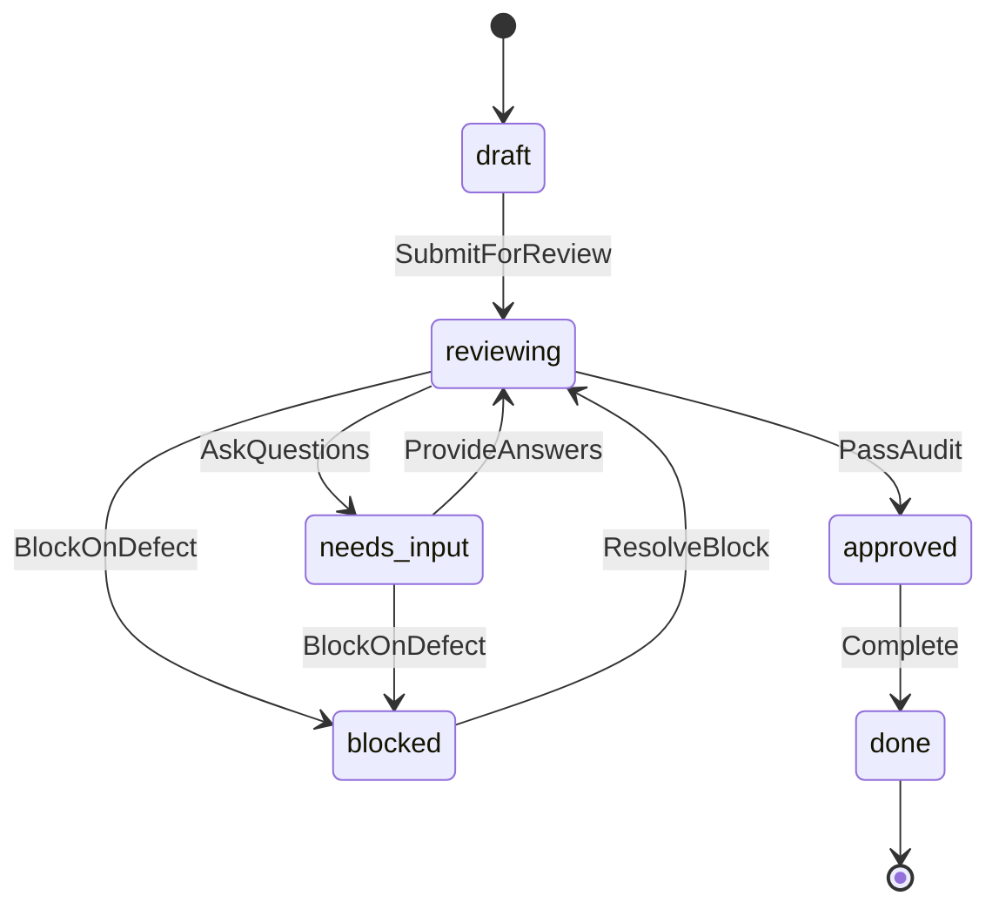

# PRD / SPEC 成果物の形式モデル

`PrdSpec.tla` は、`prd-spec` が出力する要求仕様書（PRD）および仕様書（SPEC）における状態機械・レビューサイクル・質問回答・ゲート進行のライフサイクルを手動で抽象化した TLA+ 形式検証モデルである。TLC モデル検査器により、状態空間の網羅的探索、不変条件の保持、および終端可達性（デッドロックフリー）を検証する。

## 状態遷移



- `draft`: 初稿・草稿の作成段階。レビューへ提出することで `reviewing` へ進む。
- `reviewing`: 監査・検証段階。未確定事項があれば `needs_input`、欠陥や上限到達時は `blocked`、全合格時は `approved` へ遷移。
- `needs_input`: 人間の入力・回答待ち段階。回答ファイルが提供されると `reviewing` へ戻る。
- `blocked`: 致命的欠陥や予算到達による停止。原因が解消されれば再開可能。
- `approved`: 全ての問いが解消し、blocking 指摘が 0 件で監査に合格した状態。
- `done`: 納品・完了状態（終端状態）。

## 検証する性質（Invariants）

| 性質 | 内容 |
|---|---|
| `TypeOK` | 全ての状態変数が許容される型と範囲にあること |
| `NoUnresolvedQuestionsOnApproval` | `approved` または `done` に達したとき、未回答の問いが残存していないこと |
| `NoBlockingOnCompletion` | `done` に達したとき、blocking な指摘が 0 件であり、かつ監査合格フラグが立っていること |
| `ValidTerminal` | 完了状態に到達したすべての実行経路において、すべての問いが回答され監査を通っていること |

## 実行

TLC (`tla2tools.jar`) を用いて実行する:

```bash
java -cp /path/to/tla2tools.jar tlc2.TLC PrdSpec.tla -config PrdSpec.cfg
```
